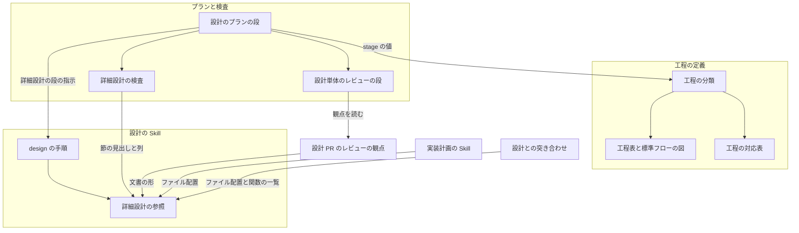
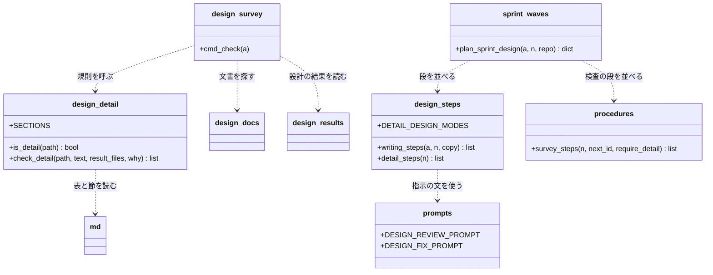
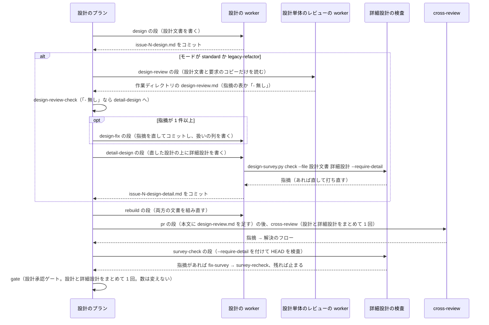

# development-workflow: 設計の後に詳細設計の工程を置き、ファイル配置・関数の責務・異常系の処理を実装の前に設計レビューで確かめる（#3144）

## 目的

- **今どうなっているか**: 設計の工程が決めるのは、構成要素・データ構造・入出力の契約・処理の流れまでである。ファイルの置き場・関数の分け方・関数ごとの責務と失敗の扱いは、設計承認ゲートの後に実装計画と実装の中で決まり、設計レビューに現れない
- **誰に効くか**: `standard`・`legacy-refactor` の変更を設計 Pull Request で承認する利用者と、その設計をレビューする `cross-review` の担当
- **変えると何が成り立つか**: 設計の直後に詳細設計の工程が入り、ファイル配置・関数の責務・異常系の処理が設計 Pull Request に載る。責務の混在・重複・置き場の誤り・失敗の扱いの抜けを、実装の前に設計レビューで止められる
- **詳細設計の土台**: 詳細設計に入る前に、設計文書だけを 1 つの AI がレビューし、指摘を直す。詳細設計は直した設計の上に書く

## 適用範囲

- **働く範囲**: NDF を使うすべてのリポジトリ。工程表・設計の Skill・設計のプランは NDF が配るため、利用先のリポジトリでも同じに働く
- **プロジェクトごとに違うもの**: 無し（詳細設計の項目は言語に依らない。クラスを持たない言語では関数とモジュールで書く）
- **当たるモード**: `standard`・`legacy-refactor`。`light`・`operation`・`documentation` は詳細設計の工程を通らない

## あるべき姿の根拠

| 根拠 | 種類 | 何を示すか |
| --- | --- | --- |
| STD1 | 外部の一次情報 | 設計記述の標準（IEEE 1016）は、構成（Composition）・依存（Dependency）・インタフェース・構造・アルゴリズムを設計の視点として並べる。詳細設計の項目 1〜5 がこれに当たる |
| PRD1 | 外部の一次情報 | arc42 は構成要素ごとに責務・インタフェース・ディレクトリとファイルの場所を書き、詳細化は重要で複雑な要素に絞る。ファイル配置と、変える関数だけを書く範囲の取り方の根拠になる |
| PRD3 | 外部の一次情報 | C4 モデルはコードの粒度の図を、長く保守する文書には勧めない（IDE が生成できるため）。詳細設計を実装後に追随させない根拠になる |
| `issues/issue-3144-requirements.md` の「調べた事実」 | 外部の一次情報 | 手続きの仕様を事前条件・事後条件・例外で書き、モジュールごとに失敗と原因を書く形が通例である |
| 依頼の原文（#3144 の本文） | 利用者の指示の原文 | 詳細設計の工程を設計の後に置き、ファイル配置・クラス・関数の構造と責務・異常系の処理を決める |

要求と受け入れ条件は #3144 の本文にある（コピーは `issues/issue-3144-requirements.md` ）。この文書は「どう作るか」だけを扱う。

## ドメインモデル

### コンテキスト

| コンテキスト | 何の語が 1 つの意味に決まるか |
| --- | --- |
| 開発の工程（`ndf-workflow`） | 工程・詳細設計・異常系の処理・設計文書 |
| クロスレビュー（`ndf-cross-review`） | 設計 Pull Request のレビューの観点 |

関係は公開された言語である。開発の工程が詳細設計の文書の形（ファイル名 `issue-<番号>-design-detail.md` と 10 の節の見出し）を定め、クロスレビューはその形を読んでレビューの観点を当てる。

### 集約

| 集約 | 持ち主（書き換えてよいもの） | 根 | エンティティ | 値オブジェクト |
| --- | --- | --- | --- | --- |
| 工程の分類 | `workflow-common.sh` の `WF_STAGE_MATRIX` | 工程の分類の表 | 工程の行 | モードごとの区分（必須・条件付き・対象外） |
| 工程の名前の対応 | 工程表と工程の対応表（`development-workflow/SKILL.md` の工程表・`projects-tracking.md` の対応表・`transcript_agents.py` の `STEP_PHASES` と `agent-layers.md` の表・`stage-skills.json`）。工程名の字は工程の分類から写し、ここでは変えない | 工程名の対応 | 対応の行 | 工程名・ボードの値・フェーズ・掛かる規則の Skill |
| 詳細設計の文書 | 設計のプランの詳細設計の段（worker が `design` の手順で書く） | 詳細設計の文書 | 10 の節 | 関数の行・失敗の行・ファイルの行 |
| 設計のプラン | `supervise_lib/design_steps.py` | プラン | 段 | 段の行き先（`next`） |

### 不変条件

| # | 集約 | 条件 | 破れたときの扱い |
| --- | --- | --- | --- |
| I1 | 工程の分類 | 「詳細設計」の行は「設計」の直後にあり、`legacy-refactor`・`standard` が必須、`light`・`operation`・`documentation` が対象外である | 工程の分類のテストが落ちる |
| I2 | 工程の分類 | 進捗記録が受ける `stage` の値は工程の分類の行名（`wf_is_stage` が `WF_STAGE_MATRIX` から読む）で、「詳細設計」を受ける | `projects-sync.sh` は一覧に無い名を終了コード 2 で拒む |
| I3 | 詳細設計の文書 | 10 の節がすべてあり、各節は表の行を 1 つ以上持つか `省く: <理由>` の 1 行を持つ | `design-survey.py check` が `detail_section` で指摘し、終了コード 1 |
| I4 | 詳細設計の文書 | 関数の仕様の表で副作用のある関数（副作用の列が `無し` でない行）は、異常系の処理の表に 1 行以上ある | `design-survey.py check` が `detail_failure` で指摘し、終了コード 1 |
| I5 | 詳細設計の文書 | 関数の仕様の表で種類が `新設` の関数は、既存の部品の再利用の表に行がある | `design-survey.py check` が `detail_reuse` で指摘し、終了コード 1 |
| I6 | 詳細設計の文書 | 頭の設計文書が「設計の結果」の節を持つ書式（`standard`）では、ファイル配置の表のパスは、その節の触るファイルにすべて含まれる。`legacy-refactor` の書式（「設計の結果」の節が無く、「現状の構造」「変更後の構造」の節がある）では、ファイル配置の表が触るファイルの正本で、照合しない | `design-survey.py check` が `detail_file` で指摘し、終了コード 1 |
| I7 | 設計のプラン | 詳細設計の段は `standard`・`legacy-refactor` の設計のプランだけにあり、設計単体のレビュー（I10）の後・ドキュメント再構成の段の前に立つ | 設計のプランのテストが落ちる |
| I8 | 設計のプラン | 承認ゲートは 2 つ（設計承認ゲート・リリース承認ゲート）のままで、設計のプランの判定の段は `gate` の 1 つだけである | 設計のプランのテストが落ちる |
| I9 | 工程の名前の対応 | 工程表の行名・ボードの値の対応表・工程とフェーズの対応・工程ごとに掛かる規則の Skill が、工程の分類の行名と同じ字の「詳細設計」を持つ | 工程の名前を突き合わせるテスト（`STEP_PHASES` と `agent-layers.md` の表の一致・`stage-skills.json` の工程名・工程表と対応表の行名と `WF_STAGE_MATRIX` の行名の一致）が落ちる |
| I10 | 設計のプラン | 設計単体のレビューの段（`design-review`）は `standard`・`legacy-refactor` の設計のプランだけにあり、`design` の段の次・`detail-design` の段の前に立つ。指摘が 1 件以上あれば直しの段（`design-fix`）を通ってから `detail-design` へ進む | 設計のプランのテストが落ちる |

### ドメインイベント

| # | イベント | 発生元 | 受け手 |
| --- | --- | --- | --- |
| E1 | 設計文書を書いた | 設計のプランの `design` の段 | 設計単体のレビューの段（詳細設計を通るモード）・ドキュメント再構成の段（ほかのモード） |
| E2 | 詳細設計を書いた | 設計のプランの `detail-design` の段 | ドキュメント再構成の段 |
| E3 | 進捗記録とボードに詳細設計の工程を記録した | 設計のプランの記録（段の `stage` が変わったとき `projects-sync.sh`）と、設計の Skill の「進行を記録する」（詳細設計を書き始めるとき） | 課題の本文の `## 進行`・ボード・通過記録 |
| E4 | 設計 Pull Request に詳細設計を載せて出した | 設計のプランの `pr` の段 | `cross-review` |
| E5 | 設計レビューが詳細設計の観点で指摘を出した | `cross-review`（詳細レビュー） | 設計のプランの解決のフロー |
| E6 | 設計承認ゲートで承認された | 人の承認 | 設計の結果のステージ・実装のプラン |
| E7 | 実装計画が対象ファイルを詳細設計から引き写した | `implementation-plan` | 実装（`tdd-cycle`）と完了判定の設計との突き合わせ |
| E8 | 設計単体のレビューが設計文書への指摘を出した（0 件を含む） | 設計のプランの `design-review` の段 | `design-review-check` の段（0 件なら詳細設計の段、1 件以上なら直しの段） |
| E9 | 設計単体のレビューの指摘を直した | 設計のプランの `design-fix` の段 | 詳細設計の段・設計 Pull Request の本文（レビューの結果を設計承認ゲートの材料として載せる） |

### 用語

| 用語 | 意味 | 用語集への反映 |
| --- | --- | --- |
| 詳細設計 | 設計の後に置く工程と、その成果物。ファイル配置・クラスと関数の構造・関数ごとの責務と異常系の処理を、実装の前に決める | 追加（`ndf-workflow`。要求の工程で足した行の出所を `plugins/ndf/skills/design/references/detailed-design.md` へ移す） |
| 異常系の処理 | 関数ごとに起こりうる失敗と、その検出の場所・扱い・利用者に見える出力・後始末 | 追加（`ndf-workflow`。出所は同上） |

## 外部の調査

| 種類 | 調べるか | 理由 |
| --- | --- | --- |
| 標準・仕様 | 調べる | 詳細設計の記述項目に設計記述の標準（IEEE 1016）がある |
| 主要な製品 | 調べる | 設計文書のテンプレート（arc42・C4 モデル）が、ファイル・コードの粒度をどこまで書くかを定めている |
| ライブラリとサービス | 調べない | 作るのは工程の定義・Skill の本文・既存の検査スクリプトの規則で、Markdown の読み取りは既存の部品（`lib/md.py`・`lib/design_docs.py`）が持つ。新しい依存を足す対象が無い |

### 標準・仕様

| # | 標準・仕様 | 何を定めているか | 設計への反映 | 出典 |
| --- | --- | --- | --- | --- |
| STD1 | IEEE 1016（ソフトウェア設計記述） | 設計記述が持つ視点として Context・Composition・Logical・Dependency・Information・Patterns use・Interface・Structure・Interaction・State dynamics・Algorithm・Resource の 12 を挙げる。誤りの扱いと並行性を直に扱う視点は一覧に無い | 項目 1（Composition・Dependency）・2（Structure）・3（Interface）・5（Algorithm）・7（Resource）の対応の根拠。誤りの扱いは標準の視点に無いため、要求の調べた事実（事前条件・事後条件・例外）に倣って項目 4 を独立させる | https://en.wikipedia.org/wiki/Software_design_description （2026-11-13） |
| STD2 | 契約による設計（事前条件・事後条件・例外の記述） | 手続きを requires・effects・raises で書き、例外の無い言語でも失敗を呼び出し元へ伝える形にする | 項目 3 の列（事前条件・事後条件・副作用）と項目 4 の列 | `issues/issue-3144-requirements.md` の「調べた事実」（要求の工程が 2026-11-12 に取得） |

### 主要な製品

| # | 製品 | どう解いているか | 設計への反映 | 出典 |
| --- | --- | --- | --- | --- |
| PRD1 | arc42 の構成要素の分解（Building Block View） | 構成要素ごとに責務・インタフェース・ディレクトリとファイルの場所・未解決のリスクを書く。詳細化は重要で複雑な要素に絞る | 項目 1 のファイルの行の列（パス・役割 1 文・依存する先）。変える関数だけを書く範囲の取り方 | https://docs.arc42.org/section-5/ （2026-11-13） |
| PRD2 | arc42 の横断的な概念（Crosscutting Concepts） | ログの形式と出力先のような、複数の構成要素にまたがる方針を 1 か所にまとめる。必要なものだけを選ぶ | 項目 8（ログと記録の出力）を関数ごとの適用先として書き、方針の本体は `logging-guidelines` に置いたまま指す | https://docs.arc42.org/section-8/ （2026-11-13） |
| PRD3 | C4 モデルのコードの図（Level 4） | 任意の詳細度で、重要で複雑な構成要素だけに描く。IDE が生成できるため長く保守する文書には勧めない | クラス図を新しく描かせず、設計文書の「構造」の節を指す。詳細設計は実装後に追随させない | https://c4model.com/diagrams/code （2026-11-13） |

### 確かめられなかったこと

| 対象 | 試した手段 | 結果と理由 |
| --- | --- | --- |
| IEEE 1016 の原文（各視点の定義） | 試していない | 規格の本文は有償で、取得の手段が無い。視点の名前だけを百科事典の記事から引いた |

調べた量: 候補 5 件・取得の試み 4 回。

## 機能一覧

| # | 機能 | 誰が使うか |
| --- | --- | --- |
| F1 | 工程表と工程の分類に「詳細設計」の工程があり、進捗記録とボードに記録できる | conductor・supervisor・利用者（ボードを見る人） |
| F2 | 詳細設計の文書を、10 の項目のテンプレートと書き方の参照に従って書く | 設計の worker |
| F3 | 設計のプランが、`standard`・`legacy-refactor` で設計の段の後に詳細設計の段を流す | conductor（`supervise.py new sprint --design`） |
| F4 | 詳細設計の文書の形（節・異常系の行・再利用の行・ファイル）を検査する | 設計の worker・設計のプランの検査の段 |
| F5 | 設計 Pull Request のレビューが詳細設計の 6 つの観点で指摘を出す | `cross-review` の担当 |
| F6 | 実装計画が対象ファイルを詳細設計のファイル配置から引き写す | `implementation-plan` |
| F7 | 完了判定の設計との突き合わせが、実装が詳細設計から外れた箇所を並べる | 完了判定の worker |
| F8 | 設計のプランが、詳細設計の段の前に設計文書だけを 1 つの AI にレビューさせ、指摘を直してから詳細設計へ進む | conductor・設計承認ゲートで設計 Pull Request を見る利用者 |

## 構成要素

| 要素 | 責務 | 機能 |
| --- | --- | --- |
| 工程の分類（`workflow-common.sh` の `WF_STAGE_MATRIX`） | 「詳細設計」の行を設計の直後に持ち、モードごとの区分を返す | F1 |
| 工程表（`development-workflow/SKILL.md` の「モードごとに起動する Skill」と「工程ごとの決まり」、理由の置き場 `stage-notes.md`） | 「詳細設計」の行と、その工程の決まり（通るモード・書き先・承認ゲートを増やさないこと） | F1 |
| 標準フローの図（`workflow-modes.md`） | 設計 → 詳細設計 → ドキュメント再構成の経路 | F1 |
| 工程の対応表（`projects-tracking.md`・`agent-layers.md`・`parallel-work.md`・`stage-skills.json`・`transcript_agents.py` の `STEP_PHASES`） | 「詳細設計」の記録の値・フェーズ・動く単位・掛かる規則の Skill | F1 |
| 詳細設計の参照（`design/references/detailed-design.md`。新設） | 10 の項目の書き方・節の見出し・表の列・省く書き方・既存の参照との分担 | F2 |
| 設計の Skill（`design/SKILL.md`・`deliverables.md`・`design-template.md`） | 手順「詳細設計を書く」と、成果物の置き場（パッケージ・モジュール構成を詳細設計へ移す）。「進行を記録する」の契機に、詳細設計を書き始めるときの工程「詳細設計」の記録を足す（設計のプランの外で呼ばれた経路でも記録が残る）。設計のプランの詳細設計の段から呼ばれたときは、工程「設計」を打ち直さない | F1・F2 |
| 設計のプランの段（`supervise_lib/design_steps.py`・`supervise_lib/procedures.py` の `survey_steps`） | `detail-design` の段と、詳細設計を通るモードの定数。詳細設計を通るモードでは `survey-check` に `--require-detail` を付ける | F3 |
| 設計単体のレビューの段（`supervise_lib/design_steps.py` の `design-review`・`design-review-check`・`design-fix`、指示の文 `supervise_lib/prompts.py`） | 設計文書だけを 1 つの AI に読ませて指摘を作業ディレクトリへ書かせ、指摘があれば直させる。観点は `cross-review` の設計 Pull Request の観点を読んで使い、写さない | F8 |
| 詳細設計の検査（`lib/design_detail.py`。新設）とエントリポイント（`design-survey.py`） | I3〜I6 の 4 つの規則 | F4 |
| 設計 PR のレビューの観点（`review_focus.py` の `DESIGN_REVIEW_TEMPLATE`・`08-review-categories.md`）と設計文書の名前（`classifications.py`・`categories.py`・`glossary.py`） | 詳細設計の 6 つの観点。詳細設計の文書を設計文書として数える | F5 |
| 実装計画の Skill（`implementation-plan/SKILL.md`） | 対象ファイルを詳細設計から引き写し、足すファイルに理由を書く | F6 |
| 設計との突き合わせ（`supervise_lib/prompts.py` の `DESIGN_MATCH_PROMPT`・`quality-gates/references/design-match.md`） | 詳細設計のファイル配置と関数の一覧を実装と照らす | F7 |



### 値の集合へ値を足すことで当てはまらなくなる規則

工程の集合に「詳細設計」を、設計文書の名前の集合に `-design-detail.md` を足す。集合の名前と既存の値（`ドキュメント再構成`・`-design-decisions.md`）で、リリース対象を検索した。新しい値に当てはまらない規則は、上の表へ載せた。検索のコマンドは次の 2 つである。

```bash
grep -rn "ドキュメント再構成" plugins/ndf
grep -rn "design-decisions" plugins/ndf --include=*.py
```

| 規則 | 置き場 | 当てはまるか |
| --- | --- | --- |
| 設計文書の行数の上限（1,000 行）を見るファイル名 | `cross-review/scripts/classifications.py` の `DESIGN_DOC_FILE_SUFFIXES` | 当てはまらない。`-design-detail.md` を足す |
| 設計 PR の文書として分類するファイル名 | `cross-review/scripts/review_lib/categories.py` の `DESIGN_DOC_SUFFIXES` | 当てはまらない。同上 |
| 用語チェックが読む文書 | `scripts/glossary.py` の `DEFAULT_PATHS` | 当てはまらない。`issues/*-design-detail.md` を足す |
| 用語チェックが読む文書（宣言のあるリポジトリ） | 各リポジトリの `.ndf/glossary.json` の `check.paths`（このリポジトリにもある） | 当てはまらない。`DEFAULT_PATHS` は宣言を作るときだけ使われ、宣言のあるリポジトリは宣言の値を読む。このリポジトリの宣言へ足し、ほかのリポジトリへはリリースの案内に書く |
| 課題の番号から設計文書を探す名前 | `scripts/lib/design_docs.py` の `DESIGN_NAME`（`issue-<番号>-design(-<名前>)?.md`） | 当てはまる。変えない |
| ドキュメント再構成が組み直す文書 | `procedures.py` の `rebuild_step`（`issue-{n}-design-*.md` も含む） | 当てはまる。変えない |
| 進捗記録の受ける工程名 | `projects-sync.sh` → `wf_is_stage`（`WF_STAGE_MATRIX` から読む） | 当てはまる。行を足せば通る |
| 工程とフェーズの対応 | `transcript_agents.py` の `STEP_PHASES` と `agent-layers.md` の表 | 当てはまらない。両方へ「詳細設計 → 設計」を足す |
| 工程ごとに掛かる規則の Skill | `scripts/lib/stage-skills.json` | 当てはまらない。「詳細設計」に `document-style` を足す |

## 構造

詳細設計の検査は、既存のエントリポイント `design-survey.py check` に規則を足す形で作る。読み取りの部品を新しいモジュールへ分け、エントリポイントが肥大しないようにする。設計のプランの段は、既存の `design_steps` が組み、指示の文は `prompts` に置く。



関数ごとのシグネチャ・責務・副作用・異常系の処理・既存の部品の再利用の確認は、詳細設計の文書 `issues/issue-3144-design-detail.md` が持つ（決定 7）。この節は型とモジュールの関係だけを持つ。

## 入出力の契約

### 詳細設計の文書の形

置き場は `issues/issue-<番号>-design-detail.md` で、設計文書（`issues/issue-<番号>-design.md`）と同じ課題に 1 本置く。1 本は 1,000 行以下とし、超える主題は設計を 2 本に分けると報告して止まる（設計の工程と同じ扱い）。

| # | 節の見出し（`##`） | 表の列 | 既存の参照との分担 |
| --- | --- | --- | --- |
| 1 | ファイル配置 | パス・種類（新設 / 変更 / 削除）・役割 1 文・依存する先。表の前にパッケージ・モジュール構成のツリー | 構成要素の粒度は設計文書（`system-architecture.md`）が持ち、ここはファイルの粒度だけを持つ |
| 2 | クラスと関数の構造 | 置き場・クラスまたはモジュール・メソッドと最上位の関数 | クラス図は設計文書の「構造」の節（`structure-behavior.md`）を指し、描き直さない |
| 3 | 関数の仕様 | 関数・置き場・種類（新設 / 変更）・シグネチャ・責務 1 文・事前条件・事後条件・副作用（無ければ `無し`） | 外から呼ばれる約束は `interface-api.md` が持ち、ここは内部の関数だけを持つ |
| 4 | 異常系の処理 | 関数・失敗・原因・検出する場所・扱い（呼び出し元へ返す / 再試行 / 既定値で続ける / 止める）・利用者に見える出力と終了コード・後始末と再実行の可否 | 境界の失敗の形は `interface-api.md`、要素をまたぐ失敗の経路は `structure-behavior.md` が持つ。ここは関数の粒度だけ |
| 5 | 処理の手順 | 関数・条件の組み合わせ・結果（判定表）。繰り返しの終わる条件と計算量の注意は表の後に箇条書き | 要素をまたぐ順序は設計文書の「処理の流れ」が持つ |
| 6 | 内部のデータと定数 | 名前・種類（型 / 定数 / 設定値）・置き場・既定値 | 永続データは `data-structure.md` が持つ |
| 7 | 並行と排他 | 同時に走りうる処理・共有する資源・排他の取り方・冪等性と中断からの再開 | 無し（ここだけが持つ） |
| 8 | ログと記録の出力 | 関数・出すもの・レベルまたは書き先（ログ・結果 JSON・進捗記録）・出さないもの（秘密） | 基準は `logging-guidelines` が持ち、ここは適用先だけ |
| 9 | 既存の部品の再利用 | 新設する関数・確かめた既存の部品（関数・ライブラリ）・確かめた手段（検索の語とコマンド）・結果（使う / 使えない理由） | ライブラリの比較は設計文書の「外部の調査」が持ち、ここは関数の粒度の確認だけ |
| 10 | 単体テストの観点 | 関数・正常・境界値・異常（項目 4 の失敗の行ごと） | 受け入れ条件の粒度は設計文書の「テスト設計」が持つ |

**当たらない節は見出しを残し、本文を `省く: <理由>` の 1 行にする。** 見出しを消すと、検査が「書き忘れ」と「当たらない」を見分けられない。

**書く関数は、新設する関数と、シグネチャ・責務・失敗の扱いのいずれかを変える関数だけである**（要求の前提 3）。変えない関数は書かない。

### 検査の規則（`design-survey.py check`）

既存の 4 規則（`unknown_method`・`no_candidates`・`unknown_candidate`・`unnamed_redline`）に次の 5 規則を足す。結果の形・終了コードは既存のまま（0 = 指摘なし / 1 = 指摘あり / 2 = 読めない / 3 = 文書が無い）。

| 規則 | 指摘する条件 | 指摘の `name` |
| --- | --- | --- |
| `detail_section` | 10 の節のどれかの見出しが無い、節が表の行も `省く: <理由>`（理由が空でない）も持たない、または関数の仕様の表に「種類」「副作用」の列が無い | `<パス> <節の見出し>` |
| `detail_failure` | 関数の仕様の表で副作用の列が `無し` でない関数が、異常系の処理の表の 1 列目に無い | `<パス>:<行> <関数>` |
| `detail_reuse` | 関数の仕様の表で種類が `新設` の関数が、既存の部品の再利用の表の 1 列目に無い | `<パス>:<行> <関数>` |
| `detail_file` | ファイル配置の表のパスが、頭の設計文書の「設計の結果」の触るファイルに無い。頭の設計文書が読んだ文書に無いか、設計の結果の表を読めないときは 1 行。頭の設計文書が `legacy-refactor` の書式なら当てない | `<パス>:<行> <ファイルのパス>`（読めないときは `<パス> 設計の結果`） |
| `detail_missing` | `--require-detail` を渡したのに、まとまりに詳細設計の文書が無い | `#<番号>` |

関数とパスの照合はインラインコードの記号（`` ` ``）を外し、前後の空白を除いた字で行う。節の見出しの照合は `##` の後の字の完全一致である。

**`detail_file` が照合に使うファイルの一覧の出所は、頭の設計文書の書式で決まる。** `standard` の設計文書は「設計の結果」の節を持ち、その触るファイルが出所である。`legacy-refactor` の設計文書は 4 節（「現状の構造」「変更後の構造」「外部の調査」「決定の記録」）だけを書き、「設計の結果」の節を持たない（決定 7）。この書式では、詳細設計のファイル配置の表が触るファイルの正本になる。照合する先が無いため `detail_file` を当てない。実装計画はこの表から対象ファイルを引き写す（決定 9）。書式は見出しで見分ける。「設計の結果」の節が無く、「現状の構造」と「変更後の構造」の節がそろうときだけ `legacy-refactor` の書式とする。どちらにも当たらない文書は、設計の結果の表を読めないものとして 1 行を指摘する。

`--require-detail` は `--issue` と `--file` のどちらとも組める。渡さないときは、詳細設計の文書があるときだけ 4 規則を当てる（`light` の受け入れ条件のファイルなど、詳細設計を持たない文書を指摘しない）。

### 設計単体のレビューの結果

設計単体のレビューの段（`design-review`）が書き、後の段が読むファイルの形である。置き場はプランの作業ディレクトリ（`{state_dir}/work/design-review.md`）で、コミットしない。

| 読み手 | 読むもの |
| --- | --- |
| `design-review-check` の段 | `- 無し` の 1 行があるか（`grep -qx -- '- 無し'`）。終了コード 0 なら指摘なし、1 なら指摘あり、2 ならファイルが無い |
| `design-fix` の段 | 指摘の表。直した行と直せない行の扱いの列を書き換える |
| `pr` の段 | ファイルの中身を設計 Pull Request の本文の署名の前へ足す（既存の `append`。ファイルが無いモードでは足さない） |

| 行 | 形 |
| --- | --- |
| 1 行目 | `## 設計単体のレビュー` |
| 指摘があるとき | `\| # \| 箇所 \| 指摘 \| 扱い \|` の表。箇所は設計文書の節の見出し、扱いは `未` で書き、直しの段が `直した` か `直さない: <理由>` に替える |
| 指摘が無いとき | `- 無し` の 1 行だけ |

### 工程の値

| 置き場 | 足す値 |
| --- | --- |
| `WF_STAGE_MATRIX` | `詳細設計\t-\t-\tR\tR\t-`（「設計」の行の直後） |
| 工程表の行 | `\| 詳細設計 \| — \| — \| `design` \| `design` \| — \|`（「設計」の行の直後）。丸括弧を付けない（付けると条件付きに読まれる） |
| `projects-tracking.md` の対応表 | `\| 詳細設計 \| `design` \| `詳細設計` \|` |
| ボードの単一選択 | 値「詳細設計」。ボードを使うリポジトリの利用者が足す（既存の「工程名が変わったとき」と同じ手段）。リリースの案内に書く |

## 処理の流れ



設計単体のレビューは 1 回だけ流し、直した後にレビューを打ち直さない。直した設計は、詳細設計と合わせて後の `cross-review` がもう一度見る（決定 11）。

失敗の経路:

- `design-review` の worker が失敗したら、既存の work の段の失敗の扱いでプランが止まる
- `design-review.md` が無いまま `design-review-check` に来たら（終了コード 2）、既存の run の段の失敗の扱い（judge が直し・やり直し・止めるを選ぶ）に従う
- `design-fix` が直せない指摘は、扱いの列に `直さない: <理由>` を書いて詳細設計の段へ進む。その行は設計 Pull Request の本文に載り、`cross-review` と設計承認ゲートで人が見る
- 詳細設計の worker が 1,000 行の上限に当たったら、設計を 2 本に分けると報告して止まる（設計の段と同じ）。プランは既存の work の段の失敗の扱いで止まる
- `survey-check` の指摘を `fix-survey` が直せなければ、既存どおりプランを止めて人へ戻す
- `light`・`operation`・`documentation` の設計のプランは `design` の段から `rebuild` へ進む。設計単体のレビューの段・詳細設計の段・`--require-detail` のどれも持たない

## 非機能の実現方式

| 大項目 | 条件 | 実現方式 |
| --- | --- | --- |
| 性能・拡張性 | 設計文書は 1 本 1,000 行以下 | 詳細設計を別の文書に分け、1 本ごとに上限を当てる。行数の検査（`classifications.py`）に `-design-detail.md` を足す |
| 運用・保守性 | 詳細設計の項目と既存の参照が同じ事実を 2 か所に持たない | 「詳細設計の文書の形」の表の分担の列のとおり、クラス図・境界の失敗の形・永続データ・ログの基準は既存の参照を指す。パッケージ・モジュール構成は設計文書から詳細設計の文書へ移し、1 か所に置く |

## 決定の記録

### 決定 1: 工程の名前を業界で通じる語にするため、「詳細設計」とする

決める中身（ファイル・クラス・関数・責務・失敗の扱い）は、業界で詳細設計（内部設計）と呼ばれる範囲と一致する（要求の調べた事実）。用語集にも同じ語を要求の工程で足してある。

「構造設計」は設計の Skill の参照「構造と振る舞い」と紛れ、「実装設計」は実装計画（`implementation-plan`）と紛れるため採らない。

根拠: Value 14（MVV 版 7）

### 決定 2: Skill の数を増やさないため、詳細設計は `design` の参照と手順の 1 つとして足す

工程表の行は新しく足すが、行が呼ぶ Skill は `design` のままにする。詳細設計の書き方は新しい参照 `references/detailed-design.md` に置き、`design/SKILL.md` の手順に「詳細設計を書く」を足す。設計と詳細設計は同じ課題の同じ設計 Pull Request に載り、外部の調査・決定の記録・用語の突き合わせの手順を共有する。プランの外で `design` を呼んだときは、設計文書の突き合わせ（手順 5）の後に続けて詳細設計を書く。設計のプランでは `design` の段の指示に「詳細設計は次の段が書く」を足して手前で止め、`detail-design` の段が `/ndf:design #<番号> 詳細設計` で書く。

新しい Skill を作ると、設計の手順（用語集の確認・外部の調査・突き合わせ）を 2 つの Skill で持つことになる。

根拠: Value 11（MVV 版 7）

### 決定 3: 1 本の文書の行数の上限を守るため、詳細設計は別の文書 `issue-<番号>-design-detail.md` に書く

設計文書に節として足すと、`standard` の設計文書は 1,000 行の上限に近づく。別の文書にすれば、検査が置き場を 1 つに決めて読め、設計の段と詳細設計の段が同じファイルを同時に書き換えない。名前は既存の探索の規則（`design_docs.py` の `DESIGN_NAME`）とドキュメント再構成の対象（`issue-{n}-design-*.md`）にそのまま当たる。

設計文書の節にする形は、文書が短いときに読みやすいが、置き場が文書の長さで変わると検査の規則が 2 通りになるため採らない。

根拠: Value 3 / Value 8（MVV 版 7）

### 決定 4: 工程の記録を正しくし、詳細設計を直した設計の上に書くため、`design` の段の後に設計単体のレビューと `detail-design` の段を足す

詳細設計を通るモードの段の並びは、次のとおりにする。

| 段 | 種類 | 工程（`stage`） | 次 |
| --- | --- | --- | --- |
| `design` | work | 設計 | `design-review` |
| `design-review` | work（1 つの AI） | 設計 | `design-review-check` |
| `design-review-check` | run | 設計 | 終了コード 0 なら `detail-design`、1 なら `design-fix` |
| `design-fix` | work | 設計 | `detail-design` |
| `detail-design` | work | 詳細設計 | `rebuild` |

段を分けると、`detail-design` の段の `stage` が「詳細設計」になり、プランの記録が工程に入った時点で進捗記録とボードへ書く。worker の 1 回の起動が持つ文脈も、設計文書を書いた後に新しく始まる。

設計単体のレビューの段は「設計」の工程に含める。工程表の行もボードの値も増やさない。レビューと直しは設計文書を確かめて直す作業で、詳細設計の文書をまだ持たないためである。

設計の段の指示に詳細設計を含める形は、段が 1 つで済む。しかし、進捗記録が「詳細設計」を書く契機を持たず、工程の分類で必須の工程が「記録なし」と出るため採らない。設計単体のレビューを詳細設計の段の後へ置く形（差し戻し前の設計）は、設計の誤りを詳細設計が引き継ぎ、直すときに 2 つの文書を書き直すことになるため採らない。

根拠: Value 3 / Value 9（MVV 版 7）

### 決定 5: 詳細設計を通るモードをプランが引けるよう、`design_steps.py` に定数を置き、工程の分類との一致をテストで縛る

プランの組み立ては Python で、工程の分類はシェルの `WF_STAGE_MATRIX` にある。実行時にシェルの変数を Python で読む既存の部品は無い。次の検索の当たりは、`development-workflow/tests/` の 2 ファイルだけだった（2026-11-13 に実行）。

```bash
grep -rln "WF_STAGE_MATRIX" plugins/ndf --include=*.py
```

定数 `DETAIL_DESIGN_MODES = ("standard", "legacy-refactor")` を置く。この定数が `WF_STAGE_MATRIX` の「詳細設計」の行で `R` の列と一致することを、テストで確かめる。既存の `DESIGN_MATCH_MODES` と同じ置き方である。

実行時にシェルの表を読み取る形は、表の書式を読む部品を新しく作ることになり、#3092（工程の進行表をスクリプトで組む）が置き場を作り直すまでの間だけのために増えるため採らない。

- 作り方: 自前で作る
- 比べた候補: STD1

根拠: Value 11（MVV 版 7）

### 決定 6: 検査のエントリポイントを増やさないため、詳細設計の検査は `design-survey.py check` の規則として足す

`design-survey.py check` は、設計の Skill の手順 5 と設計のプランの `survey-check` の段がすでに打つ。規則を足せば、新しい段も新しい手順も要らない。判定の部品は `lib/design_detail.py` に分け、エントリポイントの肥大を避ける。

新しいエントリポイントのスクリプトを作る形は、Skill の手順とプランの段を 1 つずつ増やすため採らない。文書の形をレビューだけで見る形は、同じ見落としが実行ごとにばらつくため採らない。

- 作り方: 自前で作る・標準に倣う
- 比べた候補: STD1 / STD2 / PRD1

根拠: Value 3 / Value 11（MVV 版 7）

### 決定 7: 同じ事実を 2 か所に持たないため、パッケージ・モジュール構成は詳細設計の文書へ移し、クラス図は設計文書に残す

`standard`・`legacy-refactor` の成果物のパッケージ・モジュール構成（ツリー）は、ファイルの粒度であり、詳細設計のファイル配置と同じ事実を持つ。この 2 モードでは詳細設計の文書の「ファイル配置」の節に書き、`deliverables.md` の要否表の行は「詳細設計を通るモードでは詳細設計の文書に書く」を添える。クラス図は型の関係で、`legacy-refactor` の「現状の構造・変更後の構造」の節が使うため設計文書に残し、詳細設計からは指す。

クラス図も詳細設計へ移す形は、`legacy-refactor` の設計文書の 4 節の形を崩すため採らない。

根拠: Value 11（MVV 版 7）

### 決定 8: 実装が詳細設計から外れたかを既存の仕組みで見るため、完了判定の設計との突き合わせに詳細設計を足す

完了判定の設計との突き合わせ（`design_match_steps`）は、すでに設計文書の決定を 1 件ずつ実装と照らしている。その指示（`DESIGN_MATCH_PROMPT`）に「詳細設計のファイル配置と関数の仕様の表を実装と照らし、違うものを節に並べる」を足す。突き合わせを入れるモード（`DESIGN_MATCH_MODES`）は `standard` のまま変えない。

`cross-refactoring` に持たせる形は、構造を直す工程が「設計と違う」を判定することになり、責務が混ざるため採らない。`legacy-refactor` へ突き合わせを広げる形は、このモードの設計文書が実装の Pull Request に載ることがあり、突き合わせの入力が定まらないため採らない。

根拠: Value 13（MVV 版 7）

### 決定 9: 実装計画の対象ファイルの出所を 1 つにするため、詳細設計のファイル配置から引き写す

`implementation-plan` の「修正対象」と各タスクの「対象ファイル」は、詳細設計の文書があればそのファイル配置の表から引き写す。表に無いファイルを足すときは、タスクの「変更内容」に理由を書く。設計の結果の触るファイルとファイル配置の一致は、検査の規則 `detail_file` が見る。

根拠: Value 8（MVV 版 7）

### 決定 10: #3092 を待たずに進めるため、工程の行は今の置き場に足す

#3092（工程の進行表をスクリプトで組む）は 2026-11-13 の時点で OPEN である（ `gh issue view 3092 --json state` の結果 `OPEN` ）。要求の前提 4 のとおり、今の置き場（`WF_STAGE_MATRIX` と工程表）へ足す。#3092 が後から置き場を移すときは、この行も同じ移行で移る。

根拠: Value 5（MVV 版 7）

### 決定 11: 費用と時間を抑えるため、設計単体のレビューは 1 つの AI の軽いレビューにし、`cross-review` にしない

`design-review` の段は、新しい文脈の worker 1 つ（既定の claude -p）に、設計文書と要求のコピーだけを読ませる。観点は `cross-review` の設計 Pull Request の観点をそのファイルから読んで使い、指示の文へ写さない。観点の置き場は `cross-review/scripts/review_lib/review_focus.py` である。使うのは `MODEL_REVIEW_TEMPLATE` と `DESIGN_REVIEW_TEMPLATE` の 2 つである。直した後にレビューを打ち直さない。

費用と効果を、次の実績で比べた。出典は、2026-11-09〜11-13 に流した設計のプランの報告のうち、`review` の段が動いた 22 件である。報告の置き場はメインディレクトリの `.ndf/sprint-*/1-design-*-state/report.md` で、手元の実行記録のためコミットしない。

| 量 | `cross-review`（設計のプランの `review` の段） | 近い work の段（`rebuild`。同じ設計文書を読む） |
| --- | --- | --- |
| 所要（中央値） | 518.9 秒（174.5〜1,863.0 秒） | 154.6 秒（21 件） |
| claude 側の費用（中央値） | $1.33（$0.30〜$2.45） | $1.51（21 件。文書を書き直す分を含む） |
| 外部の AI の起動 | codex 2〜5 回・kiro 3〜5 回（1 件あたり） | 無し |
| ラウンド | 2〜3 | 1 |
| 見つけた指摘 | 中央値 3.5 件（合計 84 件、直した 73 件） | — |

数え方は、各報告の次の 3 か所を読んだ。

| 報告の箇所 | 読んだ値 |
| --- | --- |
| 段ごとの表 | `review`・`rebuild` の行 |
| 件数の行 | `rounds`・`findings`・`fixed` |
| `CLI（drive・work の中）` の行 | `codex N 回`・`kiro N 回` |

比べた結果、次の 3 点で軽いレビューを選ぶ。

- **`cross-review` は Pull Request を要る。** 設計単体に当てるには、`pr`・`sync-body`・`review` と解決のフローを詳細設計の段の前へもう 1 組置き、詳細設計を送った後にもう 1 度 `cross-review` を流すことになる。1 件あたり中央値で約 519 秒と外部の AI の起動 5〜10 回が増え、継続的統合も 2 度起動する
- **設計文書は後の `cross-review` でもう一度見られる。** 設計と詳細設計をまとめた `cross-review` は、1 ラウンド目でドメインモデルの節を、2 ラウンド目以降で残りの節を見る。この分担は `08-review-categories.md` の「設計 PR のモデルレビューと詳細レビュー」にある。設計単体のレビューの役目は、詳細設計が誤った設計の上に立つ前に大きな誤りを止めることに絞れる
- **軽いレビューは外部の AI の起動を持たない。** 外部の AI を起動する経路の失敗（起動・待ち・回収）を、すべての `standard` の設計のプランへ増やさない。複数の AI の見方の違いは後の `cross-review` が持つ

`cross-review` を設計単体にも当てる形は、上のとおり時間と外部の AI の起動が倍になるため採らない。軽いレビューの worker を外部の AI（`"runtime": "codex"`）で起動する形は、観点の多様さを足せるが、外部の AI の失敗の経路をすべての設計のプランへ足すため採らない。直した後にレビューを打ち直す形は、後の `cross-review` が直した設計を見るため、同じ確認を 2 度行うことになり採らない。

軽いレビューの所要と費用は、実測していない。上の `rebuild` の値は、同じ文書を読んで書き直す段の値で、読むだけのレビューの上限の目安として使った（「未確認のまま残ること」）。

根拠: Value 2 / Value 5（MVV 版 7）

## テスト設計

| 受け入れ条件・不変条件 | どの振る舞いで縛るか | どう壊したら落ちるべきか |
| --- | --- | --- |
| 受け入れ条件 1・I1 | `wf_stages` の並びで「詳細設計」が「設計」の直後にあり、モードごとの区分が `-`・`-`・`R`・`R`・`-` である | 行を消す・別の位置へ移す・`light` を `C` にする |
| 受け入れ条件 2・I2・I9 | `projects-sync.sh <課題> stage "詳細設計"` が終了コード 0 で `## 進行` の行に印を付ける。`STEP_PHASES` と `agent-layers.md` の表の一致の既存テスト・`stage-skills.json` の工程名の既存テストが通る | 工程の分類から行を消す（終了コード 2 になる）。`STEP_PHASES` から消す |
| I9（工程表と対応表） | `development-workflow/SKILL.md` の工程表（見出しの 1 列目が「工程」で、モードの列を持つ表）の 1 列目の行名の並びが、`WF_STAGE_MATRIX` の行名の並びと一致する。`projects-tracking.md` の対応表（「工程表の行」「記録する Skill」「`stage` の値」の表）の 1 列目と 3 列目が、どちらも `WF_STAGE_MATRIX` の行名の一覧に含まれる。表は `test_transcript_agents.py` が `agent-layers.md` の表を読むのと同じく Markdown の表の行として読み、`test_stage_check.py` に足す | 工程表の行名を「詳細 設計」にする・対応表の `stage` の値を `詳細設計` 以外の字にする・工程表から行を消す |
| 受け入れ条件 3・I3 | 10 の節のうち 1 つの見出しが無い文書・本文が空の節を持つ文書で `detail_section` が出る。`省く: <理由>` の節は指摘されない | 見出しの一覧から 1 つ落とす・`省く:` の理由が空でも通す |
| 受け入れ条件 4・I4 | 副作用の列が `無し` でない関数が異常系の処理の表に無いと `detail_failure` が出る | 副作用の列を読まずに全関数を通す・異常系の表の 2 列目以降で照合する |
| I5 | 種類が `新設` の関数が再利用の表に無いと `detail_reuse` が出る。`変更` の関数は出ない | `変更` の関数にも求める |
| I6 | ファイル配置のパスが設計の結果の触るファイルに無いと `detail_file` が出る。頭の設計文書が `legacy-refactor` の書式（「設計の結果」が無く「現状の構造」「変更後の構造」がある）なら出ない。どちらの書式でもない頭の設計文書では 1 行出る | 括弧の注記の中のパスを触るファイルとして数える・`legacy-refactor` の書式の文書に `detail_file` を出す・「設計の結果」が無いだけで照合をやめる |
| 受け入れ条件 3（存在） | `--require-detail` を付けて詳細設計の文書の無い課題を検査すると `detail_missing` が出る。付けなければ出ない | 付けなくても出す（`light` の文書が落ちる） |
| 受け入れ条件 5 | 設計 PR の詳細レビューの観点の文字列に、詳細設計の 6 観点の行が含まれる（`review_focus` が組む観点の出力で確かめる） | 観点の行を消す |
| 受け入れ条件 6 | 設計レビューで見る（`implementation-plan` の本文。`.md` の文言を照合するテストは書かない） | — |
| 受け入れ条件 7・I8 | `standard` の設計のプランの `type` が `judge` の段は `gate` の 1 つだけである（設計単体のレビューの段を足しても増えない） | 詳細設計の後か設計単体のレビューの後に判定の段を足す |
| 受け入れ条件 8・I7 | `standard`・`legacy-refactor` の設計のプランで `detail-design` の `stage` が「詳細設計」で `next` が `rebuild`。`survey-check` の `cmd` に `--require-detail` がある | 段を消す・`next` を `rebuild` のままにする |
| 受け入れ条件 10・I10（並び） | `standard`・`legacy-refactor` の設計のプランで `design` の `next` が `design-review`、`design-review` の `next` が `design-review-check`、`design-review-check` の `on_exit` が `{"1": "design-fix"}` で `next` が `detail-design`、`design-fix` の `next` が `detail-design` である。どの段も `stage` が「設計」 | `design` から `detail-design` へ直に進める・`design-fix` の `next` を `design-review` へ戻す（打ち直しの輪を作る） |
| 受け入れ条件 10（分岐） | `design-review-check` の `cmd` を、`- 無し` の 1 行だけのファイル・指摘の表のファイル・無いファイルで打つと、終了コードが 0・1・2 になる | 表の中の `- 無し` を含む行でも 0 にする（行全体の一致をやめる） |
| 受け入れ条件 10（材料） | 設計のプランの `pr` の段の `append` に `{state_dir}/work/design-review.md` がある。ファイルがあれば本文へ足し、無ければ足さない（既存の `with_appended` の振る舞い） | `append` から外す |
| 出し直しの指摘 | 出し直しの指摘の入力を持つ `standard` の設計のプランで、`detail-design` の指示に指摘の文が入る | `design` の段にだけ入れる |
| 受け入れ条件 9 | `light`・`documentation` の設計のプランで `design` の `next` が `rebuild` のままで、`design-review`・`design-review-check`・`design-fix`・`detail-design` の段も `--require-detail` も無い | 全モードに段を足す |
| 決定 5 | `DETAIL_DESIGN_MODES` が `WF_STAGE_MATRIX` の「詳細設計」の行の `R` の列と一致する | 片方だけにモードを足す |
| 設計文書の名前 | `-design-detail.md` の文書が行数の検査（1,000 行）と設計 PR の分類と用語チェックの対象になる | 名前の一覧に足し忘れる |
| 契約のフィクスチャ | `fixtures/supervise-contract/plans/sprint/1-design-16.json`（`standard`）を作り直し、`design-review`・`design-review-check`・`design-fix`・`detail-design` の段を含む。`test_supervise_limits.py` の `DESIGN_ROUTE` に同じ段を足す | — |

## 設計の結果

| 課題 | 扱い | 取り込み先 | 触るファイル |
| --- | --- | --- | --- |
| #3144 | 実装する | — | `plugins/ndf/skills/development-workflow/scripts/lib/workflow-common.sh`、`plugins/ndf/skills/development-workflow/SKILL.md`、`plugins/ndf/skills/development-workflow/references/workflow-modes.md`、`plugins/ndf/skills/development-workflow/references/projects-tracking.md`、`plugins/ndf/skills/development-workflow/references/agent-layers.md`、`plugins/ndf/skills/development-workflow/references/parallel-work.md`、`plugins/ndf/skills/development-workflow/references/stage-notes.md`、`plugins/ndf/scripts/lib/stage-skills.json`、`plugins/ndf/scripts/lib/transcript_agents.py`、`plugins/ndf/skills/design/SKILL.md`、`plugins/ndf/skills/design/references/detailed-design.md`（新設）、`plugins/ndf/skills/design/references/deliverables.md`、`plugins/ndf/skills/design/references/design-template.md`、`plugins/ndf/scripts/supervise_lib/design_steps.py`、`plugins/ndf/scripts/supervise_lib/procedures.py`、`plugins/ndf/scripts/supervise_lib/prompts.py`、`plugins/ndf/scripts/supervise_lib/paths.py`、`plugins/ndf/scripts/supervise_lib/sprint_waves.py`、`plugins/ndf/scripts/supervise_lib/sprint_revise.py`、`plugins/ndf/scripts/design-survey.py`、`plugins/ndf/scripts/lib/design_detail.py`（新設）、`plugins/ndf/scripts/glossary.py`、`.ndf/glossary.json`、`plugins/ndf/skills/cross-review/scripts/classifications.py`、`plugins/ndf/skills/cross-review/scripts/review_lib/categories.py`、`plugins/ndf/skills/cross-review/scripts/review_lib/review_focus.py`、`plugins/ndf/skills/cross-review/docs/08-review-categories.md`、`plugins/ndf/skills/implementation-plan/SKILL.md`、`plugins/ndf/skills/quality-gates/references/design-match.md`、`docs/glossary/glossary.json`、`docs/glossary.md`、`plugins/ndf/scripts/tests/test_design_survey.py`、`plugins/ndf/scripts/tests/test_supervise_new.py`、`plugins/ndf/scripts/tests/test_supervise_limits.py`、`plugins/ndf/scripts/tests/fixtures/supervise-contract/plans/sprint/1-design-16.json`、`plugins/ndf/skills/development-workflow/tests/test_stage_check.py` |

## 人へ残す判断

無し

## 未確認のまま残ること

| 項目 | 内容 |
| --- | --- |
| 詳細設計の段の所要と行数 | `standard` の課題で詳細設計の文書が何行になり、設計のプランの所要が何分延びるかは実測していない。リリース後テスト（要求の検証手段の手動確認）で、`standard` の課題 1 件の設計のプランを流して測る |
| 進行中の課題の欠落の案内 | リリースの前に設計を通った `standard` の課題は、Pull Request を作る時点のチェックで「詳細設計」が記録なしと案内される（判定は通す側へ倒すため止まらない）。何件に出るかは、リリース時点で進行中の課題の数で決まる |
| 設計単体のレビューの所要と費用 | 読むだけのレビューの段の所要と費用は実測していない。決定 11 は、同じ文書を読んで書き直す `rebuild` の段の実績（中央値 154.6 秒・$1.51）を上限の目安に使った。リリース後テストの設計のプランで `design-review` と `design-fix` の段の行を測る |
| 設計単体のレビューの効果 | 1 つの AI のレビューが、`cross-review` の指摘（22 件で中央値 3.5 件）のうち何割を詳細設計の前に拾うかは測っていない。報告は担当の AI ごとの指摘の数を持たず、過去の記録から分けられない。リリース後に、`design-review.md` の指摘と後の `cross-review` の指摘を課題ごとに並べて比べる |
| 外部の AI の費用 | 決定 11 の費用の比較は claude 側の金額だけである。codex と kiro の起動は回数だけが報告にあり、金額へ換算していない |
