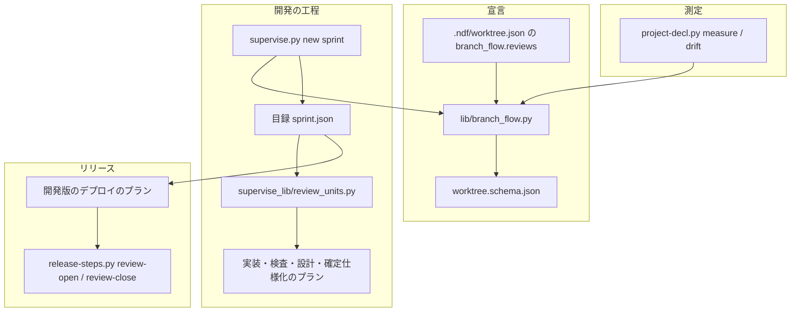
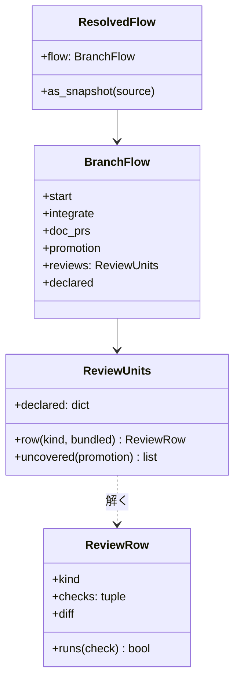
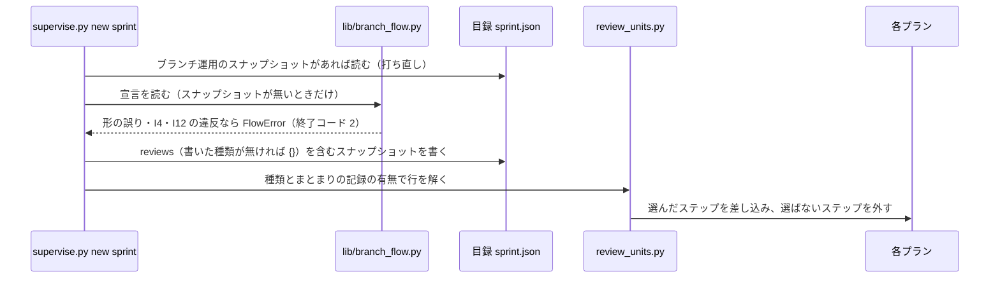
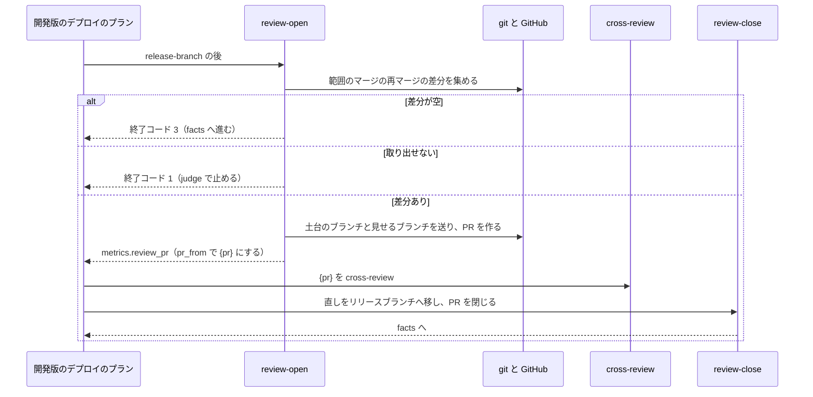

# ブランチ運用の宣言: PR の種類ごとに掛けるレビューと対象の差分を選べる（#3163）

## 目的

- **今どうなっているか**: ndf v10.27.61 のブランチ運用の宣言（`.ndf/worktree.json` の `branch_flow`）は、どの PR で何をレビューするかを書く項目を持たない。レビューの置き場はプランのテンプレートに決め打ちで、課題のまとまりの記録の有無と pace で暗黙に変わる
- **誰に効くか**: 実装 PR・スプリントの PR・リリースブランチの PR と PR が分かれるリポジトリ（最初の利用者は ai-plugins の #3119）
- **変えると何が成り立つか**: リポジトリが宣言で、PR の種類ごとに掛けるレビューと対象の差分を選べる。どの PR でも cross-review されない実装の差分が出る宣言は、スプリントを作る前に止まる。宣言の無いリポジトリのプランは今と同じである

## 適用範囲

- **働く範囲**: NDF を使うすべてのリポジトリ。宣言を書いたリポジトリでだけ振る舞いが変わる
- **プロジェクトごとに違うもの**: レビューの単位は設定（`.ndf/worktree.json` の `branch_flow.reviews`）で受ける。引数では受けない（PR の変更でレビューを外せないよう、メインディレクトリの設定から読む）
- **当たるモード**: スプリントで流すすべてのモードと pace（`normal`・`auto`・`fast`）。単発の `supervise.py new impl` / `new check` は宣言を読まず、今の振る舞いのまま

## あるべき姿の根拠

| 根拠 | 種類 | 何を示すか |
| --- | --- | --- |
| 「ブランチルールはリポジトリの事情によって決まり、ndfはどんなルールでも対応できるように設計されるべき」 | 利用者の指示の原文（#3119、2026-11-12） | レビューの単位を NDF の決め打ちではなく、リポジトリの宣言で受ける |
| 「#3119 レビューをどの単位でやるかのルールも入れたい」 | 利用者の指示の原文（#3119、2026-11-12） | レビューの単位を宣言の項目にする |
| PRD2・PRD3 | 外部の一次情報 | 主要なコード管理の製品は、レビューの要否を宛先のブランチ（PR の種類）ごとの規則として宣言させる |
| STD1・PRD1 | 外部の一次情報 | マージのコミットのレビューは、自動のマージの結果（衝突の印を含む）との差を見る形が git と Gerrit で定着している |
| 手元の git 2.53.0 で組んだリポジトリの実測（「外部の調査」の「再マージの差分の実測」。2026-11-13） | 実測 | 衝突したマージだけが再マージの差分を持ち、衝突の無いマージは空になる。差分を逆に当てて土台の tree を作れる |

要求と受け入れ条件は #3163 の本文にある（コピーは `issues/issue-3163-requirements.md`）。この文書は「どう作るか」だけを扱う。

## ドメインモデル

### コンテキスト

| コンテキスト | 何の語が 1 つの意味に決まるか |
| --- | --- |
| プロジェクトの宣言（`lib/branch_flow.py`・`project-decl.py`） | レビューの単位・掛けるレビュー・PR の種類・対象の差分（値の名前と許す組み合わせ）。宣言の読み分け・検査と、既存の PR からの測定（`measure`・`drift`）を持つ |
| 開発の工程（`ndf-workflow`） | スプリントの PR・未検査の差分・目録のスナップショット。スプリントの開始で宣言を読み、目録へ写し、プランを組む |
| リリース（`ndf-release`） | リリースブランチ・リリースの単位（#3121 の語のまま）・リリースブランチの PR・衝突の解消の差分・衝突の解消のレビューの PR |

コンテキストの間の関係は次の 3 つである。どれも左が上流（供給者）、右が下流（顧客）である。

| 供給者 | 顧客 | 渡すもの |
| --- | --- | --- |
| プロジェクトの宣言 | 開発の工程 | 公表された言語として、許す値の表（`lib/branch_flow.py`）とスキーマ。開発の工程は宣言のファイルを読み分けの関数だけで読む |
| 開発の工程 | リリース | 目録のスナップショットのレビューの単位。#3121 と同じく、リリースは開発の工程がスプリントの開始時に目録へ書いた値だけを読み、宣言のファイルを読み直さない |
| プロジェクトの宣言 | リリース | 公表された言語として、リリースブランチの PR の行（`release`）の値の名前（`pr`・`resolution`・`none`）。値はスナップショット経由で受け、名前の意味は `lib/branch_flow.py` の表を正本にする。値の名前を変えると、開発の工程とリリースの両方へ波及する |

リリースブランチの PR の行（`release`）の値の名前はプロジェクトの宣言が決め、その値で衝突の解消の差分を取り出してレビューの PR を組むのはリリースが決める。

### 集約

| 集約 | 持ち主（書き換えてよいもの） | 根 | エンティティ | 値オブジェクト |
| --- | --- | --- | --- | --- |
| ブランチ運用の宣言 | リポジトリの管理者（1 者）。書く手段は手の編集と、管理者の答えを受けて書く `project-decl.py write` の 2 つで、`write` は既存の宣言を読んで合わせるため手の編集を消さない | `.ndf/worktree.json` の `branch_flow` | — | 既存の 4 項目・レビューの単位（PR の種類ごとに、掛けるレビューの組と対象の差分） |
| スプリント | `supervise.py new sprint`（開始時に 1 回だけ書く） | 目録（`sprint.json`） | スプリントブランチ | スナップショット（レビューの単位を含む） |
| リリース | `release-steps.py`（下の表のサブコマンドだけが書く） | 承認資料と承認したコミット | リリースブランチ・衝突の解消のレビューの PR | 衝突の解消の差分 |

集約の間は ID（ブランチ名・PR の番号）で参照する。レビューの単位を書き換えてよいのは宣言の持ち主（リポジトリの管理者）だけで、NDF のプランとテンプレートは宣言を書かず、目録のスナップショットを読むだけである。

リリースの集約は、開発版のデプロイのプランと本番のリリースのプランの両方から使われる。書き込みは `release-steps.py` のサブコマンドに限り、どのサブコマンドが何を書くかを次の表で固定する。

| サブコマンド | 呼ぶプラン | 書くもの |
| --- | --- | --- |
| `release-branch` | 開発版のデプロイ | リリースブランチへ、本番チャネルとリリースの単位のマージ。組み直しも同じコマンドで、origin のリリースブランチの先頭から積む（強制 push をしない。#3121 の決定 6） |
| `review-open` | 開発版のデプロイ | 衝突の解消のレビューの PR と一時のブランチ（土台のブランチと見せるブランチ）を作る。始めに、直しを移し終えた前の組だけを閉じて消す（I11）。リリースブランチは書かない |
| `review-close` | 開発版のデプロイ | リリースブランチへ、衝突の解消のレビューで入った直しのコミット。移せた後に、その版のレビューの PR の本文へレビュー済みの先頭を書き、PR を閉じて一時のブランチを消す |
| `release` | 本番のリリース | リリースブランチへ、承認したコミットの後の、マージでないコミット（版上げ・変更履歴など）だけ。中身の変更は承認ゲートで止まり、開発版のデプロイのプランの組み直しへ戻る（#3121 の決定 14） |

中身（マージと直し）を書くのは開発版のデプロイのプランだけで、本番のリリースのプランはリリースブランチを組み直さない。

### 不変条件

| # | 集約 | 条件 | 破れたときの扱い |
| --- | --- | --- | --- |
| I1 | ブランチ運用の宣言 | PR の種類ごとに、掛けるレビューと対象の差分は「PR の種類 × 値」の表（決定 2）が許す値だけを取る | 直すキー（`branch_flow.reviews.<種類>.<checks か diff>`）と許す値を出して終了コード 2。既定値へ倒さない |
| I2 | ブランチ運用の宣言 | 対象の差分が「掛けない」なら掛けるレビューは空、それ以外なら 1 つ以上 | I1 と同じ |
| I3 | ブランチ運用の宣言 | リリースブランチの PR の値は、取り込み方の行がリリースの単位を選ぶ（`promotion: selected`）ときだけ書ける | I1 と同じ。理由に `promotion = <行>` を添える |
| I4 | ブランチ運用の宣言 | 実装の差分は、実装の差分を覆う行の 1 つ以上で cross-review される。実装の差分を覆う行は、`impl` で `diff: pr`・`sprint` で `diff: unchecked`・`release` で `diff: pr` の 3 つだけで、`release` の `diff: resolution` は衝突の解消の差分しか見ないため数えない。書いていない種類は既定値で埋め、課題のまとまりの記録が有るときと無いときの両方で成り立つ | 直すキーと理由を出して終了コード 2。プランを作らない |
| I5 | ブランチ運用の宣言 | `reviews` が無い宣言・書いていない種類は、既定値の表（決定 3）の値になり、今のプランと同じステップを組む | 退行のテストが落ちる |
| I6 | スプリント | 動いているスプリントは、目録のスナップショットのレビューの単位でプランを組む。開始の後に宣言を変えても、打ち直しで組むステップは変わらない。スナップショットは宣言の有無に依らず開始時に必ず書き、`reviews` は書いた種類が無くても空の形（`{}`）で書く | 打ち直しのテストが落ちる |
| I7 | スプリント | リファクタリングを止める条件（`refactor_suspended`・リファクタリングの無いモード）は宣言より先に効き、cross-refactoring を選んでも外す | 外れないとテストが落ちる |
| I8 | リリース | 衝突の解消の差分が空なら、レビューを打たずに次のステップへ進む。差分を取り出せない・レビューの PR を組めないなら止めて人へ戻す | 空で打つ・取り出せないのに進むとテストが落ちる |
| I9 | リリース | 衝突の解消のレビューで入った直しは、リリースブランチへ移してから承認資料を作る。移せなければ止める。直しはリリースブランチの組み直しでも消えず（組み直しは origin の先頭から積む）、本番へ入れた後の戻すマージ（#3121 の E13）でベースブランチへ届く | 承認資料が直しの前の先頭を指す・組み直しで直しが消えるとテストが落ちる |
| I10 | リリース | 承認資料を作る時点のリリースブランチのマージは、すべて衝突の解消のレビューを通っている。組み直しで足したマージは、同じプランの `review-open` が前回のレビュー済みの先頭からの範囲で拾う | 組み直しで足したマージを範囲から落とすとテストが落ちる |
| I11 | リリース | 衝突の解消のレビューの PR と一時のブランチは、版ごとに開いているものが 1 組までで、役目を終えると閉じて消す（片付けの時点は「リリースブランチの PR のレビュー」の表）。閉じて消してよいのは、レビューで入った直しがすべてリリースブランチへ移った組だけである。移していない直しを持つ組は残し、`review-open` は新しい組を作らずに止める | 止まった後の打ち直しで 2 組目が開く・移していない直しを持つ組を閉じて消すとテストが落ちる |
| I12 | ブランチ運用の宣言 | 書いていない種類の既定値が実装の差分に cross-review を掛け、書いた行も実装の差分に cross-review を掛ける組み合わせは、まとまりの記録の有無のどちらでも生じない。同じ実装の差分を 2 回 cross-review するのは、利用者が両方の行を書いたときだけである（決定 3） | 書いていない種類のキー（`branch_flow.reviews.<種類>`）と、重なる行を出して終了コード 2 |

### ドメインイベント

| # | イベント | 発生元 | 受け手 |
| --- | --- | --- | --- |
| E1 | リポジトリがレビューの単位を宣言に書いた | 利用者・`project-decl.py write` | `supervise.py new sprint`（E2） |
| E2 | スプリントの開始で宣言を読み、組み合わせを検査した | `lib/branch_flow.py` の読み分け | 目録への書き込み（E3） |
| E3 | 読んだ値を目録へ書いた | `supervise.py new sprint` | プランのテンプレート（E4） |
| E4 | プランのテンプレートが、PR の種類ごとにレビューのステップを組んだ | `supervise_lib/review_units.py` | 各プランの実行（E5・E6） |
| E5 | 実装 PR・スプリントの PR・設計 PR・確定仕様化の PR に宣言どおりのレビューを掛けた | 各プランの実行 | 検査の記録・PR のレビューのコメント（E7 の材料） |
| E6 | リリースブランチを組み、リリースブランチの PR に宣言どおりのレビューを掛けた | 開発版のデプロイのプラン | 承認資料（facts のステップ） |
| E7 | 宣言と実際の使い方のずれを出した | `project-decl.py drift` | 利用者 |

### 用語

| 用語 | 意味 | 用語集への反映 |
| --- | --- | --- |
| レビューの単位 | PR の種類ごとに、掛けるレビューと対象の差分を決めた組。ブランチ運用の宣言の `reviews` に書く | 追加（`ndf-workflow`）。「課題のまとまり」の説明がこの語を別の意味で使っていたため、同じ変更でその説明を「1 本の実装の Pull Request でレビューするためにまとめたもの」と言い換え、1 語 1 意味にする |
| 掛けるレビュー | レビューの単位のうち、PR に掛ける検査の組。cross-review・cross-refactoring・振る舞いの確認の 3 つから選ぶ | 追加（`ndf-workflow`） |
| PR の種類 | NDF のプランが出す PR の分け方。実装 PR・スプリントの PR・リリースブランチの PR・設計 PR・確定仕様化の PR の 5 つ | 追加（`ndf-workflow`） |
| 対象の差分 | レビューに渡す差分の取り方。PR の差分全体・未検査の差分・衝突の解消の差分・掛けないの 4 つ | 追加（`ndf-workflow`） |
| スプリントの PR | スプリントブランチからベースブランチへ出す、検査のプランの PR | 追加（`ndf-workflow`） |
| 未検査の差分 | 前回の検査の後に入った差分。最後の検査の範囲（#3126）と同じ取り方 | 追加（`ndf-workflow`） |
| リリースブランチの PR | 選んで集める取り込み方（`promotion: selected`）で、リリースブランチから本番チャネルへ出す PR | 追加（`ndf-release`） |
| 衝突の解消の差分 | スプリントブランチをリリースブランチへ集めるマージのコミットが、親を自動でマージし直した結果（衝突の印を含む）と比べて持つ差分。衝突の解消と、組み合わせのためにマージのコミットで足した変更が入る。取り出し方は git の再マージの差分である | 追加（`ndf-release`） |
| 衝突の解消のレビューの PR | 衝突の解消の差分だけを PR の差分として見せるため、開発版のデプロイのプランが一時に作る PR。レビューで入った直しをリリースブランチへ移してから閉じる | 追加（`ndf-release`） |

用語集のコンテキストは、上の「コンテキスト」の表に合わせる。プロジェクトの宣言のコンテキストは用語集に独立した区分を持たないため、その語は開発の工程（`ndf-workflow`）に置く。

## 外部の調査

| 種類 | 調べるか | 理由 |
| --- | --- | --- |
| 標準・仕様 | 調べる | 衝突の解消の差分の取り出し方は git が定める。マージのコミットの差分の形を git の文書で確かめる |
| 主要な製品 | 調べる | PR の種類（宛先のブランチ）ごとにレビューの要否を宣言させる製品と、マージのコミットをレビューさせる製品の解き方を比べる |
| ライブラリとサービス | 調べる | 衝突の解消の差分の取り出しと、宣言の検査に使える既存の部品を確かめる |

### 標準・仕様

| # | 標準・仕様 | 何を定めているか | 設計への反映 | 出典 |
| --- | --- | --- | --- | --- |
| STD1 | git log / git show の `--remerge-diff`（`--diff-merges=remerge`） | マージのコミットについて、親を自動でマージし直した結果（衝突の印を含む）と記録された結果の差を出す | 衝突の解消の差分の定義と取り出し方にする（決定 5） | https://git-scm.com/docs/git-log （2026-11-13） |
| STD2 | git merge-tree `--write-tree` | worktree に触れずに 2 つのコミットのマージの結果の tree を作り、衝突したファイルの一覧を出す | 採らない。再マージの差分が同じ情報を 1 つのコマンドで出すため | https://git-scm.com/docs/git-merge-tree （2026-11-13） |

### 主要な製品

| # | 製品 | どう解いているか | 設計への反映 | 出典 |
| --- | --- | --- | --- | --- |
| PRD1 | Gerrit | マージのコミットの変更を、親ではなく「Auto Merge」（衝突の印を含む自動のマージの結果）と比べて見せ、衝突の解き方のレビューに使う | 衝突の解消の差分を、自動のマージの結果を土台にした PR として見せる（決定 5） | https://gerrit-review.googlesource.com/Documentation/user-review-ui.html （2026-11-13） |
| PRD2 | GitHub のルールセット | 宛先のブランチごとに「Require a pull request before merging」と承認の数を規則として宣言する | レビューの要否を PR の種類ごとの宣言の値にする（決定 1） | https://docs.github.com/en/repositories/configuring-branches-and-merges-in-your-repository/managing-rulesets/available-rules-for-rulesets （2026-11-13） |
| PRD3 | GitLab の承認の規則 | 承認の規則ごとに対象の宛先のブランチ（すべての保護ブランチか特定のブランチ）を選ぶ | 同上 | https://docs.gitlab.com/user/project/merge_requests/approvals/rules/ （2026-11-13） |

### ライブラリとサービス

| # | 候補 | 版 | ライセンス | 最後のリリースの日付 | 終了のアナウンス | 要件を満たすか | 出典 |
| --- | --- | --- | --- | --- | --- | --- | --- |
| LIB1 | git（`--remerge-diff`・`apply -R`） | 2.53.0（手元） | GPL-2.0 | 未確認（手元の版だけを見た） | 無し | 満たす。衝突したマージだけが差分を持ち、差分を先頭へ逆に当てて土台の tree を作れた | `git --version`・手元で組んだリポジトリでの実行（「再マージの差分の実測」。2026-11-13） |
| LIB2 | 既存の読み分けの表（`lib/branch_flow.py` の `allowed_values` と `schema_fragment`） | ndf v10.27.61 | リポジトリのライセンス | 2026-11-12（#3121） | 無し | 満たす。許す値の表からスキーマと検査を作る形が既にある | `plugins/ndf/scripts/lib/branch_flow.py` |
| LIB3 | jsonschema（Python） | 未確認 | MIT | 未確認 | 未確認 | 採らない。組み合わせの検査（I3・I4）はスキーマで書けず、プロジェクトの依存（`pyproject.toml` は pytest 系だけ）を増やすため | `pyproject.toml` の `dependencies` |

### 再マージの差分の実測

本番チャネル（`main`）から 3 つのスプリントブランチを切り、リリースブランチ（`rel`）へ `--no-ff` で集めた。`s1` と `s2` は同じ行を変えて衝突し、手で `B1+B2` に解いた。`s3` は別のファイルだけを足し、衝突しない。

```bash
git log --first-parent --remerge-diff --format='commit %s' main..rel
git log --first-parent --remerge-diff --format= main..rel > ../rd.patch
git switch -q --detach rel && git apply -R --index ../rd.patch && echo 'apply -R: ok'
git diff --cached rel
```

```text
commit merge s2

diff --git a/f.txt b/f.txt
remerge CONFLICT (content): Merge conflict in f.txt
index f823de2..2bfc134 100644
--- a/f.txt
+++ b/f.txt
@@ -1,7 +1,3 @@
 a
-<<<<<<< 579bab8 (merge s3)
-B1
-=======
-B2
->>>>>>> 27f426d (s2)
+B1+B2
 c
commit merge s3
commit merge s1
apply -R: ok
diff --git a/f.txt b/f.txt
index 2bfc134..f823de2 100644
--- a/f.txt
+++ b/f.txt
@@ -1,3 +1,7 @@
 a
-B1+B2
+<<<<<<< 579bab8 (merge s3)
+B1
+=======
+B2
+>>>>>>> 27f426d (s2)
 c
```

- 衝突しない `merge s1`・`merge s3` は差分を持たず、衝突した `merge s2` だけが衝突の印との差を持つ
- `remerge CONFLICT` の行は `git apply -R` が拡張の見出しとして読み飛ばし、逆に当てられた。当てた tree と先頭の差は、衝突の解消の差分そのものになる
- 確かめたのは 1 つのマージが 1 つの衝突を持つ形だけである。複数のマージが同じファイルの近い行を変えたときに逆に当てられるかは「未確認のまま残ること」に置く

### 確かめられなかったこと

| 対象 | 試した手段 | 結果と理由 |
| --- | --- | --- |
| git の最新版の日付 | 試していない | 手元の版（2.53.0）で `--remerge-diff`（2.36 で入った機能）が動くことを確かめたため、取得を省いた |
| jsonschema の最新版・最後のリリースの日付 | 試していない | 採らない理由が依存を増やすことと表現力で、版に依らないため |

調べた量: 候補 8 件・取得の試み 5 回。

## 機能一覧

| # | 機能 | 誰が使うか |
| --- | --- | --- |
| F1 | 宣言にレビューの単位（PR の種類ごとの掛けるレビューと対象の差分）を書く | リポジトリの管理者 |
| F2 | 書いた宣言の形と組み合わせを検査し、誤りを直すキーつきで止める | `supervise.py new sprint`・`project-decl.py check / write` |
| F3 | スプリントのプランが、目録の値のとおりにレビューのステップを置く・外す | supervisor（プランの実行） |
| F4 | リリースブランチの PR に、衝突の解消の差分か PR の差分全体のレビューを掛ける | 開発版のデプロイのプラン |
| F5 | 既存のリポジトリの PR からレビューの単位を推し、宣言とのずれを出す | リポジトリの管理者（`project-decl.py measure / drift`） |

## 構成要素

| 要素 | 責務 |
| --- | --- |
| `plugins/ndf/scripts/lib/branch_flow.py`（変える） | レビューの単位の表（PR の種類・掛けるレビュー・対象の差分・種類ごとに許す値・既定値）、読み分け、組み合わせの検査（I1〜I4・I12）、スナップショットへの出し入れ、スキーマの断片。許す値の唯一の置き場 |
| `plugins/ndf/skills/worktree/schemas/worktree.schema.json`（変える） | `branch_flow.reviews` の定義。`branch_flow.schema_fragment()` から作る |
| `plugins/ndf/contracts/settings/worktree.json.json`（変える） | `branch_flow` の要約にレビューの単位を足す |
| `plugins/ndf/scripts/supervise_lib/review_units.py`（新設） | 解いたレビューの単位 1 行を受け、プランへレビューのステップを差し込む・外す。ステップの並びは既存の検査の部品（`templates._inspect_steps`・`review_step`・`BEHAVIOR_STEPS`）から作る |
| `plugins/ndf/scripts/supervise_lib/sprint_bundles.py`（変える） | `with_review`・`without_review` を `review_units` へ移し、まとまりの読み出しだけを残す |
| `plugins/ndf/scripts/supervise_lib/sprint_waves.py`・`sprint.py`（変える） | 実装・検査・pace `fast` の検査・設計の各プランを組む所で、目録の値から種類ごとの行を解いて `review_units` を呼ぶ |
| `plugins/ndf/scripts/supervise_lib/sprint_close_steps.py`（変える） | 確定仕様化の PR に、宣言で選んだときだけ cross-review を置く |
| `plugins/ndf/scripts/supervise_lib/release_flow.py`・`release_templates.py`（変える） | 開発版のデプロイのプランの `release-branch` の後に、リリースブランチの PR のレビューのステップを置く。本番のリリースのプランの後片付けで、その版のレビューの一時のブランチを消す |
| `plugins/ndf/scripts/release_lib/review_range.py`（新設）・`release-steps.py`（変える） | 衝突の解消の差分を取り出し、レビューの PR を組む（`review-open`）。レビューの直しをリリースブランチへ移し、PR と一時のブランチを片付ける（`review-close`） |
| `plugins/ndf/scripts/project_lib/measure_branch_flow.py`・`project-decl.py`（変える） | PR の種類ごとに残ったレビューの印からレビューの単位を推し（`measure`）、宣言とのずれを出す（`drift`） |
| `plugins/ndf/skills/worktree/references/declaration.md`（変える） | レビューの単位の表・成り立たない組み合わせの規則・宣言の例 |
| `plugins/ndf/skills/release/references/release-steps.md`（変える） | `review-open`・`review-close` の使い方 |
| `docs/glossary.md`・`docs/glossary/glossary.json`（変える） | 用語の表の 4 語 |



図には実行時に動く要素だけを描く。文書（`declaration.md`・`release-steps.md`・用語集）と契約のファイル（`worktree.json.json`）は図に含めない。`sprint_bundles.py` は `review_units.py` へ関数を移すだけで、新しい関係を持たない。

## 構造



- `ReviewUnits.declared` は宣言に書いた種類だけを持つ。書いていない種類は `row` が既定値の表から解く（決定 3）
- `ReviewRow` は値オブジェクトで、プランのテンプレートが読むのはこれだけである
- `BranchFlow.reviews` は既存の 4 項目と別の属性にする。既存の `KEYS`（4 項目の文字列の値）を回す測定・ずれの処理を変えないためである

## データ構造

### 宣言の形

```json
{
  "branch_flow": {
    "start": "production",
    "integrate": "check",
    "doc_prs": "sprint",
    "promotion": "selected",
    "reviews": {
      "impl": {"checks": ["cross-review"], "diff": "pr"},
      "sprint": {"checks": ["cross-refactoring", "behavior"], "diff": "unchecked"},
      "release": {"checks": ["cross-review"], "diff": "resolution"},
      "design": {"checks": ["cross-review"], "diff": "pr"},
      "spec": {"checks": [], "diff": "none"}
    }
  }
}
```

| キー | 値 | 意味 |
| --- | --- | --- |
| `reviews.<種類>` | 種類は `impl`（実装 PR）・`sprint`（スプリントの PR）・`release`（リリースブランチの PR）・`design`（設計 PR）・`spec`（確定仕様化の PR） | 書いていない種類は既定値 |
| `reviews.<種類>.checks` | `cross-review`・`cross-refactoring`・`behavior`（振る舞いの確認）の重複の無い並び | 掛けるレビュー。並びの順は意味を持たず、ステップは常にリファクタリング → cross-review → 振る舞いの確認の順に置く |
| `reviews.<種類>.diff` | `pr`（PR の差分全体）・`unchecked`（未検査の差分）・`resolution`（衝突の解消の差分）・`none`（掛けない） | 対象の差分 |

### PR の種類ごとに許す値（I1・I3）

| 種類 | 許す `checks` | 許す `diff` | 書ける条件 |
| --- | --- | --- | --- |
| `impl` | 3 つすべて | `pr` / `none` | 常に |
| `sprint` | 3 つすべて | `unchecked` / `none` | 常に |
| `release` | `cross-review` | `pr` / `resolution` / `none` | 取り込み方の行がリリースの単位を選ぶとき |
| `design` | `cross-review` | `pr` / `none` | 常に |
| `spec` | `cross-review` | `pr` / `none` | 常に |

### 既定値の表（I5）

| 種類 | まとまりの記録あり | まとまりの記録なし |
| --- | --- | --- |
| `impl` | `cross-review` / `pr` | 掛けない |
| `sprint` | `cross-refactoring`・`behavior` / `unchecked` | 3 つすべて / `unchecked` |
| `release` | 掛けない | 掛けない |
| `design` | `cross-review` / `pr` | `cross-review` / `pr` |
| `spec` | 掛けない | 掛けない |

### 目録のスナップショット

`sprint.json` の `ブランチ運用` に `reviews` を足し、宣言に書いた種類だけをそのまま写す。既定値で埋めた形は写さない（まとまりの記録の有無でプランの組み立ての時点に解くため）。

| 場面 | 書く・読む値 |
| --- | --- |
| スプリントの開始 | `ブランチ運用` は宣言の有無に依らず必ず書く（#3121 の今の振る舞いのまま。宣言が無ければ `source` が既定値を示す）。`reviews` も必ず書き、書いた種類が無ければ `{}` にする |
| 打ち直し・後の工程 | 「目録に値が有るか」は `ブランチ運用` のスナップショットの有無で決める（今の `pin_flow` と同じ単位）。有れば、その中の `reviews` だけを読み、宣言を読まない |
| `ブランチ運用` は有るが `reviews` が無い目録 | この版より前に始めたスプリントの目録である。`reviews: {}` と同じに読み（すべての種類が既定値）、宣言を読まない |

`reviews` の有無で宣言へ戻らないため、開始の後に足した `reviews` を打ち直しで拾うことはない（I6）。

## 入出力の契約

| エントリポイント | 変わること |
| --- | --- |
| `.ndf/worktree.json` の `branch_flow` | 任意の `reviews` を受ける。この版より前の NDF は `additionalProperties: false` のため `reviews` を書いた宣言を終了コード 2 で止める（要求の「影響」のとおり） |
| `supervise.py new sprint` | I1〜I4・I12 に反する宣言では、直すキー（`branch_flow.reviews.<種類>...`）と理由を 1 件 1 行で出して終了コード 2。プランを作らない |
| `release-steps.py review-open --version <版> --diff pr\|resolution --production <ブランチ>` | 新設。始めに、開いている衝突の解消のレビューの PR（head が `review/release/v` で始まる）を版に依らず調べる。直しを移し終えた PR（PR の本文に書いた見せる先頭より後のコミットが無いか、`git cherry <リリースブランチ> <PR の head> <見せる先頭>` がすべて `-`）は閉じて一時のブランチを消す。移していない直しを持つ PR が 1 つでもあれば、閉じず・消さず・新しい PR を作らずに終了コード 1 で止め、PR の番号と移していないコミットを出す（人が `review-close` を打ち直すか直しを捨てるかを決める）。次に範囲を決める: 同じ版の閉じたレビューの PR の本文にレビュー済みの先頭があり、それがリリースブランチの先頭の祖先なら、そこから先頭まで。無ければ本番チャネルから先頭まで。レビューの PR を組み、見せるブランチの先頭（見せる先頭）を PR の本文に書き、結果の JSON の `metrics.review_pr` に番号を出す。差分が空なら終了コード 3（打たずに進む）、取り出せない・組めないなら 1 |
| `release-steps.py review-close --version <版>` | 新設。レビューの PR の head に積まれた直しのコミットをリリースブランチへ移して送り、送った後の先頭をレビュー済みの先頭として PR の本文に書き、PR を閉じて一時のブランチを消す。移せなければ 1 で、PR とブランチを残す（人が見る材料。直しを移し終えるまで、次の `review-open` も閉じない） |
| `project-decl.py measure` | 結果の `branch_flow` の項目に `reviews.<種類>` の推定（値・確からしさ・根拠、測れなければ `unknown` と理由）を足す |
| `project-decl.py drift` | `branch_flow.reviews.<種類>` のずれの行を足す |

## 処理の流れ

測定とずれの検出（`project-decl.py`・`measure_branch_flow.py`）は図を描かない。PR を読んで値を推し、`lib/branch_flow.py` の表で検査するだけの 1 本道である（推し方は決定 8）。

### プランを組む



| プラン | 当たる種類 | 置く・外す所 |
| --- | --- | --- |
| 実装（`plan_sprint_impl`・`plan_fast_impl`） | `impl` | `ready` の前に、手元の送信 → 選んだレビューのステップ → 手元の早送りを置く（今の `with_review` の並びを一般にしたもの） |
| 検査（`plan_sprint_check`） | `sprint` | 既にある assess・refactor・review・振る舞いの確認から、選ばないステップを外して行き先を付け替える |
| pace `fast` の検査・コードレビュー・最後の検査（`plan_fast_check`） | `sprint` | 同上。cross-review を選ばなければコードレビューのプランを置かない |
| 設計（`plan_sprint_design`・`plan_mvv_design`・`plan_advise_design`） | `design` | `none` なら設計のレビューのまとまり（`_review_steps`）を外し、`pr` の次を要求の再確認へつなぐ |
| 確定仕様化（`_spec_pr_steps`） | `spec` | `pr` なら `pr` と `ready` の間に文書の cross-review を置く |
| 開発版のデプロイ（`plan_release_package_plugin`） | `release` | `release-branch` と `facts` の間に `review-open` → `review` → `review-close` を置く |

リファクタリングのステップは、宣言で選んでも `refactor_suspended` かリファクタリングの無いモードなら外す（I7）。外す判定は今の `trim_check_steps` の 1 か所に置いたまま、`review_units` の後に通す。

### リリースブランチの PR のレビュー



`diff: pr` のときは、土台を本番チャネルの先頭、見せるブランチをリリースブランチの先頭にして同じ経路を通る（決定 6）。

リリースブランチを組み直すときも、開発版のデプロイのプランを打ち直す。並びは同じ `release-branch` → `review-open` → `review` → `review-close` → `facts` である。本番のリリースのプランはリリースブランチの中身を書き換えず、承認の外の変更を見つけると承認ゲートで止まって組み直しへ戻す（#3121 の決定 14）。そのため、承認資料が指す先頭は常にこの並びを通った後の先頭である（I10）。

| 経路 | 直しのコミット | 組み直しで足したマージ |
| --- | --- | --- |
| 組み直し | `release-branch` は origin のリリースブランチの先頭から積むため、前回の `review-close` が送った直しは残る | `review-open` が前回のレビュー済みの先頭からの範囲で拾い、レビューする |
| 本番へ入れた後 | 本番チャネルへ入り、戻すマージ（`<リリースブランチ>-sync`。#3121 の E13）でベースブランチへ届く。次のリリースブランチは本番チャネルから切るため、同じ衝突は解いた形で始まる | — |

衝突の解消のレビューの PR と一時のブランチ（`review/release/v<版>` と土台のブランチ）を片付ける持ち主は `release-steps.py` で、時点は次の 3 つである（I11）。

| 時点 | 片付けるもの |
| --- | --- |
| `review-close` の成功 | その版のレビューの PR を閉じ、一時のブランチを消す |
| `review-open` の始め | 開いたまま残ったレビューの PR と一時のブランチのうち、直しを移し終えたもの（直しが無いものを含む）を、版に依らず閉じて消す。cross-review が直しを積まずに収束しなかった後の打ち直しと、版を出さずにやめた後の次の版がここで片付ける。移していない直しを持つ組は閉じずに止める（I11）。`review-close` が移せずに止まった後は、人が原因を直して `review-close` から打ち直すと、移した後に閉じる |
| 本番のリリースのプランの後片付け（`cleanup`） | その版のレビューの一時のブランチが残っていれば消す |

止まった直後は PR を開いたままにする。止まった理由を人が PR の上で見るためである。

## 非機能の実現方式

| 大項目 | 条件 | 実現方式 |
| --- | --- | --- |
| 性能・拡張性 | 宣言の無いリポジトリでは、1 スプリントで起動するレビューの回数が変わらない | 既定値の表を今の決め打ちと同じ値にし、宣言の無いときのプランの `steps` の `id` と `drive` の並びを今のテンプレートと比べるテストで固定する（I5） |
| 運用・保守性 | 組み合わせの誤りは直すキーと理由を 1 件 1 行 | 既存の `FlowError` の `items` に、キーを `reviews.<種類>.<checks か diff>` の形で積む。理由は `because` に入れる |
| 移行性 | 既存の宣言はそのまま通る | `reviews` は任意のキーで、既存の 4 項目の値と意味を変えない。既存の目録は `reviews` が無ければ既定値で読む |

## 決定の記録

### 決定 1: 種類ごとの選択を 1 か所で読めるよう、`branch_flow.reviews` に PR の種類をキーにした行を並べる

宣言は PR の種類ごとに `checks` と `diff` を持つ行を並べる。運用の型の名前（#3119 の案の A〜C のような名前）を 1 つ選ぶ形は、型を足すたびに NDF の変更が要り、リポジトリが自分のルールを書けない。行を並べれば、どの組み合わせも宣言だけで書け、I4 の検査も行の集まりに対して 1 か所で行える。キーを `branch_flow` の中に置くのは、取り込み方（I3）と合わせた検査を同じ読み分けで行うためである。

採らなかった案は、型の名前を 1 つ選ぶ形と、最上位に別の項目を置く形である。前者は上のとおり、後者は取り込み方との組み合わせの検査が 2 か所に分かれる。

- 作り方: 自前で作る・標準に倣う
- 比べた候補: PRD2 / PRD3 / LIB2 / LIB3

根拠: Value 4 / Value 11（MVV 版 7）

### 決定 2: 種類に合わない値を書けないよう、許す値を「PR の種類 × 値」の表 1 つで持つ

許す `checks` と `diff` は「データ構造」の表を `lib/branch_flow.py` に 1 つ置き、スキーマの断片・読み分けの検査・測定の候補をそこから作る。設計 PR・確定仕様化の PR・リリースブランチの PR は文書かマージだけを持つため、cross-refactoring と振る舞いの確認を許さない。スプリントの PR は 1 スプリントに 1 回だけ検査するため、その未検査の差分は PR の差分全体と同じになる。pace `fast` の検査の PR は未検査の差分で作る。そのため、スプリントの PR には `pr` を置かず `unchecked` だけを許す。

スプリントの PR に `pr` も許す案は、pace `normal` では `unchecked` と同じプランになり、pace `fast` では組めない値になるため採らない。

- 作り方: 自前で作る
- 比べた候補: LIB2 / LIB3

根拠: Value 8 / Value 11（MVV 版 7）

### 決定 3: 宣言の無いリポジトリを退行させないよう、既定値は種類ごとに、まとまりの記録の有無で 2 列の表にする

今の振る舞いは、まとまりの記録があれば実装 PR で、無ければスプリントの PR で cross-review を掛ける。この切り替えを宣言の値として表すと、まとまりの記録の有無という宣言の外の事実を宣言へ持ち込むことになる。そこで、書いていない種類だけを、プランを組む時点のまとまりの記録の有無で既定値の表から解く。書いた種類は、まとまりの記録の有無に依らずその値で組む。目録には書いた種類だけを写し、解いた形は写さない。

既定値で解く行と書いた行は、実装の差分への cross-review が重なりうる。たとえば `impl` だけに `cross-review / pr` を書くと、まとまりの記録が無いスプリントで `sprint` の既定値も cross-review を掛ける。同じ実装の差分を 2 回レビューすることになる。この重なりは宣言を読んでも見えない。そこで、次の 2 つがそろう宣言は読み分けで止める（I12）。書いた行が実装の差分を覆う cross-review を持つこと。書いていない種類の既定値も、まとまりの記録の有無のどちらかで実装の差分を覆う cross-review を持つこと。出力は書いていない種類のキーで、利用者はその種類を書いて、cross-review を掛けるかを決める。利用者が両方の行に書いた重なりは、意図したものとして通す。

「まとまりの記録があれば」を表す特別な値を宣言に置く案は、利用者が書けるのに意味が宣言の外で決まる値になるため採らない。重なりを知らせるだけで進める案は、出力を読まないまま 2 回のレビューの費用が続くため採らない。重なる既定値の側から cross-review を黙って外す案は、書いていない種類の振る舞いが別の種類の値で変わり、宣言から読めないため採らない。

根拠: Value 3 / Value 4（MVV 版 7）

### 決定 4: 誤った宣言でスプリントを始めないよう、「レビューされない差分」の検査は読み分けの時点で、まとまりの記録の有無の両方について行う

I4 は書いていない種類を既定値で埋めて検査する。既定値はまとまりの記録の有無で変わるため、両方の場合に成り立つことを求める。実装の差分を覆うと数える行は、`impl` の `diff: pr`・`sprint` の `diff: unchecked`・`release` の `diff: pr` だけである。`release` の `diff: resolution` は衝突の解消の差分しか見ないため数えない。数えると、次の宣言が通る。`impl` を `none`、`sprint` から cross-review を外し、`release` を `cross-review / resolution` にした宣言である。この宣言では、実装の差分がどの PR でも cross-review されない。読み分けの時点で決まるため、`supervise.py new sprint` だけでなく `project-decl.py check / write` も同じ誤りで止まる。設計 PR と確定仕様化の PR の文書の差分は、実装の差分ではないため検査に含めない。I12 の重なりの検査も、同じ「実装の差分を覆う行」の定義を使う。

まとまりの記録を読んだ後（スプリントの開始の時点）だけで検査する案は、`project-decl.py write` が通した宣言で後からスプリントが止まるため採らない。

根拠: Value 3 / Value 7（MVV 版 7）

### 決定 5: 衝突の解き方だけをレビューできるよう、衝突の解消の差分を git の再マージの差分で取り出し、それを差分に持つ一時の PR で見せる

リリースブランチの範囲は、前回のレビュー済みの先頭（無ければ本番チャネル）から、リリースブランチの先頭までである。範囲の first-parent のマージを `git log --first-parent --remerge-diff` で集めると、衝突したマージと、マージのコミットで足した変更だけが差分を持つ。この差分を先頭へ逆に当てた tree を土台のコミット（親は先頭）にし、その子に先頭と同じ tree のコミットを置く。土台を宛先、子を head にした PR の差分は、衝突の解消の差分そのものになる。cross-review は PR の番号だけを入力に取るため、駆動を変えずに使える。これは pace `fast` の検査が前回の検査の時点を宛先にした PR で範囲を表す形（#1078）と同じ考え方である。

差分が空なら終了コード 3 で打たずに進む。逆に当てられない（後のマージが同じ行を変えた）ときは推定で縮めず、終了コード 1 で止めて人へ戻す。Gerrit の自動のマージとの比較（PRD1）は 1 つのマージ単位であり、リリースブランチの複数のマージをまとめて 1 つの PR に見せる点だけが異なる。

git merge-tree で各マージの tree を作り直す案は、同じ差分を得るのに処理が増えるため採らない。マージのコミットごとに PR を作る案は、レビューの起動の回数がマージの数だけ増えるため採らない。

- 作り方: ライブラリやサービスを使う・標準に倣う
- 比べた候補: STD1 / STD2 / PRD1 / LIB1

根拠: Value 2 / Value 12（MVV 版 7）

### 決定 6: 承認する人がレビュー済みの内容を見るよう、リリースブランチの PR のレビューは開発版のデプロイのプランで承認資料より前に置く

本番チャネルへの PR は、本番のリリースのプランが承認の後に作る。そこでレビューすると、承認した内容と直した後の内容が食い違う。開発版のデプロイのプランは `release-branch` でリリースブランチを組んだ直後に承認資料を作るため、その間にレビューを置く。`diff: pr` も同じ一時の PR の経路で通し、土台を本番チャネルの先頭にする。レビューの直しはレビューの PR の head に積まれるため、`review-close` がそのコミットをリリースブランチへ cherry-pick して送る（`diff: pr` では早送りになる）。承認資料はその後の先頭で作る（I9）。リリースブランチを組み直すのは開発版のデプロイのプランだけで、組み直しも同じ並びでレビューを通すため、承認する人が見る先頭は常にレビュー済みである（I10）。PR の番号は既存の `pr_from`（#1273）で `{pr}` へ渡す。開発版のデプロイのプランは `{pr}` を読むほかのステップを持たない。

本番の PR を開発版のデプロイの時点で先に作る案は、承認の前に本番チャネル宛の PR が開いたままになるため採らない。

根拠: Value 1 / Value 13（MVV 版 7）

### 決定 7: レビューのステップの並びを 1 つにするため、差し込みと取り外しを `review_units` の 1 モジュールに寄せる

今はレビューのステップを扱う関数が 3 つに分かれている。

| 扱い | 関数 |
| --- | --- |
| 実装のプランへの cross-review の差し込み | `with_review` |
| 検査のプランからの取り外し | `without_review` |
| リファクタリングの取り外し | `trim_check_steps` |

種類ごとに 3 つのレビューを選べるようにすると、同じ判定が各プランへ散る。`review_units` は解いた行を受けて、ステップの並び（リファクタリング → cross-review → 振る舞いの確認）を既存の部品から作り、選ばないステップを外して行き先を付け替える。リファクタリングを止める条件は今の `trim_check_steps` に残し、`review_units` の後に通す（I7）。

各プランのテンプレートの中で個別に分岐する案は、同じ並びの規則を 5 か所に書くことになるため採らない。

根拠: Value 9 / Value 11（MVV 版 7）

### 決定 8: 測定を PR に残る印だけで行うため、レビューの単位はレビューごとの印の有無から推す

measure は直近のマージ済みの PR を種類ごとに最大 10 件読み、次の印の有無を数える。

| 掛けるレビュー | 印 |
| --- | --- |
| cross-review | レビューの本文の頭が `## 🤖 cross-review` |
| cross-refactoring | コメントの `<!-- cross-refactoring plan` |
| 振る舞いの確認 | コメントの `<!-- ndf:behavior-check` |

PR の種類は head と宛先で分ける。

| head と宛先 | PR の種類 |
| --- | --- |
| head が `feat/issue-` | 実装 PR |
| head が `sprint/`、宛先がベースブランチ | スプリントの PR |
| head が `release/v`、宛先が本番チャネル | リリースブランチの PR |
| head が `review/release/v` | リリースブランチの PR（その衝突の解消のレビューの PR） |
| head が `design/` | 設計 PR |
| head が `spec/` | 確定仕様化の PR |

確からしさの基準（標本 3 件・割合 0.9 と 0.6）は既存の `confidence` を使う。対象の差分は次のように推す。

| 条件 | 推す値 |
| --- | --- |
| 掛けるレビューが空 | `none` |
| リリースブランチの PR で、印が衝突の解消のレビューの PR にある | `resolution` |
| リリースブランチの PR で、印が本番チャネル宛の PR にある | `pr` |
| それ以外 | 種類が許す値のうち `none` 以外の 1 つ |

drift は、書いていない種類について、まとまりの記録の有無の両方の既定値と比べる。どちらとも違うときだけ、ずれとして出す。

検査の記録（`check-trigger.py` の記録）を読む案は、手元に残る記録で別のマシンから測れず、実装 PR と設計 PR の分を持たないため採らない。

根拠: Value 3 / Value 13（MVV 版 7）

## テスト設計

| 受け入れ条件・不変条件 | どの振る舞いで縛るか | どう壊したら落ちるべきか |
| --- | --- | --- |
| 受け入れ条件 1 | 5 種類それぞれに `checks` と `diff` を書いた宣言を読むと、`BranchFlow.reviews.row(<種類>)` が書いた値を返す。スナップショットへ出して読み直しても同じ | 書いた種類の値を捨てて既定値を返すと落ちる |
| 受け入れ条件 2 | 種類ごとに 1 つずつ選んだ宣言で、実装・検査・pace `fast` の検査・設計・確定仕様化・開発版のデプロイのプランの `steps` に、選んだレビューの `id` だけが現れる | 選ばないステップを残す・選んだステップを置かないと落ちる |
| 受け入れ条件 3・I5 | 宣言の無いリポジトリと `reviews` の無い宣言で、実装（まとまりの記録あり / 無し）・検査・pace `fast` の検査と最後の検査・リリース・設計・確定仕様化の `steps` の `id` と `drive` の並びが、ndf v10.27.61 のテンプレートが組む並びと等しい | 既定値の表の 1 セルを変えると落ちる |
| 受け入れ条件 4・I8 | 衝突したマージを含むリリースブランチで `review-open` を打つと、PR の差分が衝突の解消の差分だけになる。衝突の無いマージだけのリリースブランチでは終了コード 3 でレビューのステップへ進まない。逆に当てられない範囲では終了コード 1 | 再マージの差分ではなく first-parent の差分を渡す・空でも PR を作ると落ちる |
| I9 | `review-close` の後のリリースブランチの先頭が、レビューの PR の直しのコミットを含む。その後に単位を足して `release-branch` を打ち直しても、先頭が直しのコミットを含む。cherry-pick が衝突すると終了コード 1 で、リリースブランチを動かさない | 直しを捨てる・組み直しで直しが消える・衝突のまま送ると落ちる |
| I10 | `review-close` の後に衝突する単位を足して組み直すと、次の `review-open` の範囲が前回のレビュー済みの先頭からになり、足したマージの衝突の解消の差分だけを PR に出す | 範囲を本番チャネルから取り直す・足したマージを落とすと落ちる |
| I11 | 直しの無いレビューの PR を開いたまま `review-open` を打ち直すと、前の PR が閉じ、開いているレビューの PR が 1 つになる。リリースブランチへ移していない直しを持つレビューの PR があると、`review-open` は終了コード 1 で止まり、その PR と一時のブランチが残り、新しい PR を作らない | 前の PR を残す・移していない直しを持つ PR を閉じる・ブランチを消すと落ちる |
| 受け入れ条件 5・I4 | 実装の差分がどの PR でも cross-review されない宣言（まとまりの記録の一方の場合だけで外れるものと、`impl` が `none`・`sprint` に cross-review が無く・`release` が `cross-review / resolution` のものを含む）は、`supervise.py new sprint` が終了コード 2 でプランを書かず、`branch_flow.reviews.<種類>` と理由を出す | 片方のまとまりの場合だけ検査する・設計 PR の cross-review を数える・`release` の `diff: resolution` を実装の差分を覆う行に数えると落ちる |
| I12 | `impl` だけに `cross-review / pr` を書いた宣言は、`branch_flow.reviews.sprint` と重なる行を出して終了コード 2。`impl` と `sprint` の両方に cross-review を書いた宣言は通る | 既定値の重なりを通す・書いた重なりを止めると落ちる |
| 受け入れ条件 6・I1・I2・I3 | `resolution` をリリースブランチの PR 以外へ書く・スプリントの PR に `pr` を書く・設計 PR に cross-refactoring を書く・`diff: none` で `checks` を書く・`promotion: whole` で `release` を書くと、直すキーと許す値を出して終了コード 2 | 既定値へ倒す・キーを出さないと落ちる |
| 受け入れ条件 7 | `reviews` の知らないキー・知らない種類・表に無い値で、直すキーと許す値を出して終了コード 2 | 黙って捨てると落ちる |
| 受け入れ条件 8 | `declaration.md` の宣言の例を、スキーマ（`worktree.schema.json`）と読み分けの両方に通すと通る。スキーマの `branch_flow` は `schema_fragment()` と一致する | 例かスキーマの片方だけを直すと落ちる |
| 受け入れ条件 9・I6 | 開始時と違う `reviews` をメインディレクトリへ書いてから同じスプリントで `new sprint` を打ち直すと、組むレビューのステップが開始時と同じ。宣言の無いリポジトリで始めたスプリント（目録の `reviews` が `{}`）と、`reviews` の無い目録で、後から宣言に `reviews` を足しても同じ | 打ち直しで宣言を読み直す・`reviews` の有無で宣言へ戻ると落ちる |
| I7 | `checks` に cross-refactoring を選んでも、CI テストの宣言の無いリポジトリとリファクタリングの無いモードでは assess・refactor が現れない | 宣言を止める条件より先に効かせると落ちる |
| 受け入れ条件 10 | 種類ごとの PR の標本（印の有る・無いの組）から、`measure` の `reviews.<種類>` が推した値と確からしさを出す。標本が 3 件に満たない種類は `unknown` と理由 | 標本が少ないのに値を出すと落ちる |
| 受け入れ条件 11 | 宣言と測った値が違う種類だけ、`drift` が `branch_flow.reviews.<種類>` の行を出す。書いていない種類は既定値の 2 列のどちらかに合えば出さない | 既定値の片方だけと比べると落ちる |

## 設計の結果

| 課題 | 扱い | 取り込み先 | 触るファイル |
| --- | --- | --- | --- |
| #3163 | 実装する | — | `plugins/ndf/scripts/lib/branch_flow.py`、`plugins/ndf/skills/worktree/schemas/worktree.schema.json`、`plugins/ndf/contracts/settings/worktree.json.json`、`plugins/ndf/scripts/supervise_lib/review_units.py`（新設）、`plugins/ndf/scripts/supervise_lib/sprint_bundles.py`、`plugins/ndf/scripts/supervise_lib/sprint_waves.py`、`plugins/ndf/scripts/supervise_lib/sprint.py`、`plugins/ndf/scripts/supervise_lib/sprint_close_steps.py`、`plugins/ndf/scripts/supervise_lib/release_flow.py`、`plugins/ndf/scripts/supervise_lib/release_templates.py`、`plugins/ndf/scripts/release_lib/review_range.py`（新設）、`plugins/ndf/scripts/release-steps.py`、`plugins/ndf/scripts/project_lib/measure_branch_flow.py`、`plugins/ndf/scripts/project-decl.py`、`plugins/ndf/skills/worktree/references/declaration.md`、`plugins/ndf/skills/release/references/release-steps.md`、`docs/glossary.md`、`docs/glossary/glossary.json`、`plugins/ndf/scripts/tests/test_branch_flow.py`、`plugins/ndf/scripts/tests/test_sprint_branch_flow.py`、`plugins/ndf/scripts/tests/test_review_units.py`（新設）、`plugins/ndf/scripts/tests/test_release_review_range.py`（新設）、`plugins/ndf/scripts/tests/test_project_decl_branch_flow.py` |

## 人へ残す判断

無し

## 未確認のまま残ること

| 項目 | 内容 |
| --- | --- |
| 再マージの差分を逆に当てられない頻度 | 実測は 1 つのマージが 1 つの衝突を持つ形だけで行った。後のマージやレビューの直しが同じ行を変えると止まる。実際のリリースブランチでの頻度は、#3119 の宣言で流す最初のリリースで `review-open` の終了コードを見て分かる |
| 測定の API の回数 | 種類ごとに最大 10 件 × 2 回の取得で、`measure` の締め切りに収まるか。リリース後テストで ai-plugins に `measure` を打ち、所要の秒と `unknown` の理由で分かる |
| GitHub の PR の差分の見せ方 | 土台を宛先にした PR の差分が、GitHub の画面と cross-review の取得で、手元の `git diff <土台> <head>` と一致すること。手元の git では確かめたが、GitHub の三点の比較での表示はリリース後テストの最初の `review-open` で分かる |
