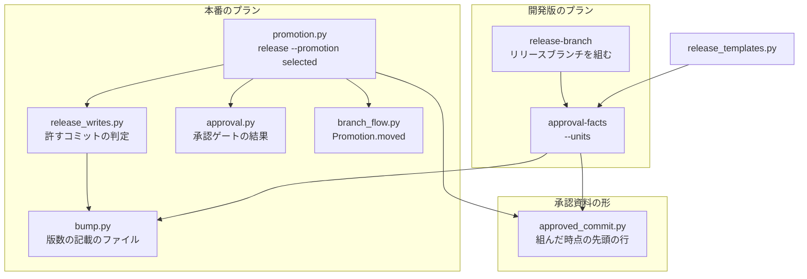
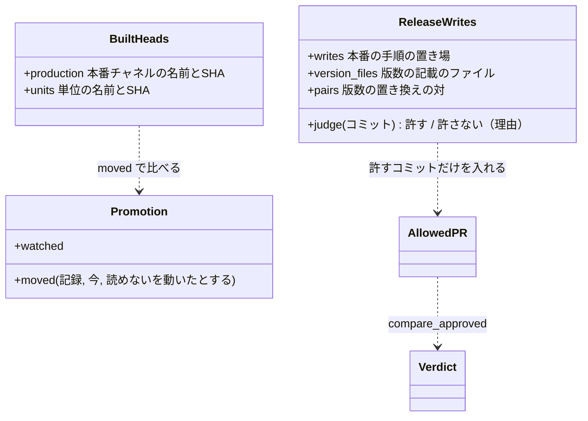
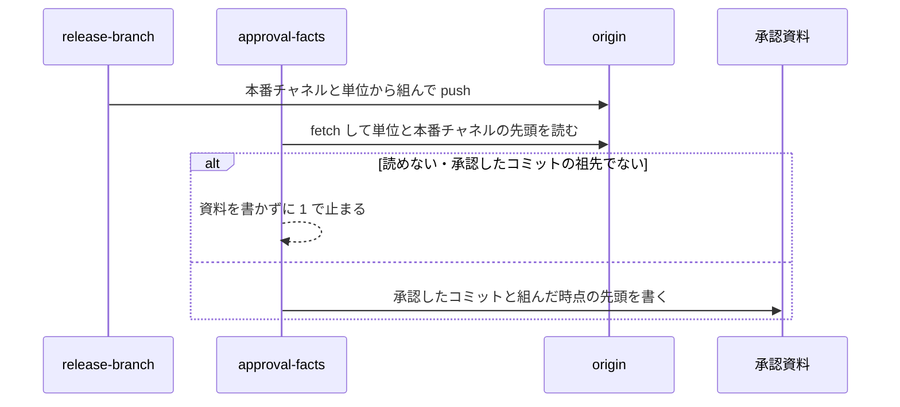
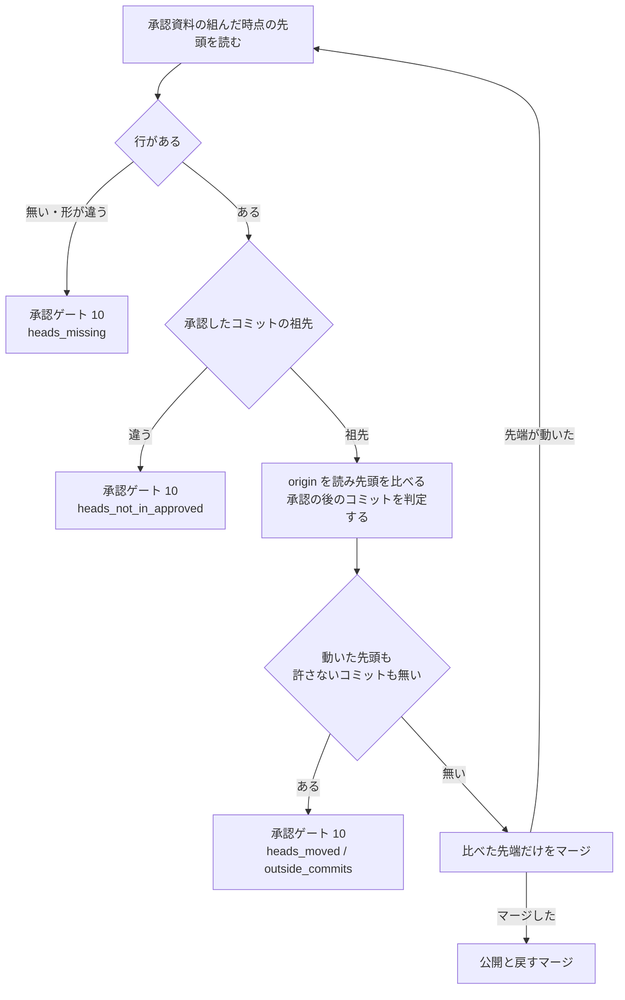

# 選んで集める取り込み方の本番のリリース: 承認した中身とリリースの工程の変更だけを本番へ入れる（#3168）

## 目的

- **今どうなっているか**: 選んで集める取り込み方の本番のリリースは、承認したコミットの後のマージでないコミットを中身を見ずに通し、承認の後に動いたリリースの単位と本番チャネルの先頭を見ない
- **誰に効くか**: 選んで集める取り込み方を宣言したリポジトリで、リリース承認ゲートを承認する利用者
- **変えると何が成り立つか**: 本番チャネルへ入る中身が、承認資料で人が承認した中身と、リリースの工程が機械で足した変更だけになる。食い違えば本番へ入れずに承認ゲート（終了コード 10）へ戻り、組み直しと再承認を促す

## 適用範囲

- **働く範囲**: NDF を使うすべてのリポジトリのうち、`.ndf/worktree.json` の `branch_flow.promotion` が `selected` のリポジトリ。ai-plugins は既定の取り込み方（whole）のため当たらない
- **プロジェクトごとに違うもの**: リリースの工程が書く箇所のうち、本番の手順の置き場は各リポジトリの設定（`.ndf/release.json` の `writes`）から読む。版数の記載の置き場と変更履歴は NDF の版上げと同じ規則で決まり、設定を足さない
- **当たるモード**: `standard`。変える振る舞いは本番のリリースのプランと開発版のリリースのプランの承認資料の段で、モードに依らず同じに働く

## あるべき姿の根拠

| 根拠 | 種類 | 何を示すか |
| --- | --- | --- |
| STD1（SLSA の source track の「Final revision approved」） | 外部の一次情報 | 承認は最後に入る版に対して行い、承認の後の変更は改めて見る |
| PRD1（GitHub の stale な承認の取り消し） | 外部の一次情報 | 差分が変わる push と、取り込み先の進みによる差分の変化で承認を外す |
| PRD2（GitLab の承認の取り消し） | 外部の一次情報 | 承認の後のコミットは既定で承認を外し、`git patch-id` で同じ変更かを見る |
| 実装 PR #3148 のコードレビューの major 2 件（`promotion.py:61`・`promotion.py:108`） | 実測 | 今の実装が、ソースを書き換えたコミットと承認の後のスプリントへの push を通す |

要求と受け入れ条件は #3168 の本文にある（コピーは [issue-3168-requirements.md](issue-3168-requirements.md) ）。この文書は「どう作るか」だけを扱う。

## ドメインモデル

### コンテキスト

| コンテキスト | 何の語が 1 つの意味に決まるか |
| --- | --- |
| リリース（`ndf-release`） | 承認資料・承認したコミット・承認の後のコミット・リリースの工程が書く箇所・組んだ時点の先頭 |
| 開発の工程（`ndf-workflow`） | 選んで集める取り込み方・リリースの単位・取り込み方の表の行（組み直す条件で比べる先頭） |

開発の工程が供給者、リリースが顧客の関係（顧客 / 供給者）。リリースは、取り込み方の表の行が持つ「組み直す条件で比べる先頭」（`watched`）と比べ方（`moved`）を使い、取り込み方の名前で分岐しない。比べ方に「読めない先頭を動いたとして扱う」を足すのは、リリースの要求を受けて供給者の側で行う。

### 集約

| 集約 | 持ち主（書き換えてよいもの） | 根 | エンティティ | 値オブジェクト |
| --- | --- | --- | --- | --- |
| 承認資料 | 承認資料の欄の形を持つ `lib/approved_commit.py`。書くのは `approval-facts`（表の行）と `approve`（承認の記録）で、どちらもこのモジュールの関数を通す | 承認資料（`issues/approval-<プラグイン>-v<版>.md`） | — | 承認したコミット・承認の記録・組んだ時点の先頭 |
| リリースブランチ | 本番チャネルへ入れてよいかの判定の持ち主は `release_lib/promotion.py`。ブランチへ書くのは下の表の書き手で、判定は書き手を区別せずにすべてのコミットへ掛ける | `release/v<版>` | 承認の後のコミット | リリースの工程が書く箇所・承認の後のコミットの判定 |

承認資料はリリースブランチをブランチ名で参照せず、承認したコミットの SHA と、組んだ時点の先頭の SHA だけを持つ。

リリースブランチの書き手と、判定の持ち主との関係:

| 書き手 | いつ書くか | 書いたものの扱い |
| --- | --- | --- |
| 開発版のプランの `release-branch` | 承認の前（リリースブランチを組む） | 承認したコミットに含まれ、判定の対象にならない |
| 本番のプランの bump・bump-others・changelog・notes・snapshot | 承認の後 | 承認の後のコミットとして `promotion.py` が判定する（I1〜I3） |
| 本番のプランの judge → fix | 承認の後（ステップが落ちたとき） | 同上 |
| 本番のプランの同期とチェック（`sync-check --commit`） | 承認の後（snapshot の後、release の前） | 同上 |

書き手はどれも判定の結果を変えられない。判定の規則を変えてよいのは `promotion.py` と、それが呼ぶ `release_writes.py`・`bump.py` だけである。

### 不変条件

| # | 集約 | 条件 | 破れたときの扱い |
| --- | --- | --- | --- |
| I1 | リリースブランチ | 本番チャネルへマージする先端は、承認したコミットに、許すコミット（下の I2）と承認を取り直さずに通すコミット（差分が `docs/`・`issues/` の下だけ）を first-parent で積んだものである | 承認ゲート（10）で止め、許さないコミットを `items[]` に `result: unapproved` で載せる |
| I2 | リリースブランチ | 許すコミットは、変えたパスのすべてが「リリースの工程が書く箇所」か `docs/`・`issues/` の下にあり、版数の記載を持つファイルの変更が版数の置き換えの対だけのものである | そのコミットを許さない（I1 の扱い） |
| I3 | リリースブランチ | 許すかを判定できないコミット（差分を読めない・パスを読めない）は許さない | そのコミットを許さない（I1 の扱い） |
| I4 | 承認資料 | 選んで集める取り込み方の承認資料は「組んだ時点の先頭」の行を 1 つ持ち、その行は本番チャネル 1 つとリリースの単位 1 つ以上を正しい形で並べる（形の規則は「データ構造」） | `approval-facts` は、選んで集める取り込み方で `--units` が無ければ資料を書かずに 2 で止まる。本番のリリースは承認ゲート（10、`heads_missing`）で止める |
| I5 | 承認資料 | 組んだ時点の先頭のどれもが、承認したコミットの祖先である | `approval-facts` は資料を書かずに 1 で止まる。本番のリリースは承認ゲート（10、`heads_not_in_approved`）で止める |
| I6 | リリースブランチ | 本番チャネルへマージする直前の origin の各先頭が、承認資料の組んだ時点の先頭と一致する。読めない先頭は一致しないとみなす | 承認ゲート（10、`heads_moved`）で止め、動いた先頭の名前・記録の SHA・今の SHA を `items[]` に載せる |
| I7 | リリースブランチ | 先端が動いて比べ直す回のたびに、I1〜I6 を判定し直す | 比べ直しで破れたら承認ゲート（10）で止める |
| I8 | リリースブランチ | 既定の取り込み方（whole）の本番のリリースと開発版のリリースは、この変更の前と同じに振る舞う | 既存のテストが落ちる |

I4 と I5 は承認資料が持つ値だけで決まるため承認資料の不変条件に置き、書くとき（`approval-facts`）と読むとき（本番のリリース）の両方で確かめる。I6 は承認資料の外の origin の状態と比べる条件で、判定するのは本番のリリースのため、リリースブランチの不変条件に置く。

### ドメインイベント

| # | イベント | 発生元 | 受け手 |
| --- | --- | --- | --- |
| E1 | リリースブランチを組み、組んだ時点の先頭を読んだ | 開発版のプランの `release-branch` のステップ | `approval-facts`（同じ単位を `--units` で受ける） |
| E2 | 組んだ時点の先頭を承認資料に書いた | 開発版のプランの `approval-facts` のステップ | リリース承認ゲートで承認する人・本番の `release` |
| E3 | リリース承認ゲートで承認した（承認の記録を書いた） | 利用者か MVV 判定（`approve`） | 本番の `release` |
| E4 | 本番のプランがリリースブランチへ版上げ・変更履歴・説明文・消費の記録のコミットを積んだ | 本番のプランの bump〜snapshot | 本番の `release`（E5 で判定する） |
| E5 | 承認の後のコミットを判定した | 本番の `release --promotion selected` | 本番チャネルへのマージ（E7）・承認ゲート |
| E6 | 組んだ時点の先頭を origin と比べた | 本番の `release --promotion selected` | 本番チャネルへのマージ（E7）・承認ゲート |
| E7 | 本番チャネルへマージした | 本番の `release --promotion selected`（`merge-when-green --expect-head`） | 公開（タグ・GitHub Release）と戻すマージ |

E5 と E6 はどちらもマージ（E7）の前に、比べ直しのたびに通す。順序は問わない。

### 用語

| 用語 | 意味 | 用語集への反映 |
| --- | --- | --- |
| 選んで集める取り込み方 | `.ndf/worktree.json` の `branch_flow.promotion` が `selected` の運用。本番チャネルから組んだリリースブランチへ、選んだスプリントブランチだけを集めて本番へ出す | 追加（`ndf-workflow`。要求の段で足した。意味は変えない） |
| 承認の後のコミット | 承認したコミットから、本番へマージする直前の origin のリリースブランチの先頭までの first-parent の列にあるコミット | 追加（`ndf-release`。要求の段で足した。意味は変えない） |
| リリースの工程が書く箇所 | 本番のリリースのプランが、承認の後にリリースブランチへ積むコミットで書き換える箇所。版上げが書き換える版数の記載・CHANGELOG.md・`.ndf/release.json` の本番の手順が `writes` に宣言した置き場 | 追加（`ndf-release`。要求の段で足した。意味は変えない） |
| 組んだ時点の先頭 | 選んで集める取り込み方でリリースブランチを組んだときに読んだ、各リリースの単位と本番チャネルの origin の先頭の SHA | 追加（`ndf-release`。要求の段で足した。意味は変えない） |

## 外部の調査

| 種類 | 調べるか | 理由 |
| --- | --- | --- |
| 標準・仕様 | 調べる | 承認と承認した版の結び付け方に、供給網の安全の公開の仕様がある |
| 主要な製品 | 調べる | 主要なコードホスティングが、承認の後の push と取り込み先の進みをどう扱うかを比べる |
| ライブラリとサービス | 調べる | 版上げに使っている bump-my-version で、許す差分を作り直して比べられるかを確かめる |

### 標準・仕様

| # | 標準・仕様 | 何を定めているか | 設計への反映 | 出典 |
| --- | --- | --- | --- | --- |
| STD1 | SLSA Source Requirements（working draft） | 「Final revision approved」: 承認は最後に入る版に対して行い、レビュー中に足した変更も見る。「Moving fully reviewed content from one context to another still requires review」。人の審査の例外として、信頼したロボットに恒久の例外を与えてよい | 承認の後のコミットを既定で許さず、機械の工程（リリースの工程が書く箇所）だけを例外として許可リストで許す（決定 1） | https://slsa.dev/spec/draft/source-requirements （2026-11-13） |

### 主要な製品

| # | 製品 | どう解いているか | 設計への反映 | 出典 |
| --- | --- | --- | --- | --- |
| PRD1 | GitHub の保護ブランチ | 「Dismiss stale pull request approvals」は、承認の時点の差分を記録し、差分が変わる push・Update branch・取り込み先の進みで承認を外す。「Require approval of the most recent reviewable push」は最後の push の承認を求める | 承認の時点の先頭（単位と本番チャネル）を記録し、動いたら承認を外す側へ倒す（決定 2・決定 3） | https://docs.github.com/en/repositories/configuring-branches-and-merges-in-your-repository/managing-protected-branches/about-protected-branches （2026-11-13） |
| PRD2 | GitLab のマージリクエストの承認の設定 | 既定で、承認の後に足した変更で承認を外す。`git patch-id` で同じ変更かを判定する。ファイルの種類で承認を残す設定は無く、近いものはコードオーナーのファイルが変わったときだけ外す設定である | パスだけで承認を残さず、版数の記載のファイルは差分の中身も見る（決定 1） | https://docs.gitlab.com/user/project/merge_requests/approvals/settings/ （2026-11-13） |

### ライブラリとサービス

| # | 候補 | 版 | ライセンス | 最後のリリースの日付 | 終了のアナウンス | 要件を満たすか | 出典 |
| --- | --- | --- | --- | --- | --- | --- | --- |
| LIB1 | bump-my-version（依存に固定済み） | 1.5.1（固定）。最新は 1.8.1 | MIT | 2026-11-01（1.8.1） | 無し | 一部。`replace --dry-run` は書かずに置き換えを試せるが、置き換えた後の中身を返さない。承認の後の差分を作り直して比べるには、版上げの他のプラグインの上げ幅・変更履歴・説明文も作り直す必要があり、これだけでは足りない | https://pypi.org/project/bump-my-version/ （2026-11-13）、`.venv/bin/bump-my-version replace --help`（2026-11-13） |
| LIB2 | git（`diff-tree`・`rev-list`・`merge-base --is-ancestor`） | 実行環境の git | GPL-2.0 | 確かめていない | 無し | 満たす。コミットの差分・祖先の判定を読める。今の比べる処理（`lib/approved_commit.py`）も使っている | `plugins/ndf/scripts/lib/approved_commit.py`（2026-11-13） |

### 確かめられなかったこと

| 対象 | 試した手段 | 結果と理由 |
| --- | --- | --- |
| SLSA の source track の正式版（v1.1） | https://slsa.dev/spec/v1.1/source-requirements | HTTP 404。working draft を出典にした |
| git の最後のリリースの日付 | 試していない | 依存として既に使っている実行環境の Tool で、版の選定はこの変更の範囲の外 |

調べた量: 候補 5 件・取得の試み 6 回。

## 機能一覧

| # | 機能 | 誰が使うか |
| --- | --- | --- |
| F1 | 承認の後に積んだコミットのうち、リリースの工程が書く箇所の外を変えたものがあれば、本番へ入れずに止める | 選んで集める取り込み方の本番のリリース（承認ゲートで人が読む） |
| F2 | リリースブランチを組んだ時点の各リリースの単位と本番チャネルの先頭を、承認資料に書く | リリース承認ゲートで承認する人 |
| F3 | 本番へマージする前に、組んだ時点の先頭を origin の先頭と比べ、動いた・読めない・記録が無いときに止める | 選んで集める取り込み方の本番のリリース（承認ゲートで人が読む） |

## 構成要素

| 要素 | 責務 |
| --- | --- |
| `release_lib/release_writes.py`（新設） | 承認したコミットの時点の宣言から「リリースの工程が書く箇所」を組み、承認の後のコミットを 1 つずつ許すか判定する（I2・I3）。git を読むだけで書かない |
| `release_lib/bump.py` | 版上げが書き換える行の組み立て（ファイルの一覧と、各ファイルで行を選ぶ正規表現・範囲）を 1 か所に持ち、版上げ（`plan_bump`）と判定の両方へ渡す。組み立ては作業ツリーのほかに、指定したコミットの木の中身からも行を選べる |
| `release-steps.py` | `plan_bump` が版上げが書き換える行の組み立てを `bump.py` から読む。`approval-facts` が `.ndf/worktree.json` の取り込み方を読み、選んで集める取り込み方では `--units` を必須にする。受けた単位から組んだ時点の先頭を読み、承認したコミットの祖先かを確かめて承認資料の表へ書く（E2・I4・I5） |
| `lib/approved_commit.py` | 承認資料の「組んだ時点の先頭」の行の形（書く・読む）を持つ |
| `release_lib/promotion.py` | `allowed_after` が許すコミットだけを返す（E5）。`_merge_approved` が比べ直しのたびに組んだ時点の先頭を確かめ（E6・I4〜I7）、止めるときの `next` を組み直しと承認資料の作り直しへ向ける |
| `release_lib/approval.py` | 承認ゲートの結果に、先頭の判定の項目と止めた理由（`metrics.reason` の新しい値）と呼び手が渡す `next` を載せる |
| `lib/branch_flow.py` | 取り込み方の行の `moved` が、読めない先頭を動いたとして扱う比べ方を選べる |
| `supervise_lib/release_templates.py` | 開発版のプランの `facts` のステップが、`release-branch` と同じ単位を `--units` で渡す。本番のプランの `release` のステップは今と同じく `--approval` で承認資料を渡し（`_release_step`）、`--approved-sha` を渡す経路は無い |
| 文書（確定仕様・`production-merge.md`・`release-steps.md`） | 承認の後に許すコミットと止める条件、承認資料の新しい行、`metrics.reason` の新しい値を書く |

`release-steps.py` の `plan_bump` も `bump.py` の組み立てを読む（図では `approval-facts` と同じファイルのため描かない）。文書の 3 つは図に含めない。

## 構造

- `ReleaseWrites` は `release_writes.py` の値で、承認したコミットの時点の木から作る。作った後に変えない
- `BuiltHeads` は承認資料の「組んだ時点の先頭」の行を読んだ値で、`Promotion.moved` が受ける形（`{"production": SHA, "units": {ブランチ: SHA}}`）と同じ形を持つ
- `AllowedPR`・`Verdict`・`compare_approved` は形を変えない

## データ構造

承認資料（Markdown）の「2. 承認の判断に使うもの」の表へ、行を 1 つ足す。既存の行と承認の記録の形は変えない。

| 項目 | 内容 | 空を許すか | 意味 |
| --- | --- | --- | --- |
| 組んだ時点の先頭 | `本番チャネル <ブランチ>: <40 桁の SHA>` の行 1 つと、`リリースの単位 <ブランチ>: <40 桁の SHA>` の行 1 つ以上を ` ` でつないだもの | 許す（行が無い） | 行が無いのは「この変更の前に組んだ承認資料」か「選んで集める取り込み方でない承認資料」。選んで集める取り込み方の本番のリリースでは、行が無いことを止める理由として扱う（I4）。選んで集める取り込み方のリポジトリでは `approval-facts` が `--units` を必須にするため、この変更の後に作る資料で行が欠けるのは、手で書き換えた場合だけである |

- 例: `| 組んだ時点の先頭 | 本番チャネル main: 1a2b…（40 桁） リリースの単位 sprint/lbr2-1: 3c4d…（40 桁） |`
- ブランチ名は git の規則で `:` と空白を含まないため、`<種類> <ブランチ>: <SHA>` の形で一意に読める
- 形が違う行（種類が 2 つ以外・本番チャネルが 1 つでない・単位が無い・同じ単位が 2 つ・SHA の形の誤り）は、行が無いのと同じに扱う
- 承認資料は版ごとに 1 つで、作り直すと表の行も書き直る（今の `approval-facts` の振る舞い）。時系列は承認資料を作り直した git の履歴と、本番のリリースの PR のリリース記録が持つ。この行は「今の承認資料がどの先頭を対象にしたか」だけを持つため、上書きで過去を失ってよい
- 移行: 既存の承認資料は書き換えない。この変更の前に組んだ承認資料で選んで集める取り込み方の本番のリリースを打つと止まり、`next` が作り直しを指す（受け入れ条件 9）

## 入出力の契約

| 名前 | 入力 | 出力 | 失敗の形 | 互換性 |
| --- | --- | --- | --- | --- |
| `release-steps.py approval-facts` | `--units <ブランチ>...` を足す（任意。`--head` と組で渡す） | 承認資料の表に「組んだ時点の先頭」の行。`metrics.built_heads` に同じ値 | `--units` だけで `--head` が無い → 2。選んで集める取り込み方のリポジトリで `--units` が無い → 2（資料を書かない。`next` は `--units` を付けた打ち直し）。先頭を読めない・承認したコミットの祖先でない → 1（資料を書かない。`next` は `release-branch` の打ち直し） | 既定の取り込み方では互換あり（`--units` を渡さなければ今と同じ）。選んで集める取り込み方では `--units` が必須になる。開発版のプランは渡すため、変わるのは単発で打つ場合だけである |
| `release-steps.py release --channel prod --promotion selected` | 変えない（`--approval` で承認資料を読む） | 止まらなければ今と同じ | 下の表の 4 つで承認ゲート（10）。`--approved-sha` で受けたときは承認資料が無く、組んだ時点の先頭の記録が無いとして 10 | 止まる条件が増える。新しい終了コードは足さない。本番のプランの `release` のステップは利用者の承認でも MVV 判定の承認でも `--approval` を渡す（`release_templates.py` の `_release_step`）ため、正常の経路は `--approved-sha` の扱いに当たらない。`--approved-sha` で止まるのは単発で打った場合だけで、`next` は `--approval` での打ち直しを指す |
| `release-steps.py release-branch` | 変えない | 変えない | 変えない | 結果 JSON の欄を変えない |

本番のリリースが止まるときの結果（`status: gate`、終了コード 10）:

| `metrics.reason` | 止める理由 | `items[]` |
| --- | --- | --- |
| `outside_commits`（既存） | 承認の後のコミットに、許さないものがある | `kind: commit`・`name: <SHA>`・`result: unapproved`・`subject`。許さない理由に当たるパスを `paths` に足す |
| `heads_missing`（新設） | 承認資料に組んだ時点の先頭の行が無いか、形が違う | `kind: cell`・`name: 組んだ時点の先頭`・`result: missing` |
| `heads_not_in_approved`（新設） | 記録した先頭が承認したコミットの祖先でない | `kind: branch`・`name: <ブランチ>`・`result: not_in_approved`・`recorded` |
| `heads_moved`（新設） | origin の先頭が記録と違うか、読めない | `kind: branch`・`name: <ブランチ>`・`role: production / unit`・`result: moved / missing`・`recorded`・`current`（読めなければ `null`） |

- `heads_missing`・`heads_not_in_approved` は、origin の先頭とコミットを読む前に止める（処理の流れの図）
- 動いた先頭と許さないコミットがどちらもあるときは、両方の `items[]` を載せ、`metrics.reason` は `heads_moved` を取る（先頭が動けば組み直しが要り、コミットの判定は組み直した後に変わる）
- `next` は、選んで集める取り込み方では「`release-branch --units <単位>` で組み直し、`approval-facts --head release/v<版> --units <単位> --approval <資料>` で承認資料を作り直して承認を取り直し、`release --channel prod --promotion selected --approval <資料>` を打ち直す」を指す。記録が無いときの `<単位>` は、記録から読めないため置き換えずに残す
- `metrics.built_heads` に記録の値を、`metrics.current_heads` に読んだ値を載せる

## 処理の流れ

開発版のプラン（E1・E2）:

本番のプランの `release --promotion selected`（E5・E6・E7）。比べ直しの回のたびに、承認資料の記録を読むところからやり直す:

承認の後のコミットを判定する手順（`release_writes.py`）:

1. 承認したコミットの木から、本番の手順の `writes`（`.ndf/release.json` を `git show <承認したコミット>:.ndf/release.json` で読む）・各プラグインの `plugin.json` の版を読む
2. 先端の木から各プラグインの `plugin.json` の版を読み、承認したコミットの版から変わったものを「版数の置き換えの対」にする。版数の記載のファイルは、対を持つプラグインごとに `bump.py` の組み立てから決まる
3. `rev-list --first-parent --no-merges <承認したコミット>..<先端>` のコミットを 1 つずつ見る。`diff-tree --no-renames` で第 1 親からの変更を読み、パスごとに次で判定する
   - `CHANGELOG.md`・`writes` の下・`docs/`・`issues/` の下 → 許す
   - 版数の記載のファイル → 親の木の中身に `bump.py` の組み立てを当てて「版上げが書き換える行」（各ファイルで、版を書く欄を選ぶ正規表現と範囲が選んだ行）を求める。消した行がすべてその行で、足した行がその行の旧版を新版へ置き換えた字面と 1 対 1 で一致するときだけ許す。それ以外の行の変更（同じファイルの起動コマンドの版つきのパッケージ名など）は、旧版と同じ字面の置き換えでも許さない。ファイルの追加・削除・モードの変更は許さない
   - それ以外 → 許さない
4. すべてのパスを許したコミットだけを `AllowedPR.commits` に入れる。差分を読めないコミットは許さない（I3）

宣言と版を承認したコミットの時点から読むのは、承認の後のコミットで `.ndf/release.json` の `writes` を広げて通す経路を作らないためである。

## 非機能の実現方式

| 大項目 | 要求の条件 | 実現方式 | 確かめ方 |
| --- | --- | --- | --- |
| セキュリティ | 承認の後のコミットの判定は許可リスト（リリースの工程が書く箇所）で行い、拒否リストにしない。判定できないコミット（差分を読めないなど）は許さない側へ倒す | パスごとに許可リストの側だけを列挙し、どれにも当たらなければ許さない。git の失敗・読めない差分はコミットを許さない値で返す | 合成したリポジトリで、許可リストの外の `.py` を変えたコミット・版数のほかに欄を変えた `plugin.json`・差分を読めないコミットが止まることをテストで見る |
| 運用・保守性 | 止めた理由は結果 JSON の items と summary に載り、承認ゲートで人が読んで組み直しへ進める | `summary` に止めた理由の 1 文（どのコミットか・どの先頭がどこからどこへ動いたか）を書き、`items[]` と `next` に組み直しの手順を載せる | 止まる経路のテストで、`items[]` の SHA・ブランチ名・記録と今の SHA と `next` を見る |

## 決定の記録

### 決定 1: 承認の後に入る中身を機械の工程の分だけに絞るため、許すコミットを許可リストのパスと版数の置き換えの対で判定する

承認の後のコミットを、変えたパスが「リリースの工程が書く箇所」か承認を取り直さずに通すパス（`docs/`・`issues/`）にあるときだけ許す。版数の記載を持つファイルは、版上げが書き換える行（`bump.py` の組み立てが、版を書く欄の正規表現と範囲で選ぶ行）だけが、「プラグインの承認の時点の版 → 先端の版」の対で置き換わったときに限って許す。`plugin.json` は版のほかに hook や MCP の起動コマンド（版つきのパッケージ名を含みうる）を持つ。版らしい字面をすべて伏せて比べると、起動するパッケージの版を差し替えたコミットも通る。対の置き換えをファイルの全体へ当てても、パッケージの版がたまたまプラグインの旧版と同じなら通る。置き換えを当てる行を版上げが選ぶ行に限れば、版上げ以外の版の書き換えは通らない。

許す差分を本番のプランと同じ処理で作り直して木を比べる形は採らない。変更履歴・説明文は PR 本文を読み、消費の記録は外部のコマンドを走らせるため、作り直すと承認の後の外部の状態で結果が変わり、比べる基準にならない。LIB1 の `--dry-run` も置き換えた後の中身を返さない。

- 作り方: 自前で作る・標準に倣う
- 比べた候補: STD1 / PRD1 / PRD2 / LIB1 / LIB2

根拠: Value 1 / Value 7 / Value 13（MVV 版 7）

### 決定 2: 承認と組んだ時点の先頭を結び付けるため、先頭を承認資料の表の行に置き、本番でも承認したコミットの祖先かを確かめる

組んだ時点の先頭は、承認資料の「2. 承認の判断に使うもの」の表の行に置く。承認する人が同じ資料の中で、どの単位をどの SHA で承認したかを読めるためである。承認の記録の行の形（`<SHA> を <担い手> が <時刻> に承認`）は変えず、本番のリリースで「記録した各先頭が承認したコミットの祖先である」ことを確かめて結び付ける。承認の記録は承認したコミットを持つため、承認したコミットに含まれない先頭へ行を書き換えると止まる。

承認資料と同じ場所の別のファイル（JSON）に置く形は採らない。承認する人が読む資料と比べる値が 2 か所に分かれ、資料だけを作り直したときに古い値が残る。承認の記録の行へ先頭を足す形も採らない。記録の行を読む既存の関数（`mvv-gate.py` の記録・`approve_from_facts`）の形が変わる。

根拠: Value 1 / Value 8 / Value 11（MVV 版 7）

### 決定 3: 組んだ時点の値を承認資料へ写す経路を増やさないため、`approval-facts` が `--units` を受けて origin の先頭を読み直す

`approval-facts` は `--units` で単位を受け、fetch した origin の各単位と本番チャネルの先頭を読み、それぞれが承認したコミット（リリースブランチの先頭）の祖先であることを確かめてから書く。`release-branch` から `approval-facts` までの間に単位へ push されると祖先でなくなり、資料を書かずに止まるため、書いた値は承認したコミットに入っている先頭と一致する。

`release-branch` の結果 JSON を状態ディレクトリから読む形は採らない。`approval-facts` は単発でも打たれ、状態ディレクトリを受け取らない。結果 JSON の欄を変えないという要求の境界にも合う。

根拠: Value 3 / Value 4（MVV 版 7）

### 決定 4: 読めない先頭を動いていないとして通さないため、取り込み方の行の `moved` に読めない先頭を動いたとする比べ方を足す

組み直す条件で比べる先頭は、取り込み方の表の行（`watched`）が持つ。本番のリリースはこの行の `moved` を使い、取り込み方の名前で分岐しない。`moved` は答えの時点の値が取れない先頭を比べない作りのため、読めない先頭を動いたとして返す引数を足し、本番のリリースだけがそれを使う。既定の振る舞いは変えない。

本番のリリースの側に先頭の比べ方をもう 1 つ書く形は採らない。組み直す条件が 2 か所に分かれる。

根拠: Value 9 / Value 11（MVV 版 7）

### 決定 5: 版上げが書き換える行の選び方を手で写さないため、組み立てを `bump.py` の 1 か所に置き、版上げと判定の両方がそこから読む

今は `release-steps.py` の `plan_bump` の補助の関数が、版数の記載のファイルと行を選ぶ正規表現を関数ごとに書いている。一覧と、各ファイルで行を選ぶ正規表現・範囲を `bump.py` へ移し、`plan_bump` と `release_writes.py` の両方がそこから読む。版上げが書き換える箇所を足すと、判定が許す行も同じ変更で増える。

判定の側に一覧を写す形は採らない。版上げの側だけに箇所を足すと、正しい版上げのコミットが止まる。

根拠: Value 11（MVV 版 7）

### 決定 6: 承認していない変更を本番へ入れないため、judge の直しと生成物の同期のコミットも許可リストで判定する

本番のプランの judge → fix のステップと、同期とチェック（`sync-check --commit`）のステップも、承認の後にコミットを積みうる。これらを許すコミットに入れず、ほかのコミットと同じ判定に掛ける。直しや同期でリリースの工程が書く箇所の外が変わるなら、その中身は承認資料に無いため、組み直しと再承認へ戻すのが要求の期待する結果である。`docs/`・`issues/` の下だけの直しは今と同じく通る。

根拠: Value 1 / Value 13（MVV 版 7）

## テスト設計

| 受け入れ条件・不変条件 | どの振る舞いで縛るか | どう壊したら落ちるべきか |
| --- | --- | --- |
| 1・I1・I2 | 承認の後に `.py` を書き換えたマージでないコミットを積むと、マージせず 10 で止まり、`items[]` にその SHA が `result: unapproved` で載る | 許すコミットをパスで絞らない（今の `allowed_after`）と落ちる |
| 2・I2 | `plugin.json` の `version` と `hooks` を同じコミットで変えると止まる | 版数の記載のファイルをパスだけで許すと落ちる |
| 2・I2 | `plugin.json` の起動コマンドの版つきのパッケージ名だけを変えると止まる | 版らしい字面をすべて伏せて比べると落ちる |
| 2・I2 | プラグインの旧版と同じ版のパッケージ名を、起動コマンドの中で新版へ差し替えると止まる | 対の置き換えを版上げが選ぶ行の外へも当てると落ちる |
| 3・I1・I2 | bump・bump-others・changelog・notes・snapshot が作るコミットだけなら止まらずにマージする | 許可リストから `CHANGELOG.md`・`writes`・版数の記載のファイルのどれかを落とすと落ちる |
| 4・I1 | 別のスプリントのコミットを cherry-pick したマージでないコミットを積むと止まる | cherry-pick の差分を許すと落ちる |
| 5・I4・I5 | `approval-facts --head --units` が承認資料に組んだ時点の先頭の行を書き、各 SHA が承認したコミットの祖先である | 行を書かない・本番チャネルの行を落とすと落ちる |
| 5・I5 | `release-branch` の後に単位へ push してから `approval-facts` を打つと、資料を書かずに止まる | 祖先の確かめを外すと落ちる |
| 6・I6 | 承認の後に単位へ 1 件 push すると、マージせず 10 で止まり、単位の名前・記録の SHA・今の SHA と、組み直しを指す `next` が載る | 先頭を比べない（今の `_merge_approved`）と落ちる |
| 7・I6 | 承認の後に本番チャネルが進むと止まり、本番チャネルの記録と今の SHA が載る | `watched` から本番チャネルを外すと落ちる |
| 8・I6 | 承認の後に単位が origin から消えると止まる | 読めない先頭を比べない（`moved` の既定）で呼ぶと落ちる |
| 9・I4 | 組んだ時点の先頭の行を持たない承認資料では 10 で止まり、`next` が承認資料の作り直しを指す | 行が無いときに比べずに通すと落ちる |
| I4 | 選んで集める取り込み方のリポジトリで `approval-facts` を `--units` なしで打つと、資料を書かずに 2 で止まる | 取り込み方を読まずに `--units` を任意のままにすると落ちる |
| 3 | 本番のプランの `release` のステップが、利用者の承認と MVV 判定の承認のどちらのプランでも `--approval` を渡す | `--approved-sha` を渡すテンプレートにすると落ちる |
| I5 | 記録の先頭を承認したコミットに含まれない SHA へ書き換えた資料では止まる | 祖先の確かめを本番で外すと落ちる |
| 10・I7 | 先端が動いて比べ直す回で、比べ直しの前に単位へ push すると止まる | 比べ直しの回で判定を飛ばすと落ちる |
| I3 | 差分を読めないコミット（git の失敗を返す）を許さない | 読めないときに許す値を返すと落ちる |
| 11・I8 | 既定の取り込み方と開発版のリリースの既存のテストが通る | whole の経路に判定を足すと落ちる |
| 12 | 上の止まる経路と通る経路を、origin を含む合成した git のリポジトリで確かめ、`plugins/ndf/scripts/tests/` の範囲のテストとして通す | — |
| 13 | 確定仕様と `production-merge.md` の記述は、レビューで 1〜9 と突き合わせる（文言を照合するテストは書かない） | — |

## 設計の結果

| 課題 | 扱い | 取り込み先 | 触るファイル |
| --- | --- | --- | --- |
| #3168 | 実装する | — | `plugins/ndf/scripts/release_lib/release_writes.py`（新設）、`plugins/ndf/scripts/release_lib/bump.py`、`plugins/ndf/scripts/release_lib/promotion.py`、`plugins/ndf/scripts/release_lib/approval.py`、`plugins/ndf/scripts/lib/approved_commit.py`、`plugins/ndf/scripts/lib/branch_flow.py`、`plugins/ndf/scripts/release-steps.py`、`plugins/ndf/scripts/supervise_lib/release_templates.py`、`plugins/ndf/scripts/tests/test_release_selected.py`、`plugins/ndf/scripts/tests/test_release_writes.py`（新設）、`plugins/ndf/scripts/tests/test_branch_flow.py`、`docs/specifications/ndf-branch-flow-declaration.md`、`plugins/ndf/skills/development-workflow/references/production-merge.md`、`plugins/ndf/skills/release/references/release-steps.md` |

## 人へ残す判断

| 判断 | 当たるレッドライン | なぜ当たるか |
| --- | --- | --- |
| 本番チャネルへ入れてよい承認の後の変更を、許可リスト（決定 1）と組んだ時点の先頭の一致（決定 2〜4）に絞ること | C2 | 本番チャネルへ誰の何が入れられるかの判定を変える |

## 未確認のまま残ること

| 項目 | 内容 |
| --- | --- |
| 選んで集める取り込み方の実際のリリースでの振る舞い | ai-plugins は既定の取り込み方のため、このリポジトリのリリースでは通らない。選んで集める取り込み方を宣言したリポジトリで本番のリリースを出したとき、リリース後テストで、承認資料に組んだ時点の先頭が載ることと、正常の経路で止まらないことを見る |
| 生成物の同期で止まる頻度 | 同期とチェックを宣言し、選んで集める取り込み方を使うリポジトリで、承認の後の同期のコミットが版数の置き換えのほかを変えて止まる回数は分からない。そのリポジトリの最初の本番のリリースで分かる |
