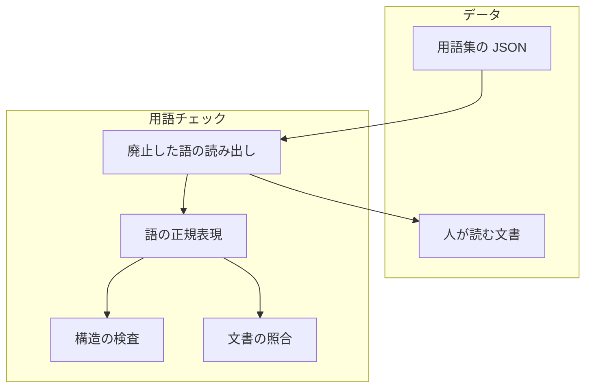
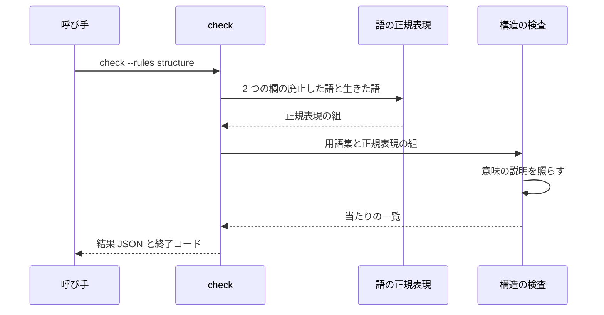

# 用語チェック: 用語集の意味の説明に残る廃止した語と避ける語を落とす（#3190）

## 目的

- **今どうなっているか**: 用語チェック（`glossary.py check`）は、設計の文書の追加した行の廃止した語を落とすが、用語集自身の意味の説明は見ない。語を改名しても意味の説明に古い語が残り（廃止した語 7 か所・`入口` 11 か所・`段` 3 か所）、そこから新しい文書へ写る。1 文字の語（`段`）と「`字で持つ`」型の直訳は、今の用語集の形では廃止した語に登録できない
- **誰に効くか**: 用語集を読んで設計の文書を書く AI と人、NDF を使うすべてのプロジェクトの用語集の持ち主
- **変えると何が成り立つか**: 構造の検査が意味の説明の廃止した語を落とし、ai-plugins の用語集の意味の説明は今の語で書かれる。避ける語 4 つが廃止した語として登録され、新しい設計の文書の追加した行でも落ちる

## 適用範囲

- **働く範囲**: 意味の説明の検査と、単独で照合する廃止した語の欄は NDF の `glossary.py` に入り、用語集の設定（`.ndf/glossary.json`）を持つすべてのリポジトリで既定で働く。避ける語 4 つの登録と意味の説明の言い換えは ai-plugins の用語集だけに入る
- **プロジェクトごとに違うもの**: どの語を廃止した語とするかは、各プロジェクトの用語集（設定の `source` が指すファイル）のデータで受ける。NDF のコードに語を書かない
- **当たるモード**: 用語チェックが走るすべての変更。構造の検査は CI ですべての Pull Request に走り、手元では `glossary.py check` と `gate` の後の設計の工程で走る

## あるべき姿の根拠

| 根拠 | 種類 | 何を示すか |
| --- | --- | --- |
| STD1 | 外部の一次情報 | 日本語の語の境界は、辞書を引かずに文字の種類だけでは決まらない。境界を全面に引かず、登録した語の前後だけを見る形にとどめる理由になる |
| PRD1 | 外部の一次情報 | 日本語の表記の検査で広く使われる prh は、語ごとに「この形のときだけ当てる」条件（否定の後読み）を規則のデータ側に持たせる。照合の条件を語の側に置く形の先例になる |
| PRD2 | 外部の一次情報 | Vale の置き換えの規則は、語の境界を既定で掛け、語ごとに外す設定（`nonword`）を持つ。境界の掛け方を語ごとに選ぶ形の先例になる |
| 手元の実測（2026-11-13、`develop` の先頭 25f96ab28 の用語集に、`deprecated` の規則と同じ除き方で照らした。コマンドと出力は下の「実測の手順」） | 実測 | 意味の説明の廃止した語の当たりは 7 件。要求の表の 10 件のうち、`インライン` の内側の `ライン` 2 件はカタカナの境界の規則で、バッククォートの中の `実行の条件` 1 件はインラインコードの除外で、今の規則のまま当たらない |
| 「#1142 の設計文書に `継続的統合` が 31 か所、直訳調の `字で持ち` が残った」 | 利用者の指摘の要約（2026-11-13。課題の本文が引く。原文は課題に無い） | 用語集の意味の説明から新しい文書へ古い語が写る |

要求と受け入れ条件は #3190 の本文にある（コピーは `issues/issue-3190-requirements.md`）。この文書は「どう作るか」だけを扱う。

### 実測の手順

今の `glossary.py` の部品（文書の照合の正規表現の組 `_build_word_patterns`・生きた語の内側を除く `_uncovered`・インラインコードを空白で埋める `mask_inline_code`）で、意味の説明を照らした。ai-plugins の根で打つ。

```bash
f=$(mktemp)
git show 25f96ab28:docs/glossary/glossary.json > "$f"
python3 - "$f" <<'EOF'
import json, sys, time
sys.path.insert(0, "plugins/ndf/scripts")
import glossary as G
g = json.load(open(sys.argv[1], encoding="utf-8"))
t0 = time.perf_counter()
words, _ = G._build_word_patterns(g)
hits = [(it.get("term") or it.get("id"), m.group(0))
        for it in G.terms_of(g) + G.contexts_of(g)
        for m in G._uncovered(G.mask_inline_code(it.get("meaning") or ""), words)]
print(f"items={len(G.terms_of(g))} contexts={len(G.contexts_of(g))} hits={len(hits)} seconds={time.perf_counter() - t0:.3f}")
print(*hits, sep="\n")
raw = sum((it.get("meaning") or "").count("ライン") for it in G.terms_of(g) + G.contexts_of(g))
print(f"raw_ライン={raw} hit_ライン={sum(1 for h in hits if h[1] == 'ライン')}")
EOF
time python3 plugins/ndf/scripts/glossary.py check --rules structure
```

出力の要点（2026-11-13、手元で 1 回）:

```text
items=1063 contexts=20 hits=7 seconds=0.275
('承認ゲート', '本番の系')
('ライブラリ', '共通層')
('最小の呼び出し', '認証の確認')
('登録簿', '起動元')
('再起動の試み', '統括役')
('台帳のチェックポイント', 'リリースの記録')
('文書のファイル', '用語集の宣言')
raw_ライン=12 hit_ライン=0
real    0m0.154s   （今の構造の検査の全体。終了コード 0）
```

`ライン` は意味の説明に部分一致で 12 回現れる（`インライン`・`パイプライン` など）が、照合の当たりは 0 件である。

## ドメインモデル

### コンテキスト

| コンテキスト | 何の語が 1 つの意味に決まるか |
| --- | --- |
| プロジェクトの用語集（`project-glossary`） | 用語集の形と検査の語。廃止した語・単独で照合する廃止した語 |
| NDF の開発ワークフロー（`ndf-workflow`） | 用語チェックと、言い換え先の語（CI・エントリポイント・ステップ・ステージ・文字列） |

関係は**共有カーネル**である。用語集の欄の形（廃止した語の 2 つの欄）を両方が使い、同じ変更で変える。どちらも ai-plugins の同じ用語集のファイルにあり、持ち主も同じである。

### 集約

| 集約 | 持ち主（書き換えてよいもの） | 根 | エンティティ | 値オブジェクト |
| --- | --- | --- | --- | --- |
| 用語集 | プロジェクトの変更（Pull Request）。`glossary.py` は `render` が人が読む文書を書くほかは読むだけ | 用語集 | 語の項目・コンテキスト | 意味の説明・廃止した語・単独で照合する廃止した語 |

### 不変条件

| # | 集約 | 条件 | 破れたときの扱い |
| --- | --- | --- | --- |
| I1 | 用語集 | 語の項目とコンテキストの意味の説明に、どれかの項目の廃止した語（2 つの欄のどちらでも）が現れない。どこかのコンテキストの生きた語と同じ語・生きた語の出現の内側の出現・インラインコードの中の出現は数えない | 構造の検査が `deprecated_meaning` で当て、終了コード 1 で止まる |
| I2 | 用語集 | 単独で照合する廃止した語は、漢字で始まる語なら直前が漢字の出現に、漢字で終わる語なら直後が漢字の出現に当たらない | 照合の規則が持つ（破れたら `段階`・`手段`・`文字` に当たる。テストが落とす） |
| I3 | 用語集 | 単独で照合する廃止した語の欄は、空でない文字列の配列で、各語の先頭か末尾が漢字であり、同じコンテキストの生きた語と重ならない | 構造の検査が `schema` で当てる |
| I4 | 用語集 | 人が読む文書は、用語集から `render` した内容と一致する（既存） | `stale_document` で当てる |

### ドメインイベント

| # | イベント | 発生元 | 受け手 |
| --- | --- | --- | --- |
| E1 | 避ける語を、言い換え先の語の廃止した語として登録した | この変更の実装の Pull Request | 用語チェック（E4・E5 で照らす語に入る） |
| E2 | 用語集の意味の説明から、廃止した語と避ける語を除いた | この変更の実装の Pull Request | 用語チェック（E4 が 0 件になる） |
| E3 | 人が読む文書を作り直した | `glossary.py render` | 用語チェック（`stale_document`） |
| E4 | 用語チェックが、用語集自身の意味の説明を照らした | Pull Request の CI と手元の `glossary.py check` | 用語集の持ち主（当たりの行を読み、言い換える） |
| E5 | 新しい設計の文書の追加した行に書かれた避ける語が落ちた | 設計のブランチの Pull Request の CI | 設計の文書の書き手 |

### 用語

| 用語 | 意味 | 用語集への反映 |
| --- | --- | --- |
| 廃止した語 | 用語集で別の語へ置き換えた語。文書の追加した行と、用語集自身の意味の説明に出たら落とす | 意味の変更（`project-glossary`） |
| 単独で照合する廃止した語 | 前後が漢字の出現には当てない廃止した語。1 文字の語と、長い語の一部に現れる語を登録するために使う | 追加（`project-glossary`） |
| 用語チェック | `glossary.py check`。用語集の形と意味の説明の廃止した語、文書の追加した行の語を見る | 意味の変更（`ndf-workflow`） |
| CI | Pull Request ごとに自動で走る検査（GitHub Actions のワークフロー） | 追加（`ndf-workflow`）。廃止した語 `継続的統合` は実装で足す |
| 文字列 | 文字の並びとして持つ値 | 追加（`ndf-workflow`）。単独で照合する廃止した語 `字で持` は実装で足す |
| エントリポイント | 既存の語（`ndf-workflow`） | 廃止した語に `入口` を足す（実装で足す） |
| ステップ | 既存の語（`ndf-workflow`）。意味（プランの steps の 1 要素）は変えない（決定 3） | 単独で照合する廃止した語に `段` を足す（実装で足す） |
| ステージ | 既存の語（`ndf-workflow`）。意味（パイプラインの中のプランのグループ）は変えない（決定 3） | 単独で照合する廃止した語に `段` を足す（実装で足す） |

新しい 3 語（単独で照合する廃止した語・CI・文字列）と、意味を変えた 2 語は、この設計の変更で用語集へ足し、`pending_source` にこの文書を書く。廃止した語の登録は実装の変更で行う。単独で照合する廃止した語の欄は実装が `glossary.py` に足すまで読まれず、登録を先にすると、意味の説明を言い換える前に実装の Pull Request の構造の検査が落ちるためである（E4 は E2 の後）。

本文で使う「意味の説明」は、語の項目の意味の欄（`terms[].meaning`）とコンテキストの意味の欄（`contexts[].meaning`）を指す。「避ける語」は、この変更が廃止した語として登録する `継続的統合`・`入口`・`段`・`字で持` の 4 つを指す。

## 外部の調査

| 種類 | 調べるか | 理由 |
| --- | --- | --- |
| 標準・仕様 | 調べる | 1 文字の語を誤った当たりなく照らすには、日本語の語の境界と漢字の判定の決まりに倣う必要がある |
| 主要な製品 | 調べる | 表記ゆれの検査の製品が、語ごとの照合の条件をどこに持つかを比べる |
| ライブラリとサービス | 調べる | 語の境界を形態素解析のライブラリに任せるか、正規表現で書くかを決める |

### 標準・仕様

| # | 標準・仕様 | 何を定めているか | 設計への反映 | 出典 |
| --- | --- | --- | --- | --- |
| STD1 | Unicode Standard Annex #29 Unicode Text Segmentation（Unicode 18.0.0） | 既定の語の境界の規則。日本語・中国語・タイ語などの語の境界を確実に見つけるには辞書を引くなどの仕組みが要り、既定の規則を上書きできるようにしてよい、と定める | 語の境界を文書の全体に引かない。登録した語の前後の 1 文字が漢字かどうかだけを見る、範囲の狭い規則にとどめる | https://www.unicode.org/reports/tr29/ （2026-11-13） |

### 主要な製品

| # | 製品 | どう解いているか | 設計への反映 | 出典 |
| --- | --- | --- | --- | --- |
| PRD1 | prh（proofreading-helper）7.0.0 | 規則ごとに正しい形（`expected`）と照合の形（`pattern` / `patterns`。正規表現と否定の後読みを書ける）を持ち、規則ごとの例（`specs`）が合わなければ読み込みで失敗する | 照合の条件を語の側（用語集のデータ）に置く。条件は正規表現ではなく「単独で照合する」の 1 種類に絞る（決定 2） | https://raw.githubusercontent.com/prh/prh/master/misc/prh.yml （2026-11-13） |
| PRD2 | Vale v3.27.0 の置き換えの規則（`substitution`） | 置き換えの組（`swap`）を持ち、語の境界（`\b`）を既定で掛け、`nonword` で外せる。鍵に正規表現も書ける | 境界を掛けるかを語ごとに選ぶ。既存の廃止した語の欄は今の照合のまま残し、境界を掛ける語だけを別の欄に置く（決定 2） | https://docs.vale.sh/checks/substitution （2026-11-13） |

### ライブラリとサービス

| # | 候補 | 版 | ライセンス | 最後のリリースの日付 | 終了のアナウンス | 要件を満たすか | 出典 |
| --- | --- | --- | --- | --- | --- | --- | --- |
| LIB1 | regex（PyPI） | 2026.11.9 | Apache-2.0 AND CNRI-Python | 2026-11-09 | 無し | 満たす（`\p{Han}` で漢字を判定できる）。NDF のスクリプトは標準ライブラリで動く前提で、依存を 1 つ足すことになる | https://pypi.org/pypi/regex/json （2026-11-13） |
| LIB2 | SudachiPy（PyPI） | 0.7.0 | Apache-2.0 | 2026-09-24 | 無し | 満たす（形態素解析で `段階` と `段` を分けられる）。辞書のパッケージを別に入れる必要がある | https://pypi.org/pypi/sudachipy/json （2026-11-13） |
| LIB3 | fugashi（PyPI。MeCab の包み） | 1.5.2 | MIT AND BSD-3-Clause | 2025-10-24 | 無し | 満たす（形態素解析）。辞書のパッケージを別に入れる必要がある | https://pypi.org/pypi/fugashi/json （2026-11-13） |
| LIB4 | prh（npm） | 7.0.0 | MIT | 2026-11-07 | 無し | 満たさない。Node.js の実行環境が要り、用語集の JSON から規則を作り直す変換が要る | https://registry.npmjs.org/prh （2026-11-13） |

### 確かめられなかったこと

| 対象 | 試した手段 | 結果と理由 |
| --- | --- | --- |
| NDF を使うほかのプロジェクトの用語集で、意味の説明に廃止した語がある数 | 試していない | ほかのプロジェクトの用語集を読む手段が手元に無い（「未確認のまま残ること」） |

調べた量: 候補 7 件・取得の試み 20 回。

## 機能一覧

| # | 機能 | 誰が使うか |
| --- | --- | --- |
| F1 | 構造の検査が、用語集の意味の説明の廃止した語を 1 件ずつ当てる | CI・用語集の持ち主 |
| F2 | 用語集に、前後が漢字の出現を除いて照合する廃止した語を登録できる | 用語集の持ち主 |
| F3 | 避ける語 4 つを廃止した語として登録し、意味の説明を今の語へ言い換える | ai-plugins の用語集 |

## 構成要素

| 要素 | 責務 |
| --- | --- |
| 構造の検査（`glossary.py` の `structure_findings`） | F1。語の項目とコンテキストの意味の説明を、文書の照合と同じ正規表現の組で照らし、`deprecated_meaning` の当たりを返す。単独で照合する廃止した語の欄の形を `schema` で確かめる（I3） |
| 語の正規表現（`lib/glossary_words.py`） | F2。単独で照合する語の正規表現を、先頭が漢字なら直前に漢字が無い、末尾が漢字なら直後に漢字が無い条件付きで作る（I2）。漢字の文字の範囲はここだけに置く |
| 廃止した語の読み出し（`glossary.py`） | 1 つの項目の廃止した語を、2 つの欄を合わせて返す。置き換え先（`replacement`）・文書の生成（`render_text`）・差分（`diff_items`）・正規表現の組み立て（`_build_word_patterns`）がここを読む |
| 用語集のデータ（`docs/glossary/glossary.json`） | F3。語の追加、廃止した語の登録、意味の説明の言い換え |
| 人が読む文書（`docs/glossary.md`） | `render` で作り直す |
| 用語集の形の参照（`requirements-design` の `references/glossary-format.md`） | 欄の表に単独で照合する廃止した語の欄を、規則の表に `deprecated_meaning` を足し、`schema` の条件と規則の数を直す。`deprecated_meaning` の行に、`detail` の置き換え先のどれの意味にも当たらない出現は中身で書く、と添える（決定 3） |
| CI のワークフロー（`.github/workflows/glossary.yml`） | 先頭の説明の「用語集の形と文書の一致だけを見る」に、意味の説明の廃止した語を足す（コメントだけ。振る舞いは変えない） |



## 構造

型は増やさない。照合に使う正規表現の組（`WordPair`）は今のまま、構造の検査と文書の照合の両方が使う。

| 項目 | 今 | 変更後 |
| --- | --- | --- |
| 1 つの項目の廃止した語 | `deprecated_of(t)` が `deprecated` の欄だけを返す | 2 つの欄を合わせて返す関数を足し、置き換え先・文書の生成・差分・正規表現の組み立てはそちらを読む。欄ごとの読み出しは形の検査だけが使う |
| 文書の照合の正規表現 | `deprecated` の 2 文字以上の語から作る | それに、単独で照合する廃止した語を境界付きの形で足す（1 文字を含む） |
| 構造の検査 | 形・重なり・禁止語を見る | 意味の説明の廃止した語（`deprecated_meaning`）と、単独で照合する廃止した語の欄の形を足す |

## データ構造

用語集の語の項目に、省略できる欄を 1 つ足す。今の欄は形も意味も変えない。

| 欄 | 型 | 空を許すか | 意味 |
| --- | --- | --- | --- |
| `terms[].deprecated_standalone` | 文字列の配列 | 許す | 単独で照合する廃止した語。1 文字でよい。各語の先頭か末尾が漢字である。前後が漢字の出現には当てない |

例（ai-plugins の用語集に実装で足す行の抜粋）:

```json
{"term": "ステップ", "context": "ndf-workflow", "deprecated_standalone": ["段"], "...": "..."}
{"term": "CI", "context": "ndf-workflow", "deprecated": ["継続的統合"], "...": "..."}
{"term": "文字列", "context": "ndf-workflow", "deprecated_standalone": ["字で持"], "...": "..."}
{"term": "エントリポイント", "context": "ndf-workflow", "deprecated": ["入口"], "...": "..."}
```

照合の例:

| 書いた行 | `段` に当たるか | `字で持` に当たるか |
| --- | --- | --- |
| `第 1 段`・`3 段`・`段 ` の後にインラインコード | 当たる | — |
| `段階`・`手段`・`見積の段階` | 当たらない（後ろか前が漢字） | — |
| `字で持ち`・`字で持つ` | — | 当たる |
| `文字で持つ`・`数字で持つ` | — | 当たらない（前が漢字） |
| `文字`・`字数`・`1 字` | — | 当たらない（語の形が違う） |

人が読む文書では、単独で照合する廃止した語を「廃止した語」の列に、`段（単独）` の形で今の廃止した語の後に並べる。表の列の数は変えない。

## 入出力の契約

`glossary.py check` の引数・終了コード・出力の形は変えない。構造の検査で当たる規則が 1 つ増える。

| 項目 | 内容 |
| --- | --- |
| 名前 | `glossary.py check [--diff BASE \| --file P...] [--rules all\|structure]` |
| 入力 | 変わらない。用語集の語の項目は `deprecated_standalone` を持てる |
| 出力（当たり） | 規則 `deprecated_meaning` の 1 件: `rule` は `deprecated_meaning`、`path` は用語集のファイル、`line` は 0（ほかの構造の当たりと同じ）、`term` は項目の語（コンテキストのときは `id`）、`detail` は `意味の欄に廃止した語「<見つけた語>」がある。<置き換え先> と書く`。標準エラーは `ERROR: <path>:0: deprecated_meaning: <項目の語>` |
| 出力（形の誤り） | `deprecated_standalone` が配列でない・空の文字列を含む・先頭も末尾も漢字でない語を含む・同じコンテキストの生きた語と重なる、は `schema` |
| 失敗の形 | 当たりがあれば終了コード 1（既存と同じ）。読めないときは 2（既存と同じ） |
| 互換性 | 意味の説明に廃止した語を持つ用語集は、NDF の版を上げた後の構造の検査で落ちる。当たりの `detail` が置き換え先を示すので、項目ごとに言い換えて直せる。当たった規則を止める項目は持たない（今の規則に合わせる）。`deprecated_standalone` を持たない用語集の照合は変わらない |

当たりの例（ai-plugins の今の用語集を変更後の検査で照らした場合の 1 件）:

```text
ERROR: docs/glossary/glossary.json:0: deprecated_meaning: 登録簿
{"rule": "deprecated_meaning", "path": "docs/glossary/glossary.json", "line": 0, "term": "登録簿", "detail": "意味の欄に廃止した語「起動元」がある。親エージェント と書く"}
```

## 処理の流れ



図には、`check` の中で呼ぶ廃止した語の読み出し（正規表現の組を作る前に 2 つの欄を合わせる）と、処理の流れに現れない用語集のデータ・人が読む文書・用語集の形の参照・CI のワークフローを描かない。

1. `check` は用語集を読み、2 つの欄の廃止した語から正規表現の組を 1 回だけ作る。今は `--rules all` で文書を照らすときだけ作っているが、構造の検査でも使うため、`structure_findings` の前に作る
2. 構造の検査は、語の項目ごとに、意味の説明をインラインコードを空白で埋めた形にしてから、生きた語の出現の内側を除いた一致を当てる（文書の照合の `_uncovered` と同じ処理を使う）。コンテキストの意味の説明も同じに照らす
3. 文書の照合（`--rules all`）は同じ正規表現の組を使う。単独で照合する廃止した語も追加した行で当たる（受け入れ条件 4〜7）

実測: ai-plugins の用語集（1,063 項目・20 コンテキスト）で、正規表現の組の作成と意味の説明の照合を合わせて約 0.28 秒（2026-11-13、手元で 1 回。「実測の手順」の `seconds=0.275`）。今の構造の検査の全体は約 0.15 秒である（同じ手順の `time` の `real 0m0.154s`）。

## 非機能の実現方式

| 大項目 | 条件 | 実現方式 |
| --- | --- | --- |
| 運用・保守性 | 当たりは今の出力の形で出し、新しい出力の形を足さない | 当たりは既存の項目（`rule`・`path`・`line`・`term`・`detail`）だけで出す。見つけた語と置き換え先は `detail` に入れる |
| 移行性 | ほかのプロジェクトで落ちるようになることと直し方を利用者へ示す | `detail` に置き換え先を出す。振る舞いの変化は実装の Pull Request の本文の「利用者への影響」に書き、`CHANGELOG.md` へは `release` が版を出すときに写す（`CHANGELOG.md` は Pull Request ごとに書かない運用である） |

## 決定の記録

### 決定 1: 意味の説明に古い語が残る原因を断つため、構造の検査に意味の説明の廃止した語の規則を足す

古い語は意味の説明から新しい文書へ写る。文書の追加した行だけを見ている限り、写す元が残る。構造の検査はすべての Pull Request で走るため、ここに置けば用語集を変えた変更のどれもが照らされる。照合は文書の照合と同じ正規表現の組と除き方（生きた語と同じ語・生きた語の出現の内側・インラインコード）を使い、2 つの規則で当たり方が食い違わないようにする。

`--rules all` だけに置く形は採らない。CI は設計のブランチ以外で構造の検査だけを走らせるため、用語集だけを直す Pull Request が照らされない。規則を止める設定を持たせる形も採らない。用語チェックは当たった規則を止める項目を持たず、ほかのプロジェクトでも同じに働かせる（要求の前提 3）。

- 作り方: 自前で作る
- 比べた候補: PRD1 / PRD2 / LIB4

根拠: Value 7 / Value 11 / Value 14（MVV 版 7）

### 決定 2: 1 文字の語と長い語の一部に現れる語を登録するため、前後が漢字の出現を除いて照合する廃止した語の欄を足す

`段` は `段階`・`手段` の一部に、`字で持` は `文字で持つ` の一部に現れる。どちらも誤った当たりは「登録した語の前か後ろが漢字」の形をしている。そこで、先頭が漢字なら直前に漢字が無い、末尾が漢字なら直後に漢字が無いときだけ当てる欄を足す。漢字の判定は、標準ライブラリの `re` に CJK 統合漢字・拡張 A・互換漢字・繰り返しの記号（`々`）の範囲を書いて行う。既存の廃止した語の欄の照合は変えない（今の 155 語の当たり方を変えないため）。

正規表現を語ごとに書かせる形（PRD1・PRD2 の正規表現の鍵）は採らない。用語集の持ち主が正規表現を書いて確かめる手間が増え、要る条件は 1 種類で足りる。形態素解析のライブラリ（LIB2・LIB3）は採らない。辞書のパッケージを足すことになり、NDF のスクリプトが標準ライブラリで動く前提が崩れる。漢字の判定のために LIB1 を足す形も採らない。範囲を書けば標準ライブラリで足りる。既存の廃止した語の欄すべてに漢字の境界を掛ける形も採らない。`共通層` のように前後へ漢字が続く書き方で今は当たる出現が、当たらなくなる。

- 作り方: 自前で作る・標準に倣う
- 比べた候補: STD1 / PRD1 / PRD2 / LIB1 / LIB2 / LIB3

根拠: Value 3 / Value 12 / Value 4（MVV 版 7）

### 決定 3: 置き換え先を 1 つに決められない語のため、`段` をステップとステージの両方の廃止した語にし、2 語の意味は広げない

`段` は、プランの steps の 1 要素を指すときはステップ、パイプラインの中のプランのグループを指すときはステージに当たる。両方に登録すると、当たりの `detail` は `ステップ / ステージ と書く` になり（`replacement` が両方を並べる今の振る舞い）、書き手が文脈で選べる。片方だけに登録すると、もう片方の意味の行にも誤った言い換え先を示す。

ステップとステージは、用語集の今の意味のまま使う。要求の用語の表は 2 語を「工程の 1 つ分」「パイプラインの 1 つ分」と書くが、その広さに意味を広げると、プランの steps の 1 要素とそれ以外の工程の区切りが同じ語になり、1 語 1 意味が崩れる。`detail` が示す 2 語のどちらの意味にも当たらない `段`（今の用語集の 3 か所。決定 5）は、どちらの語にも置き換えず、中身で書く。`detail` は書き手が最初に見る候補であり、当たらないときの書き方は決定 5 の例と用語集の形の参照（`glossary-format.md`）の規則の表に書く。この扱いは要求の用語の表と食い違うため、「人へ残す判断」の 3 で設計承認ゲートに出す。

根拠: Value 14（MVV 版 7）

### 決定 4: `インライン` の内側の `ライン` は言い換えも規則の追加もせず、今の規則のまま扱う

廃止した語の照合は、カタカナだけの語の前後がカタカナのときに当てない（`glossary_words.word_pattern` の `katakana`）。意味の説明の照合は同じ正規表現を使うため、`インライン` の `ライン` は当たらない。手元の実測で、今の用語集の意味の説明に `ライン` は部分一致で 12 回現れ、当たりは 0 件である（「実測の手順」の `raw_ライン=12 hit_ライン=0`）。バッククォートの中の `実行の条件` も、インラインコードの除外で当たらない。

根拠: Value 3 / Value 11（MVV 版 7）

### 決定 5: 意味の説明は、言い換え先の語の意味が合わない箇所では別の語で書き直す

言い換え先の語は用語集で意味が決まっている。ステップは「プランの steps の 1 要素」、ステージは「パイプラインの中のプランのグループ」である。`仕様適合` の「レビューの第 1 `段`」と「`段` `spec`」、`進行表` の「3 `段`」はどちらの意味にも当たらないため、ステップ・ステージへ置き換えず、指摘ファイルの鍵（`stage` の値 `spec`）や「3 つの階層」のように中身で書く。1 語を 2 つの意味に使わないためである。ほかの 18 か所は、表の言い換え先の語へそのまま置き換える。

| 項目 | 見つけた語 | 書き直す語 |
| --- | --- | --- |
| 承認ゲート | `本番の系` | 本番系 |
| ライブラリ | `共通層` | 重点領域 |
| 最小の呼び出し | `認証の確認` | 認証確認 |
| 登録簿 | `起動元` | 親エージェント |
| 再起動の試み | `統括役` | リレーハブ |
| 台帳のチェックポイント | `リリースの記録` | リリース記録 |
| 文書のファイル | `用語集の宣言` | 用語集の設定 |
| 記録の置き場が分からない・持ち主の記録・実行の核・実行の識別子・子の実行（2 か所）・方針の名前・持ち主の鍵・持ち主の契約・持ち主の単位（2 か所） | `入口` | エントリポイント |
| 仕様適合（2 か所） | `段` | レビューの 1 つ目の観点・指摘ファイルの `stage` の値 `spec` |
| 進行表 | `段` | 3 つの階層 |

意味の説明を照合の規則で除く形（項目ごとの除外の欄）は採らない。古い語が残る原因そのものを残すことになる。

根拠: Value 7 / Value 14（MVV 版 7）

### 決定 6: 設計を承認する変更で語を足し、廃止した語の登録は実装の変更で行う

この設計の変更では、新しい 3 語と意味を変えた 2 語だけを用語集へ足す（ドメインモデルの「用語」の表の 1 列目が用語チェックの対象になるため）。廃止した語の登録は、意味の説明の言い換えと同じ実装の変更に置く。登録だけを先に入れると、`継続的統合` などは設計のブランチの文書の照合で当たり始め、`deprecated_standalone` は検査が読まないまま用語集に載る。

根拠: Value 3 / Value 13（MVV 版 7）

### 決定 7: 1 文字の `段` と語の一部の `字で持` を登録するため、用語集の語の項目に省略できる欄 `deprecated_standalone` を足す

今の `deprecated` の欄は部分一致で照合するため、1 文字の語を登録すると「段階」「手段」まで当たる。新しい欄は前後が漢字の出現を除いて照合する（決定 2）。省略できる欄の追加で、今の欄の形と意味は変えないため、今の用語集はそのまま読める。conductor が決め、設計承認ゲートで人が確かめる。

根拠: Value 3（MVV 版 7）

### 決定 8: 意味の説明の廃止した語の規則（`deprecated_meaning`）は既定で掛け、止める設定を持たせない

ほかの文書の廃止した語は既定で落とす。用語集の意味の説明だけを外す理由は無く、外していたことが古い語の残った原因である（要求の目的）。止める設定を足すと、説明に古い語を残したまま検査を通す道が残る。
NDF の版を上げた後に、意味の説明に廃止した語を持つほかのリポジトリの用語集が落ちる。落ちたときの直し方は廃止した語の言い換えだけで、検査の出力が箇所と置き換え先を示す。CHANGELOG にこの変化を書く。conductor が決め、設計承認ゲートで人が確かめる。

根拠: Value 3 / Value 13（MVV 版 7）

### 決定 9: `段` の置き換え先は、ステップとステージの今の意味のまま使い、2 語の意味を広げない

要求の用語の表は「工程の 1 つ分」「パイプラインの 1 つ分」と広く書いたが、用語集のステップ（プランの steps の 1 要素）とステージ（パイプラインの中のプランのグループ）は他の文書が今の意味で使っている。広げると 1 語 1 意味が崩れる。どちらにも当たらない `段` は、決定 5 のとおり別の語で書き直す。conductor が決め、設計承認ゲートで人が確かめる。

根拠: Value 3（MVV 版 7）

## テスト設計

| 受け入れ条件・不変条件 | どの振る舞いで縛るか | どう壊したら落ちるべきか |
| --- | --- | --- |
| 受け入れ条件 1・8・9 | ai-plugins の用語集で `check --rules structure` が当たり 0 件・終了コード 0 で終わる（完了判定でコマンドを打つ。単体テストは書かない） | 意味の説明の言い換えを 1 か所戻すと `deprecated_meaning` で 1 になる |
| 受け入れ条件 2・I1 | 一時の用語集で、語の項目の意味の説明に別の項目の廃止した語を書くと、`check --rules structure` が `deprecated_meaning` の当たり（項目の語・見つけた語・置き換え先）を出して 1 で終わる。コンテキストの意味の説明でも同じ | 語の項目だけを見るように壊すとコンテキストの側が、`--rules all` だけで走るように壊すと構造の検査の側が落ちる |
| 受け入れ条件 3・I1 | 一時の用語集で、どこかのコンテキストの生きた語と同じ廃止した語・生きた語の出現の内側の廃止した語・インラインコードの中の廃止した語は当てない | 生きた語の除外かインラインコードの除外を外すと当たりが出て落ちる |
| 受け入れ条件 4・5 | 一時の用語集で `deprecated` に登録した語を `--file` の文書に書くと `deprecated` で当たる（既存のテストが縛る）。ai-plugins の用語集に `継続的統合`・`入口` が登録されたことは、手動確認の `--diff` で見る | — |
| 受け入れ条件 6・I2 | 一時の用語集で `deprecated_standalone` に `段` を登録すると、`第 1 段`・`3 段` を書いた行が `deprecated` で当たり、`段階`・`手段` を書いた行は当たらない | 漢字の境界を外すと `段階` が当たって落ちる |
| 受け入れ条件 7・I2 | 一時の用語集で `deprecated_standalone` に `字で持` を登録すると、`字で持ち` が当たり、`文字で持つ`・`字数`・`1 字` は当たらない | 先頭の漢字の境界を外すと `文字で持つ` が当たって落ちる |
| I1（単独で照合する語） | 一時の用語集で、意味の説明に単独で照合する廃止した語を書くと `deprecated_meaning` で当たり、前後が漢字の出現は当たらない | 構造の検査が `deprecated` の欄だけを読むように壊すと落ちる |
| I3 | `deprecated_standalone` が配列でない・空の文字列を含む・先頭も末尾も漢字でない語を含む・同じコンテキストの生きた語と重なる、はそれぞれ `schema` で当たる | 形の検査を外すと落ちる |
| I4・受け入れ条件 9 | `render` が単独で照合する廃止した語を「廃止した語」の列に `（単独）` を付けて書き、列の数は 6 のまま | 欄を読まないように壊すと文書に出ず落ちる |
| 置き換え先と差分 | `replacement` が単独で照合する廃止した語にも置き換え先を返し、`diff` がその追加を `deprecated` の変化として返す | 2 つの欄を合わせる関数を通さないように壊すと落ちる |
| 受け入れ条件 10 | 既存の `test_glossary.py` がすべて通る | — |

## 設計の結果

| 課題 | 扱い | 取り込み先 | 触るファイル |
| --- | --- | --- | --- |
| #3190 | 実装する | — | `plugins/ndf/scripts/glossary.py`、`plugins/ndf/scripts/lib/glossary_words.py`、`plugins/ndf/scripts/tests/test_glossary.py`、`docs/glossary/glossary.json`、`docs/glossary.md`、`plugins/ndf/skills/requirements-design/references/glossary-format.md`、`.github/workflows/glossary.yml` |

## 人へ残す判断

無し。要求の「境界」が設計承認ゲートで見るとした 3 点は、決定 7〜9 で決めた。設計承認ゲートの承認資料に 3 点を並べ、人が確かめる。

## 未確認のまま残ること

| 項目 | 内容 |
| --- | --- |
| ほかのプロジェクトの用語集で落ちる数 | NDF を使うほかのプロジェクトの用語集で、意味の説明に廃止した語がいくつあるかは分からない。開発版を入れたプロジェクトで構造の検査を打った結果で分かる |
| `入口` を廃止した語にしたときの、用語集の外の既存の文書への影響 | 用語集の外の文書（確定仕様・Skill の本文）は追加した行だけが照らされるため、既存の出現では落ちない。既存の文書の行を書き換えた Pull Request の設計のブランチで、その行が当たる。何件の変更で当たるかは、実装の後の設計の Pull Request で分かる |
