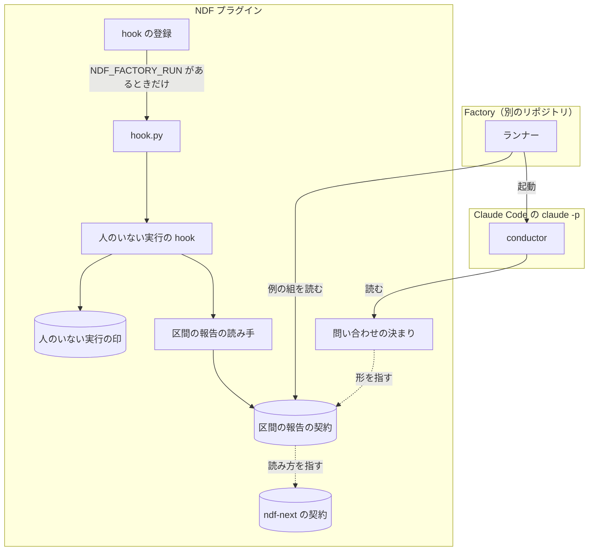
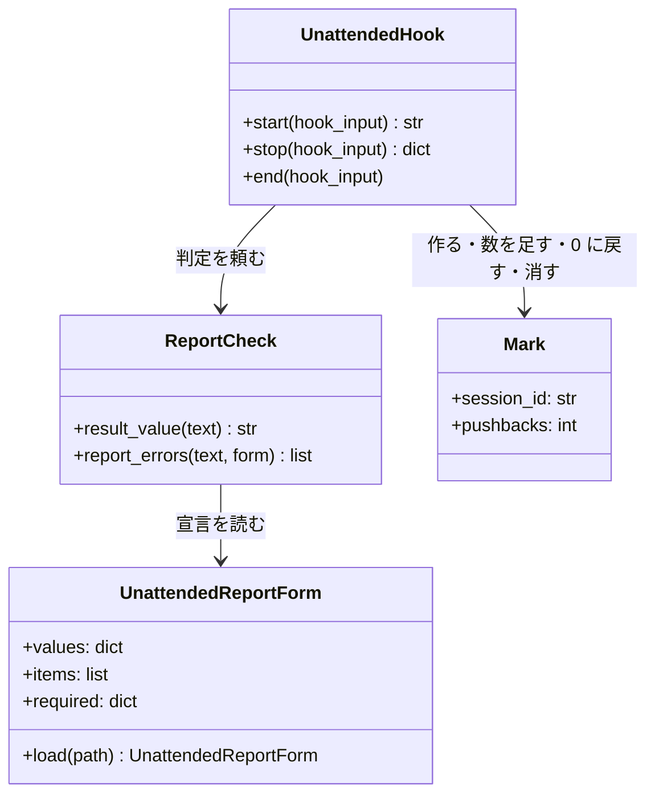
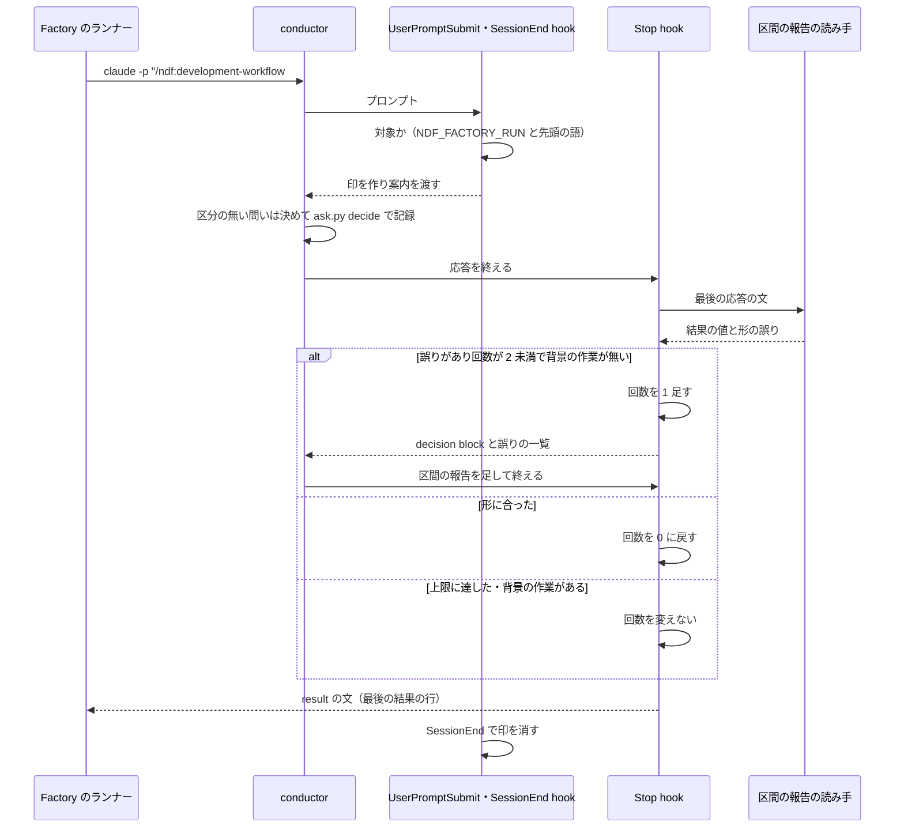

# development-workflow: 人のいない実行で conductor が問い返さずに進み、Factory が読める区間の報告で終える（#3242）

## 目的

- **今どうなっているか**: Factory の実行ジョブ（環境変数 `NDF_FACTORY_RUN` がある `claude -p`）で、conductor がモード判定の後に「確認したいこと」を本文に並べて区間を終える。最後の応答に `- 結果:` の行が無く、Factory はどの課題でも最初の区間を失敗として扱う
- **誰に効くか**: Factory から NDF の開発を回す利用者と、conductor の最後の応答を読む Factory のランナー
- **変えると何が成り立つか**: 人のいない実行の conductor は、区分の無い問いを自分で決めて記録する。承認ゲート・区分のある問い・終わり・続けられないときは、契約の形の「区間の報告」を最後の応答に書いて区間を終える。報告を書かずに終えようとすると、Stop hook が差し戻す。人がいる会話の振る舞いは変わらない

## 適用範囲

- **働く範囲**: NDF を導入したすべてのリポジトリの、人のいない実行の conductor のセッション。Claude Code だけで働く（Factory のランナーは `claude -p` を起動する。Codex の hook は変えない）
- **プロジェクトごとに違うもの**: 人へ回す区分は既存の `.ndf/ask.json` の `allow` で受ける（設定）。人のいない実行かどうかは環境変数 `NDF_FACTORY_RUN` で受ける（Factory が立てる）。引数では受けない
- **当たるモード**: 5 つのモードすべてと pace（`normal`・`fast`・`auto`）。pace が MVV 判定で承認ゲートを通す場合は今どおり通し、区間の報告は次の承認ゲートか終わりで書く

## あるべき姿の根拠

| 根拠 | 種類 | 何を示すか |
| --- | --- | --- |
| STD1 | 外部の一次情報 | Stop hook は最後の応答の文（`last_assistant_message`）を受け、`decision: "block"` で応答を続けさせられる。背景の作業（`background_tasks`）の有無で「終わった」と「待っている」を見分ける |
| STD2 | 外部の一次情報 | `claude -p` は、許可を受け取る相手が無い実行では `AskUserQuestion` を出さない。人のいない実行で問いを Tool で出す手段は無く、問いは本文に書かれる |
| 手元の Claude Code 2.1.323 での実測（「外部の調査」の「hook の実測」。2026-11-13） | 実測 | `claude -p` の最初のプロンプトで UserPromptSubmit が起き、Stop の差し戻しの後に続けた応答が `result` の文になる |
| 「実装の途中で NDF の改修が要ると分かったら、設計で未決として止めない。…そのレーンが ai-plugins の規約（課題・設計承認・リリース承認）で直す」 | 利用者の指示の原文（2026-11-11） | Factory のランナーで補わず、NDF の側を直す |

要求と受け入れ条件は #3242 の本文にある（コピーは `issues/issue-3242-requirements.md`）。この文書は「どう作るか」だけを扱う。

## ドメインモデル

### コンテキスト

| コンテキスト | 何の語が 1 つの意味に決まるか |
| --- | --- |
| 開発の工程（`ndf-workflow`） | conductor・承認ゲート・問い合わせの区分・区分の無い問い・区間の報告の書き方 |
| Factory との受け渡し（`ndf-factory`） | 実行ジョブ・区間・人のいない実行・結果の行・区間の報告の形 |

関係は**公開された言語**である。区間の報告の形は契約のファイル（`plugins/ndf/contracts/forms/unattended-report.json` ）として文書化する。開発の工程が書き手、Factory のランナーが読み手になる。読み手は別のリポジトリにあり、契約のファイルの例の組を自分のテストで読む。既存の `ndf-next` のブロック（`ndf-next-block.json`）と同じ関係である。

### 集約

| 集約 | 持ち主（書き換えてよいもの） | 根 | エンティティ | 値オブジェクト |
| --- | --- | --- | --- | --- |
| 区間の報告の形 | 契約のファイル `unattended-report.json`（人が Pull Request で変える。コードは読むだけ） | 形の宣言 | — | 結果の値（3 つ）・報告の項目・値ごとに要る項目・例の組 |
| 人のいない実行の印 | `hook_lib/unattended.py`（UserPromptSubmit で作り、Stop で回数を足すか 0 に戻し、SessionEnd で消す） | 印のファイル（セッション 1 つに 1 つ） | — | セッションの識別子・続けて差し戻した回数 |

conductor が書く最後の応答は集約に入れない。応答は Claude Code が持ち、NDF の hook は読んで差し戻すだけで書き換えない。

### 不変条件

| # | 集約 | 条件 | 破れたときの扱い |
| --- | --- | --- | --- |
| I1 | 区間の報告の形 | 結果の行の値は、`ndf-next-block.json` の規則の後半（応答の文の最後の「- 結果:」の行の値。前後の空白を除く）と同じ読み方で読む。同じ文に対して 2 つの読み手が同じ値を返す | テストが落ちる。読み方を 2 か所に書かない |
| I2 | 区間の報告の形 | 結果の値は `判断が要る` / `完了` / `できなかった` の 3 つだけで、値ごとに要る項目は契約のファイルの宣言だけが決める | 3 つの外の値・要る項目の欠けは形の誤りとして差し戻す |
| I3 | 人のいない実行の印 | 印のあるセッションの Stop のうち、I4 にも I5 の上限にも当たらないもので、最後の応答が形に合わなければ差し戻す（`decision: "block"` と誤りの一覧） | — |
| I4 | 人のいない実行の印 | 背景の作業（`background_tasks`）か予定（`session_crons`）が残る Stop は差し戻さず、回数も変えない | — |
| I5 | 人のいない実行の印 | 形に合わない Stop が続く間の差し戻しは 2 回までで、続けて 3 回目の形に合わない Stop は通す。形に合った Stop を通したら回数を 0 に戻す。数えるのは NDF の hook が差し戻した回数だけで、同じ Stop を別の hook（`/goal` の条件の判定など）が差し戻しても NDF の数は 1 つだけ増える | 通した後の判定は Factory の側（行が無ければ失敗） |
| I6 | 人のいない実行の印 | 印が付くのは、`NDF_FACTORY_RUN` が空でなく、プロンプトの先頭が `/ndf:development-workflow`（前に `/goal ` を許す）のセッションだけである。worker・レビューの `claude -p` には付かない | — |
| I7 | 人のいない実行の印 | 印はセッションの終わり（SessionEnd）まで残し、Stop では消さない。1 つのセッションで Stop が何度起きても（`/goal` が条件を満たすまで Stop を差し戻す実行を含む）、最後の Stop まで I3 の判定を受ける | SessionEnd で消せなかった印は、次の `unattended-start` が作られてから上限の宣言の日数を過ぎたものを消す。消せなくても hook は止めない |
| I8 | 人のいない実行の印 | `NDF_FACTORY_RUN` が空の実行では、hook は環境変数を 1 回読んで終わり、Python を起動せず、応答の文を読まない | — |
| I9 | 人のいない実行の印 | hook のどの失敗（入力・契約・印の読み書き）も Stop と UserPromptSubmit を止めない側へ倒す | 標準エラーへ 1 行残して通す |

### ドメインイベント

| # | イベント | 発生元 | 受け手 |
| --- | --- | --- | --- |
| E1 | Factory が実行ジョブの区間を起動した | Factory のランナー | conductor（UserPromptSubmit hook） |
| E2 | conductor が人のいない実行だと判定した | UserPromptSubmit hook（印を作り、案内を `additionalContext` で渡す） | conductor |
| E3 | conductor が区分の無い問いを決め、記録した | conductor（`ask.py decide --question`） | 問い合わせの記録（`ask.jsonl`） |
| E4 | conductor が承認を求める区分の問いに当たり、区間を終えた | conductor（区間の報告。`判断が要る`） | Factory のランナー |
| E5 | conductor が人の操作が要る問いに当たり、区間を終えた | conductor（区間の報告。`できなかった` と人に頼むこと） | Factory のランナー |
| E6 | conductor が承認ゲートに着き、承認資料を添えて区間を終えた | conductor（区間の報告。`判断が要る`） | Factory のランナー |
| E7 | conductor が工程を最後まで通し、区間を終えた | conductor（区間の報告。`完了`） | Factory のランナー |
| E8 | conductor が続けられない理由に当たり、区間を終えた | conductor（区間の報告。`できなかった` と理由） | Factory のランナー |
| E9 | 区間の報告を書かずに応答を終えようとし、差し戻された | Stop hook（`hook.py unattended-stop`） | conductor |
| E10 | Factory が最後の結果の行を読み、区間の結果を決めた | Factory のランナー | Factory（対象外） |

### 用語

| 用語 | 意味 | 用語集への反映 |
| --- | --- | --- |
| 区間の報告 | 人のいない実行の conductor が区間を終える最後の応答の末尾に置く報告。見出し「## 区間の報告」の直後の項目が結果の行で、値ごとに要る項目を添える。形は `contracts/forms/unattended-report.json` | 追加（`ndf-factory`） |
| 人のいない実行の印 | 人のいない実行の conductor のセッションに UserPromptSubmit hook が付ける状態のファイル。Stop hook が差し戻しの対象と回数をここで決める | 追加（`ndf-factory`） |
| 結果の行の差し戻し | 人のいない実行の印のあるセッションで、最後の応答が区間の報告の形に合わないとき、Stop hook が Stop を止めて報告を書かせること。形に合わない Stop が続く間は 2 回までで、形に合った Stop で数え直す | 追加（`ndf-factory`） |
| 人のいない実行 | 環境変数 `NDF_FACTORY_RUN` が空でない実行ジョブの区間。`AskUserQuestion` が使えず、応答を人が読まない（要求の定義のまま） | 追加済み（要求と同じ変更。`ndf-factory`） |
| 結果の行 | 最後の応答の文の中の、最後の `- 結果: <値>` の行。値は `判断が要る` / `完了` / `できなかった` の 3 つ（要求の定義のまま） | 追加済み（要求と同じ変更。`ndf-factory`） |
| 区分の無い問い | `asking.md` の「区分」のどれにも当たらない問い。AI が決めて記録する（要求の定義のまま） | 追加済み（要求と同じ変更。`ndf-workflow`） |

用語集の正本は `docs/glossary/glossary.json` で、`docs/glossary.md` は `glossary.py render` で作る。上の 6 語は、この設計と要求の Pull Request の中で 2 つのファイルへ入れてある（設計の結果の「触るファイル」）。

## 外部の調査

| 種類 | 調べるか | 理由 |
| --- | --- | --- |
| 標準・仕様 | 調べる | 差し戻しと対象の判定は Claude Code の hook の仕様（Stop・UserPromptSubmit の入力と出力）と、`claude -p` の振る舞いに依る |
| 主要な製品 | 調べる | 非対話の AI エージェントの最後の応答を、呼ぶ側が決まった形で受け取る手段を主要な CLI が持つ |
| ライブラリとサービス | 調べない | 判定は正規表現と JSON の読み書きで足り、Python の標準ライブラリと既存の hook の部品（`hook.py`・状態の根の関数）で書ける。外部の依存を足す対象が無い |

### 標準・仕様

| # | 標準・仕様 | 何を定めているか | 設計への反映 | 出典 |
| --- | --- | --- | --- | --- |
| STD1 | Claude Code の hook の仕様 | Stop の入力は `stop_hook_active`・`last_assistant_message`・`background_tasks`・`session_crons`。`{"decision":"block","reason":…}` で応答を続けさせる。続けさせるのは 8 回続けてまでで、Tool を呼ぶと数え直す。UserPromptSubmit の入力の `prompt` は打った行のまま（Skill の展開の前）で、`additionalContext` を足せる | Stop で応答の文を読んで差し戻す（決定 3）。背景の作業があれば差し戻さない（I4）。UserPromptSubmit で印を作り案内を渡す（決定 3） | https://code.claude.com/docs/en/hooks.md （2026-11-13） |
| STD2 | Claude Code の非対話の実行（`claude -p`） | 許可を受け取る相手（`--permission-prompt-tool` など）が無い `-p` の実行は `AskUserQuestion` を出さない。`--bare` ではプラグインの hook を読まない。`--json-schema` で最後の出力を JSON Schema に合わせられる | 人のいない実行の問いは Tool ではなく区間の報告で返す（決定 2・7）。`--bare` を付けない前提を「未確認のまま残ること」に置く | https://code.claude.com/docs/en/headless.md と https://code.claude.com/docs/en/hooks.md の `AskUserQuestion` の節（2026-11-13） |

### 主要な製品

| # | 製品 | どう解いているか | 設計への反映 | 出典 |
| --- | --- | --- | --- | --- |
| PRD1 | Claude Code の構造化出力（`claude -p --json-schema`） | 呼ぶ側が JSON Schema を渡し、最後の出力を `structured_output` で受ける。合わなければ欄が無い | 呼ぶ側（Factory のランナー）の起動を変える必要があり、ランナーの変更は対象範囲の外。採らない（決定 7） | https://code.claude.com/docs/en/cli-reference.md （2026-11-13） |
| PRD2 | OpenAI Codex の非対話の実行（`codex exec --output-schema` / `-o`） | 呼ぶ側が JSON Schema を渡し、最後のメッセージをファイルへ書かせる | PRD1 と同じく呼ぶ側の変更になる。採らない（決定 7） | https://developers.openai.com/codex/noninteractive （2026-11-13） |

### hook の実測

手元の Claude Code 2.1.323 で、記録だけを行う hook と、結果の行が無ければ 1 度差し戻す hook を `--settings` で渡して確かめた（2026-11-13）。

```bash
claude -p --model haiku --settings "$S" "「了解」とだけ答えて" </dev/null --output-format json
```

| 確かめたこと | 結果 |
| --- | --- |
| `-p` の最初のプロンプトで UserPromptSubmit が起きるか | 起きる。`prompt` は打った文のまま、`session_id` は Stop と同じ |
| 1 回目の Stop の入力 | `stop_hook_active: false`、`last_assistant_message: "了解"` |
| 差し戻した後の Stop の入力 | `stop_hook_active: true`、`last_assistant_message: "了解\n- 結果: 完了"` |
| `--output-format json` の `result` | `"了解\n- 結果: 完了"`、`num_turns: 2`。差し戻した後の応答がランナーの読む文になる |

問い合わせの記録を区間で絞れるかは、手元で `ask.py summary` を打って確かめた（2026-11-13）。`--since` と `--cwd` の引数を持ち、記録の時刻（`at`。UTC の ISO 8601、例 `2026-11-13T01:23:45+00:00`）を文字列として比べる（`plugins/ndf/scripts/ask.py` の `cmd_summary`）。そのため `--since` には UTC の時刻を渡す。

```bash
$ python3 plugins/ndf/scripts/ask.py summary --help
usage: ask.py summary [-h] [--since SINCE] [--cwd CWD]
$ python3 plugins/ndf/scripts/ask.py summary --since 2026-11-13T00:00:00+09:00 --cwd <空のディレクトリ>
{"tool": "ask", "status": "ok", "summary": "問い合わせ: 止めた 0 件・通した 0 件・案内だけ 0 件、代わりの判断が無い止めた問い 0 件", "items": [], "metrics": {"verdict": {"deny": 0, "allow": 0, "advise": 0}, "source": {}, "decision": {"ref": 0, "no_ref": 0}, "unanswered": 0}}
```

AI が自分で決めて `--question` で記録した問いは `metrics.decision.no_ref` に数えられる。

### 確かめられなかったこと

| 対象 | 試した手段 | 結果と理由 |
| --- | --- | --- |
| `claude -p` で背景の作業（`background_tasks`）を残して応答を終えたとき、プロセスが作業の完了を待って応答を続けるのか、そのまま `result` を返して終わるのか | 試していない（実測は単発の質問 1 件だけ） | 背景の作業を残す実行の実測を足していない。「未確認のまま残ること」へ置き、リリース後テストで確かめる |
| Factory のランナーの起動の形（`--bare` の有無・`--permission-prompt-tool` の有無）と結果の行の読み方 | 試していない | 別のリポジトリにあり、この課題の対象範囲の外。要求の前提 1 と「未確認のまま残ること」へ置く |

調べた量: 候補 4 件・取得の試み 5 回。

## 機能一覧

| # | 機能 | 誰が使うか |
| --- | --- | --- |
| F1 | 区間の報告の形を契約のファイルで読む（結果の値・項目・値ごとに要る項目・例の組） | Factory のランナー、NDF の hook とテスト |
| F2 | 人のいない実行の conductor のセッションに印を付け、人のいない実行の決まりを案内する | conductor |
| F3 | 区間の報告の形に合わない最後の応答を差し戻す（形に合わない Stop が続く間は 2 回まで） | conductor |
| F4 | 人のいない実行での問いの扱い（区分ごとに、決めて続けるか・どの結果で区間を終えるか）を決まりとして読む | conductor |

## 構成要素

| 要素 | 責務 |
| --- | --- |
| 区間の報告の契約（`plugins/ndf/contracts/forms/unattended-report.json`。新設） | 区間の報告の形の正本。結果の行の読み方は `ndf-next-block.json` の規則の後半を指し、結果の値・項目・値ごとに要る項目・例の組を宣言する |
| 契約の検査（`scripts/contracts_lib/model.py`） | 受け渡しの形（`forms/`）の項目に、形の宣言のキーと、区間の報告の例の組の形を許す |
| 区間の報告の読み手（`plugins/ndf/scripts/lib/unattended_report.py`。新設） | 契約のファイルを読み、応答の文から結果の値と形の誤りの一覧を返す。ファイル・環境変数・時刻を読まない純粋な関数（契約のファイルの読み込みだけを別の関数に分ける） |
| 人のいない実行の hook（`plugins/ndf/scripts/hook_lib/unattended.py`。新設） | UserPromptSubmit で対象のセッションを判定して印を作り案内の文を返す。Stop で印を読み、読み手の判定と回数から差し戻すかを決め、回数を足すか 0 に戻す。SessionEnd で印を消す |
| hook のエントリポイント（`plugins/ndf/scripts/hook.py`） | 副命令 `unattended-start`・`unattended-stop`・`unattended-end` を受け、`hook_lib/unattended.py` へ渡す |
| hook の登録（`plugins/ndf/hooks/claude.json`） | UserPromptSubmit・Stop・SessionEnd に、`NDF_FACTORY_RUN` が空なら sh だけで終える行を 1 つずつ足す |
| 契約の項目（`contracts/entrypoints/plugins__ndf__scripts__hook.py.json`・`contracts/files/unattended-mark-json.json`（新設）・`contracts/env/NDF_FACTORY_RUN.json`・生成する `contracts/index.md`） | hook.py が読む環境変数と書く印のファイルを宣言する |
| 上限の宣言（`plugins/ndf/contracts/limits.json`） | 差し戻しの上限の回数（方針 `hook.unattended-pushback`）と、消し残した印を消すまでの日数を持つ |
| 問い合わせの決まり（`plugins/ndf/skills/development-workflow/references/asking.md`） | 「人のいない実行」の節を足す。区分ごとの扱い（承認を求める区分と人の操作が要る区分は `.ndf/ask.json` に関わらず区間を終える）と、区間の報告の契約のファイルへの参照を持つ（形を写さない）。`.ndf/ask.json` の `allow` の行からこの節を指す |
| 工程の決まり（`development-workflow/SKILL.md`・`references/agent-layers.md`） | 「自走で工程を通す」と「conductor の報告」から、人のいない実行では承認ゲートで `AskUserQuestion` の代わりに区間の報告で区間を終えることを `asking.md` の節へ指す |
| hook の説明（`docs/ndf-plugin-reference.md`） | hook の節に、人のいない実行の 2 本の hook を 1 行ずつ足す |



図に入れない要素: 契約の検査（`contracts_lib/model.py`）は CI で契約のファイルを読むだけで実行時の経路に無い。契約の項目と hook の説明は文書で、実行時の経路に無い。上限の宣言は人のいない実行の hook が回数を引くだけの既存の部品である。工程の決まり（SKILL.md・agent-layers.md）は問い合わせの決まりを指すだけで、図の「問い合わせの決まり」に含める。

## 構造



関数の名前と引数は詳細設計の文書で決める。ここでは責務の分かれ目（判定は純粋な関数、状態は hook の部品）だけを決める。

## 入出力の契約

### 区間の報告（応答の文の形）

conductor は区間を終える最後の応答の**末尾**に次の節を置く。見出しの後ろに他の見出しを置かない。`ndf-next` のブロックは節の後ろに置いてよい。

人の判断の材料は、ランナーのコンテナの外から読める形で渡す。コンテナの中のファイルのパスは区間が終わった後に人が開けないため、項目の値にしない。材料の中身（`approval-request.md` の 2 層を持つ承認資料、または問いの判断に要る事実・得失・推奨）は、同じ応答の本文の節「## 判断の材料」に書き、区間の報告の直前に置く。応答の文は Factory が区間の結果として受け取るため、人はそこで材料を読める。

```markdown
## 判断の材料

（承認資料の本文。`approval-request.md` の 2 層）

## 区間の報告

- 結果: 判断が要る
- 課題: #12
- 区分: ndf-gate:1
- 承認ゲート: 設計 Pull Request のマージ
- 問い: 設計 Pull Request をマージしてよいか
- Pull Request: https://github.com/<所有者>/<リポジトリ>/pull/<番号>
- 材料: 本文
- 人に頼むこと: 無し
- 理由: 無し
```

| 項目 | 値 | 空のとき |
| --- | --- | --- |
| 結果 | `判断が要る` / `完了` / `できなかった` | 空にしない |
| 課題 | `#番号` を空白区切り | 空にしない |
| 区分 | `asking.md` の区分の名前（`ndf-gate:1`・`ndf-ask:redline:C4`・`ndf-ask:human-action` など） | `無し` |
| 承認ゲート | `設計 Pull Request のマージ` / `本番の系へ届く操作` | `無し` |
| 問い | 人に決めてほしいことを 1 行 | `無し` |
| Pull Request | URL を空白区切り | `無し` |
| 材料 | `本文`（同じ応答に「## 判断の材料」の節がある）か、コンテナの外から開ける `https://` の URL を空白区切り | `無し` |
| 人に頼むこと | 人にしかできない操作を 1 行 | `無し` |
| 理由 | 1 行 | `無し` |

値ごとに要る項目（`無し` にしない項目）:

| 結果 | 要る項目 | 条件つきで要る項目 |
| --- | --- | --- |
| `判断が要る` | 区分・問い・材料 | 区分が `ndf-gate:<番号>` なら承認ゲートと Pull Request |
| `完了` | — | — |
| `できなかった` | 理由 | 区分が `ndf-ask:human-action` なら人に頼むこと |

- 材料の値が `本文` のときは、区間の報告より前に見出し「## 判断の材料」が要る。`本文` でも `https://` で始まる URL でもない値（ファイルのパスなど）は形の誤りとする。この 2 つも契約のファイルの `shape` が宣言し、hook が確かめる
- **結果の行の読み方**は `ndf-next-block.json` の規則の後半と同じ（応答の文の最後の「- 結果:」の行の値、前後の空白を除く）。Factory のランナーが読むのは値だけで、ほかの項目は人が読む
- `完了` に `ndf-next` のブロックが添えば、区間はカットポイントで終わり、次の区間はブロックの中身で始まる（`ndf-next-block.json` の規則どおり）。ブロックが無ければ工程を最後まで通した
- 項目の読み方: 結果の行より後ろの、`- <項目>: <値>` の形の行を項目として読む。同じ項目が 2 つあれば後ろを読む

### 契約のファイル（`plugins/ndf/contracts/forms/unattended-report.json`）

既存の受け渡しの形（`name`・`summary`・`rule`・`writers`・`readers`・`cases`）に、形の宣言のキー `shape` を足す。

```json
{
  "name": "unattended-report",
  "summary": "人のいない実行（NDF_FACTORY_RUN）の conductor が区間を終える最後の応答の末尾の報告。Factory のランナーは結果の行の値で区間の結果を決める",
  "rule": "結果の行は ndf-next-block の規則の後半と同じく、応答の文の最後の「- 結果:」の行の値（前後の空白を除く）。値は shape.values のどれか。結果の行より後ろの「- <項目>: <値>」の行を項目として読み、shape.required が値ごとに要る項目（無しにしない）を決める",
  "shape": {
    "values": {"判断が要る": "承認ゲートか承認を求める区分の問いで止まった", "完了": "工程を最後まで通した。ndf-next があればカットポイント", "できなかった": "続けられない・人の操作が要る"},
    "items": ["結果", "課題", "区分", "承認ゲート", "問い", "Pull Request", "材料", "人に頼むこと", "理由"],
    "material": {"item": "材料", "body": "本文", "heading": "## 判断の材料", "url_prefix": "https://"},
    "required": {
      "判断が要る": {"always": ["区分", "問い", "材料"], "when": [{"item": "区分", "prefix": "ndf-gate:", "need": ["承認ゲート", "Pull Request"]}]},
      "完了": {"always": [], "when": []},
      "できなかった": {"always": ["理由"], "when": [{"item": "区分", "equals": "ndf-ask:human-action", "need": ["人に頼むこと"]}]}
    }
  },
  "writers": ["plugins/ndf/skills/development-workflow/references/asking.md"],
  "readers": ["plugins/ndf/scripts/lib/unattended_report.py"],
  "cases": [
    {"text": "## 区間の報告\n\n- 結果: 完了\n- 課題: #1\n- 区分: 無し\n…", "result": "完了", "errors": []},
    {"text": "## 確認したいこと\n\n「進めて」と返してもらえれば続けます。\n", "result": "", "errors": ["結果の行が無い"]}
  ]
}
```

- 例の組の形は `{"text": 文, "result": 結果の値（行が無ければ空の文字列）, "errors": 形の誤りの一覧}`。誤りの文言は読み手の関数が返す文と一致させる
- 例の組は少なくとも次を持つ
  - 3 つの値の正しい形
  - 行が無い
  - 3 つの外の値
  - 値ごとの要る項目の欠け
  - 条件つきの欠け（承認ゲートで Pull Request が無い）
  - 材料が `本文` なのに「## 判断の材料」の節が無い
  - 材料がファイルのパス
  - 結果の行が 2 つある（後ろを読む）
- `shape` の形（キーと型）は契約の検査が確かめる

### hook の入出力

| 副命令 | 事象 | 入力（標準入力の JSON から読むもの） | 出力 |
| --- | --- | --- | --- |
| `hook.py unattended-start` | UserPromptSubmit | `session_id`・`prompt` | 対象なら印を作り `{"hookSpecificOutput":{"hookEventName":"UserPromptSubmit","additionalContext":<案内>}}`。対象でなければ何も出さない |
| `hook.py unattended-stop` | Stop | `session_id`・`last_assistant_message`・`background_tasks`・`session_crons` | 差し戻すなら `{"decision":"block","reason":<誤りの一覧と契約のパス>}`。通すなら何も出さない |
| `hook.py unattended-end` | SessionEnd | `session_id` | 印を消す。何も出さない |

- Stop の hook は複数あれば並んで動き、どれか 1 つが差し戻せば Stop は止まる（STD1）。`/goal` の条件の判定と NDF の差し戻しが同じ Stop に重なっても、NDF は自分の判定だけで回数を数える（I5）
- どちらも終了コードは 0（I9）
- 登録の行は `sh -c '[ -n "${NDF_FACTORY_RUN:-}" ] || exit 0; …'` で始め、空なら Python を起動しない（I8）。続きは既存の hook の行と同じく、SessionStart が用意した hook 用の仮想環境の python で `hook.py` を直に起動する（`uv run` を挟まない。構造の検査 `hook-deps`）
- 差し戻しの上限の回数は、上限の宣言（`plugins/ndf/contracts/limits.json` ）に方針 `hook.unattended-pushback`（`attempts: 2`）として置く。`lib/limits.py` で引く（構造の検査 `limit-literal`）
- 案内の文は次の 3 つを指す。形の表は写さない
  - 人のいない実行であること
  - 区分の無い問いは決めて `ask.py decide --question` で記録して続けること
  - 区間の終え方の正本（`asking.md` の「人のいない実行」と契約のファイルのパス）
- 差し戻しの文は、読み手の関数が返した誤りの一覧と、契約のファイルのパスと、残りの差し戻しの回数を持つ

### 人のいない実行の印（`<状態の根>/unattended/<session_id>.json`）

| キー | 型 | 意味 |
| --- | --- | --- |
| `session_id` | 文字列 | Claude Code のセッションの識別子 |
| `started_at` | 文字列（ISO 8601） | 印を作った時刻 |
| `pushbacks` | 整数 | 形に合わない Stop が続いた間に差し戻した回数。形に合った Stop を通すと 0 に戻る |

状態の根は既存の `state_home.container_home` で決める（待ちの通知・guard と同じ、セッションを持つ状態の根。`state_home` の置き場の表の「コンテナのプロセス」）。ファイル名の `session_id` は英数字と `-` 以外を含めば印を作らない。

## 処理の流れ



U と S は人のいない実行の hook のエントリポイントで、hook の登録の行と `hook.py` を通って起動する。F が読む契約のファイルと S が引く上限の宣言、conductor が読む問い合わせの決まりと工程の決まり、契約の検査・契約の項目・hook の説明は、この図に入れない（構成要素図にある）。

conductor が区間を終える場面と結果の値:

| 場面 | 結果 | 決まり |
| --- | --- | --- |
| 区分の無い問い | 終えない | 決めて `ask.py decide --question` で記録し、続ける |
| 承認ゲート（pace が MVV 判定で通さないとき） | `判断が要る` | 区分 `ndf-gate:<番号>`・承認ゲート・Pull Request・材料を添える |
| 承認を求める区分の問い（レッドライン・費用・取り消せない操作・規約への同意） | `判断が要る` | 区分・問い・材料。`.ndf/ask.json` の `allow` と `mode` に関わらず区間を終える |
| 人の操作が要る問い（`ndf-ask:human-action`） | `できなかった` | 区分・人に頼むこと・理由。`.ndf/ask.json` の `allow` と `mode` に関わらず区間を終える |
| プロジェクトが `.ndf/ask.json` の `extra` に足した区分の問い | `判断が要る` | 区分・問い・材料 |
| 工程の最後まで通した | `完了` | — |
| カットポイント | `完了` | `ndf-next` のブロックを添える（既存の決まり） |
| 続けられない（スクリプトの失敗・権限の不足） | `できなかった` | 理由 |

`.ndf/ask.json` の `allow` は、人がいる会話で「人へ回してよい区分」を絞る設定で、外した区分は AI が決める。人のいない実行ではこの絞り込みを当てない。外した区分を AI が決めて進めると、人のいない所でレッドライン・費用・取り消せない操作・規約への同意を AI が承認し、AI にはできない人の操作を「決めて続ける」ことになる。これは要求の境界（AI によるレッドラインの操作の承認を行わない）と共通原則の C1〜C8 に反するため、承認を求める区分と人の操作が要る区分は、設定に関わらず区間を終える。`asking.md` の「人のいない実行」の節はこの扱いを書き、`allow` の表の行からそこを指す。

## 非機能の実現方式

| 大項目 | 条件 | 実現方式 |
| --- | --- | --- |
| 運用・保守性 | 結果の行の形の正本は契約のファイル 1 つで、Factory のランナーのテストと NDF のテストが同じ例の組を読む | 値・項目・値ごとに要る項目を契約のファイルの `shape` に置き、読み手の関数はそこから読む（決定 1）。NDF のテストは `unattended-report.json` と `ndf-next-block.json` の両方の例の組を読む |
| 性能・拡張性 | 差し戻しの判定は、`NDF_FACTORY_RUN` の無い実行では環境変数の読み 1 回で終わり、応答の文を読まない | 登録の行の sh が環境変数を 1 回読んで終える（決定 6）。Python を起動しないため、既存の hook の起動時間も増えない |

## 決定の記録

### 決定 1: 読み方を 2 か所に持たないため、区間の報告の契約を新設し、結果の行の読み方は ndf-next の契約を指す

`ndf-next-block.json` は結果の行の読み方（最後の「- 結果:」の行の値）をすでに持ち、Factory のランナーのテストがその例の組を読む。区間の報告の契約は読み方を書き直さず、その規則の後半を指し、足すのは値・項目・値ごとに要る項目だけにする。読み手の関数は 1 つ（`lib/unattended_report.py`）にし、NDF のテストが 2 つの契約の例の組を同じ関数で読む。

`ndf-next-block.json` に項目と値を足して 1 つの契約にする形は採らない。カットポイントのブロックと区間の報告は書く時点と読み手の振る舞いが違い、`ndf-next` の例の組の形（`blocks`・`launch`）に報告の形の誤りを混ぜると、既存の読み手のテストの意味が変わる。

根拠: Value 11 / Value 8（MVV 版 7）

### 決定 2: Factory の読み方を 1 つに保つため、承認ゲートの外の承認を求める問いも `判断が要る` で終え、区分の項目で見分ける

Factory は `判断が要る` を「人の答えを待って止まった」と読み、答えで次の実行ジョブを始める。レッドライン・費用・取り消せない操作・規約への同意の問いも、人の答えを待って次の区間で続ける点で同じ扱いになる。値を増やすと Factory のランナーの読み方も増える。人が読む違いは `- 区分:` と `- 問い:` の項目が持つ。

承認ゲート以外の問いに別の値（`問いが要る` など）を足す形は採らない。ランナーの変更が要り、対象範囲の外である。

この値は要求の未決 2 への設計の案で、承認ゲートの外の承認でも同じ値でよいかは、設計承認ゲートで利用者が Factory の側と合わせて決める（「人へ残す判断」）。

根拠: Value 1 / Value 4 / C1〜C8（MVV 版 7）

### 決定 3: worker とレビューの claude -p を巻き込まないため、差し戻しの対象を UserPromptSubmit が付ける印で決める

`NDF_FACTORY_RUN` は子のプロセスへ継がれ、supervise.py の worker・cross-review の相手役の `claude -p` も同じ値を持つ。環境変数だけで対象を決めると、区間の報告を書かない子の応答まで差し戻し、費用が増え、子の出力が壊れる。UserPromptSubmit はプロンプトを打った行のまま受ける（STD1・実測）ため、先頭が `/ndf:development-workflow` のセッションだけに印を付けられる。あわせて、印を付けた時点で案内の文を `additionalContext` で渡し、conductor が自分で環境変数を調べなくても人のいない実行の決まりを読む。

Stop で毎回 transcript の最初のプロンプトを読む形は採らない。transcript の書き込みは遅れることがあり（STD1）、行の形も版で変わる。子の起動ごとに `NDF_FACTORY_RUN` を外す形も採らない。起動する箇所が supervise.py・relay・外部 AI の CLI に分かれ、外し忘れが残る。

- 作り方: 自前で作る・標準に倣う
- 比べた候補: STD1 / STD2 / PRD1

根拠: Value 2 / Value 3（MVV 版 7）

### 決定 4: 差し戻しを無駄に繰り返さないため、形に合わない Stop が続く間の差し戻しは 2 回までにし、回数を印に持つ

1 回目で直らない応答は、2 回目で直ることがある（形の誤りの一覧を読んで足す）が、3 回目以降は同じ応答の繰り返しになりやすい。2 回で直らなければ Stop を通し、Factory は行の無い区間を失敗として扱う（前提 1）。回数は印のファイルに持ち、上限の値は上限の宣言に置く。

回数は形に合った Stop で 0 に戻し、印はセッションの終わりまで残す。`/goal /ndf:development-workflow` で始まるセッションでは、`/goal` が条件を満たすまで Stop を差し戻して続けさせる。そのため、1 つのセッションに Stop が何度も起きる。途中の Stop で印を消すと、最後の Stop が判定されない。セッションで通算して数えると、途中の Stop で使い切った回数のために最後の Stop を差し戻せない。続けて形に合わない Stop だけを数えれば、どの Stop も同じ上限で判定される。

上限の 2 回は要求の未決 1 への設計の案で、決めるのは設計承認ゲートの利用者である（「人へ残す判断」）。

`stop_hook_active` で回数を数える形は採らない。Claude Code は Tool を呼ぶと続けた回数を数え直す（STD1）。この値は `/goal` の続きでは常に真になる（`docs/specifications/ndf-relay-goal-skill-and-prose-wait.md` ）。そのため、同じセッションの差し戻しの回数を表さない。Claude Code の上限（8 回続けて）に任せる形も採らない。報告を書かないまま 8 回分の費用がかかる。

根拠: Value 2（MVV 版 7）

### 決定 5: Factory と人が読む材料を欠かさないため、hook は値だけでなく値ごとに要る項目まで確かめる

受け入れ条件 2・4・5・6 は、値と一緒に承認ゲートの名前・設計 Pull Request の URL・問いと材料・人に頼むこと・理由が載ることを求める。値だけを確かめると、項目の欠けた報告がそのまま Factory へ届き、人が読む材料が無い。項目の有無は文の照合ではなく行の形で決まるため、決定的に確かめられる。材料は、値が `本文` なら「## 判断の材料」の節があるか、そうでなければ `https://` の URL かまでを確かめる。ランナーのコンテナの中のファイルのパスは区間が終わった後に人が開けず、材料を添えたことにならないためである。項目の中身の正しさ（URL が開けるか・理由が筋が通るか）は確かめない。

根拠: Value 1 / Value 3（MVV 版 7）

### 決定 6: 人がいる会話の費用を増やさないため、hook の登録の行で NDF_FACTORY_RUN を sh だけで確かめる

UserPromptSubmit と Stop はすべてのプロンプトと応答で起きる。登録の行の先頭で環境変数を読み、空なら Python を起動せずに終える。既存の relay の行（`NDF_RELAY_DIR`）と同じ形である。

既存の `hook.py` の Stop の行（待ち通知）の中で判定する形は採らない。人がいる会話でも Python の中まで入り、非機能の条件（環境変数の読み 1 回）を満たさない。

根拠: Value 2 / Value 4（MVV 版 7）

### 決定 7: ランナーを変えずに直すため、構造化出力のフラグを使わず、応答の文の契約で受け渡す

`claude -p --json-schema`（PRD1）と `codex exec --output-schema`（PRD2）は、呼ぶ側が起動のフラグを渡す形である。使うには Factory のランナーの変更が要る。要求はランナーの変更を対象範囲の外に置き、既存の `ndf-next` のブロックも応答の文の契約で受け渡している。応答の文の契約なら、人が読む報告と機械が読む値が同じ文に載る。

`AskUserQuestion` の hook（問い合わせの guard）を人のいない実行向けに変える形も採らない。許可を受け取る相手の無い `-p` の実行では Tool が出ない（STD2）ため、guard を変えても今の事象に効かない。

- 作り方: 自前で作る・標準に倣う
- 比べた候補: PRD1 / PRD2 / STD2

根拠: Value 4 / Value 12（MVV 版 7）

### 決定 8: 問いの扱いの正本を 1 つに保つため、人のいない実行の決まりを asking.md の節に置き、SKILL.md と agent-layers.md はそこを指す

区分ごとの扱いは `asking.md` が正本で、人のいない実行は区分ごとの扱いを「区間をどの値で終えるか」に読み替えるだけである。SKILL.md の「自走で工程を通す」と agent-layers.md の「conductor の報告」には、人のいない実行では承認ゲートで区間の報告を書いて終えることと参照先だけを置く。

新しい参照の文書（`unattended.md` など）を作る形は採らない。区分の表を写すか、行き来が増える。

根拠: Value 11 / Value 14（MVV 版 7）

## テスト設計

| 受け入れ条件・不変条件 | どの振る舞いで縛るか | どう壊したら落ちるべきか |
| --- | --- | --- |
| 受け入れ条件 1・I1 | 読み手の関数が、`unattended-report.json` の例の組のすべてで宣言どおりの値と誤りを返す。`ndf-next-block.json` の例の組で、値が `判断が要る` のものは起動しない（`launch` が偽）と一致する | 結果の行を最初の行で読むように壊す。前後の空白を除かないように壊す |
| 受け入れ条件 1 | 契約の検査が `shape` のキーと区間の報告の例の組の形を許し、形の違う `shape`（値の無い `required` など）を拒む | `_check_form` が `shape` を知らないキーとして拒むまま。型を見ないように壊す |
| I2 | 3 つの外の値・値ごとに要る項目の欠け・条件つきの欠けを誤りとして返す。要る項目を契約のファイルから読む | 要る項目を関数の中に書き写す（契約のファイルの `required` を変えても判定が変わらない） |
| I2・受け入れ条件 2・5 | 値が `判断が要る` で、材料が `無し`・ファイルのパス・`本文` なのに「## 判断の材料」の節が無いもの、区分が `ndf-gate:<番号>` で Pull Request が無いものを誤りとして返す | 材料の形を見ない。Pull Request を条件つきの要る項目から外す |
| 受け入れ条件 7・I3 | 印のあるセッションで、結果の行の無い応答の Stop に `decision: "block"` と誤りの一覧を返す | 印を読まずに通す。誤りがあっても何も出さない |
| I4 | `background_tasks` か `session_crons` が空でない Stop では差し戻さず、印を残す | 背景の作業を見ずに差し戻す。印を消す |
| I5 | 続けて 3 回目の形に合わない Stop を通し、印を残す | 回数を数えない。2 回目で止める |
| I5 | 形に合った Stop の後は回数が 0 に戻り、次に形に合わない Stop が続けば再び 2 回まで差し戻す。別の hook が同じ Stop を差し戻した入力（`stop_hook_active` が真）でも、NDF の回数は 1 つだけ増える | 回数を戻さない。`stop_hook_active` で回数を数える |
| I6 | `NDF_FACTORY_RUN` があり先頭が `/ndf:development-workflow` か `/goal /ndf:development-workflow` のプロンプトだけ印を作る。`/ndf:design #1` や普通の文では作らず、何も出さない | 先頭の語を見ずに印を作る |
| I7 | 形に合った Stop を通しても印を残し、同じセッションの後の Stop（`/goal` の続き）も判定する。SessionEnd で印を消す。上限の宣言の日数を過ぎた印は次の `unattended-start` で消える | Stop で印を消す。SessionEnd で消さない |
| 受け入れ条件 8・I8 | 登録の行が、`NDF_FACTORY_RUN` が空のとき Python を起動せず終了コード 0 で何も出さない。既存の hook・問いの区分・`ndf-next` のブロックのテストを変えずに通す | sh の判定を外す。既存のテストのファイルを書き換える |
| I9 | 入力が JSON でない・契約のファイルが読めない・印が書けないとき、終了コード 0 で何も出さない（差し戻さない） | 例外をそのまま上げる |
| 受け入れ条件 2〜6 | リリース後テストで、要求の「再現手順」の 2 を開発版のチャネルで打ち、`stream-json` の最後の `result` の文と `ask.py summary --since <起動の時刻（UTC の ISO 8601）> --cwd <試しのリポジトリの根>` の `metrics.decision.no_ref` を見る | LLM の応答に依るため、ユニットテストでは縛らない |
| 受け入れ条件 4・5（`.ndf/ask.json` が区分を許さないとき） | リリース後テストで、試しのリポジトリに `"allow": []` の `.ndf/ask.json` を置き、人の操作が要る課題と、費用の出る操作（有料の API の呼び出しなど）を求める課題を流す。最後の結果の行がそれぞれ `できなかった`（人に頼むことつき）と `判断が要る`（区分 `ndf-ask:cost`・問い・材料つき）になる | LLM の応答に依るため、ユニットテストでは縛らない |
| 背景の作業を残した Stop（I4） | リリース後テストで、conductor が supervisor を背景で起動して待つ区間を流し、背景の作業がある Stop の後に `result` が返るか、`result` の最後の結果の行があるかを見る | 「未確認のまま残ること」の確かめ方 |

## 設計の結果

| 課題 | 扱い | 取り込み先 | 触るファイル |
| --- | --- | --- | --- |
| #3242 | 実装する | — | `plugins/ndf/contracts/forms/unattended-report.json`（新設）、`scripts/contracts_lib/model.py`、`scripts/tests/test_check_ndf_contracts.py`、`plugins/ndf/scripts/lib/unattended_report.py`（新設）、`plugins/ndf/scripts/hook_lib/unattended.py`（新設）、`plugins/ndf/scripts/hook.py`、`plugins/ndf/hooks/claude.json`、`plugins/ndf/contracts/entrypoints/plugins__ndf__scripts__hook.py.json`、`plugins/ndf/contracts/files/unattended-mark-json.json`（新設）、`plugins/ndf/contracts/env/NDF_FACTORY_RUN.json`、`plugins/ndf/contracts/index.md`、`plugins/ndf/contracts/limits.json`、`plugins/ndf/skills/development-workflow/references/asking.md`、`plugins/ndf/skills/development-workflow/SKILL.md`、`plugins/ndf/skills/development-workflow/references/agent-layers.md`、`docs/ndf-plugin-reference.md`、`plugins/ndf/scripts/tests/test_unattended_report.py`（新設）、`plugins/ndf/scripts/tests/test_hook_unattended.py`（新設）、`docs/glossary/glossary.json`、`docs/glossary.md`（用語 6 語。要求と設計の Pull Request で入れてある） |

## 人へ残す判断

| # | 判断 | 設計の案 | 決める人と時期 |
| --- | --- | --- | --- |
| 1 | 結果の行の差し戻しが続けて効かないとき、何回で諦めて応答を終えるか（要求の未決 1） | 形に合わない Stop が続く間は 2 回まで。3 回目は通し、Factory は行の無い区間を失敗とする（決定 4。値は上限の宣言 `hook.unattended-pushback` で変えられる） | 利用者。設計承認ゲート |
| 2 | 承認ゲートの外の承認を求める区分の問い（レッドライン・費用・取り消せない操作・規約への同意）の結果の値を `判断が要る` にするか（要求の未決 2） | `判断が要る` にし、`- 区分:` の項目で承認ゲートと見分ける（決定 2）。Factory はこの値を「承認ゲートで止まった」と読むため、同じ値でよいかを Factory の側と合わせる必要がある | 利用者が Factory の側と合わせて決める。設計承認ゲート |

## 未確認のまま残ること

| 項目 | 内容 |
| --- | --- |
| Factory のランナーの読み方 | ランナーが最後の結果の行の値で区間の結果を決め、行が無ければ失敗とすること（要求の前提 1）は、ランナーのリポジトリにあり確かめていない。リリース後テストで Factory の実行ジョブの区間の結果を見て分かる |
| Factory のランナーの起動の形 | ランナーが `--bare` を付けていればプラグインの hook が動かず（STD2）、差し戻しと案内が働かない。リリース後テストで、`stream-json` に Stop hook の差し戻しが現れるか、印のファイルが作られるかで分かる |
| 背景の作業を残した Stop の後の `claude -p` の振る舞い | conductor は supervisor を背景で起動して待つ。背景の作業が残る Stop は差し戻さない（I4）。プロセスが作業の完了を待って応答を続けるなら、最後の Stop で判定される。そのまま `result` を返して終わるなら、結果の行の無い `result` が差し戻されずにランナーへ届き、受け入れ条件 7 が働かない。手元では単発の質問 1 件しか実測しておらず、どちらかは確かめていない。リリース後テストで、背景の作業を残す区間の `stream-json` の最後の `result` と Stop の入力の `background_tasks` を見て分かる。後者だったときは、背景の作業を残して区間を終えないことを `asking.md` の「人のいない実行」の節へ足すかを、次の課題で決める |
| conductor の振る舞い（受け入れ条件 2〜6） | 案内と決まりを読んだ conductor が、区分の無い問いを決めて承認ゲートまで進むかは LLM の応答に依る。Factory のモデル（Claude Sonnet 5.5）でのリリース後テストで分かる |
