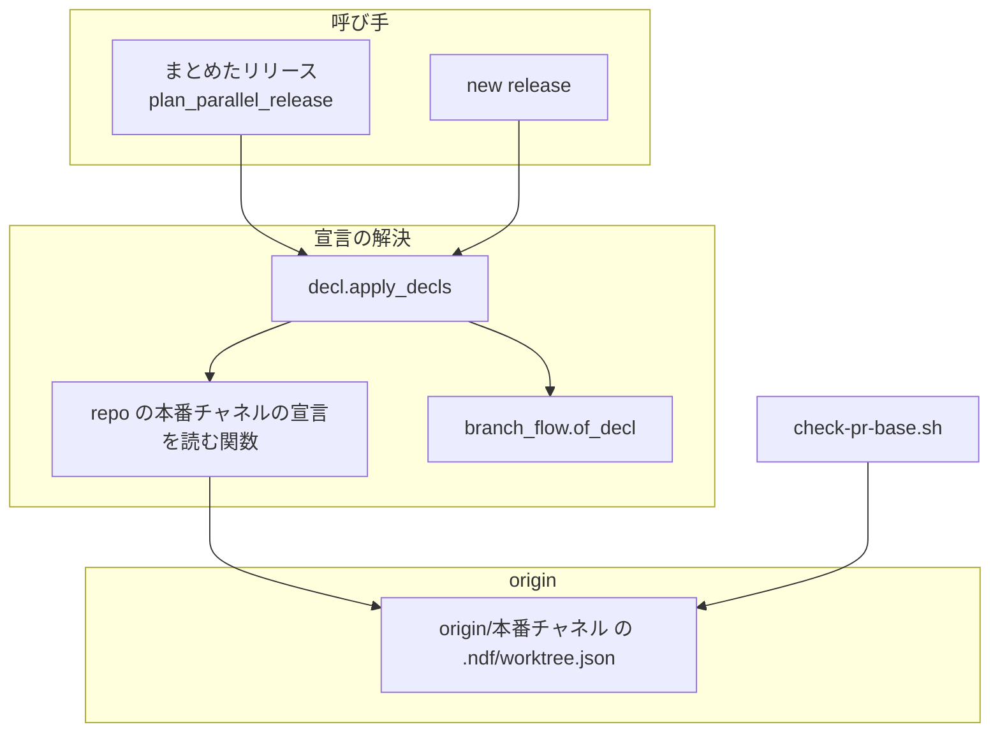
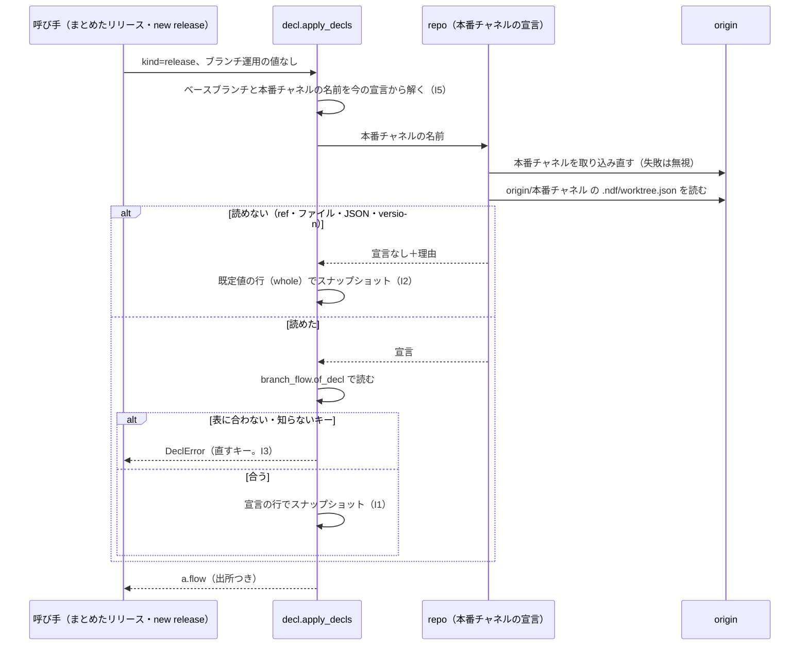

# ブランチ運用の宣言: スプリントに属さないリリースを、本番チャネルの宣言の取り込み方で組む（#3308）

## 目的

- **今どうなっているか**: まとめたリリースと `supervise.py new release` のプランは、取り込み方をメインディレクトリ（ベースブランチを追従）の宣言から読む。一方 `main` 宛の検査は本番チャネルの宣言で判定する。ベースブランチだけを `selected` に切り替えた時点で、リリースのプランは `selected` で組まれ、検査は `whole` で判定するため、切り替えを載せたリリースが組めない
- **誰に効くか**: ブランチ運用の宣言を `whole` から `selected` へ切り替えるリポジトリ（ai-plugins の #3119 の段 4 を含む）の利用者
- **変えると何が成り立つか**: リリースを組む側と `main` 宛の検査が同じ宣言を読み、検査に断られるプランを組まない。後の工程が「どの時点の宣言を読むか」が 1 つの規則になり、宣言を切り替える途中でも工程ごとに読む値が食い違わない

## 適用範囲

- **働く範囲**: NDF を使うすべてのリポジトリ。宣言の無いリポジトリと、本番チャネルとベースブランチの宣言が同じリポジトリでは、組まれるプランは変わらない
- **プロジェクトごとに違うもの**: 本番チャネルとベースブランチの名前は、今と同じく宣言（`production_branch`・`base_branch`）と既定ブランチから解く。新しい設定と引数は足さない
- **当たるモード**: `standard`。並列の計画のまとめたリリースと、単発の `new release` に効く。スプリントの中のリリースのプランは変わらない

## あるべき姿の根拠

| 根拠 | 種類 | 何を示すか |
| --- | --- | --- |
| 一時リポジトリで、`main` に `branch_flow` の無い宣言、`develop` に `selected` の宣言を置き、`kind=release` で `decl.apply_decls` を打つと、取り込み方が `selected`・出所が `.ndf/worktree.json の branch_flow` になった（2026-11-13） | 実測 | リリースのプランが本番チャネルの宣言を読んでいない |
| `scripts/check-pr-base.sh` の 39〜41 行は、`origin/<宛先>` を取り込み直してから `git show refs/remotes/origin/<宛先>:.ndf/worktree.json` の `version == 1` の宣言の `branch_flow.promotion` を読む | 実測（コードを読んだ結果） | 検査の判定は本番チャネルの宣言で決まる。同じ宣言を読めば、組むプランと検査の判定が揃う |
| 課題 #3308 の「期待する結果」（取り込み方を `main` 宛の検査と同じ本番チャネルの宣言で決める） | 利用者の指示の原文 | 読み先を本番チャネルの宣言にする |

要求と受け入れ条件は #3308 の本文にある（コピーは [issue-3308-requirements.md](issue-3308-requirements.md) ）。この文書は「どう作るか」だけを扱う。

## ドメインモデル

### コンテキスト

| コンテキスト | 何の語が 1 つの意味に決まるか |
| --- | --- |
| 開発の工程（`ndf-workflow`） | ブランチ運用の宣言・本番チャネルの宣言・開始時の記録・スプリントブランチ |
| リリース（`ndf-release`） | まとめたリリース・リリースの単位 |

開発の工程が供給者、リリースが顧客の関係（顧客 / 供給者）。語の置き場は用語集（`docs/glossary.md` の開発の工程の節）に合わせる。
確定仕様 `docs/specifications/ndf-branch-flow-declaration.md` の関係を変えない。リリースのコンテキストは、供給者の集約
（ブランチ運用の宣言・本番チャネルの宣言・開始時の記録）を読むだけで、書き換えない。
スプリントに属するリリースは、開発の工程が記録した開始時の記録を受け取る。スプリントに属さないリリースは、開始時の記録を持たないため、
本番チャネルへ出す時点で検査と同じ本番チャネルの宣言を読む。

### 集約

| 集約 | 持ち主（書き換えてよいもの） | 根 | エンティティ | 値オブジェクト |
| --- | --- | --- | --- | --- |
| ブランチ運用の宣言 | ベースブランチへの宣言を変える Pull Request のマージ（`project-decl.py write` の出力も手の編集も、このマージで入る。本番チャネルの宣言は、それを本番チャネルへ出すマージでだけ変わる） | `.ndf/worktree.json` の `branch_flow` | — | 4 項目の値・レビューの単位（`reviews`） |
| スプリント | `supervise.py new sprint`（開始時に 1 回だけ書く） | スプリントの目録（`sprint.json`） | スプリントブランチ | 開始時の記録 |
| リリース | リリースのプランの組み立て（`supervise_lib/release_templates.py` の `plan_release`） | 承認資料と承認したコミット | リリースブランチ | 組んだ時点の取り込み方の値（プランが持つスナップショット） |

この変更は集約を足さない。リリースの集約を作るのは `plan_release` だけで、呼び手のプランによってスナップショットの受け取り元が分かれる。

| リリースのプラン | `plan_release` へ渡すスナップショットの受け取り元 | 不変条件 |
| --- | --- | --- |
| スプリントの中のリリース（開発版・本番のステージ） | 開始時の記録 | I4 |
| まとめたリリース（提示・本番） | 本番チャネルの宣言（この変更で替える） | I1 |
| `new release`（`--channel dev`・`--channel prod`） | 本番チャネルの宣言（この変更で替える） | I1 |

### 不変条件

| # | 集約 | 条件 | 破れたときの扱い |
| --- | --- | --- | --- |
| I1 | リリース | スプリントに属さないリリースのプラン（開発版・本番を問わない）は、取り込み方とリリースのレビューの単位を、組む時点の本番チャネルの宣言から読む | — |
| I2 | リリース | 本番チャネルの宣言を読めない（origin に本番チャネルが無い・ファイルが無い・JSON として読めない・`version` が 1 でない）ときは、既定値の行（`whole`）で組む | — |
| I3 | リリース | 本番チャネルの宣言の `branch_flow` が取り込み方の表に合わない・知らないキーを持つときは、既定値へ倒さずにプランを組まない | `DeclError`（直すキーと許す値、読んだ宣言の場所つき）。`new release` は終了コード 2 |
| I4 | スプリント | 開始時の記録を持つプラン（`new sprint` の打ち直し・`new close`・スプリントの中のリリース）は、記録の値で組み、本番チャネルの宣言を読まない | — |
| I5 | リリース | ベースブランチと本番チャネルの名前は、読み先を替えても今の宣言（メインディレクトリ）と既定ブランチから解く | — |
| I6 | 宣言 | 宣言の無いリポジトリでは、組まれるプランが変わらない | — |

### ドメインイベント

| # | イベント | 発生元 | 受け手 |
| --- | --- | --- | --- |
| E1 | スプリントを始め、開始時の宣言の値を目録に記録した | `supervise.py new sprint` | スプリントの後の工程（E3・E7・スプリントの中のリリース） |
| E2 | ベースブランチの宣言を書き換えた | 宣言を変える Pull Request のマージ | 次に始める `new sprint`（E1） |
| E3 | スプリントブランチを作った | スプリントのプランのスプリントブランチのステップ | スプリントの後の工程 |
| E4 | まとめたリリースか `new release` のプランを組んだ | 並列の計画のまとめたリリース・`supervise.py new release` | リリースの実行（承認資料・本番の Pull Request） |
| E5 | 本番チャネル宛の Pull Request を検査した | `main` 宛の Pull Request の CI（`check-pr-base.sh`） | 本番のマージのステップ |
| E6 | 本番チャネルへマージし、本番チャネルの宣言が切り替わった | 段 4 のリリースのマージ | 以後に組む E4 |
| E7 | 後片付けでスプリントブランチを残すかを決めた | マージの後の後片付け（`merged-steps.py`） | スプリントブランチの削除（残さないと決めたときに消す）と、次の後片付け（残したブランチが本番チャネルに含まれた後に、もう一度残すかを決める） |

### 用語

| 用語 | 意味 | 用語集への反映 |
| --- | --- | --- |
| 本番チャネルの宣言 | 本番チャネルのブランチの origin 上の先頭にある `.ndf/worktree.json` | 無し（要求の工程で追加済み） |
| 開始時の記録 | スプリントの目録（`sprint.json`）の `ブランチ運用` に、開始時に書いた宣言の値 | 無し（要求の工程で追加済み） |

## 外部の調査

省く: どの時点の宣言を読むかはプロジェクトの中の取り決めだけで形が決まる。使う git の操作（取り込み直しと `git show <ref>:<path>`）は、`main` 宛の検査（`scripts/check-pr-base.sh`）が既に使う形の延長である。

## 機能一覧

| # | 機能 | 誰が使うか |
| --- | --- | --- |
| F1 | まとめたリリースのプランを、本番チャネルの宣言の取り込み方で組む | 並列の計画のオーガナイザー |
| F2 | `supervise.py new release` のプランを、本番チャネルの宣言の取り込み方で組む | `/ndf:release` を打つ利用者と conductor |
| F3 | 後の工程ごとに読む宣言を 1 つの規則で決める（決定 1） | NDF の開発者（#3308・#3310 の実装） |

## 構成要素

| 要素 | 責務 | 変えること |
| --- | --- | --- |
| `plugins/ndf/scripts/lib/repo.py` | 本番チャネルの宣言を読む。origin から本番チャネルを取り込み直し（失敗しても続ける）、`origin/<本番チャネル>:.ndf/worktree.json` を読み、読めなければ読めない理由を返す | 本番チャネルの宣言を読む関数を足す |
| `plugins/ndf/scripts/supervise_lib/decl.py`（`apply_decls`・`flow_snapshot`） | 引数と宣言からプランの値を埋める。ブランチ運用の値の読み先を、テンプレートの種別で選ぶ | 種別がリリース（`kind == "release"`）で、引数にブランチ運用の値が無いときは、本番チャネルの宣言からスナップショットを作る。スナップショットの出所の欄に、読んだ宣言の場所か読めない理由を書く |
| `plugins/ndf/scripts/lib/parallel_release.py`（`plan_parallel_release`） | まとめたリリースの提示のプランと本番のプランを組む | 変えない。種別リリースで `apply_decls` を呼んでおり、提示のプランと本番のプランが同じスナップショットで組まれる |
| `plugins/ndf/scripts/lib/branch_flow.py` | 宣言の読み分け・取り込み方の表・スナップショットの形 | 変えない。読んだ宣言の `branch_flow` を今の `of_decl` で読む |
| `plugins/ndf/skills/worktree/references/declaration.md` | 宣言の書き方の手順書 | 「`branch_flow` はメインディレクトリの設定から読む」の行を、決定 1 の規則（スプリントに属さないリリースは本番チャネルの宣言を読む）に合わせる |
| `scripts/check-pr-base.sh` | `main` 宛の検査 | 変えない（受け入れ条件 8） |

型（クラス）は変えない。足すのは関数 1 つで、ブランチ運用の値はこれまでと同じ `ResolvedFlow` のスナップショット（`dict`）で渡す。

## 処理の流れ

スナップショットができた後は、今のテンプレート（`release_flow`・`review_units`）が `sprint_flow(a)` で読む。テンプレートの側は変えない。

`kind` が `sprint` と `close` のとき、`apply_decls` は今と同じくメインディレクトリの宣言からスナップショットを作る。
続けて `sprint_waves.pin_flow` が、それを開始時の記録で置き換える（I4）。

構成要素の表のうち、手順書（`declaration.md`）は文書のため、`check-pr-base.sh` は変えないため、この図に現れない。検査が同じ宣言を読む関係は構成要素図にある。

## 非機能の実現方式

| 大項目 | 要求の条件 | 実現方式 | 確かめ方 |
| --- | --- | --- | --- |
| 可用性 | origin へ取り込めないときも、手元の `origin/<本番チャネル>` を読んでプランを組める（前提 4）。読めなければ `whole` で組む（前提 3） | 取り込み直しの失敗（ネットワーク・認証の問い合わせを含む）を無視して手元の追跡ブランチを読む。認証の問い合わせで止まらないよう `GIT_TERMINAL_PROMPT=0` で打つ。追跡ブランチも無ければ I2 で既定値の行にする | origin を消した一時リポジトリで、手元の `origin/main` の宣言でプランが組まれること。追跡ブランチも無いときは `whole` で組まれること |
| 移行性 | 移行の操作は要らない。宣言を持つリポジトリでも、本番チャネルとベースブランチの宣言が同じなら組まれるプランは変わらない | 宣言と目録の形を変えない。読み先だけを替え、同じ値なら同じスナップショットになる | 両方に同じ `selected` の宣言を置いたリポジトリで、プランが今と同じになること（受け入れ条件 3） |
| セキュリティ | リリースの組み方を決める宣言は、本番チャネルへのマージでだけ変わる。ベースブランチの Pull Request だけではリリースの範囲の決め方を変えられない | スプリントに属さないリリースは、worktree とメインディレクトリの宣言の `branch_flow` を読まない。読むのは origin の本番チャネルの先頭だけ | ベースブランチの宣言だけを `selected` にしたリポジトリで、プランが `whole` で組まれること（受け入れ条件 1） |

## 決定の記録

### 決定 1: 工程ごとに読む値が食い違わないよう、後の工程が読む宣言を「スプリントに属するかと、リリースのプランか」で割り当てる

後の工程が読む宣言は次の 3 つのどれかに決める。規則は 3 行で、表はその割り当てである。

- スプリントに属する工程は、開始時の記録を読む。開始の後に宣言を変えても、そのスプリントの振る舞いは変わらない
- スプリントに属さないリリースのプラン（開発版・本番を問わない）と、本番チャネル宛の検査は、本番チャネルの宣言を読む。
  リリースのプランは種別リリースの 1 つの組み立て（`apply_decls`）で値を受け取るため、開発版と本番で読み先を分けない。
  本番のプランは `main` 宛の検査と同じ宣言で組み、検査に断られるプランを組まない。開発版のプランも同じ宣言から
  レビューの単位を読み（決定 2）、同じリポジトリの開発版と本番で単位が食い違わない
- 今の宣言（メインディレクトリ）を読むのは、開始時の記録を作る時点と、宣言そのものを測る・書く工程と、開始時の記録を持たないスプリントの後片付けだけである

| 工程 | 読む宣言 | 直す課題 |
| --- | --- | --- |
| スプリントを始める（`new sprint` の初回。E1） | 今の宣言 | 変えない |
| `new sprint` の打ち直し・`new close`・スプリントの中のプラン（設計・実装・検査・開発版・本番） | 開始時の記録 | 変えない（#3121 の I3） |
| スプリントブランチの作成（E3） | 開始時の記録（起点を常に `--from` で渡す） | #3310 |
| 後片付けの残す判断（E7） | 開始時の記録。記録の無いスプリントだけ今の宣言 | #3310 |
| まとめたリリースのプラン（E4） | 本番チャネルの宣言 | #3308 |
| `new release --channel prod` のプラン（E4） | 本番チャネルの宣言 | #3308 |
| `new release --channel dev` のプラン（E4） | 本番チャネルの宣言 | #3308 |
| `main` 宛の検査（E5） | 本番チャネルの宣言 | 変えない（#3121 の決定 12） |
| 宣言の測定・ずれの検出・書き出し（`project-decl.py`） | 今の宣言 | 変えない |

ブランチの名前（ベースブランチ・本番チャネル）は、読み先に依らず今の宣言と既定ブランチから解く（I5）。名前を宣言のどこから読むかを
工程ごとに変えると、同じプランの中で起点と宛先が別の宣言から決まる。

すべての工程を開始時の記録へ寄せる割り当ては採らない。まとめたリリースと `new release` は特定のスプリントに属さず、読む記録が無い。
すべての工程を本番チャネルの宣言へ寄せる割り当ても採らない。スプリントに属する工程が本番チャネルの宣言を読み直すと、段 4 のマージ
（E6）の前に `whole` で始めたスプリントが、マージの後の工程から `selected` で動く。そうなると、開始の後に宣言を変えてもスプリントの
振る舞いを変えない約束（#3121 の I3）が破れる。開始時の記録を本番チャネルの宣言から作る形を採らない理由は、決定 5 にある（origin を持たない
テストのリポジトリで #3121 の `selected` のテストが通らない）。

根拠: Value 3 / Value 7 / Value 11（MVV 版 7）

### 決定 2: リリースの値の出所を 1 つにするため、取り込み方とリリースのレビューの単位を同じ本番チャネルの宣言から読む

スプリントに属さないリリースのプランは、ブランチ運用の値（4 項目と `reviews`）をすべて本番チャネルの宣言から作ったスナップショットで受け取る。
テンプレートは今と同じく `sprint_flow(a)` でスナップショットを読むため、`release_flow`・`review_units` の読み手は変えない。

取り込み方だけを本番チャネルの宣言から読み、レビューの単位をメインディレクトリから読む形は採らない。`reviews.release` は、
単位を選ぶ取り込み方でしか書けない（取り込み方の表の組み合わせの制限）。そのため 2 つの宣言を混ぜると、取り込み方は `whole` なのに
`reviews.release` を持つ組が生まれる。プランは、宣言の検査が通らない値で組まれることになる。

根拠: Value 3 / Value 11（MVV 版 7）

### 決定 3: 検査と同じ判定にするため、本番チャネルの宣言を読めないときは既定値の行で組み、形が壊れているときだけ止める

「読めない」は、origin に本番チャネルが無い・ファイルが無い・JSON として読めない・`version` が 1 でない、の 4 つとする。
`check-pr-base.sh` はこの 4 つのどれでも取り込み方を空として `whole` の規則で判定する。組む側を同じ扱いにすれば、
組んだプランと検査の判定が揃う。

`branch_flow` があり、取り込み方の表に合わない組か知らないキーを持つときは、`DeclError` で止める（#3121 の I1）。
検査は `promotion` の値だけを読むため、ほかのキーが壊れた宣言でも判定は続くが、組む側は壊れた宣言の `reviews` や起点を
使うことになる。既定値へ倒すと、利用者が書いた運用と違うリリースが組まれる。

JSON として読めない宣言を止める扱いも採らない。検査は同じ宣言を `whole` で判定するため、止めると検査が通すリリースを組む側だけが
組めなくなる。スナップショットの出所の欄に読めない理由を書き、承認資料とプランの記録から読めるようにする。

根拠: Value 1 / Value 3（MVV 版 7）

### 決定 4: 承認の前に本番チャネルの宣言が変わったときは、提示を組み直さず、`main` 宛の検査で止める

まとめたリリースの組み直しの条件（取り込み方の表の「組み直す条件」）に、本番チャネルの宣言の変化を足さない（要求の未決 1）。

本番チャネルの宣言が変わるのは、本番チャネルへのマージ（E6）だけである。ただし、本番チャネルへ入れる経路はまとめたリリースだけではない。
スプリントの中の本番のステージも、本番のプランを組む。`supervise_lib/sprint_waves.py` の `plan_sprint_release` が、`channel` が `prod` の
`plan_release` を組む。並列の計画の外で動くスプリントは、提示から承認までの間に本番チャネルへ入りうる。`whole` の運用では、
そのリリースがベースブランチの宣言を丸ごと本番チャネルへ運ぶため、ベースブランチの宣言が `selected` なら本番チャネルの宣言もそこで
`selected` に変わる。この変化は起きる前提で扱う。

起きたときは、まとめたリリースの本番の Pull Request が `main` 宛の検査（E5）で断られる。`selected` の判定は 2 つを求める
（`scripts/check-pr-base.sh` の 44〜70 行）。分岐元が `release/v<版>` であることと、スプリントブランチにも、組むマージと版上げにも無い
コミットを持たないことである。
`whole` で組んだプランはこれを満たさないため、マージのステップが止まって人へ戻る。人はまとめたリリースを組み直し、承認を取り直す。
提示のプランと本番のプランは同じ `apply_decls` の結果から組まれるため、提示と本番で取り込み方が食い違うことはない。

組み直しの条件に足す形は採らない。組み直しの判定は、本番のマージのステップで承認したコミットと先端を比べるときに走る。
選んで集める取り込み方のマージのステップ（`release_lib/promotion.py`）は、始めに origin を取り込み直す（100 行の `git fetch -q origin --tags`）。
`whole` の取り込み方のマージのステップも、本番の段の始めに origin を取り込み直す。`release-steps.py` の 708 行の `git fetch -q origin --tags` である。
本番チャネルの宣言を読むための取り込みは、そこで既に済んでいる。そのため費用の差は、宣言の `git show` 1 回だけで小さい。
採らない理由は費用ではなく、結果が同じことにある。取り込み方が変われば承認資料の範囲が変わる（取り込み方の表の「承認資料の範囲」）ため、
組み直したプランは承認を取り直す必要があり、どちらの形でも人へ戻る。検査で止まれば、判定を足さずに同じ所で止まる。

根拠: Value 2 / Value 3（MVV 版 7）

### 決定 5: 動いているスプリントの振る舞いを変えないため、開始時の記録は今と同じくメインディレクトリの宣言から作り、宣言の食い違いでは止めない

#3121 の決定 19 の段 3〜4 の間は、ベースブランチの宣言が `selected`、本番チャネルの宣言がまだ `whole` である。
この間に始めたスプリントも、開始時の記録はメインディレクトリの宣言から作る（要求の未決 2）。`new sprint` に、2 つの宣言の食い違いで止める判定を足さない。

決定 19 は、段 4 のマージの後に始めるスプリントから `selected` で動くと定めており、段 3〜4 の間に始めるスプリントは前提 5 の順序の外にある。
順序の外で始めたスプリントのリリースは、本番の Pull Request が `main` 宛の検査で断られて止まる。

食い違いで止める形は採らない。#3121 のテストは、宣言を origin に置かない一時リポジトリで `selected` のスプリントを組む
（`test_sprint_branch_flow.py` の `make_repo` は origin を持たない）。そこでは本番チャネルの宣言を読めず、食い違いと判定される。
そのため受け入れ条件 6（手を入れずに通る）を満たせない。本番チャネルの宣言で開始時の記録を作る形も、同じ理由で採らない。origin を持たない
テストのリポジトリでは本番チャネルの宣言を読めず（I2）、開始時の記録が `whole` になる。そのため、`selected` のスプリントを組む #3121 の
テストが手を入れずに通らない。

根拠: Value 3 / Value 13（MVV 版 7）

### 決定 6: #3310 の受け入れ条件 2 と揃えるため、開始時の記録を持たないスプリントの後片付けは今の宣言（メインディレクトリ）を読む

要求の未決 3 の答えである。開始時の記録を持たないスプリントは、#3121 より前に始めたもの（宣言の仕組みが無く、`whole` で動いた）か、
NDF の外で作った `sprint/` のブランチである。どちらも本番チャネルの宣言の値を前提にしていない。

今の宣言を読むと、`whole` から `selected` への切り替えの間（ベースブランチだけが `selected`）は残す側へ倒れる。後片付けで残しすぎても
次の後片付けで消せるが、消しすぎたブランチは戻せない。本番チャネルの宣言を読む形は採らない。同じ間に消す側へ倒れる。

根拠: Value 6 / Value 7（MVV 版 7）

## テスト設計

| 受け入れ条件・不変条件 | どの振る舞いで縛るか | どう壊したら落ちるべきか |
| --- | --- | --- |
| 受け入れ条件 1・I1 | bare の origin の `main` に `branch_flow` の無い宣言、`develop` に `selected` の宣言を置き、メインディレクトリを `develop` にしたリポジトリで、`plan_parallel_release` の本番のプランと `new release --channel prod` のプランに `--promotion selected` と `release-branch` のステップが無い | 読み先をメインディレクトリの宣言に戻すと落ちる |
| 受け入れ条件 2 | 同じリポジトリで `main` の宣言が `promotion: whole` を明示しても、受け入れ条件 1 と同じプランになる | `branch_flow` の有無だけで分けて値を読まないと落ちる |
| 受け入れ条件 3 | `main` と `develop` の両方が `selected` のリポジトリで、まとめたリリースと `new release` の組み方が変更前と同じになる（単位を持たないプランは変更前と同じく `DeclError` で止まる） | 本番チャネルの宣言を読んでも `whole` へ倒すと落ちる |
| 受け入れ条件 4・I2 | `main` が origin に無い・`main` に宣言のファイルが無い・JSON として読めない・`version` が 2 のそれぞれで、`whole` で組まれ、スナップショットの出所に読めない理由が出る | 読めないときに例外で止めると落ちる |
| 受け入れ条件 4・I3 | `main` の宣言の `branch_flow` が表に合わない組・知らないキーを持つとき、`new release` が直すキーを出して終了コード 2 で止まり、まとめたリリースはプランを書かない | 表に合わない宣言を既定値へ倒すと落ちる |
| 非機能の可用性 | origin の URL を存在しない場所へ向けたリポジトリで、手元の `origin/main` の宣言の値でプランが組まれる | 取り込み直しの失敗で止めると落ちる |
| 決定 2 | `main` の宣言が `selected` と `reviews.release` を持ち、`develop` の宣言が `whole` のとき、`new release` の開発版のプランのレビューの単位が `main` の宣言の値になる | レビューの単位だけをメインディレクトリから読むと落ちる |
| 受け入れ条件 5 | 設計文書の決定 1 の表を読む（テストを書かない） | — |
| 受け入れ条件 6・I6 | `test_branch_flow.py`・`test_sprint_branch_flow.py`・`test_release_selected.py`・`test_parallel_lane.py`・`test_parallel_plan.py`・`test_parallel_rebuild.py` を手を入れずに通す | 宣言の無いリポジトリの値を変えると落ちる |
| 受け入れ条件 7・I4 | `develop` の宣言を `selected` から外した後、同じスプリントの `new sprint` の打ち直しと `new close` が開始時の記録の値で組まれ、本番チャネルの宣言を読まない（`main` の宣言を壊しても止まらない） | 種別 `sprint`・`close` でも本番チャネルの宣言を読むと落ちる |
| 受け入れ条件 8 | `scripts/tests/test_pr_base_guard.py` を手を入れずに通す | `check-pr-base.sh` の判定を変えると落ちる |
| I5 | `main` の宣言に別の `base_branch`・`production_branch` を書いても、プランの起点と本番チャネルの名前はメインディレクトリの宣言の値になる | 名前を本番チャネルの宣言から読むと落ちる |

## 設計の結果

| 課題 | 扱い | 取り込み先 | 触るファイル |
| --- | --- | --- | --- |
| #3308 | 実装する | — | `plugins/ndf/scripts/lib/repo.py`、`plugins/ndf/scripts/supervise_lib/decl.py`、`plugins/ndf/skills/worktree/references/declaration.md`、`plugins/ndf/scripts/tests/test_release_production_flow.py`（新設） |

## 人へ残す判断

無し

## 未確認のまま残ること

| 項目 | 内容 |
| --- | --- |
| #3119 の段 4 のリリース | ai-plugins の `develop` だけが `selected` の状態で、まとめたリリースが `whole` で組まれ、`main` 宛の検査を通るかは、段 3 の後の実運用でしか確かめられない。この版のリリース後テストと #3119 の段 4 で分かる |
| 取り込み直しに掛かる時間 | まとめたリリースの提示と組み直しのたびに本番チャネルを 1 回取り込み直す。所要は未測定。並列の計画で最初にまとめたリリースを組んだときのプランの記録で分かる |
