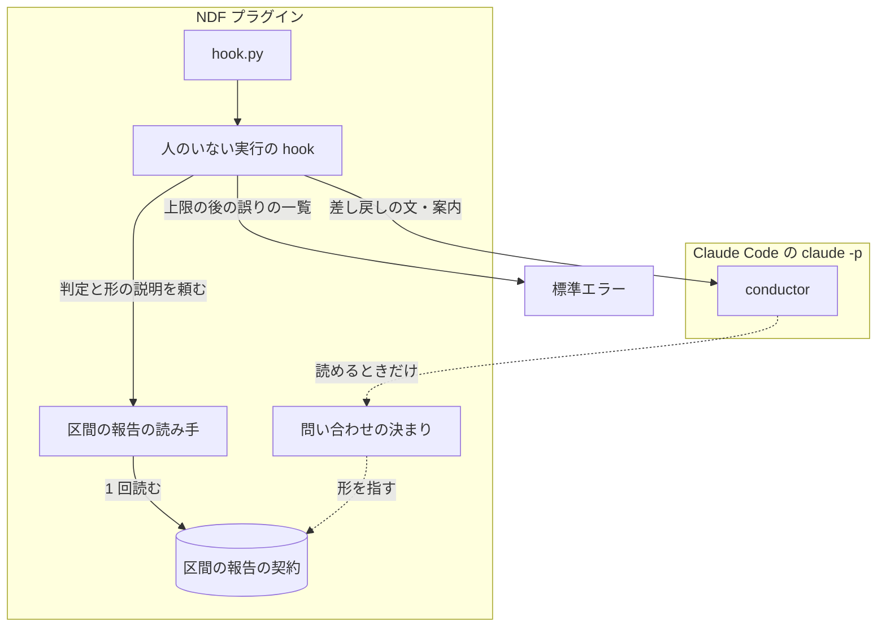
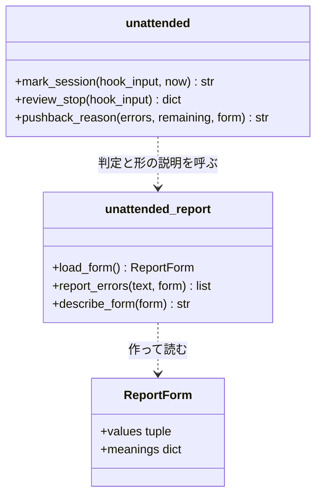
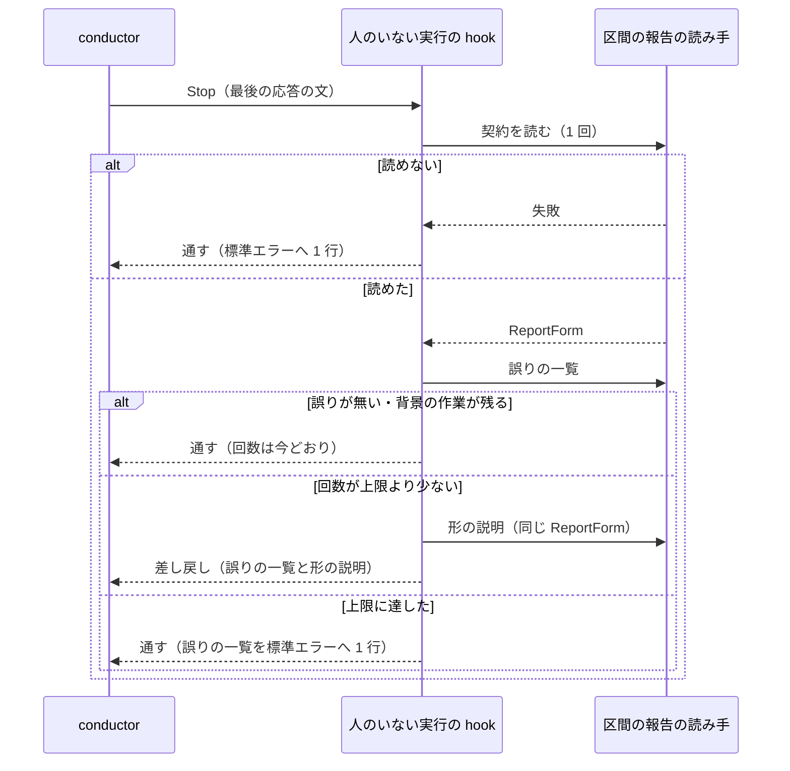

# 人のいない実行の差し戻し: 契約のファイルを読めなくても、差し戻しの文だけで区間の報告を契約の形で書き直せる（#3329）

## 目的

- **今どうなっているか**: 人のいない実行（`NDF_FACTORY_RUN`）を `--permission-mode acceptEdits` で動かすと、conductor はプラグインの導入先にある区間の報告の契約を Read できない。Stop の hook の差し戻しの文は契約のパスを示すだけで結果の値を載せないため、conductor は形を推し、差し戻しの上限（2 回）の後に契約に無い値（`続けられない`）のまま区間が終わる
- **誰に効くか**: Factory から NDF の開発を回す利用者と、最後の応答の結果の行を読む Factory のランナー
- **変えると何が成り立つか**: 差し戻しの文と区間の始めの案内が、契約から作った形の説明（結果の値とその意味・値ごとに要る項目・材料の書き方・値ごとの例）を載せる。conductor はファイルを読まずに、契約の 3 つの値のどれかで区間の報告を書ける

## 適用範囲

- **働く範囲**: NDF を導入したすべてのリポジトリの、人のいない実行の conductor のセッション。Claude Code だけで働く（hook は `hooks/claude.json` の登録だけを使う）
- **プロジェクトごとに違うもの**: 無い。形の説明の中身は NDF の契約のファイルが決め、設定と引数では受けない。人のいない実行かどうかは今どおり環境変数 `NDF_FACTORY_RUN` で受ける
- **当たるモード**: 5 つのモードすべてと pace（`normal`・`fast`・`auto`）。人のいない実行の conductor の区間の終わりはモードに依らないため

## あるべき姿の根拠

| 根拠 | 種類 | 何を示すか |
| --- | --- | --- |
| STD1 | 外部の一次情報 | Stop の hook の `reason` は、Claude が応答を続ける理由として Claude に渡る。exit 0 の hook の標準エラーは Claude に見えない。UserPromptSubmit の `additionalContext` は 10,000 文字までそのまま Claude の文脈へ入る |
| #3329 の「事象」の順 2〜5（ndf 10.27.62、2026-11-14 06:53 JST の 1 回の実行） | 実測 | 契約のファイルの Read が `permission_denied` で拒まれ、パスだけの差し戻しでは conductor が形を推して契約に無い値を 2 回書いた。費用 0.55 ドル・11 ターン |
| #3329 の「現状」の表（hook が契約を読む経路） | 実測 | hook のプロセスは AI の Read の権限に関わらず契約のファイルを読めている。説明を作る材料は hook の手元にある |

要求と受け入れ条件は #3329 の本文にある（コピーは `issues/issue-3329-requirements.md`）。この文書は「どう作るか」だけを扱う。

## ドメインモデル

### コンテキスト

| コンテキスト | 何の語が 1 つの意味に決まるか |
| --- | --- |
| 開発の工程（`ndf-workflow`） | conductor・区間の報告の書き方・差し戻しの文と案内の中身 |
| Factory との受け渡し（`ndf-factory`） | 人のいない実行・区間の報告の形・結果の行・結果の値 |

関係は**公開された言語**で、#3242 の設計から変えない。区間の報告の形は契約のファイル（`plugins/ndf/contracts/forms/unattended-report.json` ）として文書化され、開発の工程が書き手、Factory のランナーが読み手になる。この変更は、書き手（conductor）へ契約の中身を届ける経路を足すだけで、公開された言語そのもの（契約の `shape` と `cases`）は変えない。

### 集約

| 集約 | 持ち主（書き換えてよいもの） | 根 | エンティティ | 値オブジェクト |
| --- | --- | --- | --- | --- |
| 区間の報告の形 | 契約のファイル `unattended-report.json`（人が Pull Request で変える。コードは読むだけ） | 形の宣言（`shape`） | — | 結果の値とその意味・報告の項目・値ごとに要る項目・材料の書き方 |
| 人のいない実行の印 | `hook_lib/unattended.py`（UserPromptSubmit で作り、Stop で回数を足すか 0 に戻し、SessionEnd で消す） | 印のファイル（セッション 1 つに 1 つ） | — | セッションの識別子・続けて差し戻した回数 |

どちらの集約も形を変えない。形の説明は区間の報告の形から作る派生の文で、集約に入れず、保存もしない（Stop と UserPromptSubmit のたびに、その時に読んだ契約から作る）。差し戻しの文と案内も同じく派生の文である。派生の文の条件は集約の条件ではなく、その文を作る構成要素が守る。不変条件の表の「対象（守る持ち主）」の列に、集約か、派生の文とそれを作る構成要素を書く。

### 不変条件

| # | 対象（守る持ち主） | 条件 | 破れたときの扱い |
| --- | --- | --- | --- |
| I1 | 差し戻しの文と形の説明（派生の文。差し戻しの文に載せるのは人のいない実行の hook、形の説明の中身を作るのは区間の報告の読み手） | 差し戻しの文は、誤りの種類（結果の行が無い・値が契約の外・要る項目の欠け・材料の誤り・`次のコマンド:` の残り）に関わらず形の説明を載せる。形の説明は、契約の結果の値すべてとその意味、値ごとに要る項目（条件つきの項目は条件も）、材料の書き方、値ごとの例を持つ | テストが落ちる |
| I2 | 形の説明（派生の文。区間の報告の読み手が作る） | 形の説明の値・項目・条件・材料の書き方・例は、その Stop（または UserPromptSubmit）で読んだ契約の `shape` だけから作る。値と項目の一覧を Python の文字列・Skill の本文・文書へ写さない | テストが落ちる（別の `shape` を与えると説明が変わらない） |
| I3 | 形の説明（派生の文。区間の報告の読み手が作る） | 形の説明に載る値ごとの例は、同じ契約の判定（`report_errors`）で誤り 0 件になる | テストが落ちる。例を書き直すのではなく、例の作り方を直す |
| I4 | 案内（派生の文。人のいない実行の hook が作る） | 区間の始めの案内は、契約を読めれば I1 と同じ形の説明を載せる。読めなければ今の案内の文だけを返し、標準エラーへ 1 行残す（UserPromptSubmit を止めない） | — |
| I5 | 人のいない実行の印 | 同じ区間の差し戻しは、上限の宣言（`hook.unattended-pushback`）の回数を超えない。上限に達した後の形に合わない Stop は差し戻さずに通し、回数を変えず、誤りの一覧を標準エラーへ 1 行残す | 通した後の判定は Factory の側（値が契約の外なら失敗） |
| I6 | 人のいない実行の印 | #3242 の振る舞いを保つ。形に合った Stop は差し戻さず回数を 0 に戻す・背景の作業か予定が残る Stop は差し戻さず回数を変えない・契約か上限の宣言を読めなければ差し戻さずに通す・`NDF_FACTORY_RUN` の無い実行では登録の行が Python を起動しない | 既存のテストが落ちる |
| I7 | 区間の報告の形 | 契約のファイルの `shape` と `cases` は変わらない | 契約の検査と既存の例の組のテストが落ちる |
| I8 | 人のいない実行の印 | Stop 1 回あたりの契約のファイルの読み込みは 1 回のままで、差し戻すかの判定と形の説明は同じ読み込みの結果を使う | テストが落ちる |

### ドメインイベント

| # | イベント | 発生元 | 受け手 |
| --- | --- | --- | --- |
| E1 | UserPromptSubmit の hook が印を作り、形の説明を載せた案内を返した | UserPromptSubmit の hook（`hook.py unattended-start`） | conductor |
| E2 | conductor が、区間の報告の形に合わない応答で終えようとした | conductor | Stop の hook |
| E3 | Stop の hook が、誤りの一覧と形の説明を添えて差し戻した | Stop の hook（`hook.py unattended-stop`） | conductor |
| E4 | conductor が、差し戻しの文だけを材料に区間の報告を書き直した | conductor | Stop の hook（次の Stop） |
| E5 | 差し戻しの回数が上限に達した後、conductor が形に合わない応答で終え、hook が標準エラーへ誤りの一覧を残して通した | Stop の hook | Claude Code のデバッグの記録（人が読む） |
| E6 | Factory のランナーが最後の結果の行を読み、区間の結果を決めた | Factory のランナー | Factory（対象外） |

番号は要求の「ドメインイベント」を引き継ぐ。E1 と E5 は、要求の未決 1・2 をこの設計で決めた形（決定 2・3）に合わせて書いた。

### 用語

| 用語 | 意味 | 用語集への反映 |
| --- | --- | --- |
| 区間の報告 | 人のいない実行の conductor が区間を終える最後の応答の末尾に置く報告（#3242 で追加した語のまま） | 変えない |
| 人のいない実行 | 環境変数 `NDF_FACTORY_RUN` が空でない実行ジョブの区間（#3242 で追加した語のまま） | 変えない |
| 結果の行 | 最後の応答の文の中の、最後の `- 結果: <値>` の行（#3242 で追加した語のまま） | 変えない |
| 結果の行の差し戻し | 人のいない実行の印のあるセッションで、最後の応答が区間の報告の形に合わないとき、Stop の hook が Stop を止めて報告を書かせること（#3242 で追加した語のまま。差し戻しの文の中身が増えても意味は変わらない） | 変えない |

この文書では、次の言い方を本文で使う（プロジェクトの用語集の語ではない。関数と変数の名前を説明するための言い方で、ほかの文書に広がらない）。

- 形の説明: 契約の `shape` から作る文。結果の値とその意味・値ごとに要る項目（条件つきの項目は条件も）・材料の書き方・値ごとの例を持つ
- 差し戻しの文: Stop の hook が `decision: block` で返す `reason` の文
- 案内: UserPromptSubmit の hook が印を作るときに `additionalContext` で返す文
- 値ごとに要る項目: 結果の値ごとに、無しにしてはいけない項目（契約の `shape.required`）

## 外部の調査

| 種類 | 調べるか | 理由 |
| --- | --- | --- |
| 標準・仕様 | 調べる | 差し戻しの文と案内が Claude にどう届くか（届く経路・文字数の上限・標準エラーの行き先）は Claude Code の hook の仕様が決める |
| 主要な製品 | 調べる | 非対話の AI の最後の出力を、決まった形に合わせる手段を主要な CLI が持つ。使えるなら差し戻しの文を足すより確実である |
| ライブラリとサービス | 調べる | 形の説明は契約からの文の組み立てで、テンプレートのエンジンを使うか標準ライブラリで組むかを決める |

### 標準・仕様

| # | 標準・仕様 | 何を定めているか | 設計への反映 | 出典 |
| --- | --- | --- | --- | --- |
| STD1 | Claude Code の hook の仕様 | Stop の `decision: "block"` の `reason` は「Claude が続けるべき理由」として Claude に渡る。exit 0 の hook の標準エラーを Claude は見ない（デバッグの記録で読む）。`additionalContext`・`systemMessage` と素の標準出力は 10,000 文字までで、超えるとファイルへ退避され先頭 2,000 文字だけが渡る。`systemMessage` は利用者へ見せる警告で、`stream-json` では情報のメッセージとして届くことがある | 形の説明は差し戻しの文（`reason`）と案内（`additionalContext`）に載せる（決定 1・2）。上限の後の記録は標準エラーに置く（決定 3）。案内の全体を 10,000 文字より十分に短く保つ（非機能の実現方式） | `curl -sS https://code.claude.com/docs/en/hooks.md` の「Stop decision control」「Add context for Claude」「Exit code output」の節（2026-11-13 に取得） |

### 主要な製品

| # | 製品 | どう解いているか | 設計への反映 | 出典 |
| --- | --- | --- | --- | --- |
| PRD1 | Claude Code の構造化出力（`claude -p --json-schema`） | 呼ぶ側が JSON Schema を渡し、最後の出力を `structured_output` で受ける | 呼ぶ側（Factory のランナー）の起動を変える必要があり、ランナーの変更は対象範囲の外。採らない（#3242 の決定 7 と同じ判断。決定 1） | #3242 の設計の外部の調査 PRD1 の出典 `https://code.claude.com/docs/en/cli-reference.md` （2026-11-13）。この課題では取得し直していない |

### ライブラリとサービス

| # | 候補 | 版 | ライセンス | 最後のリリースの日付 | 終了のアナウンス | 要件を満たすか | 出典 |
| --- | --- | --- | --- | --- | --- | --- | --- |
| LIB1 | Jinja2（テンプレートのエンジン） | 3.1.6 | BSD | 2025-03-05 | 無し | 満たさない。hook の人のいない実行の経路は標準ライブラリだけで動く（`python3 -S` で起動できる。#3242 の I9 と `test_the_subcommands_run_without_site_packages`）。このリポジトリの依存（`pyproject.toml`・`uv.lock`）にも無い | `https://pypi.org/pypi/Jinja2/json` と `grep -i jinja pyproject.toml uv.lock`（0 件）（2026-11-13） |
| LIB2 | Python の標準ライブラリの文字列の組み立て（f 文字列・`str.join`。`string.Template` を含む） | Python 3.14.4 | PSF | — | 無し | 満たす。値・項目の数が契約で変わる繰り返しは `str.join` で組め、新しい依存が要らない | `python3 --version` と `python3 -c "import string; print(string.Template.__doc__)"`（2026-11-13） |

### 確かめられなかったこと

| 対象 | 試した手段 | 結果と理由 |
| --- | --- | --- |
| `claude -p --output-format stream-json --verbose` の出力に、Stop の hook の標準エラー（exit 0）が載るか | 試していない | STD1 は Setup の hook について「`hook_response` のイベントとして載る」と書くが、Stop の hook については書いていない。実測の費用（`claude -p` の起動）がかかるため、「未確認のまま残ること」へ置き、リリース後テストで見る |
| Factory のランナーの実際の権限の設定 | 試していない | 別のリポジトリにあり、この課題の対象範囲の外（要求の前提 1） |

調べた量: 候補 4 件・取得の試み 5 回。

## 機能一覧

| # | 機能 | 誰が使うか |
| --- | --- | --- |
| F1 | 区間の報告の契約から、形の説明（値とその意味・値ごとに要る項目と条件・材料の書き方・値ごとの例）を作る | NDF の hook |
| F2 | 差し戻しの文に、誤りの一覧と形の説明を載せる | conductor |
| F3 | 人のいない実行の区間の始めの案内に、形の説明を載せる | conductor |
| F4 | 差し戻しの上限に達した後の形に合わない Stop を、誤りの一覧を標準エラーへ残して通す | Factory の運用者（デバッグの記録を読む人） |

## 構成要素

| 要素 | 責務 |
| --- | --- |
| 区間の報告の読み手（`plugins/ndf/scripts/lib/unattended_report.py`） | 形の宣言（`ReportForm`）に値の意味を持たせ、そこから形の説明の文を作る純粋な関数を足す。値ごとの例も同じ宣言から作り、例が判定で誤り 0 件になるように組む。ファイル・環境変数・時刻を読まない |
| 人のいない実行の hook（`plugins/ndf/scripts/hook_lib/unattended.py`） | Stop で、差し戻しの文に形の説明を足す（判定に使ったのと同じ `ReportForm` を渡す）。上限に達した後の形に合わない Stop で、誤りの一覧を標準エラーへ 1 行残す。UserPromptSubmit で契約を読み、読めれば案内に形の説明を足す |
| 問い合わせの決まり（`plugins/ndf/skills/development-workflow/references/asking.md` の「人のいない実行」） | 差し戻しの文と案内が形の説明を載せること、上限の後は通して標準エラーへ残すことを、振る舞いに合わせて書く。値と項目の一覧は写さず、契約のファイルを指す |
| 人のいない実行の hook のテスト（`plugins/ndf/scripts/tests/test_hook_unattended.py`） | 差し戻しの文・案内の中身、上限の後の扱い、契約の読み込みの回数を縛る |
| 区間の報告の読み手のテスト（`plugins/ndf/scripts/tests/test_unattended_report.py`） | 形の説明が契約から作られること（別の `shape` で変わること）と、例が誤り 0 件になることを縛る |

変えないもの: 契約のファイル（`unattended-report.json`）、上限の宣言（`limits.json`）、hook の登録（`hooks/claude.json`）、hook のエントリポイント（`hook.py`。`review_stop` と `mark_session` の戻り値の形は変わらない）。

図に入れない要素: 2 つのテストのファイルは実行時の経路に無い。

## 構造

触る型は `ReportForm` だけで、値の意味（契約の `shape.values` の説明）を持つ欄を足す。形の説明は値の意味を載せるため、判定に使う `ReportForm` から意味も読めるようにし、契約の読み込みを 1 回に保つ（I8）。`Requirement`・`Condition`・`Material` は形を変えず、新しい関数が読むだけである。関数の関係を示す。

`describe_form` は新設、`pushback_reason` は引数に `ReportForm` を足す。関数の名前と引数の細部は詳細設計で決める。

## 処理の流れ

Stop の流れ。契約の読み込みは 1 回で、判定と形の説明が同じ結果を使う（I8）。

UserPromptSubmit の流れ。対象のセッションで印を作った後に契約を読み、読めれば今の案内の文に形の説明を足して返す。読めなければ今の案内の文だけを返し、標準エラーへ 1 行残す（I4）。印の作り方と対象の判定は変えない。

## 入出力の契約

| 項目 | 内容 |
| --- | --- |
| 名前 | `hook.py unattended-stop`（Stop）と `hook.py unattended-start`（UserPromptSubmit） |
| 入力 | 変わらない（Claude Code の hook の JSON） |
| 出力（Stop） | 差し戻すときの `{"decision": "block", "reason": …}` の形は変わらない。`reason` の中身に形の説明が加わる。上限の後に通すときの出力は今どおり無し（標準出力に何も出さない）で、標準エラーに 1 行が加わる |
| 出力（UserPromptSubmit） | `hookSpecificOutput.additionalContext` の形は変わらない。中身に形の説明が加わる |
| 失敗の形 | 変わらない。どの失敗も終了コード 0 で通し、標準エラーへ 1 行残す（#3242 の I9） |
| 互換性 | 区間の報告の契約の形と結果の行の読み方は変わらないため、Factory のランナーへの影響は無い。差し戻しの文と案内は Claude だけが読む文で、ほかに読む側は無い |

形の説明の文の並び（読み手が上から読む順）は次のとおりとし、文面の細部は詳細設計で決める。

1. 区間の報告の置き方: 最後の応答の末尾に置き、`- 結果: <値>` の行の後ろに `- <項目>: <値>` の行を並べる（行頭は `- `）。項目の一覧は契約の `items` の順
2. 結果の値ごとに、値・意味（契約の `values` の説明）・要る項目（`always`）と条件つきの項目（`when` の項目・条件・要る項目）
3. 材料の書き方（契約の `material`）
4. 値ごとの例（値 1 つに 1 つ）。要る項目には中身を示す仮の値を入れ、材料の項目には `material.body` を入れて、例の前に `material.heading` の節を置く

## 非機能の実現方式

| 大項目 | 条件 | 実現方式 |
| --- | --- | --- |
| 性能・拡張性 | `NDF_FACTORY_RUN` の無い実行では Python を起動しない | 登録の行（`hooks/claude.json`）を変えない |
| 性能・拡張性 | Stop 1 回あたりの契約の読み込みを 1 回から増やさない | `review_stop` が判定のために読んだ `ReportForm` を、差し戻しの文を作る関数へ渡す。形の説明を作る関数はファイルを読まない純粋な関数にする |
| 運用・保守性 | 結果の値と値ごとに要る項目の正本は契約のファイル 1 つのまま | 形の説明を作る関数は `ReportForm` だけを入力に取る。`asking.md` は一覧を写さず契約を指す |
| 性能・拡張性（STD1 から足す） | 案内と差し戻しの文が 10,000 文字の上限に当たらない | 今の契約で作る形の説明は 2,000 文字程度の見込みで、案内と差し戻しの文の全体を 10,000 文字より十分に短く保つ。実装で今の契約から作った両方の文の長さを測り、テストで上限の半分（5,000 文字）以下を縛る |

## 決定の記録

### 決定 1: 契約を読めない conductor が形を推さずに済むよう、差し戻しの文に契約から作った形の説明を載せ、作る関数を区間の報告の読み手に置く

conductor が形を誤ったのは、形の正本が Read できない場所にあり、差し戻しの文がそのパスしか示さなかったためである（あるべき姿の根拠の実測）。hook は契約を読めているので、hook が読んだ `shape` から値とその意味・値ごとに要る項目と条件・材料の書き方・値ごとの例を文にして差し戻しの文に載せれば、conductor は Read の権限に依らず形を知れる。作る関数は判定と同じモジュール（`unattended_report.py`）に置き、判定の規則と説明が同じ `ReportForm` から作られるようにする。値ごとの例を載せるのは、説明の文だけでは行頭の `- `・結果の行の位置・材料の見出しを読み違える余地が残り、例を写せば判定に通る報告が書けるためである。

契約の JSON をそのまま差し戻しの文へ貼る形は採らない。`rule` の文と `shape` の入れ子を conductor が解釈し直す必要があり、`cases`（読み手のテストの例の組で、誤りの例を含む）まで載る。値と項目を Python の文字列に書く形は、正本が 2 つになるため採らない（要求の受け入れ条件 2）。呼ぶ側に JSON Schema を渡して出力を縛る形（PRD1）は、Factory のランナーの起動を変えるため対象範囲の外である。テンプレートのエンジン（LIB1）は hook の標準ライブラリだけの経路を壊すため採らず、標準ライブラリの文字列の組み立て（LIB2）で作る。

- 作り方: 自前で作る
- 比べた候補: STD1 / PRD1 / LIB1 / LIB2

根拠: Value 11 / Value 7 / Value 1（MVV 版 7）

### 決定 2: 最初の応答から形に合わせられるよう、区間の始めの案内にも同じ形の説明を載せる（要求の未決 1）

案内は今、契約のパスを示すだけで、Read を拒まれる権限ではそのパスが役に立たない。案内に形の説明が無い限り、続けられない区間の最初の応答は形を推すしかなく、少なくとも 1 回の差し戻しと 1 ターンの費用が毎回かかる（実測の 1 回は 11 ターン・0.55 ドル）。形の説明は 2,000 文字程度の見込みで、1 ターンの応答と差し戻しの往復より小さい。説明は決定 1 と同じ関数で作り、案内と差し戻しの文で同じ文を使う。契約を読めないときは今の案内だけを返し、UserPromptSubmit を止めない（I4）。

差し戻しの文だけに載せる形は採らない。続けられない区間のたびに、形に合わない最初の応答と差し戻しの往復が残り、上限の 2 回のうち 1 回を形を知るためだけに使う。

根拠: Value 2 / Value 7 / Value 11（MVV 版 7）

### 決定 3: 差し戻しの上限を守るため、上限に達した後の形に合わない Stop は差し戻さずに通し、誤りの一覧を標準エラーへ 1 行残す（要求の未決 2）

hook は応答の文を書き換えられず（STD1）、上限を超えて差し戻すと受け入れ条件 4（上限の宣言を超えない）と対象範囲（上限の回数を変えない）に反する。上限の後に契約の外の値で終わる場合を減らすのは決定 1・2 で、差し戻しの 1 回ごとに形の説明が届くため、上限の 2 回は形を知るためではなく書き直すために使われる。上限の後の Stop は今どおり通し、回数も変えない。そのうえで、なぜ契約の外で終わったかを後から追えるよう、誤りの一覧を標準エラーへ 1 行残す（exit 0 の標準エラーは Claude に見えず、Claude Code のデバッグの記録に残る。STD1）。

値の誤りに限って上限の外で 1 回差し戻す形は、上限の宣言を超えるため採らない。`systemMessage` で警告する形は、通すときの hook の出力の形を変え（既存のテストの期待値「通すときは出力が無い」を変える）、Factory のランナーはその欄を読まないため、得るものに比べて変わる範囲が広い。何も残さずに通す形は、契約の外で終わった理由が記録に残らないため採らない。

根拠: Value 13 / Value 1 / Value 3（MVV 版 7）

## テスト設計

| 受け入れ条件・不変条件 | どの振る舞いで縛るか | どう壊したら落ちるべきか |
| --- | --- | --- |
| 受け入れ条件 1・I1 | 誤りが「結果の行が無い」だけの Stop の差し戻しの文に、契約の 3 つの値・その意味・値ごとに要る項目・条件つきの項目の条件・材料の書き方が現れる。値が契約の外・要る項目の欠け・`次のコマンド:` の残りの差し戻しにも同じ説明が現れる | 誤りの種類で説明を付けるかを分ける・条件つきの項目を落とすと落ちる |
| 受け入れ条件 2・I2 | テストの中で値か要る項目を変えた別の `shape` を与えると、形の説明もその値と項目に変わり、元の値が現れない | 値・項目を Python の文字列に固定すると落ちる |
| 受け入れ条件 3・I3 | 形の説明から値ごとの例を取り出し、同じ契約の `report_errors` に掛けると、どの値の例も誤り 0 件になる。別の `shape` でも同じ | 例から要る項目・材料の見出し・行頭の `- ` を落とすと落ちる |
| 受け入れ条件 4・I5 | 上限まで差し戻した後の、値が契約の外の Stop は差し戻されず、回数は上限のまま変わらず、標準エラーに誤りの一覧が 1 行出る | 上限の後にもう 1 回差し戻す・回数を変える・標準エラーへ出さないと落ちる |
| 受け入れ条件 5・I6 | 既存の `test_hook_unattended.py` と `test_unattended_report.py` の振る舞いのテスト（形に合った Stop で数え直す・背景の作業・契約と上限の宣言を読めない・登録の行が Python を起動しない）が期待値を変えずに通る | 既存の振る舞いを変えると落ちる |
| 受け入れ条件 6・I7 | 契約のファイルの `shape` と `cases` を変えない。既存の例の組のテストと契約の検査が通る | 契約のファイルを書き換えると差分と既存のテストに出る |
| I4 | 対象のセッションの案内に形の説明が現れる。契約を読めないときは今の案内の文だけが返り、標準エラーに 1 行出て、印は作られる | 読めないときに UserPromptSubmit が失敗する・案内を返さないと落ちる |
| I8 | 差し戻す Stop 1 回で契約の読み込みが 1 回だけ起きる | 差し戻しの文を作るときに契約を読み直すと落ちる |
| 非機能（10,000 文字） | 今の契約で作った案内の文が 5,000 文字以下 | 契約の全体を貼るなどで文が膨らむと落ちる |
| 非機能（10,000 文字） | 今の契約で、誤りの種類（結果の行が無い・値が契約の外・要る項目の欠け・材料の誤り・`次のコマンド:` の残り）がすべて出た差し戻しの文が 5,000 文字以下 | 誤りの一覧と形の説明が重なって文が膨らむと落ちる |
| 受け入れ条件 7 | リリース後テストで、開発版チャネルの版で「再現手順」の 2 を打ち、最後の `result` の文の最後の結果の行の値が契約の 3 つの値のどれかで、Bash が拒まれる区間では `できなかった` と `- 理由:` の行があることを見る | — （LLM の応答に依るため、ユニットテストにしない） |

## 設計の結果

| 課題 | 扱い | 取り込み先 | 触るファイル |
| --- | --- | --- | --- |
| #3329 | 実装する | — | `plugins/ndf/scripts/lib/unattended_report.py`、`plugins/ndf/scripts/hook_lib/unattended.py`、`plugins/ndf/skills/development-workflow/references/asking.md`、`plugins/ndf/scripts/tests/test_hook_unattended.py`、`plugins/ndf/scripts/tests/test_unattended_report.py` |

## 人へ残す判断

無し

## 未確認のまま残ること

| 項目 | 内容 |
| --- | --- |
| conductor が形の説明を読んで契約の値で書き直すか | LLM の応答に依り、ユニットテストでは確かめられない。リリース後テストで「再現手順」の 2 を開発版チャネルの版で打ち、受け入れ条件 7 で判定する |
| 上限の後の標準エラーの 1 行が `stream-json` の出力に載るか | 外部の調査の「確かめられなかったこと」のとおり、Stop の hook の標準エラーの行き先は仕様に書かれていない。同じリリース後テストの `stream-json` の出力で見る。載らなくても I5 の振る舞い（通す・回数を変えない）は変わらない |
| 形の説明の実際の文字数 | 2,000 文字程度は見込みで、実装で今の契約から作った文を測るまで分からない。テストが 5,000 文字以下を縛る |
