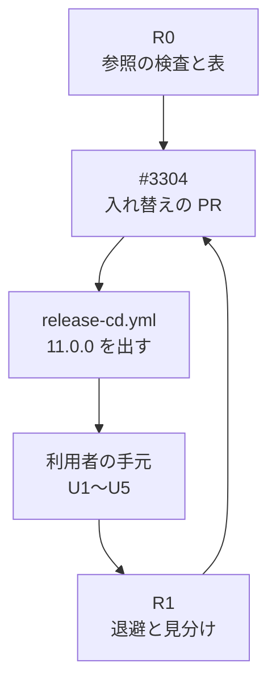
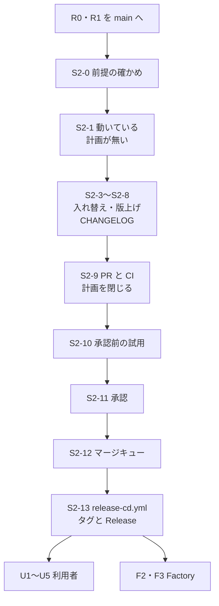

# プラグインの入れ替え: 外からの参照・旧い置き場・動いているラッパーを壊さずに 11.0.0 を出し、戻せるようにする（#3341）

## 目的

- **今どうなっているか**: 入れ替え（S2 #3304）の手順は、外からの参照 813 本（`release-cd.yml` の正式版の publish を含む）を「向け直さずに済む」とし、旧い置き場を 1 か所しか退避せず、動いているラッパーの扱いと戻し方を持たない。版の出し方も #3672 の前の `develop` と開発版の形のままである
- **誰に効くか**: #3304 を実装するレーン lswap と、11.0.0 を入れる NDF の利用者（共有の設定ディレクトリで複数のコンテナを動かす利用者・利用先のリポジトリ・Codex・Factory）
- **変えると何が成り立つか**: lswap が [issue-3341-design-swap.md](issue-3341-design-swap.md) と #3304 の本文だけを読み、手順の外の判断で止まらずに入れ替えを通せる。入れ替えた中身は版数 11.0.0 と同じコミットで `main` に入り、戻すときは 11.0.1 として出せる

## 適用範囲

- **働く範囲**: この設計 PR は `issues/` と用語集だけを変える。用語集で変えるのは正本の `docs/glossary/glossary.json` と、そこから `glossary.py render` で作る `docs/glossary.md` の 2 本である。`.ndf/glossary.json` は正本の置き場を名指す設定で、変えない（C7 に当たらない）。受け入れ条件 19 の「差分が `issues/` に閉じる」との食い違いは「人へ残す判断」に載せた。設計が決めた手順は、ai-plugins の入れ替えの子（R0・R1・#3304）と、11.0.0 を入れるすべての利用者の手元（CHANGELOG の案内）で働く
- **プロジェクトごとに違うもの**: 足さない。利用先のリポジトリの宣言は、今の移行のコマンド（`ndf project branch-strategy migrate`）で移す
- **当たるモード**: `standard`

### 代表のリポジトリでの振る舞い

| 代表のリポジトリ | 設定の要点 | 直した後に起きること | この種類で扱えなくなること |
| --- | --- | --- | --- |
| Web サービス（`.ndf/project.json` に `branch_strategy` を持つ利用先） | 宣言の `$schema` が `main` の `plugins/ndf/skills/.../schemas/` を指す | 11.0.0 を入れた後も同じ URL で、契約のスキーマと同じ中身が返る（手順 S2-7）。旧い形の宣言は移行のコマンドで移す | 無し |
| モバイルアプリ | 同上 | 同上 | 無し |
| 業務文書だけ | 宣言は `document.json` だけで `$schema` を持たないことがある | 置き場の退避と利用者の手順だけが当たる | 無し |

### ai-plugins だけの事情

| 値 | 置く所 | 持つ Issue |
| --- | --- | --- |
| 11.0.0 を出す workflow（`release-cd.yml`）と、必須のチェックの名前 17 個 | `.github/workflows/`・`main` の ruleset | #3304 |
| 機能の対応表と試走の記録 | `scripts/ndf-next-parity/parity/` | #3342 |
| 文書の行き先の表 | `docs/ndf-swap-doc-destinations.md` | #3382 |

## あるべき姿の根拠

| 根拠 | 種類 | 何を示すか |
| --- | --- | --- |
| `release-cd.yml:36` が `plugins/ndf/scripts/release-steps.py` を打ち、新しいプラグインに `scripts/` が無い（[issue-3341-design-refs.md](issue-3341-design-refs.md) の R9） | 実測 | 外からの参照を向け直さないと、入れ替えのマージで正式版のタグを作るジョブが落ちる |
| 外からの参照 813 本・147 組のうち、入れ替えの後のツリーで 94 組が書き換えか削除を要する（同じ文書の「入れ替えの後の参照先の決め方」） | 実測 | 決定 73 の「向け直さずに済む」は事実と合わない |
| 新しい NDF の `prepare_state_dir` が旧いラッパーの錠を確かめずに旧い置き場を退避する（`identity.py:300-330`） | 実測 | 名前を `ndf` にした後は、旧いラッパーを見分ける `registry.legacy_running` が空の置き場を見る |
| 2026-11-17 の 10 系の耐久の記録で `PENDING` が 52 ファイル、うち錠を持つプロセスが動いているのが 3 ファイル（`.git/ndf/state/dbos/`） | 実測 | 入れ替えの瞬間に動いている耐久の実行がある |
| STD3（Claude Code はプラグインの版数が違うときだけ新しい中身を届ける） | 外部の一次情報 | 入れ替えた中身が旧い版数のまま `main` にあると、既存の利用者には届かず、新しく入れる利用者にだけ届く |
| STD2（マージキューは必須のチェックを通った PR を一時のブランチで確かめる） | 外部の一次情報 | 11.0.0 も迂回せずにマージキューで入れられる |

要求と受け入れ条件は #3341 の本文にある（コピーは [issue-3341-requirements.md](issue-3341-requirements.md) ）。この文書は「どう作るか」だけを扱う。

**調べた表と手順は 3 本に分けた。**

- [issue-3341-design-refs.md](issue-3341-design-refs.md) : 外からの参照の対応表
- [issue-3341-design-places.md](issue-3341-design-places.md) : 旧い置き場の一覧と退避の規則
- [issue-3341-design-swap.md](issue-3341-design-swap.md) : 入れ替えの手順（前の子・当日・利用者・移行・戻し方・#3304 の本文の差分）

#1142 の決定 73・75・79 は [issue-1142-design-next.md](issue-1142-design-next.md) の本文を書き直した。

## ドメインモデル

### コンテキスト

| コンテキスト | 何の語が 1 つの意味に決まるか |
| --- | --- |
| ndf-workflow | プラグインの入れ替え・外からの参照・旧い置き場・承認前の試用 |
| ndf-release | 版上げの PR・正式版のタグ・リリース承認ゲート |
| ndf-factory | Factory（volareinc/nd-factory）が NDF を呼ぶときの入出力の契約と、取得元の固定・固定の解除 |

関係は次の 2 つである。

- **ndf-workflow と ndf-release は顧客と供給者である。** 入れ替えの手順（ndf-workflow）が、リリース（ndf-release）の版上げの PR と workflow を使う側に立つ
- **ndf-workflow と ndf-factory は供給者と顧客である。** 供給者は ai-plugins の NDF で、契約のスキーマ（`plugins/ndf/contracts/`）の持ち主も ai-plugins である。契約のスキーマは公表された言語として働き、Factory はそれに合わせて呼び出しを移す（F2）。入れ替えで契約に関わる変更は、Skill の下のスキーマ 4 本を契約のスキーマと同じ中身にすること（決定 12）と、Factory の取得元の固定と解除の順番（決定 11）の 2 つで、どちらも ai-plugins の側が決め、volareinc/nd-factory の変更はそのリポジトリの持ち主が行う

入れ替えの PR は、2 つのコンテキストの変更を 1 本に載せる（決定 6）。S2-5 のうち `release-cd.yml` の書き換えと、ほかのリリースの workflow の削除は ndf-release の変更である。中身は ndf-release の決定（決定 7）が決める。ndf-workflow の手順は、その変更を載せる順番と確かめだけを持つ。集約「正式版」の版数を書くのは版上げの PR（入れ替えの PR の S2-4）で、版の規則（入れ替えは MAJOR の 11.0.0。STD4・決定 6）に従って書き、手順の側で別の値を決めない。

### 集約

| 集約 | 持ち主（書き換えてよいもの） | 根 | エンティティ | 値オブジェクト |
| --- | --- | --- | --- | --- |
| 外からの参照の書き換えの表 | 表と検査を作るのは R0（`scripts/check-plugin-refs.py`・`scripts/plugin-refs-swap.json`）。R0 の後に「未作成」の行を「向け直す」へ書き換えるのは、その行の行き先の副命令を作る子（M3a・M5・M6・M7・AD2 など）の PR で、検査がそれを強いる（決定 1） | 表 | 行（参照する場所・今の参照先・入れ替えの後の参照先） | 判定（同じパス・向け直す・未作成・消す・ファイルを消す） |
| 状態の置き場 | 新しい NDF の `identity` と `durable`（R1 が直す） | 置き場 | 退避した置き場 | 形の版・退避先の名前 |
| 入れ替えの手順 | #3304 | 手順 | 手順（S2-0〜S2-15） | 確かめ |
| 正式版 | 版数（`plugin.json` 2 本の `version`）を書くのは版上げの PR（入れ替えの PR の S2-4）。タグと GitHub Release を作るのは `release-cd.yml` | 版数 | タグ・GitHub Release | 版数（`plugin.json` の `version`） |

### 不変条件

| # | 集約 | 条件 | 破れたときの扱い |
| --- | --- | --- | --- |
| I1 | 外からの参照の書き換えの表 | 入れ替えの後のツリーで、実行する参照の参照先がすべて実在する | `check-plugin-refs.py check --tree swapped --strict` が落ち、S2-0 で止まる（`--strict` が無いと「未作成」の行は既知の失敗として数えるだけで落ちない。決定 1） |
| I2 | 外からの参照の書き換えの表 | 入れ替えで消えるパスを指す実行する参照は、すべて表に行を持つ | R0 より後の PR が表に無い参照を足すと、必須のチェック `script-structure-check` の中の検査（`check --tree swapped`）が落ちる。「未作成」の行は既知の失敗として数え、それ以外が 1 件でもあれば落ちる（決定 1） |
| I3 | 状態の置き場 | 旧い置き場の錠を 10 系のプロセスが持つ間は、退避しない。新しい NDF は旧い錠の確かめから名前の変更と新しい置き場の `format.json` の書き込みが終わるまで旧い錠を持ち続け、その間に 10 系が退避する置き場へ書かない。持てるのは確かめた時点に在る錠のファイルだけで、その後に新しい錠のファイルで起動する 10 系が無いことは、10 系をすべて止める入れ替えの手順 U1 を前提にする | 錠が 1 つでも取れなければ `legacy_running` で止まる（規則 P6）。U1 を守らずに 10 系を起動したときの窓は「未確認のまま残ること」に載せる |
| I4 | 状態の置き場 | 退避は名前の変更だけで、退避先が既にあれば何も変えない | `retire_target_exists` で止まる |
| I5 | 状態の置き場 | 新しい NDF は、自分が書かない旧い置き場を退避しない | 退避の対象の表（`OLD_STATE_PLACES`）に重ならない置き場があれば、R1 のテストが落ちる |
| I6 | 正式版 | 入れ替えた中身は、版数 11.0.0 と同じコミットで `main` に入る | 入れ替えの PR と版上げの PR が別なら、入れ替えの PR の head の `plugin.json` 2 本の `version` が `11.0.0` でなく、S2-4 と S2-9 の確かめ（`jq -r .version` が `11.0.0`）が落ちる |
| I7 | 正式版 | 版数は出荷済みの版数を使わない。戻すときも新しい版数で出す | タグは ruleset で更新も削除もできない。同じ版数のタグを作る publish は落ちる |
| I8 | 正式版 | 正式版のタグと GitHub Release を作る workflow は `release-cd.yml` の 1 本で、版上げの PR はマージキューから入る | 2 本の workflow が同じタグを取り合う。入れ替えの PR が `ndf-next-release.yml` を消し、S2-5 の確かめで残っていないことを見る |

### ドメインイベント

要求のドメインイベントの番号を引き継ぐ。決定 6 で入れ替えの PR と版上げの PR を 1 本にしたため、E3 と E5 は同じ PR で起き、E4（マージ）は E7（承認）の後になる。

| # | イベント | 発生元 | 受け手 |
| --- | --- | --- | --- |
| E1 | 書き換えの表と検査が `main` へ入った（R0） | R0 の PR のマージ | 以後のすべての PR の CI |
| E2 | 10 系で動いているスプリントとプランが無くなった | S2-1・S2-9 | 人（承認前の試用へ進む） |
| E3・E5 | 入れ替えと版上げの PR（`release/v11.0.0`）を作った | S2-9 | CI・人 |
| E6 | 版上げの PR の head を、隔離した設定ディレクトリで試した | S2-10 | リリース承認ゲート |
| E7 | リリース承認ゲートを通った | S2-11 | マージキュー |
| E4 | 版上げの PR が `main` へ入り、11.0.0 を出した | S2-12・S2-13 | 利用者・Factory（F2） |
| E8 | 利用者の手元でラッパー・リレーハブ・耐久ワークフロー・計画を止め、更新し、入れ直した | U1〜U4 | 新しい NDF の最初の起動 |
| E9 | 新しい NDF の最初の起動で、旧い置き場を退避した | U3 | 利用者 |
| E10 | 利用先のリポジトリ・Codex・Factory が移行した | U5・S2-4・F2 | 人（B1 で戻すかを判断する材料にする）・F3（Factory の固定を外す） |
| E11 | 入れ替えを戻した | B1〜B6 | 利用者 |

### 用語

| 用語 | 意味 | 用語集への反映 |
| --- | --- | --- |
| 外からの参照 | `plugins/ndf/` の外にあって、`plugins/ndf/` の中のパスを名指しするもの。実行する参照・作り直す生成物・根の検査のテスト・文書の 4 種類に分ける。実行する参照は、書き換えの表と検査を入れ替えより前に `main` へ入れ、書き換えそのものは入れ替えの PR で行う | 意味の変更 |
| 外からの参照の書き換えの表 | 入れ替えで消えるパスを指す実行する参照を、行ごとに入れ替えの後の参照先へ対応づけた表（`scripts/plugin-refs-swap.json`）。入れ替えの PR が当て、検査が実在を確かめる | 追加 |
| 旧い置き場 | 10 系の NDF（今の `plugins/ndf/`）が状態を書く置き場。プラグイン名を含む置き場（`~/.local/state/ndf`・`.git/ndf/state` など）が新しい NDF の置き場と同じパスになるのは、入れ替えでプラグイン名が `ndf` になった後で、新しい NDF は最初の起動でそれを退避する。リポジトリの `.ndf/` のように名前を含まない置き場は、入れ替えの前から新しい NDF と同じパスを使う | 意味の変更 |
| 入れ替えの起点のコミット | 入れ替えの PR が分かれた `main` のコミット（`git merge-base origin/main HEAD`）。今のプラグインがそのまま残り、入れ替えで切れるリンクの書き換え先の固定の URL に使う | 意味の変更 |

## 外部の調査

| 種類 | 調べるか | 理由 |
| --- | --- | --- |
| 標準・仕様 | 調べる | 状態の置き場の位置（XDG）、版の上げ方（SemVer）、マージキューの振る舞いが入れ替えの手順を決める |
| 主要な製品 | 調べる | パッケージの更新で古い版の状態を移す・名前を変える手順を、主要なパッケージ管理が持つ |
| ライブラリとサービス | 調べる | 参照先が実在するかの検査に、既存のリンク検査のツールが使えるかを比べる。置き場の退避と排他の候補は #3344 の LIB12〜LIB14 で比べ済みのため調べ直さない（[issue-1142-design-next.md](issue-1142-design-next.md) の決定 85） |

### 標準・仕様

| # | 標準・仕様 | 何を定めているか | 設計への反映 | 出典 |
| --- | --- | --- | --- | --- |
| STD1 | XDG Base Directory Specification 0.8 | `XDG_STATE_HOME`（既定 `~/.local/state`）は再起動をまたいで残す状態、`XDG_CACHE_HOME`（既定 `~/.cache`）は無くてよいデータを置く。形の違う古いデータの移し方は定めない | 状態の置き場（O1）は退避し、キャッシュ（O9）は触らない。移し方は NDF が決める（規則 P1） | https://specifications.freedesktop.org/basedir/latest/ （2026-11-17） |
| STD2 | GitHub のマージキュー | 必須のチェックを通った PR を、書き込みの権限を持つ利用者がキューへ入れる。キューは先端と前の PR を合わせた一時のブランチ（`gh-readonly-queue/<base>/...`）でチェックを確かめる | 11.0.0 の版上げの PR も S2-12 でキューへ入れ、迂回しない（決定 7） | https://docs.github.com/en/repositories/configuring-branches-and-merges-in-your-repository/configuring-pull-request-merges/managing-a-merge-queue （2026-11-17） |
| STD3 | Claude Code のプラグインのマーケットプレイス | 利用者は計算した版数が手元と違うときだけ新しい中身を受け取る。取得元は `ref`（ブランチ・タグ）と `sha` で固定できる | 入れ替えた中身と版数を同じコミットで入れる（決定 6）。戻すときも版数を変えて出す（決定 10）。Factory は `ref` で 10 系のタグに固定できる（F1） | https://code.claude.com/docs/en/plugin-marketplaces （2026-11-17） |
| STD4 | Semantic Versioning 2.0.0 | 公開の API の後方互換を壊す変更では MAJOR を上げる | 入れ替えは 11.0.0（MAJOR）で出す。戻す版は中身が 10 系でも 11 系の PATCH にする（決定 10） | https://semver.org/ （2026-11-17） |
| STD5 | GitHub Actions の workflow を起動するイベント | `issue_comment` と `pull_request_target` は `GITHUB_SHA` が既定ブランチの最後のコミット、`GITHUB_REF` が既定ブランチで動く。`issue_comment` は workflow のファイルが既定ブランチにあるときだけ動く | 11.0.0 の承認は、入れ替えの PR の head でなく `main` の 10 系の `release-approval.yml` が確かめる（決定 7） | https://docs.github.com/en/actions/reference/workflows-and-actions/events-that-trigger-workflows （2026-11-17） |

### 主要な製品

| # | 製品 | どう解いているか | 設計への反映 | 出典 |
| --- | --- | --- | --- | --- |
| PRD1 | Debian のパッケージ管理（Debian Policy 4.7.4.1 の 6 章） | 更新は新しい版の `preinst` → 展開 → 古い版の `postrm` の順で進み、保守のスクリプトは打ち直しても安全（冪等）であることを求める。設定の移し方は定めない | 退避を新しい NDF の最初の起動に置き、打ち直しても同じ結果になるよう、退避先が既にあれば何も変えずに止まる（規則 P2） | https://www.debian.org/doc/debian-policy/ch-maintainerscripts.html （2026-11-17） |

### ライブラリとサービス

| # | 候補 | 版 | ライセンス | 最後のリリースの日付 | 終了のアナウンス | 要件を満たすか | 出典 |
| --- | --- | --- | --- | --- | --- | --- | --- |
| LIB1 | lychee（リンクとパスの検査） | 0.24.2 | Apache-2.0 | 2026-05-01 | 無し（リポジトリはアーカイブされていない） | 一部。Markdown・HTML のリンクの実在は見るが、workflow の `run:` の中のコマンドや JSON の宣言の値のパスは見ない。入れ替えの後のツリー（`plugins/ndf-next/` を `plugins/ndf/` と読む）での判定も持たない | `gh api repos/lycheeverse/lychee/releases/latest`（2026-11-17） |
| LIB2 | 今の `scripts/check-markdown-links.py`（このリポジトリの Markdown のリンクの検査） | — | リポジトリと同じ | — | 無し | 一部。Markdown のリンクだけを見る。文書の参照は引き続きこれが見る | `scripts/check-markdown-links.py`（2026-11-17） |

### 確かめられなかったこと

| 対象 | 試した手段 | 結果と理由 |
| --- | --- | --- |
| マージキューへの投入と承認の関係 | STD2 のページ | 承認をキューへの投入の条件として書いていない。ai-plugins の ruleset は承認 0 件を求める（`gh api repos/devbasex/ai-plugins/rulesets/22332172`）ため、この設計には効かない |
| `GITHUB_TOKEN` でキューへ入れたときに `merge_group` の workflow が動くか | 試していない | 11.0.1 からの統合した workflow の前提。「未確認のまま残ること」に書いた |

調べた量: 候補 8 件・取得の試み 11 回。

## 機能一覧

| # | 機能 | 誰が使うか |
| --- | --- | --- |
| F-1 | 外からの参照の検査と書き換え（2 つのモードの検査・表を当てる `apply`） | CI・lswap |
| F-2 | 旧い置き場の退避と、旧いラッパーを見分けて止まる振る舞い | 利用者の手元の新しい NDF |
| F-3 | 入れ替えと版上げを 1 本にした PR と、承認前の試用 | lswap・人 |
| F-4 | 11.0.0 を出す 1 本の workflow | GitHub Actions |
| F-5 | 利用者・利用先・Codex・Factory の移行の案内 | 利用者・volareinc/nd-factory の持ち主 |
| F-6 | 戻し方の手順 | 人 |

## 構成要素

| 要素 | 責務 | 作る子 |
| --- | --- | --- |
| `scripts/check-plugin-refs.py` | 外からの参照を集め、今のツリーと入れ替えの後のツリーで参照先が実在するかを確かめ、書き換えの表を当てる | R0 |
| `scripts/plugin-refs-swap.json` | 書き換えの表（94 行） | R0 |
| `identity.prepare_state_dir`・`durable.prepare_store` | 規則 P1・P2・P6 で退避する。重ならない置き場を対象から外す（不変条件 I5） | R1 |
| `relay install` | ランチャーを置き換えるとき `relay.version` に自分の版を書く（規則 P3） | R1 |
| `release-cd.yml` | 版上げの PR の組み立て・承認の証跡の確かめ・マージキューへの投入・タグと GitHub Release を持つ 1 本の workflow | #3304（S2-5） |
| 入れ替えの手順 | S2-0〜S2-15 | #3304 |
| CHANGELOG の 11.0.0 の節 | 利用者の手順 U1〜U5 と移行の案内 | #3304（S2-8） |

## 処理の流れ

手順ごとの打つコマンドと確かめは [issue-3341-design-swap.md](issue-3341-design-swap.md) にある。どの手順も、確かめが落ちたら次へ進まず、落ちた確かめを結果に載せて止まる。

## 決定の記録

### 決定 1: 入れ替えの前のツリーを壊さずに向け直しの順番を守るため、書き換えの表と検査を前の子 R0 で入れ、書き換えそのものは入れ替えの PR で行う

入れ替えの前の `main` では 10 系がリリースと検査を担い、新しいプラグインはまだ `plugins/ndf-next/` にある。両方のツリーで正しい参照の形は、互換の層（旧い名前を新しい副命令へ読み替える仕組み）を置かない限り作れない。後方互換を置かない方針（要求の前提 6）に沿い、R0 は表と検査を先に入れて、入れ替えの PR が表を当てるだけで済むようにする。

検査は R0 の時点から必須のチェックで落とす。R0 は検査を、既存のジョブ `script-structure-check`（`.github/workflows/script-structure.yml`）のステップとして足す。このジョブは `main` の ruleset が既に必須にしているため、新しいジョブを作らず、ruleset を変えずに検査が必須になる。R0 の時点で行き先が無い「未作成」の 9 組のため、`check --tree swapped` は次の形で判定する。

| 見つけたもの | 既定の判定 | `--strict` の判定 |
| --- | --- | --- |
| 表に無く、入れ替えの後に実在しない参照 | 落ちる | 落ちる |
| 表の「未作成」の行で、行き先がまだ無い | 既知の失敗として数え、落とさない | 落ちる |
| 表の「未作成」の行で、行き先が実在する | 落ちる（行を「向け直す」へ書き換える） | 落ちる |
| 表の「向け直す」の行で、行き先が実在しない | 落ちる | 落ちる |

これで、R0 の後に表に無い参照を足した PR は必須のチェックで落ち、マージキューへ入れない（不変条件 I2・受け入れ条件 2 の「どのジョブで落ちるか」）。副命令を作る子（M3a・M5・M6・M7・AD2 など）は、行き先が実在した時点で 3 行目に当たるため、同じ PR で表の行を「向け直す」へ書き換える。S2-0 は `--strict` で 0 を確かめ、「未作成」が残っていれば入れ替えへ進まない。

受け入れ条件 2 の文言は「対応表の参照を向け直す PR が、入れ替えの PR より前に `main` へ入る」である。この決定で先に入れるのは表と検査で、参照の書き換えそのものは入れ替えの PR が行う。文言との食い違いは「人へ残す判断」に載せた。

採らなかった形は 2 つある。

| 採らなかった形 | 採らない理由 |
| --- | --- |
| 入れ替えの前に参照を `plugins/ndf-next/` へ向ける | 10 系の正式版の publish と承認の検査を、作り直した実装で動かすことになる。試走で通っていない経路（対応表の 200 行が未通過）を本番のリリースに使う |
| workflow の中で `plugins/ndf/bin/ndf` の有無で分ける | 入れ替えの後に消す分岐を残す |

検査は、文書のリンクを今の `check-markdown-links.py`（LIB2）に任せ、workflow・宣言・根の検査の中のパスだけを自前で見る。リンク検査のツール（LIB1）は Markdown と HTML のリンクを見るもので、コマンドの文字列と JSON の値のパスも、入れ替えの後のツリーでの判定も持たない。

- 作り方: 自前で作る
- 比べた候補: LIB1 / LIB2

根拠: Value 3 / Value 11 / Value 13（MVV 版 9）

### 決定 2: 外からの参照の数え方を再現できるよう、ファイルと参照先の組を単位にし、扱いの違う 4 種類に分ける

813 本・4,989 箇所を 1 行ずつ並べると、作り直す生成物（533 本）が表の大半を占め、向け直しの判断が要る行が埋もれる。実行する参照は、同じファイルで同じ参照先を何行も名指すことが多いため、ファイルと参照先の組（147 組）を 1 行にし、行番号をセルに並べる。数えたコマンドを表の文書に置き、誰が打っても 147 になる。

根拠: Value 13 / Value 14（MVV 版 9）

### 決定 3: 退避を 1 つの規則にそろえるため、状態のホームとチェックアウトの置き場だけを `<元の名前>.v<旧い形の版>-<日付>` へ退避し、退避先があれば止まる

旧い置き場 14 種のうち、新しい NDF が同じパスへ書くのは O1・O3・O6 の `relay.py`・O10・O12 の 5 つで、退避するのは状態を持つ O1・O3 の 2 つである。O6・O10 は共有の設定ディレクトリにあり、O12 は利用者の作業の記録なので、退避せずに規則 P3〜P5 で扱う。重ならない置き場まで退避すると、共有の設定ディレクトリを使う別のコンテナの 10 系が書いている台帳（O2）まで名前が変わり、パスの求め方が 10 系とずれる利用者では実在しない置き場を見る。退避先が既にあるとき、今の実装は時刻を足して退避を続けるが、同じ日に 2 回目の退避が要るのは 10 系がまだ書いているときであり、続けると退避が何度も起きる。止めて人が確かめる。

`format.json` の無い置き場の退避先は、今の実装で `ndf.v10-<日付>` と `state.v0-<日付>` の 2 つの形がある。形の版を `format.json` の番号、無ければ `10` とする 1 つの式にそろえる。

受け入れ条件 4 は「どれも同じ規則で退避する」、受け入れ条件 5 は「新しい置き場が旧い置き場のどれとも重ならない」を求める。重なる置き場は、新しい置き場 N1・N3・N6・N7・N8 と、旧い置き場 O1・O3・O6・O9・O12 である。この決定はそのうち状態を持つ O1・O3 だけを退避し、ほかは規則 P3〜P5 で扱うか触らない。文言どおりには満たさないため、「人へ残す判断」に載せた。

2 つの条件の目的は、扱いの漏れが無いことと、重なりが分かることである。14 種すべてに退避か扱いの規則を 1 つずつ当て、重なるかを置き場ごとに示すことで、この目的を満たす（[issue-3341-design-places.md](issue-3341-design-places.md) の「旧い置き場」の表）。

- 作り方: 自前で作る・標準に倣う
- 比べた候補: STD1 / PRD1

根拠: Value 3 / Value 6 / C3（MVV 版 9）

### 決定 4: 旧い版のラッパーを見分けて止まる振る舞いを、入れ替えの前の子 R1 として新しい NDF の退避の前に置く

M3a #3297・M3b #3407 は閉じており、見分ける部品（`registry.legacy_running`・`hub_decide.mixed`）は新しい NDF にある。欠けているのは順序で、名前が `ndf` になった後は、`prepare_state_dir` が旧い置き場を退避してから見分けるため、空の置き場を見て「旧いラッパーは無い」と答える。直す場所は退避の前の錠の確かめ（規則 P6）で、入れ替えの PR に混ぜると入れ替えだけを revert できなくなるため、別の子 R1 にする。

S2 に置く形は、入れ替えの PR が新しい NDF の振る舞いの変更を含み、レビューで入れ替えと振る舞いの変更が分けられなくなるため採らない。

根拠: Value 7 / Value 9（MVV 版 9）

### 決定 5: 共有の設定ディレクトリで 10 系と 11.0 がランチャーを書き換え合わないよう、10 系の版の守りに自分の版を書いて合わせ、同じ設定ディレクトリのコンテナを同じ日に上げる

10 系の SessionStart は、`relay.version` より古い版では複製を置き直さない（`version_dir.py:362-365`）。新しい NDF がランチャーを置き換えるときに `relay.version` へ `11.0.0` を書けば、10 系のセッションが残っていても 11.0 のランチャーを戻さない。プラグインの導入先は設定ディレクトリにあり、1 回の更新ですべてのコンテナの次の起動が 11.0 になる。そのため手順は「すべてのコンテナの 10 系を止める → 1 回更新する → コンテナごとに入れ直す」（U1〜U4）にする。止めるものはラッパー・リレーハブ・耐久ワークフロー・開いているスプリントの 4 つである。対象ごとの止め方・更新・入れ直し方は [issue-3341-design-swap.md](issue-3341-design-swap.md) の「利用者の手順」の表が持つ。止めた後に `PENDING` で残る 10 系の耐久の実行は、旧い置き場と一緒に退避して 10 系の記録として残し、11.0 は再開しない。続けたい実行は U1 の前に 10 系で終わらせる。

新しい NDF のランチャーを共有でない置き場へ移す形は、M3b の置き場の決まりを変え、`ndf-relay` の解決の順序も変える。版の守りに合わせる方が変更が 1 行で済む。

根拠: Value 1 / Value 3（MVV 版 9）

### 決定 6: 入れ替えた中身が旧い版数のまま `main` に置かれる期間を作らないよう、入れ替えの PR を版上げの PR（`release/v11.0.0`）と同じ 1 本にする

Claude Code は版数が違うときだけ新しい中身を届ける（STD3）。入れ替えの PR と版上げの PR を分けると、間の期間に新しく入れる利用者は 11.0 の中身を 10.27 の版数で受け取り、既存の利用者には届かない。1 本にすれば、承認前の試用（S2-10）とリリース承認ゲート（S2-11）が入れ替えの全体を見たうえで承認する。#3672 の trunk の形（`main` から切った `release/v<版>` の PR のマージで正式版を出す）にもそのまま合う。

PR が大きくなる代わりに、承認する人は入れ替えを 1 回で見る。分けて間の期間の扱いを CHANGELOG に書く形は、期間の長さが承認の待ちで決まり、利用者が入れた版を後から特定できないため採らない。

根拠: Value 1 / Value 3 / P1（MVV 版 9）

### 決定 7: 11.0.0 を出す workflow を `release-cd.yml` の 1 本にまとめ、`ndf-next-release.yml` と `release-approval.yml` を入れ替えの PR で消す

`release-cd.yml` は宣言（`.ndf/project.json` の `branch_strategy.release.cd.workflow` と `deliveries`）が名指す workflow である。名前を保てば宣言を変えずに済む。

#1142 の受け入れ条件 7（#3395 の決定 128）は、組み立て・承認の証跡の確かめ・証跡の後のマージ・タグと GitHub Release を workflow が行うことを求める。これを満たすため、`ndf-next-release.yml` の 4 つの仕事（組み立て・承認・マージ・publish）を `release-cd.yml` へ移す。マージはマージキューへの投入に替える（#3672: 迂回なし・マージキュー）。承認の検査（`release-approval.yml` の `approval-check`）も同じ workflow の `issue_comment` のジョブへ移す。commit status の名前 `ndf/release-approval` は変えないため、承認の照合は今のまま読める。

`ndf-next-release.yml` を残して名前を変える形は採らない。宣言の `cd.workflow` を書き換える（C7）うえに、その workflow の本番ブランチへの直接のマージ（`NDF_RELEASE_TOKEN` で ruleset の例外を使う）が #3672 の「迂回なし」と食い違う。

11.0.0 そのものは、入れ替えの PR の承認を `main` の 10 系の定義が確かめ、マージのコミットの新しい定義が publish する。この流れが頼る振る舞いと、その根拠は次のとおりである（2026-11-17 に確かめた）。

| 頼る振る舞い | 根拠 | 種類 |
| --- | --- | --- |
| `issue_comment` と `pull_request_target` の workflow は、既定ブランチ（`main`）の定義で動く | GitHub のイベントの一覧（STD5）: どちらも `GITHUB_SHA` が既定ブランチの最後のコミット。`issue_comment` は「workflow のファイルが既定ブランチにあるときだけ動く」 | 外部の一次情報 |
| 10 系の承認の検査は PR の head をチェックアウトせずに通る | `.github/workflows/release-approval.yml:37-39` が `ref: ${{ github.event.repository.default_branch }}` を取り出し、`plugins/ndf/scripts/release-steps.py approval-check` を既定ブランチのツリーで打つ。PR の head に `plugins/ndf/scripts/` が無くても読まない | 実測 |
| マージキューの一時のブランチ（`merge_group`）で、承認の commit status `ndf/release-approval` を求められない | `main` の ruleset（`gh api repos/devbasex/ai-plugins/rulesets/22332172`）の必須のチェックは 17 個で、`ndf/release-approval` を含まない。キューは承認の status を待たない。承認を見るのは S2-11 の確かめで、人は status が `success` になってから S2-12 でキューへ入れる | 実測 |

人の操作として残るのは、11.0.1 からの組み立てとキューへの投入が使う `secrets.NDF_RELEASE_TOKEN` の登録（S2-9 の依頼。C1）と、使わなくなった変数 `NDF_RELEASE_RUNNER` の削除（S2-15）だけで、ruleset の例外は要らない。

根拠: Value 3 / Value 11 / P1（MVV 版 9）

### 決定 8: 検証の行（`channel: "verify"`・`verify/next`）を足さない

#3572 の検証の行は、`develop` と開発版のチャネルの間に試す場を置くためのものだった。#3672 で ai-plugins は trunk になり、承認前の試用は版上げの PR の head からの導入（`verify-install --ref release/v<版>`。#3672 の決定 17）で行う。宣言は `verify: null` のままでよく、行を足すと使われない試す場のブランチ（`verify/next`）とマーケットプレイス（`ai-plugins-next`）が残る。

根拠: Value 6 / Value 11（MVV 版 9）

### 決定 9: 外からの参照のうち作り直す生成物と文書は、表を持たずに作るコマンドと行き先の表へ委ねる

許可ファイル・計測の記録・宣言の `docs.tested` は今のプラグインの中身から作られたもので、行ごとに向け直すと、作るコマンドと手で直した行が食い違う。文書の行き先と扱いは #3382 の持ち物（[docs/ndf-swap-doc-destinations.md](../docs/ndf-swap-doc-destinations.md) ）で、この設計は表に無い 3 件を #3382 へ送るだけにする。

根拠: Value 11（MVV 版 9）

### 決定 10: 戻すときは 10 系の中身を 11.0.1 として出し、出荷済みの版数を使わない

Claude Code は版数が違えば中身を届ける（STD3）ため、10.27 の次の PATCH でも利用者には届く。しかし 11.0 のランチャーは `relay.version` に `11.0.0` を書いており（決定 5）、10 系の版の守りは自分より新しい版を見るとランチャーを置き直さない。中身が 10 系でも版数を 11.0.1 にすれば、10 系の守りが自分の版を新しいと読み、ランチャーを戻せる。タグは更新も削除もできない（I7）ため、11.0.0 を消して出し直す形は取れない。

revert で戻るのはコードだけである。退避した置き場・`relay.current`・進行表の DB・閉じた Issue・volareinc/nd-factory の変更の扱いは #3378 の決定に従う。

根拠: Value 3 / Value 13 / P1（MVV 版 9）

### 決定 11: Factory を止めずに入れ替えるため、volareinc/nd-factory を 10 系の最後のタグへ固定してから 11.0.0 を出し、合わせた後に外す

volareinc/nd-factory のランナーは 10 系のスクリプトを直に呼ぶため、11.0.0 を出した時点で止まる。取得元は `ref` で固定できる（STD3）。固定（F1）を 11.0.0 の前に、呼び出しの移し替え（F2）を後に置けば、ai-plugins の版上げの PR を待たせずに Factory を動かし続けられる。volareinc/nd-factory への変更はそのリポジトリの持ち主が行い、この設計は依頼の時点（S2-0 の前）だけを決める。

根拠: Value 4 / Value 5（MVV 版 9）

### 決定 12: 利用先が名指すスキーマの URL を変えずに済むよう、入れ替えの PR で Skill の下のスキーマ 4 本を契約のスキーマと同じ中身にする

利用先の宣言の `$schema` は `main` の `plugins/ndf/skills/.../schemas/` を指す。新しいプラグインにも同じパスがあるが、Skill の下のコピーは古く、`branch_strategy` を持たない（2026-11-17。契約の側 `contracts/schemas/declarations/project.schema.json` は持つ）。中身をそろえれば、利用者は URL を書き換えずに済む。どちらを正本にしてコピーを無くすかは #3518（契約のページと宣言のスキーマ）の持ち物で、ここでは入れ替えの時点で食い違わないことだけを決める。

根拠: Value 4 / Value 11（MVV 版 9）

## テスト設計

| 受け入れ条件・不変条件 | どの振る舞いで縛るか | どう壊したら落ちるべきか |
| --- | --- | --- |
| 受け入れ条件 1・I2 | `check-plugin-refs.py check --tree swapped` が、表に無く入れ替えの後に実在しない参照を数え、「未作成」の行を既知の失敗として分ける（決定 1 の判定の表） | 表から 1 行消すと落ちる。workflow に `plugins/ndf/scripts/` の参照を 1 つ足すと落ちる。「未作成」の行の行き先を作って表を書き換えないと落ちる。`--strict` で「未作成」が 1 行でも残ると落ちる |
| 受け入れ条件 2・I1 | `check --tree current` と `apply` の後の `check --tree current` | 表の行き先を実在しないパスにすると落ちる |
| 受け入れ条件 4・5・I3 | `prepare_state_dir` と `prepare_store` が旧い錠を持つプロセスの居る間は退避しない | 錠の確かめを外すと、錠を持つプロセスが居ても退避が進んで落ちる |
| 受け入れ条件 4・I4 | 退避先が既にあれば何も変えずに `retire_target_exists` | 時刻を足して続けるように戻すと落ちる |
| 受け入れ条件 5・I5 | 退避の対象の表が、新しい置き場と重なる旧い置き場だけを持つ | `config-state` を対象へ戻すと落ちる |
| 受け入れ条件 7 | `relay install --replace-old` の後、`relay.version` が自分の版 | 書かないように戻すと落ちる |
| 受け入れ条件 9・I8 | 必須のチェック 17 個の名前のジョブがすべて残り、タグを作る workflow が 1 本（`check-required-checks.py` と workflow の一覧） | `release-approval.yml` を消してジョブを移し忘れると落ちる。`ndf-next-release.yml` を残すと落ちる |
| 受け入れ条件 8・I6 | 入れ替えの PR の head で `plugin.json` 2 本の `version` が `11.0.0` | 版上げを別の PR に分けると、S2-4 と S2-9 の確かめ（`jq -r .version` が `11.0.0`）で落ちる |
| I7 | publish が既にある版数のタグを作らない | 同じ版数で publish を打つと落ちる（今の publish の振る舞い） |
| 受け入れ条件 3・6・10〜18 | 文書の検査（設計承認ゲートで人が読む）・`spec-copy.py check` | 文言を照合するテストは書かない（`AGENTS.md`） |
| 受け入れ条件 19 | 設計 PR の差分が `issues/` と用語集の 2 本（`docs/glossary/glossary.json`・`docs/glossary.md`）に閉じる | `git diff --name-only origin/main...HEAD` に `plugins/`・`.github/`・`.ndf/` か、この 2 本以外の `docs/` が出たら差し戻す |

## 設計の結果

| 課題 | 扱い | 取り込み先 | 触るファイル |
| --- | --- | --- | --- |
| #3341 | 閉じる | — | — |

この課題の成果は設計 PR だけで、実装は #3304 と前の子 R0・R1 が持つ。R0・R1 の起票と #3304・#3341 の本文の書き換え（[issue-3341-design-swap.md](issue-3341-design-swap.md) の「#3304 の本文の差分」）は、設計承認ゲートの後に行う。

## 人へ残す判断

| 判断 | 当たるレッドライン | なぜ当たるか |
| --- | --- | --- |
| 入れ替えの PR を版上げの PR と同じ 1 本にし、11.0.0 を出す workflow を `release-cd.yml` にまとめる（決定 6・7） | P1 | 正式版の出し方（版の規則と、出す workflow）を変え、利用者全員に効く |
| 戻すときに 10 系の中身を 11.0.1 として出す（決定 10） | P1 | 版の規則（版数と中身の対応）を変える |
| 退避の対象を新しい NDF と重なる置き場に絞り、退避先があれば止める（決定 3） | C3 | 利用者の手元の状態の置き場の名前を変える範囲を決める。受け入れ条件 4（どれも同じ規則で退避する）と 5（新しい置き場が旧い置き場のどれとも重ならない）を文言どおりには満たさない。退避するのは O1・O3 だけで、N1・N3・N6・N7・N8 は O1・O3・O6・O9・O12 と重なる。受け入れ条件の書き換えを人が決める |
| 書き換えの表と検査を前の子 R0 で入れ、参照の書き換えそのものは入れ替えの PR で行う（決定 1） | — | 受け入れ条件 2（向け直す PR が入れ替えの PR より前に入る）と 3（向け直す対象とその順番）の文言と構成が違う。起票者の推定 S2 は「どの PR で向け直すかは設計が決める」とする。受け入れ条件の書き換えを人が決める |
| 設計 PR が用語集の正本 `docs/glossary/glossary.json` と、そこから作る `docs/glossary.md` を変える | — | 受け入れ条件 19 は「差分が `issues/` に閉じる」を求める。`.ndf/` は変えない（C7 に当たらない）。受け入れ条件の書き換えを人が決める |
| 統合した workflow が `secrets.NDF_RELEASE_TOKEN` を使う（決定 7） | C1 | 秘密を登録して使う |

## 未確認のまま残ること

| 項目 | 内容 |
| --- | --- |
| `GITHUB_TOKEN` でのキューへの投入 | 統合した workflow が `NDF_RELEASE_TOKEN` 無しでキューへ入れたとき、`merge_group` のチェックが動くかは確かめていない。11.0.1 の最初のリリースで分かる。11.0.0 は S2-12 の人の操作で入れるため当たらない |
| 新しい publish の最初の実行 | `bin/ndf release-steps publish` が本番のタグを作るのは S2-13 が最初である。落ちたら `workflow_dispatch` で打ち直す |
| `/` を含む ref の導入 | `verify-install --ref release/v11.0.0` が Claude Code と Codex で通るかは #3672 の未確認のままである。S2-10 で分かる |
| statusline の共有 | 10 系と 11.0 が同じ `ndf-statusline.sh` を書く。U1〜U4 を同じ日に行えば当たらないと見ているが、10 系のセッションを残したまま更新したときの表示は確かめていない |
| 退避の間に起動した 10 系 | 新しい NDF が旧い錠を持つ間に、まだ錠のファイルの無い名前のラッパーか、`hub.lock` の無い置き場のリレーハブを 10 系で起動すると、旧い置き場に錠を作って取れ、その実行の記録が退避先と新しい置き場へ分かれうる。U1 で 10 系をすべて止めてから U3 を打てば当たらない。U1 を守らなかったときの分かれた記録の扱いは確かめていない |
| 開始と終了の hook | Factory の `NDF_FACTORY_RUN` の hook 3 本のうち、開始と終了に当たる guard が新しいプラグインに見つからなかった。S2-0 の対応表の試走（#3342）で分かる |
| 退避した耐久の記録の一覧 | `ndf plan pending` が退避した置き場（`state.v10-*`）の待ちを並べるかは確かめていない。R1 のテストで分かる |
