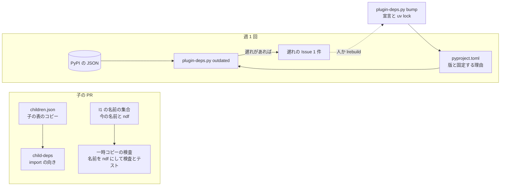

# #1142 の作り直しの順番と依存ライブラリの版: 子が先に要るものを迷わずに着手でき、クリティカルパスが 1 レーンへ偏らず、依存ライブラリが最新の安定版に保たれる（#3347）

## 目的

- **今どうなっているか**: #1142 の作り直し（`plugins/ndf-next/`）の子の表には、レビューが挙げただけで 6 組の書かれていない先に要るもの（C2・M3 → T1 など）がある。P1 #3092 は P3・P4・S1 の条件まで抱え、順番 4 では満たせない。クリティカルパスの 4 段（P1〜P4）が lr-rf の 1 レーンに直列に並ぶ。ほかにも、プラグイン名 `ndf-next` が、中継（会話を切り替えるラッパー `ndf-relay`）が切り替えの指示として拾うコードブロックの情報文字列 `ndf-next` と同じ語になっている。決定番号 65・73〜75 は、番号を振った設計文書の 2 つの系統で重なる。依存ライブラリは 14 本が、利用者の方針で選ぶ版より古い（13 本は最新の安定版より古く、httpx は安定版が古すぎてプレリリースが上げる先になる）
- **誰に効くか**: 作り直しの子を作る 6 本のレーン（lrebuild・lr-flow・lr-data・lr-rf・lr-fix-a・lr-fix-b）の worker と、設計を読み返すオーガナイザー
- **変えると何が成り立つか**: 子の worker が子の表の「先に要るもの」だけを見て着手でき、表に無い部品を import すると検査が落とす。P1 は順番 4 と 5 に分かれる。lr-rf は C1+ のマージの後すぐに着手でき（C1+ は #3344 の設計 PR #3353 の承認を待っている）、lrebuild の空き（前の表の順番 3〜7）が埋まる。名前と番号は衝突せず、依存は決まった規則と 1 本のスクリプトで最新の安定版に保たれる

## 適用範囲

- **働く範囲**: このリポジトリの #1142 の設計文書（`issues/issue-1142-design-*.md`）と、子の受け入れ条件。子の PR が触るのは `plugins/ndf-next/`・`.github/workflows/ndf-next.yml`・`.github/workflows/plugin-deps.yml`（新設）・`scripts/plugin-deps.py`（新設）である。今の `plugins/ndf/` は変えない
- **プロジェクトごとに違うもの**: 足さない。依存の版を固定する理由は `plugins/ndf-next/pyproject.toml` の宣言に書く（決定 106）
- **当たるモード**: `standard`（#1142 のまま）

## あるべき姿の根拠

| 根拠 | 種類 | 何を示すか |
| --- | --- | --- |
| #1142 の設計レビュー（2026-11-14、順番と検証の観点。#3347 の本文の受け入れ条件） | 実測 | 依存の欠け・P1 の大きさ・直列の偏り・名前の衝突・番号の重なり・原文の置き場を、行番号つきで示した |
| 利用者の指示（2026-11-14 の 08 時台（JST）。原文は [issue-3347-source-note.md](issue-3347-source-note.md) の節「設計レビューの指摘と依存ライブラリの方針」） | 指示 | 依存はできるだけ最新の安定版を使い、安定版の概念が無いもの・古すぎるものは最新を使う |
| PyPI の JSON API（LIB20。2026-11-14） | 外部の一次情報 | 宣言 24 本のうち 14 本が最新の安定版より古い。httpx の安定版 0.28.1 は 2024-12-06 で、新しいのはプレリリース 1.0.dev6（2026-08-31）だけ |
| `uv lock` の実測（14 本を上げた宣言のコピーで解決。2026-11-14） | 実測 | httpx 1.0.dev6 は githubkit 0.17.1 の `httpx<1.0.0` と両立せず解決できない。httpx を 0.28.1 のままにすると、ほかの 13 本（DBOS を含む）を上げても解決する |
| `plugins/ndf-next/src/ndf/checks/invariants.py:50-66`（不変条件 I1。新しいプラグインのコードが自分の名前を文字で持たない） | 実測 | I1 の検査は自分の名前（`plugin.json` の `name` とディレクトリ名）と一致する文字列を落とす。名前が `ndf-next` の間は、中継のブロックの語を書いた行も落ちる |

要求と受け入れ条件は #3347 の本文にある（コピーは [issue-3347-requirements.md](issue-3347-requirements.md)）。この文書は「どう作るか」だけを扱う。

**この文書は #1142 の作り直しの設計（[issue-1142-design-next.md](issue-1142-design-next.md)）への差分である。** 子の表・流す順番・レーンの割り当ての正本は、この差分の後は詳細設計 [issue-3347-design-detail.md](issue-3347-design-detail.md) が持つ。#1142 の既存の文書には、置き換えを示す引用の 1 段落（以下「帯」。決定 103）だけを足した（一覧は詳細設計の「足した帯」）。#3344（PR #3353）と #3345（PR #3355）の差分とは触る節を分けた。

**この差分で足す・変える子の記号**（#1142 の作り直しの子。前の企画（スプリント 1〜2c）の同じ記号とは別。決定 102）。ほかの記号（X0・D1・D2・T1・C2〜C5・AD1〜AD3・P2〜P4・M1〜M7・S1・S2）の中身は、詳細設計の「実装計画」の表にある:

| 記号 | Issue | 作るもの |
| --- | --- | --- |
| X1+ | #3283 の追補（この差分で足す） | I1 の名前の集合と一時コピーの検査（名前を `ndf` にした一時ディレクトリで検査とテストを打つ。決定 101）・子の表の検査・プラグイン名の変更 |
| X2 | 承認の後に起票（この差分で足す） | 依存を最新の安定版へ上げ、遅れを知らせる検査と上げる操作のスクリプトを置く |
| P1a | 承認の後に起票（P1 #3092 を分けた前半） | 工程の定義と進行表の型・保存 |
| P1b | #3092（P1 を分けた後半） | `next`・`answer`・工程から作業を呼ぶ層 |
| C1+ | #3285 の追補（#3344 の差分） | DBOS の殻の直し。表にだけ載せ、中身は #3344 の設計が持つ |

## 人へ残す判断

無し。レッドラインに当たる判断は無い（開発の間のプラグイン名はマーケットプレイスに載らず、利用者へ届かない。依存の版は `plugins/ndf-next/` の中で閉じ、入れ替えまで配られない）。

**承認で答える点は次の 5 つである。推奨のままでよければ、設計 PR の承認がそのまま 5 つの答えになる。** どれもレッドラインに当たらないが、利用者の指示を数へ置き換えるか、指示と食い違うか、Issue の持ち主を変える。文書の表はすべて推奨の形で書いてあり、推奨を退けたときに直す所を右の列に書いた。

| # | 判断 | 材料 | 推奨 | 推奨を退けたときに直す所 |
| --- | --- | --- | --- | --- |
| (n) | 開発の間のプラグイン名 | 候補 4 つの比べ（下の「プラグイン名の比べ」） | `ndf11`。ディレクトリは `plugins/ndf-next/` のまま（決定 100） | 決定 100 と、詳細設計の X1+ の 1 つ目の条件の名前。ディレクトリも動かすなら、開いている子の PR（AD1〜AD3）のマージの後に 1 本の PR で動かす条件を X1+ に足す |
| (o) | httpx を 1.0.dev6 にするか | 利用者の指示では 1.0.dev6 だが、githubkit 0.17.1 が `httpx<1.0.0` を求め、`uv lock` が解決できない（実測） | 0.28.1 に固定し、固定する理由を宣言に書く。githubkit が 1.x を許したら検査が知らせる（決定 106） | 詳細設計の X2 の 2 つ目の条件の括弧の手順（uv の `override-dependencies` で入れ、githubkit を通る呼び出しのテストを通す）に替える |
| (p) | P1 を分けた後、どちらに #3092 の番号を残すか | #3092 は工程の進行表の全体の要求で、閉じるのは全体が動いたときが自然 | #3092 を後半 P1b（`next`・`answer`・`invoke`）に残し、前半 P1a を新しく起票する（決定 98） | 決定 98 の表と、詳細設計の「実装計画」・「P1 の本文の分け方」の P1a と P1b の Issue の列を入れ替える |
| (q) | P4 #3098 を lr-rf から lrebuild へ移すか | lrebuild は順番 7 で P4 を持ち、そのまま S1・S2 へ続く。lr-rf は P1a・P1b・P3・P2 の 4 本になる | 移す（決定 99） | 詳細設計の「実装計画」と「レーンの割り当て」の P4 の行を lr-rf に戻す |
| (r) | 利用者の指示の「安定版が古すぎる」を、最新の安定版のリリースから 365 日より前とするか | 利用者の例（httpx 0.28.1 は約 23 か月前）を含み、毎年出る安定版を含まない。今の宣言で当たるのは httpx だけ（決定 106） | 365 日 | 決定 106 の表と、詳細設計の `plugin-deps.target` の `STALE_DAYS` |

### プラグイン名の比べ

| 候補 | 中継のブロック（`ndf-next`）との衝突 | I1 の名前の照合 | 入れ替えの前後の読み違い | 開発の間の Skill のプレフィックス |
| --- | --- | --- | --- | --- |
| `ndf-next`（今） | 衝突する。M3 の中継のコードがブロックの語を書くと I1 が落とす | 衝突のため照合から外す例外が要る | 「次の版」と「中継の切り替えのブロック」の 2 つの意味を持つ | `ndf-next:` |
| `ndf11` | 無い | 例外が要らない | 版 11.0.0 と同じ数字で、入れ替えの後の版と読み違えない | `ndf11:` |
| `ndf-rebuild` | 無い | 例外が要らない | `pyproject.toml` の `[project].name`（`ndf-rebuild`）と同じ語で、プラグインと依存の宣言の名前の 2 つを指す | `ndf-rebuild:`（長い） |
| `ndfx` | 無い | 例外が要らない | 何の版かが名前から読めない | `ndfx:` |

`ndf11` は衝突が無く、短く、入れ替えの後の版と同じ数字を持つ。**ディレクトリ名は変えない。** 開いている子の PR（AD1・AD2・AD3）が `plugins/ndf-next/` の下を書いており、ディレクトリを動かすと取り込みのたびに衝突する。入れ替え（S2）でディレクトリは `plugins/ndf/` になるため、最終形は名前の選び方に依らない。

## ドメインモデル

### コンテキスト

[issue-1142-design-next.md](issue-1142-design-next.md) の 3 つ（リリース・進行・プランの実行）に、作り直しの間だけの 1 つを足す。

| コンテキスト | 何の語が 1 つの意味に決まるか |
| --- | --- |
| 作り直しの計画（足す） | 子・先に要るもの・流す順番・レーン・クリティカルパス・系統（決定番号の）・固定する理由（依存の版の） |

**コンテキストマップ。** 作り直しの計画はリリースのコンテキストの上流で、リリースのコンテキストは計画の子の表を読まない。計画は S2 のマージで役目を終え、子の表（`children.json`）は S2 が消す。

| 上流 | 下流 | 関係 | 契約 |
| --- | --- | --- | --- |
| 作り直しの計画 | 新しいプラグイン（部品の子の PR） | 顧客と供給者 | 子の表（詳細設計の「実装計画」と `children.json`）。子の PR は自分の行の「先に要るもの」に挙がる部品だけを import する |

### 集約

| 集約 | 持ち主（書き換えてよいもの） | 根 | エンティティ | 値オブジェクト |
| --- | --- | --- | --- | --- |
| 子の表 | 設計 PR（この差分と、承認ゲートを通る後の差分）だけ。子の PR・レーンの PR・オーガナイザーは書き換えず、表の変更を設計 PR へ依頼する。`children.json` は正本の写しで、中身を決めない。X1+ が最初に写し、以後は設計 PR のマージ（EG2）を受けてオーガナイザーが写し直す | 詳細設計の「実装計画」（正本）と `plugins/ndf-next/src/ndf/checks/children.json`（コピー） | 子 | 先に要るもの・順番・レーン・持つサブパッケージ |
| 依存の宣言 | X2 の PR（版を上げる）・C1+ の PR（DBOS だけ）。ほかの子の PR が依存を足すときは、足す 1 行と lock だけ | `plugins/ndf-next/pyproject.toml` | 依存の 1 行 | 版・固定する理由 |

### 不変条件

| # | 集約 | 条件 | 破れたときの扱い |
| --- | --- | --- | --- |
| IG1 | 子の表 | 子のサブパッケージが import する別の子のサブパッケージは、その子の「先に要るもの」の推移の閉包に入る（決定 97） | 検査（X1+ の規則 `child-deps`）が CI で落とす |
| IG2 | 子の表 | 1 つのレーンが同じ順番に持つ子は 2 本以下で（各レーンは同時に 2 本のプランを流せる。[issue-3347-source-note.md](issue-3347-source-note.md) の節「設計承認ゲートの答え」の「6 本 × Plan 2 本」）、どの子の順番も先に要るものの順番より大きい | `children.json` の検査が落とす（X1+） |
| IG3 | 新しいプラグイン | I1 は入れ替えの前後で同じ箇所を当てる。名前を `ndf` にした一時コピーで、元と同じ指摘の集合になる（決定 101） | CI の一時コピーのジョブが落とす |
| IG4 | 依存の宣言 | 宣言の各行は、決定 106 の規則で選んだ版か、固定する理由を持つ | 週 1 回の検査が Issue で知らせる（PR は落とさない。決定 107） |
| IG5 | 依存の宣言 | `uv.lock` は `pyproject.toml` から `uv lock` で作ったものと一致する | `uv lock --check` が CI で落とす（X2） |
| IG6 | 子の表 | 決定番号は系統の中で一意で、足す決定はすべての系統の最大の次の番号を取る（決定 102） | 設計 PR のレビュー（検査は置かない。決定 102 の理由） |

**I1（[issue-1142-design-next.md](issue-1142-design-next.md) の不変条件）は、条件を「自分の名前と入れ替えの後の名前の両方」へ広げる。** 本文は承認の後に直さず、決定 101 と IG3 が上書きする（帯を足した）。

### ドメインイベント

要求のイベント（#1142 の E1〜E9）は変えない。**E6 の意味だけ #1142 の本文で取り消し線を引いて直す**（決定 105）。

| # | イベント | 発生元 | 受け手 |
| --- | --- | --- | --- |
| EG1 | 依存の版の遅れを見つけた | 週 1 回の検査（`plugin-deps.yml`） | 遅れの Issue（1 件を書き直す）・X2 の後の上げる PR |
| EG2 | 子の表を直した | 設計 PR のマージ | `children.json` の更新・レーンの定義（オーガナイザーの `lane set`） |

### 用語

| 用語 | 意味 | 用語集への反映 |
| --- | --- | --- |
| 系統（決定番号の） | 決定番号が一意に決まる設計文書の集まり。#1142 では `decisions`・`dbos`・`smells`・`data`・`scripted-flow`・`fixes`・`next` の 7 つ。重なる番号は `決定 73（fixes）` のように系統を添えて書く | 追加（`ndf-workflow`） |
| 固定する理由（依存の版の） | 依存を最新の安定版へ上げない理由と、固定させている相手（例: githubkit 0.17.1 の `httpx<1.0.0`）。宣言の `[tool.ndf.deps.hold]` に書く | 追加（`ndf-workflow`） |
| 安定版（依存の） | 依存のパッケージの版のうち、PEP 440 の pre-release でも developmental release でもない版（STD20）。NDF の変更の経路を分ける「安定版と実験版」の安定版とは別の語で、この文書では「最新の安定版」の形でだけ使う | 追加（`ndf-workflow`） |
| 一時コピーの検査 | 新しいプラグインを、名前とディレクトリを入れ替えの後の形（`ndf`）にした一時ディレクトリへコピーし、検査とテストを打つこと | 追加（`ndf-workflow`） |

## 外部の調査

| 種類 | 調べるか | 理由 |
| --- | --- | --- |
| 標準・仕様 | 調べる | 「安定版」を版の文字列から機械で決めるため |
| 主要な製品 | 調べる | 依存の版を上げるツールを作る前に、既にある自動更新の製品と比べるため |
| ライブラリとサービス | 調べる | 最新の版と依存の制約を、リリースの一次情報で確かめるため |

### 標準・仕様

| # | 標準・仕様 | 何を定めているか | 設計への反映 | 出典 |
| --- | --- | --- | --- | --- |
| STD20 | PEP 440（Version Identification） | `aN`・`bN`・`rcN`（pre-release）と `.devN`（developmental release）を区別し、どちらも最終リリースより前に並べる | 「安定版」は pre-release でも developmental release でもない版（`packaging.version.Version.is_prerelease` が偽）とする（決定 106） | https://peps.python.org/pep-0440/ （2026-11-14） |

### 主要な製品

| # | 製品 | どう解いているか | 設計への反映 | 出典 |
| --- | --- | --- | --- | --- |
| PRD20 | Dependabot（version updates） | 対応する生態系に `uv` がある。設定 `allow`・`ignore` で上げる対象を絞り、更新ごとに Pull Request を開く。安定版が古いときにプレリリースへ上げる設定は無い | 採らない（決定 107）。「古すぎる安定版はプレリリースへ」の規則を表せず、子の PR が動いている間に依存の PR が届き続ける | https://docs.github.com/en/code-security/dependabot/ecosystems-supported-by-dependabot/supported-ecosystems-and-repositories ・ 同 `configuration-options-for-the-dependabot.yml-file`（2026-11-14） |

### ライブラリとサービス

| # | 候補 | 版 | ライセンス | 最後のリリースの日付 | 終了のアナウンス | 要件を満たすか | 出典 |
| --- | --- | --- | --- | --- | --- | --- | --- |
| LIB20 | PyPI の JSON API（`/pypi/<名前>/json`） | — | — | — | 無し | 満たす。版ごとのアップロードの日時と、プレリリースを含む全版が取れる | https://pypi.org/pypi/httpx/json ほか 24 本（2026-11-14） |
| LIB21 | uv（`uv tree --outdated`・`uv lock`・`uv lock --check`） | 0.13.7 | MIT / Apache-2.0 | — | 無し | 一部を満たす。`uv tree --outdated --depth 1` は最新の安定版との差を出すが、安定版が古いときのプレリリースは出さない（httpx を遅れとして出さなかった）。lock の作り直しと一致の確かめに使う | `uv tree --project plugins/ndf-next --outdated --depth 1 --frozen`（2026-11-14） |
| LIB22 | packaging（`Version`・`is_prerelease`） | 25.x | Apache-2.0 / BSD-2-Clause | — | 無し | 満たす。PEP 440 の比べと区別をする | `uv run --with packaging`（2026-11-14） |
| LIB23 | httpx | 0.28.1（安定版）・1.0.dev6（最新） | BSD-3-Clause | 2024-12-06・2026-08-31 | 無し | 1.0.dev6 は githubkit 0.17.1 の制約で入れられない | LIB20・`uv lock` の実測 |
| LIB24 | githubkit | 0.17.1 | MIT | 2026-11-06 | 無し | 依存の宣言 `httpx<1.0.0,>=0.23.0`・`hishel[async,httpx]<2.0.0,>=1.4.0` | https://pypi.org/pypi/githubkit/0.17.1/json （2026-11-14） |

**14 本の最新の版**（LIB20。2026-11-14。「安定版」は決定 106 の規則のもの）:

| パッケージ | 今 | 最新の安定版（日付） | 最新（日付） | 上げる先 |
| --- | --- | --- | --- | --- |
| dbos | 3.1.0 | 3.5.0（2026-11-10） | 3.6.0a8（2026-11-13） | 3.5.0（C1+ が上げる） |
| filelock | 4.0.3 | 4.2.10（2026-11-09） | 同じ | 4.2.10 |
| githubkit | 0.16.1 | 0.17.1（2026-11-06） | 同じ | 0.17.1 |
| httpx | 0.28.1 | 0.28.1（2024-12-06） | 1.0.dev6（2026-08-31） | 規則では 1.0.dev6。githubkit の制約で 0.28.1 に止める（判断 (o)） |
| markdown-it-py | 4.2.0 | 4.3.0（2026-11-10） | 同じ | 4.3.0 |
| mdit-py-plugins | 0.6.1 | 0.7.0（2026-11-10） | 同じ | 0.7.0 |
| pydantic | 2.13.5 | 2.14.3（2026-11-05） | 同じ | 2.14.3 |
| python-dotenv | 1.2.3 | 1.2.4（2026-10-01） | 同じ | 1.2.4 |
| ruff | 0.16.9 | 0.17.5（2026-11-12） | 同じ | 0.17.5 |
| semver | 3.1.0 | 3.1.1（2026-11-09） | 同じ | 3.1.1 |
| slack-sdk | 3.44.1 | 3.47.0（2026-11-13） | 同じ | 3.47.0 |
| tenacity | 9.1.4 | 9.2.1（2026-10-07） | 同じ | 9.2.1 |
| tree-sitter | 0.26.0 | 0.26.1（2026-11-09） | 同じ | 0.26.1 |
| pytest（dev） | 9.0.3 | 9.2.0（2026-10-27） | 同じ | 9.2.0 |

ほかの 10 本は最新の安定版と同じである。ptyprocess 0.7.0 は 2020-12-28 で古いが、新しいプレリリースが無いため規則では上げる先が無い。

### 確かめられなかったこと

| 対象 | 試した手段 | 結果と理由 |
| --- | --- | --- |
| Renovate のプレリリースの設定と uv の対応 | 試していない | 組織へのアプリの導入が要り、この設計の時間では確かめなかった。採らない理由には使っていない（決定 107）。残るリスク: 表せるなら、`plugin-deps.py` の規則を設定へ移せる |
| httpx 1.0 の API の変更点 | 試していない | 1.0.dev6 を入れられないため、X2 では確かめない。githubkit が 1.x を許した後の上げる PR の受け入れ条件にする |

調べた量: 候補 6 件・取得の試み 29 回。

## 機能一覧

| # | 機能 | 誰が使うか |
| --- | --- | --- |
| FG1 | 子の表（依存・順番・レーン）の書き直しと、P1 の分割 | レーン・オーガナイザー |
| FG2 | 子の表と import の向きの検査（`child-deps`） | CI |
| FG3 | I1 の名前の集合の広げ方と、名前を `ndf` にした一時コピーの検査 | CI |
| FG4 | 依存を最新の安定版へ上げる操作と、遅れを知らせる週 1 回の検査 | lrebuild・CI |
| FG5 | 決定番号の系統と子の記号の名前空間、置き換えの帯、根拠の原文のコピー | 設計を読む人 |
| FG6 | 要求と設計の食い違いを #1142・#3092 の本文の取り消し線で解く手順 | オーガナイザー（承認の後） |

## 構成要素

| 要素 | 責務 | 作る子 |
| --- | --- | --- |
| `plugins/ndf-next/src/ndf/checks/children.json`（新設） | 子の表のコピー（子ごとのサブパッケージ・先に要るもの・順番・レーン） | X1+ |
| `plugins/ndf-next/src/ndf/checks/`（規則の追加） | `child-deps`（IG1・IG2）と I1 の名前の集合の広げ方（IG3） | X1+ |
| `.github/workflows/ndf-next.yml`（ジョブの追加） | 一時コピーの検査（IG3）と `uv lock --check`（IG5） | X1+・X2 |
| `plugins/ndf-next/.claude-plugin/plugin.json`・`.codex-plugin/plugin.json` | `name` を `ndf11` にする | X1+ |
| `scripts/plugin-deps.py`（新設） | 副命令 `outdated`（遅れの一覧）と `bump`（宣言と lock を上げる） | X2 |
| `.github/workflows/plugin-deps.yml`（新設） | 週 1 回 `outdated` を打ち、遅れの Issue を 1 件だけ作るか書き直す | X2 |
| `plugins/ndf-next/pyproject.toml`・`uv.lock` | DBOS を除く 13 本を上げる先の版にし（httpx は今の版のまま固定するため、版が変わるのは 12 本）、`[tool.ndf.deps.hold]` に httpx の固定する理由を書く | X2 |

## 決定の記録

決定の番号は系統 `next` の続きで、97 から振る（決定 102）。81〜87 は #3344、88〜96 は #3345 の差分が使う。

### 決定 97: 子が依存を迷わないため、先に要るものを「import する部品の持ち主」から引き、表に無い import を検査で落とす

子 A の先に要るものは、A のサブパッケージが import する部品の持ち主の子と、A の作業が出力を読む子である。この規則で表を引き直すと、書かれていない先に要るものは、レビューが挙げた 6 組を含めて C2・M3 → T1、M3・M7 → AD2、M1 → C3・C4・C5、M6 → AD1、P1a → C1+、P1b → AD3 の 10 組になった。どれも表へ足した（詳細設計の「実装計画」の「足した依存」の列）。T1・C4・C5・AD2 は、どれも 1 つ以上の子が名指す。

表を検査できるよう、X1+ が詳細設計の表を `children.json` へ写す。規則 `child-deps` が、検査（X1 が作った `ndf check`）の構文木から import の向きを読み、推移の閉包に無い向きを落とす。

- 採らない案: 子の PR の本文で import の追加を申告させる。書き忘れを数える手段が残らない
- 採らない案: 推移を見ずに直の依存だけを許す。C2 → C1 → X0 のような当たり前の向きまで表に並べることになり、表が読めなくなる

### 決定 98: P1 を順番 4 で満たせる大きさにするため、「進行表の型と保存」（P1a）と「next・answer・invoke」（P1b）に分け、P3・P4・S1 の条件を持ち主へ返す

P1 #3092 の受け入れ条件のうち、13〜17 は P3 #3097、18〜21 は P4 #3098 の取り込みで、11・22 は Skill の本文（S1 #3303）である。P1 が抱えると、P3・P4・S1 が先に済まない限り閉じられない。これらを持ち主の Issue へ返し、残りを 2 つに分ける。

| 子 | 中身 | 先に要るもの | 順番 |
| --- | --- | --- | ---: |
| P1a（新しく起票） | `contracts/workflow/`・`progress/model.py`・`progress/store.py`。条件 1・2・3・5・8（規約と検査）・9・10・12、取り込む旧い子 DC7（工程とモードを表から引く）・SF5（設計の工程に最後の判定を置かない） | D1・D2・C1+・T1 | 4 |
| P1b（#3092） | `progress/run.py`・`progress/invoke.py`。条件 4・6・7・8（出力の照合）、工程から作業を呼ぶ層・詰まりの測定・`adopt` を作らない、取り込む旧い子 SF8（失敗の種類から行き先を選ぶ）・SF10（手順 0 の確かめを 1 つの結果にまとめる） | P1a・C2・AD3 | 5 |

P1a は C2（プランの実行）を待たない。進行表の型と保存は、プランの実行を呼ばないためである。#3092 の番号は P1b に残す（判断 (p)）。#3092 は工程の進行表の全体の要求で、`next` が動いたときに閉じるのが本文の読み手に自然である。旧い名前（`supervise.py next`・`progress.py new`・`plugins/ndf/contracts/`）は、本文を分けるときに新しい CLI の名前へ直す（詳細設計の「P1 の本文の分け方」）。

- 採らない案: P1 を 1 本のまま順番 5 へ下げる。lr-rf の空きが順番 4 まで延び、PR #3247 と同じ大きさのまま残る
- 採らない案: #3092 を P1a にする。`next` が動く前に #3092 が閉じ、本文の目的（工程の遷移を進行表で決める）が満たされないまま閉じる

### 決定 99: クリティカルパスを 1 レーンの直列にしないため、P3 を P2 の前へ、P4 を lrebuild へ移し、lrebuild の空きに設計レビューの A・B と X1+・X2 を置く

今の表では、P1 → P2 → P3 → P4 の 4 段が lr-rf に直列に並ぶ。lrebuild は順番 3〜7 が空いたまま、順番 8 で最大の S1 を持つ。次の 3 つで偏りを解く。

1. **P3 の先に要るものを P1a だけにする。** P3（計画とレーンの進行表）が使うのは進行表の型と保存で、承認ゲートは使わない。#3097 の条件 3（承認ゲートで外した課題を順番表の次の行へ）は、P3 が順番表の操作を作り、P2 が答えからその操作を呼ぶ形に分ける。P2 の先に要るものは P1b・P3 になる
2. **P4 を lrebuild へ移す。** P4 は P3・M1 の後で、lrebuild はその後に S1・S2 を続けて持つ
3. **lrebuild の順番 2・3 に X2・X1+ を置き、P4 までの空き（順番 4〜6）で設計レビューの分類 A #3341・B #3342 を進める。** 分類 A〜G は、2026-11-14 の #1142 の設計レビューの指摘を 7 つに分けた Issue で、A は入れ替えの手順、B は機能の網羅を扱う。どちらも設計の差分の PR で、子ではないため子の表と `children.json` には載せない

最も長い鎖は、閉じていない子で数えて 7 段（C1+ から S2）で、辿ると 13 本ある（閉じていない子の並びとしては 9 本）。どの鎖も lr-flow か lr-rf から始まり、lr-fix-a か lr-fix-b を通って lrebuild で終わる。1 つのレーンが続けて持つ段は 3 つまでになる（前の表では lr-rf の 4 段）。3 段が続くのは、末尾の P4 → S1 → S2（lrebuild）と、lr-rf の P1a → P1b → P2・P1a → P3 → P2 である。末尾の 3 段は S1・S2 がどの割り当てでも直列に並ぶためで、レーンを分けても短くならない。鎖の一覧は詳細設計の「クリティカルパス」にある。

- 採らない案: S1 を領域ごとに分けて前へ出す。新しい子を足すことになり、#3347 の範囲の外である（#3347 の本文が「新しい子の追加そのもの」を範囲から外し、分類 A・B の設計に任せている）
- 採らない案: レーンを 7 本へ増やす。上限は利用者の決めた 6 本である（[issue-3347-source-note.md](issue-3347-source-note.md) の節「追記（2026-11-13 20:4x JST 利用者）」）

### 決定 100: 中継のブロックの語と衝突させないため、開発の間のプラグイン名を `ndf11` にし、ディレクトリ名は変えない

`plugin.json` 2 本の `name` を `ndf-next` から `ndf11` へ替える（X1+）。Skill のプレフィックスは開発の間 `ndf11:` になる。比べは「人へ残す判断」の「プラグイン名の比べ」にある。ディレクトリ `plugins/ndf-next/` は入れ替え（S2）まで変えない。開いている子の PR が同じディレクトリを書いており、動かすと取り込みのたびに衝突するためである。

- 採らない案: ディレクトリも `plugins/ndf11/` へ動かす。最終形は S2 で同じになり、得るものが開発の間の呼び名の一致だけである
- 採らない案: 中継のブロックの語を変える。今の NDF の利用者とラッパーの間の約束で、入れ替えの前に変えると今の NDF が壊れる

### 決定 101: I1 が入れ替えの前後で同じ箇所を当てるよう、照合する名前に入れ替えの後の名前を足し、名前を `ndf` にした一時コピーで検査とテストを打つ

I1 の照合を 2 つに分ける。

| 照合 | 名前の集合 | 何を落とすか |
| --- | --- | --- |
| 完全一致 | `plugin.json` の `name`・入れ替えの後の名前 `ndf` | 名前そのものを書いた文字列 |
| パスとプレフィックス（`/<名前>`・`<名前>/`・`<名前>:`） | 上の 2 つ・ディレクトリ名 | `.ndf/`・`~/.cache/ndf`・`/ndf:`・`plugins/ndf-next/` |

固定の語として書いてよいのは、`identity.py` の表 `FIXED_WORDS` に載る語だけである。今は 1 つで、利用先のリポジトリの宣言の置き場 `.ndf` を持つ。この置き場はプラグイン名から求めない。I1 はこの表の定義の行だけを通す。

**Python のパッケージ名 `ndf` は照合から外す。** パッケージ名はプラグイン名から切り離した固定の名前で（決定 75（next））、入れ替えの前後で変わらない。外すのは `src/ndf/` の形と、`ndf.` で始まるモジュール名の形である。2026-11-14 の `src/` を走査すると、docstring を除く文字列の定数で、入れ替えの後の名前 `ndf` に当たるものは 0 件だった（当たった 8 件はすべて docstring）。中継のブロックの語 `ndf-next` は、名前を `ndf11` にした後は完全一致の集合に入らず、パスの形でもないため、表に載せなくてよい。

CI に一時コピーのジョブを足す。`plugins/ndf-next/` を一時ディレクトリの `plugins/ndf/` へコピーし、`plugin.json` の `name` を `ndf` にしてから、X1 の検査とテストを打つ。I1 の指摘の集合（相対パスと行）が元と一致し、テストが通ることを求める。ディレクトリ名を文字で持つコードは、コピーの中でテストが落ちる。

- 採らない案: 入れ替えの後の名前だけを照合する。開発の間に `ndf11` を文字で書いても落ちない
- 採らない案: 一時コピーで検査だけを打つ。ディレクトリ名を組み立てた文字列は I1 の照合をすり抜けるため、テストで確かめる

### 決定 102: 番号と記号を読み違えないため、決定番号は系統ごとの名前空間を持ち、新しい番号は全系統の最大の次を取る

#1142 の決定の系統は 7 つで、番号の範囲は次のとおりである。

| 系統 | 文書 | 番号 |
| --- | --- | --- |
| `decisions` | [issue-1142-design-decisions.md](issue-1142-design-decisions.md)（`libraries.md` の 19〜25 は同じ決定の本文） | 1〜25・65〜68 |
| `dbos` | [issue-1142-design-dbos.md](issue-1142-design-dbos.md) | 26〜35 |
| `smells` | [issue-1142-design-smells.md](issue-1142-design-smells.md) | 36〜44 |
| `data` | [issue-1142-design-data.md](issue-1142-design-data.md) | 45〜53 |
| `scripted-flow` | [issue-1142-design-scripted-flow.md](issue-1142-design-scripted-flow.md) | 54〜65 |
| `fixes` | [issue-1142-design-fixes.md](issue-1142-design-fixes.md) | 69〜75 |
| `next` | [issue-1142-design-next.md](issue-1142-design-next.md) とこの差分・#3344・#3345 の差分 | 73〜80・81〜87・88〜96・97〜 |

重なる番号は 65（`decisions` と `scripted-flow`）と 73〜75（`fixes` と `next`）である。`grep -oE '^#{2,4} 決定 [0-9]+' issues/issue-1142-*.md issues/issue-3092-design*.md` で文書ごとの見出しの番号を集めて確かめた（2026-11-14）。19〜25 は `libraries.md` と `decisions.md` に同じ題の決定が 2 つずつあり、同じ決定の本文と要約のため重なりに数えない。#3092 の 1〜21 は別の Issue の決定で、`#3092 の決定 7` の形で指す。既存の番号は振り直さない。PR・Issue・コミットが番号で指しており、振り直すと過去の参照が別の決定を指すためである。

- 文書の中で番号だけを書くと、その文書の系統の決定を指す
- 別の系統の 65・73・74・75 を指すときは `決定 73（fixes）` と系統を添える
- 新しい決定は、すべての系統の最大の次（今は 97）から振る。重なりを増やさない（IG6）
- 子の記号（X1・S1・C1〜C5・P1〜P4・M1〜M7・T1・D1・D2）は系統 `next` の子を指す。前の企画（スプリント 1〜2c）の文書の同じ記号には、文書の頭に帯を置いて区別する。レッドラインの番号（P1・C3）は `レッドライン P1` と書く

番号の重なりを落とす検査は置かない。`issues/` の設計文書は確定仕様化で `docs/` へ移る一時の文書で、重なりは上の走査で 2 か所である。

- 採らない案: 重なる番号を振り直す。PR #3250 と #3092 の本文・lr-* の引継ぎ文書が番号で指している

### 決定 103: 捨てた決定と置き換えた材料を読み違えないため、置き換えの帯を材料の側に置く

帯は引用（`>`）の 1 段落で、「作り直し（`plugins/ndf-next/`）では <どう扱うか>（<置き換えた決定か文書>）」の形で書く。帯は材料の中身を変えず、置き換えた先を指すだけにする。足した場所は詳細設計の「足した帯」にある。決定 28（`dbos`）の帯は #3344 の差分（PR #3353）が「作り直しでもこの形を採る（決定 84）」で足すため、この差分では足さない。

### 決定 104: 根拠の原文をリポジトリから辿れるよう、git の外の引継ぎ文書を `issues/` へ写す

`.ndf/handoff/lrebuild-note-rebuild-1142-label.md` は `.ndf/.gitignore` で除外され、レーンの作業で書き換わる。コピーを [issue-3347-source-note.md](issue-3347-source-note.md) に置き、`issue-1142-design-next.md` の「あるべき姿の根拠」の 1 行目をそこへ向ける。#3303・#3290 の本文は承認の後に写しへ向ける。コピーは 2026-11-14 時点で止め、以後の追記は写さない。

### 決定 105: 要求と設計の食い違いを 1 か所で解くため、#1142 と #3092 の本文に取り消し線を引き、置き換えの文を添える

食い違いは、#1142 の前提 1（エントリポイント・プランの JSON・状態ファイルを変えない）を 2026-11-13 に「後方互換を意識しない」へ改めた後も、受け入れ条件・影響・ドメインイベント・非機能の条件に古い文が残ったことで起きた。取り消し線を引く 6 か所と置き換えの文（と文を足す 2 か所）は、詳細設計の「本文の取り消し線」にある。引くのは設計承認の後で、`issues/issue-1142-requirements.md` は `spec-copy.py write` で作り直す（このコピーを手で直さない）。

### 決定 106: 依存を最新に保つため、宣言の版は「最新の安定版。安定版が 365 日より古く、より新しいプレリリースがあれば最新」とし、入れられないものは固定する理由を書く

| 場合 | 上げる先 |
| --- | --- |
| 最新の安定版が 365 日以内（ちょうど 365 日を含む）にリリースされた | 最新の安定版 |
| 最新の安定版が 365 日より前で、それより新しいプレリリースがある | 最新（プレリリースを含む） |
| 最新の安定版が 365 日より前で、新しいプレリリースが無い | 最新の安定版（今の ptyprocess） |
| 安定版が 1 つも無い | 最新 |
| 上の版を入れると `uv lock` が解決できない | 解決できる最も新しい版。`[tool.ndf.deps.hold]` に「名前 = 固定させている相手と理由」を書く |

「安定版」は PEP 440 の pre-release でも developmental release でもない版である（STD20）。365 日は利用者の挙げた例（httpx 0.28.1 は約 23 か月）を「古すぎる」に含め、毎年出る安定版を含めない値である（判断 (r)）。宣言 24 本のうち、安定版が 365 日より古いのは httpx・ptyprocess・pytest-xdist・tree-sitter-bash の 4 本で、新しいプレリリースを持つのは httpx だけである（LIB20）。

`[tool.ndf.deps.hold]` に書いた依存は、遅れとして数えず「固定している」として出す。固定させている相手が制約を外したら（例: githubkit の新しい版が `httpx>=1` を許す）、検査は遅れとして出す。

- 採らない案: プレリリースを常に採る。DBOS の 3.6.0a8 のように、安定版が新しい依存まで不安定な版になる
- 採らない案: uv の `override-dependencies` で httpx 1.0.dev6 を押し込む。githubkit が宣言した互換の範囲を破り、githubkit の中の httpx の呼び出しが壊れても依存の解決では分からない（判断 (o)）

### 決定 107: 遅れを知らせ、上げる操作を決めるため、uv と PyPI の JSON の上に 1 本のスクリプト `scripts/plugin-deps.py` を置き、週 1 回の CI で Issue へ知らせる

作り方: ライブラリやサービスを使う
使うもの: PyPI の JSON API・packaging・uv。自分で書くのは決定 106 の規則の 5 行だけである
比べた候補: Dependabot（PRD20）・`uv tree --outdated`（LIB21）・Renovate（試していない）

| 副命令 | 中身 |
| --- | --- |
| `outdated --project <dir>` | 宣言の各行について、決定 106 の上げる先と今の版を比べ、遅れ・固定している・最新の 3 つに分けた結果 JSON を出す。遅れがあれば終了コード 1 |
| `bump --project <dir> [--package <名前>...]` | 遅れの行の `==` の版を書き換え、`uv lock` を打つ。解決できなければ書き換えを戻し、固定させている相手を結果に載せる |

週 1 回のジョブ（`.github/workflows/plugin-deps.yml`）は `outdated` を打ち、遅れがあれば印 `<!-- plugin-deps:<dir> -->` を持つ Issue を 1 件だけ作るか書き直し、遅れが無くなれば閉じる。PR の CI では打たない。PyPI に新しい版が出るたびに、関係の無い PR が落ちるためである。スクリプトをリポジトリの根の `scripts/` に置くのは、配る中身に開発のツールを入れないためで、対象は `--project` で受ける。S2 でジョブの引数を `plugins/ndf` に替える。

- 採らない案: Dependabot。決定 106 の「古すぎる安定版はプレリリースへ」を表せず、子の PR が動いている間に依存の PR が届き続け、uv.lock の衝突が増える
- 採らない案: `uv tree --outdated` だけを使う。httpx のように安定版が古い依存を遅れとして出さない

Renovate は比べた候補に挙げたが、採らない理由には使っていない（試していない）。プレリリースを許す設定があれば決定 106 の規則を表せる見込みがある。その場合も、組織へのアプリの導入と、子の PR が動いている間に依存の PR が届き続ける点は Dependabot と同じである。

### 決定 108: 動いている子の PR との衝突を減らすため、依存の更新は X2 の 1 本の PR で行い、DBOS だけは C1+ が上げ、uv.lock の衝突は `uv lock` で作り直す

X2 は DBOS を除く 13 本を上げる先の版にし（版が変わるのは httpx を除く 12 本）、`plugin-deps.py` と週 1 回のジョブと `uv lock --check` を足す。DBOS は #3344 の設計で C1+ が 3.5.0 へ上げる（決定 87）。X2 と C1+ のどちらが先に入っても、後の PR は `uv.lock` の衝突を手で解かず、取り込んだ `pyproject.toml` から `uv lock` で作り直す。

上げた版で既存の子のコードやテストが落ちたら（ruff の規則の変化など）、X2 の PR がその箇所を直してよい。 直す箇所が、動いている子の PR（今は AD1・AD2・AD3）の触るファイルに当たるときは、X2 をその PR のマージの後に取り込み直してから入れる。同じファイルを 2 本の PR が同時に直さないためである。[issue-1142-design-next.md](issue-1142-design-next.md) の「集約」の、子の PR が書いてよいものに 1 つ足す例外である。

## テスト設計

| 受け入れ条件・不変条件 | どの振る舞いで縛るか | どう壊したら落ちるべきか |
| --- | --- | --- |
| IG1 | 子 A のサブパッケージが、`children.json` で A の閉包に無い子のサブパッケージを import すると `child-deps` が指摘を返す | P1a の `progress/store.py` に `ndf.core.plan` の import を足すと落ちる |
| IG2 | `children.json` の順番とレーンの検査 | 同じレーン・同じ順番の子を 3 本にする、先に要る子より順番を小さくすると落ちる |
| IG3 | 一時コピーで I1 の指摘の集合が元と一致し、テストが通る | `src/` に `".ndf/"` の文字列を足す（`FIXED_WORDS` を通さない）と、元とコピーの両方で I1 が落ちる。`"plugins/ndf-next"` を組み立てた文字列でパスを作ると、コピーのテストが落ちる |
| I1 の完全一致 | 名前を `ndf11` にした後、中継のブロックの語 `"ndf-next"` を書いた行を I1 が落とさない | 完全一致の集合へディレクトリ名を戻すと落ちる |
| IG4・決定 106 | `outdated` が上げる先の 4 つの場合（安定版が新しい・古くプレリリースあり・古くプレリリースなし・安定版なし）と境界の 365 日ちょうどを分け、固定する理由のある行を「固定している」にする | 365 日の比べを逆にする、`is_prerelease` を見ないと落ちる。PyPI の応答は記録した JSON を使う |
| IG5 | `uv lock --check` が CI で通る | `pyproject.toml` だけを書き換えた PR が落ちる |
| 決定 107 の `bump` | 解決できない上げ方で、宣言が書き換わらずに残る | httpx を 1.0.dev6 へ上げると、`pyproject.toml` が元のままで終了コードが 0 でない |
| 決定 98 | P1a の PR が `progress/run.py`・`invoke.py` を作らず、P1b の PR が `model.py`・`store.py` を作り直さない | `children.json` のサブパッケージの持ち主の検査（IG1 と同じ規則）が、持ち主でない子のファイルの追加を落とす |

テストは子の PR（X1+・X2）が書く。この設計 PR は文書だけを変えるため、テストを足さない。

## 設計の結果

| 課題 | 扱い | 取り込み先 | 触るファイル |
| --- | --- | --- | --- |
| #3347 | 実装する | — | `scripts/plugin-deps.py`、`scripts/tests/test_plugin_deps.py`、`.github/workflows/plugin-deps.yml`、`.github/workflows/ndf-next.yml`、`plugins/ndf-next/pyproject.toml`、`plugins/ndf-next/uv.lock`、`plugins/ndf-next/.claude-plugin/plugin.json`、`plugins/ndf-next/.codex-plugin/plugin.json`、`plugins/ndf-next/src/ndf/identity.py`、`plugins/ndf-next/src/ndf/checks/invariants.py`、`plugins/ndf-next/src/ndf/checks/children.json`、`plugins/ndf-next/src/ndf/checks/child_deps.py`、`plugins/ndf-next/tests/checks/test_child_deps.py`、`plugins/ndf-next/tests/checks/test_invariants.py` |

**実装は子の PR が行う。** 上の触るファイルは X1+（#3283 の追補）と X2（承認の後に起票）の 2 本の PR に分かれる（分け方は詳細設計の「#3347 で子へ足す受け入れ条件」）。#3347 は X2 の PR の `Closes` で閉じる。P1 の分割と Issue の本文の直しは、承認の後にオーガナイザーが行う（詳細設計の「承認の後に直す Issue の本文」）。

## 未確認のまま残ること

| 項目 | 内容 |
| --- | --- |
| 12 本の版を上げた後のテスト | `uv lock` が解決することだけを確かめた。上げた版で `plugins/ndf-next/tests` が通るかは X2 の PR の CI で分かる |
| ruff 0.17 の規則の変化 | X1 の検査が ruff で数える兆候の件数が変わるかは、X2 の PR の CI で分かる |
| githubkit が httpx 1.x を許す時期 | 分からない。週 1 回の検査が、固定する理由の相手の制約が外れたときに知らせる |
