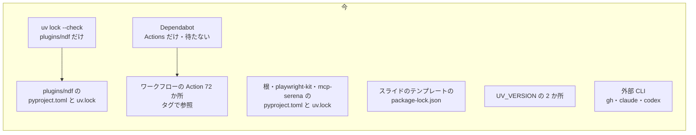
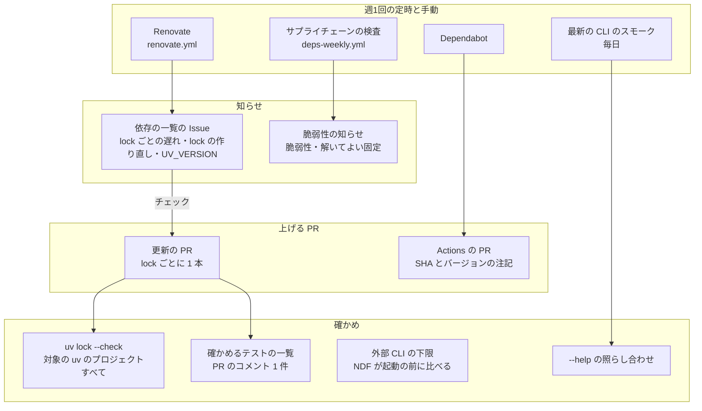
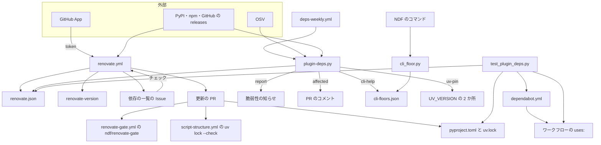
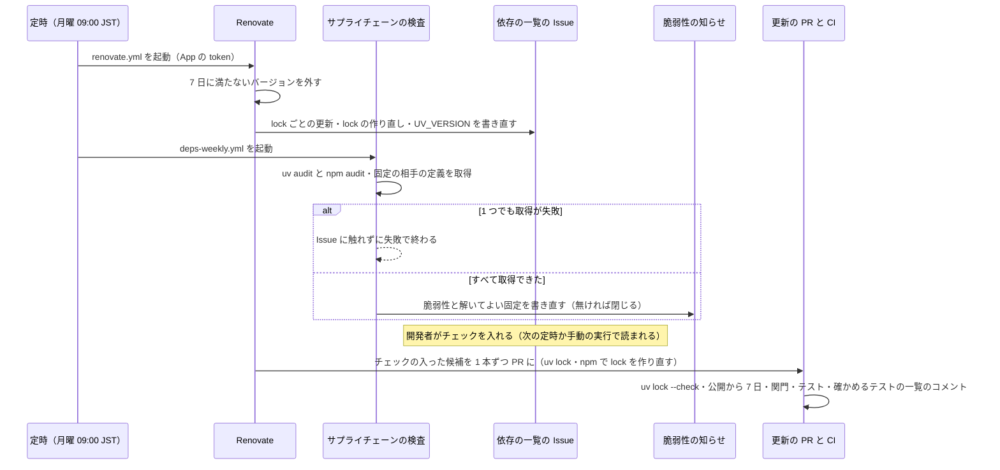

# 依存の更新: すべての lock・Actions・外部 CLI を公開から 7 日たった最新の安定版に保ち、遅れと脆弱性を週 1 回知らせる（#3370 #3691）

このリポジトリの依存は、上げる手段も遅れに気づく手段も持たない（要求は [#3370](./issue-3370-requirements.md) と [#3691](./issue-3691-requirements.md)）。Renovate が対象のすべての lock の遅れを 1 件の Issue に知らせ、チェックを入れた更新を lock ごとに 1 本の PR で上げる。Actions は SHA で固定して Dependabot が 7 日待って上げ、脆弱性は週 1 回の検査が別の Issue に知らせ、NDF は下限より古い外部 CLI を起動しない。3 案の比較は [issue-3370-3691-design-survey.md](./issue-3370-3691-design-survey.md)、採らなかった案は [issue-3370-3691-design-decisions.md](./issue-3370-3691-design-decisions.md) にある。

## 今の姿

何が起きたか・目的・受け入れ条件は要求仕様（[issue-3370-requirements.md](./issue-3370-requirements.md)、正は #3370 の本文。[issue-3691-requirements.md](./issue-3691-requirements.md)、正は #3691 の本文）にある。この文書は「どう解くか」と「なぜその解き方か」だけを書く。#3380（設計レビュー P）の 11.x の行 3380-1・2・3・4・6・8・9 は #3691 の受け入れ条件が持ち、この設計の実装で満たしたら閉じる。

**2 つの課題をまとめた理由（共通の原因）**: どちらも「依存のバージョンを上げ、遅れを知らせる仕組みが無い」という同じ欠けである。#3370 は仕組み（Renovate と 7 日待つ規則）を `plugins/ndf` の直接の依存に作り、#3691 は同じ仕組みの対象と確かめを広げる。仕組みの設定（`.github/renovate.json`）と週 1 回の検査を両方の課題が書き換えるため、別々に設計すると同じ表を 2 本の文書が持つ。

**前の設計からの変わり目**: #3370 の設計（設計 PR #3522、2026-11-15 に承認。`issues/issue-3370-design.md`・`issues/issue-3370-design-detail.md`）は入れ替え（#3304）の前の配置で書かれ、実装は入っていない。この文書がその 2 本を置き換え、次を直した。

| 前の設計 | この設計 |
| --- | --- |
| 対象は `plugins/ndf-next` | 対象は `plugins/ndf`（11.0.0 で `plugins/ndf-next` は `plugins/ndf` になった） |
| マージ先は `develop`、一致の検査は `.github/workflows/ndf-next.yml:88` | マージ先は `main`（ブランチ戦略 `trunk`）、一致の検査は `.github/workflows/script-structure.yml:97` |
| 対象を `plugins/ndf` の Python の直接の依存に絞り、脆弱性・ほかの lock・Actions と CLI は有効にしない（前の決定 6） | 対象をすべての lock・推移的な依存・コードの中の固定へ広げ、脆弱性・Actions・外部 CLI を足す（決定 6・9・11・12・13） |
| 固定する理由は Renovate の規則の自由文（前の決定 5） | 固定する理由は種類・相手・制約・見直す日の欄を持つ（決定 5） |

図の A1〜A4 と A6 は、上げる手段も遅れの知らせも持たない。A2 は根の lock で 86 本のうち 47 本が遅れ、playwright-kit の lock に既知の脆弱性が 7 件ある（2026-11-21 の実測。#3691 の「今の姿」）。

## 文脈と制約

- **バージョンの規則**: 依存は公開から 7 日たった最新の安定版にする。httpx は 0.28.1 に固定する（githubkit 0.17.1 が `httpx<1.0.0,>=0.23.0` を求める）。DBOS は C1+ の続きが上げ、この設計の対象の外に置く（#3347 の決定 106、利用者の決定 2026-11-14）
- **7 日を守る所は 3 つある**: Renovate は uv の設定を読まない。lock を作り直すのは uv と npm なので、uv の `exclude-newer` と npm の `min-release-age` が解決の守りになり、PR の上の公開日の検査（`age`）が、依存の一覧の Issue のチェックで待つ日数を飛ばした版と、解決の守りを通らない `UV_VERSION`・Renovate の版を拒む最後の守りになる（M1・M2・決定 6）
- **Renovate の App は Workflows の権限を持たない**（前の設計の非機能の実現方式）。ワークフローのファイルを書き換える更新（Actions の SHA）は Renovate に任せられない
- **必須のチェック**: `main` の ruleset（`protect main`、id 22332172）の必須のチェックは 15 件である。Renovate のチェック（`renovate/artifacts`）と依存の検査は含まれない（`gh api repos/devbasex/ai-plugins/rulesets/22332172`、2026-11-21）
- **テストは CI で打つ**: `.ndf/project.json` の `test.ci.only` が `true` で、合否は PR の CI で読む
- **触ってよい場所**: 並列の計画 p9 のレーン lz13-deps の範囲は、定義と lock（根と `plugins/ndf`）・`.github/`・`scripts/plugin-deps.py`・`scripts/tests/test_plugin_deps.py`・`issues/issue-3370-*`・`issues/issue-3691-*` である。外れるファイルは「影響と危険」に挙げる。触ってよいかはレッドラインに当たらないため「人へ残す判断」に置かず、設計承認ゲートの承認資料の「判断が要る点」で、この範囲の外を触ってよいかを問う
- **CI の uv と Python のバージョン**（3380-7）は Z2 #3687 が持ち、この設計は触らない。Z2 のレーン（lz2-ci）は、このレーンの後に `.github/workflows/` と `plugins/ndf/contracts/` を触る
- **`uv audit` はプレビュー**の機能で、出力の形が予告なく変わりうる（LIB19・M8）。終了コードは 0 件で 0、1 件以上で 1、質問合わせの失敗で 2 である（M8〜M11）

## 解き方の全体像

- 対象の 4 つの uv のプロジェクトはすべて `exclude-newer = "7 days"` を持ち、Renovate も 7 日待つ。依存の一覧の Issue には、直接の依存の更新・lock の作り直し（推移的な依存）・`UV_VERSION` の行が lock ごとに並ぶ
- チェックを入れた行は、lock ごとに 1 本の更新の PR になる。lock を変えた PR には、変わったパッケージとそれを使うテストの一覧が 1 件のコメントで付く
- 週 1 回のサプライチェーンの検査は、すべての lock の既知の脆弱性と、解いてよくなった固定を 1 件の脆弱性の知らせにまとめる。外部 CLI の `--help` は、毎日の最新の CLI のスモークの中で見本と照らす
- Actions はすべて SHA で固定され、Dependabot が公開から 7 日たったバージョンへ上げる
- NDF は `gh`・`claude`・`codex` を起動する前にバージョンを下限と比べ、古ければ理由を出して止まる

## ドメインモデル

### コンテキスト

| コンテキスト | 何の語が 1 つの意味に決まるか |
| --- | --- |
| コードの構成（`ndf-code-structure`） | 依存のバージョンの「安定版」「上げる先」「遅れ」「固定する理由」と、「依存の更新の仕組み」「依存の一覧の Issue」「推移的な依存」「脆弱性の知らせ」 |
| NDF の外部 CLI（`ndf-agent-cli`） | 「下限（外部 CLI の）」 |

2 つは上下流の関係で、コードの構成が外部 CLI の下限を依存の 1 つとして読む（下限の表は NDF のコントラクトが持ち、週 1 回の検査が読むだけ）。Renovate・Dependabot・uv の語（`minimumReleaseAge`・`cooldown`・`exclude-newer`）は設定の値としてだけ使う。

### 集約

| 集約 | オーナー（書き換えてよいもの） | 根 | エンティティ | 値オブジェクト |
| --- | --- | --- | --- | --- |
| 依存の定義（uv のプロジェクトごと） | Renovate の更新の PR | 各 `pyproject.toml` | 依存の行 | バージョン・7 日の設定・`uv.lock`（定義から `uv lock` で作るコピー） |
| 依存の更新の規則 | 規則を変える開発者の PR | `.github/renovate.json` | 依存ごとの規則（まとめ方・固定と理由・対象の外と理由） | 7 日・承認の要否・対象のパス |
| 遅れの知らせ | Renovate | 依存の一覧の Issue | 更新の候補の行 | 承認のチェック |
| 脆弱性の知らせ | サプライチェーンの検査（`deps-weekly.yml`） | 脆弱性の知らせの Issue | 脆弱性の行・解いてよい固定の行 | 勧告の ID・直ったバージョン |
| Actions の参照 | Dependabot の PR | `.github/workflows/*.yml` の `uses:` | 参照の行 | SHA・バージョンの注記 |
| 外部 CLI の下限 | 下限を変える開発者の PR | `plugins/ndf/contracts/domains/cli-floors.json`（新設） | CLI の行 | 下限・バージョンの読み方・`--help` の見本 |

依存の定義のオーナーの例外は 2 つで、どちらも行か期間が限られる。

| 例外 | 書き換える範囲 | 限り |
| --- | --- | --- |
| この設計の実装の PR による最初のバージョンアップ | 遅れている依存の行・7 日の設定・lock | 移行の 1 回だけ。その PR が `main` に入るまで Renovate を動かさない（I8） |
| C1+ の続き（DBOS を上げる作業） | DBOS の行だけ | DBOS は Renovate の対象の外（決定 7） |

### 不変条件

| # | 集約 | 条件 | 破れたときの扱い |
| --- | --- | --- | --- |
| IG5 | 依存の定義 | 各 `uv.lock` が定義と一致する（#3347 の不変条件） | CI の `uv lock --check --project <ディレクトリ>` が対象の 4 つのプロジェクトで PR を落とす。日がたっても落ちない（M4） |
| I1 | 依存の更新の規則 | 上げる先は、最初のアップロードから 7 日たったバージョンに限る（脆弱性の例外の規則に載る組を除く） | Renovate が 7 日に満たないバージョンを出しても、`uv lock` と npm の `min-release-age` が解決を拒む（M2）。lock・`UV_VERSION`・Renovate の版に入った 7 日に満たない版と公開日の無い版は、PR の `age` のステップが落とす |
| I2 | 遅れの知らせ・脆弱性の知らせ | 知らせは依存の一覧の Issue と脆弱性の知らせの 2 件だけである | 2 件目ができたら設定の誤りとして直す。脆弱性の知らせは本文の目印と作成者で 1 件を引き、無ければ作る。目印つきが 2 件以上なら触れずに止まる |
| I3 | 依存の更新の規則・依存の定義 | 固定する依存と対象の外の依存は、規則に種類・相手・制約・見直す日・理由の欄を持つ。脆弱性の例外（uv の `exclude-newer-package`・npm の `overrides`）は、同じ勧告の ID・版・外す日を持つ規則と組になる | 欄の欠けた規則と、規則の無い例外は、設定の検査のテストが落ちる（規則だけが先に入るのは、例外を 2 つの PR で入れる手順の先行の PR として通す） |
| I4 | 依存の定義 | 解決できない上げ方では、更新の PR のチェック `renovate/artifacts` が赤になる | Renovate の PR は、今の head の `renovate/artifacts` が `success` でなければ、既定ブランチの定義で動く `renovate-gate.yml` が必須の commit status `ndf/renovate-gate` を `success` にせず、merge queue に入らない（決定 8） |
| I5 | 遅れの知らせ・脆弱性の知らせ | 定時の検査は週 1 回の定時と手動でだけ走り、PR では走らない | ワークフローの起動の条件を、設定の検査のテストが確かめる |
| I6 | 依存の更新の規則 | Renovate の待つ日数・Dependabot の `cooldown` の日数・各 `pyproject.toml` の `exclude-newer` は同じ 7 日である。正は `plugins/ndf/pyproject.toml` の値。uv の lock の作り直しだけは Renovate の待つ日数を `null` にし、7 日を uv が守る（決定 6） | 食い違えば設定の検査のテストが落ちる。`null` を uv の lock の作り直しの外に置いても落ちる |
| I7 | 依存の更新の規則 | 固定した依存は、固定したバージョンの外を上げる先にしない（httpx は 0.28.1 だけ） | 固定の範囲を外すとテストが落ちる |
| I8 | 依存の定義 | 依存の定義の各行の書き手は同じ時点に 1 つだけである。実装の PR が `main` に入るまで Renovate を有効にしない | Renovate の導入（App と秘密）を実装の PR のマージの後に行う。`uv.lock` が食い違ったら、後に入る PR が `main` の上で lock を作り直す |
| I9 | 依存の更新の規則 | 対象の lock は、追跡している lock（`git ls-files`）から Renovate の `ignorePaths` を除いたものすべてである | lock を足して Renovate の対象から漏れると、設定の検査のテストが落ちる |
| I10 | Actions の参照 | 外部の Action の参照はすべて 40 桁の SHA で、後ろにバージョンの注記がある | タグで参照する行を足すと、設定の検査のテストが落ちる |
| I11 | 遅れの知らせ・脆弱性の知らせ | 1 つでも取得（脆弱性・PyPI・npm）が失敗した実行は、知らせを書き換えずに失敗で終わる | 検査のスクリプトが終了コード 0 以外で終わり、Issue に触れない。Renovate は `hostRules` の `abortOnError` で、個別のパッケージの取得が 1 つでも失敗したら依存の一覧の Issue を書く前に止まる（実走で確かめる。詳細設計の「受け入れ条件 9 と 7 の確かめ」の 5〜6） |
| I12 | 外部 CLI の下限 | NDF は下限より古い外部 CLI を起動しない | 起動の前の比べで、その箇所の今の「起動できない」の形で止まる。比べを持たない起動の箇所は、起動の箇所を探すテストが落とす |

### ドメインイベント

番号は #3691 の要求のドメインイベントを引き継ぐ（#3370 の E3〜E9 は E1・E2・E5 に含まれる）。

| # | イベント | 発生元 | 受け手 |
| --- | --- | --- | --- |
| E1 | 依存の新しいバージョンが公開された | PyPI・npm・GitHub の releases（外部） | Renovate・Dependabot の次の実行 |
| E2 | 公開から 7 日たった | 時間 | Renovate（`minimumReleaseAge`）・Dependabot（`cooldown`）・uv（`exclude-newer`） |
| E3 | 週 1 回の検査が遅れ・脆弱性・解いてよい固定・`--help` の食い違いを見つけた | `renovate.yml`・`deps-weekly.yml` | 依存の一覧の Issue・脆弱性の知らせ・ワークフローの失敗 |
| E4 | 遅れの知らせと脆弱性の知らせを書き直した・閉じた | Renovate・サプライチェーンの検査 | 開発者 |
| E5 | 更新の PR が lock を書き換えた | 依存の一覧の Issue のチェック → Renovate | CI（`uv lock --check`・テスト） |
| E6 | 更新の PR に、変わった依存と確かめるテストの一覧が出た | 確かめるテストの一覧のジョブ | 更新の PR を見る開発者 |
| E7 | NDF のコマンドが外部 CLI のバージョンを下限と比べた | NDF の起動の前の比べ | 利用者（止まったときの理由） |

## 機能一覧

| # | 機能 | 誰が使うか |
| --- | --- | --- |
| F1 | 週 1 回（と手動）、対象のすべての lock の遅れ・lock の作り直し・`UV_VERSION` を 1 件の依存の一覧の Issue に書き直す | このリポジトリの開発者 |
| F2 | 依存の一覧の Issue でチェックを入れると、その lock の更新を 1 本にまとめた PR が届く | 同上 |
| F3 | 公開から 7 日に満たないバージョンを、Renovate も Dependabot も uv も上げる先にしない | 同上（サプライチェーンの守り） |
| F4 | httpx を 0.28.1 に固定し、DBOS を対象から外し、それぞれ欄つきの理由を規則に持つ | 同上 |
| F5 | 対象のすべての uv のプロジェクトで、定義と lock の食い違いを CI が落とす | PR を出すすべての開発者 |
| F6 | lock を変えた PR に、変わったパッケージとそれを使うテストの一覧を 1 件のコメントで出す | 更新の PR を見る開発者 |
| F7 | 週 1 回（と手動）、すべての lock の既知の脆弱性と解いてよい固定を 1 件の脆弱性の知らせに書き直す | このリポジトリの開発者 |
| F8 | Actions を SHA で固定し、Dependabot が 7 日待って上げる | 同上 |
| F9 | NDF が外部 CLI を起動する前に下限と比べ、古ければ理由を出して止まる。毎日の最新の CLI のスモークの中で、使う引数を `--help` と照らす | NDF の利用者・このリポジトリの開発者 |
| F10 | 依存を今の時点の上げる先へ上げ、上げたバージョンで落ちるコードとテストを直す（最初の 1 回） | 実装のレーン |

## 構成要素

| 要素 | 責務 |
| --- | --- |
| Renovate の設定（`.github/renovate.json`） | 対象の lock と `UV_VERSION` を見て、7 日待ち、チェックを入れるまで PR を作らず、lock ごとに 1 本にまとめる。lock の作り直し（推移的な依存）を候補に出す。固定と対象の外を欄つきの理由で持つ。lock の作り直しの成否を `renovate/artifacts` で出す |
| Renovate を動かすワークフロー（`.github/workflows/renovate.yml`） | 週 1 回の定時と手動で Renovate を動かす。GitHub App から短い期限の token を作る。PR では走らない |
| Renovate のバージョン（`.github/renovate-version`） | 動かす Renovate のバージョンを 1 行で持つ。Renovate 自身が 7 日待って上げる（ワークフローの外に置くため、App に Workflows の権限が要らない） |
| サプライチェーンの検査のワークフロー（`.github/workflows/deps-weekly.yml`） | 週 1 回の定時と手動で、脆弱性・解いてよい固定・プレリリースを選べる依存を 1 件の Issue に書く。Renovate の設定を変えた PR で設定を検証する |
| 確かめるテストの一覧の投稿（`.github/workflows/deps-affected-comment.yml`） | `script-structure.yml` が作った一覧のデータを、既定のブランチのコードで PR 番号と head の SHA を確かめてから 1 件のコメントに書く |
| 最新の CLI のスモーク（`.github/workflows/runtime-plugin-smoke-latest.yml`） | 既に入れている最新の CLI で、外部 CLI の `--help` を見本と照らすステップを足す |
| 依存の検査のスクリプト（`scripts/plugin-deps.py`） | サブコマンド `report`（脆弱性と解いてよい固定の知らせ）・`affected` と `post-affected`（確かめるテストの一覧）・`age`（公開から 7 日）・`action-pins`（SHA と注記の対応）・`renovate-gate`（Renovate の PR の関門）・`renovate-log`（PR の無い失敗）・`cli-help`（`--help` の照らし合わせ）・`uv-pin`（`UV_VERSION` の 2 か所とインストーラの sha256 をそろえる） |
| 依存の定義と lock（4 つの uv のプロジェクトの `pyproject.toml`・`uv.lock`、スライドの `package.json`・`package-lock.json`・`.npmrc`） | `[tool.uv]` の `exclude-newer = "7 days"`・`.npmrc` の `min-release-age=7` と、上げる先のバージョン |
| 定義と lock の一致の検査（`.github/workflows/script-structure.yml`） | `uv lock --check` を、入力が変わったプロジェクトごとに打つ（merge queue と push では 4 つとも。今は `plugins/ndf` だけ）。公開から 7 日と Action の参照を確かめ、確かめるテストの一覧のデータを作る |
| 依存の PR の関門（`.github/workflows/renovate-gate.yml`） | `pull_request_target` と `status` の出来事で、既定ブランチの定義と検証器が Renovate の PR の `renovate/artifacts` を確かめ、PR の先端へ必須の commit status `ndf/renovate-gate` を付ける（PR の中で関門の条件も検証器も書き換えられない） |
| Dependabot の設定（`.github/dependabot.yml`） | Actions の更新を続け、`cooldown` の 7 日を持つ。頭の注記を Renovate との分担に書き直す |
| ワークフローの Action の参照（`.github/workflows/*.yml` の `uses:`） | 外部の Action を 40 桁の SHA とバージョンの注記で参照する |
| 外部 CLI の下限の表（`plugins/ndf/contracts/domains/cli-floors.json`） | `gh`・`claude`・`codex` の下限・バージョンの読み方・`--help` の見本を持つ |
| 下限の比べ（`plugins/ndf/src/ndf/adapters/cli_floor.py`） | 外部 CLI を起動する箇所の前で、バージョンを下限と比べ、古ければその箇所の今の「起動できない」の形で止める |
| 設定の検査のテスト（`scripts/tests/test_plugin_deps.py`） | I3・I5・I6・I7・I9・I10 と、Renovate の範囲・承認・閉じる設定を縛る。スクリプトのサブコマンドを記録した入力で縛る |

## 処理の流れ

脆弱性の直しが公開から 7 日に満たないときの扱いは決定 9 にある。図に含めない要素は次の 6 つである。

- Dependabot とワークフローの参照: Renovate と別の週 1 回の流れ（決定 13）
- 外部 CLI の下限の表と比べ: NDF のコマンドの起動の流れ（決定 11）
- `--help` の照らし合わせ: 毎日の `runtime-plugin-smoke-latest.yml` の中（決定 11）
- 設定の検査のテスト: PR の CI
- Renovate のバージョン: `renovate.yml` が起動のときに読むだけ
- `uv-pin`: Renovate の更新の PR の中で打たれる（決定 12）

## 非機能の実現方式

| 大項目 | 要求の条件 | 実現方式 | 確かめ方 |
| --- | --- | --- | --- |
| 運用・保守性 | 知らせは遅れの 1 件と脆弱性の 1 件だけ | 依存の一覧の Issue（Renovate がリポジトリに 1 件）と、目印のラベル `supply-chain` で引く脆弱性の知らせ 1 件 | 手動の実行を 2 回打ち、Issue が 2 件のまま書き直されることを見る（リリース後テスト） |
| セキュリティ | GitHub App の権限は #3370 の範囲（Contents・Pull requests・Issues・Commit statuses の読み書き、Checks・Metadata の読み取り）に限る | Renovate は Workflows の権限を持たず、Actions は Dependabot が持つ（決定 13）。サプライチェーンの検査は App を使わず、ワークフローの `GITHUB_TOKEN`（`issues: write`・`pull-requests: write`・`contents: read`）で動く | 導入の後、App の権限の画面とワークフローの `permissions` を見る |
| システム環境 | GitHub Actions の `ubuntu-latest` と、リポジトリで使っている uv | すべてのジョブが `ubuntu-latest` と `astral-sh/setup-uv` で動く。uv のバージョンの固定は Z2 が持つ | CI の結果で見る |

## 決定の記録

決定の本文は [issue-3370-3691-design-decisions.md](./issue-3370-3691-design-decisions.md) にある。見出しだけをここに並べる。

1. 自作の保守を負わずに遅れの知らせとバージョンアップを得るため、依存の更新の仕組みに Renovate を採り、#3347 の決定 107 の自作を置き換える
2. 起動の時刻と条件をこのリポジトリで決め、PR の CI を自動で走らせるため、Renovate を GitHub Actions の上で GitHub App の token で動かし、Renovate 自身のバージョンは `.github/renovate-version` に置いて 7 日待って上げる
3. 同じ lock を触る PR の衝突を減らすため、更新の PR はチェックを入れたときだけ作り、lock ごとに 1 本にまとめる
4. 7 日の守りを 1 か所の取りこぼしで破らないため、Renovate・Dependabot・uv の 3 か所に同じ 7 日を置き、値の一致をテストで縛る
5. 固定を解いてよい時機を機械で知るため、固定する理由を Renovate の規則の中で種類・相手・制約・見直す日の欄に分けて書く
6. 漏れなく上げるため、対象を追跡しているすべての lock（`docs/presentations/` を除く）と推移的な依存と `UV_VERSION` へ広げる
7. 7 日の規則を最初のバージョンアップにも当てるため、実装の PR は上げる先を実装の時点で uv に決めさせ、DBOS を対象の外に置く
8. 解決できない上げ方を失敗として返すため、lock の作り直しの成否を Renovate のチェックで常に出し、赤のときは更新の PR をマージしない
9. 承認と 7 日を飛ばさずに脆弱性を知るため、脆弱性は週 1 回の `uv audit` と `npm audit` で 1 件の Issue に知らせ、Renovate の脆弱性の PR は有効にしない
10. 上げた後に見るテストが分かるよう、lock を変えた PR に、変わったパッケージを import するコードを通るテストの一覧を出す
11. 古い CLI での失敗を利用者の環境で初めて知ることが無いよう、外部 CLI の下限を NDF のコントラクトの表に置き、起動の前に比べて止まる
12. `UV_VERSION` とインストーラの sha256 を食い違わせないため、Renovate の更新の後に検査のスクリプトで sha256 を書き直す
13. タグの付け替えで Action の中身が黙って変わらないよう、Actions を SHA で固定し、Renovate に渡さず Dependabot に 7 日待たせて上げさせる

## 影響と危険

- **働く範囲**: 依存の更新の仕組み（Renovate・サプライチェーンの検査・Dependabot・SHA の固定）はこのリポジトリだけで働く。外部 CLI の下限（決定 11）は NDF の利用者のリポジトリでも働く
- **プロジェクトごとに違うもの**: 無し。下限の表は NDF のコントラクトで、利用者の設定では変えない
- **当たるモード**: `standard`

### 代表のリポジトリでの振る舞い

| 代表のリポジトリ | 設定の要点 | 直した後に起きること | この種類で扱えなくなること |
| --- | --- | --- | --- |
| Web サービス | NDF の hook と 3 層の run が `claude`・`codex`・`gh` を起動する | 下限より古い CLI では、その CLI を起動する NDF のコマンドが理由を出して止まる。設計・設計の検査・cross-review・MVV 判定の流れは変わらない | 無し（CLI を下限以上へ上げれば同じ運用が続く） |
| モバイルアプリ | 同上 | 同上 | 無し（同上） |
| 業務文書だけ | `gh` と `claude` を使い、テストのツールは持たない | 同上 | 無し（同上） |

### ai-plugins だけの事情

| 値 | 置く所 | 持つ Issue |
| --- | --- | --- |
| Renovate・サプライチェーンの検査・Dependabot の設定と、対象の lock の一覧 | `.github/` の下（NDF の利用者へ届かない） | #3370・#3691 |
| マージ先のブランチ `main` | Renovate の設定の `baseBranchPatterns`（`.ndf/project.json` の `branch_strategy` が `trunk`） | #3370 |

### 書きかけの文書・同じファイルを触る変更・壊れうる箇所

| 箇所 | 扱い |
| --- | --- |
| 触ってよい場所の外のファイル（設計承認ゲートの承認資料の「判断が要る点」で問う。`.github/renovate-version`、`plugins/playwright-kit/skills/playwright-kit-ops/`・`plugins/mcp/mcp-serena/` の `pyproject.toml` と `uv.lock`、`plugins/ndf/contracts/domains/cli-floors.json`・`plugins/ndf/src/ndf/adapters/`・`plugins/ndf/src/ndf/domains/project/measure_ci.py`・`plugins/ndf/src/ndf/domains/relay/`・`plugins/ndf/tests/adapters/`、`plugins/ndf/skills/release/assets/slides/` の `.npmrc`・`package.json`・`package-lock.json`、`scripts/lib/ndf_wrappers.py`、`.ndf/project.json`、`scripts/required-checks-allow.json`、`docs/glossary/`） | 承認資料の判断が要る点に挙げる。承認されなければ、外れる受け入れ条件（#3691 の 3、5 のうち 2 つの lock）を別の課題へ分ける |
| Z2 #3687（lz2-ci）が `.github/workflows/` と `plugins/ndf/contracts/` を触る | lz2-ci はこのレーンの後に始まる（計画 p9）。この設計の SHA の固定と下限の表が先に入り、Z2 はその上で作業する |
| `.github/workflows/` の 72 か所の参照を書き換える | 1 つの PR で一度に書き換え、SHA は実装の時点の各タグの指すコミットにする。I10 のテストが残りを落とす |
| `ndf-release-reusable.yml` は利用者のリポジトリから呼ばれる | 中の Action の参照が SHA に変わるだけで、入力と出力は変わらない |
| 新しいワークフロー 4 本（`renovate.yml`・`deps-weekly.yml`・`deps-affected-comment.yml`・`renovate-gate.yml`）が `.ndf/project.json` の `test.ci_exempt` に無く、PR に付くジョブが必須のチェックの定義に無い | `ci_exempt` に理由つきで 4 行を足し、`scripts/required-checks-allow.json` の `not_required` に `renovate-config`・一覧の投稿のジョブと `renovate/artifacts` を理由つきで足す（必須にしない理由は決定 8）。関門の `ndf/renovate-gate` は `statuses` と `awaiting` に置き、`main` の ruleset の必須への追加は承認ゲート 2 で利用者が行う |
| スライドのテンプレートの `.npmrc` は `release` の Skill の資材として利用者へ配られる | 利用者がテンプレートで `npm install` するときも公開から 7 日の版だけを入れる。`min-release-age` を知らない古い npm は未知の設定として警告して続ける。変更履歴に書く |
| 外部 CLI の下限を高く置きすぎると利用者が止まる | 下限は NDF が使う引数が初めて入ったバージョンにする。分からない CLI は今の CI のバージョンを置き、「未確認のまま残ること」に書く |
| `uv audit` の出力の形が変わる | 検査のスクリプトは JSON の形が読めなければ Issue に触れずに失敗で終わる（I11） |

## 用語

| 用語 | 意味 | 用語集への反映 |
| --- | --- | --- |
| 推移的な依存 | 定義に書かず、定義した依存が求めるために lock に入るパッケージ | 追加 |
| 脆弱性の知らせ | 週 1 回のサプライチェーンの検査が、対象の lock の既知の脆弱性と解いてよくなった固定をまとめる 1 件の Issue。依存の一覧の Issue とは別に置く | 追加 |
| 下限（外部 CLI の） | NDF が動くために要る外部 CLI と本体の最も古いバージョン。`plugins/ndf/contracts/domains/cli-floors.json` が持つ | 追加 |
| 固定する理由（依存のバージョンの） | 依存を上げる先へ上げずに今のバージョンに止める理由。種類・相手・制約・見直す日の欄を持ち、Renovate の依存ごとの規則に書く（決定 5） | 意味の変更（自由文から欄つきへ） |

## テスト設計

| 受け入れ条件・不変条件 | どの振る舞いで縛るか | どう壊したら落ちるべきか |
| --- | --- | --- |
| #3370 の 1・2・3 | 済み（設計 PR #3522） | — |
| #3370 の 4・#3691 の 5・I1 | 実装の PR の各 lock が上げる先にあり（httpx は 0.28.1、DBOS は変えない）、各 `pyproject.toml` に `exclude-newer = "7 days"` がある | 7 日に満たないバージョンを定義に書くと `uv lock` が解決を拒む（M2） |
| #3370 の 5・10・IG5 | 対象の 4 つのプロジェクトで `uv lock --check` が CI で走り、lock に `exclude-newer-span = "P7D"` がある | 定義だけを書き換えた PR で CI が落ちる。`script-structure.yml` からプロジェクトを 1 つ外すとテストが落ちる |
| #3370 の 6・I6 | 7 日が Renovate・Dependabot・4 つの `pyproject.toml` で同じ値である | どれか 1 つを `"6 days"` にするとテストが落ちる |
| #3370 の 7・I2・I5 | Renovate の承認・閉じる設定と、2 本の定時のワークフローの起動の条件（`schedule` と `workflow_dispatch` だけ。確かめるテストの一覧のジョブは `pull_request` の lock のパスだけ） | 定時のジョブに `pull_request` を足す、承認か閉じる設定を外すとテストが落ちる |
| #3370 の 8・I3・I7・#3691 の 6（固定） | httpx の規則が `==0.28.1` と欄つきの理由を持ち、DBOS の規則が `enabled: false` と欄つきの理由を持つ。`dependencyDashboardHeader` の固定の一覧が規則と同じ。`report` が相手の制約の消失と緩和を出し、同値と強化を出さない | 欄を 1 つ消す、許すバージョンを広げる、固定の一覧から httpx を消すとテストが落ちる |
| #3370 の 9・I4 | `statusCheckWhen.artifactError` が `"always"`。`renovate-gate` が今の head の `success` だけを通す | 設定を外す、赤・未報告・古い head の成功を通すとテストが落ちる。解決できない上げ方は、`main` の祖先のコミットだけを持つ検証用のブランチを宛先に渡した手動の実行で 1 度見る（決定 8） |
| #3370 の 11 | 上げたバージョンで落ちたテストを同じ PR で直す | 実装の PR の CI が落ちたままならマージしない |
| #3370 の 12 | `plugins/ndf/pyproject.toml` の頭の注記が、バージョンの選び方と Renovate の設定の保存先を持ち、`11.0.0-dev.N` の注記が無い | 注記の指すファイルが無いとテストが落ちる |
| #3370 の 13 | 当たらない（自作を選ばない。決定 1） | — |
| #3691 の 1・I9 | 追跡している lock から `ignorePaths` を除いたものが、すべて Renovate の対象のパスとサプライチェーンの検査の対象に入る。`pep621` と `npm` の仕組みの設定で `lockFileMaintenance` が有効で、`UV_VERSION` の 2 か所を拾う規則がある。2 か所の版とハッシュの組が同じ | lock を 1 つ足して対象に足さない、片方のハッシュだけを変えると、テストが落ちる |
| #3691 の 2・E6 | `affected` が、記録した uv と npm の lock の差分から、変わったパッケージ・それを使うモジュール・そのモジュールを使うテスト（無ければ「テストが無い」）を出す。読めない lock では理由を出す。`post_affected` が今の head と違う SHA の結果を書かず、lock の差分が無くなった PR のコメントを消す | import の読み取りか配布名の対応表を外すと、記録した入力でテストが落ちる |
| #3691 の 3・I12 | 下限より古いバージョンを返す CLI で、その CLI を起動する NDF のエントリポイントが起動せずに 0 以外で終わり、CLI の名前・見つけたバージョン・下限を出す。起動の箇所（実行ファイルの名前を `subprocess` か `exec` に渡す所と、`bin/ndf-claude` の `exec claude`。登録の解除・認証状態の確かめを含む）がすべて比べを持つ。下限と同じバージョンでは止まらず、同じ数字のプレリリースでは止まる。`cli-help` が、見本の引数がトップレベルかサブコマンドの `--help` に無いと 0 以外で終わる | 比べを外すと、古い CLI のテストが落ちる。`--help` の側に見本に無い引数が増えても通ることを縛る |
| #3691 の 4・I10 | 外部の Action の参照がすべて 40 桁の SHA と具体的なバージョンの注記で、Dependabot の Actions の項目に `cooldown` の 7 日がある。`action-pins` が注記のタグの指すコミットと SHA を比べる | タグの参照を 1 つ足す、注記と違う SHA を書くとテストが落ちる |
| #3691 の 6（脆弱性）・I11 | `report` が、記録した `uv audit` と `npm audit` の結果から 1 件の Issue の本文を作り、0 件なら閉じる。取得の失敗を 1 つ混ぜると Issue に触れずに 0 以外で終わる | 失敗を握りつぶすと、テストが落ちる |
| I8 | 実装の PR 本文に、Renovate の導入（App と秘密）をマージの後に行う順序がある | 順序を書かずに出した PR は完了判定で止まる |

テストは実装のレーンが書く。この設計 PR は文書と用語集だけを変える。

詳細設計は [issue-3370-3691-design-detail.md](./issue-3370-3691-design-detail.md) にある。

## 設計の結果

| 課題 | 扱い | 統合先 | 触るファイル |
| --- | --- | --- | --- |
| #3370 | 実装する | — | `.github/renovate.json`（新設）、`.github/renovate-version`（新設）、`.github/workflows/renovate.yml`（新設）、`.github/workflows/renovate-gate.yml`（新設）、`.github/dependabot.yml`、`.github/workflows/script-structure.yml`、`plugins/ndf/pyproject.toml`、`plugins/ndf/uv.lock`、`scripts/tests/test_plugin_deps.py`（新設） |
| #3691 | 実装する | — | `.github/renovate.json`（新設）、`.github/workflows/deps-weekly.yml`（新設）、`.github/workflows/glossary.yml`、`.github/workflows/lint.yml`、`.github/workflows/ndf-release-reusable.yml`、`.github/workflows/pr-base-guard.yml`、`.github/workflows/pytest.yml`、`.github/workflows/release-cd.yml`、`.github/workflows/runtime-plugin-authenticated-smoke.yml`、`.github/workflows/runtime-plugin-smoke-latest.yml`（`cli-help` のステップも足す）、`.github/workflows/deps-affected-comment.yml`（新設）、`.github/workflows/runtime-plugin-smoke.yml`、`.github/workflows/runtime-plugin-validate.yml`、`.github/workflows/script-structure.yml`、`.github/dependabot.yml`、`pyproject.toml`、`uv.lock`、`plugins/playwright-kit/skills/playwright-kit-ops/pyproject.toml`、`plugins/playwright-kit/skills/playwright-kit-ops/uv.lock`、`plugins/mcp/mcp-serena/pyproject.toml`、`plugins/mcp/mcp-serena/uv.lock`、`plugins/ndf/skills/release/assets/slides/.npmrc`（新設）、`plugins/ndf/skills/release/assets/slides/package.json`、`plugins/ndf/skills/release/assets/slides/package-lock.json`、`plugins/ndf/bin/ndf`、`scripts/lib/ndf_wrappers.py`、`scripts/plugin-deps.py`（新設）、`scripts/tests/test_plugin_deps.py`（新設）、`plugins/ndf/contracts/domains/cli-floors.json`（新設）、`plugins/ndf/src/ndf/adapters/cli_floor.py`（新設）、`plugins/ndf/src/ndf/adapters/claude.py`、`plugins/ndf/src/ndf/adapters/agents.py`、`plugins/ndf/src/ndf/adapters/github.py`、`plugins/ndf/src/ndf/domains/project/measure_ci.py`、`plugins/ndf/src/ndf/domains/relay/wrapper.py`、`plugins/ndf/src/ndf/domains/relay/cli.py`、`plugins/ndf/src/ndf/domains/relay/account_login.py`、`plugins/ndf/src/ndf/domains/relay/cli_account.py`、`plugins/ndf/src/ndf/adapters/cli.py`、`plugins/ndf/tests/adapters/test_cli_floor.py`（新設）、`scripts/required-checks-allow.json`、`.ndf/project.json` |
| #3380 | 閉じる | — | — |

上げたバージョンで落ちる既存のコードとテストの直し（#3370 の受け入れ条件 11）は、触るファイルが実装の時点で決まる。直したファイルは実装の PR 本文に書く。

## 人へ残す判断

| 判断 | 当たるレッドライン | なぜ当たるか |
| --- | --- | --- |
| Renovate 用の GitHub App を作り、このリポジトリへ入れる（権限: Contents・Pull requests・Issues・Commit statuses の読み書き、Checks・Metadata の読み取り） | C2 | リポジトリへ書き込める主体が 1 つ増え、誰が何をできるかが変わる |
| GitHub App の秘密鍵を Actions の秘密に、クライアント ID を Actions の変数に置く | C1 | 秘密鍵を扱う。漏れると取り消すまでリポジトリへ書き込める |
| `.ndf/project.json` の `test.ci_exempt` に新しいワークフロー 4 本の行を足す | C7 | 利用者の設定（`.ndf/`）を書き換える |
| `main` の ruleset の必須のチェックに commit status `ndf/renovate-gate`（出元は GitHub Actions のアプリ）を足す（決定 8） | C2 | `main` へマージしてよい条件が変わる |
| 受け入れ条件 9 の確かめのために、検証用のブランチだけを対象にした ruleset を一時的に作って消す（詳細設計の「受け入れ条件 9 と 7 の確かめ」） | C2 | 一時的でも、そのブランチへマージしてよい条件が変わる |

## 未確認のまま残ること

| 項目 | 内容 |
| --- | --- |
| PyPI の取得が失敗したときの Renovate の振る舞い | 44.257.5 の依存の一覧の Issue は lookup の失敗を本文に載せる経路を持ち（`dependency-dashboard.ts`）、事前に PyPI へ届くかを確かめても実行の中の個別のパッケージの取得の失敗は捕まえられない。そこで `hostRules` の `abortOnError` で、取得が 1 つでも失敗したら Issue を書く前に実行を止める。止まって Issue が変わらないことは、実装のレーンが検証用のブランチで `registryUrls` を届かない URL にして 1 度動かして見る（詳細設計）。書き換えたなら、#3370 の受け入れ条件 7 の失敗時の扱いを「取得できなかった依存を一覧に出し、ほかの行を書き直す」へ変える案を、実装の PR の承認資料で問う |
| 承認を待つ更新が残るときに依存の一覧の Issue が閉じるか | `autoclose` は「残る PR が無くなったとき」に閉じる。承認を待つ更新が残るときは文書に無い。実装のレーンが手動の実行で見る。閉じるなら `autoclose` を外し、#3370 の受け入れ条件 7 の「無くなれば閉じる」は、サプライチェーンの検査が満たす。依存の一覧の Issue の本文に承認を待つ行も開いた更新の PR も無いときだけ、`report` が `gh issue close` で閉じる |
| 固定した httpx が依存の一覧の Issue に「固定」として出るか | `allowedVersions` で候補を除くだけでは Issue に固定の行が出ないため、固定の一覧を `dependencyDashboardHeader` に書き、常に Issue の頭に出す（詳細設計。中身が規則と同じことはテストが縛る）。導入の後の最初の実行の Issue で、制約を変えていない httpx が頭の固定の一覧にあり、更新の候補の行に無いことを見る |
| 上げたバージョンでのテストの結果 | 上げる先が実装の時点で決まるため（決定 7）、実装の PR の CI で分かる |
| `gh`・`codex` の下限の値 | NDF が使う引数が初めて入ったバージョンを、実装のレーンが各 CLI の変更履歴で確かめる。確かめられない CLI は実装の時点の CI のバージョンを置く |
| `affected` の import の読み取りで拾えない使い方（文字列での import・プラグインの読み込み） | 実装の PR の上で、lock の差分を 1 つ流して一覧を見る |
| Dependabot が SHA で固定した参照を上げ、バージョンの注記も書き換えるか | 文書の読めた範囲に記述が無かった（調査の「確かめられなかったこと」）。実装の後の最初の Dependabot の PR で分かる。注記を書き換えないなら、I10 のテストが注記のタグと SHA の食い違いを落とすので、その PR の上で注記を直す |
| Renovate の許すコマンド（`allowedCommands`）を action へ渡す形 | 全体の設定にだけ書ける（LIB13）。環境変数の名前と action からの渡し方は確かめていない。実装のレーンが手動の実行で `uv-pin` が打たれるかを見る。渡せなければ全体の設定のファイル（`RENOVATE_CONFIG_FILE`）で渡す |

## 外部の調査

| 種類 | 調べるか | 理由 |
| --- | --- | --- |
| 標準・仕様 | 調べない | 安定版の区別は PEP 440 に倣うと #3347 で決めた（`issues/issue-3347-design.md` の STD20）。新しく倣う標準は無い |
| 主要な製品 | 調べない | 比べる製品（Renovate・Dependabot）は使う候補として「ライブラリとサービス」で調べる |
| ライブラリとサービス | 調べる | Renovate・Dependabot・自作の比較と、脆弱性・SHA の固定・外部 CLI の扱いを選ぶため |

LIB1〜LIB8 と M1〜M4 は前の設計（2026-11-14）の調べで、出典はその日の取得である。LIB9 以降と M5 以降は 2026-11-21 に調べた。表と 3 案の比較は [issue-3370-3691-design-survey.md](./issue-3370-3691-design-survey.md) にある。
