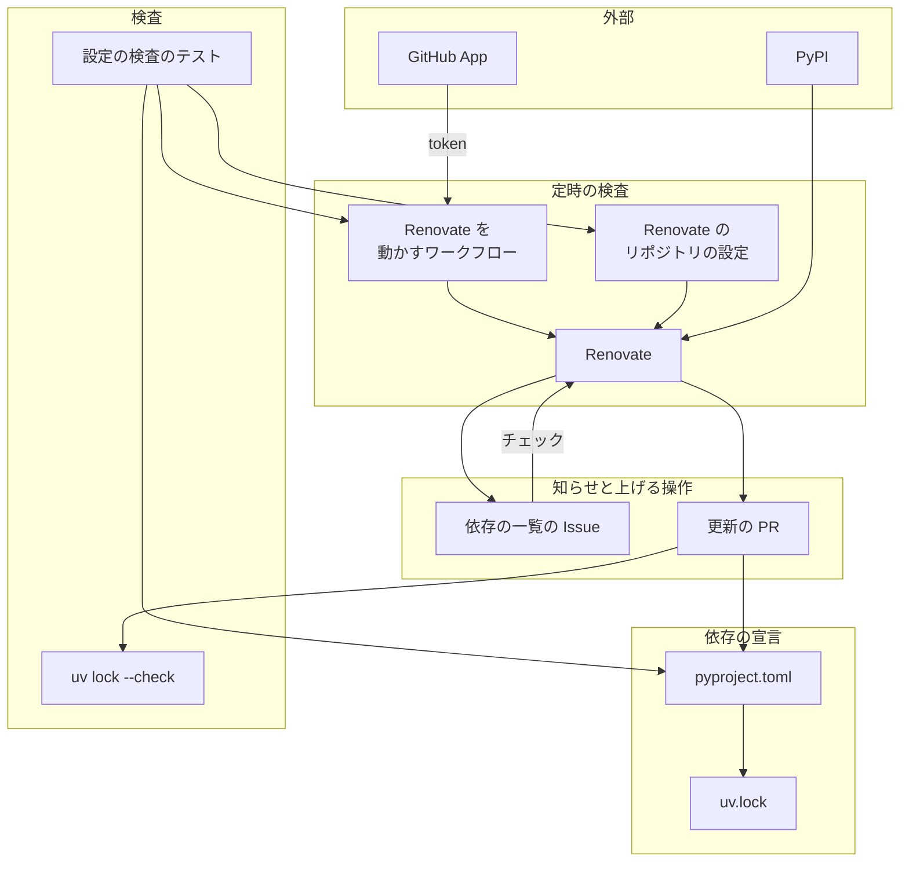
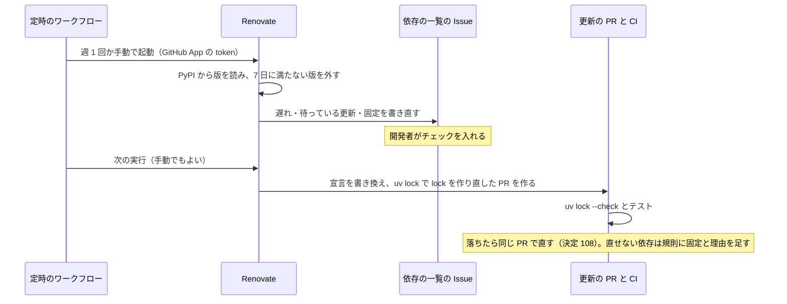

# ndf-next の依存の更新: Renovate で遅れを 1 件の Issue に知らせ、承認した更新を 1 本の PR で上げる（#3370）

## 目的

- **今どうなっているか**: `plugins/ndf-next/pyproject.toml` の依存のうち 11 本が最新の安定版より古い（「外部の調査」の LIB7）。版の遅れを知らせる検査も、版を上げる操作も無い。`[tool.uv]` に 7 日待つ設定（`exclude-newer`）が無い。リポジトリの Dependabot は GitHub Actions だけを見ている
- **誰に効くか**: #1142 の作り直しを流すレーンと、入れ替え（S2 #3304）の後に `plugins/ndf` を保守する開発者
- **変えると何が成り立つか**: 依存の版を、公開から 7 日たった最新の安定版へ上げる（#3347 の決定 106）。週 1 回の検査が遅れを 1 件の Issue に知らせ、その Issue でチェックを入れると、更新を 1 本にまとめた PR が届く。`uv.lock` と宣言の食い違いは CI が落とす

## 適用範囲

- **働く範囲**: このリポジトリだけ。対象は `plugins/ndf-next` の Python の依存（宣言と `uv.lock`）である。ほかの lock・GitHub Actions の版・CLI の版・脆弱性の知らせへ広げるかは #3380 の設計が決め、この設計は比べた結果を材料として渡す
- **プロジェクトごとに違うもの**: 無し（NDF の利用者へ配る機能ではなく、このリポジトリの開発の仕組みである）
- **当たるモード**: `standard`

## あるべき姿の根拠

| 根拠 | 種類 | 何を示すか |
| --- | --- | --- |
| 「依存の更新は Renovate と比べてから決める。X2 はそれまで着手しない」 | 利用者の指示の原文（#3380 が引用、2026-11-14） | 自作を前提にせず、既存の仕組みと比べて選ぶ |
| 「依存はできるだけ最新の安定版。安定版の概念が無い・古すぎるものは最新。公開から 7 日待つ。httpx は githubkit 0.17.1 の制約で 0.28.1 に固定」 | 利用者の指示の原文（#3380 が引用、2026-11-14） | 上げる先の規則・7 日・httpx の固定 |
| LIB1・LIB2（Renovate の公式文書） | 外部の一次情報 | 7 日待つ・依存ごとの固定と理由・1 件の Issue での知らせ・承認してから PR を作る形を設定だけで表せる |
| LIB5（uv の公式文書）と M1・M2（実測） | 外部の一次情報・実測 | `exclude-newer = "7 days"` が lock に残り、7 日に満たない版を解決で選ばず、宣言だけを変えた状態を `uv lock --check` が落とす |

要求と受け入れ条件は #3370 の本文にある（コピーは [issue-3370-requirements.md](issue-3370-requirements.md) ）。この文書は「どう作るか」だけを扱う。詳細設計（ファイル配置・設定の項目ごとの値・異常系の処理）は後の工程が `issues/issue-3370-design-detail.md` に書く。

## ドメインモデル

### コンテキスト

| コンテキスト | 何の語が 1 つの意味に決まるか |
| --- | --- |
| NDF の開発の工程（`ndf-workflow`） | 依存の版の「安定版」「上げる先」「遅れ」「固定する理由」と、「依存の更新の仕組み」「依存の一覧の Issue」 |

1 つのコンテキストに収まる。Renovate と uv は外部の系で、その語（`minimumReleaseAge`・`exclude-newer` など）は設定の値としてだけ使い、説明文では上の語で書く。

### 集約

| 集約 | 持ち主（書き換えてよいもの） | 根 | エンティティ | 値オブジェクト |
| --- | --- | --- | --- | --- |
| 依存の宣言 | Renovate が作る依存の更新の PR | `plugins/ndf-next/pyproject.toml` | 依存の行（名前と版） | 版・7 日の設定・`uv.lock`（宣言から `uv lock` で作るコピー） |
| 依存の更新の規則 | 規則を変える開発者の PR | Renovate のリポジトリの設定 | 依存ごとの規則（固定する依存と理由・対象から外す依存と理由・まとめ方） | 7 日・承認の要否・対象のディレクトリ・週 1 回の時刻 |
| 遅れの知らせ | Renovate（週 1 回と手動の実行） | 依存の一覧の Issue | 更新の候補の行 | 承認のチェック・待っている理由 |

`uv.lock` は宣言から作るコピーで、手で書き換えない。依存の宣言を書き換える PR は、宣言と lock を同じ PR で変える。

依存の宣言の持ち主は、Renovate が作る依存の更新の PR の 1 つだけである。次の 2 つは持ち主の外の例外で、どちらも期間か行が限られる。

| 例外 | 書き換える範囲 | 限り |
| --- | --- | --- |
| この課題の実装の PR による最初の版上げ | 遅れている依存の行と 7 日の設定 | 移行の 1 回だけ。その PR が `develop` に入るまで Renovate を動かさない（I8） |
| C1+ の続き（DBOS を 3.5.0 へ上げる作業） | DBOS の行だけ | DBOS は Renovate の対象の外に置く（決定 7）。対象へ戻すまで、DBOS の行はこの作業だけが書く。Renovate の更新の PR と同時に開いたときの `uv.lock` の扱いは I8 |

### 不変条件

| # | 集約 | 条件 | 破れたときの扱い |
| --- | --- | --- | --- |
| IG5 | 依存の宣言 | `uv.lock` が宣言と一致する（#3347 の不変条件） | CI の `uv lock --check` が PR を落とす。日がたっても、依存に関係の無い PR でこの検査は落ちない（M4） |
| I1 | 依存の更新の規則 | 上げる先は、最初のアップロードから 7 日たった版に限る | Renovate が 7 日に満たない版を出しても、`uv lock` が解決を拒む（M2） |
| I2 | 遅れの知らせ | 遅れの知らせは、リポジトリに 1 件の依存の一覧の Issue だけである。週ごとに新しい Issue を作らない | Renovate は同じ題の Issue を書き直す（LIB2）。2 件目ができたら設定の誤りとして直す |
| I3 | 依存の更新の規則 | 固定する依存と対象から外す依存は、規則に理由の文を持つ | 理由の無い規則は、設定の検査のテストが落ちる |
| I4 | 依存の宣言 | 解決できない上げ方では、上げる操作が失敗を返す。失敗は、更新の PR の Renovate のチェック（`renovate/artifacts`）が赤になることで返す | Renovate が lock を作り直せないと、更新の PR に赤のチェックと警告のコメントを付ける（LIB8）。そのチェックが赤のときは更新の PR をマージしない（決定 8） |
| I5 | 遅れの知らせ | 検査は週 1 回の定時と手動でだけ走り、PR では走らない | Renovate を動かすワークフローの起動の条件を、設定の検査のテストが確かめる |
| I6 | 依存の更新の規則 | Renovate の待つ日数は、依存の宣言の `exclude-newer` と同じ日数である。正は依存の宣言の値で、規則がそれに合わせる | 2 か所の値が食い違えば、設定の検査のテストが落ちる |
| I7 | 依存の更新の規則 | 固定した依存は、固定した版の外を上げる先にしない（httpx は 0.28.1 だけ） | 固定の範囲を外すと、設定の検査のテストが落ちる |
| I8 | 依存の宣言 | 依存の宣言の各行の書き手は、同じ時点に 1 つだけである。この課題の実装の PR が `develop` に入るまで、Renovate を動かすワークフローを有効にしない。その後は、DBOS の行を C1+ の続きだけが書き、それ以外の行を Renovate の更新の PR だけが書く。`uv.lock` は両方の PR が書き換えるため、先に `develop` へ入った PR の lock を正とし、後から入る PR が `develop` の上で lock を作り直す | Renovate の導入（App と秘密）を、実装の PR のマージの後に行う順序を実装の PR 本文に書く。順序が逆になったら、ワークフローを止めてから実装の PR を入れる。DBOS の PR と Renovate の更新の PR が同時に開いていて片方が先に入ったら、後の PR は lock が `develop` と食い違い、CI の `uv lock --check`（IG5）が落ちる。Renovate の更新の PR は、PR 本文の rebase/retry のチェックボックスを入れて、Renovate に `develop` の上で作り直させる。DBOS の PR は `develop` を取り込んで `uv lock` を打ち直してからマージする |

`develop` への取り込みで必須のチェックは 17 件である（ルールセット `gh api repos/devbasex/ai-plugins/rulesets/26777950`、2026-11-14）。その中に、`ndf-next.yml` のジョブ（`ndf-next-checks`・`ndf-next-tests`）と `renovate/artifacts` は含まれない。I4 と IG5 の「マージしない」は、今はマージする人が赤のチェックを見て止めることで守る（NDF のマージのスクリプトが必須でないチェックの赤で止まるかは未確認）。必須のチェックへは足さない（決定 8）。

### ドメインイベント

| # | イベント | 発生元 | 受け手 |
| --- | --- | --- | --- |
| E1 | 3 案を比べ、仕組みを選んだ | 設計の工程 | 設計承認ゲート |
| E2 | 設計承認ゲートで仕組みが承認された | 設計 PR | 実装のレーン（別のレーン） |
| E3 | 依存の新しい版が PyPI に公開された | PyPI（外部） | Renovate の次の実行 |
| E4 | 公開から 7 日たった | 時間 | Renovate（待つ日数の判定）と uv（`exclude-newer`） |
| E5 | 週 1 回の検査が遅れを見つけた | Renovate を動かすワークフロー | 依存の一覧の Issue |
| E6 | 遅れの知らせを 1 件にまとめて作った・書き直した・閉じた | Renovate（Issue が無ければ作り、あれば書き直し、残る更新が無くなれば閉じる。閉じるのは `dependencyDashboard.autoclose` を有効にしたとき。LIB8） | 開発者（Issue を読む。閉じたら遅れが無いと分かる） |
| E7 | 上げる操作が宣言と lock を書き換えた | 開発者が依存の一覧の Issue でチェックを入れ、Renovate が PR を作る | CI |
| E8 | CI が宣言と lock の一致を確かめた | `ndf-next.yml` の `uv lock --check` | 更新の PR のマージ |
| E9 | 上げた版で落ちた既存のコードとテストを直した | 更新の PR の上での開発者の直し | 更新の PR のマージ |

### 用語

| 用語 | 意味 | 用語集への反映 |
| --- | --- | --- |
| 上げる先（依存の版の） | #3347 の決定 106 の規則で選んだ依存の版のうち、最初のアップロードから 7 日たったもの | 追加 |
| 遅れ（依存の版の） | 宣言の版が上げる先より古く、固定する理由も無い状態。週 1 回の検査が知らせる | 追加 |
| 固定する理由（依存の版の） | 依存を上げる先へ上げずに今の版に止める理由と、止めさせている相手（例: githubkit 0.17.1 の `httpx<1.0.0`）。Renovate の依存ごとの規則に、理由の文として書く（決定 5） | 意味の変更（置き場を `[tool.ndf.deps.hold]` から Renovate の依存ごとの規則へ） |
| 依存の更新の仕組み | 依存の版の遅れを知らせ、版を上げる手段。このリポジトリでは Renovate を GitHub Actions で動かす形である（#3370 の決定 1） | 追加 |
| 依存の一覧の Issue | 依存の更新の仕組みが遅れを知らせる 1 件の Issue。Renovate の Dependency Dashboard で、更新の候補・待っている更新・固定した依存を並べ、チェックを入れると更新の PR が作られる | 追加 |

「安定版（依存の）」は用語集にある #3347 の意味のまま使い、変えない。

用語集の置き場は `docs/glossary/glossary.json`（正）と、そこから作る [docs/glossary.md](../docs/glossary.md) である。上の 5 語は、この設計 PR のコミットで両方へ反映した。このため設計 PR の差分は `issues/` の外の `docs/glossary` を含み、受け入れ条件 3 の「`issues/` の文書だけ」と字義では食い違う。受け入れ条件 3 が締め出す対象（`pyproject.toml`・`uv.lock`・`.github/`）は変えていない。受け入れ条件 3 は「設計 PR に実装を含めない」ことを求めると読み、用語集を設計 PR に含める。用語集は設計が決めた語の正本であり、用語の表の「用語集への反映」を設計と同じ PR で満たすためである。

## 外部の調査

| 種類 | 調べるか | 理由 |
| --- | --- | --- |
| 標準・仕様 | 調べない | 安定版の区別は PEP 440 に倣うと #3347 で調べて決めた（`issues/issue-3347-design.md` の STD20）。この設計で新しく倣う標準は無い |
| 主要な製品 | 調べない | 比べる対象の 2 つの製品（Renovate・Dependabot）は、使う候補として「ライブラリとサービス」で調べる |
| ライブラリとサービス | 調べる | 要求が Renovate・Dependabot・自作の 3 案の比較を求める |

### ライブラリとサービス

| # | 候補 | 版 | ライセンス | 最後のリリースの日付 | 終了のアナウンス | 要件を満たすか | 出典 |
| --- | --- | --- | --- | --- | --- | --- | --- |
| LIB1 | Renovate（本体） | 44.239.1 | AGPL-3.0 | 2026-11-13 | 無し | 満たす（下の比較の表）。決定 106 の「古すぎる安定版はプレリリースへ」は、今の版の年齢を基準にした近い形で表す（決定 4） | https://docs.renovatebot.com/configuration-options/ ・ https://docs.renovatebot.com/key-concepts/minimum-release-age/ ・ https://docs.renovatebot.com/modules/manager/pep621/ ・ https://docs.renovatebot.com/key-concepts/dashboard/ ・ `gh api repos/renovatebot/renovate`・`gh api repos/renovatebot/renovate/releases/latest`・`gh api repos/renovatebot/renovate/contents/docs/usage/configuration-options.md`（2026-11-14） |
| LIB2 | Renovate を GitHub Actions で動かすアクション（`renovatebot/github-action`） | v46.3.13 | AGPL-3.0（本体と同じ組織。アクションのライセンスは未確認） | 2026-11-09 | 無し | 満たす。token は PAT・GitHub App・`GITHUB_TOKEN` のどれか。`GITHUB_TOKEN` では Renovate の PR の上のワークフローが手で承認するまで走らない | https://github.com/renovatebot/github-action ・ `gh api repos/renovatebot/github-action/releases/latest`（2026-11-14） |
| LIB3 | Dependabot（version updates・security updates・alerts） | GitHub に組み込み | —（GitHub のサービス） | — | 無し | 一部を満たす。待つ日数・依存ごとの止めは持つが、止めた理由を書く項目・Issue 1 件での知らせ・プレリリースへ上げる規則を持たない | https://docs.github.com/en/code-security/dependabot/working-with-dependabot/dependabot-options-reference ・ https://docs.github.com/en/code-security/dependabot/ecosystems-supported-by-dependabot/supported-ecosystems-and-repositories ・ https://docs.github.com/en/code-security/dependabot/dependabot-security-updates/about-dependabot-security-updates ・ https://docs.github.com/en/code-security/dependabot/dependabot-alerts/about-dependabot-alerts （2026-11-14） |
| LIB4 | 自作（PyPI の JSON API・packaging・uv の上の `scripts/plugin-deps.py`。#3347 の決定 107） | — | —（このリポジトリの MIT） | — | — | 満たす（決定 106 をそのまま表せる）。脆弱性・推移的な依存・Actions と CLI の版は持たない | `issues/issue-3347-design.md` の決定 107・LIB20・LIB22（2026-11-14） |
| LIB5 | uv の `exclude-newer` | 0.13.7 | MIT / Apache-2.0 | — | 無し | 満たす。相対の期間（`"7 days"` など）を書け、比べる日時はパッケージのファイル（wheel・sdist）ごとのアップロードの日時である。依存ごとの例外（`exclude-newer-package`）もある | https://docs.astral.sh/uv/reference/settings/ ・ https://docs.astral.sh/uv/concepts/resolution/ （2026-11-14）・M1・M2 |
| LIB6 | このリポジトリの依存グラフと Dependabot alerts | — | — | — | — | 今は Python の依存を見ていない。Dependabot alerts は有効だが、依存グラフのマニフェストは 0 件で、開いている知らせも 0 件 | M3 |
| LIB7 | `plugins/ndf-next/pyproject.toml` の今の版 | — | — | — | — | githubkit は 0.17.1、DBOS は 3.4.0 に上がっている（コミット `2a7b00260`・`1200b0488`）。#3347 の「14 本の最新の版」の表で上げる先が今と違うのは 11 本（DBOS と githubkit と httpx を除く） | `git log -- plugins/ndf-next/pyproject.toml`・`issues/issue-3347-design.md` の表（2026-11-14） |
| LIB8 | Renovate の依存の一覧の Issue を閉じる設定と、lock の作り直しの失敗の知らせ | 44.239.1 の文書 | AGPL-3.0 | — | — | 一部を満たす。`dependencyDashboard.autoclose` を `true` にすると「残る PR が無くなったとき」に Issue を閉じる。承認を待つ更新が残るときに閉じるかは文書に無い。パッケージマネージャが lock の作り直しを拒むと「artifact error」になり、PR に警告のコメントと `renovate/artifacts` のチェックが付く。`statusCheckWhen.artifactError` を `"always"` にすると成功で緑・失敗で赤を出し、必須のチェックにできる | `gh api repos/renovatebot/renovate/contents/docs/usage/configuration-options.md`（blob `06410a943f7f`、2026-11-14）の `dependencyDashboard.autoclose`・`minimumReleaseAgeBuffer`・`platformAutomerge`・`statusCheckWhen` の節 |

**実測**（一時ディレクトリに `plugins/ndf-next` の `pyproject.toml` と `uv.lock` をコピーして打った。uv 0.13.7、2026-11-14）:

| # | 打ったこと | 結果 |
| --- | --- | --- |
| M1 | `[tool.uv]` に `exclude-newer = "7 days"` を足して `uv lock`、続けて引数なしの `uv lock --check` | lock の `[options]` に `exclude-newer-span = "P7D"` が入り、`uv lock --check` は終了コード 0 |
| M2 | M1 の後、宣言の semver を 3.1.1（2026-11-09 公開）にして `uv lock --check` | 解決を拒んだ: `semver was filtered by exclude-newer to only include packages uploaded before 2026-11-07T23:18:14Z`。宣言の python-dotenv を 1.2.4（2026-10-01 公開）にしたときは `The lockfile at uv.lock needs to be updated, but --check was provided.` で終了コード 1 |
| M3 | `gh api repos/devbasex/ai-plugins/vulnerability-alerts`・`gh api repos/devbasex/ai-plugins/dependabot/alerts`・GraphQL の `dependencyGraphManifests`・`gh api repos/devbasex/ai-plugins/dependency-graph/sbom` | 204（alerts は有効）・開いている知らせ 0 件・マニフェスト 0 件・SBOM は 404 |
| M4 | M1 の lock を作った後、日がたって比べる日時が進んだ状態を、宣言を `exclude-newer = "1 day"`、lock の `exclude-newer-span` を `"P1D"` に替えて（lock の他の行は変えずに）作り、引数なしの `uv lock --check` | 終了コード 0（`Resolved 58 packages`）。lock は比べる日時を絶対の日時で持たない（`exclude-newer = "0001-01-01T00:00:00Z"` は効かない値と注記される）。uv の文書も「時刻が変わっても lock を更新しない。`--upgrade` か `--refresh` で解決し直したときに日時を進める」とする（ https://docs.astral.sh/uv/concepts/resolution/ 、2026-11-14） |

### 3 案の比較

各欄の出所は上の表の番号で示す。文書の範囲で確かめられなかった欄は「未確認」とし、選んだ理由に使わない（要求の前提 4）。

| 観点 | Renovate（LIB1・LIB2） | Dependabot（LIB3） | 自作（LIB4） |
| --- | --- | --- | --- |
| 1. 7 日待つ規則と `exclude-newer = "7 days"` の両立 | 両立する。`minimumReleaseAge: "7 days"` で版ごとのリリースの日時から待ち、満たない版は PR を作らず「待っている」として依存の一覧の Issue に出す（既定の `internalChecksFilter: "strict"`）。Renovate は uv の設定を読まず、文書は「Renovate とパッケージマネージャの両方に置く」ことを勧める。lock を作り直すのは uv なので、`exclude-newer` も効く（M2）。PyPI の日時を最初のアップロードで数えるかは未確認 | 両立する。`cooldown` の `default-days: 7`（設定しなくても 3 日）。数える日時は「release」とだけあり、アップロードの日時かは未確認。security updates には効かない | 両立する。最初のアップロードの日時から 7 日（`COOLDOWN_DAYS`）を数え、`bump` は uv で lock を作る |
| 決定 106 の上げる先の規則（参考） | 近い形で表せる。`ignoreUnstable`（既定は安定版だけ）を `matchCurrentAge: "> 365 days"` の規則で `false` にすると、今の版が 365 日より古い依存だけプレリリースを候補にする。基準は「最新の安定版の年齢」ではなく「今の版の年齢」である | 表せない。プレリリースを候補にする規則の記述は文書に無い | そのまま表せる |
| 2. 既知の脆弱性の知らせ | 持つ。`vulnerabilityAlerts` は GitHub の依存グラフと Dependabot alerts を読み、待ちと予定を飛ばして直しの PR を作る。`osvVulnerabilityAlerts` は OSV のデータベースを手元で引き、uv のプロジェクト（pep621）では直接の依存の外も対象にする | 持つ。alerts と security updates。ただしこのリポジトリの依存グラフは今マニフェストを 0 件しか持たず、Python の依存を見ていない（M3）。uv.lock を依存グラフが読むかは未確認 | 持たない |
| 3. すべての lock と推移的な依存 | すべての `pyproject.toml` と `uv.lock` を見つける（`includePaths` で絞れる）。推移的な依存は、脆弱性の直しのときと、lock を作り直す定期の更新（`lockFileMaintenance`、既定で無効）で上げる | 対象のディレクトリを `directory` か `directories` で並べる（`directories` の詳しい記述は未確認）。推移的な依存は `allow` の `indirect` に uv が含まれる | `--project` で 1 つずつ。推移的な依存は見ない |
| 4. GitHub Actions の版と CLI の版 | 両方を扱える。Actions は `github-actions` の仕組み（`with:` の版も含む）、ワークフローの中の CLI の版は正規表現で拾う独自の仕組み（`customManagers`）。Actions を書き換えるには token に `workflow` の権限が要る | Actions は扱える（今このリポジトリで使っている）。ワークフローの中の CLI の版を上げる機能は文書に無い | 扱わない |
| 5. httpx のような固定と理由の置き場 | 依存ごとの規則（`packageRules`）に、範囲（`allowedVersions`）か止め（`enabled: false`）と、理由の文（`description`）を書ける。止めた依存が依存の一覧の Issue にどう出るかは未確認 | 止めは `ignore` で書ける。理由を書く項目は文書に無い（YAML のコメントだけ） | `[tool.ndf.deps.hold]` に理由を書き、検査の結果に「固定している」と出す |
| 知らせの形（受け入れ条件 7） | 1 件の Issue（Dependency Dashboard）にまとめる。`dependencyDashboardApproval` で、チェックを入れるまで PR を作らない。脆弱性の直しの PR は承認を待たない。閉じるのは `dependencyDashboard.autoclose` で「残る PR が無くなったとき」（承認を待つ更新が残るときの扱いは未確認。LIB8）。PyPI の取得が失敗したときに Issue を書き換えずに失敗で終わるかは未確認 | 更新ごとか、まとめた単位ごとの PR。Issue 1 件で知らせる設定は文書に無い | 印つきの Issue を 1 件だけ作るか書き直す |
| 要る権限と秘密 | アクションで動かすなら token が要る。PAT（人に結びつく）・GitHub App（アプリの作成と秘密鍵）・`GITHUB_TOKEN`（PR の上のワークフローが手で承認するまで走らず、リポジトリの設定の変更が要る）のどれか | 要らない（GitHub に組み込み） | `GITHUB_TOKEN` の Issue の書き込みだけ |
| 自分で保守するコード | 設定の JSON とワークフローの 1 本 | 設定の YAML | スクリプト・単体テスト・ワークフロー |

### 確かめられなかったこと

| 対象 | 試した手段 | 結果と理由 |
| --- | --- | --- |
| Renovate が PyPI の版の日時を最初のアップロードで数えるか | https://docs.renovatebot.com/key-concepts/minimum-release-age/ | 取得の要約にだけ記述があり、原文の該当の文を読めなかった（ページが長く、取得が切り詰められた）。I1 は uv の `exclude-newer` でも守るため、選んだ理由には使わない |
| Renovate の依存の一覧の Issue に、止めた依存と取得の失敗がどう出るか・遅れが無くなったときに Issue を閉じるか | https://docs.renovatebot.com/key-concepts/dashboard/ ・ https://docs.renovatebot.com/configuration-options/ ・ 設定の文書の原文（LIB8） | 閉じる設定は LIB8 で見つけた。閉じる条件は「残る PR が無くなったとき」で、承認を待つ更新との関係と、止めた依存と取得の失敗の出方は記述を見つけられなかった。「未確認のまま残ること」へ移す |
| Mend の Renovate アプリの導入の手順と、リポジトリの中身の扱い | 試していない | 取得の試みが上限の 30 回に近づいたため止めた。決定 2 はアプリを採らない理由に、ここを使わない |
| Dependabot が uv.lock を依存グラフに載せるか・`directories` の詳しい形・`ignore` の `versions` の形 | https://docs.github.com/en/code-security/dependabot/working-with-dependabot/dependabot-options-reference ・ https://docs.github.com/en/code-security/dependabot/ecosystems-supported-by-dependabot/supported-ecosystems-and-repositories | ページが長く、中盤を要約でしか読めなかった |
| `renovatebot/github-action` のライセンス | 試していない | 取得の試みが上限の 30 回に近づいたため止めた |

調べた量: 候補 8 件・取得の試み 32 回。

## 機能一覧

| # | 機能 | 誰が使うか |
| --- | --- | --- |
| F1 | 週 1 回（と手動）の検査が、`plugins/ndf-next` の遅れ・待っている更新・固定した依存を 1 件の依存の一覧の Issue に書き直す | #1142 の作り直しを流すレーンと保守する開発者 |
| F2 | 依存の一覧の Issue でチェックを入れると、`plugins/ndf-next` の更新を 1 本にまとめた PR が届く（宣言と `uv.lock` を書き換える） | 同上 |
| F3 | 公開から 7 日に満たない版を、検査も lock の解決も上げる先にしない | 同上（供給網の守り） |
| F4 | httpx を 0.28.1 に固定し、DBOS を対象から外し、それぞれの理由を規則に持つ | 同上 |
| F5 | 宣言と `uv.lock` の食い違いを CI が落とす（既存の検査を残す） | PR を出すすべての開発者 |
| F6 | 依存を今の時点の上げる先へ上げ、上げた版で落ちる既存のコードとテストを直す（最初の 1 回） | 実装のレーン |

## 構成要素

| 要素 | 責務 |
| --- | --- |
| Renovate のリポジトリの設定（新設。`.github/renovate.json`） | 対象を `plugins/ndf-next` の Python の依存に絞り、7 日待ち、チェックを入れるまで PR を作らず、更新を 1 本にまとめ、httpx を理由つきで固定し、DBOS を理由つきで対象から外す。残る更新が無くなれば依存の一覧の Issue を閉じ、lock の作り直しの成否を `renovate/artifacts` のチェックで常に出す。決定 106 の規則を近い形で持つ |
| Renovate を動かすワークフロー（新設。`.github/workflows/renovate.yml`） | 週 1 回の定時と手動で Renovate を動かす。GitHub App から短い期限の token を作って渡す。PR では走らない。`develop` を起点にする |
| 依存の宣言（変更。`plugins/ndf-next/pyproject.toml`） | 依存の版・`[tool.uv]` の `exclude-newer = "7 days"`・頭の注記（版の選び方と上げる操作の名前） |
| lock（変更。`plugins/ndf-next/uv.lock`） | 宣言から `uv lock` で作り直す |
| 宣言と lock の一致の検査（変えない。`.github/workflows/ndf-next.yml` の 88 行の `uv lock --check`） | 宣言だけを書き換えた PR を落とす |
| Dependabot の設定（変更。`.github/dependabot.yml`） | GitHub Actions の版の更新を続ける。頭の注記の「Python の依存は対象にしない理由」を、Renovate が持つことへ書き直す |
| 設定の検査のテスト（新設。`scripts/tests/test_renovate_config.py`） | 7 日が 2 か所で同じ値であること、固定する依存と外す依存が理由を持つこと、httpx が 0.28.1 だけを許すこと、ワークフローが PR で走らないこと、対象が `plugins/ndf-next` に絞られていること、Issue を閉じる設定と `renovate/artifacts` を常に出す設定があることを縛る |
| 入れ替えの手順（変更。#3304 の本文） | 入れ替えのときに、Renovate の対象のディレクトリを `plugins/ndf-next` から `plugins/ndf` へ替える手順を足す |

Dependabot の設定と入れ替えの手順は、上の流れの外にあるため図に含めない。

## 処理の流れ

次の 2 つは「未確認のまま残ること」にあり、確かめ方と、満たさないときの構成もそこに書く。

- PyPI の取得が失敗したときの Renovate の振る舞い（Issue を書き換えるか、実行を失敗で終えるか）
- 承認を待つ更新が残るときに Issue を閉じるか

## 非機能の実現方式

| 大項目 | 要求の条件 | 実現方式 | 確かめ方 |
| --- | --- | --- | --- |
| 運用・保守性 | 遅れの知らせは対象のプロジェクトごとに 1 件だけで、週ごとに新しい Issue を増やさない | Renovate の依存の一覧の Issue（リポジトリに 1 件）を使い、対象を `plugins/ndf-next` に絞る | 手動の実行を 2 回打ち、Issue が 1 件のまま書き直されることを見る（リリース後テスト） |
| セキュリティ | 選んだ仕組みが GitHub のアプリか token を要るなら、要る権限と置き場所を設計に書く。導入は設計承認と本番の承認を通す | GitHub App を作り、このリポジトリだけに入れる。権限は Contents・Pull requests・Issues・Commit statuses（`renovate/artifacts` を付けるため。決定 8）の読み書きと、Checks・Metadata の読み取りだけである。Renovate の文書が挙げる 10 件（`lib/modules/platform/github/readme.md` の「Running as a GitHub App」、2026-11-14）のうち、Workflows（対象が Python の依存だけのため）・Dependabot alerts（脆弱性の知らせを有効にしないため。決定 6）・Merge queues・Administration は与えない。App のクライアント ID は Actions の変数、秘密鍵は Actions の秘密に置き、ワークフローが実行ごとに短い期限の token を作る | 「人へ残す判断」の 2 行を設計承認ゲートで人が見る。導入の後、App の権限の画面と、ワークフローが秘密鍵を token の作成にだけ渡していることを見る |
| システム環境 | 検査は GitHub Actions の `ubuntu-latest` と、リポジトリで使っている uv で動く | ワークフローは `ubuntu-latest` で動く。Renovate が lock を作り直すときの uv の版は、リポジトリの CI と同じ版に合わせる（合わせ方は詳細設計） | 更新の PR の `uv.lock` を CI の `uv lock --check` が通すことで見る |

## 決定の記録

### 決定 1: 自作の保守を負わずに遅れの知らせと版上げを得るため、依存の更新の仕組みに Renovate を採り、#3347 の決定 107 の自作を置き換える

3 案のうち、コードを書かずに設定だけで次の 4 つを満たすのは Renovate である（比較の表の観点 1・5・知らせの形）。4 つとは、7 日待つ・固定と理由・1 件の Issue での知らせ・承認してから PR を作る形である。#3380 が決める範囲（脆弱性・ほかの lock と推移的な依存・Actions と CLI の版）も、同じ仕組みの設定を足して扱える（観点 2〜4）。自作で始めると、#3380 で広げるときに 2 つ目の仕組みを足すか、自作を育てることになる。

Dependabot は採らない。理由を書く項目を持たず、知らせが PR の単位で、1 件の Issue にまとめる設定が無い（観点 5・知らせの形）。動いている子の PR の間に依存の PR が届き続ける点は、#3347 の決定 107 のとおりである。自作は採らない。決定 106 をそのまま表せるが、脆弱性・推移的な依存・Actions と CLI の版を持たず、スクリプトと単体テストとワークフローを自分で保守し続ける。

#3347 の決定 107 との関係は**置き換え**である。決定 107 の「Dependabot を採らない」はそのまま残し、「`scripts/plugin-deps.py` を自作する」を Renovate に置き換える。決定 106 の `[tool.ndf.deps.hold]` は Renovate の依存ごとの規則に置き換える（決定 5）。要求の受け入れ条件 13（自作を選んだときの条件）は当たらない。

- 作り方: ライブラリやサービスを使う
- 比べた候補: LIB1 / LIB2 / LIB3 / LIB4

根拠: Value 12 / Value 11 / Value 6（MVV 版 7）

### 決定 2: 起動の時刻と条件をこのリポジトリで決め、PR の CI を自動で走らせるため、Renovate を GitHub Actions の上で GitHub App の token で動かす

アクション（LIB2）で動かすと、起動の時刻（週 1 回と手動）と起動の条件（PR では走らない）をワークフローで決められ、リポジトリの中身は GitHub の実行環境の外へ出ない。token には GitHub App を使う。PAT は特定の人の権限に結びつく。`GITHUB_TOKEN` では、Renovate の PR の上の CI が手で承認するまで走らず、Actions に PR を作らせるリポジトリの設定の変更も要る（LIB2）。

Mend が運用する Renovate のアプリは、導入の手順とリポジトリの中身の扱いを確かめられず（「確かめられなかったこと」）、比べる材料が無いため採らない。アクションで動かす形は、上の 2 点（起動の時刻と条件を決められる・中身が GitHub の実行環境の外へ出ない）を確かめた材料で満たす。

Renovate の本体の版はワークフローで固定し、その版も公開から 7 日たったものにする。2026-11-14 の最新 44.239.1 は 2026-11-13 の公開で、まだ 7 日に満たない。

- 作り方: ライブラリやサービスを使う
- 比べた候補: LIB1 / LIB2

根拠: Value 2 / Value 3（MVV 版 7）

### 決定 3: 動いている子の PR との衝突を減らすため、更新の PR はチェックを入れたときだけ作り、`plugins/ndf-next` の更新を 1 本にまとめる

Renovate の承認の設定（`dependencyDashboardApproval`）で、依存の一覧の Issue にチェックを入れるまで PR を作らない。`plugins/ndf-next` の更新は 1 つのまとまり（`groupName`）にし、1 回のチェックで 1 本の PR にする。#3347 の決定 108 の「依存の更新は 1 本の PR」「`uv.lock` の衝突は手で解かず `uv lock` で作り直す」を引き継ぐ。Renovate は起点が進むと PR を作り直し、lock も uv で作り直す。

依存ごとに PR を作る既定の形は採らない。子の PR が動いている間に PR が届き続け、`uv.lock` の衝突が増える。脆弱性の直しの PR は承認を待たずに作られるが（LIB1）、X2 では脆弱性の知らせを有効にしない（決定 6）。

- 作り方: ライブラリやサービスを使う
- 比べた候補: LIB1 / LIB3

根拠: Value 1 / Value 5（MVV 版 7）

### 決定 4: 7 日の守りを 1 か所の取りこぼしで破らないため、Renovate の待つ日数と uv の `exclude-newer` の 2 か所に同じ 7 日を置き、値の一致をテストで縛る

Renovate は uv の設定を読まない。Renovate の文書は、待つ日数を Renovate とパッケージマネージャの両方に置くことを勧める（LIB1）。uv の `exclude-newer = "7 days"` は、lock に `exclude-newer-span = "P7D"` として残る。そのうえで引数なしの `uv lock --check` が通る（M1）。7 日に満たない版を宣言に書くと、uv が解決を拒む（M2）。2 か所が同じ値であることは、設定の検査のテストが縛る（I6）。日がたっても、依存に関係の無い PR で `uv lock --check` は落ちない（M4）。

決定 106 の「最新の安定版が 365 日より古く、新しいプレリリースがあれば最新」は、次の規則で表す。`matchCurrentAge: "> 365 days"` の依存だけ、`ignoreUnstable` を外す。基準が「最新の安定版の年齢」から「今の版の年齢」に変わる。依存の宣言を最新の安定版に保つ限り 2 つは同じ依存を指す。今の版が 365 日より古いのは httpx・ptyprocess・pytest-xdist・tree-sitter-bash の 4 本である。そのうち新しいプレリリースを持つのは httpx だけである（`issues/issue-3347-design.md` の決定 106）。httpx は固定するため（決定 5）、X2 の上げる先は変わらない。この基準の変更は承認済みの #3347 の決定 106 の変更に当たるが、要求の受け入れ条件 2 が関係を求めるのは決定 107 だけであり、X2 の上げる先を変えないため、この設計で決める。決定 106 との関係は、決定 1 の「置き換え」の段落と同じく、この決定を正とする。

- 作り方: ライブラリやサービスを使う
- 比べた候補: LIB1 / LIB5 / LIB4

根拠: Value 3 / Value 11（MVV 版 7）

### 決定 5: 固定の理由を仕組みが読む 1 か所に置くため、httpx の固定と理由を Renovate の依存ごとの規則に書き、宣言の頭の注記からはそこを指す

httpx の規則に、許す版 `==0.28.1` と理由の文を書く（LIB1 の `allowedVersions`・`description`）。理由の文は「githubkit 0.17.1 が httpx<1.0.0,>=0.23.0 を求める」である。利用者の指示と受け入れ条件 8 が「0.28.1 に固定」とするため、0.28.x の修正版も上げる先にしない。決定 106 の `[tool.ndf.deps.hold]` は作らない。同じ事実を 2 か所に持たないためである。

固定させている相手（githubkit）が制約を外したことは、Renovate は知らせない。githubkit の更新の PR を作る規則に、httpx の固定を見直す旨の文を添える（添え方は詳細設計）。決定 106 の「相手が制約を外したら検査が遅れとして出す」は、この形に置き換える。固定の置き場と見直しの知らせ方を替えることは承認済みの決定 106 の変更に当たるが、固定の事実と理由を 1 か所に保つため、この設計で決める。

0.28.x の修正版も上げない点は、利用者の指示と受け入れ条件 8 のとおりである。範囲 `<1.0.0` にすれば修正版を受け取れるが、指示と受け入れ条件の字義を優先する。検査の結果で httpx が「固定」として出るか（受け入れ条件 8）は「未確認のまま残ること」にある。

- 作り方: ライブラリやサービスを使う
- 比べた候補: LIB1 / LIB4

根拠: Value 11 / Value 14（MVV 版 7）

### 決定 6: X2 の範囲を受け入れ条件に合わせるため、Renovate の対象を `plugins/ndf-next` の Python の依存だけに絞り、脆弱性・ほかの lock・Actions と CLI の版は有効にしない

対象の仕組みを pep621（`pyproject.toml` と `uv.lock`）だけにし、対象のディレクトリを `plugins/ndf-next` に絞る。GitHub Actions の版は Dependabot が今のまま持つ。同じ依存を 2 つの仕組みが上げないためである。次の 4 つは、#3380 の設計が比較の表を材料に決める。

- 脆弱性の知らせ（`vulnerabilityAlerts`・`osvVulnerabilityAlerts`）
- ほかの lock
- 推移的な依存の定期の更新
- CLI の版

このリポジトリの依存グラフは今 Python の依存を見ていないため（M3）、GitHub の知らせを読む形を選ぶなら依存グラフの対応を先に確かめる必要があることも、#3380 へ渡す。

- 作り方: ライブラリやサービスを使う
- 比べた候補: LIB1 / LIB3 / LIB6

根拠: Value 6 / Value 11（MVV 版 7）

### 決定 7: 7 日の規則を最初の版上げにも当てるため、実装の PR は上げる先を実装の時点で uv に決めさせ、#3347 の表の版をそのまま写さない

#3347 の「14 本の最新の版」の表には、2026-11-14 の時点で公開から 7 日に満たない版が含まれる。例は slack-sdk 3.47.0（2026-11-13 公開）と semver 3.1.1（2026-11-09 公開）で、M2 で uv が拒んだ。実装の PR は、`exclude-newer = "7 days"` を置いた後に、DBOS と httpx を除く依存を、その時点の上げる先へ上げて `uv lock` を打つ。版が変わる依存の数は実装の時点で決まり、PR 本文に一覧を書く。最初の 1 回を Renovate の PR にしないのは、Renovate の導入（App と秘密）が本番の承認の後になるためである。

DBOS の行は X2 では変えず、Renovate の対象からも外す（DBOS の規則に `enabled: false` と理由の文「DBOS の版は C1+ の続きが上げる。#3370 の対象の外」を書く）。要求は DBOS の版を「含まない」とし、境界の「行わない」に「DBOS の版を変える」を置く。DBOS を対象に含めると、決定 3 の 1 本にまとめた PR がチェック 1 回で DBOS も上げ、この範囲を越える。C1+ の殻の変更（コミット `d26eb4bbd`）は `develop` に入っている。DBOS は 3.4.0 に止めてある（コミット `1200b0488`、3.5.0 は公開から 7 日を待つため）。3.5.0 へ上げる作業は C1+ の続きに残る。DBOS を Renovate の対象へ戻すかは、#3370 の範囲の外であり、3.5.0 へ上げる作業の設計が決める。対象へ戻すと、DBOS の版上げの持ち主が C1+ の続きから Renovate の更新の PR へ移るためである。

根拠: Value 13 / Value 3（MVV 版 7）

### 決定 8: 解決できない上げ方を失敗として返すため、lock の作り直しの成否を Renovate のチェックで常に出し、赤のときは更新の PR をマージしない

Renovate は、uv が lock の作り直しを拒むと、更新の PR に警告のコメントと `renovate/artifacts` のチェックを付ける（LIB8）。`statusCheckWhen.artifactError` を `"always"` にし、成功で緑・失敗で赤を出す。受け入れ条件 9 の「上げる操作が失敗を返す」は、このチェックが赤になることで満たす。「宣言と lock を元のまま残す」は、`develop` の宣言と lock が変わらないこと（赤の PR をマージしない）で満たす。更新の PR の上の宣言と lock がどうなるか（宣言だけを変えてコミットするか）は文書に記述が無く、次の段落の確かめ方で見る。受け入れ条件 9 が守りたいのは「解決できない版が取り込まれない」ことと読み、この読み方で満たすとする。更新の PR の枝の上で宣言が変わったまま残っても、その枝は取り込まれず、`develop` の宣言と lock は元のまま残る。

httpx は 0.28.1 に固定するため（決定 5）、Renovate の上げる操作で「httpx を 1.0.dev6 へ」の場合は起きない。上げる操作そのものの失敗は、実装のレーンが検証用のブランチで確かめる（受け入れ条件 9 のテスト）。httpx の規則を一時的に `1.0.dev6` を許す形にして Renovate を 1 度動かし、`renovate/artifacts` が赤になり `develop` が変わらないことを見る。

`renovate/artifacts`・`ndf-next-checks`・`ndf-next-tests` は今 `develop` の必須のチェックに無い（不変条件の表の後の段落）。X2 では必須のチェックへ足さない。`ndf-next.yml` は PR のパスで絞って起動し（`plugins/ndf-next/**` など）、`renovate/artifacts` は Renovate の更新の PR にだけ付く。どちらも必須にすると、そのチェックが走らない PR の取り込みが止まる。赤の更新の PR をマージしないことは、更新の PR を取り込む人が `renovate/artifacts` と `ndf-next.yml` のチェックを見て守る。更新の PR は依存の一覧の Issue にチェックを入れたときだけ作られる（決定 3）。

- 作り方: ライブラリやサービスを使う
- 比べた候補: LIB1 / LIB8

根拠: Value 13 / Value 3（MVV 版 7）

## テスト設計

| 受け入れ条件・不変条件 | どの振る舞いで縛るか | どう壊したら落ちるべきか |
| --- | --- | --- |
| 受け入れ条件 1・2・3 | 設計 PR の差分が `issues/` の文書と用語集（`docs/glossary`）だけで、この文書に比較の表と決定 1 がある。用語集を含める読み方は「用語」の節にある | 設計 PR に `plugins/ndf-next/pyproject.toml` か `.github/` の変更を含めると、設計の差分の検査が落ちる |
| 受け入れ条件 4 | 実装の PR の宣言の各行が、その時点の上げる先である（httpx は 0.28.1、DBOS は変えない） | 7 日に満たない版を宣言に書くと `uv lock` が解決を拒む（M2） |
| 受け入れ条件 5・IG5 | 引数なしの `uv lock --check` が通り、lock に `exclude-newer-span = "P7D"` がある。日がたっても通り続ける（M4） | `exclude-newer` を消して lock を作り直さないと `uv lock --check` が落ちる |
| 受け入れ条件 6・I1・I6 | Renovate の待つ日数と `exclude-newer` が同じ 7 日である（設定の検査のテスト）。公開から 6 日の版が外れ 7 日の版が入ることは、uv の文書（アップロードの日時と比べる）と Renovate の文書（版ごとの日時から待つ）で示す | 片方を `"6 days"` にするとテストが落ちる |
| 受け入れ条件 7・I2・I5・E6 | ワークフローの起動の条件が定時と手動だけで、Renovate の設定が承認を求め、依存の一覧の Issue を使い、`dependencyDashboard.autoclose` が `true` である | ワークフローに `pull_request` を足す、承認の設定か閉じる設定を外すとテストが落ちる。Issue が 1 件のままか・遅れが無くなれば閉じるか・PyPI の取得の失敗で Issue を書き換えないかは、「未確認のまま残ること」の確かめ方で見る |
| 受け入れ条件 8・I3・I7 | httpx の規則が許す版 `==0.28.1` と理由の文を持ち、DBOS の規則が `enabled: false` と理由の文を持つ | 理由の文を消す、許す版を広げるとテストが落ちる。httpx が「固定」として出るかは導入の後の最初の実行の Issue で見る |
| 受け入れ条件 9・I4 | 解決できない上げ方で、上げる操作が `renovate/artifacts` の赤を返し、`develop` の宣言と lock が元のまま残る（決定 8）。設定は `statusCheckWhen.artifactError` が `"always"` である | 設定の検査のテストが、その設定を外すと落ちる。上げる操作そのものは、検証用のブランチで httpx の規則を一時的に `1.0.dev6` を許す形にして Renovate を 1 度動かし、赤のチェックと `develop` が変わらないことを見る（決定 8） |
| 受け入れ条件 10・IG5 | `ndf-next.yml` の `uv lock --check` が残る | 宣言だけを書き換えた PR で CI が落ちる（M2 の後半と同じ形） |
| 受け入れ条件 11 | 上げた版で落ちたテストを同じ PR で直す | 実装の PR の CI（`ndf-next-tests`）が落ちたままならマージしない |
| 受け入れ条件 12 | 宣言の頭の注記が版の選び方と上げる操作の名前（依存の一覧の Issue のチェック）を持ち、#3304 の本文に対象を替える手順がある | 注記の参照先の設定ファイルが無いと、設定の検査のテストが落ちる |
| 受け入れ条件 13 | 当たらない（自作を選ばない。決定 1） | — |
| 範囲の絞り（決定 6） | Renovate の対象の仕組みが pep621 だけで、対象のディレクトリが `plugins/ndf-next` だけである | 対象の絞りを外すとテストが落ちる |

テストは実装のレーンが書く。この設計 PR は文書だけを変えるため、テストを足さない。

## 設計の結果

| 課題 | 扱い | 取り込み先 | 触るファイル |
| --- | --- | --- | --- |
| #3370 | 実装する | — | `.github/renovate.json`、`.github/workflows/renovate.yml`、`.github/dependabot.yml`、`plugins/ndf-next/pyproject.toml`、`plugins/ndf-next/uv.lock`、`scripts/tests/test_renovate_config.py` |

上げた版で落ちる既存のコードとテストの直し（受け入れ条件 11）は、触るファイルが実装の時点で決まる。直したファイルは実装の PR 本文に書く。

## 人へ残す判断

| 判断 | 当たるレッドライン | なぜ当たるか |
| --- | --- | --- |
| Renovate 用の GitHub App を作り、このリポジトリへ入れる（権限: Contents・Pull requests・Issues・Commit statuses の読み書き、Checks・Metadata の読み取り） | C2 | リポジトリへ書き込める主体が 1 つ増え、誰が何をできるかが変わる |
| GitHub App の秘密鍵を Actions の秘密に、App のクライアント ID を Actions の変数に置く | C1 | 秘密鍵を扱う。漏れると取り消すまでリポジトリへ書き込める |

## 未確認のまま残ること

| 項目 | 内容 |
| --- | --- |
| PyPI の取得が失敗したときの Renovate の振る舞い | 依存の一覧の Issue を書き換えずに実行が失敗で終わるか（受け入れ条件 7）は、文書で確かめられなかった。確かめ方: 実装のレーンが、検証用のリポジトリか手元で、PyPI の取得先を届かない宛先へ向けて（`registryUrls` を到達しない URL にする）Renovate を 1 度動かし、Issue の本文と実行の終了コードを見る。満たさないときの構成: Issue を書き換える、または成功で終わるなら、Renovate の前にワークフローで PyPI の JSON API へ 1 回届くかを確かめ、届かなければ Renovate を動かさずに失敗で終えるステップを足す。後で起きる取得の失敗は、Renovate のログの `Package lookup error`（LIB8 の `logLevelRemap` の例にある語）を見てワークフローを失敗にする |
| 遅れが無くなったときに依存の一覧の Issue が閉じるか | `dependencyDashboard.autoclose` は「残る PR が無くなったとき」に閉じる（LIB8）。承認を待つ更新（PR の無い遅れ）が残るときにも閉じるかは、文書に無い。確かめ方: 実装のレーンが、承認を待つ更新が残る状態と残らない状態で手動の実行を 1 度ずつ打ち、Issue が開いたままか閉じるかを見る。満たさないときの構成: 承認を待つ更新が残るのに閉じるなら、`autoclose` を外し、ワークフローの最後のステップが Issue の本文に承認を待つ更新・開いた更新の PR が無いときだけ `gh issue close` で閉じる |
| 固定した httpx が依存の一覧の Issue に「固定」として出るか | 受け入れ条件 8 の出方は、導入の後の最初の実行の Issue を見て分かる |
| Renovate が PyPI の版の日時を最初のアップロードで数えるか | 文書の原文で確かめられなかった。uv の `exclude-newer` がアップロードの日時で拒むため（M2）、Renovate の数え方が違っても 7 日に満たない版は lock に入らない |
| 上げた版でのテストの結果 | 上げる先が実装の時点で決まるため（決定 7）、`plugins/ndf-next/tests` が通るか、ruff の規則の変化で兆候の件数が変わるかは実装の PR の CI で分かる |
| githubkit が httpx 1.x を許す時期 | 分からない。githubkit の更新の PR に添える文が、固定の見直しを促す（決定 5） |
