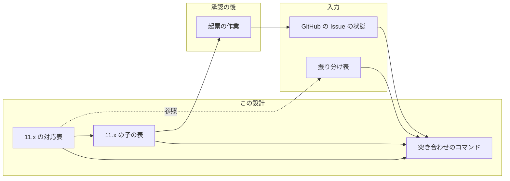
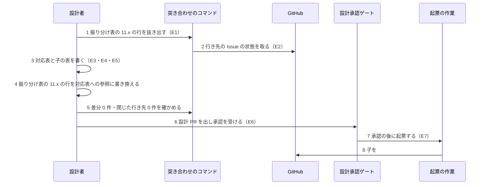

# #1142 の 11.x の行: 72 行と 15 分類に開いた行き先を割り当て、承認の後にそのまま 11.x の子を起票できる（#3388）

## 目的

- **今どうなっているか**: #1142（NDF の作り直し）の振り分け表で版が `11.x` の 72 行のうち、42 行が閉じた子（X0+・D1+・P2 などと、閉じた #3395 の設計）を、11 行が #3388 自身を行き先に持つ。残る 19 行のうち 9 行の行き先（M7・S1a）も 11.0.0 の前に閉じる。分類 H〜W の 11.x の項目にも持ち主が無い
- **誰に効くか**: 11.0.0 を出した後に 11.x の作業を始めるレーンと、その作業の順番を決める人
- **変えると何が成り立つか**: 72 行と 15 分類のすべてが、11.x の新しい子・開いている既存の Issue・作らない理由のどれか 1 つを持つ。設計承認の後に、子の表の題と本文の案のまま起票でき、多観点の設計レビュー（分類 W）の着手の時期と「起票の前に人へ見せる場」の形が決まる

## 適用範囲

- **働く範囲**: このリポジトリの `issues/` の文書と、GitHub の Issue（起票は設計承認の後）。コードと `plugins/` は変えない
- **プロジェクトごとに違うもの**: 無し（ai-plugins の作り直しの行き先だけを扱う）
- **当たるモード**: `standard`

## あるべき姿の根拠

| 根拠 | 種類 | 何を示すか |
| --- | --- | --- |
| 「閉じた子へ割り当てたままの行を、11.x の新しい子へ組み直す」「子の起票は設計承認の後に行う」 | 利用者の指示の原文（オーガナイザーの指示、2026-11-15） | 行き先を開いたものへ組み直し、起票を承認の後に置く |
| 「多観点レビューの結果は、起票の前に人へ見せる別の場を作る」 | 利用者の決定（起票者のまとめ、2026-11-14） | 範囲の外の指摘を、人が読んでから起票する |
| 共通原則の「承認は既存の承認ゲートで取り、新しい承認の工程を作らない」 | 外部の一次情報（NDF の共通原則） | 人へ見せる場を既存の承認ゲートの中に置く |
| `gh issue view` の状態（2026-11-15） | 実測 | 子 36 本のうち開いているのは X2・M7・P4・S1a・T2・S2・S3 の 7 本（[対応表](issue-3388-design-routing.md)の突き合わせ 2） |
| STD1（OWASP Top 10:2025 の A06 安全でない設計）・STD3（ATAM） | 外部の一次情報 | 設計の観点を品質の特性ごとに分けて独立に評価する |

要求と受け入れ条件は #3388 の本文にある（コピーは [issue-3388-requirements.md](issue-3388-requirements.md)）。この文書は「どう作るか」だけを扱う。分量のため 2 つの節を分けた。

| 文書 | 持つもの |
| --- | --- |
| [issue-3388-design-routing.md](issue-3388-design-routing.md) | 11.x の対応表（72 行）・分類ごとの行き先・合わせて扱う Issue・突き合わせのコマンドと結果 |
| [issue-3388-design-children.md](issue-3388-design-children.md) | 11.x の子の表（記号・題・本文の案・順番・依存・レーン）と、既存の Issue への追記の案 |

## ドメインモデル

### コンテキスト

| コンテキスト | 何の語が 1 つの意味に決まるか |
| --- | --- |
| 開発の工程（`ndf-workflow`） | 振り分け表・11.x の行・11.x の対応表・11.x の子・閉じた子・多観点レビュー・起票の前に人へ見せる場 |

コンテキストは 1 つである。

### 集約

| 集約 | 持ち主（書き換えてよいもの） | 根 | エンティティ | 値オブジェクト |
| --- | --- | --- | --- | --- |
| 11.x の対応表 | この設計（#3388 の設計 PR）。起票の作業は書き換えない | 対応表 | 行（振り分け表の行の識別子で同一性を持つ） | 11.x の行き先（子の記号 / Issue の番号 / 作らない＋理由） |
| 11.x の子の表 | この設計（#3388 の設計 PR）。記号と Issue の番号の対応は持たず、GitHub のサブ Issue の関係が持つ（決定 6） | 子の表 | 子（記号で同一性を持つ） | 題・本文の案・順番・先に要るもの・レーン |
| 振り分け表 | #1142 の設計の文書（#1142 と #3395 は閉じている）。版が `11.x` の行の行き先の列だけはこの設計が持ち、対応表への参照を置く（決定 6） | 振り分け表 | 行 | 版・行き先の子 |

対応表は子を記号で参照し、振り分け表の行を識別子で参照する（オブジェクトとして持たない）。

### 不変条件

| # | 集約 | 条件 | 破れたときの扱い |
| --- | --- | --- | --- |
| I1 | 11.x の対応表 | 振り分け表の 11.x の行と対応表の行が 1 対 1 で一致する（差分 0 件） | 設計 PR を出さない。差の行を対応表へ足すか外す |
| I2 | 11.x の対応表 | 各行の行き先は、子の表にある記号・開いている Issue の番号・`作らない` のどれか 1 つで、`作らない` には理由がある | 突き合わせ 2 が行を出す。行き先を選び直す |
| I3 | 11.x の対応表 | 行き先の Issue の番号は、突き合わせを打った時点で GitHub の状態が `OPEN` である | 突き合わせ 2 が「閉じた行き先」を出す。新しい子へ組み直す |
| I4 | 11.x の子の表 | 先に要るものの関係に輪が無く、順番は先に要るものの順番の最大 + 1（無ければ 1）である | 子の分け方を直す |
| I5 | 11.x の対応表 | 分類 H・I・K・L・M・N・O・P・Q・R・S・T・U・V・W のそれぞれが行き先を 1 つだけ持つ | 分類の表を直す |
| I6 | 11.x の子の表 | 今の `plugins/ndf/`（10.x）を変える子が無い。直す先はすべて入れ替えの後の `plugins/ndf/` である | 該当する項目に即時修正の 4 条件の理由を添えるか、入れ替えの後へ移す |
| I7 | 11.x の子の表 | 本文の案の受け入れ条件に、一定時間流して合否を決める試験が無い | 回数か件数の確かめへ書き直す |
| I8 | 11.x の子の表 | 設計承認ゲートの前に、本文の案の題を持つ Issue が 0 件である | 起票した Issue を閉じ、承認の後に起票し直す |

### ドメインイベント

| # | イベント | 発生元 | 受け手 |
| --- | --- | --- | --- |
| E1 | 11.x の行を振り分け表から抜き出した | 突き合わせ 1 | 対応表を書く設計者 |
| E2 | 行き先の子の状態を GitHub から取った | 突き合わせ 2 | 対応表を書く設計者 |
| E3 | 各行に 11.x の行き先を割り当てた | 対応表 | 子の表を書く設計者・突き合わせ 2 |
| E4 | 11.x の子の表を書いた | 子の表 | 設計承認ゲートの承認資料 |
| E5 | W の着手の時期と「起票の前に人へ見せる場」の形を決めた | 決定 4・5 | Z12 の本文の案 |
| E6 | 設計 PR が cross-review で収束し、設計承認ゲートで承認された | 設計承認ゲート | 起票の作業 |
| E7 | 承認された子の案から子の Issue を起票した（このスプリントの外） | 起票の作業 | GitHub（#3388 のサブ Issue の関係。すべてつないだら #3388 を閉じる） |

### 用語

| 用語 | 意味 | 用語集への反映 |
| --- | --- | --- |
| 11.x の対応表 | 振り分け表の 11.x の行ごとに、11.x での行き先（11.x の子の記号・開いている Issue・作らない理由のどれか 1 つ）を持つ表（[issue-3388-design-routing.md](issue-3388-design-routing.md)）。11.x の行の行き先の正本 | 追加（この設計 PR で反映済み） |
| 11.x の子 | 11.0.0 を出した後に着手する子の Issue。記号は `Z<数>` で、ラベル `rebuild-1142` を付けない | 追加（この設計 PR で反映済み） |
| 起票の前に人へ見せる場 | 多観点レビューの範囲の外の指摘を分類し、分類ごとのあるべき姿と受け入れ条件の案を、設計承認ゲートの承認資料の節「多観点レビューの分類」に載せる場。人が答えた承認ゲートの後にだけ起票する | 意味の変更（この設計 PR で反映済み。形は「人へ残す判断」の答えで確定する） |

## 外部の調査

| 種類 | 調べるか | 理由 |
| --- | --- | --- |
| 標準・仕様 | 調べる | 多観点レビュー（W）の観点の一覧と、設計の評価の方法に業界の標準がある |
| 主要な製品 | 調べる | 子の Issue を親へつなぐ形を、課題管理の製品の機能で揃えられるかを確かめる |
| ライブラリとサービス | 調べない | この設計は文書と Issue だけを作り、コードを足さない。各子が使うライブラリは、その子の設計の外部の調査で選ぶ |

### 標準・仕様

| # | 標準・仕様 | 何を定めているか | 設計への反映 | 出典 |
| --- | --- | --- | --- | --- |
| STD1 | OWASP Top 10:2025 | 10 分類の 6 番目が A06 Insecure Design（安全でない設計）。ほかに A03 Software Supply Chain Failures、A10 Mishandling of Exceptional Conditions を新しく置く | Z12 の受け入れ条件 8（セキュリティの観点を 2025 の版にし、A06 を設計の観点に使う） | https://owasp.org/Top10/2025/0x00_2025-Introduction/ （検索の結果の要旨。2026-11-15） |
| STD2 | ISO/IEC 25010:2023 | 製品の品質モデル。上位の特性を 9 つ置き、要求の記述と評価の基準に使う | Z12 の観点の一覧の出所の 1 つ（非機能の大項目ごとに観点を置く） | https://www.iso.org/standard/78176.html （検索の結果の要旨。2026-11-15） |
| STD3 | SEI ATAM（Architecture Tradeoff Analysis Method） | 品質の特性ごとのシナリオで設計を評価し、リスク・非リスク・感度点・トレードオフ点を出し、リスクを主題ごとにまとめる | Z12 の「観点ごとに独立したレビュー役 → 指摘を分類ごとにまとめる」の形 | https://apps.dtic.mil/sti/pdfs/ADA399151.pdf （検索の結果の要旨。2026-11-15） |

### 主要な製品

| # | 製品 | どう解いているか | 設計への反映 | 出典 |
| --- | --- | --- | --- | --- |
| PRD1 | GitHub のサブ Issue | 親の Issue に子を 100 件まで、8 階層までつなぐ。`gh issue create --parent`・`gh issue edit --add-sub-issue` で付け、`gh issue view --json parent,subIssues` で読める | 決定 6（起票した 11.x の子を #3388 のサブ Issue にし、記号と番号の対応を子の表の 1 か所に書く） | https://docs.github.com/en/issues/tracking-your-work-with-issues/using-issues/adding-sub-issues （2026-11-15）、`gh help issue edit`（gh 2.103.3、2026-11-15） |

### 確かめられなかったこと

| 対象 | 試した手段 | 結果と理由 |
| --- | --- | --- |
| STD1〜STD3 の原文 | 検索の語「OWASP Top 10 2025 Insecure Design category list」「SEI ATAM …」「ISO/IEC 25010:2023 …」 | 検索の結果の要旨だけを読み、原文の頁は取得していない。ISO/IEC 25010:2023 の 9 つの特性の名前は検索の結果に無かった。Z12 の設計の外部の調査で原文を取得する |

調べた量: 候補 4 件・取得の試み 5 回。

## 機能一覧

| # | 機能 | 誰が使うか |
| --- | --- | --- |
| F1 | 振り分け表の 11.x の行を抜き出し、対応表と突き合わせる（突き合わせ 1） | 設計者・レビュアー・起票の作業 |
| F2 | 対応表の行き先が開いた Issue か子の表の記号であることを確かめる（突き合わせ 2） | 設計者・レビュアー・起票の作業 |
| F3 | 11.x の子の表から、題と本文の案のまま子を起票する | 設計承認の後の起票の作業 |
| F4 | 多観点レビューの範囲の外の指摘を承認資料に載せ、人が答えた後に起票する（Z12 が作る） | 11.x の設計 PR の承認者 |

## 構成要素

| 要素 | 責務 |
| --- | --- |
| 11.x の対応表（新設、[issue-3388-design-routing.md](issue-3388-design-routing.md)） | 11.x の 72 行の行き先と、分類 15 の行き先の正本 |
| 11.x の子の表（新設、[issue-3388-design-children.md](issue-3388-design-children.md)） | 子 13 本の題・本文の案・順番・依存・レーンと、既存の Issue 2 本（#3412・#3492）の扱い |
| 振り分け表（変える、[issue-1142-design-review-routing.md](issue-1142-design-review-routing.md)） | 11.x の 72 行の行き先の列を対応表への参照に書き換え、正本が対応表であることを列の読み方に書く（この設計 PR で行い、設計承認ゲートで人が見る） |
| 突き合わせのコマンド（新設、対応表の節） | I1〜I3 を誰が打っても同じ結果で確かめる |
| 起票の作業（設計承認の後、このスプリントの外） | 子の表から起票し、子の本文の先頭に記号を書き、#3388 のサブ Issue にする。リポジトリのファイルは書き換えない |



## 処理の流れ



## 非機能の実現方式

| 大項目 | 条件 | 実現方式 |
| --- | --- | --- |
| 運用・保守性 | 突き合わせは誰が打っても同じ結果になる | 振り分け表は `origin/develop` から、状態は `gh issue view` から読む（突き合わせ 1・2） |
| 運用・保守性 | 行き先を手で 2 か所に写さない | 11.x の行の行き先は対応表だけが持ち、振り分け表は対応表の文書へのリンクで指す（Issue の番号を書かないため、#3388 を閉じても振り分け表は閉じた Issue を指さない）。記号と番号の対応は GitHub のサブ Issue の関係だけが持つ（決定 6） |

## 決定の記録

### 決定 1: 行き先が 11.0.0 の前に閉じて持ち主を失わないよう、既存の Issue は 11.0.0 の後に着手するものだけを使う

開いている子でも、M7・S1a・T2・S2 は入れ替えの前に閉じる。11.x の行をそこへ残すと、閉じた時点で今と同じ「閉じた子が行き先」に戻る。X2 #3370 も入れ替えの前に流す子である（本文の「流す順番: 2。レーン: lrebuild」。入れ替えの S2 は順番 10）。そこで、本文が 11.0.0 の後の着手を宣言している S3 #3412 と、利用者が 11.x へ回した #3492 だけを行き先に使い、ほかは 11.x の新しい子へ移す。X2 へ割り当てていた 8 行と分類 P は Z13 が持つ。

| Issue | 状態とラベル（`gh issue view`、2026-11-15） | 版を示す本文 | 判定 |
| --- | --- | --- | --- |
| #1142 | `CLOSED`（`COMPLETED`、2026-11-14T22:12Z）。`enhancement`・`priority: medium`・`area: ndf-skill` | — | 閉じたため、子の 11.x の行が #1142 の受け入れ条件として残ることは無い |
| S3 #3412 | `OPEN`。`enhancement`・`area: ndf-skill`・`rebuild-1142` | 先頭の行「11.x。11.0.0 の後に着手する」。「含む」が「この子の行はすべて版 11.x」、「11.0.0 の行は無い」 | 11.0.0 の受け入れ条件に入らない。行き先に使う |
| X2 #3370 | `OPEN`。`enhancement`・`rebuild-1142` | 「先に要るもの: X0 #3282（閉じた）。流す順番: 2。レーン: lrebuild」 | 入れ替えの前に閉じうる。行き先に使わず Z13 へ移す |
| #3492 | `OPEN`。`operation` | 本文の「版の決定」（利用者、2026-11-15）が 11.x へ回す | 行き先に使う |

#3412 はラベル `rebuild-1142` を持つが、振り分け表の版の当て方では 11.x の行は 11.0.0 の受け入れ条件に入らず、要求の「含まない」（11.0.0 の各分類の Issue に残した項目）にも当たらない。#3412 へ足す受け入れ条件は、#3412 の本文の節「11.x（#3388 の後）」に入れる。

開いている子をすべて行き先に使う形は、M7 の 8 行・S1a の 1 行・X2 の 8 行が 11.0.0 の前に再び持ち主を失うため採らない。

根拠: Value 6・Value 13（MVV 版 7）

### 決定 2: 着手の単位が主題で読めるよう、11.x の新しい子を 13 本に分け、分類ごとに行き先を 1 つにする

子は主題（契約と検査・テストと CI・異常系・予算と規模・問いと工程・汎用性・外の呼び手・拡張点・記録と文書・排水・送る範囲・多観点レビュー・依存の更新と供給網）で分ける。分類の項目は 1 つの子へまとめ、分類 L と V、H と I、N と O のように主題が重なる分類は同じ子に入れる。

分類ごとに 1 本（15 本）にする形は、行の多くが分類をまたぐため採らない。1 本にまとめる形は、1 本の PR に収まらないため採らない。

根拠: Value 9・Value 11（MVV 版 7）

### 決定 3: #1142 の子と取り違えないよう、11.x の子の記号を `Z<数>` にする

#1142 の子は X・D・C・T・AD・P・M・S、分類は A〜Y の文字を使っている。Z はどちらにも無い。記号は対応表と本文の案の中だけで使い、起票の後は番号で指す。

根拠: Value 14（MVV 版 7）

### 決定 4: 新しい承認の工程を作らずに人が読んでから起票するよう、「起票の前に人へ見せる場」を設計承認ゲートの承認資料の節に置く

多観点レビューは設計承認ゲートの前に回る。範囲の外の指摘は分類ごとのあるべき姿と受け入れ条件の案にまとめ、承認資料の節「多観点レビューの分類」に載せる。人がその承認ゲートで答えた後にだけ起票し、答えは承認ゲートの答えの記録（進行表の答え）に残る。承認ゲートを MVV 判定が通したときは起票せず、次に人が答える承認ゲート（リリース承認ゲート）の承認資料へ持ち越す。範囲の中の指摘は設計を直して解き、起票しない。

共通原則との両立: 見せる場は既存の承認ゲートの承認資料の 1 節であり、承認の工程の数と置き場所は変わらない。起票は C1〜C8 にも P1 にも当たらないため、承認ゲートを足す理由も無い。利用者の決定の「別の場」は、cross-review の指摘とも設計の決定の要旨とも分けた節として満たす。

承認ゲートとは別に人へ問う場を置く形は、新しい承認の工程になるため採らない。MVV 判定で通った承認ゲートの後に起票する形は、人が読まずに起票されるため採らない。

この形は設計の案であり、利用者の決定の「別の場」をこの形で満たすかは「人へ残す判断」で問う。

根拠: Value 1（MVV 版 7）

### 決定 5: 多観点レビューを早く効かせるよう、W を Z12 として Z1 の後の順番 2 で着手し、Z5 と Z8 の設計を Z12 の後に置く

Z12 が使うのは、Z1 が足す結果 JSON の `items` の観点・分類・重さ・受け入れ条件の欄だけである。そこで Z12 を Z1 の直後（順番 2、レーン `l11-a`）に置く。Z12 を先に要るものに持つのは Z5（順番 3）と Z8（順番 3）で、この 2 本の設計 PR は多観点レビューを通る。ほかの子（新しい子の Z1・Z2・Z3・Z4・Z6・Z7・Z9・Z10・Z11・Z13 と、既存の #3412・#3492）は Z12 を先に要るものに持たず、設計 PR は多観点レビューを通らずに承認される。1 巡の観点の数の上限は 6、巡の上限は 2 とし、値は `contracts/limits.json` の 1 か所に置く。

Z5 と Z8 を選んだ理由: Z5 は人への問いと信頼の境界、Z8 は外から足す拡張点を扱い、観点を変えたときの抜け（信頼の境界・運用・移行）が出やすい。どちらも Z1 か Z7 の後に流れるため、Z12 を足しても順番が 1 つ下がるだけで済む。

すべての子を Z12 の後に置く形は、レーン `l11-b`〜`l11-d` の 3 本が Z1・Z12 の完了まで止まるため採らない。W を最後に置く形は、11.x の設計がすべて多観点レビューを通らずに承認されるため採らない。

根拠: Value 5・Value 7（MVV 版 7）

### 決定 6: 行き先の事実を 2 か所に写さないよう、11.x の行の正本を対応表にし、振り分け表は対応表へのリンクで指す

振り分け表の 11.x の 72 行の「行き先の子」の列は、この設計 PR の中で対応表（`issue-3388-design-routing.md`）へのリンクに書き換え、順番と種類の列は `—` にする。列の読み方と件数の表もこの書き換えに合わせる。書き換えは設計 PR に入るため、人は設計承認ゲートで書き換えた振り分け表を見る（要求の境界の「確認してから行う」）。このスプリントは設計 PR のマージで終わり（要求の S9）、承認の後に振り分け表を書き換える段は無い。

振り分け表には Issue の番号を書かない。#3388 を閉じても、振り分け表が閉じた Issue を指すことは無い。振り分け表を読むコードは無い（`grep -rln design-review-routing plugins/ scripts/ .github/` が 0 件、2026-11-15）ため、書き換えで検査は落ちない。子の表のコピー（`children.json`）には 11.x の子を足さない（#1142 の子ではないため）。

記号と Issue の番号の対応は GitHub が持つ。起票の作業は、子の本文の先頭に記号を書き、子を #3388 のサブ Issue にする（PRD1）。リポジトリのファイルは書き換えない。#3388 は、子の表の 13 本をすべて起票してサブ Issue につなぎ、#3412 へ受け入れ条件を足した後に、起票の作業が閉じる。設計 PR の本文には #3388 を閉じるキーワードを書かない。

振り分け表の 11.x の行へ新しい記号を書き写す形は、同じ行き先を 2 か所に持つため採らない。振り分け表を `#3388` で指す形は、#3388 を閉じた時点で振り分け表が閉じた Issue を指すため採らない。

- 作り方: 標準に倣う
- 比べた候補: PRD1

根拠: Value 8・Value 11（MVV 版 7）

### 決定 7: 前提が消える行を作らないよう、3368-5 を作らない

3368-5（ndf-next だけの PR でも残りのジョブが走る）は、入れ替えで `plugins/ndf-next/` の置き場が無くなると、ndf-next だけの PR が存在しなくなる。

根拠: Value 6（MVV 版 7）

### 決定 8: 11.0.0 の不具合を 11.x へ送らないよう、#3035 と #2583 を 11.x へ回さない

#3035 は ndf-next で再現した今の機能の不具合で、本文が受け入れ条件を 11.0.0 に置く。決定 127（同等は不具合を引き継がない）により 11.0.0 で直す。#2583 は 2026-11-14 に閉じ、閉じたときのコメントが ndf-next で条件 1・2 が解けたことをテストの名前とともに示す。

根拠: Value 7（MVV 版 7）

### 決定 9: 規模の確かめが実行するマシンの性能で揺れないよう、分類 V の負荷試験を回数の検査にする

Z4 は合成した規模の見本で、比較の回数・API の呼び出しの回数・走査の回数を数え、宣言した上限と比べる。一定時間流して合否を決める試験は、合否がマシンの性能で決まりコードの性質を表さないため置かない。

根拠: Value 3・Value 13（MVV 版 7）

### 決定 10: 後方互換を意識しない前提に合わせ、分類 S の「10.x の修正の版を出す期間」を扱わない

11.0.0 の後に 10.x の修正の版を出すと、今の `plugins/ndf/` を変える作業が生じる。要求の前提 5 は後方互換の経路を設けないと決めている。Z7 は入れ替えの日のアナウンスだけを扱う。

根拠: Value 2・Value 5（MVV 版 7）

## テスト設計

このスプリントはテストを足さない（要求の「前提とする取り決め」）。受け入れ条件と不変条件は、対応表の突き合わせのコマンドと `gh` で確かめる。

| 受け入れ条件・不変条件 | どの振る舞いで縛るか | どう壊したら落ちるべきか |
| --- | --- | --- |
| 受け入れ条件 1・I5 | 分類ごとの行き先の表に 15 分類が 1 行ずつある | 分類の行を消すか 2 行にすると、表を数えた値が 15 行・各 1 行と合わない |
| 受け入れ条件 2 | 決定 4・5 と Z12 の本文の案が、着手の時期・場・見せるもの・答えの残し方・共通原則との両立の理由を持つ | 決定 4 から共通原則との両立の段落を消すと、承認資料の判定で理由が無いと出る |
| 受け入れ条件 3・I1 | 突き合わせ 1 の差分が 0 件 | 対応表の行を 1 つ消すと `diff` が行を出す |
| 受け入れ条件 3・I2・I3 | 突き合わせ 2 の出力が「検査した行き先」の 1 行だけ | 行き先を閉じた Issue（例: `#3295`）にすると「閉じた行き先」が出る。子の表に無い記号にすると「子の表に無い記号」が出る |
| 受け入れ条件 4・I4 | 子の表の一覧の順番が、先に要るものの順番 + 1 に一致する | 先に要るものを輪にするか順番を下げると、一覧の下の段落の数え直しと合わない |
| 受け入れ条件 5 | 「合わせて扱う Issue」の表に 3 本の判断・根拠・行き先がある | 行を消すと受け入れ条件 5 の対象が欠ける |
| 受け入れ条件 6・I6 | 子の表の「直す先」と決定 10 | 子の本文の案に今の `plugins/ndf/` を直す項目を足すと、I6 の条件に当たる |
| 受け入れ条件 7・I8 | 子の表の 13 の題と完全に一致する Issue の題が 0 件（下のコマンド。2026-11-15 は Issue 1,440 件に対して 0 件） | 設計承認の前に子を起票すると 1 件以上が出る |
| 受け入れ条件 8・I7 | 子の本文の案の受け入れ条件に、時間で合否を決める試験が無い | Z4 の受け入れ条件 4 を「一定時間流して落ちない」に書き換えると I7 に当たる |

受け入れ条件 7 のコマンド（出力が `0` であること）:

```bash
gh issue list --state all --limit 4000 --json title -q '.[].title' > /tmp/3388-titles.txt
grep -E '^\*\*題\*\*: ' issues/issue-3388-design-children.md | sed 's/^\*\*題\*\*: //' > /tmp/3388-drafts.txt
grep -Fxc -f /tmp/3388-drafts.txt /tmp/3388-titles.txt
```

## 設計の結果

| 課題 | 扱い | 取り込み先 | 触るファイル |
| --- | --- | --- | --- |
| #3388 | 設計 PR で直す | — | `issues/issue-1142-design-review-routing.md`、`issues/issue-3388-design.md`、`issues/issue-3388-design-routing.md`、`issues/issue-3388-design-children.md`、`docs/glossary.md`、`docs/glossary/glossary.json` |

設計 PR は、振り分け表の 11.x の行の書き換え（決定 6）と、用語の表の 3 語（「11.x の対応表」「11.x の子」「起票の前に人へ見せる場」）の用語集への反映を含む。子の起票とサブ Issue のつなぎ・#3412 への受け入れ条件の追記は、設計承認の後の起票の作業が行う（このスプリントの外）。

## 人へ残す判断

| 判断 | 案 | 推す理由 | 答えで変わるもの |
| --- | --- | --- | --- |
| 利用者の決定「多観点レビューの結果は、起票の前に人へ見せる別の場を作る」を、設計承認ゲートの承認資料の 1 節（「多観点レビューの分類」）で満たすか | 承認資料の 1 節で満たす（決定 4） | 共通原則が「承認は既存の承認ゲートで取り、新しい承認の工程を作らない」と決めている。節は cross-review の指摘とも設計の決定の要旨とも分け、人が分類とあるべき姿を読んでから答える | 「別の場」を承認ゲートの外に置くと答えた場合は、Z12 の受け入れ条件 6・決定 4・用語「起票の前に人へ見せる場」を書き直す。共通原則との両立は、その場を承認の工程にしない形（読むだけで答えを求めない、など）を Z12 の設計で決める |

## 未確認のまま残ること

| 項目 | 内容 |
| --- | --- |
| 73 行の 1 行 | オーガナイザーの指示の 73 行に当たる 1 行は、振り分け表に見つからない（突き合わせ 1 は 72 行）。#3492 を数えた値かは記録が無く分からない。設計承認ゲートで承認資料を読む人が数え方を知っていれば分かる |
| 「別の場」の原文 | 利用者の決定は起票者のまとめで、原文が残っていない。この形で満たすかは「人へ残す判断」で問う |
| 外部の標準の原文 | STD1〜STD3 は検索の結果の要旨で読んだ。Z12 の設計の外部の調査で原文を取得した時点で分かる |
