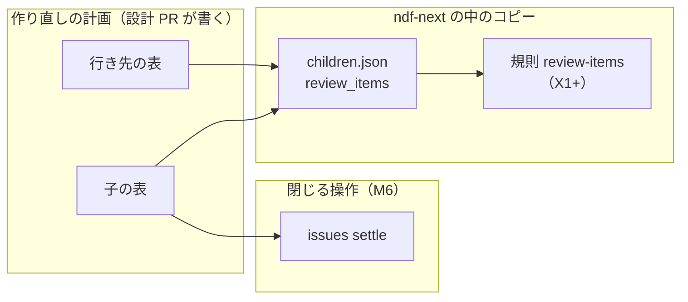
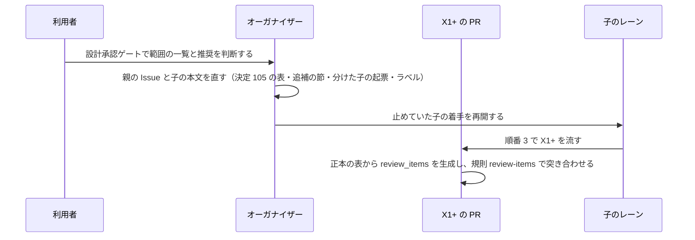

# #1142 の作り直し: 設計レビューの全項目に行き先と順番を割り当て、範囲を決めてから子の着手を再開する（#3395）

## 目的

- **今どうなっているか**: #1142 の設計レビュー 4 巡で見つかった項目 182 件のうち、子の表に席があるのは分類 A・B の 2 本だけである。閉じた子へ足す項目が 61 件あり（行き先の表で数えた）、要求の受け入れ条件にも持ち主の無い行が残る。利用者の決定で、新しい子の着手を止めている。あわせて利用者は、今の機能とほぼ同等の実装ができたら一度 NDF を差し替え（11.0.0）、上げた版で残りの機能を作ると指示した（2026-11-14）。今の受け入れ条件「ラベルの課題がすべて閉じる」のままでは、11.0.0 の時期が改善の量で決まる
- **誰に効くか**: #1142 のレーンを流す conductor と、作り直しの範囲を承認する利用者
- **変えると何が成り立つか**: 全項目が行き先の子・順番・要求の行・版を持ち、11.0.0 の範囲と受け入れ条件、範囲を広げるか 11.x へ回すかを設計承認ゲートの 1 回で判断できる。承認の後、止めていた子の着手を再開でき、11.0.0 を出せる時点を 6 つの条件で判定できる（決定 127・128 で 2 つ足した）

## 適用範囲

- **働く範囲**: このリポジトリの #1142 の作り直し（`plugins/ndf-next/`）の計画だけ。利用先のリポジトリでは働かない
- **プロジェクトごとに違うもの**: 無し（ai-plugins の作り直しの計画の決定である）
- **当たるモード**: `standard`。コード・テスト・CI の定義は変えない（#3395 の前提 1）

## あるべき姿の根拠

| 根拠 | 種類 | 何を示すか |
| --- | --- | --- |
| 「新しい子の着手を止め、この Issue の行き先の表と範囲の決定（設計の差分）を先に作る」（2026-11-14、#3395 の本文が記録した利用者の決定） | 利用者の指示の原文 | 表と範囲を決めてから子を再開する |
| 「まず最低限現行機能とほぼ同等の実装が完成したら一度ndfを差し替え、バージョンアップした版で改めて残りの機能の開発に入りたい」（2026-11-14、判断の記録 b013a7f21979・3b55bbdd4bba） | 利用者の指示の原文 | 11.0.0 を今の NDF と同等で切る（決定 123〜126） |
| 抜き出しのコマンドの出力 182 件（[issue-1142-design-review-routing.md](issue-1142-design-review-routing.md) の「抜き出しのコマンドと突き合わせ」、2026-11-14） | 実測 | 表に無い項目が 0 件であること |
| `grep -rEn "^\s*(import\|from) <名前>"` で数えた import 0 件の依存 12 本（`origin/develop` 6b2044230、2026-11-14） | 実測 | 宣言にあって使わない依存の一覧 |
| `gh run view` で測った CI の所要（2026-11-14） | 実測 | テストと CI の予算の基準 |
| STD1・PRD1・PRD2 | 外部の一次情報 | Python 3.10 の保守の終了、依存の更新の既存ツールの機能 |

要求と受け入れ条件は #3395 の本文にある（コピーは [issue-3395-requirements.md](issue-3395-requirements.md)）。この文書は「どう作るか」だけを扱う。分けた文書は次のとおりである。

| 文書 | 中身 |
| --- | --- |
| [issue-3395-design-scope.md](issue-3395-design-scope.md) | 設計承認ゲートで利用者が決めること（11.0.0 の範囲と受け入れ条件・止めている子の再開・範囲を広げるか 11.x へ回すか・依存の更新の比較）と、11.0.0 の時期の見込み |
| [issue-1142-design-review-routing.md](issue-1142-design-review-routing.md) | 項目ごとの行き先と版の表と、要求の受け入れ条件の持ち主の表（#1142 の設計文書の置き場） |
| [issue-3395-design-decisions.md](issue-3395-design-decisions.md) | 決定 109〜126 |
| [issue-3395-design-detail.md](issue-3395-design-detail.md) | 詳細設計 |

要求の本文の書き換えは、決定 105 の表（[issue-3347-design-detail.md](issue-3347-design-detail.md#本文の取り消し線)）へ行を足した。

この文書の子の記号（X0+・M3a など）は #1142 の作り直しの子である。項目は `<Issue 番号>-<連番>`（例: `3341-1`）で指す。

## ドメインモデル

### コンテキスト

変更は 2 つのコンテキストにまたがり、外部の GitHub（Issue）を 1 つ読み書きする。計画の決定（表・証拠の割り当て）は、#3347 の設計が置いたコンテキスト「作り直しの計画」（[issue-3347-design.md](issue-3347-design.md)）にある。表を読む規則・選択の記録の契約・閉じる操作は、新しいプラグイン（ndf-next）の中で動く。

| コンテキスト | 何の語が 1 つの意味に決まるか |
| --- | --- |
| 作り直しの計画 | 子・追補の単位・流す順番・レビューの項目・行き先の表・要求の行・閉じる証拠の割り当て |
| 新しいプラグイン（ndf-next の実行時） | 子の表のコピー（`children.json`）・規則 `review-items`・選択の記録・閉じる操作（`ndf issues settle`） |
| GitHub（Issue。外部） | Issue の状態（開いている・閉じた）・Issue のコメント・PR のマージ。語の意味は GitHub が決め、この設計は変えない |

**コンテキストマップ。** #3347 の設計のマップ（「作り直しの計画」が上流、新しいプラグインが下流、顧客と供給者）に、次の 3 行を足す。

| 上流 | 下流 | 関係 | 契約 |
| --- | --- | --- | --- |
| 作り直しの計画 | 新しいプラグイン（規則 `review-items`） | 顧客と供給者 | 行き先の表（正本）と、そこから生成する `children.json` の `review_items`。規則はコピーを生成し直して突き合わせ、表の中身を決めない |
| 新しいプラグイン（D1+ の契約） | 作り直しの計画（目的の物差し・M7） | 公表された言語 | `contracts/` に置く選択の記録の JSON Schema。M7 は記録をこの形でだけ読み、ndf-next のモジュールを import しない |
| GitHub（Issue） | 新しいプラグイン（閉じる操作） | 腐敗防止層 | GitHub のアダプター（AD1）。`ndf issues settle` は Issue の状態とコメントをアダプター越しにだけ読み書きする |

### 集約

| 集約 | 持ち主（書き換えてよいもの） | 根 | エンティティ | 値オブジェクト |
| --- | --- | --- | --- | --- |
| 子の表 | 設計 PR だけ（#3347 の設計のとおり） | 詳細設計の「実装計画」 | 子 | 先に要るもの・順番・レーン・閉じたか |
| 行き先の表 | 設計 PR だけ。子の PR とオーガナイザーは書き換えず、表の変更を設計 PR へ依頼する。`children.json` の `review_items` は正本から生成するコピーで、手で書かない | [issue-1142-design-review-routing.md](issue-1142-design-review-routing.md) の表（正本） | レビューの項目 | 行き先の子・順番・新設か追補か・要求の行・本文の行の要約値 |
| 解消する Issue | 証拠の種類と持ち主の子の割り当ては設計 PR。Issue を閉じるのは M6 の `ndf issues settle` だけで、子の PR の closing keywords とオーガナイザーは閉じない | 「閉じる操作」の節の表（割り当ての正本）と、`settle` の入力の JSON | 解消する Issue | 閉じる証拠・持ち主の子 |

### 不変条件

| # | 集約 | 条件 | 破れたときの扱い |
| --- | --- | --- | --- |
| IY1 | 行き先の表 | 入力の Issue の項目は、表にちょうど 1 行ある | 規則 `review-items` が CI で落とす（X1+） |
| IY2 | 行き先の表 | 行き先は、子の表にある子・追補の単位・予約の値（`#3388`・`#3395 の設計`・`済み`）のどれかである | 同上 |
| IY7 | 行き先の表 | 行き先は、子の表で `superseded_by` を持つ子（追補の単位へ置き換えた閉じた子 D1・D2・T1・X0・X1・C1・AD1・AD2・AD3 と、分ける前の子 M3・S1）を指さない。閉じた子へ足す項目は追補の単位を行き先にする（要求の受け入れ条件 4） | 同上 |
| IY3 | 子の表 | 子の受け入れ条件は 25 行以下である（決定 111） | 25 行を超えた子は設計 PR で分ける。検査は置かない（決定 111 の理由） |
| IY4 | 行き先の表 | 要求の行が「無し」の項目は、範囲の一覧に 1 行ある | 設計 PR のレビューが見る |
| IY5 | 解消する Issue | 解消する Issue を閉じるときは、閉じる証拠を 1 つ持つ | 閉じる操作のスクリプトが、証拠を確かめられないと閉じずに止まる（M6） |
| IY6 | 行き先の表 | `children.json` の `review_items` は、正本の表と入力の Issue の本文から生成した結果と一致する | 同上 |

**行き先に決めた後で閉じた子。** 行き先の表に載った後に、割り当てた項目を解いて閉じた子（C1+ など）は `superseded_by` を持たないため、IY7 に当たらない。行は書き換えない。要求の受け入れ条件 4 が 0 件を求める閉じた子は、項目を割り当てる前に閉じて追補の単位へ置き換えた子で、IY7 の一覧と同じである。

### ドメインイベント

| # | イベント | 発生元 | 受け手 |
| --- | --- | --- | --- |
| E1 | 入力の Issue から項目を抜き出した | この設計 | 行き先の表 |
| E2 | 項目に行き先・順番・要求の行を割り当てた | この設計 | 範囲の一覧・子の表 |
| E3 | 範囲の一覧を作った | この設計 | 設計承認ゲート |
| E4 | 物差し・持ち主・食い違い・閉じる操作・予算を決めた | この設計 | 子の受け入れ条件 |
| E5 | 設計の差分の PR を出した | pr のステップ | cross-review（3 ラウンドで打ち切る） |
| E6 | 利用者が設計承認ゲートで判断した | 利用者 | オーガナイザー |
| E7 | #1142 と子の本文を直した | オーガナイザー | 子のレーン |
| E8 | 止めていた子の着手を再開した（E7 の後。`children.json` のコピーを待たない） | オーガナイザー | 子のレーン |
| E9 | `review_items` を正本から生成して `children.json` に置いた | X1+（最初の生成）。以後は表を変えた設計 PR のマージの後にオーガナイザー | 規則 `review-items` |

**E7 と E8 は本文の直しだけを前提にする。** コピーの最初の書き手 X1+ は順番 3 で、順番 2 の X0+・X3 より後に流れる。E8 がコピーを待つと順番 2 の子が X1+ のマージまで着手できない。X1+ のマージまでは、正本の表と抜き出しのコマンドで表に無い項目を確かめる。コマンドは [issue-1142-design-review-routing.md](issue-1142-design-review-routing.md) の「抜き出しのコマンドと突き合わせ」にある。X1+ のマージからは規則が CI で縛る。要求の E7 の「`children.json` を写し直した」は E9 が持つ。

### 用語

| 用語 | 意味 | 用語集への反映 |
| --- | --- | --- |
| 選択の記録 | 行き先を選ぶたびに 1 行残す事象。選んだ主体（スクリプト・conductor・人）・規則の番号・行き先を持つ | 追加 |
| 閉じる証拠 | 解消する Issue を閉じるときに添える 1 つの証拠。改善の証拠・消えたコードのパス・再現しない記録のどれか | 追加 |

## 外部の調査

| 種類 | 調べるか | 理由 |
| --- | --- | --- |
| 標準・仕様 | 調べる | 要求の Python の下限（3.10）が今も保守されているかを決める |
| 主要な製品 | 調べる | 依存の更新を自前（X2）で作るか、既存の製品を使うかを比べる（#3395 の前提 6） |
| ライブラリとサービス | 調べる | 自作のロックと打ち直しを、lock にある部品で置き換えられるかを確かめる |

### 標準・仕様

| # | 標準・仕様 | 何を定めているか | 設計への反映 | 出典 |
| --- | --- | --- | --- | --- |
| STD1 | PEP 619（Python 3.10 のリリースの予定） | 「As of 2026-10-01, 3.10 has reached the end-of-life phase」。3.10.22 が最後のセキュリティの版 | 要求の Python の下限を 3.11 へ揃える（決定 115） | https://peps.python.org/pep-0619/ （2026-11-14） |

### 主要な製品

| # | 製品 | どう解いているか | 設計への反映 | 出典 |
| --- | --- | --- | --- | --- |
| PRD1 | Renovate 44.239.1（AGPL-3.0、2026-11-13） | `minimumReleaseAge` で公開から待つ。`pep621` の manager が `pyproject.toml` と `uv.lock` を読み、`lockFileMaintenance` で lock を作り直す。`uv.lock` の推移的な依存は脆弱性の修正のときだけ上げる。GitHub Actions は `helpers:pinGitHubActionDigests` で SHA に固定する。導入は GitHub App かセルフホスト | 依存の更新の比較（決定 118） | https://docs.renovatebot.com/configuration-options/ ・ https://docs.renovatebot.com/modules/manager/pep621/ ・ https://docs.renovatebot.com/modules/manager/github-actions/ ・ https://github.com/renovatebot/renovate/releases （2026-11-14） |
| PRD2 | Dependabot（GitHub に内蔵） | `package-ecosystem: "uv"` を持つ。`cooldown` の `default-days` で公開から待つ（未設定でも 3 日）。`directories` で下位のディレクトリを指せ、`groups` で PR をまとめる。security updates は脆弱性の警告から PR を出すが、uv の推移的な依存は親の更新が要ると上げられない。cooldown は version updates だけに効く | 依存の更新の比較（決定 118） | https://docs.github.com/en/code-security/dependabot/working-with-dependabot/dependabot-options-reference ・ https://docs.github.com/en/code-security/dependabot/dependabot-security-updates/about-dependabot-security-updates （2026-11-14） |

### ライブラリとサービス

| # | 候補 | 版 | ライセンス | 最後のリリースの日付 | 終了のアナウンス | 要件を満たすか | 出典 |
| --- | --- | --- | --- | --- | --- | --- | --- |
| LIB1 | tenacity | 9.1.4 | Apache-2.0 | 9.1.4 の公開は 2026-02-07（lock の upload-time）。より新しい版の有無は未確認 | 無し | 満たす。打ち直しの回数と待ちの上限を宣言で書ける。`plugins/ndf-next/uv.lock` に既にある | `plugins/ndf-next/uv.lock`・パッケージの `METADATA`（2026-11-14） |
| LIB2 | filelock | 4.0.3 | MIT | 4.0.3 の公開は 2026-09-23（lock の upload-time）。より新しい版の有無は未確認 | 無し | 満たす。`testing/slots.py`・`testing/records.py` が既に使う | 同上 |

### 確かめられなかったこと

| 対象 | 試した手段 | 結果と理由 |
| --- | --- | --- |
| Renovate の `vulnerabilityAlerts` と `pinDigests` の既定値 | https://docs.renovatebot.com/configuration-options/ | ページが大きく、該当の節の原文を読み切れなかった（取得は HTTP 200） |
| Dependabot が uv の推移的な依存（`indirect`）を version updates でどう上げるか | 上の Dependabot の 2 ページ | `allow` の `dependency-type` に `indirect` があることまでは読めた。`uv.lock` での振る舞いの記述は無い |
| Dependabot が SHA で固定した Actions を上げるか | 上の Dependabot のページ | 記述を見つけられなかった |
| tenacity・filelock の最新の版 | 試していない | lock の版で要件を満たすため、取得の試みを使わなかった |

調べた量: 候補 5 件・取得の試み 11 回。

## 機能一覧

| # | 機能 | 誰が使うか |
| --- | --- | --- |
| F1 | 全項目の行き先の表と、表に無い項目を落とす検査 | conductor・オーガナイザー・子の worker |
| F2 | 範囲を広げるか 11.x へ回すかの一覧 | 利用者（設計承認ゲート） |
| F3 | 選択の記録で数える目的の物差し | 利用者・振り返り |
| F4 | 要求の受け入れ条件の持ち主と、作らない行の一覧 | 利用者・オーガナイザー |
| F5 | 閉じる証拠と、証拠を確かめて閉じる操作 | 子の worker・オーガナイザー |
| F6 | 依存の更新の既存ツール・既存の部品・使わない依存の扱い | 子の worker |
| F7 | テストの数と CI の所要の予算 | 子の worker・CI |

## 構成要素

この設計で足す・分ける・順番か中身の変わる子である（ほかの子の中身は詳細設計の「実装計画」のまま）。追補の単位の Issue は元の子の番号を使い、PR は `Refs #<元の子> #<出所>` と書く（決定 110）。

| 子 | 何をするか | 先に要るもの | 順番 | 種別 | 版 |
| --- | --- | --- | ---: | --- | --- |
| X0+ | #3282 の追補。状態の置き場の退避の範囲・エントリポイントの見つけ方・CI の版の固定・使わない依存の削除・ファイルのロック | X0 | 2 | 追補 | 11.0.0 |
| X3 | 今の機能と行き先の子の対応表、並行して `plugins/ndf` へ入る直しの棚卸し | X0 | 2 | 新設 | 11.0.0 |
| X2 | 中身は設計承認ゲートでの依存の更新の結論で決まる（[issue-3395-design-scope.md](issue-3395-design-scope.md) の「結論ごとに書き直す行」）。推奨のとき: 依存の版の一度の引き上げ・固定の理由を Dependabot の `ignore` へ移す・Dependabot の `plugins/ndf-next` の項目と security updates の有効化。結論までは着手しない | X0 | 2 | 既存 | 11.x |
| X1+ | #3283 の追補（#3347 の中身に足す）。規則 `review-items`・種類 6 の規則・テストの数の予算・`ndf check` の結果 JSON | X1 | 3 | 追補 | 11.0.0 |
| D1+ | #3284 の追補。結果 JSON の `outputs`・選択の記録・一時的な失敗の種類・終了コードの事実を 1 か所に | D1 | 3 | 追補 | 11.0.0 |
| T1+ | #3286 の追補。LLM の CLI を数える枠・偽物と本物の突き合わせ・障害の注入・プロセスの組の停止を 1 つに・CI の所要の予算 | T1 | 3 | 追補 | 11.0.0 |
| D2+ | #3287 の追補。外の呼び手の契約（公開する面の表）・ブランチの運用の宣言・最小構成 | D2・D1+ | 4 | 追補 | 11.0.0 |
| AD1+ | #3288 の追補。信頼できない入力の境界・公開先への書き込みの検査・マージの方式・件数の上限 | AD1・D1+・T1+ | 4 | 追補 | 11.0.0 |
| AD2+ | #3289 の追補。Slack の通知・送り手が 1 つだけ動く・失敗の区別 | AD2・T1+ | 4 | 追補 | 11.0.0 |
| AD3+ | #3290 の追補。起動の権限・判断の呼び出しの失敗の区別・実行の記録・CLI の版の下限・打ち直し | AD3・D1+・T1+ | 4 | 追補 | 11.0.0 |
| M3b | M3 #3297 を分けた中継（新しい Issue） | D2・AD2・AD3・T1 | 4 | 新設 | 11.0.0 |
| M3a | M3 #3297 を分けた hook（#3297 の番号を使う。M3-H1〜H14 を持つ） | M3b・D2・AD2・AD3・T1 | 5 | 新設 | 11.0.0 |
| M8 | worktree のコンテキストとディスクの片付け | AD1+ | 5 | 新設 | 11.0.0 |
| S1a | S1 #3303 を分けた Skill 本文とエージェント定義（#3303 の番号を使う）。本文は今のまま移し、スクリプトのパスとコマンドだけを直す（決定 126） | M1〜M8・C5 | 8 | 新設 | 11.0.0 |
| S1b | S1 を分けた hook のエントリポイント・配る Skill の表・Codex | M1〜M8・C5 | 8 | 新設 | 11.0.0 |
| S1c | S1 を分けた文書の行き先。11.0.0 は 3341-9・3382-1 だけで、規約の移動・公開側へコピーされた非公開の参照の削除は 11.x | X3・M1〜M8 | 8 | 新設 | 11.0.0 |
| T2 | 入れ替えの前の試走（ndf-next だけで 1 スプリントを develop のマージまでと 1 計画を流し、機能の対応表の行ごとに通ったかを記録する。決定 124 の 2） | S1a・S1b・S1c | 9 | 新設 | 11.0.0 |
| S2 | 入れ替え（順番 9 から 10 へ） | T2 | 10 | 既存 | 11.0.0 |
| S3 | 入れ替えの後の確定仕様化と、物差しの測り直し | S2 | 11 | 新設 | 11.x |

版の列は、その子が 11.0.0 の行を持つかで決めた。11.0.0 の子でも 11.x の行の分は後で作る（行ごとの版は行き先の表）。S1a〜S1c の先に要るものから P4 を外した。P4 #3098 は子として 11.x へ回す（決定 123）。

順番が変わる既存の子: M5 は M4 の共通パッケージを使うため 6 から 7 へ。C2・P1a は D1+・T1+ を、C4・C5・P1b・M2・M6・M4 は AD1+ か AD3+ を先に要るものに足すが、順番は変わらない。



図は計画のデータの流れだけを描く。子の 1 本ずつは上の表が持ち、図に描かない。

## 処理の流れ



承認の後にオーガナイザーが行う本文の直し:

- 決定 105 の表の取り消し線と置き換え（#1142）
- 追補の単位の節（元の子の本文）
- 分けた子と新設の子の起票（M3b・S1b・S1c・X3・M8・T2・S3）
- P1a・P1b・P3 へのラベル `rebuild-1142`（3342-8）。P4 は 11.x のため付けない
- 範囲の外とした項目と、版が 11.x の行の #3388 への転記。11.x の行だけを持つ Issue（P4 #3098・X2 #3370 ほか）からラベル `rebuild-1142` を外す（決定 123）
- #1142 と S2 #3304 の受け入れ条件の置き換え（「11.0.0 の受け入れ条件」の本文の差分の案）

## 11.0.0 の受け入れ条件

**11.0.0 は今の NDF と同等で切り、出せる時点を次の 6 つで判定する**（決定 123・124・127・128）。同等は意図した振る舞いと同じことで、今の NDF の既知の不具合は引き継がない（決定 127）。#1142 の要求の 290 行（ラベル `rebuild-1142` の Issue がすべて閉じる）と 321 行（対象の一覧の全件が閉じたか理由を持つ）は、11.0.0 の条件から外す。

| # | 条件 | 持ち主 | 判定の材料 |
| --- | --- | --- | --- |
| 1 | 機能の対応表（#3342 のあるべき姿 1）の全行が、行き先の子か作らない理由を持つ | X3 | 対応表の行ごとの `to` か `not_built` |
| 2 | 試走（#3342 のあるべき姿 4: ndf-next だけで 1 スプリントを develop のマージまでと、1 計画を流す）で対応表の全行が通る | T2 | 対応表の行ごとの試走の結果 `trial`（通った・落ちた・試走で通らない理由） |
| 3 | 退行させないもの: 設計承認ゲートとリリース承認ゲート・hook の守り・秘密の検査・Codex 向けのリリース・Factory の契約（volareinc/nd-factory#183） | P2・M2（承認ゲート）・M3a（hook）・AD3+（秘密を伏せる。3394-12）と根の `scripts/check-repo-secrets.py`（入れ替えで変わらない）・S1b（Codex。要求の 345 行）・D2+（Factory。3341-8・3390 の 5 行） | 持ち主の子の受け入れ条件と、試走の記録 |
| 4 | S2 の確かめは、スクリプトが対応表の行を判定する（ラベルの件数で見ない） | S2 | 対応表。1 と 2 を満たさない行の一覧を返し、0 行のときだけ通す |
| 5 | ラベル `rebuild-1142` の Issue のうち今の機能の不具合を直すもの（[issue-3395-design-bugs.md](issue-3395-design-bugs.md) の一覧）が、子の PR で再現の手順を通して閉じる（決定 127） | 一覧の行き先の子。閉じる証拠は M6（3395-6）、作り直しの間に起票された不具合の受け付けは X3（3381-4） | 一覧の Issue の状態と、閉じた PR の再現の記録。S2 のスクリプトが開いている不具合の Issue を返し、0 件のときだけ通す |
| 6 | リリース（ブランチの組み立て・承認の証跡の確かめ・証跡の後のマージ・タグと GitHub Release）を GitHub Actions の workflow が行い、会話のセッションは承認資料の提示と答えだけを持つ（決定 128） | M2 #3296・S2 | M2 の受け入れ条件と、試走（2）の 1 スプリントのリリースを workflow が通した記録 |

**対応表の形。** X3 が対応表を行ごとに `feature`（今の機能）・`to`（行き先の子）か `not_built`（作らない理由）・`trial`（試走の結果）を持つ形で作る。置き場と書式（Markdown の表か JSON か）は X3 が決め、S2 のスクリプトはこの 4 つの鍵だけを読む。退行させないもの（3）の 5 つは、対応表の行として載せ、試走（2）で通ったことを確かめる。

**本文の差分の案。** 設計承認ゲートの後に、オーガナイザーが次のとおり書き換える。この作業では GitHub の本文を書き換えない。

#1142（[issue-1142-requirements.md](issue-1142-requirements.md) の 290・321 行。決定 105 の表と同じ形で取り消し線を引く）:

```diff
-- [ ] ラベル `rebuild-1142` の付いた Issue が、この Issue の改善（子 Issue の PR）によってすべて閉じる。一覧: https://github.com/devbasex/ai-plugins/issues?q=label%3Arebuild-1142
+- [ ] ~~ラベル `rebuild-1142` の付いた Issue が、この Issue の改善（子 Issue の PR）によってすべて閉じる~~ → 11.0.0 は下の 6 つで判定し、残りは 11.x（#3388）で扱う（#3395 の決定 124・127・128）
+- [ ] 11.0.0: 同等は意図した振る舞いと同じことで、今の NDF の既知の不具合は引き継がない
+- [ ] 11.0.0: 機能の対応表（X3）の全行が、行き先の子か作らない理由を持つ
+- [ ] 11.0.0: 試走（T2。ndf-next だけで 1 スプリントを develop のマージまでと 1 計画）で対応表の全行が通る
+- [ ] 11.0.0: 承認ゲート 2 つ・hook の守り・秘密の検査・Codex への配布・Factory の契約（volareinc/nd-factory#183）を退行させない
+- [ ] 11.0.0: S2 の確かめは、スクリプトが対応表の行を判定する（ラベルの件数で見ない）
+- [ ] 11.0.0: ラベル `rebuild-1142` の Issue のうち今の機能の不具合を直すもの（#3395 の issue-3395-design-bugs.md の一覧）が、子の PR で再現の手順を通して閉じる
+- [ ] 11.0.0: リリース（ブランチの組み立て・承認の証跡の確かめ・証跡の後のマージ・タグと GitHub Release）を GitHub Actions の workflow が行う
-- [ ] 着手の時点の対象の一覧（番号と題）が詳細設計に残り、…作り直しの後に、一覧の全件が「閉じた」か「理由を明示した」のどちらかになっている
+- [ ] ~~着手の時点の対象の一覧（番号と題）が詳細設計に残り、…どちらかになっている~~ → 11.x（#3388）で扱う（#3395 の決定 124）
```

あわせて、[issue-1142-design-review-routing.md](issue-1142-design-review-routing.md) の「要求の受け入れ条件の持ち主」で版が `11.x` の行の末尾に「（11.x）」を足す。

S2 #3304（題・目的・受け入れ条件の手順 9 と 2 行）:

```diff
-#1142 S2: plugins/ndf-next/ を plugins/ndf/ へ入れ替えて 11.0.0 にし、ラベル rebuild-1142 の Issue がすべて閉じたかを確かめる
+#1142 S2: plugins/ndf-next/ を plugins/ndf/ へ入れ替えて 11.0.0 にし、機能の対応表の全行が通ったかをスクリプトで確かめる
-…volareinc/nd-factory#183 を入れ替えの前提として片付け、ラベル `rebuild-1142` の Issue がすべて閉じたかを確かめる。
+…volareinc/nd-factory#183 を入れ替えの前提として片付け、機能の対応表（X3）の全行が行き先か作らない理由を持ち、試走（T2）で通ったことをスクリプトで確かめる（#3395 の決定 124）。
-- [ ] 9. ラベル `rebuild-1142` の開いている Issue が S2 自身を除いて 0 件であることを確かめる。…（確かめ: `gh issue list --label rebuild-1142 --state open`）
+- [ ] 9. 対応表の全行が行き先か作らない理由を持ち、試走の結果が通ったことを、スクリプトが判定する。満たさない行があれば一覧を返して止まり、オーガナイザーへ送る（確かめ: S2 のスクリプトの終了コードと行の一覧）
-- [ ] 入れ替えの時点でラベル `rebuild-1142` の Issue が 26 本の子で閉じきれなければ、S2 の前に理由を添えてオーガナイザーへ送る（設計の「未確認のまま残ること」）
+- [ ] 承認ゲート 2 つ・hook の守り・秘密の検査・Codex への配布・Factory の契約（volareinc/nd-factory#183）が退行していないことを、対応表の該当の行の試走の結果で確かめる
+- [ ] 今の機能の不具合を直す Issue（#3395 の issue-3395-design-bugs.md の一覧）が閉じていることを、スクリプトが判定する。開いている Issue があれば一覧を返して止まる（#3395 の決定 127）
+- [ ] 入れ替えの後のリリースを GitHub Actions の workflow（M2 #3296）が行い、会話のセッションは承認資料の提示と答えだけを持つ（#3395 の決定 128）
```

S2 の先に要るものは T2 のまま変えない。

## 目的の物差し

**行き先を選んだ主体の数で測る。** コマンドの文字で数えると、作り直しでコマンドの名前とパスが変わった時点で数が 0 に見える（3395-1）。

| 形 | 選択の記録の出所 | 主体の決め方 |
| --- | --- | --- |
| 今の形 | `scripts/measure/ai-branching.py` が読む 3 つの記録（プランの `progress.jsonl`・台帳・会話の記録）と規則 `ai-branching-rules.json` の R01〜R27 | 当たった行はすべて conductor が選んだ回として数える（どれも AI が出力を読んで次の手を決めた跡）。台帳の `ask` で `source` が人のものは人 |
| 新しい形 | 進行表に残る選択の記録（D1+ が契約を置き、C2 と P1b が書く） | 記録の `chooser`。CLI が返した `next` のとおりに打たれた選択はスクリプト、`next` と違う行き先を打った選択は conductor、承認ゲートの答えは人 |

選択の記録の形（D1+ が `contracts/` に置く）:

```json
{"event": "route_chosen", "at": "2026-12-01T01:00:00Z", "run_id": "<実行の ID>", "rule": "R07",
 "chooser": "script", "from": "wait", "to": "gate", "cause": "ci_pending"}
```

- `rule` は [issue-1142-design-scripted-flow.md](issue-1142-design-scripted-flow.md) の洗い出しの一覧の番号で、今の形の数と行ごとに突き合わせる鍵である
- 測るスクリプト（M7）は、今の形を読む部分を `plugins/ndf/scripts/lib` の import から切り離し、`scripts/measure/` の中へ移す。入れ替え（S2）で `plugins/ndf/scripts/` が消えても動く。新しい形は `bin/ndf` の副命令が出す JSON で読み、`plugins/ndf-next` のモジュールを import しない
- `claude-p-usage.py`・`token-usage.py` の使用量も同じ扱いにする。今の形は帳簿のファイルを直に読み、新しい形は `bin/ndf` の使用量の副命令の JSON を読む

| # | 物差し | 前の値 | 目標（入れ替えの後の 30 日） |
| --- | --- | ---: | ---: |
| G1 | conductor が選んだ回（スクリプト化「できる」11 規則） | 2,456 | 0 |
| G2 | conductor が選んだ回（「一部できる」12 規則） | 6,593 | 3,296 以下 |
| G3 | conductor が選んだ回（「できない」4 規則のうち数えられる 2 規則） | 186 | 0（スクリプトが判断の呼び出しとして呼ぶ） |
| U1 | PR 1 本あたりの費用（換算。input を 1 とする） | 1.42M | 1.14M 以下 |
| U2 | 計画が起動した `claude -p` のうち使用量が残る割合 | 19%（72 本のうち 14 本） | 100% |
| U3 | PR 1 本あたりの所要 | 28.7 分 | 28.7 分以下 |

前の値の出所は次の 2 つである。

| 物差し | 出所 |
| --- | --- |
| G1〜G3 | scripted-flow の一覧（2026-10-14〜11-13 の 30 日、R01〜R27 の回数を判定ごとに合計） |
| U1〜U3 | #1142 のコメント「移行の前の基準」（2026-09-25、10.17.25） |

G2 の目標は、機械で決まる分を移すと一覧が見込む半分である。U1 の目標は前の値の 80% で、conductor の分 0.68M のうち選ぶ回の減る分（G1・G2 の目標で 64% 減）を半分も見込まない値にした。

## `review_items` の形

`children.json` に `review_items` を足す。中身は手で写さず、正本の表と入力の Issue の本文から生成のコマンド（`ndf check review-items --write`）で作る。正本の表は [issue-1142-design-review-routing.md](issue-1142-design-review-routing.md) の「行き先の表」で、生成のコマンドは X1+ が作る。最初の生成は X1+ の PR が行い、以後は表を変えた設計 PR のマージの後にオーガナイザーが生成し直す（#3347 の設計の EG2 と同じ書き手）。子の表で、追補の単位へ置き換えた子と分けた子の行に `superseded_by` を足し、規則が見分けられるようにする。

```json
{
  "children": {
    "D1": {"superseded_by": ["D1+"], "...": "..."},
    "C1": {"superseded_by": ["C1+", "C2"], "...": "..."},
    "M3": {"superseded_by": ["M3a", "M3b"], "...": "..."}
  },
  "review_items": {
    "table": "issues/issue-1142-design-review-routing.md",
    "sources": [3341, 3342, 3343, 3344, 3345, 3346, 3347, 3364, 3365, 3366, 3367, 3368,
                3377, 3378, 3379, 3380, 3381, 3382, 3390, 3391, 3392, 3393, 3394, 3395],
    "quoted": [3395],
    "items": {
      "3341-1": {"text_sha": "<本文の行の sha256 の先頭 12 文字>", "to": ["S2"], "order": 10, "kind": "既存", "req": 344},
      "3366-7": {"text_sha": "<同>", "to": ["#3388"], "order": null, "kind": "範囲の外", "req": "none"},
      "3381-1": {"text_sha": "<同>", "to": ["#3395 の設計"], "order": 0, "kind": "#3395 の設計", "req": "none"},
      "3347-8": {"text_sha": "<同>", "to": ["済み"], "order": 0, "kind": "済み", "req": 301}
    }
  }
}
```

| キー | 値 |
| --- | --- |
| `children` の `superseded_by` | 追補の単位へ置き換えた子（D1・D2・T1・X0・X1・C1・AD1・AD2・AD3）と分けた子（M3・S1）だけが持つ、置き換え先の子の並び。C1 の置き換え先は `C1+`・`C2` である。行き先に決めた後で作業を終えて閉じた子は持たない |
| `table` | 正本の表のパス。S3 が設計文書を動かすときに書き換える |
| `sources` | 入力の Issue の番号の並び |
| `quoted` | `sources` のうち、引用（`> `）の中のチェックボックスの行を数える Issue の番号。正本の表の「列の読み方」の #3395 の例外を、抜き出しのコードへ番号を書かずに渡す |
| `items` の鍵 | 項目の番号 `<Issue 番号>-<連番>`。正本の表の 1 列目と同じ |
| `text_sha` | 本文の行（チェックボックスの記号を除いた文）の sha256 の先頭 12 文字。項目の同一性はこの値で決め、番号は表と対応させるためのラベルとして扱う。生成は、`text_sha` が既にある項目と一致すればその番号を引き継ぎ、一致しない新しい項目には、その Issue の既存の最大の連番 + 1 を振る。本文に取り消し線を引いても、後ろの項目の番号は変わらない |
| `to` | 行き先の並び（先頭が持ち主）。子の記号か、予約の値 `#3388`・`#3395 の設計`・`済み` のどれか。予約の値は正本の表の「行き先の子」の列と同じ表記で、表の `済み（PR <番号>）` の括弧の PR 番号は正本だけが持つ |
| `order` | 流す順番。`#3388` は `null` |
| `kind` | `新設`・`追補`・`既存`・`#3395 の設計`・`済み`・`範囲の外`（正本の表の「新設か追補か」の列と同じ表記） |
| `req` | 要求の行の番号か `"none"`。空を許さない |

**行き先の値の表記の正本は、正本の表の列の読み方である**（[issue-1142-design-review-routing.md](issue-1142-design-review-routing.md) の「列の読み方」）。不変条件 IY2・IY7・`to`・`kind` はこの表記をそのまま使い、別の表記を作らない。

### 規則 `review-items` が指摘を返すとき

規則 `review-items`（X1+。規則 `child-deps` と同じ検査に置く）が指摘を返すのは次のとき:

1. `sources` の Issue から抜き出した項目の `text_sha` が `items` に無い（表に無い項目）
2. `items` の項目の `text_sha` が抜き出しに無い（本文で取り消し線を引いたのに、表に行が残っている）
3. `to` の値が予約の値でなく、`children` に無いか、`superseded_by` を持つ子を指す。予約の値は子の照合から外す
4. `kind` が `追補` なのに `to` の先頭が `+` で終わらない
5. `req` が数でも `"none"` でもない
6. `review_items` が、正本の表と本文から生成し直した結果と一致しない（コピーのずれ。IY6）

**PR と push の実行は、GitHub を読まない規則 3・4・5 だけを当て、GitHub の本文を読む規則 1・2・6 は週 1 回の検査で当てる。** 表を変える設計 PR の時点では、本文の取り消し線とコピーの生成し直しがまだで（「表とコピーを直す時と書き手」）、規則 1・2・6 を PR で当てると表を変える PR が必ず落ちる。規則 3・4・5 は `children.json` だけで決まり、ndf-next の PR で GitHub の読み出しを増やさない。起動は X1+ が `.github/workflows/ndf-next.yml` に足す（PR と push の `bin/ndf check review-items --offline`・週 1 回の `schedule` の `bin/ndf check review-items`。`schedule` は `develop` を取り出す。詳細設計の「クラスと関数の構造」）。オーガナイザーは生成し直した後に `bin/ndf check review-items` を手元で打ち、規則 1〜6 が通ることを確かめる。読めないときは止まった理由 `infra_wait` を返し、通さない。

### 表とコピーを直す時と書き手

| 起きること | 表（正本）を直す | 本文を直す | コピーを生成し直す |
| --- | --- | --- | --- |
| 子が作業を終えて閉じた | 直さない（閉じた子は `superseded_by` を持たないため、規則 3 は落とさない） | — | 要らない |
| 子を追補の単位へ置き換えた・分けた | 設計 PR が行き先を置き換え先へ書き換える | — | 設計 PR のマージの後にオーガナイザーが、子の表とともに生成し直す |
| 項目を取り消す（作らないと決めた） | 設計 PR が表から行を消す（取り消しは範囲の判断で、承認ゲートを通る）。X1+ の最初の生成の前は、表の番号を本文の順で確かめるため取り消さず、最初の生成の後の設計 PR で取り消す | 設計 PR のマージの後に、オーガナイザーが入力の Issue の本文の項目に取り消し線を引く | 本文を直した直後に、オーガナイザーが生成し直す |
| 設計レビューで項目が増えた | 設計 PR が行を足す（番号はその Issue の既存の最大の連番 + 1） | — | 設計 PR のマージの後にオーガナイザーが生成し直す |

表を変える設計 PR の CI は、規則 3・4・5 だけを当てるため、このずれでは落ちない。設計 PR のマージから生成し直しまでの間、正本とコピーはずれる。オーガナイザーはマージを受けて本文の直しと生成し直しを 1 回の作業で行い、週 1 回の検査（規則 2・6）が残ったずれを落とす。

## 閉じる操作

**解消する Issue は閉じる証拠を 1 つ持ち、M6 の副命令 `ndf issues settle` が証拠を確かめてから閉じる。** 子の PR の closing keywords で閉じると、改善を確かめないまま閉じる（3395-6）。

| 証拠の種類 | 当てる場合 | 確かめ方 |
| --- | --- | --- |
| 改善の証拠 | 原因の機能を ndf-next が作り直す | Issue の場面を再現するテストが基底のブランチにあり、そのテストを足した PR がマージ済み。「足した」は、PR の変更ファイルにテストのファイルがあり、PR の差分でテストの関数の定義が足されたことで確かめる（既存のテストと無関係な PR では閉じない） |
| 消えたコードのパス | 原因の機能の後継が X3 の対応表に無い | 指したパスが入れ替えの後の基底のブランチに無い |
| 再現しない記録 | 原因が CI・GitHub・時間の外部の振る舞いで、単体のテストで再現できない | 再現の手順のコマンド・終了コード・記録のパス・日時（直した子の PR のマージの後）がそろう |

入力（`--file <JSON>`）:

```json
{"settle": [
  {"issue": 2041, "child": "AD1+", "evidence": {"kind": "improved", "pr": 0, "test": "<テストのノード ID>"}},
  {"issue": 2690, "child": "T2", "evidence": {"kind": "not_reproduced", "command": "<再現のコマンド>", "exit": 0, "record": "<記録のパス>", "at": "<ISO 8601>", "after_pr": 0}},
  {"issue": 0, "child": "S2", "evidence": {"kind": "removed", "path": "<消えたパス>", "commit": "<S2 のマージのコミット>"}}
]}
```

確かめられない行は閉じずに `items` へ理由を載せ、結果を `stopped` で返す。閉じるときは証拠をコメントに書いてから閉じる。

| Issue | 題（要旨） | 証拠の種類 | 持ち主 |
| --- | --- | --- | --- |
| #2041 | `--expect-head` が短い SHA を完全一致で比べる | 改善の証拠 | AD1+ |
| #2224 | 待ちの部品が上限の時刻に最後の照会を打たない | 改善の証拠 | T1+ |
| #2317 | CI 待ちが外したチェックをメインディレクトリの宣言から読む | 改善の証拠 | AD1+ |
| #2602 | 「残リスク: マージの前に決める」を判断の記録なしでマージする | 再現しない記録 | T2 |
| #2690 | 状態が不整合なチェックを待ち続ける | 再現しない記録 | T2 |
| #2719 | マージの CI の待ちの上限がランナーの待ちを含まない | 再現しない記録 | T2 |
| #3077 | 別のリポジトリへの起票で由来の行が番号だけになる | 改善の証拠 | AD1+ |
| #3087 | 検査のトリガーで行数が二重に差し引かれる | 改善の証拠 | M5 |
| #3188 | 落ちたテストを手元で打たずに push する | 改善の証拠 | C3 |
| #3153 | マージ直後のまとめのチェックの pending を CI 以外の理由と読む | 改善の証拠 | AD1+ |

#2602・#2690・#2719 は GitHub と CI の時間の振る舞いが原因で、単体のテストの偽物では起きない。T2 の試走の記録で確かめる。

## 既存の部品と使わない依存

| 置き換える自作 | 置き場（`origin/develop` 6b2044230） | 置き換え先 | 持ち主 |
| --- | --- | --- | --- |
| `fcntl.flock` のロック | `src/ndf/identity.py:84` | filelock | X0+ |
| `fcntl.flock` のロック | `src/ndf/adapters/run_log.py:116` | filelock | AD3+ |
| 判断の呼び出しの打ち直しのループ | `src/ndf/adapters/llm.py:107` | tenacity | AD3+ |
| 外部 CLI の待ちのループ | `src/ndf/adapters/agents.py:200,263` | tenacity | AD3+ |
| 揺れない待ち・枠の待ちのループ | `src/ndf/testing/waits.py:38`・`src/ndf/testing/slots.py:297,415` | tenacity | T1+ |

**同じ概念の実装 2 つ**: プロセスの組を止める処理が `testing/slots.py` の `_stop_group` と `adapters/agents.py` の `stop` にあり、猶予の秒と例外の扱いが食い違う（3394-9）。T1+ が 1 つにまとめ、AD3+ が呼び替える。まとめた関数は、パッケージ直下の新しいモジュール `src/ndf/process_group.py` に置く。テスト基盤（`testing/`）と外部との接続（`adapters/`）の両方が依存できる下の層である（`src/ndf/identity.py` と同じ層。`testing/` と `adapters/` を import しない）。本番のアダプターがテスト基盤に依存する向きを作らない（Value 9）。T1+ が先に流れるため、このモジュールを作るのは T1+ である。

宣言にあって import が 0 件の依存は 12 本で、tenacity（上の表で使う）を除く 11 本を次のように扱う。数えたコマンド（`plugins/ndf-next` で打つ）:

```bash
for m in mdit_py_plugins ptyprocess pydantic dotenv ruamel semver slack_sdk tabulate tree_sitter tree_sitter_bash unidiff tenacity; do
  echo "$m $(grep -rEn "^\s*(import|from) $m(\.| |$)" src tests | wc -l)"
done
```

| 依存 | 扱い | 理由 |
| --- | --- | --- |
| mdit-py-plugins | 消す | AD2 の Markdown のアダプターが markdown-it-py だけで閉じた |
| pydantic | 消す | D1 が契約の検証に jsonschema を選んだ。2 つ持つと同じ概念が 2 つになる |
| slack-sdk | 消す | AD2 の通知は httpx の 1 回の送信で作った |
| ptyprocess | 使う: M3b | 中継の擬似端末 |
| python-dotenv | 使う: AD2+ | 通知の `.env` の読み取り |
| ruamel-yaml | 使う: S1b | 配る Skill の frontmatter の読み書き |
| semver | 使う: M2 | 版の比較 |
| tabulate | 使う: M7 | 記録の表の組み立て |
| tree-sitter | 使う: M3a | hook のシェルの構文木（M3-H1） |
| tree-sitter-bash | 使う: M3a | 同上 |
| unidiff | 使う: M7 | 用語集の追加行の読み取り |

消す 3 本は X0+ が宣言と lock から外す。使う子が閉じても import が 0 件なら、S2 が宣言から外す。

## テストと CI の予算

| 物差し | 前の値（2026-11-14） | 予算（S2 の時点） | 増える方向を検査する子 |
| --- | ---: | ---: | --- |
| テストの関数の数 | 今の NDF 8,696（516 ファイル）。ndf-next 442（41 ファイル） | ndf-next で 4,348 以下（今の NDF の半分） | X1+（`limits.json` の上限を超える PR を落とす） |
| CI のテストの所要 | 今の NDF の `pytest.yml`（develop への push）中央値 931 秒（5 回）。ndf-next の `ndf-next-tests` 中央値 40.5 秒（8 回） | ndf-next のテストの所要 465 秒以下（今の NDF の半分） | T1+（pytest の総所要を予算と比べて落とす） |

数え方: テストの関数は `grep -rhcE '^\s*(async )?def test_' <テストの置き場> | awk '{s+=$1} END{print s}'`。CI の所要は `gh run view <ID> --json jobs` の `startedAt` と `completedAt` の差。半分にするのは、「テストを削る」方針（2026-10-31 の利用者の方針の 5 点）に沿うためである。

## 構造の条件の食い違い

| 条件 | 要求 | ndf-next | 揃える側 | 持ち主 |
| --- | --- | --- | --- | --- |
| ファイルの行数の上限 | 500 行（305 行） | `checks/rules.json` の `structure.max_lines` 1,000 | 要求を 1,000 へ | X1（済み）。要求の文は決定 105 の表 |
| 種類 6（コピーで生まれた重複・既存部品の再実装）の検査 | 7 種類すべてに CI の検査（324 行） | `rules.json` の `smells` に種類 6 の規則が無い | 実装へ足す | X1+ |
| Python の下限 | 3.10 以上（355・532 行） | `requires-python = ">=3.11"` | 要求を 3.11 へ | X0+（CI で下限の 3.11 を流す） |

## 決定の記録

決定 109〜126 は [issue-3395-design-decisions.md](issue-3395-design-decisions.md) にある。

## テスト設計

| 受け入れ条件・不変条件 | どの振る舞いで縛るか | どう壊したら落ちるべきか |
| --- | --- | --- |
| 1・IY1 | 抜き出しのコマンドの出力と表の 1 列目が一致する（行き先の表の文書のコマンド） | 表から 1 行消すと差分が出る |
| 2 | 表の各行の 4 列が空でない | 要求の行を空にすると規則 `review-items` の 5 が落とす（X1+） |
| 3・IY6 | `review_items` の形・生成のコマンド・規則 6 つが書かれ、持ち主 X1+ が表にある | 規則のどれかを外すと、該当の壊し方を X1+ のテストが落とす。`items` の 1 行を手で書き換えると規則の 6 が落とす。閉じた子（`superseded_by` なし）を指す行と予約の値 `#3388`・`#3395 の設計`・`済み` の行では落ちない |
| 4・IY7 | 追補の単位へ置き換えた子と分ける前の子を行き先にした行が 0 件（「行き先ごとの件数」） | `to` を `D1` にすると規則の 3 が落とす |
| 5・IY3 | 基準 25 行と、M3・S1 を分けた後の子 | M3 を行き先に書くと規則の 3 が落とす |
| 6・15・IY4 | 「無し」34 件と 7 点がすべて範囲の一覧にある | 「無し」の行を一覧から消すと設計 PR のレビューで見つかる |
| 7・8 | 選択の記録の形・両方を読む方法・持ち主・物差しの表 | M7 のテスト: 今の形の見本と新しい形の見本で同じ `rule` の数が出る。`chooser` を読み捨てると落ちる |
| 9・10 | 要求の受け入れ条件の 47 行に持ち主か「作らない」がある | 持ち主の欄を消すと行き先の表の文書のレビューで見つかる |
| 11 | 食い違い 3 点の表 | — |
| 12 | 決定 105 の表に 16 行がある | — |
| 13・14・IY5 | 証拠の 3 種類・入力の形・10 件の割り当て | M6 のテスト: 証拠のテストがマージされていない行は閉じずに `stopped` を返す |
| 16 | 比較の表と、X2 の行の「比較の結論まで着手しない」 | — |
| 17・18 | 置き換えの表・統合の持ち主・11 本の扱い | X0+ の PR の後に数え直しのコマンドで消した 3 本が出ない |
| 19 | 予算の表 | X1+: 上限を超えるテストの数で落ちる。T1+: 予算を超える所要で落ちる |
| 20 | `git diff --name-only origin/develop...HEAD` に `plugins/`・`scripts/`・`.github/` が 0 件 | コードのファイルを足すと出る |
| 版の列（決定 123） | 行き先の表の全 182 行が版 `11.0.0` か `11.x` を持つ（行き先の表の文書の「版ごとの件数」のコマンドで 125 と 57。決定 127 で 11.x から 11 行を戻した） | 版を空にすると件数の和が 182 にならない |
| 11.0.0 の受け入れ条件（決定 124・127・128） | 6 つの条件に持ち主の子と判定の材料があり、#1142 と S2 の本文の差分の案がある | S2 のテスト: 対応表に `to` も `not_built` も無い行か、`trial` が通っていない行か、不具合の一覧に開いている Issue があると、確かめのスクリプトが止まる |

## 設計の結果

| 課題 | 扱い | 取り込み先 | 触るファイル |
| --- | --- | --- | --- |
| #3395 | 閉じる | — | — |

## 人へ残す判断

| 判断 | 当たるレッドライン | なぜ当たるか |
| --- | --- | --- |
| 既に公開リポジトリと公開の Issue に入っている非公開の参照（3391-6 の一覧。S1c が作る）を、1 件ずつ消すか書き換えるか残すか | C4・C5 | 履歴から消すには履歴の書き換えが要り、別のリポジトリの公開の Issue の書き換えは他者が読む内容を変える |

## 未確認のまま残ること

| 項目 | 内容 |
| --- | --- |
| 監査の 134 件との差 | 差 6 件の内訳。監査の時点の本文が残っていない。この設計は抜き出しのコマンドの 182 件を正とする |
| Dependabot の uv の推移的な依存 | `indirect` を許したとき `uv.lock` の推移的な依存がどう上がるか。X2 の PR で設定を入れた後の最初の PR で分かる |
| 物差しの目標 U1 | 1.14M 以下に届くか。S3 の測り直しで分かる |
| C1+ の範囲 | 動いている C1+（PR #3373）が新しい項目を含まないこと。C1+ が閉じても規則 `review-items` は落とさない（C1+ は `superseded_by` を持たない）。C1+ のマージの後に、行き先の表の C1+ の 4 行が PR で解けたかをオーガナイザーが PR の差分で確かめ、解けていない行は設計 PR で C2 へ移す |
