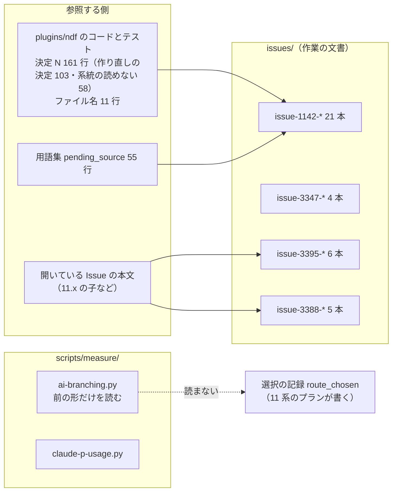
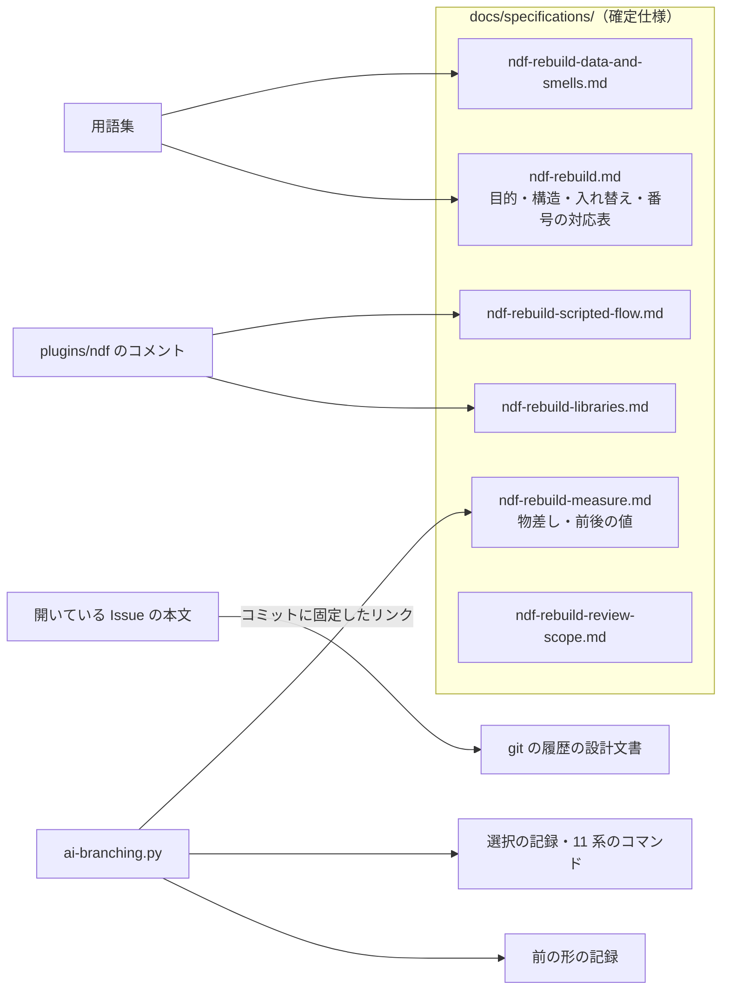
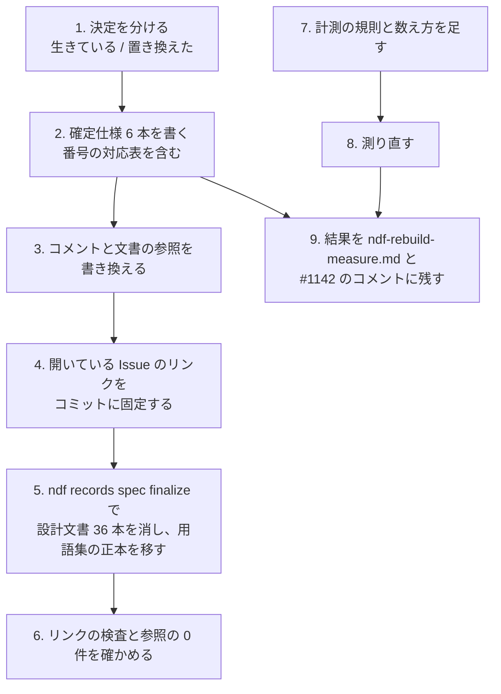

# #1142 の作り直しの仕様: 確定仕様だけで辿れ、入れ替えの前後を同じ物差しで比べられる（#3412）

作り直しの仕様は `issues/` の設計文書 36 本にあり、決定の番号が重なり、コードはその作業文書を根拠に指し、入れ替えの後の値は測れていない。設計文書を主題ごとに 6 本の確定仕様（`docs/specifications/ndf-rebuild*.md`）へ溶かし、決定の番号は今の番号を保ったまま重なる 1 つだけを振り直し、参照を確定仕様へ向けてから設計文書を消す。計測のスクリプトは、前の形の記録と後の形の記録（選択の記録と 11 系のコマンド）を同じ規則の番号で数え、物差し G1〜G3 を 1 つの表に出す。採らなかった案は各決定に、ADR の番号の慣行などの調査は末尾の「外部の調査」にある。

## 今の姿

何が起きたか・目的・受け入れ条件は要求仕様（[issue-3412-requirements.md](./issue-3412-requirements.md)、正は #3412 の本文）にある。この文書は「どう解くか」と「なぜその解き方か」だけを書く。



設計に要る今の構造は次の 4 つである（数は 2026-11-21 の `main` で数えた）。

| 対象 | 今の構造 |
| --- | --- |
| 決定の見出し | 12 本の文書に 151 件、最大の番号は 129。系統ごとの番号の範囲は `decisions` 1〜25・65〜68、`dbos` 26〜35、`smells` 36〜44、`data` 45〜53、`scripted-flow` 54〜65、`fixes` 69〜75、`next` 73〜129（#3347・#3395 の差分を含む）、`issue-3388-design.md` 1〜10 |
| 番号の重なり | 別の決定が同じ番号を持つのは 65（`decisions` と `scripted-flow`）・73〜75（`fixes` と `next`）・1〜10（`decisions` と `issue-3388-design.md`）の 3 組。19〜25 は `libraries` が本文で `decisions` が要約の同じ決定 |
| 置き換えた決定 | 決定 27 は採らない（`issue-1142-design-dbos.md` の 3・665 行の注記）。決定 28 は決定 84 で戻した。決定 27 を注記なしで指すのは `dbos.md:725`・`next.md:609`・`issue-1142-design-detail.md:196` |
| 計測 | `ai-branching.py` は `--ndf` と `--state` の下の `progress.jsonl` を読むが、行の `kind` が `run`・`step`・`attention` のものだけを数える。規則の表（`ai-branching-rules.json`）は 25 行で、規則の番号（R01〜R27）を持たず名前と正規表現だけを持つ。G1〜G3 は、規則の名前を scripted-flow の洗い出しの表で R の番号へ手で寄せて足した値である |

## 文脈と制約

- このレーン（並列の計画 p9 の `ls3-spec`）の触る場所は `docs/specifications/`・`docs/ndf-plugin-reference.md`・`issues/issue-1142-*`・`issues/issue-3395-*`・`issues/issue-3412-*` である。この設計の実装はその外（`issues/issue-3347-*`・`issues/issue-3388-*`・`issues/README.md`・`docs/glossary/`・`scripts/measure/`・`scripts/token-usage.py`・`scripts/check-markdown-links.py`・`scripts/tests/`・`plugins/ndf/` のコメント）も触る（「影響と危険」）
- `plugins/ndf/src` と `plugins/ndf/tests` は、同じ計画の `lz1-contract` も触る。コメントの行だけを変え、マージの衝突は base-sync で解く
- `scripts/ndf-next-parity/parity/features.json` へ書くのは計画の決まりで `le2e`（同じ計画の最後のレーン）だけである。この設計はその中のファイル名の参照を変えず、受け入れ条件 5 の数える範囲から外す
- 測り直しの期間は 2026-11-18（11.0.0）から測る日までで、30 日に届かない（要求仕様の前提 1）
- 11.0.13 では工程のプランが起動しない既知の不具合（#3908）がある。プランが書く選択の記録は、2026-11-21 の時点でこのマシンに 1 件も無い（`.ndf` と `.worktrees` の下の `progress.jsonl` 768 本に `route_chosen` が 0 件）
- `docs/archive/`・`docs/ndf-12-survey/` は書いた日の時点の記録で、追随しない（`AGENTS.md` の「ドキュメント」の表）

## 解き方の全体像



- 作り直しの仕様は 6 本の確定仕様にあり、決定の番号は 6 本を通して一意である。`issues/` に作り直しの設計文書は残らない
- コードのコメントは `docs/specifications/ndf-rebuild-<主題>.md の決定 N` の形で根拠を指す。用語集の語の SSOT も確定仕様を指す
- 開いている Issue の本文が設計文書を指すリンクは、消す前のコミットに固定したリンクに変わり、読めるまま残る
- `ai-branching.py` を 1 回打つと、前の形と後の形のそれぞれで規則の番号ごとの回数と G1〜G3 が出る。測り直しの結果は `ndf-rebuild-measure.md` と #1142 のコメントに残る

## 構成要素

| 要素 | 責務 |
| --- | --- |
| 確定仕様 6 本（新設） | 作り直しの仕様と生きている決定を主題ごとに持つ |
| 番号の対応表（`ndf-rebuild.md` の 1 セクション） | 設計文書の（文書・番号）から確定仕様の（ファイル・番号）を引く |
| 参照の書き換え | コメント・用語集・文書の参照を確定仕様へ向け、開いている Issue のリンクを固定する |
| `issues/README.md` の完了後の扱い | このリポジトリの `issues/` の文書の扱いを 1 か所で決める |
| 計測の規則の表（`ai-branching-rules.json` の変更） | 規則ごとに規則の番号と形（前・後）を持つ |
| 物差しの分類の表（`ai-branching-measures.json`、新設） | 規則の番号を G1〜G3 へ寄せる |
| `ai-branching.py` の数え方の追加 | 選択の記録を数え、形ごとに規則の番号と物差しへ集計する |
| `claude-p-usage.py` の `launches`・`plan-cost` | U2 の起動の突き合わせと、U1 の計画起動分（会話に残らない `claude -p`）を、進捗の記録と使用量ログだけから出す |
| `token-usage.py` の期間と PR の一意化 | 期間の始まり `--since` を受け、対象リポジトリの一意な PR を U1・U3 の分母にする |
| `check-markdown-links.py` の `--removing` | 消すファイルへの相対リンクと、可変の ref で指す GitHub のリンクを、消す前に挙げる |

## 移す先の対応表

受け入れ条件 1 の対応表である。「移さない」の行は、生きている決定とコードが指す事実を持たない作業の記録で、`plan-to-spec` の「開発中の履歴・TODO・PR 分割・作業チェックリスト」に当たる。生きている決定かコードが指す事実を中に見つけたら、その行だけを主題の合う確定仕様へ移す（決定 2）。

| 設計文書 | 扱い | 移す先 |
| --- | --- | --- |
| `issue-1142-requirements.md` | 移す（目的・要求の要旨と、要求の受け入れ条件のオーナー） | `ndf-rebuild.md` |
| `issue-1142-design.md` | 移す | `ndf-rebuild.md` |
| `issue-1142-design-modules.md` | 移す | `ndf-rebuild.md` |
| `issue-1142-design-migration.md` | 移す（エントリポイントの一覧） | `ndf-rebuild.md` |
| `issue-1142-design-next.md` | 移す | `ndf-rebuild.md` |
| `issue-1142-design-next-design-detail.md` | 移す（配置と入れ替えの結果） | `ndf-rebuild.md` |
| `issue-3347-design.md` | 移す（順番・依存のバージョンの方針。決定 97〜108） | `ndf-rebuild.md` |
| `issue-1142-design-decisions.md` | 移す | `ndf-rebuild-libraries.md` |
| `issue-1142-design-libraries.md` | 移す（決定 19〜25 の本文） | `ndf-rebuild-libraries.md` |
| `issue-1142-design-dbos.md` | 移す | `ndf-rebuild-libraries.md` |
| `issue-1142-design-data.md` | 移す | `ndf-rebuild-data-and-smells.md` |
| `issue-1142-design-data-design-detail.md` | 移す | `ndf-rebuild-data-and-smells.md` |
| `issue-1142-design-smells.md` | 移す | `ndf-rebuild-data-and-smells.md` |
| `issue-1142-design-smells-design-detail.md` | 移す | `ndf-rebuild-data-and-smells.md` |
| `issue-1142-design-scripted-flow.md` | 移す | `ndf-rebuild-scripted-flow.md` |
| `issue-1142-design-scripted-flow-design-detail.md` | 移す | `ndf-rebuild-scripted-flow.md` |
| `issue-3395-design.md` | 移す（目的の物差しは `ndf-rebuild-measure.md`、構成要素・`review_items`・閉じる操作・テストと CI の予算は `ndf-rebuild-review-scope.md`） | `ndf-rebuild-measure.md`・`ndf-rebuild-review-scope.md` |
| `issue-3395-design-decisions.md` | 移す（決定 109〜129） | `ndf-rebuild-review-scope.md`（決定 114 は `ndf-rebuild-measure.md`） |
| `issue-3395-design-detail.md` | 移す（選択の記録は `ndf-rebuild-scripted-flow.md`） | `ndf-rebuild-review-scope.md`・`ndf-rebuild-scripted-flow.md` |
| `issue-3395-design-scope.md` | 移す（11.0.0 と 11.x の範囲の結論） | `ndf-rebuild-review-scope.md` |
| `issue-1142-design-detail.md` | 移さない（開いている bug の割り当てと、2026-11-14 に置き換えた実装計画） | — |
| `issue-1142-design-base-design-detail.md` | 移さない（前の企画の残りの割り当て） | — |
| `issue-1142-design-fixes.md` | 移さない（子 Issue 14 本への振り分け。決定 69〜75 は振り分けの決定） | — |
| `issue-1142-design-fixes-design-detail.md` | 移さない（同上の詳細） | — |
| `issue-1142-design-labels.md` | 移さない（ラベル `rebuild-1142` の Issue を閉じる子の割り当て） | — |
| `issue-1142-design-review-routing.md` | 移さない（設計レビューの項目の移行先の表。移行先の Issue の本文が持つ） | — |
| `issue-3347-requirements.md` | 移さない（要求のコピー。正は #3347 の本文） | — |
| `issue-3347-design-detail.md` | 移さない（子の表と本文の直しの手順） | — |
| `issue-3347-source-note.md` | 移さない（申し送りの原文。#3347 の本文とコメントが持つ） | — |
| `issue-3395-requirements.md` | 移さない（要求のコピー。正は #3395 の本文） | — |
| `issue-3395-design-bugs.md` | 移さない（11.0.0 で直す Issue の一覧。各 Issue が持つ） | — |
| `issue-3388-requirements.md` | 移さない（要求のコピー。正は #3388 の本文） | — |
| `issue-3388-design.md` | 移さない（11.x の行の分け方。結果は 11.x の子の本文が持つ） | — |
| `issue-3388-design-detail.md` | 移さない（起票の手順） | — |
| `issue-3388-design-children.md` | 移さない（子の表。各子の本文が持つ） | — |
| `issue-3388-design-routing.md` | 移さない（11.x の対応表。各子の本文が持つ） | — |

移す 20 本・移さない 16 本で、36 本のすべてが 1 行ずつある。

## 処理の流れ



1〜6 と 7〜8 は互いに依存しない。9 は 2 と 8 の両方の後に行う。4 は 5 の前に行う（消した後はリンクを固定するコミットを選べない）。

## 決定の記録

### 決定 1: 主題ごとに読めるよう、作り直しの仕様を 6 本の確定仕様に分ける

- **質問**: 20 本の設計文書を、確定仕様の何本にまとめるか
- **選んだ案**: 主題ごとに 6 本（`ndf-rebuild.md`・`ndf-rebuild-libraries.md`・`ndf-rebuild-data-and-smells.md`・`ndf-rebuild-scripted-flow.md`・`ndf-rebuild-measure.md`・`ndf-rebuild-review-scope.md`）にし、名前を `ndf-rebuild` で始める。1 本は 500 行以下にし、超えたら同じ接頭辞で分ける
- 採らなかった案: 設計文書 1 本を確定仕様 1 本へ写す（設計の後の差分の文書（#3347・#3395）が前の文書を上書きしており、写すと上書きの前と後が別の仕様に残る）
- 採らなかった案: 1 本にまとめる（14,515 行の材料から 500 行の上限に収まらない）
- **代償**: 設計文書と確定仕様が 1 対 1 でないため、元の文書から移す先を引くには対応表を読む
- 根拠: Value 8（MVV バージョン 1）

### 決定 2: 作業の記録を仕様にしないため、生きている決定とコードが指す事実を持たない文書は移さない

- **質問**: 割り当ての表・起票の手順・要求のコピーのような作業の記録を、確定仕様へ移すか
- **選んだ案**: 移さない。対応表の「移さない」の 16 本は git の履歴に残す。中に生きている決定か、コードとテストが指す事実が見つかったら、その行だけを主題の合う確定仕様へ移す
- 採らなかった案: 36 本をすべて移す（割り当ての表は Issue の開閉で古くなり、確定仕様が古い事実を持ち続ける）
- **代償**: 移さない文書の中身を読むには、git の履歴か、固定したリンク（決定 6）を辿る
- 根拠: Value 6（MVV バージョン 1）

### 決定 3: コードと文書の今の参照を壊さないため、決定の番号は今の番号を保ち、重なる決定だけを最大の次へ振り直す

- **質問**: 決定の番号を 1 系統にそろえるとき、すべてを振り直すか、今の番号を保つか
- **選んだ案**: 今の番号を保つ。移す決定の中で別の決定と番号が重なるのは 65（`decisions` と `scripted-flow`）だけなので、`scripted-flow` の 65 を 130 へ振り直す。73〜75（`fixes`）と 1〜10（`issue-3388-design.md`）は移さない文書の決定なので確定仕様で重ならない。19〜25 は本文（`libraries`）の 1 つにする。`ndf-rebuild.md` に、振り直した決定と、移さない文書から移した決定の（元の系統・元の番号）→（確定仕様・番号）の表を置く。元の文書はファイル名で書かず系統の名前（`scripted-flow` など）と題で書き、表の頭に消す前のコミットの `issues/` を指す固定リンクを 1 つ置く（ファイル名が確定仕様に残ると受け入れ条件 5 の 0 件に当たる）。この番号の系統は 6 本で閉じ、11.x の子は自分の設計と確定仕様に自分の番号を持つ
- 採らなかった案: 6 本を通して 1 から振り直す（作り直しの決定を指すコメント 103 行がすべて別の決定を指すようになり、書き換えの漏れを番号で見分けられない）
- 採らなかった案: 系統の名前を番号に添えて残す（`決定 65（decisions）`。#3347 の決定 102 の形で、受け入れ条件 2 の「1 系統」に当たらない）
- **代償**: 番号に欠番と並びの飛びが残る（130 だけが離れる）
- 根拠: Value 8（MVV バージョン 1）。STD1・STD2（番号を再利用しない）

### 決定 4: 置き換えた決定を材料に読ませないため、置き換え先の決定の「採らなかった案」へ畳む

- **質問**: 採らない・置き換えた決定を確定仕様にどう残すか
- **選んだ案**: 独立した決定として残さず、置き換え先の決定の本文に `採らなかった案:` の行として理由とともに畳む（決定 27 は `recv` で待つ決定の中へ）。置き換え先が無い決定は落とす。戻した決定（決定 28 を戻した決定 84）は、戻した後の中身を 1 つの決定として書く。置き換えの判定は、置き換えた側か置き換えられた側の設計文書の文（注記の「採らない」「置き換えた」・取り消し線・後の決定の本文の「〜を置き換える」）で決める。置き換えたと決まった決定は、注記なしで指す箇所も同じ扱いにする
- 採らなかった案: 置き換えた決定を状態つきで残す（ADR の superseded。確定仕様を読む人が今の仕様と過去の決定を毎回見分けることになり、3347-7 の食い違いがそのまま確定仕様に移る）
- **代償**: 置き換えた決定の全文は確定仕様に無く、git の履歴に残る
- 根拠: Value 8（MVV バージョン 1）。STD2（過去の決定を見せる理由は、置き換え先の採らなかった案で満たす）

### 決定 5: 子の記号を 1 つの意味にするため、確定仕様では前の企画の子を記号で書かず、Issue の番号で書く

- **質問**: 前の企画と作り直しで重なる記号（X1・S1・D1・D2・C1〜C5・R1・R2・A2・I1・I13）をどう書き分けるか
- **選んだ案**: 確定仕様の記号は作り直しの子だけに使い、`ndf-rebuild.md` に記号と Issue の番号の表を置く。前の企画の子は Issue の番号（例 #3092）で書く。不変条件の番号（I1 など）も決定の番号と同じく 6 本を通して一意にし、重なるものは最大の次へ振り直す（対応表に載せる）
- 採らなかった案: 前の企画の記号に接頭辞を付ける（`旧 X1`。読み手が接頭辞の有無を毎回見分けることになる）
- **代償**: 前の企画の子を記号で検索しても確定仕様に当たらない
- 根拠: Value 1（MVV バージョン 1）

### 決定 6: 開いている Issue から設計文書を読めるまま消すため、リンクを消す前のコミットに固定する

- **質問**: 開いている Issue の本文（11.x の子の見出し `材料にする設計の節`など）が指す設計文書を消すとき、リンクをどうするか
- **選んだ案**: 消す PR の作業で、開いている Issue の本文のうち 36 本を `blob/<ブランチ>/issues/…` で指すリンクを、消す直前の `main` のコミットの `blob/<コミット>/issues/…` へ書き換える。既に 40 桁の SHA で固定したリンクは替えない。GitHub は本文の更新を版の一致で縛れず AI は人の編集を止められないので、AI は置換案（Issue ごとの替える前後のリンク）と適用のコマンドを作り、Issue の編集者が打つ（打つたびに完全な本文を取り直して当てる。詳細設計の「本文の書き戻しと同時の編集」）。閉じた Issue と Pull Request は書き換えない
- 採らなかった案: 設計文書を `issues/old/` へ移す（リンクのパスが変わるのは同じで、`old/` が増え続ける）
- 採らなかった案: リンクを確定仕様へ向ける（子が材料にしているセクションは割り当ての表など移さない文書にもあり、移した先が無い）
- **代償**: 固定したリンクの先は、その後の確定仕様の直しを映さない。適用は編集者の手で、`ndf records spec finalize` に持たせる直しは範囲外の #3950 にした
- 作り方: 標準に倣う
- 比べた候補: PRD1
- 根拠: Value 6（MVV バージョン 1）

### 決定 7: `issues/` の完了後の扱いを 1 か所にするため、`issues/README.md` が決め、確定仕様化のスクリプトが消す

- **質問**: 4 か所で食い違う完了後の扱い（`old/` へ移す・消す・残す判断）のどれを正にし、どこに置くか
- **選んだ案**: 扱いは「確定仕様へ移した後に消す」とし、`issues/README.md` に置く。消すのは `ndf records spec finalize --remove` で、同じ実行が用語集の語の SSOTを確定仕様へ移す。`old/` の今の 208 本は残し、新しく足さない。`ndf-knowledge-and-kiro.md` は `issues/README.md` を指す 1 文にする。`plan-to-spec` はリポジトリの索引に従う作りのまま変えない（ほかのプロジェクトの扱いを持ち込まない）。`plan-to-spec` が残す判断を許すのは「指示書や `issues/` の索引が残すと定めている」ときだけなので、索引が「消す」と書けば食い違わない。#3347 の決定 102 は決定 3 に置き換わり、決定 4 の形で畳む
- 採らなかった案: `old/` へ移す（参照の書き換えが要るのは消すときと同じで、`old/` が増え続ける）
- 採らなかった案: `plan-to-spec` を正にする（`plan-to-spec` はほかのプロジェクトにも配る手順で、このリポジトリの扱いを持たせるとリポジトリごとの扱いを受けられない）
- **代償**: 消した文書の全文は git の履歴にしか残らない
- 根拠: Value 4 / Value 6（MVV バージョン 1）

### 決定 8: 入れ替えの後のコマンドの選択も数えるため、後の形は選択の記録と、11 系のコマンドの規則の両方で数える

- **質問**: 後の形の G1〜G3 を、選択の記録（`route_chosen` の `chooser`）だけで数えるか、会話の記録に残ったコマンドも数えるか
- **選んだ案**: 両方で数える。選択の記録は `chooser` が `conductor` の行を規則の番号（`rule`）ごとに数える。プランの外で conductor が打った 11 系のコマンド（`ndf ci watch`・`ndf plan next <プラン> --from <ステップ>` など）は、規則の表に形 `after` の行として規則の番号つきで足し、会話の記録から数える。前の形は今の 25 行に形 `before` と規則の番号を足し、会話の外の旧い進捗と台帳の数え（R14 の `slow`・R21 の `impl`・`design` の停止・R25 の `settle` など）も規則の番号へ寄せる。物差しは規則の番号を G1〜G3 へ寄せる分類の表で決め、分類の表は規則の番号と形ごとに出所を 1 つに決める（`transcripts`・`progress`・`ledger`・`records`・`none`）。ほかの出所の当たりは参考に出すが G に足さない。書き手の無い出所の規則は 0 でなく「測れない」として理由を出す
- 今の書き手との突き合わせ: 11.0.13 の選択の記録の書き手は `transition_decide.py` だけで、R03・R10 は停止の後の自動の遷移として `chooser: script`、R13 は回答を受けて `chooser: human` で書く。`ndf plan next <プラン> --from <ステップ>` と `ndf plan queue --from`・`--resume` は選択の記録を書かない。よって conductor の手での再開は会話の記録にしか残らず、後の形の R03・R10・R13 の出所は `transcripts` にする（`records` にすると手での再開が消える）。同じ再開のコマンドは、同じ会話の直前の結果の対象のプランの行（`gate` か `--answer` の後なら R13、`cause.kind` が `base_conflict` なら R10、止まった原因を結果から読めなければ `unresolved`、ほかは R03）で対象ごとに 1 つの規則に寄せ、提示された `next` か `routes` のとおりに打った回は数えない（詳細設計の「後の形の R03・R10・R13」）。`records` を出所にするのは、`chooser: conductor` を書く書き手を足した規則だけである
- 会話の記録で conductor を見分ける: Claude Code の JSONL の行の `isSidechain`・`entrypoint` と、ファイルが `subagents/` の下かで役割を決める（詳細設計の「会話の記録の役割」）。supervisor と worker が同じコマンドを打っても conductor の回に入れず、役割の欄を持たない `tool_result` は `tool_use_id` の呼び出しの役割を継ぎ、なお決められない行は `unattributed` として件数を出す（`value` に入れず、手の表と比べる `all_roles` には入れる）。conductor が結果 JSON の `next` のとおりに打ったコマンドは、行き先を選んだのがスクリプトなので conductor の回に入れない（`ndf.contracts.chosen.chooser` と同じ規則）
- 採らなかった案: 選択の記録だけで数える（プランの外で conductor が選んだ回が 0 に見え、3395-1 の「後の値が 0 に見える」が残る）
- 採らなかった案: 会話の記録だけで数える（スクリプトが選んだ回（`chooser` が `script`）と conductor が選んだ回を分けられない）
- **代償**: 11 系のコマンドの規則を、コマンドを足すたびに表へ足す手間が残る
- 作り方: 自前で作る
- 比べた候補: LIB1
- 根拠: Value 3（MVV バージョン 1）

### 決定 9: 計測が配るコードに縛られないため、後の形は記録の形とコマンドの JSON だけで読む

- **質問**: 計測のスクリプトが後の形を読むとき、`plugins/ndf` のモジュールを import するか
- **選んだ案**: import しない。選択の記録は `progress.jsonl` の行を `plugins/ndf/contracts/schemas/route-chosen.schema.json` で確かめて読み、形の合わない行は数えずに件数を出す。使用量は使用量ログ（`ndf records usage` の置き場）の行を直に読み、`ndf records usage report` は使わない（期間の合計だけで会話の ID ごとの行を持たず、3 層に既に入った分を除けないため）
- 採らなかった案: `ndf.contracts.chosen` を import する（計測が配るコードのバージョンに縛られ、入れ替えのたびに計測が壊れる。#3395 の決定 114 が退けた形）
- **代償**: スキーマが変わると、計測の側の確かめも同じ変更で直す。使用量は使用量ログの行の形（`caller`・`session_id`・`usage`・`at`）に縛られるが、行の形は記録の契約で、モジュールの中身ほど変わらない
- 作り方: ライブラリやサービスを使う
- 比べた候補: LIB1
- 根拠: Value 9（MVV バージョン 1）

### 決定 10: 30 日に届かない期間でも判定を残すため、測り直しを 2 回に分ける

- **質問**: 「入れ替えの後の 30 日」の目標を、30 日に届く前のこのスプリントでどう測るか
- **選んだ案**: 実装の PR で 11.0.0 から測る日までの値を測って残し（受け入れ条件 9・10）、30 日の値は 2026-12-18 以降にリリース後の確認で同じコマンドを打って足す。結果の表は期間の列を持ち、2 回の値を並べる
- 採らなかった案: 30 日を待ってから実装の PR を出す（確定仕様化と後に続く 3 本（#3492・#3696・#3697）が 1 か月止まる）
- **代償**: 1 回目の値は日数が短く、目標との比べは参考の値になる。G1〜G3 の前の値は手で規則を寄せた値なので、同じ期間を直したスクリプトで打ち直した値も並べ、前と後はスクリプトの値どうしで比べる（要求仕様の前提 2）
- 根拠: Value 5（MVV バージョン 1）

## 影響と危険

- **働く範囲**: このリポジトリだけ。確定仕様・`issues/`・計測のスクリプトはどれも配らない。`plugins/ndf` はコメントの行だけが変わり、振る舞いは変わらない
- **プロジェクトごとに違うもの**: 無い（`issues/` の扱いはこのリポジトリの `issues/README.md` に置き、`plan-to-spec` は変えない）
- **当たるモード**: `standard`（このリポジトリの作業）
- **このレーンの触る場所の外**: 実装は「文脈と制約」の 1 行目の場所を触る。オーガナイザーが並列の計画のレーン `ls3-spec` の触る場所へ足してから実装を始める。`plugins/ndf/src`・`plugins/ndf/tests` は `lz1-contract` と重なるので、コメントの行だけにし、base-sync で解く
- **`scripts/ndf-next-parity/`**: `README.md` と `parity/features.json` が設計文書を 3 行で指す。features.json へ書くのは `le2e` だけなので、受け入れ条件 5 の数える範囲から外し、書き換えのリクエストを #3692 のコメントで送る。実装の PR はその書き換えを待たない
- **壊れうる箇所**: 消した後に残った参照は `scripts/check-markdown-links.py` と文書の古さの検査が落とす。開いている Issue のリンクの固定を忘れると、11.x の子の材料が読めなくなる（処理の流れの 4 を 5 の前に置く）

### 代表のリポジトリでの振る舞い

| 代表のリポジトリ | 設定の要点 | 直した後に起きること | この種類で扱えなくなること |
| --- | --- | --- | --- |
| Web サービス | 配る `plugins/ndf` の振る舞いは変わらない | 設計・設計の検査・cross-review・MVV 判定で変わることは無い | 無し |
| モバイルアプリ | 同上 | 同上 | 無し |
| 業務文書だけ | 同上 | 同上 | 無し |

### ai-plugins だけの事情

| 値 | 置く所 | 持つ Issue |
| --- | --- | --- |
| `issues/` の完了後の扱い（確定仕様へ移した後に消す） | `issues/README.md` | #3412 |
| 作り直しの確定仕様の名前の接頭辞 `ndf-rebuild` | `docs/specifications/` | #3412 |

## テスト設計

| 受け入れ条件 | どの振る舞いで縛るか | どう壊したら落ちるべきか |
| --- | --- | --- |
| 1 | 対応表の 36 行と、実装の PR で消えた `issues/` のファイルの一覧が一致する（PR の差分を数える） | 1 本でも消し忘れるか、表に無いファイルを消すと一致しない |
| 2 | 下の「番号の一意の検査」が 0 行 | 振り直さずに 65 を 2 本に置くと 1 行出る。`## 決定 65` と `### 決定 65` のように見出しの階層が違っても 1 行出る |
| 3 | 確定仕様の記号が `ndf-rebuild.md` の記号の表にだけ載る作り直しの子を指す（レビューで表と照らす） | 前の企画の X1 を記号で書くと表の Issue と違う |
| 4 | 決定 27 の題の語が `採らなかった案:` の行の外に現れない（レビュー） | 決定 27 を独立した見出しで残すと当たる |
| 5 | 要求仕様の検証手段の `git grep` が 0 行。`決定 N` を書くコメントのうち作り直しの決定を指すものが確定仕様のファイル名を持つ | 1 行でも元のファイル名が残ると当たる |
| 6 | `issues/README.md` と `ndf-knowledge-and-kiro.md` の扱いの文が同じ扱いを指す（レビュー） | 片方に `old/` へ移すと残ると食い違う |
| 7 | 前の形と後の形の見本の記録を置いた入力で `ai-branching.py` を打つと、`forms.before` と `forms.after` の両方に規則の番号ごとの回数と G1〜G3 が出る | 後の形を読まないように壊すと `forms.after` が 0 になって落ちる |
| 8 | 同じ選択を前の形（規則の正規表現に当たるコマンド）と後の形（同じ規則の番号の 11 系のコマンド）で 1 回ずつ置くと、同じ規則の番号に 1 回ずつ数えられる。R03 の `chooser: script` の選択の記録（停止の後の自動の遷移）と、conductor の会話の `next` と違う `ndf plan next <プラン> --from <ステップ>` を一組にすると、R03 は 1 回になる | `chooser` を読み捨てると `script` の行が conductor の回に入って落ちる。R03 の出所を `records` にすると手での再開が 0 になって落ちる |
| 8（役割） | 同じ `ndf ci watch` を conductor・worker（`subagents/` の下）・supervisor（`entrypoint: sdk-cli`）が 1 回ずつ打つ見本で、conductor の回は 1、役割で絞らない回は 3。`next` のとおりに打ったコマンドは conductor の回に入らない | 役割を読み捨てると 3 になって落ちる |
| 7（記録の規則） | 旧い形の進捗と台帳の見本（`slow`・`impl exit=1`・`design exit=1`・`settle` の `rejected`）で、R14・R21・R25 が会話なしで数えられ、G2・G3 に入る。会話と記録の両方に跡がある規則（R03 など）は出所の 1 つだけが入る | 記録の出所を外すと G3 が 0 になって落ちる |
| 7（期間） | `until` の 1 秒後の行を、会話・選択の記録・旧い進捗・台帳のどれでも数えない | 1 つでも `since` だけで絞ると落ちる |
| 7（形の確かめ） | スキーマに合わない `route_chosen` の行は数えず、`rejected` の件数に出る | 確かめを外すと形の合わない行が数えられて落ちる |
| 7（import しない） | `ai-branching.py` を `plugins/ndf/src` を import の道に入れない環境で打てる | `ndf` を import すると `ModuleNotFoundError` で落ちる |
| 9・10 | 測り直しの結果の表が、前の値・後の値・期間・コマンドの列を持ち、測れなかった値に理由の列がある（レビュー） | 期間の列が無い・U1 の判定が無いとレビューで変更を要求する |
| 11 | CI の必須のジョブ（リンクの検査・文書の古さ・`scripts/tests`）が実装の PR で通る | 参照を残すとリンクの検査が落ちる |

番号の一意の検査は、見出しの階層を落として番号だけを比べる。

```bash
grep -hoE '^#{2,4} 決定 [0-9]+' docs/specifications/ndf-rebuild*.md | grep -oE '[0-9]+$' | sort -n | uniq -d
```

## 用語

| 用語 | 意味 | 用語集への反映 |
| --- | --- | --- |
| 目的の物差し | 作り直しの目的（AI の判断をスクリプトへ移す・使用量を減らす）を測るスクリプトと規則。値は G1〜G3・U1〜U3 | 意味の変更（SSOT を `docs/specifications/ndf-rebuild-measure.md` へ移す。`ndf records spec finalize` が行う） |
| 選択の記録 | ルートを選ぶたびに 1 行残す事象（`route_chosen`） | 意味の変更（SSOT を `docs/specifications/ndf-rebuild-scripted-flow.md` へ移す。同上） |

詳細設計は [issue-3412-design-detail.md](./issue-3412-design-detail.md) にある（新設する関数 8・シグネチャを変える関数 4 のため別ファイル）。

## 設計の結果

| 課題 | 扱い | 統合先 | 触るファイル |
| --- | --- | --- | --- |
| #3412 | 実装する | — | `docs/specifications/ndf-rebuild.md`（新設）、`docs/specifications/ndf-rebuild-libraries.md`（新設）、`docs/specifications/ndf-rebuild-data-and-smells.md`（新設）、`docs/specifications/ndf-rebuild-scripted-flow.md`（新設）、`docs/specifications/ndf-rebuild-measure.md`（新設）、`docs/specifications/ndf-rebuild-review-scope.md`（新設）、`docs/specifications/ndf-knowledge-and-kiro.md`、`docs/specifications/README.md`、`issues/README.md`、`docs/glossary/glossary.json`、`docs/glossary/ndf-rebuild.md`、`scripts/measure/ai-branching.py`、`scripts/measure/ai-branching-rules.json`、`scripts/measure/ai-branching-measures.json`（新設）、`scripts/measure/claude-p-usage.py`、`scripts/token-usage.py`、`scripts/check-markdown-links.py`、`scripts/tests/test_ai_branching.py`（新設）、`scripts/tests/test_claude_p_usage.py`、`scripts/tests/test_token_usage.py`、`scripts/tests/test_check_markdown_links.py`、`plugins/ndf/pyproject.toml`、`plugins/ndf/src/ndf/checks/README.md`、`plugins/ndf/src/ndf/checks/children.json`、`plugins/ndf/src/ndf/checks/invariants.py`、`plugins/ndf/src/ndf/core/durable.py`、`plugins/ndf/src/ndf/core/plan/transition_decide.py`（ほかに、作り直しの決定を指すコメントを持つ `plugins/ndf/src`・`plugins/ndf/tests`・`scripts` のファイルを実装の棚卸しで 1 つずつ足す。`issues/issue-1142-*`・`issue-3347-*`・`issue-3395-*`・`issue-3388-*` の 36 本を消す） |

## 未確認のまま残ること

| 項目 | 内容 |
| --- | --- |
| 後の形の選択の記録の量 | 2026-11-21 の時点でこのマシンに `route_chosen` が 0 件で、プランは #3908 のため起動していない。実装の PR の測り直しで 0 件のままなら、G1〜G3 の後の形は会話の記録の分だけになり、結果に「プランの選択は測れなかった（#3908）」と残す |
| 物差しの目標 U1 | 1.14M 以下に届くか。1 回目は実装の PR の測り直しで、30 日の値は 2026-12-18 以降に分かる |
| コメントの決定番号の系統 | 「決定 N」316 行のうち 58 行は系統を読み取れず、43 行は番号だけで別の課題の決定の疑いがある（2026-11-21 の棚卸し）。実装の棚卸しで 1 行ずつ前後の文と照らして決める |
| `issue-1142-design-fixes.md` の決定 69〜75 をコードが指すか | 棚卸しは「決定 73〜75」の指しを `next` の決定と読んだが、1 行ずつは照らしていない。詳細設計の手順 1 で移さない 16 本も含む 36 本の決定をすべて選別し、`fixes` の決定を指す行が見つかれば、その決定を確定仕様へ移し、番号を 131 以降へ振り直す（決定 2・3）。消す前に、残す決定と移し先がすべて決まっていることを手順 1 の終わりの条件にする |

## 外部の調査

| 種類 | 調べるか | 理由 |
| --- | --- | --- |
| 標準・仕様 | 調べる | 決定の記録の番号と置き換えの扱いに慣行がある |
| 主要な製品 | 調べる | 消すファイルへのリンクを残す手段を GitHub が持つ |
| ライブラリとサービス | 調べる | 記録の形の確かめに既存のライブラリがある |

### 標準・仕様

| # | 標準・仕様 | 何を定めているか | 設計への反映 | 出典 |
| --- | --- | --- | --- | --- |
| STD1 | MADR 4.0.0 | 番号は次の連番（`NNNN-title.md`）。分類のフォルダに分けると番号はフォルダの中でだけ一意。状態に `superseded by ADR-0123` を持てる | 番号を確定仕様 6 本で 1 系統にし、フォルダごとの名前空間を持たない（決定 3） | https://adr.github.io/madr/（2026-11-21） |
| STD2 | Michael Nygard「Documenting Architecture Decisions」 | 番号は単調に増やし、再利用しない。覆した決定は superseded として残す | 番号を再利用しない（決定 3）。superseded は残さず置き換え先へ畳む（決定 4） | https://cognitect.com/blog/2011/11/15/documenting-architecture-decisions（2026-11-21） |

### 主要な製品

| # | 製品 | どう解いているか | 設計への反映 | 出典 |
| --- | --- | --- | --- | --- |
| PRD1 | GitHub のファイルの固定リンク | ブランチ名をコミットの SHA に替えたリンクは、後のコミットで変わらず同じ中身を開く。ブランチのリンクは先頭のバージョンを開くので変わる | 開いている Issue のリンクを消す前のコミットに固定する（決定 6） | https://docs.github.com/en/repositories/working-with-files/using-files/getting-permanent-links-to-files（2026-11-21） |

### ライブラリとサービス

| # | 候補 | バージョン | ライセンス | 最後のリリースの日付 | 終了のアナウンス | 要件を満たすか | 出典 |
| --- | --- | --- | --- | --- | --- | --- | --- |
| LIB1 | jsonschema（Python） | 4.26.0（ルートの `pyproject.toml` の extras `jsonschema` で固定済み） | MIT | 確かめていない | 無し | 満たす。選択の記録の行をスキーマで確かめられ、`plugins/ndf` を import しない（決定 9）。規則の数え方（決定 8）は持たないので自前で書く | `/work/ai-plugins/pyproject.toml` の 23 行（2026-11-21） |

### 確かめられなかったこと

| 対象 | 試した手段 | 結果と理由 |
| --- | --- | --- |
| LIB1 の最後のリリースの日付 | 試していない | バージョンはリポジトリで固定済みで、日付は採否に関わらないため取得しなかった |

調べた量: 候補 4 件・取得の試み 3 回。
