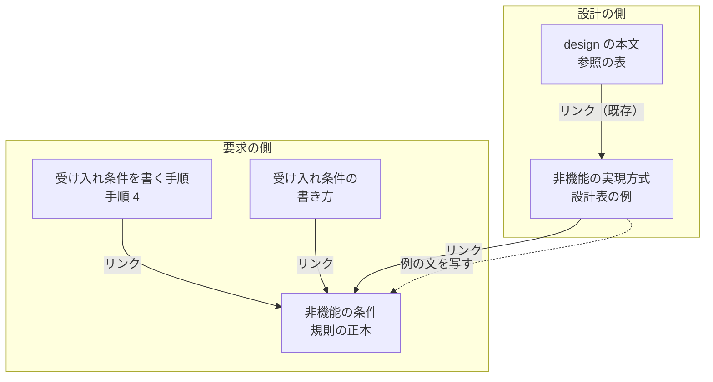
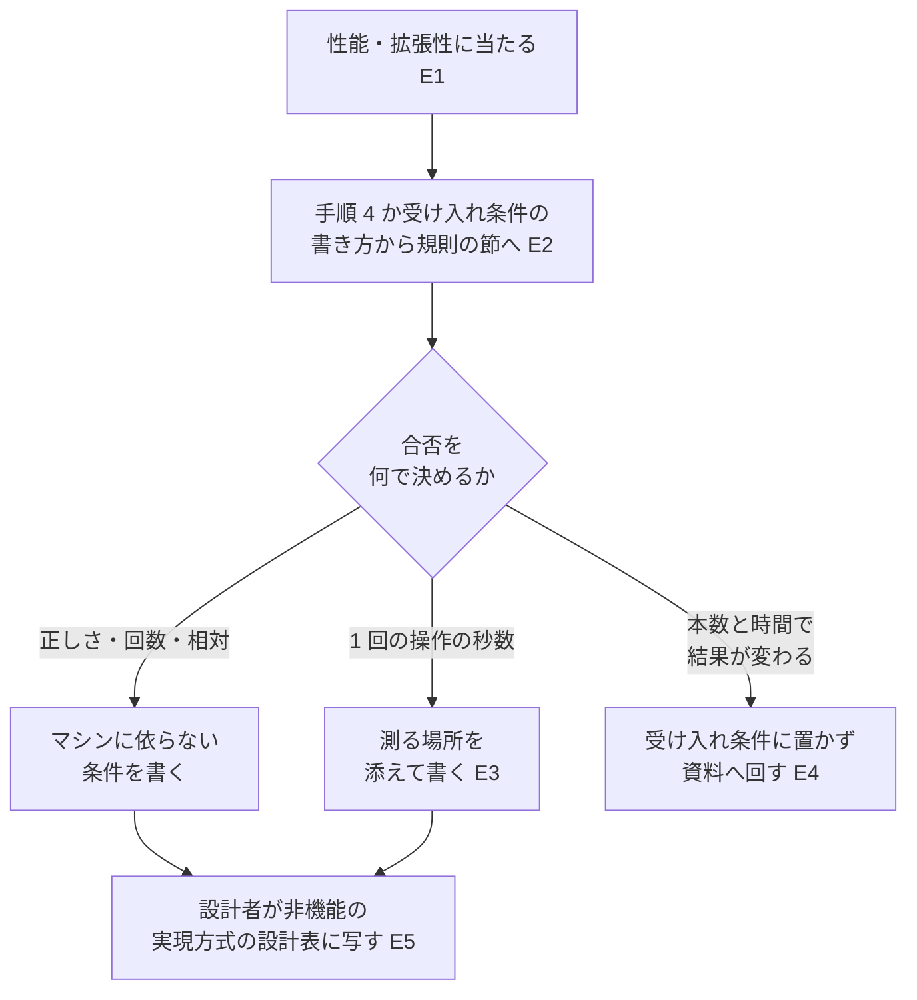

# requirements-design・design: 性能の受け入れ条件をマシンに依らない形で書き、負荷の実測を資料へ回す（#3436）

## 目的

- **今どうなっているか**: 非機能の条件の書き方と例が、性能を「1 万件で一覧の初期表示が 2 秒以内」の形で書かせ、どのマシンで測るかを書かせていない。2026-11-14 に、この形から時間で区切った負荷試験の受け入れ条件が 4 本生まれ、共有の開発機での不合格がコードの問題か CPU の取り合いかを区別できず、マージの判断に使えなかった
- **誰に効くか**: `requirements-design` で受け入れ条件を書く人と、`design` で非機能の実現方式と確かめ方を書く人。その条件でマージを判定する人
- **変えると何が成り立つか**: 規則と例に従って書いた性能の条件は、合否がコードの振る舞いだけで決まり、マシンのスペックと同時に動かす本数で変わらない。負荷の実測は、スペックと条件と結果を並べた資料として上限の目安になる

## 適用範囲

- **働く範囲**: NDF を使うすべてのリポジトリ。`requirements-design` と `design` の参照文書はリリース対象であり、利用先のリポジトリで受け入れ条件を書くときにも読まれる
- **プロジェクトごとに違うもの**: 測る場所（どの CI のランナーか）と、相対の形の倍率。どちらも規則が値を持たず、条件を書く人が条件の文に書く（決定 3）
- **当たるモード**: `standard`（受け入れ条件を書くすべてのモードで規則が読まれる。この変更そのものの工程は `standard`）

## あるべき姿の根拠

| 根拠 | 種類 | 何を示すか |
| --- | --- | --- |
| 利用者の指示の原文「負荷試験を要求する受け入れ条件そのものを直さないと再発しそう」（2026-11-14） | 利用者の指示の原文 | 直す先が課題ごとの条件ではなく、条件を生む手順書であること |
| 利用者の指摘「所要時間はマシンスペックの問題で、DB の作りでは直らない」「どういうスペックのマシンでどういう条件で動かしたらこうなりました、という資料を作って、上限なりの目安を提供するぐらい」 | 利用者の指示の原文 | 負荷の実測の行き先が合否ではなく資料であること |
| 2026-11-14 の負荷試験の 1 回目（共有の 8 コアのマシンで 34 本・30 分、p95 1.62 秒で不合格）がマージの判断に使えなかった | 実測 | 測る場所の決まらない秒数の上限は、合否として働かないこと |
| PRD1（CodSpeed は命令の重み付けで測り、ハードウェアと雑音に依らない結果を得る） | 外部の一次情報 | 業界にも、実時間を避けてマシンに依らない量で回帰を捕まえる形があること |
| PRD2（pytest-benchmark は保存した基準との差で失敗させる） | 外部の一次情報 | 同じマシンでの基準との相対を合否にする形が、広く使われるライブラリにあること |
| STD1（GitHub-hosted runner はラベルごとに CPU 数とメモリが決まり、public と private で値が違う） | 外部の一次情報 | 測る場所は「CI のランナー」と書くだけでは決まらず、ラベルと公開範囲まで書く必要があること |

要求と受け入れ条件は #3436 の本文にある（コピーは [issue-3436-requirements.md](issue-3436-requirements.md) ）。この文書は「どう作るか」だけを扱う。

## ドメインモデル

### コンテキスト

| コンテキスト | 何の語が 1 つの意味に決まるか |
| --- | --- |
| NDF の開発ワークフロー（`ndf-workflow`） | 受け入れ条件・非機能の条件・マシンに依らない条件・測る場所・時間で区切った負荷試験 |

変更は 1 つのコンテキストに収まる。要求の側（`requirements-design`）と設計の側（`design`）は同じコンテキストの中の 2 つの手順であり、設計の側は要求の側の規則を写さずに指す。

### 集約

| 集約 | 持ち主（書き換えてよいもの） | 根 | エンティティ | 値オブジェクト |
| --- | --- | --- | --- | --- |
| 性能の条件の書き方の規則 | `requirements-design` の非機能の条件の参照文書（「合否に置く性能の条件」の節） | 規則の節 | — | 3 つの形（正しさ・回数と計算量・同じマシンでの相対）、秒数の上限の書き方、負荷の実測の行き先 |
| 非機能設計表の例 | `design` の非機能の実現方式の参照文書 | 例の表 | 性能・拡張性の行 | 要求の条件・実現方式・確かめ方 |

規則の集約は 1 つの持ち主だけが書き換える。設計の側の例と、受け入れ条件の書き方の参照文書・`requirements-design` の本文は、規則の節を見出しへのリンクで指すだけで、規則の文を持たない。

### 不変条件

| # | 集約 | 条件 | 破れたときの扱い |
| --- | --- | --- | --- |
| I1 | 性能の条件の書き方の規則 | 規則の文（3 つの形・秒数の上限の書き方・負荷の実測の行き先）は、非機能の条件の参照文書の「合否に置く性能の条件」の節の 1 か所にだけある | 規則の文の重複を見つけたら、重複をリンクへ置き換える（レビューで見る） |
| I2 | 性能の条件の書き方の規則 | 2 つの Skill のディレクトリの中で「秒以内」を持つ行は、同じ行に測る場所を持つ | 測る場所を足すか、マシンに依らない形へ書き換える |
| I3 | 非機能設計表の例 | 性能・拡張性の行の「要求の条件」は、要求の側の性能の例と同じ文である | 要求の側の文へ揃える |
| I4 | 性能の条件の書き方の規則 | 受け入れ条件を書く手順の本文・受け入れ条件の書き方の参照文書・非機能の実現方式の参照文書から、規則の節へリンクでたどれる | リンクを張り直す。見出しを変えたらリンクの見出しも変える |
| I5 | 性能の条件の書き方の規則 | 2 つの Skill のディレクトリの中で「倍以内」を持つ行（相対の形）は、同じ行に測る場所を持つ | 測る場所を足すか、相対でない形へ書き換える |

### ドメインイベント

| # | イベント | 発生元 | 受け手 |
| --- | --- | --- | --- |
| E1 | 書き手が性能の条件を書こうとした | 非機能の該当の判定（性能・拡張性に当たる） | 受け入れ条件を書く手順の手順 4 |
| E2 | 書き手が規則を読み、条件の形を選んだ | 手順 4 または受け入れ条件の書き方の参照文書の「非機能の条件」の節からのリンク | 規則の節 |
| E3 | 書き手が秒数の上限を置き、測る場所を添えた | 規則の節の「秒数の上限を置くとき」 | 要求の受け入れ条件 |
| E4 | 書き手が負荷の実測を資料へ回した | 規則の節の「負荷の実測」 | 実測の資料（受け入れ条件の外） |
| E5 | 設計者が非機能設計表の確かめ方を書いた | 非機能の実現方式の参照文書 | 規則の節（確かめ方も同じ規則に従う） |

### 用語

| 用語 | 意味 | 用語集への反映 |
| --- | --- | --- |
| マシンに依らない条件 | 同じ入力なら、合否がコードの振る舞いと、条件の文に書いた測る場所だけで決まる受け入れ条件。正しさ・回数と計算量・同じマシンの上で測った基準との相対の 3 つの形。正しさと回数と計算量は、どのマシンで実行しても同じ合否になる。相対は、変更の影響がマシンごとに違うため比もマシンで変わり、スペックが固定された測る場所を同じ文に書いたときだけこの条件に当たる | 追加（要求のステップで反映済み） |
| 時間で区切った負荷試験 | 「N 分流す」のように、流す時間と同時に動かす本数を決めて所要や失敗を測る試験 | 追加（要求のステップで反映済み） |
| 測る場所 | 秒数の上限を測るマシン。スペックが設定で固定された場所に限る | 追加（要求のステップで反映済み） |

## 外部の調査

| 種類 | 調べるか | 理由 |
| --- | --- | --- |
| 標準・仕様 | 調べる | 測る場所の例に使う CI のランナーの仕様が固定されているか、非機能の大項目の出所（IPA 非機能要求グレード）が性能の測定条件をどう扱うかを確かめる |
| 主要な製品 | 調べる | 実時間に依らずに性能の回帰を捕まえる製品と、基準との相対で失敗させる製品が、どう解いているかを例の形に使う |
| ライブラリとサービス | 調べない | 変更は参照文書の規則と例だけで、依存を足さない。規則を機械で強制する検査も作らない（要求の前提 5） |

### 標準・仕様

| # | 標準・仕様 | 何を定めているか | 設計への反映 | 出典 |
| --- | --- | --- | --- | --- |
| STD1 | GitHub-hosted runners の仕様 | `ubuntu-latest` は public のリポジトリで 4 CPU・16 GB、private のリポジトリで 2 CPU・8 GB。ジョブはラベルに対応する仕様で動く | 秒数の上限の例では、測る場所をランナーのラベルと公開範囲まで書く | https://docs.github.com/en/actions/reference/runners/github-hosted-runners （2026-11-14） |

### 主要な製品

| # | 製品 | どう解いているか | 設計への反映 | 出典 |
| --- | --- | --- | --- | --- |
| PRD1 | CodSpeed の CPU simulation | ベンチマークを 1 回だけ走らせ、CPU の振る舞いをシミュレートして命令の重み付けとキャッシュミスの推定から量を出す。ハードウェアとその揺らぎに依らない | 回数と計算量の形を、マシンに依らない条件の 1 つとして置く根拠にする | https://codspeed.io/docs/instruments/cpu （2026-11-14） |
| PRD2 | pytest-benchmark 5.3.1 の `--benchmark-compare-fail` | 保存した基準の実行と比べ、指定の統計量が指定の割合（例: `min:5%`）以上遅くなるとテストを失敗させる | 同じマシンでの相対の形の例と、倍率を条件の文に書かせる決定（決定 3）の材料にする | https://pytest-benchmark.readthedocs.io/en/latest/comparing.html 、 https://pytest-benchmark.readthedocs.io/en/latest/usage.html （2026-11-14） |

### 確かめられなかったこと

| 対象 | 試した手段 | 結果と理由 |
| --- | --- | --- |
| IPA 非機能要求グレードの性能・拡張性の測定条件の扱い | https://www.ipa.go.jp/archive/digital/iot-en-ci/jyouryuu/hikinou/ent03-b.html | HTTP 200 で取得できたが、紹介のページで項目の中身を持たない。項目一覧と利用ガイドは ZIP・PDF のダウンロードで、取得していない |

調べた量: 候補 4 件・取得の試み 6 回。

## 機能一覧

| # | 機能 | 誰が使うか |
| --- | --- | --- |
| F1 | 性能の条件を、マシンに依らない 3 つの形のどれかで書ける（規則と形ごとの例） | 受け入れ条件を書く人 |
| F2 | 秒数の上限を置くときに、測る場所を添えて書ける。共有の開発機の秒数を合否に使わないと分かる | 受け入れ条件を書く人 |
| F3 | 負荷の実測を、受け入れ条件ではなくスペックと条件と結果を並べた資料へ回せる | 受け入れ条件を書く人 |
| F4 | 非機能設計表の性能の行で、要求の条件をコピーし、確かめ方を規則に沿った測り方で書ける | 設計者 |
| F5 | 受け入れ条件を書く手順と非機能の実現方式の参照文書から、規則へリンクでたどれる | 受け入れ条件を書く人と設計者 |

## 構成要素

| 要素 | 責務 |
| --- | --- |
| 非機能の条件の参照文書（`plugins/ndf-next/skills/requirements-design/references/nonfunctional-requirements.md`） | 規則の正本を持つ。「性能・拡張性」の表の下に `### 合否に置く性能の条件` の節を新設し、3 つの形と形ごとの例・相対の形と秒数の上限を置くときの測る場所の書き方・共有の開発機で測った所要を合否に使わない規則・時間で区切った負荷試験を置かない規則と資料の形を書く。表の性能の行と処理量の行（どちらも書き方と例）を置き換え、表の直後の「書き方と例は変わらない」の文を性能の例が変わった事実に合わせる。「書き方の共通の決まり」の数字の行を測る場所を含む形にする。「現行 4 種からの移り先」の「書き方と例をそのままに」を、性能の例だけが変わった形に合わせる |
| 受け入れ条件の書き方の参照文書（`plugins/ndf-next/skills/requirements-design/references/acceptance-criteria.md`） | 書き換えの例の性能の行を、マシンに依らない形へ置き換える。「非機能の条件」の節に、性能の条件は規則の節に従うという 1 文と規則の節へのリンクを足す |
| 受け入れ条件を書く手順の本文（`plugins/ndf-next/skills/requirements-design/SKILL.md` の手順 4） | 性能の条件を書くときに規則の節へたどれる 1 文とリンクを足す。規則の文は写さない |
| 非機能の実現方式の参照文書（`plugins/ndf-next/skills/design/references/nonfunctional.md`） | 非機能設計表の例の性能・拡張性の行を、要求の側の性能の例をコピーした形にし、確かめ方を回数の測り方で書く。冒頭の要求の側の参照をリンクにし、確かめ方も規則の節に従うという 1 文を足す |

`design` の本文（`plugins/ndf-next/skills/design/SKILL.md`）は変えない。参照の表の「非機能の条件が仕様にある」の行（66 行目）が、既に非機能の実現方式の参照文書へリンクしている。受け入れ条件 6 の「`design` の本文の参照の表から `nonfunctional.md` へたどれ」は、このリンクで満たす。



## 処理の流れ

書き手が性能の条件を書くときにたどる順序である（ドメインイベント E1〜E5）。



## 規則の節に書く中身

新設する `### 合否に置く性能の条件` の節が持つ規則と例である。文面は実装で決め、ここでは載せる内容と例の値を決める。

| 規則 | 載せる内容 | 例（受け入れ条件 1 の「3 つの形それぞれに例が 1 つ以上」を満たす値） |
| --- | --- | --- |
| マシンに依らない 3 つの形に限る | 受け入れ条件（マージの合否）に置いてよい性能の条件は、正しさ・回数と計算量・同じマシンでの相対の 3 つの形に限る | 正しさ: 10 本の書き手が同時に 100 件ずつ書いても、取りこぼしが 0 件で、書き込みの失敗（`database is locked`）が 0 回 |
| | | 回数と計算量: 1 万件で一覧の初期表示が発行する問い合わせは 2 回までで、件数を 10 倍にしても回数が変わらない |
| | | 同じマシンでの相対: GitHub Actions の `ubuntu-latest` のランナー（public のリポジトリ、4 CPU）の 1 回の実行の中で測った変更前の所要に対して、変更後の所要が 1.5 倍以内（倍率と基準は条件ごとに書く） |
| 相対の形にも測る場所を添える | 同じマシンでの相対を合否にするときは、変更前と変更後を同じ測る場所（スペックが設定で固定され、ほかの処理と CPU を取り合わない場所。CI のランナーのラベルと公開範囲まで）の 1 回の実行の中で測ると同じ文に書く。比は同時に動く処理の量で変わるため、場所を縛らない相対の条件は合否として働かない | 上の相対の例（測る場所を同じ文に持つ） |
| 秒数の上限には測る場所を添える | 1 回の操作の所要を秒数で合否にするときは、測る場所（スペックが設定で固定された場所。CI のランナーのラベルと公開範囲まで）を同じ文に書く | GitHub Actions の `ubuntu-latest` のランナー（public のリポジトリ、4 CPU）で測り、1 万件の一覧の初期表示が 2 秒以内 |
| 共有の開発機で測った所要を合否に使わない | 共有の開発機と利用者の手元の端末で測った所要は、秒数も変更前との比も、ほかの処理との取り合いで変わるため、マージの合否に使わない | — |
| 時間で区切った負荷試験を置かない | 「N 分流す」「N 本を同時に動かす」で所要や失敗を測る試験を受け入れ条件に置かない。負荷の実測は、マシンのスペック・流した条件（本数・時間・データ量）・結果を並べた資料に残し、上限の目安として使う | 資料の 1 行: 8 コア・32 GB の共有でないマシン、34 本・30 分、p95 0.4 秒（値は形の説明のための例） |

置き換える例の行:

| 文書 | 置き換える前 | 置き換えた後 |
| --- | --- | --- |
| 非機能の条件の参照文書の性能の行 | 書き方「対象操作・データ量・上限値」、例「1 万件で一覧の初期表示が 2 秒以内」 | 書き方「対象操作・データ量と、マシンに依らない形の条件（新設の節へのリンクを添える）」、例「1 万件で一覧の初期表示が発行する問い合わせは 2 回までで、件数を 10 倍にしても回数が変わらない」 |
| 非機能の条件の参照文書の処理量の行 | 書き方「単位時間あたりの件数」、例「1 分あたり 600 件の取り込みを取りこぼさない」 | 書き方「一度に受け付ける件数と、取りこぼし・失敗の件数（単位時間あたりの件数は資料へ回す。新設の節へのリンクを添える）」、例「600 件を一度にキューへ積んで取り込むと、取りこぼしが 0 件」 |
| 非機能の条件の参照文書の共通の決まりの数字の行 | 「2 秒以内」は、何件のデータで、どの操作を測るのかが決まってはじめて判定できる | 秒数の上限は、何件のデータで、どの操作を、どの測る場所で測るかが決まってはじめて判定できる（「秒以内」の語を持たない） |
| 受け入れ条件の書き方の参照文書の書き換えの例 | 1 万件のデータで、検索 API の応答が 1 秒以内に収まる | 1 万件のデータで検索 API を 1 回呼ぶと、発行する問い合わせは 1 回で、件数を 10 倍にしても回数が変わらない |
| 非機能の実現方式の参照文書の設計表の性能・拡張性の行 | 要求の条件「1 万件で一覧の初期表示が 2 秒以内」、確かめ方「1 万件を投入して初期表示を測る」 | 要求の条件は要求の側の性能の例と同じ文。実現方式は「一覧の取得を 50 件ずつに区切り、関連は 1 回の問い合わせでまとめて読む」。確かめ方は「問い合わせの回数を数えるテストで、1 千件と 1 万件の回数が同じことを見る」 |

性能・拡張性の表の容量と増加への備えの行は、秒数も時間で区切った測定も持たないため変えない（受け入れ条件 7）。ほかの 5 つの大項目の節は変えない。可用性の「30 分以内」「43 分まで」は復旧と停止の許容の時間で、性能の条件ではないため規則に当たらない。

## 決定の記録

### 決定 1: 規則を 1 か所で直せるよう、正本を非機能の条件の参照文書の性能・拡張性の下に置き、ほかの 3 つの文書は見出しへのリンクで指す

性能の条件を書く人は、手順 4・受け入れ条件の書き方・非機能の実現方式のどこからでも同じ規則に着く必要がある。規則の文を 3 か所に写すと、直すたびに 3 か所の文どうしの食い違いが生まれる。性能・拡張性の大項目の節は既に性能の書き方を持つため、その直下に節を足すのが読み手の探す場所と一致する。

規則を受け入れ条件の書き方の参照文書に置く形は採らない。性能の条件は非機能の 6 大項目の 1 つで、大項目ごとの書き方はすでに非機能の条件の参照文書が持っているためである。

根拠: Value 11 / Value 14（MVV 版 7）

### 決定 2: 書き手が既定でマシンに依らない形を選ぶよう、表と書き換えの例をマシンに依らない形に置き換え、測る場所を添えた秒数の形は規則の節の例 1 つだけに置く

例は書き手がそのまま写す形になる。例を測る場所を添えた秒数の形にすると、利用先のリポジトリでは CI のランナーの名前を差し替えないまま写される。マシンに依らない形なら、どのリポジトリへコピーても合否がコードの振る舞いで決まる。秒数の形を禁じない理由は、1 回の操作の所要そのものが利用者の約束になる場合があるためで、その場合の書き方を規則の節の例で示す。

すべての例を測る場所を添えた秒数の形にする置き換えは採らない。受け入れ条件 4 の確かめ方は満たすが、合否が CI のランナーの仕様の変更（STD1 の public と private の差）に左右される形を既定として広げるためである。

根拠: Value 4 / Value 13（MVV 版 7）

### 決定 3: プロジェクトごとの揺らぎに合わせられるよう、相対の形の倍率に既定値を置かず、倍率と基準を条件の文に書かせる

同じマシンで測った基準との差の揺らぎは、測る対象（入出力の多さ・並列の度合い）と測る場所で変わる。規則に既定値を置くと、このリポジトリの CI に合わせた値が利用先のリポジトリへ持ち込まれる。PRD2 も倍率を利用者の指定に任せ、既定の閾値を持たない。規則の節の例では値（1.5 倍）を示し、条件ごとに倍率と基準（同じ実行の中の変更前の所要など）を書くことを規則にする。

既定値として 3 倍を置く形は採らない。3 倍はこのリポジトリの別の課題で決めた予算の値で、他のプロジェクトでの根拠を持たないためである。

根拠: Value 4（MVV 版 7）

### 決定 4: 単位時間あたりの件数を合否に置かないよう、処理量の書き方と例を正しさの形へ置き換える

処理量の例「1 分あたり 600 件の取り込みを取りこぼさない」は、1 分という時間で区切った測定で、マシンの速さで合否が変わる。受け入れ条件 7 は、容量・処理量・増加への備えの行を規則に当たる箇所を持つときだけ変えるとしており、この行は時間で区切った測定に当たる。置き換えた後は、書き方を「一度に受け付ける件数と、取りこぼし・失敗の件数」に、例を一度に積んだ件数を取りこぼさないかという正しさの形にし、単位時間あたりの件数は資料へ回す。書き方の列も置き換えるのは、例だけを変えると表が引き続き単位時間あたりの件数を受け入れ条件の書き方として求めるためである。

処理量の行を変えずに残す形は採らない。残すと、規則の節が禁じる形を同じ文書の例が示すことになるためである。

根拠: Value 13 / Value 11（MVV 版 7）

### 決定 5: 利用先のリポジトリでも読めるよう、規則の文書にこのリポジトリの課題番号を書かず、資料の形（スペック・条件・結果）を書く

参照文書はリリース対象で、利用先のリポジトリの書き手には ai-plugins の課題番号が開けない。受け入れ条件 3 の「#3423 の形」は、マシンのスペック・流した条件・結果を並べる形として書けば中身が伝わる。

規則の文に `#3423` を書く形は採らない。利用先から見て意味を持たない番号になり、語は中身の分かる語で書く基準にも合わないためである。

根拠: Value 4 / Value 14（MVV 版 7）

### 決定 6: 受け入れ条件 8 のリンク切れは、CI と同じ `scripts/check-markdown-links.py --root .` で判定する

要求は `plugins/ndf/scripts/tests/` の参照の検査を名指すが、その pytest の範囲はリポジトリの文書のリンクを照合しない（テスト設計の対応の表）。CI がリンクを照合するのは `scripts/check-markdown-links.py` だけである。判定には CI と同じ検査を使い、要求の文言を検査の名前へ揃える。pytest の範囲は、既存のテストを壊さないことの確認として走らせる。

pytest の範囲だけで判定する形は採らない。リンクが切れても通るため、受け入れ条件 8 を確かめたことにならないためである。

根拠: Value 13（MVV 版 7）

### 決定 7: 直す先は `plugins/ndf-next/` のコピーにし、今の `plugins/ndf/` は変えない

#1142 の作り直しでは、11.0.0 で `plugins/ndf-next/` が `plugins/ndf/` と入れ替わる。それまで今の `plugins/ndf/` は、即時修正を除いて変えない（#3303 S1a の対象範囲 I2）。この課題の変更は方針（性能の条件の書き方）を変えるため、即時修正の条件 3 に当たらない。そこで、S1a が `plugins/ndf-next/skills/` へ移した `requirements-design`・`design` のコピーを直す。4 本の文書の変える節と新設する節は、移したコピーでも同じ見出しと行に残る（S1a は本文を変えず、スクリプトのパスとコマンドだけを直す）。

今の `plugins/ndf/` を直す形は採らない。入れ替えまでの間だけ効く変更に工程を使い、コピーとの食い違いを S1a へ持ち込むためである。実装の着手は、2 つの Skill のコピーが `plugins/ndf-next/skills/` に入った後にする（先に要るもの: S1a #3303）。

根拠: Value 4 / Value 11（MVV 版 7）

## テスト設計

`.md` の文言を照合するテストは足さない（`AGENTS.md` の DON'T と要求の「前提とする取り決め」）。リンクは既存の検査、文面はレビューで縛る。

| 受け入れ条件・不変条件 | どの振る舞いで縛るか | どう壊したら落ちるべきか |
| --- | --- | --- |
| 受け入れ条件 1 | レビューで、規則の節に 3 つの形と形ごとの例が 1 つ以上あることを見る | 形の 1 つの例を消すと、レビューが差し戻す |
| 受け入れ条件 2 | レビューで、秒数の上限と相対の形に測る場所を添える規則と、共有の開発機で測った所要（秒数と比）を合否に使わない規則があることを見る | どれかの規則を消すか、相対の形の例から測る場所を外すと、レビューが差し戻す |
| 受け入れ条件 3 | レビューで、時間で区切った負荷試験を置かない規則と、資料の形（スペック・条件・結果）があることを見る | 資料の形の 3 項目の 1 つを消すと、レビューが差し戻す |
| 受け入れ条件 4・不変条件 I2 | `grep -rn '秒以内' plugins/ndf-next/skills/requirements-design plugins/ndf-next/skills/design` の当たる行が、すべて同じ行に測る場所を持つ | 書き換えの例を「1 秒以内に収まる」へ戻すと、測る場所を持たない行が当たる |
| 受け入れ条件 2・不変条件 I5 | `grep -rn '倍以内' plugins/ndf-next/skills/requirements-design plugins/ndf-next/skills/design` の当たる行が、すべて同じ行に測る場所を持つ | 規則の節の相対の例から測る場所（ランナーのラベルと公開範囲）を外すと、測る場所を持たない行が当たる |
| 受け入れ条件 5・不変条件 I3 | レビューで、設計表の性能・拡張性の行の要求の条件が要求の側の性能の例と同じ文で、確かめ方が回数の測り方であることを見る | 要求の側の例だけを直して設計表を古い文のまま残すと、2 つの文が食い違う |
| 受け入れ条件 6・不変条件 I4 | `python3 scripts/check-markdown-links.py --root .` が 0 で終わる（見出しへのリンクを見出しの名前で照合する。表の下の実測） | 規則の節の見出しを変えてリンクを直さないと、検査が 1 で終わる |
| 受け入れ条件 7 | 差分で、性能・拡張性以外の 5 つの大項目の節と、容量・増加への備えの行に変更が無いことを見る | 可用性の例を書き換えると、差分に現れてレビューが差し戻す |
| 受け入れ条件 8 | `python3 scripts/check-skill-frontmatter.py` と `python3 scripts/check-markdown-links.py --root .` が 0 で終わる。受け入れ条件 8 の「リンク切れの検査」の判定は `scripts/check-markdown-links.py` とする（表の下の対応）。要求の検証手段の `pytest plugins/ndf/scripts/tests -q -n 4 -k "link or reference or skill"` も走らせ、0 で終わることを見る | frontmatter を壊すか、リンク先のパスを誤ると、どちらかが 1 で終わる |
| 不変条件 I1 | レビューで、規則の文（3 つの形・秒数の書き方・資料の形）が規則の節の外に写されていないことを見る | 受け入れ条件の書き方の参照文書へ 3 つの形を写すと、レビューが差し戻す |

見出しのリンクの照合の実測（2026-11-14）。規則の節はまだ無いため、同じ照合を通る既存の見出しで試した。`plugins/ndf/skills/design/references/design-template.md` の `## 承認する人が読む欄` の末尾に 1 文字足して走らせ、直後に元へ戻した:

```text
$ python3 scripts/check-markdown-links.py --root .   # 見出しを変えた状態
Markdown link check failed:
- plugins/ndf/skills/design/SKILL.md: missing heading anchor: references/design-template.md#承認する人が読む欄
- plugins/ndf/skills/design/references/decisions.md: missing heading anchor: design-template.md#承認する人が読む欄
（ほか 2 件）
exit=1
$ python3 scripts/check-markdown-links.py --root .   # 元へ戻した状態
Markdown local links are valid
exit=0
```

受け入れ条件 8 の「リンク切れの検査」と要求の検証手段の対応:

| 検査 | リポジトリの文書のリンクを照合するか | 根拠 |
| --- | --- | --- |
| `python3 scripts/check-markdown-links.py --root .` | する。CI も同じコマンドで走らせる | `.github/workflows/runtime-plugin-validate.yml:97` |
| `pytest plugins/ndf/scripts/tests -q -n 4 -k "link or reference or skill"` | しない。範囲は 216 件で、`check-markdown-links.py` を呼ぶ唯一のテスト（`test_handoff.py:222`。一時ディレクトリに作ったリポジトリへ走らせる）を含まない | `--collect-only` の出力「216/8545 tests collected」、範囲の中の `test_handoff` の件数 0、`grep -rln check-markdown-links plugins/ndf/scripts/tests` の当たりは `test_handoff.py` と固定データだけ |

要求の文言（`plugins/ndf/scripts/tests/` の参照の検査）と判定に使う検査がずれる。判定に使う検査は決定 6 で決めた。

## 設計の結果

| 課題 | 扱い | 取り込み先 | 触るファイル |
| --- | --- | --- | --- |
| #3436 | 実装する | — | `plugins/ndf-next/skills/requirements-design/references/nonfunctional-requirements.md`、`plugins/ndf-next/skills/requirements-design/references/acceptance-criteria.md`、`plugins/ndf-next/skills/requirements-design/SKILL.md`、`plugins/ndf-next/skills/design/references/nonfunctional.md`（S1a #3303 が移したコピー。決定 7） |

## 未確認のまま残ること

| 項目 | 内容 |
| --- | --- |
| 規則が次の課題で効くか | 規則と例に従って性能の条件が書かれるかは、リリースの後に `requirements-design` を通した次の課題の受け入れ条件で分かる（要求の検証手段の「手動確認」） |
| 非機能の大項目の出所での性能の測定条件の扱い | IPA 非機能要求グレードの項目一覧と利用ガイドを取得していない（外部の調査の「確かめられなかったこと」）。規則の形は利用者の指摘と PRD1・PRD2 を根拠にしており、出所の扱いが違っても規則は変えないが、出所の語と揃っているかは取得するまで分からない |
