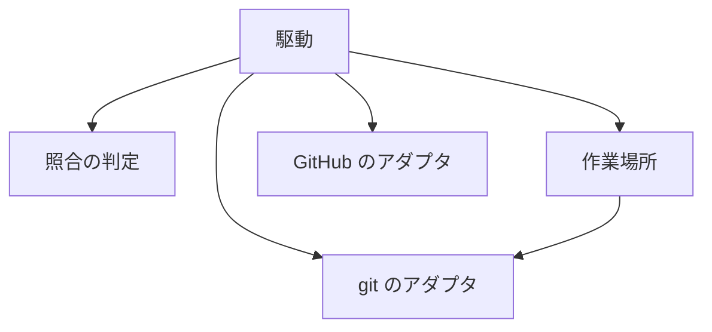
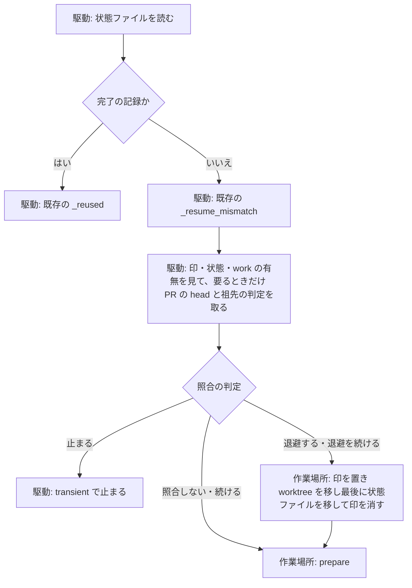

# cross-refactoring: 中断した後に PR の head が進んでも、今の head から作り直して続けられる（#3483）

## 目的

- **今どうなっているか**: cross-refactoring を途中で止め、対象の Pull Request の head が進んでから同じコマンドを打ち直す。すると、止める前の head で作った作業場所と状態ファイルをそのまま続ける。古いコードに対して提案と実装を進める。今の ndf ではスプリント PR #3480 の検査で、最後の push が non-fast-forward で断られて止まり、15〜20 分と token を使った。ndf-next の cross-refactoring も、未完了の状態を続けるときに `work` の HEAD と PR の head を比べない
- **誰に効くか**: 検査のプランを流し直す conductor と、cross-refactoring を単独で打ち直す利用者
- **変えると何が成り立つか**: 未完了の状態を続ける前に、`work` の起点と PR の今の head を比べる。古い起点なら、古い作業場所と状態ファイルを消さずに退避し、空の状態で今の head から作業場所を作り直す。手での退避が要らなくなり、古い起点を理由に push が断られなくなる

## 適用範囲

- **働く範囲**: ndf-next の cross-refactoring の駆動（`plugins/ndf-next/src/ndf/domains/crossrefactor/`）。利用先のリポジトリで打つ `ndf refactor run` でも働く
- **働かない範囲**: 今の ndf（`plugins/ndf/`）は変えない。#1142 の作り直し（ndf-next）へ注力し、11.0.0 で入れ替える方針のためである（要求の「含まない」）。今の ndf での回避は、古いレビュー worktree と耐久の記録を手で退けてから打ち直すこと
- **プロジェクトごとに違うもの**: 無し（PR の head と `work` の HEAD だけを比べる。設定も引数も足さない）
- **当たるモード**: `standard`

## あるべき姿の根拠

| 根拠 | 種類 | 何を示すか |
| --- | --- | --- |
| #3483 の再現手順（PR #3480 の head 08ead1510 → 2561d6dd9 で、レビュー worktree が 08ead1510 のまま。2026-11-15 01:27 JST） | 実測（今の ndf） | 中断した実行を続けると、作業場所が今の head へ合わない |
| `plugins/ndf-next/src/ndf/domains/crossrefactor/workspace.py` の `_add` が、在る worktree を `worktree.resumable` で確かめて作り直さない | 実測（コードを読んだ） | ndf-next でも、未完了の状態を続けると `work` は前の head のまま続く（要求の前提 1） |
| STD1（`git merge-base --is-ancestor` の終了コード） | 外部の一次情報 | 「含む」の判定を 1 回の外部コマンドで、0・1・それ以外で分けて読める |
| STD2（`git worktree move`） | 外部の一次情報 | 登録を保ったまま worktree を移せる。lock の掛かった worktree は外してから移す |
| PRD1（GitHub の「push で古い承認を退ける」） | 外部の一次情報 | head が変わった後に、古い head への判断を使わずに取り直す形が広く使われている |

要求と受け入れ条件は #3483 の本文にある（コピーは [issue-3483-requirements.md](issue-3483-requirements.md)）。この文書は「どう作るか」だけを扱う。詳細設計（ファイル・関数の粒度）は別の文書 `issue-3483-design-detail.md` に書く。

## ドメインモデル

### コンテキスト

変更は ndf-next の cross-refactoring（用語集のコンテキスト `ndf-cross-refactoring`）の 1 つに収まる。決まる語は、作業場所（`rf<PR>`）・状態ファイル（`state.json`）・古い起点・退避した作業場所・退避の途中の印である。

### 集約

| 集約 | 持ち主（書き換えてよいもの） | 根 | エンティティ | 値オブジェクト |
| --- | --- | --- | --- | --- |
| 作業場所 | 置き場の作成・退避の移動は `workspace`（`plugins/ndf-next/src/ndf/domains/crossrefactor/workspace.py`）、状態ファイルの中身は `store`（`plugins/ndf-next/src/ndf/domains/crossrefactor/store.py`） | `<置き場>/rf<PR>` | `work`・`read/<ランタイム>`・`logs`・状態ファイル | 起点（`work` の HEAD）・退避の名前・退避の途中の印 |

照合は作業場所を読むだけで、書き換えるのは「古い起点」と判定した後の退避だけである。退避を行うのは `workspace` だけで、駆動（`drive`）は照合の判定（`resume_decide`）の答えに従って `workspace` を呼ぶ。状態ファイルの中身を書くのは既存どおり駆動（`store.save`）で、退避は状態ファイルをファイルごと移すだけで中身を書き換えない。

### 不変条件

| # | 集約 | 条件 | 破れたときの扱い |
| --- | --- | --- | --- |
| I1 | 作業場所 | 担当の CLI を起動する前に、続ける状態の `work` の HEAD は PR の今の head を含む（同じか、その子孫） | 含まなければ続けずに、退避して空の状態から始める |
| I2 | 作業場所 | 退避は消さずに移すだけで、移す前の `work`・`read/<ランタイム>`・`logs`・状態ファイルが退避した先にそろう | 移せなければ新しく始めずに止まり、移せなかった場所を出す。途中まで移せたときは退避の途中の印が残り、次の打ち直しが退避を続ける（決定 3） |
| I3 | 作業場所 | 古い起点と判定した状態ファイルは、元の置き場 `rf<PR>` に残らない | 移せなければ新しく始めずに止まる（印が残る） |
| I4 | 作業場所 | 状態ファイルに最終ゲートの記録（`final`）がある回は照合しない | — |
| I5 | 作業場所 | PR の今の head を取れないときは、作業場所と状態ファイルを変えない | 種類 `transient` で止まる |
| I6 | 作業場所 | 退避した先は、同じ PR の作業場所の片付け（`workspace.release`）が見つけて、作業の残りで外すかを決める名前に置く | 退避の途中の印がある退避した先は外さない |
| I7 | 作業場所 | 退避した先の `work` の HEAD のコミットは `git -C <退避した先>/work rev-parse HEAD` で引ける | I2 と同じ（移せなければ止まり、印が残る） |
| I8 | 作業場所 | 古い起点で作り直した後の打ち直しは、退避した状態を続けない | I3 と同じ |

### ドメインイベント

要求の番号を引き継ぐ。

| # | イベント | 発生元 | 受け手 |
| --- | --- | --- | --- |
| E1 | 実行を中断した | 利用者か上位の工程 | 状態ファイルに途中の記録が残る |
| E2 | PR の head が進んだ | GitHub | E4 の照合 |
| E3 | 同じコマンドを打ち直した | 利用者か上位の工程 | 駆動 |
| E4 | `work` の HEAD と PR の今の head を比べた | 駆動（判定は `resume_decide`） | 古い起点なら E5、そうでなければ既存の続きの経路 |
| E5 | 古い作業場所と状態ファイルを退避した | `workspace` | 結果 JSON の `items` と標準エラー |
| E6 | 今の head から作業場所を作り直し、空の状態で始めた | 駆動 | 既存の `workspace.prepare` |
| E7 | 改善項目を PR へ push した | 最終ゲート | 既存の経路 |

### 用語

| 用語 | 意味 | 用語集への反映 |
| --- | --- | --- |
| 古い起点 | 中断した cross-refactoring を続けるとき、PR の今の head が `work` の HEAD と同じでもその祖先でもないこと | 変更（要求の工程で足した意味の「書き込み用のレビュー worktree」を、作業場所の `work` へ直す） |
| 退避した作業場所 | 古い起点のために、消さずに `rf<PR>.retired-<時刻>` へ移した作業場所（`work`・`read/<ランタイム>`・`logs`）と状態ファイル。同じ PR の作業場所の片付けが、作業の残りで外すかを決める | 追加（`ndf-cross-refactoring`） |
| 退避の途中の印 | 退避を始める前に退避した先へ置き、移し終えたら消すファイル。残っていれば、前の打ち直しの退避が途中で止まったことを表す。次の打ち直しは照合をせずに退避を続ける（ファイル名は詳細設計が決める） | 追加（`ndf-cross-refactoring`） |
| 作業場所 | ndf-next の cross-refactoring が Pull Request ごとに作る置き場 `<置き場>/rf<PR>`。書き込み用の `work`・担当ごとの読み取り用 `read/<ランタイム>`・`logs`・状態ファイルを持つ | 追加（`ndf-cross-refactoring`） |
| 状態ファイル | ndf-next の cross-refactoring の実行の進みを持つ `rf<PR>/state.json`。完了の記録が無ければ、同じコマンドを打ち直すと記録のある手順を流し直さずに続ける | 追加（`ndf-cross-refactoring`） |

## 照合の規則

> 未完了の状態を続ける前に、前の退避の途中の印が残っていれば、照合をせずにその退避を続ける。印が無ければ、PR の今の head が `work` の HEAD に含まれる（`git merge-base --is-ancestor <PR の head> <work の HEAD>` が 0）かを見る。含まれなければ古い起点で、古い作業場所と状態ファイルを `rf<PR>.retired-<時刻>` へ退避し、空の状態で今の head から作業場所を作り直す。状態が残るのに `work` が無ければ、比べる起点が無いため古い起点として扱う。PR の今の head を取れなければ何も変えずに止まる。最終ゲートの記録がある回と、途中の記録が無い回は照合しない。

表は上から順に当て、最初に当たった行で決める。

| 場合 | 扱い | 受け入れ条件 |
| --- | --- | --- |
| 退避の途中の印が `rf<PR>.retired-<時刻>` に残る | 照合をせずに退避を続ける（残りの移動から。head を取らない） | 3・4 |
| 状態ファイルが空・完了の記録（`done`）を持つ | 照合しない（既存の経路。完了の比較は `_reused`） | — |
| 状態ファイルに最終ゲートの記録（`final`）がある | 照合しない | 6 |
| 状態ファイルはあるが `work` が無い | 古い起点として扱い、残り（`read/<ランタイム>`・`logs`・状態ファイル）を退避する。head を取らない | 2・3・4 |
| PR の今の head を取れない | 何も変えずに種類 `transient` で止まる | 7 |
| `--is-ancestor` が 0 | 続ける | 5 |
| `--is-ancestor` が 0 以外 | 退避して、空の状態で今の head から始める | 2・3・4 |

## 外部の調査

| 種類 | 調べるか | 理由 |
| --- | --- | --- |
| 標準・仕様 | 調べる | 「含む」の判定と worktree の移動は git の仕様で決まる。終了コードと lock の扱いを一次情報で確かめる |
| 主要な製品 | 調べる | head が変わった後に、古い head への判断を使い続けるか取り直すかの解き方を比べる |
| ライブラリとサービス | 調べない | 依存を足さない。PR の head は既存の GitHub のアダプタで、worktree の操作は既存の git のアダプタで読める |

### 標準・仕様

| # | 標準・仕様 | 何を定めているか | 設計への反映 | 出典 |
| --- | --- | --- | --- | --- |
| STD1 | `git merge-base --is-ancestor` | 第 1 引数が第 2 引数の祖先なら 0、そうでなければ 1、誤りは 1 以外の非ゼロ | 0 だけを「含む」と読み、1 と誤り（PR の head が手元に無い 128 を含む）を古い起点と読む（決定 2） | https://git-scm.com/docs/git-merge-base （2026-11-14）。手元の git 2.53.0 で 0・1・128 を確かめた |
| STD2 | `git worktree move` | 登録を保ったまま worktree を移す。lock の掛かった worktree は `--force` を 2 回渡さないと移さない。main worktree と submodule を含む worktree は移せない | 移動先の親を先に作り、NDF の lock は外してから移して掛け直す（`--force` を使わない）（決定 4） | https://git-scm.com/docs/git-worktree （2026-11-14）。手元の git 2.53.0 で、親が無いと 128、lock 付きは 128、外せば 0 を確かめた |

### 主要な製品

| # | 製品 | どう解いているか | 設計への反映 | 出典 |
| --- | --- | --- | --- | --- |
| PRD1 | GitHub の保護ブランチ「Dismiss stale pull request approvals when new commits are pushed」 | 承認した時点の差分を記録し、新しい push・base へのマージで差分が変わると承認を古いものとして退け、取り直させる | head が変わったら古い head への判断（提案・実装）を使わずに取り直す。退けた承認が履歴に残るのと同じく、古い作業場所は消さずに退避する | https://docs.github.com/en/repositories/configuring-branches-and-merges-in-your-repository/managing-protected-branches/about-protected-branches （2026-11-14） |

### 確かめられなかったこと

無し。

調べた量: 候補 3 件・取得の試み 3 回。

## 機能一覧

| # | 機能 | 誰が使うか |
| --- | --- | --- |
| F1 | 未完了の状態を続ける前に、起点と PR の今の head を比べる | cross-refactoring を打ち直す conductor と利用者 |
| F2 | 古い起点なら、古い作業場所と状態ファイルを退避し、退避した先を知らせる | 同上。退避した先から古いコミットを取り出す人 |
| F3 | 空の状態で今の head から作業場所を作り直して始める | 同上 |
| F4 | 退避した作業場所を、同じ PR の作業場所の片付けの対象にする | 実行の終わりの片付けと `ndf refactor release` |

## 構成要素

| 要素 | 責務 | 変更 |
| --- | --- | --- |
| 駆動（`plugins/ndf-next/src/ndf/domains/crossrefactor/drive.py` の `_open`・`drive`） | 未完了の状態を続ける前に照合の事実を集めて判定へ渡し、答えに従って続ける・止まる・退避するを行う。PR の今の head は既存の GitHub のアダプタ（`Ports.github` の `pull(<PR>).head_sha`）で読む（決定 2）。退避の 1 件を `Finish` の `items` の末尾へ足し、標準エラーへ 1 行出す | 変える |
| 照合の判定（`plugins/ndf-next/src/ndf/domains/crossrefactor/resume_decide.py`） | 判定だけを持つ純粋な関数（入力: 退避の途中の印の有無・状態の種類・`work` の有無・PR の今の head（取れなければ無し）・祖先の判定の結果。出力: 照合しない / 続ける / 止まる / 退避する / 退避を続ける）。外部コマンドを打たず、終了コードを持たない（決定 1） | 新設 |
| 作業場所（`plugins/ndf-next/src/ndf/domains/crossrefactor/workspace.py`） | 退避の途中の印を置き、作業場所の worktree の NDF の lock を外して移し、lock を掛け直し、最後に状態ファイルを移して印を消す。`release` は、同じ PR の退避した先（印の無いもの）も作業の残りで判定して外す（決定 4）。冒頭の説明に退避した先を足す | 変える |

cross-review の駆動と、今の ndf（`plugins/ndf/`）は変えない。

## 入出力の契約

足すのは次の 2 つの出力だけである。次のものは変えない。

- `ndf refactor run` の引数と、結果 JSON の形
- 終了コードの表（`plugins/ndf-next/contracts/facts/exit-codes.json`）
- 止まった理由の表（`plugins/ndf-next/contracts/causes.json`）

| 出力 | 形 | どこへ出すか |
| --- | --- | --- |
| 標準エラー（1 行） | `↻ 古い起点のため退避し、今の head から始め直す: <退避した先>（作業の起点 <7 字>・PR の head <7 字>）` | 退避した直後に 1 度 |
| 結果 JSON の `items` の末尾（1 件） | `{"kind": "retired", "path": "<退避した先>", "work_head": "<作業の起点>", "pr_head": "<PR の head>", "reason": "古い起点のため退避した（作業の起点 <7 字>・PR の head <7 字>）"}` | `Finish.items` の末尾。完了・止まりのどちらでも足す（決定 6） |

head を取れないときの結果:

| `status` | 止まった理由の種類 | 終了コード | `summary` |
| --- | --- | --- | --- |
| `stopped` | `transient` | `infra_wait`（75） | `PR #<番号> の今の head を取れないため、未完了の状態を続けずに止まった（作業場所と状態ファイルは変えていない）` |

退避が失敗したときは、種類 `refused`（終了コード `failed` の 1）で止まり、`summary` に移せなかったパスと退避した先を書く。

退避の名前と中の配置:

| 退避した先 | 中の配置 |
| --- | --- |
| `<置き場>/rf<PR>.retired-<YYYYmmddHHMMSS>` | 元の `rf<PR>` の中身（`work`・`read/<ランタイム>`・`logs`・`state.json`）をそのまま。worktree には NDF の lock を掛け直す |

## 処理の流れ

状態ファイル（`rf<PR>/state.json`）が実行の進みを持つ。照合は `_open` の、完了の記録を返すかの判定（`_reused`）と引数の照合（`_resume_mismatch`）の後、作業場所の用意（`workspace.prepare`）の前に行う。`prepare` は在る worktree を作り直さないため、後で照合すると古い `work` のまま用意が済む。

駆動は PR の head を取る前に、退避の途中の印の有無と、状態の種類・`work` の有無を見る。次のどれかに当たれば、PR の head を取らずに照合の判定へ渡す。

| 場合 | 判定の答え |
| --- | --- |
| 退避の途中の印が残る | 退避を続ける |
| 状態が空か完了 | 照合しない |
| 最終ゲートの記録がある | 照合しない |
| 状態ファイルはあるが `work` が無い | 退避する |

PR の head は、既存の GitHub のアダプタの `pull(<PR>).head_sha`（REST の読み取り 1 回）で取る。続けて `git merge-base --is-ancestor` を 1 回打つ。手元に無い head は古い起点と読む（決定 2）。`workspace.prepare` の `fetch_head` は既存のまま 1 回で、照合のための fetch は足さない。

退避した後は空の状態で `prepare` へ進み、`prepare` が今の head から `work` と `read/<ランタイム>` を作る。

## 非機能の実現方式

| 大項目 | 要求の条件 | 実現方式 | 確かめ方 |
| --- | --- | --- | --- |
| 可用性 | 照合で止まるのは head が取れないときだけ。古い起点を理由に検査のプランを止めない | 古い起点は退避して空の状態から続け、終了コードを変えない。止まるのは head を取れないときと、退避が失敗したとき（要求の E5 の失敗。I2・I3。何も失わずに止まる）。退避の失敗で止まった後は、次の打ち直しが退避の途中の印から続けるため、人の手での退避が要らない（決定 3） | 駆動のテストで、古い起点の打ち直しが `ok` か既存の止まりで終わり、照合を理由に止まらないことを見る。退避を途中で失敗させた後の打ち直しが、人の操作なしに空の状態へ進むことを見る |
| 性能・拡張性 | 照合で増える外部への問い合わせは、未完了の状態を続ける回につき GitHub の PR の読み取り 1 回と `git merge-base` 1 回まで | GitHub の REST の PR の読み取り 1 回と `merge-base --is-ancestor` 1 回だけを打ち、PR の head を fetch しない（手元に無い head は 0 以外になり、古い起点と読める。決定 2） | 駆動のテストで、偽の GitHub のアダプタの読み取りと `git merge-base` の呼ばれた回数を数える |
| 運用・保守性 | 退避した作業場所は、同じ PR の作業場所の片付けの対象になる名前に置く | 作業場所の片付け（`workspace.release`）に同じ PR の `rf<PR>.retired-<時刻>` を足し、作業の残りで外すかを決める（決定 4） | 作業場所のテストで、`release` が同じ PR の退避した先を見つけ、作業の残らないものを外し、残るものを理由つきで残すことを見る |

## 決定の記録

### 決定 1: 照合の分岐をテストで縛れるようにするため、判定を純粋な関数 `resume_decide` に置き、事実の取得と退避を殻に置く

ndf-next の cross-refactoring は、判定と外との接続を分けている。判定は外部コマンドを打たない `*_decide.py`（`finished_decide`・`launch_decide` ほか）に、外との接続は `drive.py`・`workspace.py` に置く。照合の規則は 7 つの場合を上から当てる表で、分岐の取り違えがそのまま古い起点の続きか、作業の要らない退避になる。判定を純粋な関数に置けば、表の 7 行を git も GitHub も使わずに単体のテストで縛れる。

駆動の中に分岐を直に書く形は採らない。表の行ごとのテストに一時の git リポジトリと偽の GitHub が要り、分岐の数だけ組み立てが増える。既存の引数の照合（`_resume_mismatch`）に足す形も採らない。引数の比べは外部コマンドを打たないが、この照合は PR の head と祖先の判定を取るため、止まる理由の種類も違う（`invalid` と `transient`）。

- 作り方: 自前で作る・標準に倣う
- 比べた候補: STD1 / PRD1

根拠: Value 11 / Value 9（MVV 版 7）

### 決定 2: 外部への問い合わせを増やさないため、PR の head を GitHub の REST で 1 回読み、fetch せずに `--is-ancestor` の 0 だけを「含む」と読む

PR の今の head は、既存の GitHub のアダプタで 1 回読む（要求の前提 4）。アダプタは `plugins/ndf-next/src/ndf/adapters/github.py` の `GitHub.pull` で、REST で PR を読み、`head_sha` を持つ。その commit が手元に無いことがあるが、手元に無い commit は `work` の HEAD の祖先になりえないため、`--is-ancestor` が 128 を返しても古い起点と読んでよい。1 も 128 以外の誤りも同じく古い起点と読む。誤った判定で退避しても、退避は消さずに移すだけで、続く `workspace.prepare` が `git fetch` を打ち、取得の失敗はそこで既存の経路になる。逆に誤りを「含む」と読むと、古い起点のまま続く今の不具合が残る。

既存の `git.Git.is_ancestor` は終了コード 1 以外を `GitError` にするため使わず、`Git.attempt` で終了コードを読む。

PR の head を先に fetch してから比べる形は採らない。外部への問い合わせが 1 つ増え、非機能の条件（GitHub の PR の読み取り 1 回と `git merge-base` 1 回まで）を超える。`worktree.fetch_head`（`git fetch` と `rev-parse`）で head を取り、`prepare` の取得と兼ねる形も採らない。照合の前に `prepare` が `work` の置き場を触り（孤児の片付け・worktree の追加）、I5（head を取れないときに何も変えない）を守る順序が崩れる。

- 作り方: 標準に倣う
- 比べた候補: STD1

根拠: Value 2 / Value 7 / Value 9（MVV 版 7）

### 決定 3: 途中で失敗しても古い起点のまま続かず、人の手を要らずにやり直せるため、退避の途中の印を先に置き、状態ファイルを最後に移す

退避は複数の worktree とファイルを 1 つずつ移すため、途中で失敗しうる。途中で止まった形を、次の打ち直しが照合の結果から推し量ると、`work` だけ移った形で照合を飛ばして古い状態を続ける。人の手での退避が要り、要求の「影響」にある回避の手順が残る。

そこで、退避した先のディレクトリを作って退避の途中の印を置いてから移し、移し終えたら印を消す。次の打ち直しは、照合より先に同じ PR の退避した先に印が残るかを見て、残れば退避を続ける（「照合の規則」の表の 1 行目）。続ける手順は「`rf<PR>` に残るものを移す（状態ファイルは最後）→ 印を消す」で、何度打っても同じ結果になる。印を置く前の失敗は何も変えていないため、次の打ち直しが同じ照合からやり直す。

状態ファイルを最後に移すことが、古い状態を終わらせることに当たる。印を消した後に `work` だけが無く状態ファイルが残る形は、照合の規則の「状態ファイルはあるが `work` が無い」の行が古い起点として退避するため、ここでも古い状態は続かない。

印の残る退避した先は、`release` が外さない（I6）。

根拠: Value 1 / Value 7 / 共通原則の上位の原則（MVV 版 7）

### 決定 4: 実行の終わりの片付けで退避した先が残り続けないため、退避の名前を `rf<PR>.retired-<時刻>` にし、同じ PR の作業場所の片付けへ足す

ndf-next には、退避した先を名前で見つける既存の後片付けが無い。既存の 2 つの後片付けは、どちらも退避した先を外さない。cross-refactoring の worktree は detached で、NDF の lock が掛かるためである。

| 既存の後片付け | 外す対象 | 出典 |
| --- | --- | --- |
| 孤児の lock の片付け（`worktree.sweep_orphans`） | ディレクトリが無い worktree だけ | `plugins/ndf-next/src/ndf/core/converge/worktree.py` の `orphans` |
| `/ndf:merged` | PR のブランチを checkout した worktree だけ。locked の worktree は動かさない | `plugins/ndf-next/src/ndf/domains/worktree/merged.py` の docstring の 3 |

そこで、同じ PR の `rf<PR>.retired-<時刻>`（印の無いもの）を、作業場所の片付け（`workspace.release`）の対象に足す。`workspace.release` は、実行の終わりと `ndf refactor release` が打つ既存の関数である。外すのは、`work` に PR の head へ載っていない自分のコミット（`worktree.own_commits`）が無く、未コミットの変更も無いときだけである。それ以外は理由つきで残す（要求の前提 2: 人が取り出す）。外す手段は既存の `worktree.release`（NDF の lock だけを外す）で、利用者の lock は外さない。`<時刻>` は地方時の `YYYYmmddHHMMSS` にする。

`rf<PR>` の中に `work.retired-<時刻>` として置く形は採らない。新しい実行が同じ `rf<PR>` に worktree を作り、片付けが `rf<PR>` を 1 つの単位として外すため、退避した先と新しい実行の作業の区別がつかない。別の PR の退避した先まで全 PR を見て片付ける形も採らない。作業場所は GitHub を読まない層で、PR の状態を読むには層をまたぐ。別の PR の退避した先は、その PR で cross-refactoring を打ったときの片付けで外れる（要求の「含まない」）。

移すのは `git worktree move` で、登録を保つ（STD2）。移動先の親を先に作る。NDF の lock を外してから移し、同じ理由の lock を掛け直す（`--force` を 2 回渡さない）。

- 作り方: 自前で作る・標準に倣う
- 比べた候補: STD2 / PRD1

根拠: Value 6（MVV 版 7）

### 決定 5: 最終ゲートの記録がある回を照合から外すため、状態ファイルの `final` の有無で見分ける

最終ゲートは送る前に `work` を origin の先頭へ合わせ、送っていない自分のコミットだけを載せ直す（`final_gate.send` の `worktree.sync_worktree`）。止まった後に PR の head が進んでいても、続ける最終ゲートが自分で今の head へ合わせるため、照合は要らない（要求の前提 3）。最終ゲートは止まりでも通過でも状態ファイルの `final` に記録を書く（`drive._final`）ため、`final` の有無で見分ける。

状態ファイルの `phase` で見分ける形は採らない。`phase` は担当を起動するたびに書く進みの印で、最終ゲート修正（`final-fix`）の担当を起動する前の中断と、最終ゲートに入る前の中断を分けない。

根拠: Value 8（MVV 版 7）

### 決定 6: 退避した先を結果 JSON から機械で読めるようにするため、`items` の末尾へ種類 `retired` の 1 件を足す

`items` の形は結果の契約（`plugins/ndf-next/contracts/schemas/result.schema.json`）で種類ごとの欄を持つ（`item`・`final` ほか）。退避した先のパス・作業の起点・PR の head をそれぞれの欄に置けば、呼ぶ側（検査のプラン）が `reason` の文を解かずに退避した先を引ける。

既存の `ndf refactor release` の `{"kind": "kept", "reason": …}` に揃える形は採らない。退避した先のパスが文の中に埋まり、機械で読めない。今の ndf の開始の片付けの形（`run-dir`）に揃える形も採らない。今の ndf との後方互換は求めない（要求の「含まない」）。

退避の 1 件は完了の記録（`done` の `result`）に入れない。完了の記録を返す打ち直しで、退避していない回に退避の 1 件が出るためである。

根拠: Value 3 / Value 14（MVV 版 7）

### 決定 7: head を取れない止まりを既存の語彙で読ませるため、種類 `transient` で止める

取得の一時的な失敗（5xx・接続の切断など）に当たる種類は、止まった理由の表（`plugins/ndf-next/contracts/causes.json`）の `transient` である。その終了コードは `infra_wait`（75。`plugins/ndf-next/contracts/facts/exit-codes.json`）である。打ち直せば通りうる止まりで、行き先も既存の再試行（`cause.transient`）になる。新しい種類を足さない。

種類 `precondition` は採らない。前提（宣言・認証・対象のファイル）の欠けで人へ戻す種類で、一時的な取得の失敗に当てると再試行されずに人を待つ。

根拠: Value 3 / Value 4（MVV 版 7）

## テスト設計

テストの置き場は `plugins/ndf-next/tests/domains/crossrefactor/` である。要求の検証手段のとおり、`plugins/ndf-next` で `uv run --frozen pytest tests/domains/crossrefactor -q` で集まる。

| 受け入れ条件・不変条件 | どの振る舞いで縛るか | どう壊したら落ちるべきか |
| --- | --- | --- |
| 1・I1 | 未完了の状態を打ち直すと、作業場所の用意と担当の CLI の起動より前に PR の head と `work` の HEAD を比べる | 照合を `prepare` の後へ動かす・照合を外すと、担当の起動が先に記録されて落ちる |
| 2・8 | 中断 → PR の head を進める → 打ち直すと、新しい `work` の HEAD が PR の今の head と一致する。修正の前は一致せずに落ちる | 照合を外す・`--is-ancestor` の引数を逆にすると、`work` の HEAD が古いままで落ちる |
| 3・I2 | 退避した先が標準エラーに 1 行、結果 JSON の `items` に種類 `retired` の 1 件出て、退避した先に移す前の `work`・`read/<ランタイム>`・`logs`・状態ファイルがそろう | 移す処理を消す処理に置き換える・`logs` を移さないと、退避した先の中身がそろわずに落ちる。`items` へ足さないと落ちる |
| 3・I7 | `git -C <退避した先>/work rev-parse HEAD` が古い `work` の HEAD を返す | `git worktree move` を消す・名前を変える処理に置き換えると、退避した先で `rev-parse` が失敗して落ちる |
| 4・I3 | 古い起点で作り直した後、元の置き場に古い状態ファイルが無い | 状態ファイルを移さないと、元の置き場に古い状態ファイルが残って落ちる |
| 4・I8 | 古い起点で作り直した後にもう一度打っても、退避した状態の項目を続けない | 状態ファイルを移さないと、2 回目の打ち直しで古い項目が続いて落ちる |
| 5 | PR の head が `work` の HEAD と同じ・その祖先のとき、作業場所と状態ファイルを動かさずに古い状態を続ける | 判定を「同じときだけ」に狭めると、自分で push した後の打ち直しで退避して落ちる |
| 6・I4 | 状態ファイルに `final` がある回は、PR の head が進んでいても退避しない | `final` の見分けを外すと、最終ゲートの続きで退避して落ちる |
| 7・I5 | head を取れないと、`stopped`・種類 `transient`・終了コード 75・`summary` に head を取れなかったことが出て、作業場所と状態ファイルが変わらない | head を取れないときに「含む」と読む・退避へ進むと落ちる |
| 照合の規則 | 照合の判定（`resume_decide`）が、「照合の規則」の表の 7 つの場合で表と同じ答えを返す | 判定の分岐を 1 つ入れ替えると落ちる |
| I2・I1（退避の途中の失敗） | `work` を移した後で状態ファイルの移動を失敗させて止め、打ち直すと、古い状態を続けずに退避を続ける。印を消した形（状態ファイルはあるが `work` が無い）でも、古い起点として退避する | 「`work` が無い回は照合しない」に戻すと、今の head の `work` の上で古い状態を続けて落ちる |
| I6 | 作業場所の片付け（`workspace.release`）が同じ PR の `rf<PR>.retired-<時刻>` を見つけ、自分のコミットも未コミットの変更も無ければ外し、自分のコミットが残れば理由つきで残す。印の残る退避した先は外さない | `release` に退避した先を足さないと、退避した先が残ったままで落ちる |
| 非機能（性能） | 照合の 1 回で、GitHub のアダプタの PR の読み取りと `git merge-base` が 1 回ずつだけ呼ばれ、`git fetch` の回数は修正の前と同じ | 照合の前に fetch を足すと、呼ばれた回数で落ちる |
| 9 | 既存の ndf-next の cross-refactoring のテストが通る | — |

## 設計の結果

| 課題 | 扱い | 取り込み先 | 触るファイル |
| --- | --- | --- | --- |
| #3483 | 実装する | — | `plugins/ndf-next/src/ndf/domains/crossrefactor/drive.py`、`plugins/ndf-next/src/ndf/domains/crossrefactor/resume_decide.py`、`plugins/ndf-next/src/ndf/domains/crossrefactor/workspace.py`、`plugins/ndf-next/tests/domains/crossrefactor/test_drive.py`、`plugins/ndf-next/tests/domains/crossrefactor/test_resume_decide.py`、`plugins/ndf-next/tests/domains/crossrefactor/test_workspace.py`（新設）、`docs/glossary/glossary.json`、`docs/glossary.md` |

## 人へ残す判断

無し

## 未確認のまま残ること

| 項目 | 内容 |
| --- | --- |
| 前提 1 の再現 | 未完了の状態を続けると `work` が今の head へ合わないことは、コードを読んだ範囲で成り立つ。実装の工程で、失敗するテスト（テスト設計の 2・8）を先に書いて確かめる |
| 実機での push | 退避の後の新しい実行で push が non-fast-forward で断られないことは、ndf-next の入れ替えの後のリリース後テストで、再現手順の形をスプリント PR で打って確かめる |
