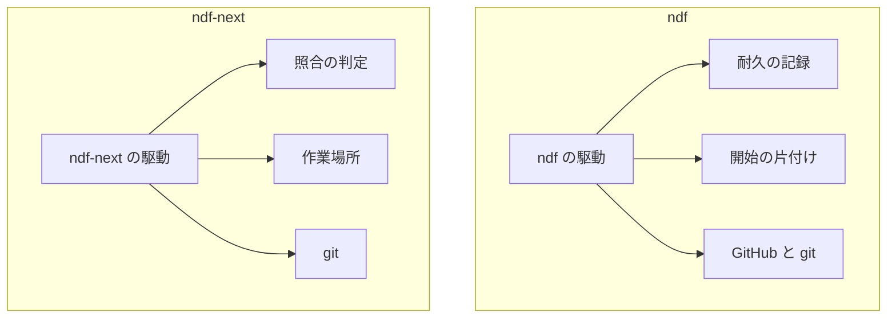
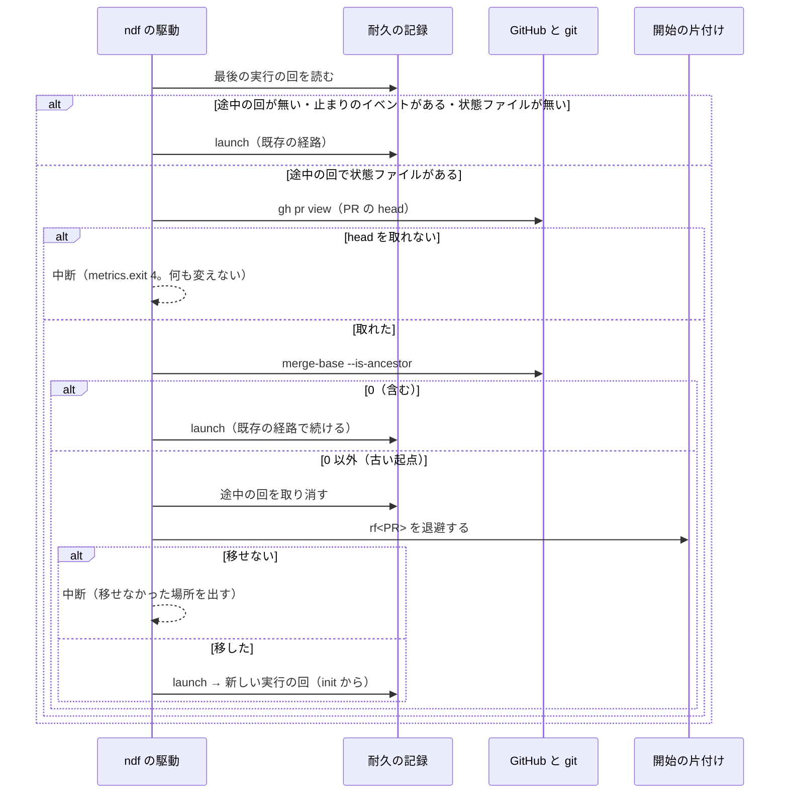
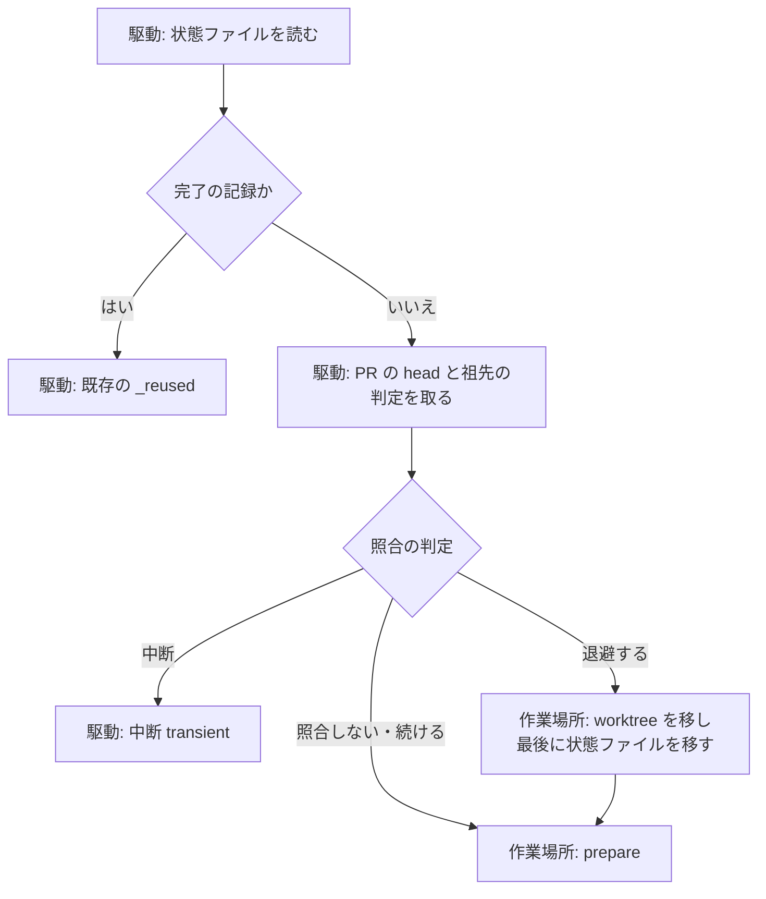

# cross-refactoring: 中断した後に PR の head が進んでも、今の head から作り直して続けられる（#3483）

## 目的

- **今どうなっているか**: cross-refactoring を途中で止め、対象の Pull Request の head が進んでから同じコマンドを打ち直すと、止める前の head で作ったレビュー worktree と耐久の記録をそのまま続ける。古いコードに対して提案と実装を進め、最後の push が non-fast-forward で断られて止まる（スプリント PR #3480 の検査で 15〜20 分と token を使った）
- **誰に効くか**: 検査のプランを流し直す conductor と、cross-refactoring を単独で打ち直す利用者
- **変えると何が成り立つか**: 中断した実行を続ける前に、レビュー worktree の起点と PR の今の head を比べる。古い起点なら、古いレビュー worktree を消さずに退避し、古い実行の回を終わらせ、今の head から新しい実行の回を始める。手での退避が要らなくなり、push が古い起点を理由に断られなくなる

## 適用範囲

- **働く範囲**: ndf と ndf-next の cross-refactoring の駆動。利用先のリポジトリで打つ cross-refactoring でも働く
- **プロジェクトごとに違うもの**: 無し（PR の head とレビュー worktree の HEAD だけを比べる。設定も引数も足さない）
- **当たるモード**: `standard`

## あるべき姿の根拠

| 根拠 | 種類 | 何を示すか |
| --- | --- | --- |
| #3483 の再現手順（PR #3480 の head 08ead1510 → 2561d6dd9 で、レビュー worktree が 08ead1510 のまま。2026-11-15 01:27 JST） | 実測 | 中断した実行を続けると、init の中の同期（`_sync_work_worktree`）が流れない |
| STD1（`git merge-base --is-ancestor` の終了コード） | 外部の一次情報 | 「含む」の判定を 1 回の外部コマンドで、0・1・それ以外で分けて読める |
| STD2（`git worktree move`） | 外部の一次情報 | 登録を保ったまま worktree を移せる。lock の掛かった worktree は外してから移す |
| LIB1（DBOS の回復は `PENDING` の耐久ワークフローだけを拾う） | 外部の一次情報 | 取り消した実行の回は、次の起動で回復しない |
| PRD1（GitHub の「push で古い承認を退ける」） | 外部の一次情報 | head が変わった後に、古い head への判断を使わずに取り直す形が広く使われている |
| `plugins/ndf/skills/cross-review/scripts/review_lib/commands/start_round.py:114` がラウンドの開始ごとに `_sync_worktree` を打つ | 実測（コードの検索） | cross-review の駆動には同じ照合が要らない（下の決定 1） |

要求と受け入れ条件は #3483 の本文にある（コピーは [issue-3483-requirements.md](issue-3483-requirements.md)）。この文書は「どう作るか」だけを扱う。詳細設計（ファイル・関数の粒度）は別の文書 `issue-3483-design-detail.md` に書く。

## ドメインモデル

### コンテキスト

変更は 2 つのコンテキストにまたがる。ndf と ndf-next は別のパッケージで、互いを import しない。

| コンテキスト | 何の語が 1 つの意味に決まるか |
| --- | --- |
| ndf の cross-refactoring（`ndf-cross-refactoring`） | レビュー worktree・耐久の記録・実行の回・古い起点・退避したレビュー worktree・開始の片付け |
| ndf-next の cross-refactoring | 作業場所（`rf<PR>`）・状態ファイル（`state.json`）・NDF の lock |

**関係: 公表された言語。** 2 つは「照合の規則」と「退避の名前」だけを同じ文で持ち（非機能の条件「照合の規則は ndf と ndf-next で同じ文で説明できる」）、実装は共有しない。規則の文はこの文書の「照合の規則」の節が正本で、両方の確定仕様がこの文を写す。

### 集約

| 集約 | 持ち主（書き換えてよいもの） | 根 | エンティティ | 値オブジェクト |
| --- | --- | --- | --- | --- |
| 実行の回（ndf） | cross-refactoring の駆動（`drive.py` の `main` の側） | 耐久ワークフロー `refactor-<鍵>-<回>` | — | 状態（`PENDING`・`CANCELLED` ほか）・止まりのイベント `pause` |
| レビュー worktree の置き場（ndf） | 開始の片付け（`run_state`） | `<置き場>/<slug>/rf<PR>` | `work`・担当ごとの読み取り用 | 起点（`work` の HEAD）・退避の名前 |
| 作業場所（ndf-next） | `workspace` | `<置き場>/rf<PR>` | `work`・`read/<ランタイム>`・状態ファイル | 起点（`work` の HEAD）・退避の名前 |

照合は集約を読むだけで、書き換えるのは「古い起点」と判定した後の 2 つ（実行の回を終わらせる・置き場を退避する）である。ndf ではこの 2 つが別の集約に当たるため、持ち主を分け、駆動が順に呼ぶ。

### 不変条件

| # | 集約 | 条件 | 破れたときの扱い |
| --- | --- | --- | --- |
| I1 | 実行の回・作業場所 | 担当の CLI を起動する前に、続ける実行の回の `work` の HEAD は PR の今の head を含む（同じか、その子孫） | 含まなければ続けずに、退避して新しい実行の回を始める |
| I2 | レビュー worktree の置き場・作業場所 | 退避は消さずに移すだけで、`work` の HEAD のコミットは退避した先から `git -C <退避した先> rev-parse HEAD` で引ける | 移せなければ新しい実行の回を始めずに止まり、移せなかった場所を出す |
| I3 | 実行の回 | 古い起点と判定した実行の回は、終わった状態（ndf は `CANCELLED`、ndf-next は状態ファイルが置き場に無い）になり、次の打ち直しで続かない | 終わらせられなければ新しい実行の回を始めずに止まる |
| I4 | 実行の回 | 最終ゲートの止まり（終了コード 23）から続ける実行の回は照合しない | — |
| I5 | 実行の回・作業場所 | PR の今の head を取れないときは、レビュー worktree・状態ファイル・耐久の記録を変えない | 中断（`stopped`）で終える |
| I6 | レビュー worktree の置き場 | 退避した先は、既存の後片付け（開始の片付けと `/ndf:merged`）が持ち主・PR の状態・作業の残りで判定する名前に置く | — |

### ドメインイベント

要求の番号を引き継ぐ。E5 と E6 の順は ndf だけ入れ替える（決定 4）。

| # | イベント | 発生元 | 受け手 |
| --- | --- | --- | --- |
| E1 | 実行を中断した | 利用者か上位の工程 | 耐久の記録（ndf）・状態ファイル（ndf-next）に途中の実行の回が残る |
| E2 | PR の head が進んだ | GitHub | E4 の照合 |
| E3 | 同じコマンドを打ち直した | 利用者か上位の工程 | 駆動 |
| E4 | レビュー worktree の HEAD と PR の今の head を比べた | 駆動 | 古い起点なら E6・E5、そうでなければ既存の続きの経路 |
| E5 | 古いレビュー worktree と状態を退避した | ndf は `run_state`、ndf-next は `workspace` | 結果 JSON の `items` と標準エラー |
| E6 | 古い実行の回を終わらせた | ndf は耐久の記録（取り消し）、ndf-next は E5 の状態ファイルの移動 | 次の打ち直しの実行の回の選び方（`durable.resolve`） |
| E7 | 今の head から新しい実行の回を始めた | 駆動 | 既存の init |
| E8 | 改善項目を PR へ push した | 最終ゲート | 既存の経路 |

### 用語

| 用語 | 意味 | 用語集への反映 |
| --- | --- | --- |
| 古い起点 | 中断した cross-refactoring を続けるとき、PR の今の head が `work` の HEAD と同じでもその祖先でもないこと | 無し（要求の工程で追加済み） |
| 退避したレビュー worktree | 古い起点のために、消さずに `rf<PR>.retired-<時刻>` へ移したレビュー worktree と状態ファイル。開始の片付けと `/ndf:merged` が、持ち主・PR の状態・作業の残りで外すかを決める | 追加（`ndf-cross-refactoring`） |

## 外部の調査

| 種類 | 調べるか | 理由 |
| --- | --- | --- |
| 標準・仕様 | 調べる | 「含む」の判定と worktree の移動は git の仕様で決まる。終了コードと lock の扱いを一次情報で確かめる |
| 主要な製品 | 調べる | head が変わった後に、古い head への判断を使い続けるか取り直すかの解き方を比べる |
| ライブラリとサービス | 調べる | 実行の回を終わらせる手段は、既に依存している DBOS が持つかを確かめる |

### 標準・仕様

| # | 標準・仕様 | 何を定めているか | 設計への反映 | 出典 |
| --- | --- | --- | --- | --- |
| STD1 | `git merge-base --is-ancestor` | 第 1 引数が第 2 引数の祖先なら 0、そうでなければ 1、誤りは 1 以外の非ゼロ | 0 だけを「含む」と読み、1 と誤り（PR の head が手元に無い 128 を含む）を古い起点と読む（決定 2） | https://git-scm.com/docs/git-merge-base （2026-11-14）。手元の git 2.53.0 で 0・1・128 を確かめた |
| STD2 | `git worktree move` | 登録を保ったまま worktree を移す。lock の掛かった worktree は `--force` を 2 回渡さないと移さない。main worktree と submodule を含む worktree は移せない | 移動先の親を先に作り、lock は外してから移して掛け直す（`--force` を使わない）（決定 5） | https://git-scm.com/docs/git-worktree （2026-11-14）。手元の git 2.53.0 で、親が無いと 128、lock 付きは 128、外せば 0 を確かめた |

### 主要な製品

| # | 製品 | どう解いているか | 設計への反映 | 出典 |
| --- | --- | --- | --- | --- |
| PRD1 | GitHub の保護ブランチ「Dismiss stale pull request approvals when new commits are pushed」 | 承認した時点の差分を記録し、新しい push・base へのマージで差分が変わると承認を古いものとして退け、取り直させる | head が変わったら古い head への判断（提案・実装）を使わずに取り直す。退けた承認が履歴に残るのと同じく、古いレビュー worktree は消さずに退避する | https://docs.github.com/en/repositories/configuring-branches-and-merges-in-your-repository/managing-protected-branches/about-protected-branches （2026-11-14） |

### ライブラリとサービス

| # | 候補 | 版 | ライセンス | 最後のリリースの日付 | 終了のアナウンス | 要件を満たすか | 出典 |
| --- | --- | --- | --- | --- | --- | --- | --- |
| LIB1 | DBOS Transact（Python）の `DBOSClient.cancel_workflow`（既存の依存。`durable.cancel_others` が使う） | 3.1.0 | MIT | 未確認 | 無し（確かめた範囲） | 満たす。取り消すと状態が `CANCELLED` になり、回復は `PENDING` だけを拾う | `.venv/lib/python3.14/site-packages/dbos/_sys_db.py` の `get_pending_workflows`（2026-11-14）・https://docs.dbos.dev/python/reference/client （2026-11-14） |

### 確かめられなかったこと

| 対象 | 試した手段 | 結果と理由 |
| --- | --- | --- |
| DBOS 3.1.0 の最後のリリースの日付 | 試していない | 既存の依存で版を変えないため、この設計の判断に使わない |
| DBOS の文書が「取り消した耐久ワークフローを回復しない」と明記しているか | https://docs.dbos.dev/python/reference/client | 取得できたが、該当の記述を確かめられなかった。代わりに手元のソース（LIB1 の出典）で回復の条件を確かめた |

調べた量: 候補 4 件・取得の試み 6 回。

## 照合の規則

ndf と ndf-next が同じ文で持つ規則である（関係「公表された言語」の正本）。

> 中断した実行を続ける前に、PR の今の head が `work` の HEAD に含まれる（`git merge-base --is-ancestor <PR の head> <work の HEAD>` が 0）かを見る。含まれなければ古い起点で、古いレビュー worktree と状態を `rf<PR>.retired-<時刻>` へ退避し、古い実行の回を終わらせ、今の head から新しい実行の回を始める。PR の今の head を取れなければ何も変えずに中断する。最終ゲートの止まりから続ける回と、状態ファイルが無い回は照合しない。

| 場合 | 扱い | 受け入れ条件 |
| --- | --- | --- |
| 途中の実行の回が無い・完了の記録を返す | 照合しない（既存の経路。完了の比較は #1263 の `keep_finished_output`） | — |
| 途中の実行の回に止まりのイベント `pause` がある（ndf） | 照合しない | 6 |
| 状態ファイルが無い（init の前に中断した） | 照合しない（init が流れ直し、既存の同期が効く） | — |
| PR の今の head を取れない | 何も変えずに中断 | 7 |
| `--is-ancestor` が 0 | 続ける | 5 |
| `--is-ancestor` が 0 以外 | 退避・終わらせる・新しく始める | 2・3・4 |

## 機能一覧

| # | 機能 | 誰が使うか |
| --- | --- | --- |
| F1 | 中断した実行を続ける前に、起点と PR の今の head を比べる | cross-refactoring を打ち直す conductor と利用者 |
| F2 | 古い起点なら、古いレビュー worktree と状態を退避し、退避した先を知らせる | 同上。退避した先から古いコミットを取り出す人 |
| F3 | 古い実行の回を終わらせ、今の head から新しい実行の回を始める | 同上 |
| F4 | 退避したレビュー worktree を既存の後片付けの対象にする | `/ndf:merged` と開始の片付け |

## 構成要素

| 要素 | 責務 | 変更 |
| --- | --- | --- |
| ndf の駆動（`plugins/ndf/skills/cross-refactoring/scripts/drive.py` の `Drive.run`） | 耐久の記録を開く前に照合し、古い起点なら終わらせる・退避するを順に呼ぶ。退避の 1 件を結果 JSON の `items` の末尾へ足し、標準エラーへ 1 行出す | 変える |
| 耐久の記録（`plugins/ndf/scripts/lib/durable.py`） | DBOS を起動せずに、最後の実行の回の ID・状態・止まりのイベントの有無を読む（新しい関数 1 つ）。終わらせるのは既存の `cancel_others` | 変える |
| 開始の片付け（`plugins/ndf/scripts/lib/run_state.py`・`run_state_kinds.py`） | `rf<PR>` の中身を `rf<PR>.retired-<時刻>` へ移す関数を持つ。名前の規則に退避の名前を足し、片付けの判定（持ち主・PR の状態・作業の残り）を `rf<PR>` と同じに当てる | 変える |
| ndf-next の駆動（`plugins/ndf-next/src/ndf/domains/crossrefactor/drive.py` の `_open`） | 未完了の状態を続ける前に照合し、古い起点なら退避して空の状態から始める。退避の 1 件を `Finish` の `items` の末尾へ足し、標準エラーへ 1 行出す | 変える |
| ndf-next の照合の判定（`plugins/ndf-next/src/ndf/domains/crossrefactor/resume_decide.py`） | 判定だけを持つ純粋な関数（入力: 状態・PR の今の head（取れなければ無し）・祖先の判定の結果。出力: 照合しない / 続ける / 中断 / 退避する）。外部コマンドを打たず、終了コードを持たない | 新設 |
| ndf-next の作業場所（`plugins/ndf-next/src/ndf/domains/crossrefactor/workspace.py`） | 作業場所の worktree の lock を外して移し、NDF の lock を掛け直し、状態ファイルと記録の置き場を移す | 変える |
| cross-refactoring の説明（`plugins/ndf/skills/cross-refactoring/SKILL.md` の再開の段落） | 古い起点で作り直すことと退避した先の扱いを書く | 変える |

図は説明の文書（`SKILL.md`）を含めない。cross-review の駆動と、収束ループの共通の層（`loop_drive.py`）は変えない（決定 1）。

## 処理の流れ

### ndf

照合は `durable.launch` の前に行う。DBOS は起動のときに途中の耐久ワークフローを回復して流し始めるため、後で照合すると古い起点のまま担当の CLI が起動しうる（`durable.cancel_others` が launch の前に止めるのと同じ理由）。同じ PR の駆動を 2 本流さないことは、`main` が先に取る持ち主の鍵（`lease_stage.hold`。#2342）が守る。

### ndf-next

ndf-next は耐久の記録を持たず、状態ファイル（`rf<PR>/state.json`）が実行の回に当たる。照合は `_open` の、完了の記録を返すかの判定（`_reused`）の後、作業場所の用意（`workspace.prepare`）の前に行う。

状態ファイルが無い・`work` が無い回では、駆動は PR の head を取らずに照合の判定へ渡す（判定は「照合しない」を返す）。

PR の head は既存の `worktree.fetch_head`（`git fetch` と `rev-parse`）で取る。ndf-next の駆動はこの 1 回を `workspace.prepare` の取得と兼ねず、照合の側で 1 回打つ（下の「非機能の実現方式」）。

## 入出力の契約

コマンドの引数・結果 JSON の形・終了コードの表は変えない。足すのは次の 2 つで、どちらも既存の開始の片付けの結果と同じ形である。

| 出力 | 形 | どこへ出すか |
| --- | --- | --- |
| 標準エラー（1 行） | `↻ 古い起点のため退避し、今の head から新しい実行の回を始める: <退避した先>（作業の起点 <7 字>・PR の head <7 字>）` | 退避した直後に 1 度 |
| 結果 JSON の `items` の末尾（1 件） | `{"kind": "run-dir", "name": "<退避した先>", "result": "kept", "reason": "古い起点のため退避した（作業の起点 <7 字>・PR の head <7 字>）"}` | ndf は新しい実行の回が最初に返す結果（done・中断・止まり 23 のどれでも）へ足す。ndf-next は `Finish.items` の末尾へ足す |

head を取れないときの結果:

| 実装 | `status` | 終了コード | `summary` |
| --- | --- | --- | --- |
| ndf | `stopped` | 1（`metrics.exit` は 4） | `PR #<番号> の今の head を取れないため、中断した実行を続けずに止まった（レビュー worktree・状態ファイル・耐久の記録は変えていない）` |
| ndf-next | `stopped`（`cause` の種類 `transient`） | 終了コードの表の `infra_wait` の値 | 同じ文 |

退避の名前と中の配置:

| 実装 | 退避した先 | 中の配置 |
| --- | --- | --- |
| ndf | `<置き場>/<slug>/rf<PR>.retired-<YYYYmmddHHMMSS>` | 元の `rf<PR>` の中身（`work`・担当ごとの読み取り用・それ以外のファイル）をそのまま。状態ファイルは `work/.cross_refactoring/` に入ったまま移る |
| ndf-next | `<置き場>/rf<PR>.retired-<YYYYmmddHHMMSS>` | 元の `rf<PR>` の中身（`work`・`read/<ランタイム>`・`logs`・`state.json`）をそのまま。worktree には NDF の lock を掛け直す |

## 非機能の実現方式

| 大項目 | 要求の条件 | 実現方式 | 確かめ方 |
| --- | --- | --- | --- |
| 可用性 | 照合で止まるのは head が取れないときだけ。古い起点を理由に検査のプランを止めない | 古い起点は退避して新しい実行の回で続け、終了コードを変えない。止まるのは head を取れないときと、退避・取り消しが失敗したとき（I2・I3。何も失わずに止まる） | 結合のテストで、古い起点の打ち直しが `ok` か既存の止まりで終わり、照合を理由に止まらないことを見る |
| 性能・拡張性 | 照合で増える外部コマンドは、中断した実行を続ける回につき `gh pr view` 1 回と `git merge-base` 1 回まで | ndf は `pr_head`（`gh pr view` 1 回）と `merge-base --is-ancestor` 1 回だけを打ち、PR の head を fetch しない（手元に無い head は 0 以外になり、古い起点と読める。決定 2）。ndf-next は `fetch_head` 1 回と `merge-base` 1 回 | 単体のテストで、偽の `gh`・`git` の呼ばれた回数を数える |
| 運用・保守性 | 退避したレビュー worktree は既存の後片付けの対象になる名前に置く。照合の規則は ndf と ndf-next で同じ文で説明できる | ndf は `run_state` の名前の規則へ `rf<n>.retired-<時刻>` を足し、`rf<n>` と同じ判定（持ち主・PR の状態・作業の残り）で外すかを決める。ndf-next は NDF の lock を掛け直し、`release` と孤児の片付けが NDF の作った worktree と読む。規則の文は「照合の規則」の節の 1 つ | 開始の片付けのテストで、PR が閉じて作業の残らない退避した先が外れ、作業の残る退避した先が理由つきで残ることを見る |

## 決定の記録

### 決定 1: cross-review の駆動を変えないため、照合を cross-refactoring の駆動に置き、収束ループの共通の層に置かない

cross-review はラウンドの開始ごとにレビュー worktree を PR の head へ同期する（`review_lib/commands/start_round.py:114` の `_sync_worktree(wt, pr, head, strict=True)`）。中断した実行を続けても、次のラウンドの開始で今の head に合うため、同じ照合が要らない。共通の層（`loop_drive.py`）へ置くと、使う側が 1 つだけの関数が共通の層に増える。別の課題も起こさない。

判定の規則そのもの（祖先の判定の結果から続けるか退避するかを決める）は 1 行で、ndf と ndf-next は別のパッケージで互いを import しないため、規則は文で揃え（「照合の規則」の節）、コードは各パッケージに 1 か所ずつ置く。

- 作り方: 自前で作る・標準に倣う
- 比べた候補: STD1 / PRD1

根拠: Value 11 / Value 9（MVV 版 7）

### 決定 2: 外部コマンドを増やさないため、PR の head を fetch せずに `--is-ancestor` の 0 だけを「含む」と読む

ndf は PR の head を `gh pr view` で取る（前提 4）。その commit が手元に無いことがあるが、手元に無い commit は `work` の HEAD の祖先になりえないため、`--is-ancestor` が 128 を返しても古い起点と読んでよい。1 も 128 以外の誤りも同じく古い起点と読む。誤った判定で退避しても、退避は消さずに移すだけで、新しい実行の回の init が `git fetch` を打ち、取得の失敗はそこで既存の経路（中断）になる。逆に誤りを「含む」と読むと、古い起点のまま続く今の不具合が残る。

PR の head を先に fetch してから比べる形は採らない。中断した実行を続ける回の外部コマンドが 1 つ増え、非機能の条件（`gh pr view` 1 回と `git merge-base` 1 回まで）を超える。

- 作り方: 標準に倣う
- 比べた候補: STD1

根拠: Value 2 / Value 7（MVV 版 7）

### 決定 3: 「新しい実行の回を 1 つ足す」を守るため、古い実行の回は耐久の記録の中で取り消し、記録のファイルを退避しない

取り消した耐久ワークフローは状態が `CANCELLED` になり、DBOS の回復は `PENDING` だけを拾う（LIB1）。次の `durable.resolve` は最後の回が終わっていると読んで回 `n + 1` を始める。手段は既存の `durable.cancel_others`（launch の前に途中の耐久ワークフローを子ごと止める）をそのまま使う。

記録のファイルを `<鍵>.sqlite.retired-<時刻>` へ移す既存の手段（`durable.launch` の `retire_if`）は採らない。実行の回の番号が 1 に戻り、要求の「耐久の記録は新しい実行の回を 1 つ足す」と合わない。同じ記録の完了の比較（#1263）の材料も新しい記録から見えなくなる。

- 作り方: ライブラリやサービスを使う
- 比べた候補: LIB1

根拠: Value 3 / Value 8（MVV 版 7）

### 決定 4: 移せなかったときに古い起点のまま続かないため、ndf では取り消してから退避する

要求のドメインイベントは退避（E5）の後に終わらせる（E6）順を置く。ndf でこの順にすると、退避した後に取り消しが失敗したとき、次の打ち直しで DBOS が古い実行の回を回復し、移した後の置き場を指したまま流れる。取り消してから退避すれば、退避が失敗しても古い実行の回は続かない。次の打ち直しは新しい実行の回の init へ進み、作業の残る `rf<PR>` を開始の判定（`run_state.check_start`）が理由つきで止める。退避が失敗する見込みは取り消しより高い（git の拒否・移動先の親の作成）ため、失敗の多い側を後に置く。

ndf-next は要求の順（退避の後に終わらせる）のままにする。状態ファイルを最後に移すことが「終わらせる」に当たり、途中で失敗しても状態ファイルが残るため、次の打ち直しで同じ照合からやり直せる。

根拠: Value 7 / 共通原則の上位の原則（MVV 版 7）

### 決定 5: 既存の後片付けに任せるため、退避の名前を `rf<PR>.retired-<時刻>` にし、開始の片付けの名前の規則へ足す

開始の片付けと `/ndf:merged` は `<置き場>/<slug>/rf<n>` の名前で対象を見つけ、持ち主・PR の状態・作業の残りで外すかを決める（`run_state._sweep_review`）。同じ規則に `rf<n>.retired-<時刻>` を足せば、PR が閉じ、作業が残らない退避した先は既存の判定で外れ、未 push のコミットが残る退避した先は理由つきで残る（`--force` を使わない）。`<時刻>` の形は既存の退避（`work.stale-<時刻>`・`<鍵>.sqlite.retired-<時刻>`）と同じ `YYYYmmddHHMMSS` にする。

既存の `*.stale-<時刻>` の名前は採らない。種類 `stale-copy` は「何を持つか分からない」中身として片付けの対象から外しており、退避したレビュー worktree が永く残る。`rf<PR>` の中に `work.retired-<時刻>` として置く形も採らない。新しい実行の回が同じ `rf<PR>` に worktree を作り、片付けが `rf<PR>` を 1 つの単位として外すため、退避した先と新しい実行の作業の区別がつかない。

移すのは `git worktree move` で、登録を保つ（STD2）。移動先の親を先に作る。ndf-next の worktree は NDF の lock を外してから移し、同じ理由の lock を掛け直す（`--force` を 2 回渡さない）。

- 作り方: 自前で作る・標準に倣う
- 比べた候補: STD2 / PRD1

根拠: Value 6（MVV 版 7）

### 決定 6: 最終ゲートの止まりから続ける回を照合から外すため、止まりのイベント `pause` の有無で見分ける

最終ゲートの止まり（23）の実行の回は、耐久ワークフローがイベント `pause` を立てて続きを待つ（`drive.py` の `durable.pause`）。この回の続きは、cross-review の修正が PR へ push した後に打つため、PR の head が `work` の HEAD より進むのが正しい状態である（前提 3）。照合の前に、最後の途中の回にイベント `pause` があるかを DBOS を起動せずに読み（既存の `durable.event_from` と同じ読み方）、あれば照合しない。

結果ファイルの有無や状態ファイルの `phase` で見分ける形は採らない。耐久の記録が「止まっている」ことの正本で、ほかは記録から導いたコピーである。

根拠: Value 8（MVV 版 7）

### 決定 7: 結果 JSON の形を変えないため、退避の 1 件を開始の片付けの結果と同じ形で `items` の末尾へ足す

`{"kind": "run-dir", "name": …, "result": "kept", "reason": …}` は、開始の片付けが `items` の末尾へ足す既存の行（`drive.py` の `SWEPT`）と同じ鍵と語彙である。消さずに残したことを `kept` で表し、退避の理由を `reason` に書く。新しい `result` の値（`retired` など）は採らない。読み手の語彙が増え、要求の「既存の開始の片付けの結果と同じ形」から外れる。

ndf は退避を耐久ワークフローの外（`main` の側）で行うため、新しい実行の回の結果に耐久ステップとしては残らない。`Drive.run` が、その起動で最初に返す結果へ 1 度だけ足す。

根拠: Value 3 / Value 14（MVV 版 7）

### 決定 8: head を取れない中断を既存の語彙で読ませるため、ndf は `metrics.exit` 4、ndf-next は種類 `transient` で止める

ndf の中断の 4 は「状態を判定できない」を含む既存の値である（SKILL.md の終了コードの表）。ndf-next は止まった理由の表（`contracts/causes.json`）で、取得の一時的な失敗に当たる種類が `transient` である。どちらも新しい値を足さない。

根拠: Value 3 / Value 4（MVV 版 7）

## テスト設計

テストの置き場は、ndf が `plugins/ndf/skills/cross-refactoring/tests/`（要求の検証手段の `scripts/tests` はこの置き場を指す）と `plugins/ndf/scripts/tests/`、ndf-next が `plugins/ndf-next/tests/domains/crossrefactor/` である。

| 受け入れ条件・不変条件 | どの振る舞いで縛るか | どう壊したら落ちるべきか |
| --- | --- | --- |
| 1・I1 | 中断した実行を打ち直すと、担当の CLI を起動する前に PR の head と `work` の HEAD を比べる | 照合を launch の後へ動かす・照合を外すと、担当の起動が先に記録されて落ちる |
| 2・9（ndf） | 中断 → PR の head を進める → 打ち直すと、新しい実行の回の `work` の HEAD が PR の今の head と一致する。修正の前は一致せずに落ちる | 照合を外す・`--is-ancestor` の引数を逆にすると、`work` の HEAD が古いままで落ちる |
| 2・9（ndf-next） | 同じ流れで、ndf-next の `work` の HEAD が PR の今の head と一致する | 同上 |
| 3・I2 | 退避した先が標準エラーに 1 行、結果 JSON の `items` に 1 件出て、`git -C <退避した先> rev-parse HEAD` が古い `work` の HEAD を返す | `git worktree move` を消す・名前を変える処理に置き換えると、退避した先で `rev-parse` が失敗して落ちる。`items` へ足さないと落ちる |
| 4・I3 | 古い起点で作り直した後にもう一度打つと、古い実行の回が `CANCELLED` で、新しい回を続ける（ndf）。ndf-next は元の置き場に古い状態ファイルが無い | 取り消しを外すと、2 回目の打ち直しで古い回が回復して落ちる |
| 5 | PR の head が `work` の HEAD と同じ・その祖先のとき、レビュー worktree と状態ファイルを動かさずに古い実行の回を続ける | 判定を「同じときだけ」に狭めると、自分で push した後の打ち直しで退避して落ちる |
| 6・I4 | イベント `pause` が立った途中の回は、PR の head が進んでいても退避しない | 止まりの見分けを外すと、最終ゲートの続きで退避して落ちる |
| 7・I5 | head を取れないと、`stopped`・`metrics.exit` 4（ndf-next は種類 `transient`）・`summary` に head を取れなかったことが出て、レビュー worktree・状態ファイル・耐久の記録が変わらない | head を取れないときに「含む」と読む・退避へ進むと落ちる |
| 8 | ndf-next の照合の判定（`resume_decide`）が、5 つの場合（完了・状態なし・取れない・含む・含まない）で上の表と同じ答えを返す | 判定の分岐を 1 つ入れ替えると落ちる |
| 10 | 既存の cross-refactoring のテストが通る | — |
| I6 | 開始の片付けが `rf<n>.retired-<時刻>` を見つけ、PR が閉じて作業が残らなければ外し、未 push のコミットが残れば理由つきで残す | 名前の規則に足さないと、退避した先が結果に現れずに落ちる |
| 非機能（性能） | 照合の 1 回で、`gh pr view` と `git merge-base` が 1 回ずつだけ呼ばれる（ndf-next は `fetch` と `merge-base`） | 照合の前に fetch を足すと、呼ばれた回数で落ちる |

## 設計の結果

| 課題 | 扱い | 取り込み先 | 触るファイル |
| --- | --- | --- | --- |
| #3483 | 実装する | — | `plugins/ndf/skills/cross-refactoring/scripts/drive.py`、`plugins/ndf/scripts/lib/durable.py`、`plugins/ndf/scripts/lib/run_state.py`、`plugins/ndf/scripts/lib/run_state_kinds.py`、`plugins/ndf/skills/cross-refactoring/SKILL.md`、`plugins/ndf/skills/cross-refactoring/tests/test_refactor_drive_resume.py`、`plugins/ndf/scripts/tests/test_run_state.py`、`plugins/ndf/scripts/tests/test_durable.py`、`plugins/ndf-next/src/ndf/domains/crossrefactor/drive.py`、`plugins/ndf-next/src/ndf/domains/crossrefactor/resume_decide.py`、`plugins/ndf-next/src/ndf/domains/crossrefactor/workspace.py`、`plugins/ndf-next/tests/domains/crossrefactor/test_drive.py`、`plugins/ndf-next/tests/domains/crossrefactor/test_resume_decide.py`、`docs/glossary/glossary.json`、`docs/glossary.md` |

## 人へ残す判断

無し

## 未確認のまま残ること

| 項目 | 内容 |
| --- | --- |
| 前提 1 の再現 | 中断した実行を続けると init の同期が流れないことは、コードを読んだ範囲で成り立つ。実装の工程で、失敗するテスト（テスト設計の 2・9）を先に書いて確かめる |
| 実機での push | 退避の後の新しい実行の回で push が non-fast-forward で断られないことは、リリース後テストで再現手順の 1〜3 をスプリント PR で打って確かめる |
