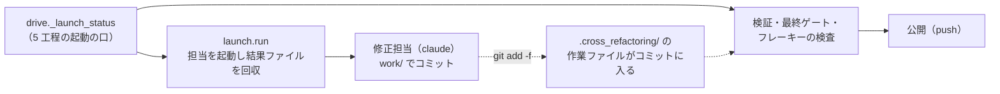
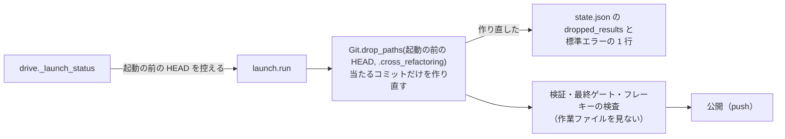
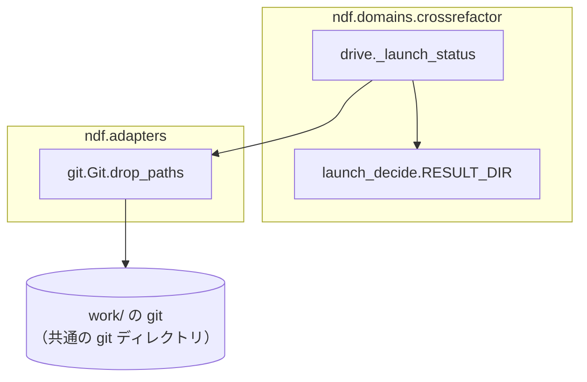
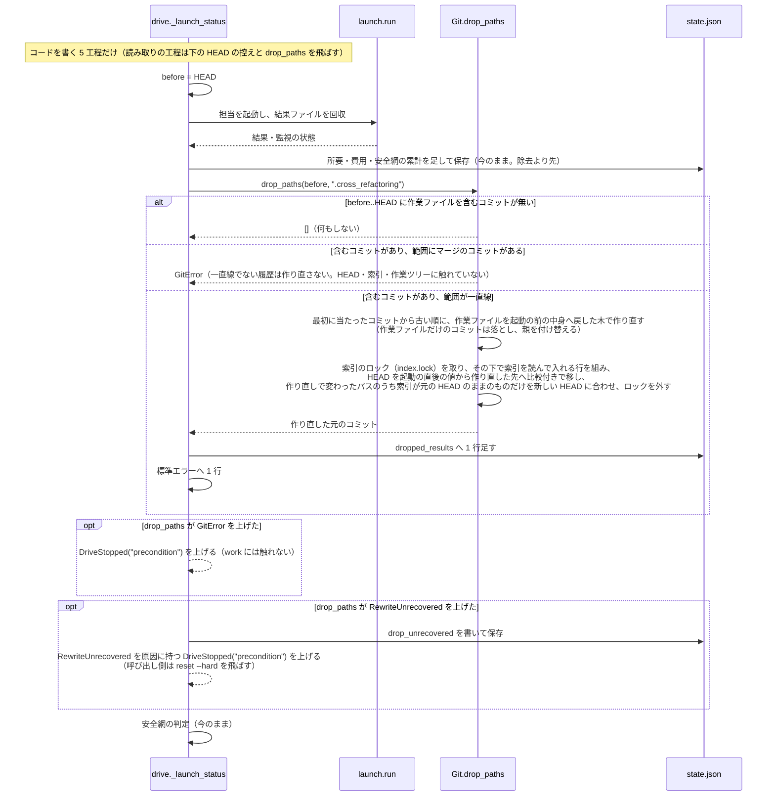

# cross-refactoring: 担当が無視の規則を越えて入れた作業ファイルを、公開の前のコミットから除く（#3500）

cross-refactoring のコードを書く工程の担当が `git add -f` で作業ファイル（`.cross_refactoring/` の下の結果ファイルと進捗のファイル）をコミットすると、オーケストレーターはそのまま公開するか、正しい直しを範囲外として止める。担当の起動 1 回ごとに、起動の後に増えたコミットから作業ファイルだけを除いて作り直し、メッセージとほかの変更はそのまま残す。差し戻し・`git filter-branch`・`git filter-repo` などの採らなかった案は「決定の記録」に、git の一次情報は「外部の調査」にある。

## 今の姿

何が起きたか・目的・受け入れ条件は要求仕様（[issue-3500-requirements.md](./issue-3500-requirements.md)、正は #3500 の本文）にある。この文書は「どう解くか」と「なぜその解き方か」だけを書く。

設計に要る今の構造は次のとおりである。

- 担当の起動はどの工程も `drive._launch_status` を通る。コードを書く 5 工程（工程の表 `plugins/ndf/contracts/domains/loop-phases.json` で coding が真）の起動の口は次のとおりで、どれも書き込み用の作業ディレクトリ `work/` で動く。読み取りの工程（提案・計画・判定など、coding が偽）は `read/<ランタイム>/` で動き、`work/` でコミットを作らない

  | 工程 | 起動する関数 | 経路 |
  | --- | --- | --- |
  | テストの追加（`add-tests`） | `drive._add_tests` | `_code` → `_launch_status` |
  | 実装（`implement`） | `drive._implement` | `_code` → `_launch_status` |
  | 修正（`fix`） | `drive._verify` | `_code` → `_launch_status` |
  | フレーキーなテストの直し（`flaky-fix`） | `drive._attempt_flaky_fix` | `_launch` → `_launch_status` |
  | 最終ゲートの直し（`final-fix`） | `drive` の最終ゲートの `fix` | `_launch` → `_launch_status` |
- 作業ファイルの置き場は `work/.cross_refactoring/` で、除外は共通の git ディレクトリの `info/exclude` の 1 行だけである（`workspace._exclude_results`）。除外は追跡に入るのを止めないので、`git add -f` で入り、入った後は追跡され続ける（要求仕様の「今の姿」の実測）
- 起動の後にコミットの中身を見るのは、フレーキーの直し（`flaky_decide.violations`）と最終ゲートの直し（`final_gate_decide.verify_final_fix`）だけで、どちらも作業ファイルを見分けない。テストの追加・実装・修正の 3 工程は何も見ない
- **根本原因**: 作業ファイルを差分に入れない約束を、除外の 1 行という「既定の `git add` が拾わない」仕組みだけで守っていて、担当がそれを越えたときに戻す所が無いこと

## 文脈と制約

- 担当の作るコミットは、起動の後で公開の前である。公開（push）はオーケストレーターだけが、検証を通した後に行う（`prompts/fix.md` の「守ること」）。最終ゲートの直しも、push 済みの HEAD の上に担当が新しいコミットを積む形である。起動の前の HEAD より後のコミットは、作り直しても force push が要らない
- 作業ディレクトリには、担当が残した未コミットの変更がありうる。作り直しは作業ツリーと未コミットの変更を変えてはいけない（受け入れ条件 3）
- 担当が書いた結果ファイルは、`launch.run` が回収先へ移した後である。進捗のファイルは作業ディレクトリに残る
- コミットのメッセージのトレーラー（`Item-Id`・`Impl-Runtime`・`Impl-Model`・`Flaky-Fix`）は、後の検査と記録が読む。作り直しで変えてはいけない（受け入れ条件 2）
- git の起動はアダプター（`ndf.adapters.git`）が持つ。今の `Git.run` は環境変数と標準入力を渡せない

## 解き方の全体像

- コードを書く工程（`launch_decide.coding_phases()` の 5 工程）の担当の起動 1 回ごとに、`_launch_status` が起動の前の HEAD を控え、起動の後に `Git.drop_paths` を呼ぶ。読み取りの工程は別の作業ディレクトリ（`read/<ランタイム>/`）で動き `work/` でコミットを作らないので、HEAD も控えず `drop_paths` も呼ばない（git の起動を足さない）
- `Git.drop_paths` は、起動の前の HEAD から今の HEAD までに `.cross_refactoring/` の下を変えたコミットがあるときだけ、最初に当たったコミットとそれより後のコミットを作り直す。範囲は一直線の履歴を前提とし（要求仕様の前提 1）、範囲にマージのコミットがあって作業ファイルに当たったとき（マージとその親との差分で当たったときを含む）は作り直さずに止める（「処理の流れ」）。作り直した木の `.cross_refactoring/` は起動の前の HEAD と同じ中身に戻す（起動の前から追跡されていたファイルは消さない）。メッセージ・作者・日付はそのまま、作業ファイルだけを変えたコミットは落とす。最初に当たったコミットより前のコミットと、作業ツリー・未コミットの変更には触れない
- 作り直したときは、工程・起動の名前・元のコミットを状態ファイルに残し、標準エラーへ 1 行出す
- 後に続くフレーキーの検査・最終ゲートの範囲の検査・検証は、作業ファイルの無いコミットだけを見る

## 構成要素

| 要素 | 責務 |
| --- | --- |
| `Git.drop_paths`（`ndf.adapters.git`、新設） | 起点から HEAD までのコミットから、指定した最上位のディレクトリの下のパスを除いて作り直し、HEAD と索引を合わせる。当たるコミットが無ければ何もしない。作り直した元のコミットを返す。git の出力と入力をバイトのまま扱う |
| `git.unrecovered`（`ndf.adapters.git`、新設） | 例外が `RewriteUnrecovered` か、それを原因（`__cause__`）に持つかを返す。後片付けを飛ばすかの判定を 1 か所に置く |
| `drive._launch_status`（変える） | 起動の前の HEAD を控え、所要を記録した後に `Git.drop_paths` へ `launch_decide.RESULT_DIR` を渡す。作り直したら状態ファイルと標準エラーへ残す。除けなければ `work` に触れずに止め、HEAD を戻せていなければ `drop_unrecovered` を残し、`RewriteUnrecovered` を原因に持つ `DriveStopped` を上げる |
| `drive._attempt_flaky_fix`・`final_gate._fix_or_undo`（変える） | 止まった起動の後片付け（`reset --hard`）を、`git.unrecovered` が真の例外では飛ばす |
| `drive._open`（変える） | 状態ファイルを読んだ直後、`workspace.prepare` より前に、`drop_unrecovered` があれば `work` の復旧を確かめる。復旧していなければ何も流さずに止め、復旧していれば記録を消して続ける |
| `docs/01-state-and-propose.md`（cross-refactoring の Skill の文書、変える） | 作業場所の箇条と状態ファイルの表に、除いた記録を足す |

## 処理の流れ

**所要の記録の順**: 所要・費用・安全網の累計（`_record_spent` と保存）は、今と同じく `launch.run` が返った直後に済ませ、その後で `drop_paths` を呼ぶ。除去に失敗して止まっても、その起動の秒と費用は状態ファイルに残り、再開したときの安全網の残りに入る。

**索引のロック**: 本来の索引を読んでから書くまでに別の処理がステージした変更を上書きしないよう、`drop_paths` は本来の索引を読む前に、git と同じロックのファイル（`rev-parse --git-path index` で得た索引の隣の `index.lock`）を排他の作成（`O_CREAT|O_EXCL`）で取る。ロックを持つあいだは別の処理の `git add` などが「index.lock が既にある」で断るので、読んだ索引と書く索引のあいだに変更は入らない。ロックの下で、索引を読み（`ls-files`）、行を組み、`update-ref` を打ち、索引の写しへ `update-index` で行を入れ（写しを `GIT_INDEX_FILE` で指す）、写しを本来の索引へ `os.replace` で置き換えてからロックを消す。ロックを取れなければ（別の処理が索引を書いている）何もせずに `GitError`。途中で失敗したら、置き換えをせずにロックを消すので、本来の索引は読んだときのままである。

**失敗したとき**: `drop_paths` は、HEAD を動かす `update-ref` より前には一時の索引・索引の写し・object の書き込みと索引のロックの取得しかせず、HEAD・本来の索引・作業ツリーに触れない。`_launch_status` は `work` を戻さない（`_reset` を呼ばない）。起動の前からあったステージ済み・未ステージ・未追跡の変更も、担当がその起動で残した変更も、`drop_paths` の失敗では失われない。失敗の場所ごとの扱いは次のとおりである。

| 失敗した所 | `drop_paths` がすること | `drop_paths` が上げるもの | 失敗の後の `work` |
| --- | --- | --- | --- |
| `update-ref` より前（範囲の読み取り・作り直し・マージで止めたとき・索引のロックを取れないとき・索引に入れる行を組む読み取り） | 取ったロックを消す | `GitError` | 起動の直後のまま |
| `update-ref` が旧い値の不一致で断る（HEAD を別の処理が動かした） | 戻さない（自分が動かしていない HEAD に触れない）。ロックを消す | `RewriteUnrecovered` | 別の処理が動かした HEAD のまま |
| `update-ref` の後の、写しへの `update-index` か写しの置き換え | `update-ref HEAD <起動の直後> <作り直した先>` で HEAD を比較付きで戻す。置き換えをせずにロックを消すので、本来の索引は起動の直後のまま | 戻せたら `GitError` | 起動の直後のまま |
| 上の戻しの `update-ref` も失敗した（旧い値の不一致を含む） | それ以上は触れない。ロックを消す | `RewriteUnrecovered` | HEAD が作り直した先か別の処理の値で、索引の `.cross_refactoring/` の行が古いことがある |

`RewriteUnrecovered` は `GitError` の子で、HEAD を起動の直後の値へ戻せていないことを表す。`_launch_status` は `GitError` を `DriveStopped("precondition", <作業ファイルを除けなかった旨と git の誤り>)` に替えて上げる（`raise ... from exc` で元の例外を原因に残す）。`RewriteUnrecovered` のときは、その前に状態ファイルへ `drop_unrecovered`（`{"phase", "stem", "before", "launched", "detail"}`。`before` は起動の前の HEAD、`launched` は起動の直後の HEAD）を書いて保存する。`git.unrecovered(exc)` は、例外そのものか原因が `RewriteUnrecovered` なら真を返す。これで次のとおりになる。

- **戻せた失敗の復旧は呼び出し側の 1 か所だけが受け持つ**。`_launch_status` も `drop_paths` も `reset --hard`・`clean` を打たない。`git.unrecovered` が偽の停止の後片付けは、今ある `DriveStopped` の扱いのままである: フレーキーの直しは `_attempt_flaky_fix` の `except DriveStopped` が起点へ 1 回戻し、最終ゲートの直しは `final_gate._fix_or_undo` が起動の前の HEAD へ 1 回戻し、コードを書く 3 工程（テストの追加・実装・修正）は再開すると `_items` が項目の起点へ戻してからやり直す。除去の失敗で `reset --hard` と `clean -fd` が重なることは無い
- **戻せなかった失敗は後片付けも飛ばす**。HEAD を戻せなかったときは、git が旧い値の不一致で守った別の処理の HEAD・索引・作業ツリーがあるか、調べるのに要る状態が残っている。`reset --hard` はそれを上書きするので、`_attempt_flaky_fix` は `git.unrecovered(exc)` が真なら `_reset` を呼ばずにそのまま上げ、`final_gate._fix_or_undo` は `fix()` が上げた例外で `git.unrecovered` が真なら `finally` の `reset --hard` を飛ばして上げる（`fix()` は `drive` の `_final` が渡す関数で、`_launch_status` の例外は `run_gate` を素通りして `drive` の `except DriveStopped` へ届く）。`drive` の停止の扱い（`_publish` で報告を書く）は今のままで、`work` に触れない
- **公開されない**。`DriveStopped` で実行は止まり、公開（最終ゲートの push）へ進まない。再開したときは、上の後片付けで作業ファイル入りのコミットが起点より後から外れる
- **戻せなかったら、起動の前へ戻ったと確かめるまで何も走らない**。`drop_unrecovered` があるあいだは、次の実行の `_open` が状態ファイルを読んだ直後（`_reused`・`_resume_mismatch` の後、`workspace.prepare` の前。fetch も作業ディレクトリの準備もしない）に、`work`（`workspace.layout(root, ()).work`）で `rev-parse HEAD` と `diff --cached --quiet HEAD -- .cross_refactoring` を打つ。HEAD が記録の `before` と同じで、索引の `.cross_refactoring/` が HEAD と同じときだけ、記録を消して保存し、続ける。どちらかが違えば（`work` が無いときを含む）`Finish("precondition", <work のパス・記録の before・今の HEAD と、保存の要る変更を退けてから `git -C <work> reset --hard <before>` を打ち、`index.lock` が残っていれば消してから打ち直す旨>)` を返し、提案・計画・項目・最終ゲート・送信のどれも流さない。記録を手で消す手順は無い。これで、最終ゲートの直しで止まり HEAD に未検査のコミット（作業ファイル入りを含む）が残ったままでは、`run_gate` が範囲の検査より先に送る経路へ届かない。起動の前の HEAD は、項目の起点・フレーキーの直しの起点より後で、最終ゲートでは送った head そのものなので、そこへ戻せばどの工程の再開も安全な起点から始まる
- 再開したときの後片付け（項目の起点・フレーキーの直しの起点・最終ゲートの直しの起動の前へ戻す `reset --hard`）が、その起点より後の未コミットの変更を消すのは今の形のままで、この設計は変えない

## 決定の記録

### 決定 1: 5 工程を 1 か所で守るため、担当の起動の口（`_launch_status`）で起動の後に除く

- **質問**: どこで作業ファイルを見つけて外すか
- **選んだ案**: すべての担当の起動が通る `drive._launch_status` で、起動の前の HEAD を控え、起動の後に除く
- 採らなかった案: 手順書（`prompts/*.md`）に「`git add -f` を使わない」と書く（担当が守らなければ同じことが起き、守ったかを確かめる所が無い。要求仕様の起票者の推定 S2）
- 採らなかった案: 工程ごとの検査（`flaky_decide.violations`・`verify_final_fix`）に作業ファイルの扱いを足す（テストの追加・実装・修正の 3 工程には検査が無く、5 工程に別々の規則を置くことになる）
- 採らなかった案: 公開（push）の直前に 1 回だけ除く（最終ゲートの直しとフレーキーの直しの検査は公開の前に走り、作業ファイルで正しい直しを止める）
- **代償**: コードを書く 5 工程の担当の起動 1 回ごとに、git の起動が 2 回増える（起動の前の HEAD を控える `rev-parse` と、範囲のコミット・親・変えたパスを 1 回で読む `log`）。当たらなければそれだけで終わる。読み取りの工程の起動では増えない（`coding_phases()` で絞る）。当たったときだけ、作り直すコミット 1 件ごとに最大 6 回（`cat-file`・`read-tree`・`rm`・`read-tree --prefix`・`write-tree`・`commit-tree`。`base` に `top` が無ければ `read-tree --prefix` を除いた 5 回）と、最後に 6 回（索引の場所を得る `rev-parse --git-path index`・`diff`・`ls-files`・`ls-tree` 2 回・`update-ref`）、合わせるパスがあればさらに写しへの `update-index` の 1 回が増える。`update-index` か置き換えが失敗したときだけ、HEAD を戻す `update-ref` の 1 回が増える。`drop_unrecovered` が残っている実行の入口でだけ、`rev-parse` と `diff --cached --quiet` の 2 回が増える（記録が無ければ増えない）。除去に失敗しても `_launch_status` は `reset`・`clean` を打たない（後片付けは呼び出し側の今の 1 か所だけで、HEAD を戻せなかったときはそれも打たない）
- 根拠: Value 7「不具合が根本原因から直される」・Value 11「重複と冗長が無い」（MVV 版 11）

### 決定 2: 担当の正しい変更を失わないため、作業ファイルだけを除いて続ける

- **質問**: 作業ファイルの入ったコミットを見つけたら、どう扱うか
- **選んだ案**: そのコミットから作業ファイルだけを除いて作り直し、項目の進みはそのまま続ける。作業ファイルだけを変えたコミットは落とす
- 採らなかった案: 起動の前まで取り消して担当へ変更を要求する（フレーキーの直しの形。要求仕様の起票者の推定 S3。正しい変更のために担当をもう 1 回起動し、時間と費用が倍になる）
- 採らなかった案: 作業ファイルを外すコミットを 1 つ足す（差分の合計からは消えるが、Pull Request のコミットの並びに作業ファイルが残る）
- 採らなかった案: 作業ファイルだけを変えたコミットを空のまま残す（Pull Request に中身の無いコミットが並ぶ）
- **代償**: 最初に当たったコミットとそれより後のコミットの SHA が変わる。どれも公開の前で、起動の前の HEAD より後のものだけである
- 根拠: Value 2「安く使える」・Value 6「使うほど散らからない」（MVV 版 11）

### 決定 3: 作業ツリーに触れずにコミットだけを作り直すため、git の plumbing で作り直す

- **質問**: 公開の前のコミットから、あるディレクトリの下のパスをどの手段で除くか
- **選んだ案**: 一時の索引で各コミットの木を読み（`read-tree`）、`.cross_refactoring/` を外して起動の前の HEAD の中身に置き直し（`rm -r -f --cached --ignore-unmatch` と `read-tree --prefix`。`-f` が無いと、一時の索引の中身が作業ツリーと違うときに `rm` が断る。`--ignore-unmatch` が無いと、作業ファイルを入れた後のコミットで担当が消した木では pathspec が一致せず終了コード 128 で止まる）、木を書き（`write-tree`）、元のメッセージ・作者・日付で `commit-tree` する。最後に、本来の索引のロック（`index.lock`）を取り、その下で本来の索引に入れる行を組んでから、`update-ref` で HEAD を起動の直後の値から比較付きで移し、本来の索引のうち作り直しで中身の変わったパスだけを新しい HEAD に合わせる（索引の写しへ `update-index` で入れ、写しで本来の索引を置き換えてからロックを消す。HEAD を移した後に残る git の起動を `update-index` の 1 回にし、それか置き換えが失敗したら HEAD を比較付きで戻す。ロックの下で読み書きするので、読んだ後に別の処理がステージした変更を上書きしない。HEAD の比較付きの更新だけでは、索引だけの変更を検知できない）。合わせるのは索引の行が元の HEAD と同じパスだけで、担当が `.cross_refactoring/` の下でステージしてコミットしていない変更は残す（`reset -q HEAD -- .cross_refactoring` はステージの内容を上書きするので使わない。作業ツリーには触れない）
- 採らなかった案: `git filter-branch --index-filter`（git の文書が使わないよう勧める。未コミットの変更があると「Cannot rewrite branches: You have unstaged changes.」で断る。作り直した後に作業ツリーの作業ファイルを消し、`refs/original/HEAD` を残す。2026-11-22 に実測）
- 採らなかった案: `git filter-repo`（リポジトリ全体の履歴を書き換える道具で、既定で新しい clone を求める。依存が 1 つ増え、この環境に入っていない。LIB1）
- 採らなかった案: `git rebase --exec` で各コミットを直す（作業ファイルを入れた後のコミットが進捗のファイルを書き換えていると、削除と変更の衝突で止まりうる。未コミットの変更には `--autostash` が要る。衝突は実測していない）
- 2026-11-22 に手で通した（git 2.53.0）: 作業ファイルだけを変えたコミットは落ち、元から空のコミットは残り、最初に当たったコミットより前のコミットは SHA が変わらず、起動の前から追跡されていた作業ファイルは残り、未コミットの変更と作業ツリーの作業ファイルは残って無視の対象に戻った。`update-ref` は HEAD が旧い値と違えば終了コード 128 で断る。`--ignore-unmatch`・索引の合わせ方・マージで止めることは、手で通した後に読み手役の指摘で変えたため、実測していない（テスト設計の 2・3・8・9 で確かめる）
- **代償**: 作り直しの手順（約 20 行）と、git と同じ形の索引のロックの取り方を自前で持つ。署名付きのコミットの署名は外れる（担当は署名しない）。ロックを持ったままプロセスが落ちると `index.lock` が残り、以後の git の索引の書き込みが断る（安全な側に倒れる。git の誤りがロックのパスを示し、`drop_unrecovered` が残ったときはその案内でも消し方を示す）
- 作り方: 自前（git の plumbing の組み合わせ）
- 比べた候補: LIB1（git filter-repo）・LIB2（git filter-branch）・LIB3（git rebase --exec）
- 根拠: Value 12「調べて分析した、実績のある最新のやり方で作られる」・Value 13「確かめたことだけが済んだとされる」（MVV 版 11）

### 決定 4: 作り直しを git の操作の置き場に置くため、アダプターの `ndf.adapters.git` に足す

- **質問**: 作り直しの手順をどこに置くか
- **選んだ案**: `ndf.adapters.git` に `Git.drop_paths(base, top)` と、その起動に使う `Git.run_bytes`（環境変数と標準入力を渡し、出力をバイトのまま返す）、戻せなかった失敗の例外 `RewriteUnrecovered` と判定 `unrecovered` を足す。除くディレクトリは引数で受け、cross-refactoring の置き場の名前（`launch_decide.RESULT_DIR`）は `drive` が渡す
- 採らなかった案: `crossrefactor.workspace` に置く（git を直接起動するコードがドメインに入る。今の `workspace` はアダプターの `Git.run` しか使わない）
- 採らなかった案: cross-review と共有する所（`ndf.core.converge`）に置く（cross-review は状態の保存先をレビューする worktree の外に置き、中なら止めるため、同じ経路が無い。使い手が 1 つの共有は置かない）
- **代償**: アダプターの `Git.run` が持たない環境変数・標準入力・バイトの受け渡しを、`Git.run_bytes` が別に持つ
- 根拠: Value 9「責務の分かれた設計で作られる」（MVV 版 11）

### 決定 5: 起きた回数を後から数えられるよう、状態ファイルと標準エラーへ残す

- **質問**: 除いたことをどこへ残すか
- **選んだ案**: 状態ファイルの新しいキー `dropped_results` に、1 回ごとに `{"phase": <工程>, "stem": <起動の名前（結果ファイルの名前の一部。項目の番号 `I-003` か、`flaky`・`r1` など）>, "commits": [<元のコミット>...]}` を足し、標準エラーへ「<工程> の担当がコミットした作業ファイル（.cross_refactoring/）を <N> 件のコミットから除いた」を 1 行出す
- 採らなかった案: 完了報告（`report.md`）に節を足す（読み手は Pull Request を見る人で、担当の操作の癖は直す人が数える材料である。報告の形を変えるほどの量ではない）
- 採らなかった案: 残さない（担当が除外を越える頻度を数えられず、手順書を直すかを決める材料が無くなる）
- **代償**: 状態ファイルのキーが 1 つ増える
- 根拠: Value 14「判断の理由が残り、語がそろっている」（MVV 版 11）

## 影響と危険

- **働く範囲**: この PR は設計文書だけで、振る舞いは変わらない。実装の後は、利用先のリポジトリでも `ndf refactor run` を打つすべての cross-refactoring に効く
- **プロジェクトごとに違うもの**: 無い（置き場の名前と作り直しは NDF のコードが持つ）
- **当たるモード**: cross-refactoring を通すすべてのモード
- **同じファイルを触る別の変更**: レーン lcrfast が cross-review の #4013・#4014・#4015・#4030 を実装中である。開いている PR #4186 が触るのは `ndf.domains.crossreview`・`ndf.adapters.claude` などで、この設計の触るファイル（`ndf.adapters.git`・`ndf.domains.crossrefactor.drive`・`final_gate`）と重ならない。cross-review は作業ファイルを worktree の外に置くため、共有するロジックも無い（決定 4）。順番の制約は無い
- **壊れうる箇所**:
  - 担当の起動の後で HEAD の SHA が変わる。起動の後に控えた SHA を使う所（`phase_decide.on_no_result` の `HEAD`、フレーキーの直しの `git log base..HEAD`、最終ゲートの `changed_by_commit`）は、どれも作り直しの後に読むので影響しない。作り直しは `launch.run` の直後で、`_launch_status` が返る前に済ませる
  - 安全網（コードを書く工程の担当の起動の秒の合計の上限。`--safety-net-minutes`）に当たって止まる起動（`DriveStopped`）でも、止める前に除く。打ち直しは項目の起点からやり直すため、残ったコミットは使われないが、作業ファイルを残さないため
  - 項目の起点（`item["start"]`）・工程の起点（`phases[].base_sha`）は起動の前の HEAD 以前を指すので、作り直しの範囲に入らない
- **手順書の `Item-Id` の検査がコードに無いこと**は別の欠けで、範囲外として #4195 に起票した（要求仕様の「対象範囲」）

### 代表のリポジトリでの振る舞い

| 代表のリポジトリ | 設定の要点 | 直した後に起きること | この種類で扱えなくなること |
| --- | --- | --- | --- |
| Web サービス（nd-factory） | 実装の PR に cross-refactoring を流す | 担当が作業ファイルを入れても、公開される PR のコミットに作業ファイルが無い | 無し |
| モバイルアプリ | 同上 | 同上 | 無し |
| 業務文書だけ | cross-refactoring を流さない（コードの範囲が無い） | 変わらない | 無し |

### ai-plugins だけの事情

- 無し（置き場の名前と作り直しは NDF のコードが持ち、このリポジトリの宣言の値を使わない）

## テスト設計

| 受け入れ条件・不変条件 | どの振る舞いで縛るか | どう壊したら落ちるべきか |
| --- | --- | --- |
| 1（5 工程で作業ファイルが残らない） | 担当の偽物が `git add -f` で `.cross_refactoring/` の下のファイルを含むコミットを作る。5 工程それぞれの起動の口（「今の姿」の表）から起動し、どの工程でも起動の後の `before..HEAD` のどのコミットにも作業ファイルが無い | `_launch_status` で除く呼び出しを外す・どれかの工程が `_launch_status` を通らない口へ変わる |
| 2（メッセージ・作者・ほかの変更・並び） | 作り直した後のコミットのメッセージ（トレーラーを含む）・作者・作業ファイル以外の木が元と同じで、並びも同じ。作業ファイルだけを変えたコミットは無くなり、元から空のコミットは残る。最初に当たったコミットより前のコミットは SHA が変わらない。作業ファイルを入れたコミットの後に、ほかの変更と作業ファイルの削除を合わせたコミットが続く範囲（#3491 の形）でも止まらずに作り直し、後のコミットのほかの変更は残る | 作者や日付の環境変数を渡し忘れる・メッセージを再整形する・作業ファイルだけのコミットを残す・元から空のコミットを落とす・範囲の頭から作り直す・一時の索引からの `rm` に `--ignore-unmatch` を付け忘れる |
| 3（未コミットの変更と作業ファイルが残る） | 作業ツリーに未コミットの変更と進捗のファイルがある状態で除く。除いた後も変更とファイルが残り、`git status` で作業ファイルが無視の対象に戻る。起動の前から追跡されていた作業ファイルに担当がステージしてコミットしていない変更は、除いた後も索引に残る | 作業ツリーを checkout し直す（`filter-branch` の形）・索引を合わせ忘れて作業ファイルの追加が索引に残る・`reset -- .cross_refactoring` で索引を丸ごと戻す |
| 4（記録と標準エラー） | 除いた起動で `dropped_results` に工程・起動の名前・元のコミットが 1 行増え、標準エラーに 1 行出る | 記録を書き忘れる・当たらない起動でも行を足す |
| 5（最終ゲートとフレーキーで止めない） | 最終ゲートの直しで担当が作業ファイルと範囲の中の直しを入れても、範囲外で止まらない。フレーキーの直しで作業ファイルを入れても `non_test` の違反にならない | 除くのを工程の検査の後へ置く |
| 6（入れなかった起動は作り直さない） | 作業ファイルを入れない起動の後で HEAD の SHA が起動の直後と同じ | 当たりの有無を見ずに毎回作り直す |
| 7（起動の前のコミットは作り直さない） | 起動の前の HEAD より前に作業ファイルを含むコミットがあっても、そのコミットは作り直さず、その作業ファイルは作り直した後の木にも残る（起動の後のコミットに削除が混ざらない） | 範囲を `before..HEAD` でなくブランチ全体にする・`top` を木から丸ごと外す |
| 8（マージを含む範囲は公開の前に止める） | 次の 2 つの範囲のどちらでも、`drop_paths` が HEAD・索引・作業ツリーに触れずに `GitError` を上げ、`_launch_status` が `DriveStopped` で止まる: (a) マージで取り込んだ側のコミットだけが作業ファイルを含む（マージの結果の木には無い）、(b) どの親にも無い作業ファイルをマージのコミットだけが解決のときに足す | パスで絞った `rev-list` で当たりを探す（既定の履歴の簡略化で取り込んだ側をたどらない）・`log` に `--diff-merges=separate` を付け忘れる（既定ではマージの変えたパスが出ず (b) を見落とす）・マージを一直線に作り直す |
| 8b（日本語を含むパス） | `.cross_refactoring/進捗.md` を含むコミットを作り直し、作り直した後の木にそのファイルが無い | `log` に `-z` を付け忘れる（既定では引用された `"` から始まる行になり `top/` に前方一致しない） |
| 8c（UTF-8 として不正なバイトと見出しに似たパス） | UTF-8 のロケールで、名前に UTF-8 として不正なバイト（`b"\xff.txt"`）を含むファイルと、`\x01` と 40 桁の 16 進で始まる名前のファイルを、作業ファイルと同じコミットで変える。作り直しが止まらずに済み、その 2 つのファイルは作り直した後の木に同じバイトの名前で残り、作業ファイルは無い。`.cross_refactoring/` の下の不正なバイトの名前のファイルも除かれ、索引も合う | 出力を `text=True` で読む（`UnicodeDecodeError` で `GitError` の経路を外れる）・`update-index` へ文字列で渡す・見出しを先頭の `\x01` だけで判定する（パスを見出しと取り違える） |
| 9（除去の失敗で起動の前の変更を消さず、作業ファイル入りのコミットを公開しない） | 起動の前に、追跡されたファイルのステージ済みの変更・未ステージの変更・未追跡のファイルを置いた `work` で、`update-ref` の前の失敗と、`update-ref` の後の `update-index` の失敗をそれぞれ起こす。どちらも `drop_paths` の後で HEAD が起動の直後の値、索引と作業ツリーが起動の直後のまま（起動の前の 3 種の変更が残る）で、`DriveStopped("precondition")` で止まり、公開（push）が呼ばれない。`_launch_status` の中では `reset`・`clean` が 1 回も呼ばれない | `GitError` で `_launch_status` が `reset --hard`・`clean` を打つ・`update-index` の失敗で HEAD を戻さない・戻しを比較なしの `update-ref` か `reset` で行う |
| 9b（後片付けは 1 か所） | フレーキーの直しで除去に失敗すると（HEAD を戻せた `GitError`）、起点へ戻す `reset --hard` と `clean -fd` がそれぞれ 1 回だけ呼ばれ、起点の後のコミットが残らない。最終ゲートの直しでも `_fix_or_undo` の戻しが 1 回だけ。コードを書く工程で失敗した実行を打ち直すと、項目の起点からやり直す | `_launch_status` でも戻して 2 回打つ・`DriveStopped` に替えずに `GitError` のまま上げる（`_attempt_flaky_fix` が戻さない） |
| 9c（HEAD を戻せないときは後片付けを飛ばす） | `update-ref` を旧い値の不一致で断らせる（HEAD を別の値へ動かし、別の処理のステージ済みの変更と未ステージの変更を置いておく）と、`drop_paths` は HEAD を動かさず `RewriteUnrecovered` を上げ、`drop_unrecovered`（`before`・`launched` を含む）が状態ファイルに残る。`update-index` と戻しの `update-ref` をどちらも失敗させても同じ。フレーキーの直しと最終ゲートの直しのどちらで起きても、`reset`・`clean` は 1 回も呼ばれず、別の処理の HEAD・索引・作業ツリーがそのまま残り、`precondition` で止まる | 旧い値の不一致でも HEAD を戻す・戻しの失敗を `GitError` として扱う・`drop_unrecovered` を書き忘れる・`_attempt_flaky_fix` の `except` か `_fix_or_undo` の `finally` が `RewriteUnrecovered` でも `reset --hard` を打つ・`raise ... from` を付け忘れて `git.unrecovered` が偽になる |
| 9e（復旧を確かめるまで何も流さない） | `drop_unrecovered` が残り、`work` の HEAD が記録の `before` と違う（最終ゲートの直しのコミットが残る）状態で打ち直すと、`workspace.prepare`（fetch を含む）・項目の後片付け・担当の起動・push のどれも呼ばれずに `precondition` で止まり、記録が残る。fetch が失敗する状態でも同じ停止に届く。HEAD を `before` へ戻し索引の `.cross_refactoring/` を HEAD に合わせてから打ち直すと、記録が消えて実行が続く。HEAD が `before` でも索引の `.cross_refactoring/` が HEAD と違えば止まる | 入口の確かめを `workspace.prepare` の後に置く・HEAD と `before` を比べずに記録だけで判定する（手で記録を消すと未検査の HEAD を送る）・確かめた後に記録を消し忘れる |
| 9f（読んだ後にステージした変更を上書きしない） | `drop_paths` が本来の索引を読んだ直後（git の起動を差し替えて `ls-files` の後）に、別の処理として `.cross_refactoring/` の下の追跡されたファイルを `git add` させる。その `git add` は索引のロックで断り、`drop_paths` の後に打ち直すとその変更が索引に入る。`drop_paths` の前からロックがあるときは、`drop_paths` が何もせずに `GitError` を上げ、HEAD と索引が起動の直後のまま。`update-ref` の後で失敗させると、本来の索引は読んだときのままでロックが残らない | ロックを取らずに `ls-files` と `update-index` を打つ（後から入ったステージを先に組んだ行で上書きする）・ロックを `ls-files` の後で取る・失敗の後にロックを消し忘れる |
| 9d（除去に失敗しても所要と費用は残る） | 除去に失敗した起動の後の状態ファイルに、その起動の秒が `phase_seconds`・`coding_seconds` に、費用が `phase_cost` に入っている | `drop_paths` を `_record_spent` と保存より先に呼ぶ |
| 10（読み取りの工程では git を起動しない） | 読み取りの工程の起動では `rev-parse` も `drop_paths` も呼ばれない | `coding_phases()` で絞らずに全工程で呼ぶ |

詳細設計は [issue-3500-design-detail.md](./issue-3500-design-detail.md) にある（新設する関数 4・シグネチャを変える関数 0 のため別ファイルにした）。

## 設計の結果

| 課題 | 扱い | 統合先 | 触るファイル |
| --- | --- | --- | --- |
| #3500 | 実装する | — | `plugins/ndf/src/ndf/adapters/git.py`、`plugins/ndf/src/ndf/domains/crossrefactor/drive.py`、`plugins/ndf/src/ndf/domains/crossrefactor/final_gate.py`、`plugins/ndf/skills/cross-refactoring/docs/01-state-and-propose.md`、`plugins/ndf/tests/adapters/test_git.py`、`plugins/ndf/tests/domains/crossrefactor/test_drop_result_files.py` |

## 外部の調査

| 種類 | 調べるか | 理由 |
| --- | --- | --- |
| 標準・仕様 | 調べる | 除外の効く範囲と、履歴を作り直す手段の正しい使い方は git の文書が決める |
| 主要な製品 | 調べる | AI のコーディングの道具が自分の作業ファイルをどう扱うか |
| ライブラリとサービス | 調べる | 履歴から特定のパスを除く既存の道具 |

### 標準・仕様

| # | 標準・仕様 | 何を定めているか | 設計への反映 | 出典 |
| --- | --- | --- | --- | --- |
| STD1 | gitignore | 「Files already tracked by Git are not affected」。除外は追跡済みのファイルに効かない | 一度入った作業ファイルは以後のコミットにも入り続けるので、除外の 1 行では守れない（根本原因） | https://git-scm.com/docs/gitignore （2026-11-22） |
| STD2 | git add | `-f, --force`: 「Allow adding otherwise ignored files」 | 除外を越える経路は `-f` で、担当が打てば止める手段が git の側に無い | https://git-scm.com/docs/git-add （2026-11-22） |
| STD3 | git filter-branch | 「has a plethora of pitfalls」として使わないよう勧め、`git filter-repo` を挙げる。`GIT_AUTHOR_*` は元のコミットから取る | 採らない（決定 3）。作者・日付を元のコミットから渡す形は倣う | https://git-scm.com/docs/git-filter-branch （2026-11-22） |

### 主要な製品

| # | 製品 | どう解いているか | 設計への反映 | 出典 |
| --- | --- | --- | --- | --- |
| PRD1 | aider | 自分の作業ファイル（`.aider*`）を `.gitignore` へ足す（`--gitignore`、既定で有効）。除外だけで守り、越えたときに戻す仕組みは文書に無い | 今の NDF と同じ形で、同じ穴を持つ。除外に加えて、越えたときに戻す所を置く | https://aider.chat/docs/config/options.html （2026-11-22） |

### ライブラリとサービス

| # | 候補 | バージョン | ライセンス | 最後のリリースの日付 | 終了のアナウンス | 要件を満たすか | 出典 |
| --- | --- | --- | --- | --- | --- | --- | --- |
| LIB1 | git filter-repo | 2.47.0 | MIT | 2024-12-04 | 無し | 満たさない（リポジトリ全体の書き換えが前提で、依存が 1 つ増え、この環境に無い。`git filter-repo --version` が「not a git command」） | https://pypi.org/pypi/git-filter-repo/json （2026-11-22） |
| LIB2 | git filter-branch（git 同梱） | git 2.53.0 | GPL-2.0（git） | git に同梱 | 無し（文書が使わないよう勧める） | 満たさない（未コミットの変更があると断る。作業ツリーの作業ファイルを消す。`refs/original/HEAD` を残す。2026-11-22 の実測） | https://git-scm.com/docs/git-filter-branch （2026-11-22） |
| LIB3 | git rebase --exec（git 同梱） | git 2.53.0 | GPL-2.0（git） | git に同梱 | 無し | 満たさない（作業ファイルを後のコミットが書き換えていると衝突で止まりうる。衝突は実測していない。未コミットの変更には `--autostash` が要る） | https://git-scm.com/docs/git-rebase （2026-11-22） |

調べた量: 候補 5 件・取得の試み 8 回。
