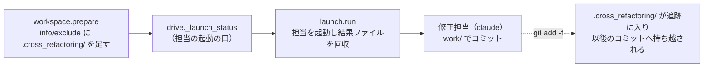
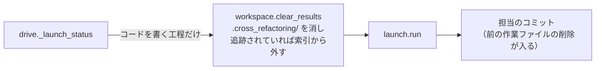

# cross-refactoring: 担当の起動の前に作業ファイルを片付け、追跡されたまま持ち越さない（#3500）

cross-refactoring の作業ファイル（`.cross_refactoring/` の下）は、一度コミットに入ると追跡され続け、その後の担当のコミットへ持ち越される。コードを書く工程の担当を起動する直前に、作業ディレクトリの `.cross_refactoring/` を消し、追跡されていれば索引からも外す。除外は今の作業場所の git の除外（`info/exclude`）のままとし、対象のリポジトリの `.gitignore` は書き換えない。コミットの作り直しなどの採らなかった案は「決定の記録」にある。

## 今の姿

何が起きたか・目的・受け入れ条件は要求仕様（[issue-3500-requirements.md](./issue-3500-requirements.md)、正は #3500 の本文）にある。この文書は「どう解くか」と「なぜその解き方か」だけを書く。

設計に要る今の構造は次のとおりである。

- 作業場所の準備（`workspace.prepare`）が、共通の git ディレクトリの `info/exclude` へ `.cross_refactoring/` を足す（`workspace._exclude_results`）。linked worktree の `rev-parse --git-path info/exclude` は共通の git ディレクトリの `info/exclude` を返し、作業場所のすべての worktree に効く（2026-11-23 に実測）
- 担当の起動はどの工程も `drive._launch_status` を通る。コードを書く 5 工程（`launch_decide.coding_phases()`。テストの追加・実装・修正・最終ゲートの直し・フレーキーなテストの直し）は書き込み用の作業ディレクトリ `work/` で動き、結果ファイルと進捗のファイルを `work/.cross_refactoring/` に書く。結果ファイルは起動の直後に回収先へ移され、進捗のファイルは残る
- 除外は追跡済みのファイルに効かない（STD1）。担当が一度 `git add -f` で入れると、その後の担当のコミット（`git add -A`・`git commit -a`）にも作業ファイルが入り続ける
- 起動の前に作業ファイルを片付ける所は無い。`drive._reset` の `git clean -fd` は無視の対象を消さない

## 文脈と制約

- 2026-11-23 の設計承認ゲートで、利用者がこの最小の形を選んだ。コミットの作り直しと、それが失敗したときの備えは持たない
- 進捗のファイルは無進捗の監視が起動の間だけ測る。結果ファイルは起動の直後に回収してある。次の起動の前に消しても失うものは無い（要求仕様の前提 1）
- 片付けは作業ディレクトリの `.cross_refactoring/` だけに効かせる。担当が残した未コミットの変更やほかのファイルには触れない

## 解き方の全体像

- コードを書く 5 工程の担当を起動する直前に、`_launch_status` が `workspace.clear_results` を呼ぶ。読み取りの工程では呼ばない
- `clear_results` は `work/.cross_refactoring/` を消し、その下のファイルが追跡されていれば `git rm -r --cached` で索引から外す。担当が次のコミットを作ると、そのコミットに削除が入って追跡から外れる
- 除外は今の `info/exclude` のままで、担当の `git add -A` で作業ファイルは入らない
- 担当が `git add -f` で入れたものは、その起動のコミットに残る。次の起動の前の片付けで追跡から外れる

## 決定の記録

### 決定 1: 追跡されたまま持ち越さないため、コードを書く工程の担当の起動の直前に `.cross_refactoring/` を消して索引から外す

- **質問**: いつ、何を片付けるか
- **選んだ案**: `drive._launch_status` で、工程が `launch_decide.coding_phases()` に入るときだけ、`launch.run` の前に `workspace.clear_results(run.work)` を呼ぶ。作業ディレクトリの `.cross_refactoring/` を消し、追跡されていれば `git rm -r -q --cached --ignore-unmatch -- .cross_refactoring` で索引から外す
- 採らなかった案: 起動の後に、そのコミットから作業ファイルを除いて作り直す（2026-11-22 の最初の設計。失敗したときの備えまで含めて新設 4 関数になり、利用者が「難しく考えすぎ」としてやめた）
- 採らなかった案: 作業場所の準備（`workspace.prepare`）で 1 回だけ片付ける（実行の途中の起動で入ったものが、同じ実行の後の起動へ持ち越される）
- 採らなかった案: 公開（push）の直前に片付ける（最終ゲートの直しの範囲の検査とフレーキーの直しの検査は公開の前に走るため、それより前の起動の分を外せない）
- **残る経路**: 担当が `git add -f` で入れた作業ファイルは、その起動のコミットに残る（次の起動の前の片付けで追跡から外れるが、最後の起動で入れたものと、入れたコミットそのものは残る）
- **代償**: 担当の起動の前に、前の起動の進捗のファイルが消える。作業ファイルが追跡されていたときは、担当の次のコミットに作業ファイルの削除が入る
- 根拠: Value 6「使うほど散らからない」・Value 11「重複と冗長が無い」（MVV 版 11）

### 決定 2: 利用者のリポジトリに差分を出さないため、除外は作業場所の `info/exclude` のままにし、`.gitignore` を書き換えない

- **質問**: `.cross_refactoring/` をどこで無視させるか
- **選んだ案**: 今の `workspace._exclude_results` のまま、共通の git ディレクトリの `info/exclude` に入れる。作業場所のすべての worktree に効き、コミットされない
- 採らなかった案: 対象のリポジトリの `.gitignore` に足す（利用者のリポジトリに `.gitignore` の差分が出て、cross-refactoring の Pull Request に NDF の都合の変更が混ざる。ai-plugins の `.gitignore` には 49 行目に既にあるが、それはこのリポジトリの事情である）
- **代償**: 無い（今の振る舞いのまま）
- 根拠: Value 4「どのプロジェクトでもそのまま使える」・Value 17「公開を前提に、値を置かない」（MVV 版 11）

## 影響と危険

- **働く範囲**: この PR は設計文書だけで、振る舞いは変わらない。実装の後は、利用先のリポジトリでも `ndf refactor run` を打つすべての cross-refactoring に効く
- **プロジェクトごとに違うもの**: 無い（置き場の名前と片付けは NDF のコードが持つ）
- **当たるモード**: cross-refactoring を通すすべてのモード
- **対象のリポジトリの `.gitignore`**: 書き換えない（決定 2）。利用者のリポジトリに差分は出ない
- **同じファイルを触る別の変更**: レーン lcrfast が cross-review の #4013・#4014・#4015・#4030 を実装中である。開いている PR #4186 が触るのは `ndf.domains.crossreview`・`ndf.adapters.claude` などで、この設計の触るファイル（`ndf.domains.crossrefactor.drive`・`workspace`）と重ならない。cross-review は作業ファイルを worktree の外に置くため、共有するロジックも無い。順番の制約は無い
- **壊れうる箇所**: 片付けを読み取りの工程の起動にも効かせると、`read/<ランタイム>/` には `.cross_refactoring/` を書いた担当の結果があるため、回収の前に消すことになる。片付けは `work` だけに、コードを書く工程の起動の前だけに効かせる
- **手順書の `Item-Id` の検査がコードに無いこと**は別の欠けで、範囲外として #4195 に起票した

### 代表のリポジトリでの振る舞い

| 代表のリポジトリ | 設定の要点 | 直した後に起きること | この種類で扱えなくなること |
| --- | --- | --- | --- |
| Web サービス（nd-factory） | 実装の PR に cross-refactoring を流す | 作業ファイルが一度入っても、次の担当の起動の前に追跡から外れ、以後のコミットへ持ち越されない。`.gitignore` は変わらない | 無し |
| モバイルアプリ | 同上 | 同上 | 無し |
| 業務文書だけ | cross-refactoring を流さない（コードの範囲が無い） | 変わらない | 無し |

### ai-plugins だけの事情

- 無し（片付けと除外は NDF のコードが持ち、このリポジトリの宣言の値を使わない）

## テスト設計

| 受け入れ条件 | どの振る舞いで縛るか | どう壊したら落ちるべきか |
| --- | --- | --- |
| 1（起動の直前に `.cross_refactoring/` が無い） | 作業ディレクトリに前の起動の作業ファイルを置き、コードを書く工程の担当の偽物を起動する。偽物が起動された時点で `work/.cross_refactoring/` が無い | `_launch_status` で片付けを呼ばない・`launch.run` の後に呼ぶ |
| 2（追跡されていれば索引から外れる） | 作業ファイルをコミットした状態で起動する。起動の時点で `git ls-files .cross_refactoring` が空で、偽物が `git add -A` でコミットすると、そのコミットに作業ファイルの削除が入る | 作業ツリーから消すだけで索引から外さない |
| 3（除外が退行しない） | 偽物が `.cross_refactoring/` に書いて `git add -A` でコミットしても、作業ファイルはコミットに入らない | `_exclude_results` を外す |
| 4（`.gitignore` が変わらない） | 実行の前後で作業ディレクトリの `.gitignore` が同じ | `.gitignore` へ書き足す |
| 5（ほかを変えない・読み取りの工程では片付けない） | 片付けの後も、作業ディレクトリのほかのファイル・未コミットの変更・HEAD が同じ。読み取りの工程の起動では `read/<ランタイム>/.cross_refactoring/` を消さない | `git clean` や `reset` で片付ける・工程で絞らずに呼ぶ |

## どこを変えるか

（詳細設計はこのセクションに畳む。新設する関数 1・シグネチャを変える関数 0 のため）

| ファイル | 変える中身 | 決定 |
| --- | --- | --- |
| `plugins/ndf/src/ndf/domains/crossrefactor/workspace.py` | `clear_results(g: git.Git) -> None` を足す。入力: 書き込み用の作業ディレクトリの git。`<作業ディレクトリ>/<launch_decide.RESULT_DIR>` があれば消し（`shutil.rmtree`）、`ls-files -z -- <RESULT_DIR>` が空でなければ `rm -r -q --cached --ignore-unmatch -- <RESULT_DIR>` を打つ。返りは無い。git の失敗は `GitError` のまま上げる（今の起動の失敗と同じく実行が止まる） | 1・2 |
| `plugins/ndf/src/ndf/domains/crossrefactor/drive.py` | `_launch_status`: 工程が `launch_decide.coding_phases()` に入るときだけ、`launch.run` の前に `workspace.clear_results(run.work)` を呼ぶ。シグネチャは変えない | 1 |
| `plugins/ndf/skills/cross-refactoring/docs/01-state-and-propose.md` | 「作業場所」の箇条に「コードを書く工程の担当を起動する前に、作業ディレクトリの `.cross_refactoring/` を消し、追跡されていれば索引から外す」を足す | 1 |
| `plugins/ndf/tests/domains/crossrefactor/test_launch_and_phase.py` | 受け入れ条件 1〜5 の行 | — |

## 設計の結果

| 課題 | 扱い | 統合先 | 触るファイル |
| --- | --- | --- | --- |
| #3500 | 実装する | — | `plugins/ndf/src/ndf/domains/crossrefactor/workspace.py`、`plugins/ndf/src/ndf/domains/crossrefactor/drive.py`、`plugins/ndf/skills/cross-refactoring/docs/01-state-and-propose.md`、`plugins/ndf/tests/domains/crossrefactor/test_launch_and_phase.py` |

## 外部の調査

| 種類 | 調べるか | 理由 |
| --- | --- | --- |
| 標準・仕様 | 調べる | 除外の効く範囲と、除外を越える追加の経路は git の文書が決める |
| 主要な製品 | 調べる | AI のコーディングの道具が自分の作業ファイルをどう扱うか |
| ライブラリとサービス | 調べない | 片付けは git の `rm --cached` とファイルの削除だけで、選ぶ道具が無い |

### 標準・仕様

| # | 標準・仕様 | 何を定めているか | 設計への反映 | 出典 |
| --- | --- | --- | --- | --- |
| STD1 | gitignore | 「Files already tracked by Git are not affected」。除外は追跡済みのファイルに効かない | 一度入った作業ファイルは除外では止まらないので、起動の前に索引から外す（決定 1） | https://git-scm.com/docs/gitignore （2026-11-22） |
| STD2 | git add | `-f, --force`: 「Allow adding otherwise ignored files」 | 担当が `-f` を打てば除外を越える。この経路は残る（決定 1 の「残る経路」） | https://git-scm.com/docs/git-add （2026-11-22） |

### 主要な製品

| # | 製品 | どう解いているか | 設計への反映 | 出典 |
| --- | --- | --- | --- | --- |
| PRD1 | aider | 自分の作業ファイル（`.aider*`）を `.gitignore` へ足す（`--gitignore`、既定で有効） | 対象のリポジトリの `.gitignore` を書き換える形は採らず、作業場所の `info/exclude` に置く（決定 2） | https://aider.chat/docs/config/options.html （2026-11-22） |

調べた量: 候補 3 件・取得の試み 7 回。
