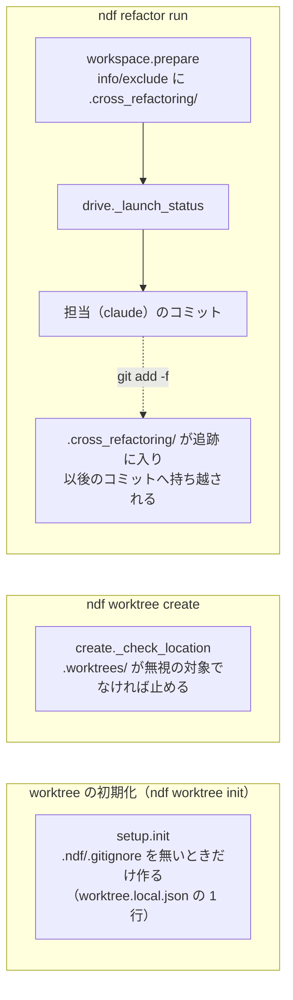
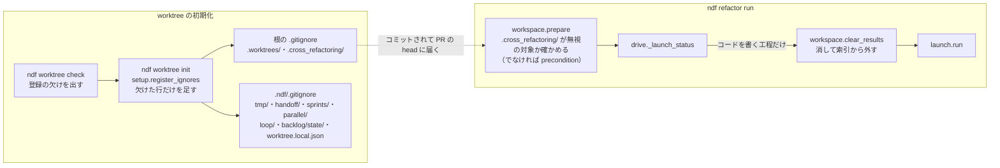

# cross-refactoring: 作業ファイルを追跡されたまま持ち越さず、NDF の一時フォルダの登録を worktree の初期化へまとめる（#3500）

cross-refactoring の作業ファイル（`.cross_refactoring/` の下）は、一度コミットに入ると追跡され続け、その後の担当のコミットへ持ち越される。コードを書く工程の担当を起動する直前に `.cross_refactoring/` を消して索引からも外し、`.cross_refactoring/` と NDF の一時フォルダ（`.ndf/tmp` など）の `.gitignore` への登録は、worktree の初期化（`ndf worktree init`）が 1 か所で行う。作業ファイルを worktree の外に置く案などの採らなかった案は「決定の記録」にある。

## 今の姿

何が起きたか・目的・受け入れ条件は要求仕様（[issue-3500-requirements.md](./issue-3500-requirements.md)、正は #3500 の本文）にある。この文書は「どう解くか」と「なぜその解き方か」だけを書く。

設計に要る今の構造は次のとおりである。

- **登録の置き場が 3 つに分かれている。** `.ndf/.gitignore` は `setup.init` が無いときだけ作り、個人設定の 1 行だけを書く。根の `.gitignore` の `.worktrees/` は worktree の Skill の手順 2-2 がシェルで書き足し、`create._check_location` が無ければ止める。`.cross_refactoring/` は cross-refactoring の `workspace._exclude_results` が共通の git ディレクトリの `info/exclude` に足す
- **NDF がリポジトリの中に置く追跡しない置き場**は、置き場の表（`plugins/ndf/contracts/domains/locations.json` の `root` が `repo` か `main` で `tracked` が偽の行）にある。`.cross_refactoring` は表に無い

| 置き場（表の id） | パス | 今の登録 |
| --- | --- | --- |
| `ndf-tmp` | `.ndf/tmp` | `setup.init` は登録しない（ai-plugins では根の `.gitignore` の `tmp/` が当たっている） |
| `ndf-handoff` | `.ndf/handoff` | 同上（ai-plugins では `.ndf/.gitignore` に手で書いてある） |
| `ndf-sprints` | `.ndf/sprints` | 同上 |
| `ndf-parallel` | `.ndf/parallel` | 同上 |
| `ndf-loop` | `.ndf/loop` | 同上 |
| `backlog-state` | `.ndf/backlog/state` | 同上（ai-plugins では `backlog/` で当たっている） |
| `worktrees` | `.worktrees` | worktree の Skill の手順 2-2 がシェルで足す。`create` が確かめる |
| （表に無い） | `.cross_refactoring` | cross-refactoring が `info/exclude` に足す |
| 個人設定（`ndf-files.json` の `worktree-local`） | `.ndf/worktree.local.json` | `setup.init` が `.ndf/.gitignore` を作るときだけ書く |

- 担当の起動はどの工程も `drive._launch_status` を通る。コードを書く 5 工程（`launch_decide.coding_phases()`）は書き込み用の作業ディレクトリ `work/` で動き、結果ファイルと進捗のファイルを `work/.cross_refactoring/` に書く。結果ファイルは起動の直後に回収先へ移され、進捗のファイルは残る
- 除外は追跡済みのファイルに効かない（STD1）。担当が一度 `git add -f` で入れると、その後の担当のコミットにも作業ファイルが入り続ける。起動の前に作業ファイルを片付ける所は無い

## 文脈と制約

- 2026-11-23 の設計承認ゲートで、利用者が次を決めた。コミットの作り直しと失敗したときの備えは持たない。作業ファイルは起動の前に片付ける。無視は `.gitignore` で行い、`info/exclude` だけの形は採らない。登録は `/ndf:development-workflow` の初期化へ寄せる
- 初期化は `/ndf:development-workflow` の手順 0（`ndf worktree check`）と、worktree の Skill の「0. 設定ファイルを用意する」（`ndf worktree init`）である。`check` はファイルを作らない約束である
- `git check-ignore -q <パス>/` は、ディレクトリが無くても末尾の `/` があれば登録を判定できる（worktree の Skill の手順 2-2 の実測。2026-11-23 に `.ndf/.gitignore` の `tmp/`・`backlog/state/` の行でも確かめた）
- 進捗のファイルは無進捗の監視が起動の間だけ測り、結果ファイルは起動の直後に回収してある。次の起動の前に消しても失うものは無い（要求仕様の前提 1）

## 解き方の全体像

- 登録すべき置き場は、置き場の表の「リポジトリの中で追跡しない」行（`.cross_refactoring` の行を足す）と個人設定から導く。`ndf worktree check` は登録の欠けた置き場を結果に出し、`ndf worktree init` は欠けた行だけを、根の置き場は根の `.gitignore` へ、`.ndf` の下の置き場は `.ndf/.gitignore` へ足す。設定が既にあっても足す
- worktree の Skill の手順 2-2 のシェルの書き足しはやめ、`init` が足した行をコミットする手順だけを残す。`create` の `.worktrees/` の確かめは今のまま最後の守りとして残す
- cross-refactoring は `info/exclude` へ書くのをやめ、作業場所の準備で `.cross_refactoring/` が無視の対象かを確かめる。対象でなければ担当を起動する前に `precondition` で止まり、`ndf worktree init` を打って登録をコミットするよう示す
- コードを書く 5 工程の担当を起動する直前に、`workspace.clear_results` が `work/.cross_refactoring/` を消し、追跡されていれば索引から外す。担当が次のコミットを作ると、そのコミットで追跡から外れる

## 決定の記録

### 決定 1: 追跡されたまま持ち越さないため、コードを書く工程の担当の起動の直前に `.cross_refactoring/` を消して索引から外す

- **質問**: いつ、何を片付けるか
- **選んだ案**: `drive._launch_status` で、工程が `launch_decide.coding_phases()` に入るときだけ、`launch.run` の前に `workspace.clear_results(run.work)` を呼ぶ。作業ディレクトリの `.cross_refactoring/` を消し、追跡されていれば `git rm -r -q --cached --ignore-unmatch -- .cross_refactoring` で索引から外す
- 採らなかった案: 起動の後に、そのコミットから作業ファイルを除いて作り直す（2026-11-22 の最初の設計。失敗したときの備えまで含めて新設 4 関数になり、利用者が「難しく考えすぎ」としてやめた）
- 採らなかった案: 作業場所の準備（`workspace.prepare`）で 1 回だけ片付ける（実行の途中の起動で入ったものが、同じ実行の後の起動へ持ち越される）
- 採らなかった案: 作業ファイルを worktree の外に置く（担当は作業ディレクトリの外を書かない約束で、置き場を外へ出すと担当ごとの置き場の重複を除く仕組みと、消し忘れを拾う仕組みが別に要る）
- **残る経路**: 担当が `git add -f` で入れた作業ファイルは、その起動のコミットに残る（次の起動の前の片付けで追跡から外れるが、最後の起動で入れたものと、入れたコミットそのものは残る）
- **代償**: 担当の起動の前に、前の起動の進捗のファイルが消える。作業ファイルが追跡されていたときは、担当の次のコミットに作業ファイルの削除が入る
- 根拠: Value 6「使うほど散らからない」・Value 11「重複と冗長が無い」（MVV 版 11）

### 決定 2: 登録の置き場を 1 つにするため、NDF の追跡しない置き場の `.gitignore` への登録を worktree の初期化（`ndf worktree init`）へまとめる

- **質問**: `.cross_refactoring/` と NDF の一時フォルダを、どこで、いつ無視させるか
- **選んだ案**: 置き場の表に `.cross_refactoring` の行を足し、表の「リポジトリの中で追跡しない」行と個人設定から登録すべき行を導く。`ndf worktree check` が欠けを出し、`ndf worktree init` が欠けた行だけを足す（根の置き場は根の `.gitignore`、`.ndf` の下は `.ndf/.gitignore`）。判定は `git check-ignore -q <パス>/` で行い、利用者が別の書き方（`tmp/` など）で登録していれば足さない。cross-refactoring は `info/exclude` へ書くのをやめ、登録が無ければ止まる
- 採らなかった案: 作業場所の `info/exclude` だけで無視させる（2026-11-23 の設計承認ゲートで利用者が採らなかった。リポジトリの外から見えず、cross-refactoring 以外の置き場の登録とも揃わない）
- 採らなかった案: cross-refactoring の起動のたびに `.gitignore` を書く（担当のコミットに `.gitignore` の差分が混ざり、Pull Request に NDF の都合の変更が毎回現れうる。登録の置き場がまた 1 つ増える）
- 採らなかった案: 登録の欠けを `check` が書き足す（`check` はファイルを作らない約束である）
- **代償**: 利用者のリポジトリの `.gitignore` と `.ndf/.gitignore` に、初期化のときに 1 回だけ差分が出る。利用者はそれをコミットする。登録のコミットより前に切ったブランチの PR で cross-refactoring を流すと、ベースを取り込むまで `precondition` で止まる
- 根拠: Value 4「どのプロジェクトでもそのまま使える」・Value 11「重複と冗長が無い」・Value 15「人も AI も同じ入口から使える」（MVV 版 11）

## 影響と危険

- **働く範囲**: この PR は設計文書だけで、振る舞いは変わらない。実装の後は、利用先のリポジトリでも `ndf worktree init`・`check` と `ndf refactor run` に効く
- **プロジェクトごとに違うもの**: 無い（登録する置き場は置き場の表が持つ）
- **当たるモード**: すべてのモード（初期化は `development-workflow` の手順 0 で通る）。片付けは cross-refactoring を通すモード
- **利用者のリポジトリへの差分**: `ndf worktree init` を打つと、根の `.gitignore` と `.ndf/.gitignore` に欠けた行が足される。差分は初期化のときに 1 回だけで、担当のコミットには入らない。コミットは今の worktree の手順のまま利用者（か初期化を打った工程）が行う
- **既存の PR**: 登録のコミットより前に切ったブランチで cross-refactoring を流すと、作業場所に登録が無く止まる。止まったときの案内（`precondition` の文）に、`ndf worktree init` と、ベースブランチを取り込むことを書く
- **同じファイルを触る別の変更**: レーン lcrfast が cross-review の #4013・#4014・#4015・#4030 を実装中である。開いている PR #4186 が触るのは `ndf.domains.crossreview`・`ndf.adapters.claude`・`plugins/ndf/contracts/domains/ndf-files.json` などである。`ndf-files.json` はこの設計も行を足すため、後に入る方がもう一方の行を残して取り込む（行の追加どうしで、順番の制約は無い）。cross-review は作業ファイルを worktree の外に置くため、共有するロジックは無い
- **壊れうる箇所**: 片付けを読み取りの工程の起動にも効かせると、`read/<ランタイム>/` の結果ファイルを回収の前に消す。片付けは `work` だけに、コードを書く工程の起動の前だけに効かせる
- **手順書の `Item-Id` の検査がコードに無いこと**は別の欠けで、範囲外として #4195 に起票した

### 代表のリポジトリでの振る舞い

| 代表のリポジトリ | 設定の要点 | 直した後に起きること | この種類で扱えなくなること |
| --- | --- | --- | --- |
| Web サービス（nd-factory） | 初期化を通り、実装の PR に cross-refactoring を流す | 初期化で `.gitignore` に `.cross_refactoring/` と `.ndf` の一時フォルダが 1 回だけ足される。作業ファイルが一度入っても、次の担当の起動の前に追跡から外れる | 無し |
| モバイルアプリ | 同上 | 同上 | 無し |
| 業務文書だけ | 初期化を通り、cross-refactoring は流さない | 初期化で同じ行が 1 回だけ足される（`.cross_refactoring/` の行も足される）。それ以外は変わらない | 無し |

### ai-plugins だけの事情

- 根の `.gitignore` に `.cross_refactoring/`（49 行目）・`.worktrees/`・`tmp/` が、`.ndf/.gitignore` に `handoff/`・`loop/`・`parallel/`・`sprints/`・`backlog/` が既にある。判定は `check-ignore` で行うので、ai-plugins では行が足されない

## テスト設計

| 受け入れ条件 | どの振る舞いで縛るか | どう壊したら落ちるべきか |
| --- | --- | --- |
| 1（起動の直前に `.cross_refactoring/` が無い） | 作業ディレクトリに前の起動の作業ファイルを置き、コードを書く工程の担当の偽物を起動する。偽物が起動された時点で `work/.cross_refactoring/` が無い | `_launch_status` で片付けを呼ばない・`launch.run` の後に呼ぶ |
| 2（追跡されていれば索引から外れる） | 作業ファイルをコミットした状態で起動する。起動の時点で `git ls-files .cross_refactoring` が空で、偽物が `git add -A` でコミットすると、そのコミットに作業ファイルの削除が入る | 作業ツリーから消すだけで索引から外さない |
| 3（init が欠けた行だけを足す） | 空のリポジトリで `init` を打つと、根の `.gitignore` に `.worktrees/`・`.cross_refactoring/`、`.ndf/.gitignore` に `.ndf` の下の 6 つの置き場と個人設定が入る。設定が既にあるリポジトリでも足す。もう 1 回打っても行が増えない。利用者の既存の行と、別の書き方の登録（根の `tmp/`）があればその置き場は足さない | 設定があるときに早く返る・文字列の一致で判定する・既存の行を消す・置き場の表から導かずに手で並べる |
| 4（check が欠けを出し書かない） | 登録の欠けたリポジトリで `check` を打つと、結果に欠けた置き場が並び、`.gitignore` と `.ndf/.gitignore` は変わらない | `check` から書き足す・欠けを出さない |
| 5（登録が無ければ止まる） | `.cross_refactoring/` が無視の対象でない作業場所で `ndf refactor run` を打つと、担当の起動の前に `precondition` で止まり、案内に `ndf worktree init` が入る | `info/exclude` に足して続ける・確かめを担当の起動の後に置く |
| 6（ほかを変えない・読み取りの工程では片付けない） | 片付けの後も、作業ディレクトリのほかのファイル・未コミットの変更・HEAD が同じ。読み取りの工程の起動では `read/<ランタイム>/.cross_refactoring/` を消さない | `git clean` や `reset` で片付ける・工程で絞らずに呼ぶ |

詳細設計は [issue-3500-design-detail.md](./issue-3500-design-detail.md) にある（新設する関数 4・シグネチャを変える関数 0 のため別ファイルにした）。

## 設計の結果

| 課題 | 扱い | 統合先 | 触るファイル |
| --- | --- | --- | --- |
| #3500 | 実装する | — | `plugins/ndf/contracts/domains/locations.json`、`plugins/ndf/contracts/domains/ndf-files.json`、`plugins/ndf/src/ndf/domains/worktree/setup.py`、`plugins/ndf/src/ndf/domains/worktree/cli.py`、`plugins/ndf/src/ndf/domains/crossrefactor/workspace.py`、`plugins/ndf/src/ndf/domains/crossrefactor/drive.py`、`plugins/ndf/skills/worktree/SKILL.md`、`plugins/ndf/skills/development-workflow/SKILL.md`、`plugins/ndf/skills/cross-refactoring/docs/01-state-and-propose.md`、`plugins/ndf/tests/domains/worktree/test_worktree_cli.py`、`plugins/ndf/tests/domains/crossrefactor/test_launch_and_phase.py` |

## 外部の調査

| 種類 | 調べるか | 理由 |
| --- | --- | --- |
| 標準・仕様 | 調べる | 除外の効く範囲と、除外を越える追加の経路は git の文書が決める |
| 主要な製品 | 調べる | AI のコーディングの道具が自分の作業ファイルをどう扱うか |
| ライブラリとサービス | 調べない | 登録は `.gitignore` の行の書き足しと `git check-ignore`、片付けはファイルの削除と `git rm --cached` だけで、選ぶ道具が無い |

### 標準・仕様

| # | 標準・仕様 | 何を定めているか | 設計への反映 | 出典 |
| --- | --- | --- | --- | --- |
| STD1 | gitignore | 「Files already tracked by Git are not affected」。除外は追跡済みのファイルに効かない | 一度入った作業ファイルは登録では止まらないので、起動の前に索引から外す（決定 1） | https://git-scm.com/docs/gitignore （2026-11-22） |
| STD2 | git add | `-f, --force`: 「Allow adding otherwise ignored files」 | 担当が `-f` を打てば登録を越える。この経路は残る（決定 1 の「残る経路」） | https://git-scm.com/docs/git-add （2026-11-22） |

### 主要な製品

| # | 製品 | どう解いているか | 設計への反映 | 出典 |
| --- | --- | --- | --- | --- |
| PRD1 | aider | 自分の作業ファイル（`.aider*`）を `.gitignore` へ足す（`--gitignore`、既定で有効） | 対象のリポジトリの `.gitignore` に登録する形に倣う。ただし起動のたびでなく初期化の 1 回にまとめる（決定 2） | https://aider.chat/docs/config/options.html （2026-11-22） |

調べた量: 候補 3 件・取得の試み 7 回。
