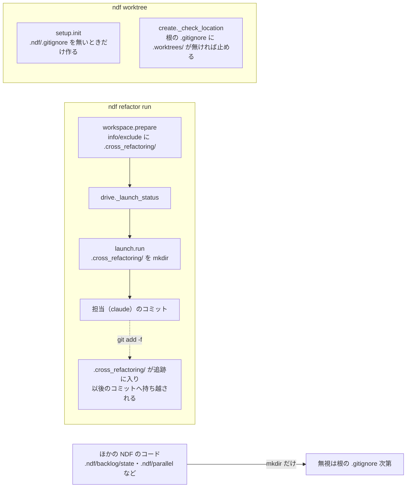
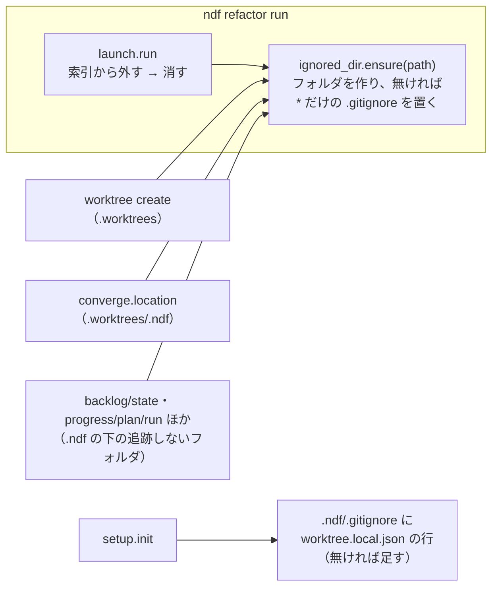

# NDF: リポジトリ管理外のフォルダとファイルを、作る側が置く .gitignore で無視させる（#3500）

NDF がリポジトリの中に作る追跡しないフォルダとファイルの無視の仕方は、置き場ごとに `info/exclude`・根の `.gitignore`・何もしない、が混ざっていて、事例の cross-refactoring の作業ファイル（`.cross_refactoring/`）は一度コミットに入ると追跡され続けた。無視を「フォルダは作る側が中へ `*` だけの `.gitignore` を置く」「`.ndf/` の中のファイルは作る側が `.ndf/.gitignore` へ行を書く」の 2 つにそろえ、根の `.gitignore` の登録には頼らない。事例の作業ファイルは、担当を起動する直前に `.cross_refactoring/` を作り直して索引からも外す。採らなかった案との比較は「決定の記録」の表にある。

## 今の姿

何が起きたか・目的・受け入れ条件は要求仕様（[issue-3500-requirements.md](./issue-3500-requirements.md)、正は #3500 の本文）にある。この文書は「どう解くか」と「なぜその解き方か」だけを書く。

- `.cross_refactoring/` を作るのは `launch.run` の 1 か所である（`Path(where.submit).parent.mkdir(...)`）。担当が動くディレクトリ（コードを書く工程は `work/`、読み取りの工程は `read/<ランタイム>/`）の根に作り、担当が結果ファイルと進捗のファイルを書く。結果ファイルは起動の直後に回収先へ移され、進捗のファイルは残る
- `.cross_refactoring/` の無視は、cross-refactoring の `workspace._exclude_results` が共通の git ディレクトリの `info/exclude` に足す 1 行だけである。除外は追跡済みのファイルに効かない（STD1）。担当が一度 `git add -f` で入れると、その後の担当のコミットにも入り続ける。起動の前に作業ファイルを片付ける所は無い
- `.worktrees/` は worktree の Skill の手順 2-2 がシェルで根の `.gitignore` に足し、`create._check_location` が無視の対象でなければ止める
- NDF のコードが `.ndf` の下に追跡しないフォルダを作る所（`backlog/state.py` の `.ndf/backlog/state`、`progress/plan/run.py` の `.ndf/parallel` など）は `mkdir` するだけで、無視は利用者の根の `.gitignore` 次第である（ai-plugins では手で書いた `.ndf/.gitignore` の行と根の `tmp/` が当たっている）
- `.ndf/.gitignore` は `setup.init` が無いときだけ作り、個人設定（`.ndf/worktree.local.json`）の 1 行を書く。`.ndf/` の中の追跡しないファイルは、工程が書くファイルの表（`plugins/ndf/contracts/domains/ndf-files.json`）で `location` が `ndf` で `tracked` が偽の行で、今はこの 1 つだけである

## 文脈と制約

- 2026-11-23 の設計承認ゲート（3 回と補足）で利用者が決めた。コミットの作り直しと失敗したときの備えは持たない。作業ファイルは起動の前に片付ける。`info/exclude` だけの形は採らない。無視は「フォルダは作る側が中へ `*` だけの `.gitignore` を置く」「`.ndf/` の中のファイルは作る側が `.ndf/.gitignore` へ行を書く」の 2 つだけにし、根の `.gitignore` の登録と `ndf worktree init`・`check` の登録の欠けの検査は持たない
- 2026-11-23 に一時のリポジトリ（git 2.53.0）で次を確かめた
  - `mkdir d && printf '*\n' > d/.gitignore` の後、`d/` の中のファイル・下のフォルダの中のファイル・`d/.gitignore` 自身は、`git status --untracked-files=all` に出ず、`git add -A` でも索引に入らず、`git check-ignore` が 0 を返す（`d/.gitignore:1:*` が当たる）
  - 既に追跡された `d/old.log` は、`d/.gitignore` を置いても `git status` に ` M` で出て、`git commit -a` に入る。`git rm -r --cached` で索引から外すと、次のコミットに削除が入り、以後は無視される。だから起動の前の片付け（索引から外す）が要る
  - `.worktrees/.gitignore`（`*`）を置いた後に `git worktree add .worktrees/feat feat` で作ると、主のリポジトリの `git status` に何も出ない。worktree の中では `b.py`・`sub/c.py` が `??` で出て、`git add -A` でコミットに入る（worktree の中の無視は worktree の根より上の `.gitignore` を読まない）。worktree の中身へ影響は無い
  - worktree の中に `.ndf/tmp/.gitignore`（`*`）を置くと、`.ndf/tmp/` の中のファイルは `git status` に出ない
  - メインディレクトリと `git worktree add` した worktree の両方で、単位ごとに置き場を作った。メインディレクトリにだけ `.worktrees`・`.ndf/handoff`・`.ndf/loop`・`.ndf/backlog/state`（中に `*` の `.gitignore`）と `.ndf/worktree.local.json` を、両方の根に `.cross_refactoring`・`.ndf/tmp`・`.ndf/parallel`・`.ndf/sprints`（中に `*` の `.gitignore`）を作り、中にファイルを置いた。メインディレクトリと worktree のどちらの `git status --untracked-files=all` にも何も出なかった
  - `.ndf/.gitignore` は、コミットされた行（`worktree.local.json`）なら worktree でも効いた（worktree に置いた `.ndf/worktree.local.json` は出ない）。メインディレクトリの `.ndf/.gitignore` に未コミットの行（`extra.json`）を足すと、メインディレクトリでは ` M .ndf/.gitignore` が出て、worktree に置いた `.ndf/extra.json` は `??` で出た（worktree には効かない）
- 進捗のファイルは無進捗の監視が起動の間だけ測り、結果ファイルは起動の直後に回収してある。次の起動の前に消しても失うものは無い（要求仕様の前提 1）

## 解き方の全体像

- NDF のコードが追跡しないフォルダを作る所は、どれも新しい共通の関数 `ignored_dir.ensure(path)` を通す。フォルダを作り、中に `.gitignore` が無ければ `*` だけを書いて置く
- `launch.run` は `.cross_refactoring/` を作る前に、追跡されたファイルがあれば索引から外し、フォルダを消してから `ensure` で作り直す。どの工程の起動の前にも通る。cross-refactoring は `info/exclude` へ書くのをやめる
- `ndf worktree create` は `.worktrees/` を `ensure` で作り、根の `.gitignore` の登録を求めない。worktree の Skill の手順 2-2 のシェルの書き足しとコミットはやめる
- `.ndf/` の中の追跡しないファイルは、作る側が `.ndf/.gitignore` へ行を書く。今は `.ndf/worktree.local.json` だけで、その置き場を用意する `setup.init` が、`.ndf/.gitignore` が既にあっても行が無ければ足す
- NDF は根の `.gitignore` を書かず、`ndf worktree init`・`check` は登録の欠けを検査しない

### NDF が作る置き場と、無視する仕組み

置き場は次の 3 つから引いた。

- **置き場の一覧**（設定ファイル `plugins/ndf/contracts/domains/locations.json`）: NDF が使う保存先ごとに、パスと、そのパスをどこから数えるか（この文書では「一覧の起点」と呼ぶ。今の worktree の根か、メインディレクトリの根か）と、git で追跡するかを持つ。ここから、リポジトリの中にあって追跡しない置き場を引いた
- **工程が書くファイルの一覧**（`plugins/ndf/contracts/domains/ndf-files.json`）: NDF の工程が書くファイルごとに、置き場と追跡するかを持つ。ここから、`.ndf/` の中にあって追跡しないファイルを引いた
- cross-refactoring の作業ファイルの置き場（一覧には載っていない）

「仕組み」の 1 はフォルダ自身の `.gitignore`、2 は `.ndf/.gitignore` の行である。「単位」は、置き場が worktree ごとに 1 つあるか、メインディレクトリ（clone した根のディレクトリ）に 1 つだけあるかである。単位は一覧の起点ではなく、その置き場を作る・読むコードと手順書が実際に使うパスで決めた（2026-11-23、main 5c2c1e62d）。一覧の起点が実際と食い違う 3 行（`.worktrees`・`.ndf/handoff`・`.ndf/loop`）は、実装で一覧を直す。

| 置き場 | 種類 | 単位 | 単位を決めた根拠 | 作る所 | 仕組み | 一覧の起点 |
| --- | --- | --- | --- | --- | --- | --- |
| `.cross_refactoring` | フォルダ | worktree ごと | 担当が動く worktree（cross-refactoring が PR ごとに用意する書き込み用・読み取り用の worktree）の根に作る | cross-refactoring の担当の起動（`crossrefactor/launch.py`） | 1（起動の前に作り直す） | 載っていない（今の worktree の根で足す） |
| `.ndf/tmp` | フォルダ | worktree ごと | 一覧の起点が今の worktree の根。メインディレクトリも 1 つの worktree として含む（conductor はメインディレクトリの `.ndf/tmp` に作業ファイルを置く） | 計画の実行の記録を書くコード（未確認のまま残ること） | 1 | 今の worktree の根（合っている） |
| `.ndf/sprints` | フォルダ | worktree ごと | 一覧の起点が今の worktree の根 | スプリントの記録を書くコード（未確認のまま残ること） | 1 | 今の worktree の根（合っている） |
| `.ndf/parallel` | フォルダ | worktree ごと | 計画の記録を書くコード（`progress/plan/run.py`）が、今の worktree の根（`git rev-parse --show-toplevel` の値）から数える | `progress/plan/run.py` | 1 | 今の worktree の根（合っている） |
| `.worktrees` | フォルダ | メインディレクトリに 1 つ | worktree を作るコード（`worktree/repo.py`）と cross 系の作業場所を作るコード（`core/converge/location.py`）が、どちらもメインディレクトリの根から数える | `worktree/create.py`・`core/converge/location.py` | 1 | 今の worktree の根（**食い違う**。メインディレクトリの根へ直す） |
| `.ndf/handoff` | フォルダ | メインディレクトリに 1 つ | `development-workflow` の手順書 `references/handoff.md` が「メインディレクトリの `.ndf/handoff/`（worktree の `.ndf/` には書かない）」と定める。conductor（AI）が書く | 引継ぎ文書を書く手順（AI） | 1 | 今の worktree の根（**食い違う**。メインディレクトリの根へ直す） |
| `.ndf/backlog/state` | フォルダ | メインディレクトリに 1 つ | 棚卸しの状態を書くコード（`backlog/state.py`）が、`git worktree list` の先頭（メインディレクトリ）から数える | `backlog/state.py` | 1 | メインディレクトリの根（合っている） |
| `.ndf/loop` | — | 作業ツリーに無い | 周回の記録を書くコード（`loop/store.py`）は、作業ツリーでなく git の内部のディレクトリ（`.git` の中の `ndf/state`）に書く | — | 要らない | メインディレクトリの根（**食い違う**。git の内部のディレクトリに合わせて直す） |
| `.ndf/worktree.local.json` | ファイル | メインディレクトリに 1 つ | 個人設定を読むコード（`worktree/ndf_settings.py`）がメインディレクトリの `.ndf/` から読む。利用者が書く | 置き場を用意するのは `worktree/setup.py` の初期化 | 2（メインディレクトリの `.ndf/.gitignore`） | 工程が書くファイルの一覧に、追跡しないファイルとして載る |

#### 単位ごとの書き分け

| | worktree ごとの置き場 | メインディレクトリに 1 つの置き場 |
| --- | --- | --- |
| (a) 作るパス | 今の worktree の根（`git rev-parse --show-toplevel`）の下。cross-refactoring は担当が動く worktree の根 | メインディレクトリの下。どの worktree から打っても、メインディレクトリを求めてそこに作る |
| (b) `*` の `.gitignore` を置く所 | 作ったフォルダの中。worktree ごとに 1 つずつ置かれる（作ったフォルダに置くので、別の worktree の分は別に置かれる） | 作ったフォルダの中。メインディレクトリに 1 つだけ置かれる |
| (c) `.ndf/.gitignore` | 使わない（フォルダは仕組み 1） | メインディレクトリの `.ndf/.gitignore` に書く。`.ndf/.gitignore` は追跡されるファイルで、worktree にもそのブランチの版がある。git は各 worktree の作業ツリーの `.gitignore` を読むので、メインディレクトリに書いた未コミットの行はメインディレクトリにだけ効く。対象のファイル（`.ndf/worktree.local.json`）はメインディレクトリにだけあるので、それで足りる |

## 決定の記録

### 決定 1: 登録に頼らず無視させるため、NDF が作るフォルダは作るときに中へ `*` だけの `.gitignore` を置き、`.cross_refactoring/` は担当の起動の前に作り直す

- **質問**: `.cross_refactoring/` と NDF が作るほかのフォルダをどう無視させ、一度入った作業ファイルの持ち越しをどう止めるか
- **選んだ案**: 共通の関数 `ignored_dir.ensure(path)` を足し、NDF のコードが追跡しないフォルダを作る所はすべてこれを通す。`launch.run` は `.cross_refactoring/` の下の追跡されたファイルを `git rm -r -q --cached --ignore-unmatch -- .cross_refactoring` で索引から外し、フォルダを消してから `ensure` で作り直す。cross-refactoring は `info/exclude` へ書くのをやめ、`create` は根の `.gitignore` の登録を求めるのをやめる
- 比べた案（観点は、登録より前に切ったブランチで動くか・利用者のリポジトリに差分が出るか・消し忘れ・実装の量）:

| 案 | 登録より前のブランチ | 利用者のリポジトリの差分 | 消し忘れ | 実装の量 |
| --- | --- | --- | --- | --- |
| **フォルダ自身の `.gitignore`（選んだ案）** | 動く（作るたびに置く） | 出ない（`.gitignore` 自身も無視される） | 起こらない（`.cross_refactoring/` は起動のたびに作り直す） | 中（共通の関数 1 つと、作る所の置き換え） |
| 根の `.gitignore` を初期化（`ndf worktree init`・`check`）で登録（2 回目の案） | 止まる（ブランチに登録が無い。ベースの取り込みが要る） | 出る（初期化のときに 1 回） | 起こらない | 中（初期化・`check`・cross-refactoring の確かめ） |
| `info/exclude` だけ（今の形） | 動く | 出ない | 起こらない | 小さい（今のまま） |
| 起動のたびに根の `.gitignore` を書く | 動く | 出る（担当のコミットに `.gitignore` の差分が混ざりうる） | 起こらない | 小さい |
| 作業ファイルを worktree の外に置く | 動く | 出ない | 起こる（担当ごとの置き場の重複を除く仕組みと、消し忘れを拾う仕組みが別に要る） | 大きい（担当は作業ディレクトリの外を書かない約束を変える） |

- 採らなかった案: `info/exclude` だけ（2026-11-23 の設計承認ゲートで利用者が採らなかった。リポジトリの外から見えない）
- 採らなかった案: 根の `.gitignore` を初期化で登録する・起動のたびに根の `.gitignore` を書く・worktree の外に置く（上の表）
- 採らなかった案: 起動の後に、そのコミットから作業ファイルを除いて作り直す（2026-11-22 の最初の設計。失敗したときの備えまで含めて新設 4 関数になり、利用者が「難しく考えすぎ」としてやめた）
- **残る経路**: 担当が `git add -f` で入れた作業ファイルは、その起動のコミットに残る（次の起動の前の片付けで追跡から外れるが、最後の起動で入れたものと、入れたコミットそのものは残る）
- **代償**: 担当の起動の前に、前の起動の進捗のファイルが消える。作業ファイルが追跡されていたときは、担当の次のコミットに作業ファイルの削除が入る。NDF が作るフォルダの中に `.gitignore` が 1 つずつ増える（無視されるので差分には出ない）
- 根拠: Value 4「どのプロジェクトでもそのまま使える」・Value 6「使うほど散らからない」・Value 11「重複と冗長が無い」（MVV 版 11）

### 決定 2: `.ndf/` の中のファイルは NDF が持つ `.ndf/.gitignore` に書くため、置き場を用意する側が行を足す

- **質問**: フォルダでない `.ndf/` の中の追跡しないファイルを、どこで無視させるか
- **選んだ案**: 作る側が `.ndf/.gitignore` へ行を書く（既にあれば足さず、既存の行は消さない）。今の該当は `.ndf/worktree.local.json` だけで、その置き場を用意する `setup.init` が、`.ndf/.gitignore` が既にあっても行が無ければ足す（今は無いときだけ作る）
- 採らなかった案: フォルダ自身の `.gitignore`（ファイルには使えない。`.ndf/` には追跡する設定がある）
- 採らなかった案: 根の `.gitignore` に書く（`.ndf/` は NDF が持つフォルダで、NDF の `.gitignore` に閉じられる）
- **代償**: 利用者のリポジトリに出る差分は、`.ndf/.gitignore` に行を足すとき（無いときだけ）に限られる
- 根拠: Value 4「どのプロジェクトでもそのまま使える」・Value 9「責務の分かれた設計で作られる」（MVV 版 11）

## 影響と危険

- **働く範囲**: この PR は設計文書だけで、振る舞いは変わらない。実装の後は、利用先のリポジトリでも `ndf refactor run`・`ndf worktree create`・`ndf worktree init` と、`.ndf` の下に記録を書くすべての工程に効く
- **プロジェクトごとに違うもの**: 無い（置き場は置き場の一覧が持つ）
- **当たるモード**: すべてのモード。片付けは cross-refactoring を通すモード
- **利用者のリポジトリへの差分**: `.ndf/.gitignore` に行が無いときだけ、その 1 行が出る。フォルダの中の `.gitignore` は自身も無視されるので差分に出ない。NDF は根の `.gitignore` を書かず、利用者が書いた既存の行（`.worktrees/` など）は消さない
- **登録より前に切ったブランチ**: どのブランチでも動く（根の `.gitignore` を見ない）
- **同じファイルを触る別の変更**: レーン lcrfast が cross-review の #4013・#4014・#4015・#4030 を実装中である。開いている PR #4186 が触るのは `ndf.domains.crossreview`・`ndf.adapters.claude`・`ndf.domains.relay.observe` などで、この設計の触るファイルと重ならない。cross-review は作業ファイルを worktree の外に置くため、共有するロジックは無い。順番の制約は無い
- **壊れうる箇所**: 作り直しを起動の後（回収の前）に置くと、結果ファイルを回収の前に消す。作り直しは `launch.run` が担当を起動する前の、`.cross_refactoring/` を作っていた所だけで行う。`ensure` を通さない `mkdir` が残ると、そのフォルダは根の `.gitignore` 次第に戻る
- **手順書の `Item-Id` の検査がコードに無いこと**は別の欠けで、範囲外として #4195 に起票した

### 代表のリポジトリでの振る舞い

| 代表のリポジトリ | 設定の要点 | 直した後に起きること | この種類で扱えなくなること |
| --- | --- | --- | --- |
| Web サービス（nd-factory） | 実装の PR に cross-refactoring を流し、`.ndf` の下に記録を書く | `.cross_refactoring/` と `.ndf` の下のフォルダは作るたびに自身の `.gitignore` で無視され、根の `.gitignore` に何も足されない。作業ファイルが一度入っても、次の担当の起動の前に追跡から外れる | 無し |
| モバイルアプリ | 同上 | 同上 | 無し |
| 業務文書だけ | cross-refactoring は流さず、`.ndf` の下に記録を書く | `.ndf` の下のフォルダが自身の `.gitignore` で無視される。それ以外は変わらない | 無し |

### ai-plugins だけの事情

- 根の `.gitignore` に `.cross_refactoring/`（49 行目）・`.worktrees/`・`tmp/` が、`.ndf/.gitignore` に `handoff/`・`loop/`・`parallel/`・`sprints/`・`backlog/` が既にある。どれも消さない。直した後はフォルダの中の `.gitignore` と二重に当たるが、振る舞いは変わらない

## テスト設計

| 受け入れ条件 | どの振る舞いで縛るか | どう壊したら落ちるべきか |
| --- | --- | --- |
| 1（フォルダを作るとき `.gitignore` を置く） | `ensure` がフォルダと `*` だけの `.gitignore` を作り、既にある `.gitignore` を書き換えない。置き場の一覧の追跡しないフォルダを作る各所（表の「作る所」）と `launch.run` を通すと `.gitignore` が置かれる | `mkdir` のまま残す・既存の `.gitignore` を上書きする |
| 2（`.ndf/.gitignore` の行） | `.ndf/.gitignore` が既にあって `worktree.local.json` の行が無いリポジトリで `init` を打つと行が足され、2 回目で増えず、既存の行が残る | 無いときだけ作る今の形のまま |
| 3（登録が無くても入らない・根を書かない・止まらない） | 根の `.gitignore` と `info/exclude` に登録が無いリポジトリで、各置き場の中に書いて `git add -A` しても、中の `.gitignore` 自身を含めて入らない。根の `.gitignore` は作られない。`create` は `.worktrees/` の登録が無くても止まらず、cross-refactoring も止まらない | `.gitignore` に `*` を書かない・根の `.gitignore` を書く・登録の確かめを残して止める |
| 4（worktree の中に影響しない） | `.worktrees/.gitignore` を置いた後に `create` で作った worktree で、足したファイルが `git add -A` で入り、主の `git status` に worktree が出ない | `.gitignore` を worktree の中に置く |
| 5（事例 1: 起動の直前に作り直してある） | 担当が動くディレクトリに前の起動の作業ファイルを置き（追跡させた場合も）、担当の偽物を起動する。偽物が起動された時点で、`.cross_refactoring/` には `.gitignore`（`*` だけ）しか無く、`git ls-files .cross_refactoring` が空で、偽物が `git add -A` でコミットすると前の作業ファイルの削除が入る。コードを書く工程と読み取りの工程の両方で確かめる | 作り直しを呼ばない・回収の後に置く・作業ツリーから消すだけで索引から外さない |
| 6（事例 1: ほかを変えない） | 作り直しの後も、作業ディレクトリのほかのファイル・未コミットの変更・HEAD が同じ | `git clean` や `reset` で片付ける |

## どこを変えるか

（詳細設計はこのセクションに畳む。新設する関数 1・シグネチャを変える関数 0 のため）

| ファイル | 変える中身 | 決定 |
| --- | --- | --- |
| `plugins/ndf/src/ndf/core/ignored_dir.py`（新設） | `ensure(path: Path) -> Path` を置く。入力: 作るフォルダ。`path.mkdir(parents=True, exist_ok=True)` の後、`path / ".gitignore"` が無ければ `*\n` を書く（あれば書き換えない。symlink ならたどらずに `OSError`）。返りは `path`。git は使わない | 1 |
| `plugins/ndf/src/ndf/domains/crossrefactor/launch.py` | `run`: `Path(where.submit).parent.mkdir(...)` を、(1) `git.Git(<担当が動くディレクトリ>)` で `ls-files -z -- .cross_refactoring` が空でなければ `rm -r -q --cached --ignore-unmatch -- .cross_refactoring` を打つ、(2) フォルダがあれば消す（`shutil.rmtree`）、(3) `ignored_dir.ensure(<フォルダ>)`、に替える。git の失敗は `GitError`、ファイルの失敗は `OSError` のまま上げる（今の起動の失敗と同じく実行が止まる。担当は起動していない）。シグネチャは変えない | 1 |
| `plugins/ndf/src/ndf/domains/crossrefactor/workspace.py` | `_exclude_results` を消し、`prepare` からの呼び出しを外す。モジュールの説明の「`.cross_refactoring/` を git の除外へ足す」の行を消す | 1 |
| `plugins/ndf/src/ndf/domains/worktree/create.py` | `_check_location`: `check-ignore` で止めるのをやめ、`ignored_dir.ensure(<.worktrees>)` を呼ぶ。保存先が既にあれば止めるのは今のまま。シグネチャは変えない | 1 |
| `plugins/ndf/src/ndf/core/converge/location.py` | `work_root` が作る `.worktrees/.ndf` の親（`.worktrees`）を `ignored_dir.ensure` で作る | 1 |
| `plugins/ndf/src/ndf/domains/backlog/state.py`・`plugins/ndf/src/ndf/progress/plan/run.py` と、置き場の一覧の追跡しないフォルダを作るほかの所 | その置き場のフォルダ（一覧のパス。下の階層ではなく一覧のパスそのもの）を作る `mkdir` を `ignored_dir.ensure` に替える。実装の最初のタスクで、置き場の一覧の各パス（`.ndf/tmp`・`.ndf/handoff`・`.ndf/sprints`・`.ndf/parallel`・`.ndf/backlog/state`）を作る箇所を、置き場の単位（「NDF が作る置き場と、無視する仕組み」の表）のパスに作っているかとあわせて `git grep` で洗い出し、触るファイルを実装計画に列挙する | 1 |
| `plugins/ndf/src/ndf/domains/worktree/setup.py` | `init`: メインディレクトリの `.ndf/.gitignore` が既にあっても、`worktree.local.json` の行が無ければ末尾に足す（既存の行は消さない。`atomic.write_text`）。シグネチャは変えない | 2 |
| `plugins/ndf/contracts/domains/locations.json`（置き場の一覧） | `.cross_refactoring` の行（起点は今の worktree の根、追跡しない）を足す。`.worktrees` と `.ndf/handoff` の行の起点をメインディレクトリの根へ直す。`.ndf/loop` の行を、git の内部のディレクトリに書く実際に合わせて直す | 1 |
| `plugins/ndf/skills/worktree/SKILL.md` | 手順 2-2 のシェル（根の `.gitignore` への書き足しとコミット）を、「`create` が `.worktrees/` を作るときに中へ `.gitignore` を置く」の説明に替える | 1 |
| `plugins/ndf/skills/cross-refactoring/docs/01-state-and-propose.md` | 「作業場所」の「`.cross_refactoring/` は git の除外へ足す」を、「担当を起動する前に `.cross_refactoring/` を作り直す（前の作業ファイルを消し、追跡されていれば索引から外し、`*` だけの `.gitignore` を置く）」に書き換える | 1 |
| `plugins/ndf/tests/core/test_ignored_dir.py`（新設） | 受け入れ条件 1・3 の行 | — |
| `plugins/ndf/tests/domains/crossrefactor/test_launch_and_phase.py` | 受け入れ条件 3・5・6 の行 | — |
| `plugins/ndf/tests/domains/worktree/test_worktree_cli.py` | 受け入れ条件 2・3（`create`）・4 の行 | — |

## 設計の結果

| 課題 | 扱い | 統合先 | 触るファイル |
| --- | --- | --- | --- |
| #3500 | 実装する | — | `plugins/ndf/src/ndf/core/ignored_dir.py`、`plugins/ndf/src/ndf/domains/crossrefactor/launch.py`、`plugins/ndf/src/ndf/domains/crossrefactor/workspace.py`、`plugins/ndf/src/ndf/domains/worktree/create.py`、`plugins/ndf/src/ndf/core/converge/location.py`、`plugins/ndf/src/ndf/domains/backlog/state.py`、`plugins/ndf/src/ndf/progress/plan/run.py`、`plugins/ndf/src/ndf/domains/worktree/setup.py`、`plugins/ndf/contracts/domains/locations.json`、`plugins/ndf/skills/worktree/SKILL.md`、`plugins/ndf/skills/cross-refactoring/docs/01-state-and-propose.md`、`plugins/ndf/tests/core/test_ignored_dir.py`、`plugins/ndf/tests/domains/crossrefactor/test_launch_and_phase.py`、`plugins/ndf/tests/domains/worktree/test_worktree_cli.py` |

## 未確認のまま残ること

| 項目 | 内容 |
| --- | --- |
| `.ndf/tmp`・`.ndf/handoff`・`.ndf/sprints` を作るコードの箇所 | 置き場の id では引けなかった（パスの文字列か別の名前で作っている）。実装の最初のタスクで `git grep` で洗い出し、`ensure` へ替えるファイルを実装計画と「設計の結果」の触るファイルへ足す。AI が手順書に従って手で作る所があれば、その手順書の作り方を `ensure` を通す形にするかを、そのときに決める |

## 外部の調査

| 種類 | 調べるか | 理由 |
| --- | --- | --- |
| 標準・仕様 | 調べる | 除外の効く範囲と、フォルダの中の `.gitignore` の効き方は git の文書が決める |
| 主要な製品 | 調べる | AI のコーディングの道具が自分の作業ファイルをどう扱うか |
| ライブラリとサービス | 調べない | フォルダの作成と `.gitignore` の 1 行と `git rm --cached` だけで、選ぶ道具が無い |

### 標準・仕様

| # | 標準・仕様 | 何を定めているか | 設計への反映 | 出典 |
| --- | --- | --- | --- | --- |
| STD1 | gitignore | 「Files already tracked by Git are not affected」。除外は追跡済みのファイルに効かない。パターンはそれを書いた `.gitignore` のあるディレクトリから相対に当たる | フォルダの中の `*` はそのフォルダの中身と `.gitignore` 自身に当たる。一度入った作業ファイルは止まらないので、起動の前に索引から外す（決定 1） | https://git-scm.com/docs/gitignore （2026-11-22） |
| STD2 | git add | `-f, --force`: 「Allow adding otherwise ignored files」 | 担当が `-f` を打てば無視を越える。この経路は残る（決定 1 の「残る経路」） | https://git-scm.com/docs/git-add （2026-11-22） |

### 主要な製品

| # | 製品 | どう解いているか | 設計への反映 | 出典 |
| --- | --- | --- | --- | --- |
| PRD1 | aider | 自分の作業ファイル（`.aider*`）を根の `.gitignore` へ足す（`--gitignore`、既定で有効） | 根の `.gitignore` を書く形は採らず、作るフォルダの中に `.gitignore` を置く（決定 1 の比較の表） | https://aider.chat/docs/config/options.html （2026-11-22） |

調べた量: 候補 3 件・取得の試み 7 回。
