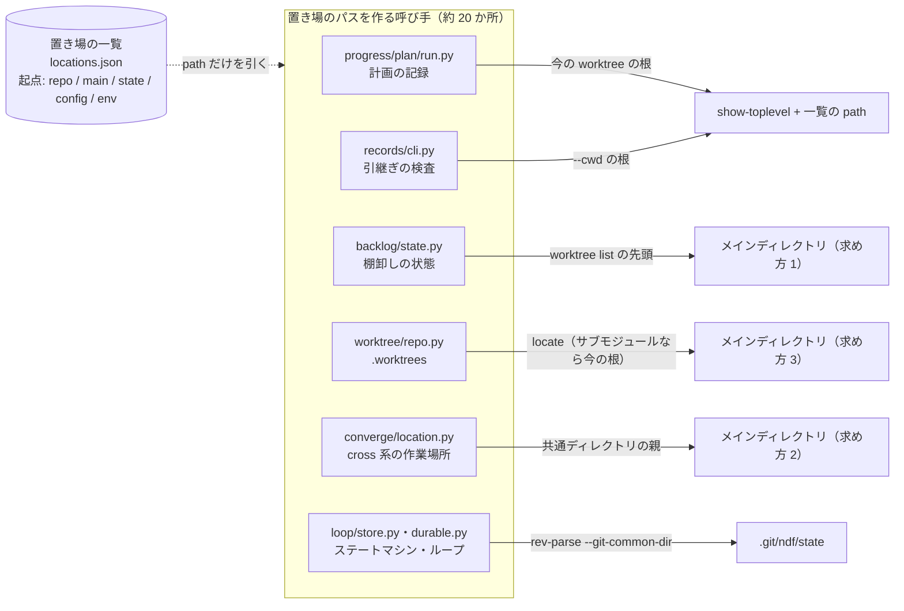
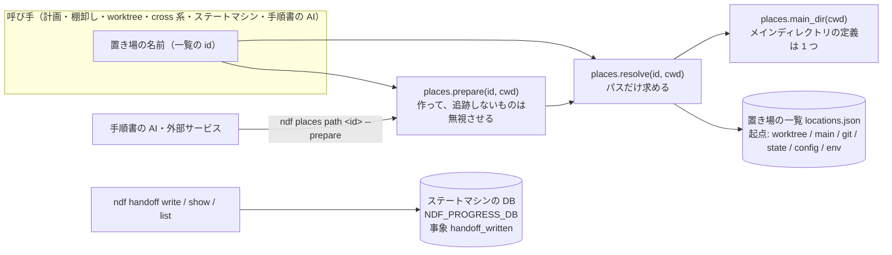

# NDF: どの worktree から打っても置き場が中身の持ち主どおりの 1 か所に決まり、追跡しないものは作る側が無視させる（#3500）

NDF が作るファイルの置き場は、置き場の一覧・コード・手順書がそれぞれ違う起点を使い、メインディレクトリの求め方も 3 通りあって、計画の記録が worktree に落ちる・引継ぎ文書の検査が別の場所を探すといった食い違いが続いていた。置き場を中身の持ち主で 4 種（追跡する設定・人が読む作業状態・機械だけが読む状態・worktree ごとの使い捨て）に分け、一覧の起点を「今の worktree」「メインディレクトリ」「git の共通ディレクトリ」の 3 つにして、パスを求める関数を 1 つにする。追跡しないフォルダとファイルは作る側が作るときに無視させ、引継ぎ文書はリポジトリから出してステートマシンの DB の記録に持つ。置き場ごとの表は「置き場ごとの決まり」に、採らなかった案は「決定の記録」に、実装を分ける子の課題は「子の課題の分け方と順番」にある。

## 今の姿

何が起きたか・目的・受け入れ条件は要求仕様（[issue-3500-requirements.md](./issue-3500-requirements.md)、正は #3500 の本文）にある。置き場ごとの実物とコードの照合（棚卸し）も要求仕様の折りたたみ「置き場の棚卸し」にあり、ここでは写さない。この文書は「どう解くか」と「なぜその解き方か」だけを書く。

- **置き場の一覧**（`plugins/ndf/contracts/domains/locations.json`）は、置き場ごとにパスと、そのパスを数える起点を持つ。リポジトリの中の起点は「今の worktree の根（一覧の値は `repo`）」と「メインディレクトリの根（同 `main`）」の 2 つだけで、git の共通ディレクトリ（`.git`）の起点は無い。そのため `.git/ndf/` の下（ステートマシン・錠・worktree の割り当て）、cross 系の作業場所（`.worktrees/.ndf/`）、cross-refactoring の作業ファイル（`.cross_refactoring/`）は一覧に行が無い
- **呼び手は一覧から path だけを引き、起点を自分で決める。** 起点を読むコードは無い。今の worktree の根から数える関数が 5 つ、メインディレクトリの求め方が 3 通りある（棚卸しの「食い違いを重い順に」8）。その結果、一覧の起点とコードが違う置き場が出ている
  - 計画の記録（`.ndf/parallel/<計画>/run.log`）は `progress/plan/run.py` の `record_dir` が今の worktree の根から数え、worktree から打つと worktree の下に落ちて、片付けで消える
  - 引継ぎ文書（`.ndf/handoff/`）は、一覧は今の worktree、手順書はメインディレクトリ、検査のコマンドは `--cwd` の根を使う
  - `.ndf/loop` は一覧・手順書が `.ndf/loop/<名>/loop.json` を指すが、コードは `.git/ndf/state/loops/<名>/` に書く（外部サービスとの契約の件は #4237）
  - 書き手の無い行（`.ndf/sprints`）と、行の無い置き場（`design.json`・`document.json`・`.ndf/backlog/research/`）がある
- **追跡しないものの無視は置き場ごとにばらばら**で、`.cross_refactoring/` は `info/exclude`、`.worktrees/` は根の `.gitignore` の登録を求め、`.ndf/` の下は利用者の根の `.gitignore` 次第である。事例 1（PR #3491 で作業ファイルがコミットに入った件）は、除外が追跡済みのファイルに効かないことから起きた
- **引継ぎ文書はメインディレクトリのファイル**で、書くのは conductor（AI）、コードは形の検査（`ndf records handoff check`）だけを持つ。中継（relay）の再開コマンドは文書のパス（`.ndf/handoff/<名>.md の続きから`）を含み、復元の検出（`relay/context_records.py` の `HANDOFF_PATH`）も最初の発言のパスで見る。別のマシンで再開すると文書が無い
- **ステートマシンの DB**（`progress/store.py`）は表 4 つ（ステートマシン・定義の改訂・進行の事象・表のバージョン）を持ち、事象は追記だけである。接続先は `NDF_PROGRESS_DB`（無ければ `.git/ndf/state/progress.sqlite`）で、nd-factory は PostgreSQL の URL を入れて複数のマシンで共有している。ステートマシンの階層は `sprint`・`lane`・`plan` の 3 つで、ID は `<階層>:<リポジトリの短いキー>:<名前>`（`progress/model.py` の `machine_id`）

## 文脈と制約

- **利用者の決定（2026-11-23、要求仕様の「利用者の決定」）**: 置き場は中身の持ち主で 4 種に分ける。一覧の起点を 3 つにし、無い行を足し、書き手の無い行を消す。パスを求める関数を 1 つにする。引継ぎ文書はステートマシンと同じ DB に記録の 1 つとして持ち、コマンドで読み書きする。設計は #3500 の 1 本、実装は子の課題に分ける。残骸は決まりを入れた後に退避してから消す
- **前の設計承認ゲートで決めたことを引き継ぐ**: 無視は「フォルダは作る側が作るときに中へ `*` だけの `.gitignore` を置く」「`.ndf/` の中のファイルは作る側が `.ndf/.gitignore` へ行を書く」の 2 つだけにし、根の `.gitignore` と `ndf worktree init` の登録に頼らない。`.cross_refactoring/` は担当を起動する直前に作り直し、追跡されていれば索引からも外す。コミットの作り直しはしない。`git add -f` の経路は残る
- **範囲外**: `loop.json` と `plan-progress`（外部サービスが読むファイル）の契約とコードの食い違いは #4237 が持つ。状態の保存先（`state`・`config`・`env` の起点。`~/.local/state/ndf` など、マシンと利用者の単位）の置き場はリポジトリの外で、4 種の対象にしない
- **後方互換は要らない**（普及の前。値の改名・置き場の移し替えは自由）。守るのは代表のリポジトリの種類を扱えることだけ
- 2026-11-23 に一時のリポジトリ（git 2.53.0）で確かめた
  - フォルダの中に `*` だけの `.gitignore` を置くと、中身と `.gitignore` 自身は `git status`・`git add -A` に出ない。追跡済みのファイルには効かず、`git rm -r --cached` で外すと次のコミットに削除が入る
  - `.worktrees/.gitignore` を置いても、その下に作った worktree の中のファイルは worktree の側で無視されない
  - `.ndf/.gitignore` のコミットされた行は worktree でも効き、メインディレクトリでの未コミットの行はメインディレクトリにだけ効く
  - `git worktree add <共通ディレクトリ>/ndf/work/rf1 feat` で、git の共通ディレクトリの中に worktree を作れ、中で `git add -A`・`git commit` が通り、メインディレクトリの `git status` に何も出ない

## 解き方の全体像

- NDF が作るファイルとフォルダは、どれも置き場の一覧の 1 行に載り、行は中身の持ち主の種（4 種）と起点（今の worktree・メインディレクトリ・git の共通ディレクトリ）を持つ。種ごとの置き場は下の表のとおりで、どの worktree から打っても同じ置き場の名前は同じパスになる
- パスは `places.resolve` だけが求め、作るのは `places.prepare` だけである。`prepare` は追跡しないフォルダに `*` だけの `.gitignore` を置き、`.ndf/` の中の追跡しないファイルは `.ndf/.gitignore` に行を書く。手順書の AI と外部サービスは `ndf places path <id>` の結果 JSON でパスを受け取り、パスを自分で組まない
- 引継ぎ文書はリポジトリに置かず、引き継ぐ対象のステートマシン（スプリント・レーン・計画）の事象 `handoff_written` として DB に追記する。人と AI は `ndf handoff write / show / list` で読み書きし、中継の再開コマンドはステートマシンの ID を持つ。`NDF_PROGRESS_DB` を共有すれば別のマシンでも同じ引継ぎを読める
- 一覧から外れた置き場（10 系の記録・引継ぎ文書のファイル・書き手の無い置き場）は、`ndf places sweep` が `.git/ndf/retired/<日時>/` へ退避し、次の掃除で 14 日を過ぎたものを消す

### 置き場ごとの決まり

列の意味: 「種」は利用者の決定の 4 種（設定＝追跡する設定、作業状態＝人が読むブランチをまたぐ作業状態、機械＝機械だけが読む状態、使い捨て＝worktree ごとの使い捨て）。「一覧の起点」は直した後の値（今の worktree の根＝`worktree`、メインディレクトリの根＝`main`、git の共通ディレクトリ＝`git`）。「無視」は、フォルダ＝作るときに中へ `*` だけの `.gitignore`、行＝`.ndf/.gitignore` に行、要らない＝作業ツリーの外。「子」は下の「子の課題の分け方と順番」の番号。

| 置き場（直した後） | 中身と持ち主 | 種 | 一覧の起点 | 無視 | 今のコードとの食い違い | 子 |
| --- | --- | --- | --- | --- | --- | --- |
| `.ndf/project.json`・`mvv.json`・`backlog.json` ほか設定 | 人と解析が書く設定。ブランチとともに PR で変える | 設定 | worktree | 追跡する | 無し（`branch_strategy`・`allowed` はキー単位でメインディレクトリから読む宣言が既にある） | — |
| `.ndf/worktree.json` | worktree の運用の設定 | 設定 | worktree | 追跡する | ファイル全体をメインディレクトリから読む（`ndf_settings.py`）。`guard`・`remote` をキー単位でメインディレクトリから読む宣言（`main_keys`）にし、`deps` は今の worktree から読む | 2 |
| `.ndf/release.json` | リリースの手順 | 設定 | worktree | 追跡する | ファイル全体をメインディレクトリから読む（`release/cli.py`）。全キーを `main_keys` に宣言して同じ振る舞いを一覧で表す | 2 |
| `.ndf/design.json`・`document.json` | 代表のリポジトリ・文書の投稿先の設定 | 設定 | worktree | 追跡する | 工程が書くファイルの一覧（`ndf-files.json`）に行が無い。行を足す | 1 |
| `.ndf/worktree.local.json` | 利用者のマシンの値 | 作業状態 | main | 行 | 一覧の起点が `repo`。`.ndf/.gitignore` は `ndf worktree init` が無いときだけ作る。`prepare` が行を足す形にする | 1 |
| `.ndf/parallel/<計画>/`（`plan.json`・`run.log`） | 計画（全レーンを束ねる） | 作業状態 | main | フォルダ | **`record_dir` が今の worktree の根から数える**（要求仕様の受け入れ条件 7） | 1 |
| `.ndf/backlog/state/<repo>/` | 課題の棚卸しの状態 | 作業状態 | main | フォルダ | 無し（求め方だけ `places.main_dir` へ寄せる） | 1 |
| `.ndf/backlog/research/` | 外部の調査の記録 | 作業状態 | main | フォルダ | 一覧に行が無い。行を足す | 1 |
| `.ndf/notes/<作業>/`（新設） | conductor と supervisor の作業メモ（承認資料・PR 本文・cross-review の出力） | 作業状態 | main | フォルダ | 今は慣習で `.ndf/tmp/<レーン>/` に置き、手順書に決まりが無い。`scratch` の行を移す | 2 |
| `.worktrees/` | 開発の worktree の置き場 | 作業状態 | main | フォルダ | 一覧の起点が `repo`、コードはメインディレクトリ。根の `.gitignore` の登録を求める（`create._check_location`）のをやめる | 1・2 |
| `.git/ndf/state/`（`progress.sqlite`・`dbos/`・`progress-work/`・`loops/`） | ステートマシン・耐久の記録・周回の記録。**引継ぎもここ（DB の事象）** | 機械 | git | 要らない | 一覧に行が無い。行を足す | 1 |
| `.git/ndf/worktree-registry.json`・`worktree-trash/` | worktree の割り当てと退避 | 機械 | git | 要らない | 一覧に行が無い | 1 |
| `.git/ndf/locks/`（`main.lock`・`branch-strategy.lock`・`acceptance-<N>.lock`） | 錠 | 機械 | git | 要らない | `ndf-main.lock`・`ndf-branch-strategy.lock` が `.git/` の直下にある。`.git/ndf/locks/` へ寄せる | 2 |
| `.git/ndf/work/<rf番号>/` | cross 系の作業場所（相手役の worktree） | 機械 | git | 要らない | 今は `.worktrees/.ndf/` で一覧に行が無い。移す（「未確認のまま残ること」の 1 を先に確かめる） | 2 |
| `.git/ndf/retired/<日時>/`（新設） | 残骸の退避先 | 機械 | git | 要らない | 無い | 4 |
| `.ndf/tmp/` | テストの出力などの使い捨て（`junit.xml` など） | 使い捨て | worktree | フォルダ | 無視は根の汎用の `tmp/` 行だけ。作業メモが混ざる（`.ndf/notes` へ分ける） | 1・2 |
| `.cross_refactoring/` | cross-refactoring の担当の提出物と進捗（担当が動く worktree） | 使い捨て | worktree | フォルダ（起動の前に作り直す） | 一覧に行が無い。`info/exclude` に足すだけで、一度入ると持ち越す（事例 1） | 2 |
| ~~`.ndf/handoff/`~~ | 引継ぎ文書 → ステートマシンの DB の事象へ移す | — | 行を消す | — | 一覧・手順書・検査の起点が 3 つともそろっていない | 3・4 |
| ~~`.ndf/sprints/`~~ | 書き手が無い | — | 行を消す | — | 一覧にだけある | 1 |
| ~~`.ndf/loop/`~~ | 書き手が無い（周回の記録は `.git/ndf/state/loops/`） | — | 行を #4237 が直す | — | 一覧・手順書・実物がコードと違う所を指す | #4237 |

外部サービスが読む置き場（`loop.json`・`plan-progress`）のパスは #4237 が `ndf places path` と同じ結果 JSON で渡す形に直す。この設計は起点 `git` と `ndf places path` を用意するところまでを持つ。

#### 起点ごとの求め方

| 起点（一覧の値） | 求め方 | 求められないとき |
| --- | --- | --- |
| 今の worktree の根（`worktree`） | `git rev-parse --show-toplevel` | git の外なら `PlaceError`（`precondition`） |
| メインディレクトリの根（`main`） | `places.main_dir`: `git worktree list --porcelain` の先頭の worktree。先頭が bare・報告されたパスがその worktree の最上位でない・共通ディレクトリが違うなら `PlaceError`（今の `converge/location.main_worktree` の確かめを移す） | 同上 |
| git の共通ディレクトリ（`git`） | `git rev-parse --path-format=absolute --git-common-dir` の実体 | 同上 |
| 状態・設定・環境変数（`state`・`config`・`env`） | 今のまま（`identity` の状態の保存先・`CLAUDE_CONFIG_DIR`・列 `env` の値） | 今のまま |

一覧の列 `env` の値があれば、どの起点でもその値を先に使う（今の `NDF_UPKEEP_STATE_DIR`・`NDF_WORKTREE_BASE` の振る舞い）。

### 引継ぎの記録

| 項目 | 決めたこと |
| --- | --- |
| どの表 | ステートマシンの DB の「進行の事象」の表（`ndf_progress_events`）。新しい表は作らず、表のバージョン（`SCHEMA_VERSION`）も上げない。事象の決まり（`contracts/workflow/progress.json` の `events`）に `sprint`・`lane`・`plan` の 3 階層ぶん、種類 `handoff_written`（`scope: table`、状態を変えない、書き手は `conductor`・`organizer`）の行を足す |
| ID | 引き継ぐ対象のステートマシンの ID（`<階層>:<リポジトリの短いキー>:<名前>`）。コマンドは `<階層>:<名前>` の短い形も受け、リポジトリは `cwd` から求める（`machine_id` と同じ計算） |
| 版 | 事象の連番（`seq`）。書くたびに 1 件追記し、上書きも削除もしない。`show` は最後の `handoff_written` を返し、`--seq` で前の版を返す |
| 中身（事象の `payload`） | `{"body": <本文の Markdown>, "history": <この版で終わった項目の Markdown>, "lines": <行数>, "bytes": <バイト数>}`。`history` は今の `<名>-history.md` の代わりで、版ごとの差分（`--trim` が移したセクション。`--trim` でなければ空）だけを持つ。`show --history` は全版の差分を古い順につなぐので、通常の `write` を挟んでも履歴は消えず、版ごとに累積を複写しない |
| 読む範囲 | 状態の畳み込み・事象の追記の確かめ・`ndf progress` の `history` の出力は、`handoff_written` の `payload` を読まない（`read_events` が SQL で外す）。本文は `ndf handoff show / write / import` だけが、要る版だけを読む |
| 形の検査 | 今の `records/handoff.py` の検査（セクションの形・`handoff.lines` 300 行・`handoff.bytes` 16,000 バイト）を `write` の中で通し、違反なら追記しない |
| 寿命 | ステートマシンと同じ。ステートマシンが閉じても事象は残り、読める。ファイルの「対象の最後の工程の後に conductor が消す」は無くなる |
| 書かないもの | 今の手順書と同じ（承認を許可として書かない・認証情報とトークンを書かない） |

| コマンド | 入力 | 出力（結果 JSON の `outputs`） | 終了コード |
| --- | --- | --- | --- |
| `ndf handoff write <ID> --file <パス か ->` `[--trim]` | 本文（標準入力か、ファイル） | `machine_id`・`seq`・`lines`・`bytes`。違反は `items[].violation` | 0 / 1（形の違反。追記しない）/ 2（ID のステートマシンが無い・引数の誤り）/ DB の止まりは今の `store_*` の理由 |
| `ndf handoff show <ID>` `[--seq N] [--history]` | — | 標準出力へ本文（`--history` なら終わった項目）。`--json` で `body`・`seq`・`at` を結果 JSON で返す | 0 / 2（ID が無い・まだ書かれていない） |
| `ndf handoff list` `[--open]` | — | このリポジトリのステートマシンのうち `handoff_written` を持つものの `machine_id`・`level`・`name`・最後の `seq` と `at`・状態。`--open` は閉じていないものだけ（スプリントと計画は全体の状態が終わりでない、レーンは終わりでない行が 1 つ以上ある） | 0 |
| `ndf handoff import <名>` `[--to <ID>]` | 前の版の `.ndf/handoff/<名>.md` と `<名>-history.md`（子の課題 3。名前は単一のファイル名、本文と履歴は旧フォルダの中の通常のファイルに限る） | 行き先は `--to` か、旧ファイル名の規則（詳細設計の「旧ファイル名と移し先」。`issue-<番号>` はその課題のスプリント、`sprint-<名>` は `sprint:<名>` か `lane:<名>`、`parallel-<名>` は `plan:<名>`）で求めた名前に完全一致する閉じていないステートマシン（引継ぎの有無によらない）。行き先があれば本文と履歴を 1 版で書き、読み直して一致したら 2 つのファイルを退避先へ動かす。行き先が無い（閉じた・無いステートマシン）か、行き先に `ndf handoff write` の版が既にあれば、書かずに退避先へ動かす。途中で止まっても、再実行は DB の移し済みの版を正として残りだけを動かす | 0 / 1（形の違反・読み直しの不一致・移した後に書き換わったファイル。ファイルは動かさない）/ 2（名前やファイルの形の違反・行き先が 2 つ以上） |

**中継の再開での読み方**: カットポイントで conductor は `ndf handoff write <ID>` で書き、`ndf-next` のブロックの再開コマンドに ID を入れる（例: `/goal /ndf:development-workflow #928 ndf handoff show sprint:s928 の続きから`）。新しいセッションの手順 0 は `ndf handoff show <ID>` で読む。サービスの再開（エントリポイント `block-next`）の引数は契約を変えずに `#<番号>`・`--loop <名>` のままにし、手順 0 は入力に ID が無ければ `ndf handoff list --open` から、名前が入力の課題番号かループ名に完全一致する 1 件を選ぶ（閉じたステートマシンと部分一致は候補にしない）（2 件以上なら今の「一致しないとき」の扱いと同じ）。0 件のときは、すぐ「引継ぎなし」にせず、入力から求めた ID（課題番号ならそのスプリント、ループ名ならループの ID）で `ndf handoff show <ID>` を打ち、前の版の文書の有無を確かめる。それも無いときだけ「引継ぎなし」として状態の確かめから始める。復元の検出（`context_records.HANDOFF_PATH`）は、最初の発言の `ndf handoff show` を見る形にし、前の版の再開コマンド（`.ndf/handoff/<名>.md の続きから`）も引き続き検出する。前の版の文書しか無い対象では、`show` が「まだ引継ぎが無い」と一緒に移すコマンド（`ndf handoff import <名> --to <ID>`）を結果 JSON で返し、手順 0 はそれを打ってから読む。前の版のパスを含む再開コマンドでは、手順 0 はパスの `<名>` で `ndf handoff import <名>` を打ち、結果の行き先の ID で `show` を読む。旧ファイル名（`issue-<番号>.md`・`sprint-<名>.md`・`parallel-<名>.md`）と ID の対応は詳細設計の「旧ファイル名と移し先」が決め、`show` と `import` の両方が同じ規則を使う（詳細設計の「前の版の引継ぎ文書の移し替え」）。

**置き換える手順書の範囲**: `development-workflow` の `references/handoff.md`（保存先と名・作る・更新する・読む・消す。名の表は「ステートマシンの選び方」の表に変える）、`references/context-window.md`（新しい会話で戻す の手順 0 と例）、`references/relay.md`（カットポイントの引継ぎ文書と ndf-next・例のコマンド）、`restart` の `SKILL.md`（4 か所）、`development-workflow` の `SKILL.md`（カットポイントの行）、`references/project-analysis.md`（`.ndf/` の追跡の例外）、`references/parallel.md`・`parallel-cross-repo.md`・`references/glossary.md`（各 1 か所）。`ndf records handoff check` は `ndf handoff write` に吸収して消す。

**引き継ぐ対象の選び方**: 会話がスプリントのステートマシンを使っていればそのスプリント、レーンとして動いていればレーン、計画を回すオーガナイザーなら計画。開発ループ（`--loop`）は、ループの今のスプリントでなく、ループの再開が読む記録に付ける（「未確認のまま残ること」の 2）。ステートマシンの無い会話（スプリントを始める前の相談など）は引継ぎを作らない。

### 残骸の退避と削除

| 残骸 | 今ある所 | 扱い |
| --- | --- | --- |
| 10 系のスプリントの記録 `.ndf/sprint-*/`（34 個）・`.ndf/sprints/` | メインディレクトリの `.ndf/` | 退避して消す |
| `.ndf/loop/`（10 系の `lcore`・`lproc` など） | 同上 | 退避して消す（#4237 が一覧の行を直した後） |
| `.ndf/backlog/` の直下の 10 系の記録（`causes.jsonl`・`depths.jsonl`・`owner.json`・`overhaul/`・`review-*.json`） | 同上 | 退避して消す（`state/` と `research/` は残す） |
| 引継ぎ文書 `.ndf/handoff/*.md`（86 件）と `*-history.md` | 同上 | 子の課題 3 の版を入れたら 1 件ずつ `ndf handoff import` で移す。閉じていないステートマシンが行き先なら本文と履歴を DB に書き、読み直して一致したときだけファイルを退避する。閉じた対象・ステートマシンの無い対象は退避だけする（どちらにするかはコードがステートマシンの状態で決める）。フォルダは空になってから `sweep` が退避する |
| `.cross_review/` | 根 | 退避して消す |
| `.worktrees/.ndf/` | メインディレクトリ | cross 系の作業場所が実際に `.git/ndf/work/` へ移った環境だけで扱う（今の `ndf-work` の保存先が `.worktrees/.ndf` かその中なら動かさない）。NDF の終わった作業場所（並びが一致しロックが無い）で、24 時間使われておらず、HEAD が参照から届き、変更・未追跡・無視されたファイルが無いものだけを `git worktree remove` し、登録された worktree が 1 つも残らなかったときだけ退避する |
| `.git/ndf/{estimate, sprint-limpl, step-history.jsonl, test-run, state.v10-*}`・`.git/ndf-main.lock`・`.git/ndf-branch-strategy.lock` | git の共通ディレクトリ | 退避して消す（錠は誰も持っていないことを確かめてから） |

- **退避と削除は `ndf places sweep` が行う。** 残骸のパスは置き場の一覧に、退避の前提条件（`plain`・`flock`・`worktree-parent`・`empty-dir`）を値に持つ `retired` の行として載せ（コードがパスを選ぶ。AI に選ばせない）、`sweep` は前提条件と移す前の検査（今の保存先と同じかその祖先・symlink や作業ツリーの外・追跡されたファイルを含む、のどれかなら動かさない）を通ったパスだけを `.git/ndf/retired/<日時>-<乱数>/`（実行ごとに新しく作り、既にある退避は上書きしない）へ移し、移したパスと移さなかった理由を結果 JSON に並べる。同じ `sweep` は 14 日を過ぎた退避を消す。行の中身は詳細設計の「残骸の退避」にある
- 打つのは後片付けの Skill（`merged`）で、承認を求めない。退避（`rename`）は 14 日の間戻せ、消すのは 14 日の後である。`.worktrees/.ndf` の下で打つ `git worktree remove` だけは戻せないが、外すのは上の条件を満たす作業場所だけで、失うのは参照から届くコミットと同じ中身の作業ツリーと Git の登録だけである。根の `.gitignore` と `.ndf/.gitignore` の利用者の行は消さない。ai-plugins の `.ndf/.gitignore` に残る 10 系の行は、子の課題 4 の PR で手で直す

### 子の課題の分け方と順番

| 順 | 子の課題（仮題） | 中身 | 前提 | 触る主な所 |
| --- | --- | --- | --- | --- |
| 1 | 置き場の一覧の起点を 3 つにし、パスを求める関数を 1 つにする | 一覧の起点を `worktree`・`main`・`git`（と既存の `state`・`config`・`env`）にし、行を足す・消す（表の子 1）。`places.resolve`・`prepare`・`main_dir` と `ndf places path` を新設し、置き場のパスを作る呼び手を置き換える（計画の記録の食い違いを直し、linked worktree にある前の版の計画の記録を移す。移し先に同じ名前があれば移さずに警告）。`prepare` の無視（フォルダの `.gitignore`・`.ndf/.gitignore` の行）。`show-toplevel` に一覧の path を足す形を検査で落とす | 無し | `core/places.py`（新設）・`contracts/domains/locations.json`・`ndf-files.json`・呼び手 約 20 か所・`checks/` |
| 2 | 置き場を決まりどおりに移し、追跡しないものを作る側で無視させる | 作業メモを `.ndf/notes/` へ、錠を `.git/ndf/locks/` へ、cross 系の作業場所を `.git/ndf/work/` へ移す。`worktree.json`・`release.json` の `main_keys`。事例 1（`.cross_refactoring/` を起動の前に作り直し、`info/exclude` をやめる）。`ndf worktree create` が根の `.gitignore` の登録を求めるのをやめる。手順書（`worktree`・`cross-refactoring`・作業メモの置き場）を合わせる | 1 | `crossrefactor/launch.py`・`workspace.py`・`worktree/create.py`・`converge/location.py`・`worktree/mainlock.py`・`project/strategy_write.py`・`loop/acceptance.py`・`ndf_settings.py`・`release/cli.py`・手順書 |
| 3 | 引継ぎ文書をステートマシンの DB の記録にする | 事象 `handoff_written`、`ndf handoff write / show / list`、中継の復元の検出、手順書（「引継ぎの記録」の置き換える範囲）。一覧の `ndf-handoff` の行を消し、`retired-handoff` の行を足す。再開の読み先を切り替える同じ PR で、`ndf handoff import` による引継ぎ文書と履歴のファイルの移し替えと退避を入れる（切り替えた版で旧文書から再開できる） | 1（`import` が `places.resolve`・`retired_slot` を使う） | `progress/`（`store.py` の読み書き）・`domains/records/handoff.py`・新しい `domains/handoff/`・`relay/context_records.py`・`contracts/workflow/progress.json`・手順書 |
| 4 | 残骸を退避してから消す | `ndf places sweep`、一覧の `retired` の行（`retired-handoff` を除いてこの PR で足す）、`merged` から打つ。ai-plugins の `.ndf/.gitignore` の 10 系の行を直す | 2・3、#4237 | `core/places.py`・`locations.json`・`skills/merged`・`.ndf/.gitignore` |
| — | `loop.json` と `plan-progress` の契約の食い違い（#4237、起票済み） | 外部サービスに渡すパスを結果 JSON にする | 1 の後が望ましい（起点 `git` と `ndf places path` を使える） | — |

子の課題は設計の承認の後に起票し、本文の受け入れ条件は「テスト設計」の行をその子へ分けて写す。用語集へ足す語（「置き場の一覧の起点」「引継ぎの記録」）は子の課題 1・3 の PR で足す。

## 決定の記録

### 決定 1: 置き場を 1 か所に決めるため、中身の持ち主で 4 種に分け、一覧の起点を「今の worktree」「メインディレクトリ」「git の共通ディレクトリ」の 3 つにする

- **質問**: NDF が作るファイルとフォルダを、どの基準でどこに置くか
- **選んだ案**: 中身の持ち主で 4 種に分ける（利用者の決定）。追跡する設定は今の worktree の `.ndf/`（PR で差し替えられて困るキーだけ `main_keys` でメインディレクトリから読む）、人が読むブランチをまたぐ作業状態はメインディレクトリの `.ndf/`、機械だけが読む状態は `.git/ndf/`、使い捨ては今の worktree。一覧の起点の値を `repo` から `worktree` へ改名し、`git` を足す。作業メモは `.ndf/tmp` から `.ndf/notes` へ分ける（`.ndf/tmp` は使い捨てに残す）
- 採らなかった案: 今のコードが作る所を一覧へ写す（計画の記録のように、コードの誤りを一覧が追認する）
- 採らなかった案: 機械の状態もメインディレクトリの `.ndf/` に置く（`git clean -X` と利用者の `.gitignore` の影響を受け、無視の登録が要る。`.git/ndf/` は作業ツリーの外で、どの worktree からも同じ所になる）
- 採らなかった案: 作業メモを `.ndf/tmp` のまま置く（メインディレクトリでは作業メモ、worktree ではテストの出力になり、1 つの行に起点が 2 つ要る）
- **代償**: cross 系の作業場所・錠・作業メモの置き場が変わり、移す間に古い置き場に残るものは残骸として退避する。`.git/ndf/` の中は人とエディタから見えにくい（機械だけが読むので扱いに困らない）
- 根拠: Value 4「どのプロジェクトでもそのまま使える」・Value 6「使うほど散らからない」・Value 9「責務の分かれた設計で作られる」（MVV 版 11）

### 決定 2: どの呼び手も同じパスを得るため、パスを求める関数を `places.resolve` 1 つにし、メインディレクトリの定義を `git worktree list` の先頭に決める

- **質問**: 約 20 か所の呼び手がそれぞれ起点を決めている形を、どうそろえるか
- **選んだ案**: 新しいモジュール `ndf.core.places` に、置き場の名前（一覧の id）と `cwd` を受けて一覧の起点どおりにパスを返す `resolve`、作って無視させる `prepare`、メインディレクトリを返す `main_dir` を置く。メインディレクトリは `git worktree list` の先頭の worktree とし、今の `converge/location.main_worktree` の確かめを移す。ほかの求め方（共通ディレクトリの親・`locate`）と、`show-toplevel` に一覧の path を足す形は消し、検査で落とす。手順書の AI と外部サービスには `ndf places path <id> [--prepare]` の結果 JSON でパスを渡す
- 作り方: 自前の関数 3 つと CLI 1 つ。一覧の読み方は今の `contracts.facts` を使う
- 比べた候補: 起点ごとの関数を呼び手に選ばせる今の形（選び間違いが今の食い違いを生んだ）、パスのライブラリ（`platformdirs` はマシンと利用者の単位の保存先を求めるもので、git の worktree を知らない）
- 採らなかった案: 共通ディレクトリの親をメインディレクトリとする（`--separate-git-dir` のリポジトリで主 worktree でない。PR 3944 の r6-2）
- 採らなかった案: `locate` の形（サブモジュールでは今の根をメインとみなし、`git worktree list` の先頭と食い違う）
- **代償**: 呼び手 約 20 か所を置き換える。`git worktree list` を打つ分だけ遅い（1 回のコマンドで数ミリ秒）
- 根拠: Value 9「責務の分かれた設計で作られる」・Value 11「重複と冗長が無い」（MVV 版 11）

### 決定 3: 登録に頼らず無視させるため、追跡しないものは `places.prepare` が作るときに無視させ、`.cross_refactoring/` は担当の起動の前に作り直す

- **質問**: 追跡しないフォルダとファイルを、利用者のリポジトリの設定に頼らずにどう無視させ、一度入った作業ファイルの持ち越しをどう止めるか
- **選んだ案**: `prepare` が、一覧で追跡しない行のフォルダを作るときに中へ `*` だけの `.gitignore` を置き（既にあれば書き換えない）、`.ndf/` の中の追跡しないファイルは `.ndf/.gitignore` に行を足す（既にあれば足さない）。`.git/ndf/` の下は作業ツリーの外なので何もしない。cross-refactoring はコードを書く工程の起点を記録する直前に、`.cross_refactoring/` が追跡されていればフォルダを作業ツリーの外へ退避して `git commit -- .cross_refactoring` で削除だけをコミットし（パスを指定した `git commit` は作業ツリーを読むので、先に退かす。ほかのステージ済みの変更はコミットに入らない）、フォルダを消して `prepare` で作り直す。`info/exclude` へ書くのと、`ndf worktree create` が根の `.gitignore` の登録を求めるのをやめる
- 採らなかった案: 根の `.gitignore` を初期化で登録する（登録より前に切ったブランチで止まり、利用者のリポジトリに差分が出る）
- 採らなかった案: `info/exclude` だけ（今の形。リポジトリの外から見えず、追跡済みのファイルに効かない）
- 採らなかった案: 起動の後にコミットから作業ファイルを除いて作り直す（最初の設計。利用者が「難しく考えすぎ」としてやめた）
- **残る経路**: 担当が `git add -f` で入れた作業ファイルは、その起動のコミットに残る（次の起動の前の片付けで追跡から外れる）
- **代償**: 担当の起動の前に前の起動の進捗のファイルが消える。追跡されていたときは、工程の起点を記録する前に NDF が削除だけのコミットを 1 つ足す（既存のコミットは作り直さない）。起点より前にあるので、最後の修正の範囲の検査とフレーキーの直しの検査・集計は SHA を受け渡さずに担当のコミットだけを見る。担当のコミットには削除が入らない。コードを書く工程の起動ごとに `git ls-files` が 1 回増える（作業場所の用意の `info/exclude` の 1 回は減る）。フォルダの中に `.gitignore` が 1 つずつ増える（無視されるので差分に出ない）
- 根拠: Value 4「どのプロジェクトでもそのまま使える」・Value 6「使うほど散らからない」（MVV 版 11）

### 決定 4: 別のマシンでも状態と引継ぎをそろえて読むため、引継ぎ文書をステートマシンの DB の事象として持ち、コマンドで読み書きする

- **質問**: 引継ぎ文書をどこに、何の単位で持つか
- **選んだ案**: 引き継ぐ対象のステートマシン（スプリント・レーン・計画）の事象 `handoff_written` として、進行の事象の表に追記する（利用者の決定）。単位はステートマシンごとで、版は事象の連番。`ndf handoff write / show / list` で読み書きし、中継の再開コマンドは ID を持つ。`.ndf/handoff` は一覧から消す
- 作り方: 今の事象の表と事象の決まりに行を足すだけで、表を足さない。形の検査は今の `records/handoff.py` を使う
- 比べた候補: 引継ぎ専用の表を足す（表のバージョンを上げ、SQLite のバックアップと PostgreSQL の移行の手間が増える。追記だけの事象の表で版も取れる）
- 採らなかった案: メインディレクトリの `.ndf/handoff/` に置く（今の形。別のマシンで再開すると文書が無い）
- **代償**: 人はエディタで直接開けず、`ndf handoff show` を打つ。DB に繋げないと読めない（そのときはステートマシンも読めないので、再開そのものができない）。過去の版は消えずに DB に残る
- 根拠: Value 4「どのプロジェクトでもそのまま使える」・Value 6「使うほど散らからない」（MVV 版 11）

### 決定 5: 消してよいかを人が確かめられるようにするため、残骸は一覧に載せたパスだけを `.git/ndf/retired/` へ退避し、14 日の後に消す

- **質問**: 10 系の記録と、一覧から外した置き場の実物をどう片付けるか
- **選んだ案**: 一覧に `retired: true` の行で残骸のパスを載せ、`ndf places sweep` が退避して結果 JSON に並べ、14 日を過ぎた退避を消す。後片付けの Skill（`merged`）が打つ
- 採らなかった案: その場で消す（誤って今の置き場を消すと戻せない）
- 採らなかった案: 利用者に手で消してもらう（リポジトリごとに残り続け、パスを人が選ぶ）
- **代償**: 退避の間は `.git/ndf/retired/` が容量を使う（ai-plugins では `step-history.jsonl` の 2.2 MB など）
- 根拠: Value 6「使うほど散らからない」（MVV 版 11）

## 影響と危険

- **働く範囲**: この PR は設計文書だけで、振る舞いは変わらない。子の課題の実装の後は、利用先のリポジトリでも NDF が置き場を作り・読むすべての工程に効く
- **プロジェクトごとに違うもの**: 無い（置き場は一覧が持つ。差し替えは今の環境変数 `NDF_UPKEEP_STATE_DIR`・`NDF_WORKTREE_BASE`・`NDF_PROGRESS_DB` のまま）
- **当たるモード**: すべてのモード。事例 1 の片付けは cross-refactoring を通すモード、引継ぎはカットポイントのある会話
- **利用者のリポジトリへの差分**: `.ndf/.gitignore` に行が無いときだけ、その行が出る。フォルダの中の `.gitignore` は差分に出ない。NDF は根の `.gitignore` を書かず、利用者の行は消さない
- **外部サービス**: エントリポイントの契約（`entrypoints.json`）は変えない。`loop.json`・`plan-progress` は #4237 が持つ。引継ぎは `NDF_PROGRESS_DB` の DB に入る
- **移す間の危険**: 錠のパスを移す版と移す前の版の NDF が同時に動くと、同じ操作を別々の錠で取る。子の課題 2 の PR の説明とリリースの CHANGELOG に「全セッションを入れ替えてから使う」を書く。作業メモの置き場が変わると、動いているレーンの起動指示の作業ディレクトリと食い違うので、子の課題 2 は動いている計画が無いときに出す
- **同じファイルを触る別の変更**: #4237 が一覧の `ndf-loop` の行と `plan-progress` の行を触る。子の課題 1 は 2 行を残し、#4237 が直す
- **壊れうる箇所**: `prepare` を通さない `mkdir` が残ると、そのフォルダは根の `.gitignore` 次第に戻る（子の課題 1 の検査で落とす）。引継ぎの事象の `payload` に大きな本文が入る（上限は今の 16,000 バイト）
- **手順書の `Item-Id` の検査がコードに無いこと**は別の欠けで、範囲外として #4195 に起票した

### 代表のリポジトリでの振る舞い

| 代表のリポジトリ | 設定の要点 | 直した後に起きること | この種類で扱えなくなること |
| --- | --- | --- | --- |
| Web サービス（nd-factory） | サービスの実行で `NDF_PROGRESS_DB` に PostgreSQL を入れ、複数のマシンで続きを動かす。実装の PR に cross-refactoring を流す | 引継ぎが DB に入り、別のマシンの再開でも `ndf handoff list --open` から読める。計画の記録はどの worktree から打ってもメインディレクトリに書かれる。追跡しないフォルダは作るたびに自身の `.gitignore` で無視される | 無し |
| モバイルアプリ | 同上（サービスを使わないときは SQLite） | 同上。SQLite のときは引継ぎも 1 台の `.git/ndf/state/progress.sqlite` に入る | 無し |
| 業務文書だけ | cross-refactoring は流さず、`.ndf` の下に記録を書く | 置き場と無視が同じ決まりで働く。それ以外は変わらない | 無し |

### ai-plugins だけの事情

| 値 | 置く所 | 持つ Issue |
| --- | --- | --- |
| 根の `.gitignore` の `.cross_refactoring/`・`.worktrees/`・`tmp/`・`.cross_review/` の行 | 根の `.gitignore`（利用者の行として残す。フォルダの中の `.gitignore` と二重に当たっても振る舞いは変わらない） | — |
| `.ndf/.gitignore` の 10 系の行（`backlog/`・`handoff/`・`loop/`・`parallel/`・`sprints/`・`sprint-*/`） | `.ndf/.gitignore`。子の課題 4 の PR で手で直す | 子の課題 4 |
| 引継ぎ文書 86 件・`.ndf/sprint-*` 34 個・`.git/ndf` の 10 系の記録 | メインディレクトリ | 子の課題 4 |

## 用語

| 用語 | 意味 | 用語集への反映 |
| --- | --- | --- |
| 置き場の一覧 | NDF が書くファイルとフォルダの置き場ごとに、パスと起点と追跡するかを持つ表（`locations.json`） | 追加 |
| 一覧の起点 | 置き場のパスを数え始める所。今の worktree の根・メインディレクトリの根・git の共通ディレクトリ・状態の保存先・設定の保存先・環境変数の値のどれか | 追加 |
| 引継ぎの記録 | 引き継ぐ対象のステートマシンに追記する事象 `handoff_written`。今の「引継ぎ文書」の置き場を変えたもの | 意味の変更 |

## テスト設計

要求仕様の受け入れ条件 1〜7 は ignore に絞っていた時点の版で、利用者の決定の分の受け入れ条件は本文にまだ無い。下の I1〜I7 はこの設計の不変条件で、子の課題の受け入れ条件へ写す。

| 受け入れ条件・不変条件 | どの振る舞いで縛るか | どう壊したら落ちるべきか |
| --- | --- | --- |
| 1・3（作るときに `*` の `.gitignore`、登録が無くても入らない） | 根の `.gitignore` と `info/exclude` に何も無い一時のリポジトリで、一覧の追跡しない各フォルダを `prepare` で作って中にファイルを置き、メインディレクトリと worktree の両方で `git add -A` しても入らない。既にある `.gitignore` は変わらない | `mkdir` のまま・`.gitignore` を上書き・根の `.gitignore` を書く |
| 2（`.ndf/.gitignore` の行） | `.ndf/.gitignore` が既にあって行が無いとき `prepare` が足し、2 回目で増えず、既存の行が残る | 無いときだけ作る今の形 |
| 3（`create` が止まらない） | 根の `.gitignore` に `.worktrees/` が無いリポジトリで `ndf worktree create` が通る | 登録の確かめを残す |
| 4（worktree の中に影響しない） | `.worktrees/.gitignore` を置いた後に作った worktree で、足したファイルが `git add -A` で入る | `.gitignore` を worktree の中に置く |
| 5・6（事例 1、未追跡） | `.cross_refactoring/` に未追跡の作業ファイルだけがある作業場所で担当の偽物を起動した時点で、`.cross_refactoring/` には `.gitignore` だけがあり、`git ls-files .cross_refactoring` が空。HEAD・ほかのファイル・未コミットの変更・ステージ済みの変更は変わらない | 作り直しを呼ばない・`git clean` で片付ける・HEAD を動かす |
| 5・6（事例 1、追跡済み） | `.cross_refactoring/` のファイルが HEAD で追跡され、ほかのファイルのステージ済みの変更もある作業場所で、コードを書く工程の担当の偽物を起動する。起動の時点で HEAD は起動前の HEAD を親とするコミットが 1 つだけ進み、そのコミットの変更は `.cross_refactoring/` の下の追跡されていたファイルの削除だけ（`git diff-tree` で確かめる）。ステージ済みの変更は索引に残り、そのコミットに入らない。`.cross_refactoring/` には `.gitignore` だけがあり `git ls-files .cross_refactoring` が空。工程の起点（`phases` の記録と最後の修正の `before`）はそのコミットで、担当の偽物が範囲内だけを変えたとき最後の修正の検査とフレーキーの直しの検査が通る | `git rm --cached` の後にパスを指定してコミットする（削除にならない・作業ファイルの中身が入る）・ステージ済みの変更をコミットに入れる・起点を NDF のコミットより前に取る・読み取りの工程でもコミットする |
| 7（計画の記録） | worktree から `detach` を呼ぶ。子のプロセスの起動の境（`subprocess.Popen`）を差し替えて起動はせず、渡された標準出力の先が メインディレクトリの `.ndf/parallel/<計画>/run.log` であることと、引数（`ndf lanes run <計画>`）を確かめる。前の版の記録がある linked worktree を `ndf worktree merged`・`cleanup` で外すと、外す前に記録がメインディレクトリへ移り、結果 JSON の `outputs.adopted` に並ぶ。移し先に同じ名前があるか、別のファイルシステムで書き手が開いたままなら、移さず worktree も外さず `warnings` に `legacy_plan_record` が出る | `record_dir` が今の worktree の根から数える・同じ名前を上書きする・書き手が開いたまま複写して元を消す・移す前に worktree を外す |
| I1（どこから打っても同じパス） | 起点ごとに、メインディレクトリ・linked worktree・サブディレクトリ・`--separate-git-dir` のリポジトリ・サブモジュールから `resolve` を呼び、起点どおりの同じパスが返る | 共通ディレクトリの親で求める・`show-toplevel` を使う |
| I2（関数は 1 つ） | 検査が、`src` の中で一覧の `path` に `show-toplevel` か共通ディレクトリの親を足す形を見つけたら落ちる。どの置き場も一覧に行がある（`ndf-files.json` の `location` と、`src` が引く id がすべて一覧にある） | 呼び手が起点を自分で決める・行の無い置き場を作る |
| I3（`ndf places path`） | `ndf places path worktrees` が結果 JSON の `outputs.path` にメインディレクトリの `.worktrees` を返し、`--prepare` で `.gitignore` を置く。無い id は終了コード 2 | パスを標準出力だけに出す・無い id で 0 |
| I4（引継ぎの書き込み） | `ndf handoff write <ID> --file -` が形の検査を通った本文を事象 1 件で追記し、`show` が同じ本文を返す。形の違反は終了コード 1 で追記しない。無いステートマシンの ID は終了コード 2 | 違反でも書く・上書きする |
| I5（引継ぎの版と履歴） | 2 回書くと `show` は 2 回目、`show --seq <1 回目>` は 1 回目を返す。`--trim` で移したセクションが、その後に通常の `write` を挟んでも `show --history` に残る。`ndf progress` の `history` に本文が出ない。`show` が DB から読む本文は返す 1 版だけ | 事象を更新する・履歴を落とす・通常の読み出しで本文を返す・最新版の表示で過去の版の本文を読む |
| I6（別のマシンの再開） | 同じ `NDF_PROGRESS_DB` を指す別のクローン（別のディレクトリ）から `ndf handoff list --open` と `show` が同じ引継ぎを返す（SQLite のファイルを共有して模す。PostgreSQL は CI の今の PostgreSQL のジョブで確かめる） | リポジトリの中のファイルを読む |
| I7（残骸の退避） | 一覧の `retired` の行のパスを置いて `ndf places sweep` を打つと `.git/ndf/retired/<日時>/` へ移り、結果 JSON に並ぶ。15 日前の退避は消え、13 日前のものは残る。`retired` でないパス・今の保存先と同じか祖先のパス・追跡されたファイルを含むパス・symlink を通るパス・登録された worktree が残る親・中に文書が残る `.ndf/handoff`・ほかのプロセスが開いている錠は動かない。固有のコミット・無視されたファイルを持つ worktree、最近使った worktree は外さない。同じ秒に別の worktree から打っても退避が重ならず、既存の退避を上書きしない | 一覧に無いパスを動かす・すぐ消す・前提条件を見ずに動かす |

## 詳細設計

新設する関数が 2 つ以上あるため、詳細設計は別ファイル [issue-3500-design-detail.md](./issue-3500-design-detail.md) にある。

## 設計の結果

| 課題 | 扱い | 統合先 | 触るファイル |
| --- | --- | --- | --- |
| #3500 | 設計だけを持ち、実装は子の課題 4 つに分ける（「子の課題の分け方と順番」） | — | `plugins/ndf/src/ndf/core/places.py`（新設）、`plugins/ndf/src/ndf/domains/handoff/`（新設）、`plugins/ndf/contracts/domains/locations.json`、`plugins/ndf/contracts/domains/ndf-files.json`、`plugins/ndf/contracts/workflow/progress.json`、`plugins/ndf/src/ndf/progress/plan/run.py`、`plugins/ndf/src/ndf/domains/backlog/state.py`、`plugins/ndf/src/ndf/domains/backlog/depth.py`、`plugins/ndf/src/ndf/progress/command.py`、`plugins/ndf/src/ndf/core/converge/location.py`、`plugins/ndf/src/ndf/domains/worktree/repo.py`、`plugins/ndf/src/ndf/domains/worktree/create.py`、`plugins/ndf/src/ndf/domains/worktree/setup.py`、`plugins/ndf/src/ndf/domains/worktree/ndf_settings.py`、`plugins/ndf/src/ndf/domains/release/cli.py`、`plugins/ndf/src/ndf/domains/crossrefactor/launch.py`、`plugins/ndf/src/ndf/domains/crossrefactor/workspace.py`、`plugins/ndf/src/ndf/domains/crossrefactor/drive.py`、`plugins/ndf/src/ndf/domains/crossrefactor/final_gate.py`、`plugins/ndf/src/ndf/domains/worktree/removal.py`、`plugins/ndf/src/ndf/domains/records/cli.py`、`plugins/ndf/src/ndf/domains/records/handoff.py`、`plugins/ndf/src/ndf/domains/relay/context_records.py`、`plugins/ndf/src/ndf/checks/`（置き場の検査）、手順書（「引継ぎの記録」の置き換える範囲・`worktree`・`cross-refactoring`・`merged`）、テスト（`plugins/ndf/tests/core/test_places.py`（新設）・`plugins/ndf/tests/domains/handoff/`（新設）・`plugins/ndf/tests/domains/crossrefactor/test_launch_and_phase.py`・`plugins/ndf/tests/domains/worktree/test_worktree_cli.py`・`plugins/ndf/tests/progress/test_plan_external.py`） |

## 未確認のまま残ること

| 項目 | 内容 |
| --- | --- |
| 1. git の共通ディレクトリの中の worktree に、相手役（codex・kiro・claude）が書けるか | ランタイムのサンドボックスが `.git` の下への書き込みを拒む場合がある（codex の workspace-write は `.git` を読み取りだけにすると見られる。この環境では codex のサンドボックスが起動できず確かめられなかった）。子の課題 2 の最初のタスクで、3 つの相手役を `.git/ndf/work/` の worktree で起動して書けるかを確かめる。書けない相手役があれば、cross 系の作業場所は今の `.worktrees/.ndf/`（メインディレクトリ、`.worktrees` の `.gitignore` で無視）に残し、一覧の行を `main` の起点で足す |
| 2. 開発ループの引継ぎを付けるステートマシン | ループの記録は `.git/ndf/state/loops/<名>/` のファイルで、サービスの名前つきのループは DB で回る（`entrypoint-cases.json` の `loop-named`）。ループの再開が読む記録がどのステートマシンの ID を持つかを子の課題 3 の最初のタスクで確かめ、その ID に付ける。ループごとのステートマシンが無ければ、ループの今のスプリントに付けて、周の切れ目で次のスプリントへ写す |

## 外部の調査

| 種類 | 調べるか | 理由 |
| --- | --- | --- |
| 標準・仕様 | 調べる | 除外の効く範囲、フォルダの中の `.gitignore` の効き方、共通ディレクトリと worktree の関係は git の文書が決める |
| 主要な製品 | 調べる | AI のコーディングの道具が自分の作業ファイルと状態をどこに置くか |
| ライブラリとサービス | 調べる | マシンと利用者の単位の保存先を求めるライブラリが、置き場の起点に使えるか |

### 標準・仕様

| # | 標準・仕様 | 何を定めているか | 設計への反映 | 出典 |
| --- | --- | --- | --- | --- |
| STD1 | gitignore | 「Files already tracked by Git are not affected」。パターンはそれを書いた `.gitignore` のあるディレクトリから相対に当たる | フォルダの中の `*` はそのフォルダの中身と `.gitignore` 自身に当たる。一度入った作業ファイルは起動の前に索引から外す（決定 3） | https://git-scm.com/docs/gitignore （2026-11-22） |
| STD2 | git add | `-f, --force`: 「Allow adding otherwise ignored files」 | 担当が `-f` を打てば無視を越える経路が残る（決定 3） | https://git-scm.com/docs/git-add （2026-11-22） |
| STD3 | git worktree | 主 worktree と linked worktree、共通ディレクトリ（`$GIT_COMMON_DIR`）の共有。`git worktree list` の先頭は主 worktree | メインディレクトリを `git worktree list` の先頭と定め、機械の状態を共通ディレクトリの下に置く（決定 1・2） | https://git-scm.com/docs/git-worktree （2026-11-23） |

### 主要な製品

| # | 製品 | どう解いているか | 設計への反映 | 出典 |
| --- | --- | --- | --- | --- |
| PRD1 | aider | 自分の作業ファイル（`.aider*`）を根の `.gitignore` へ足す（`--gitignore`、既定で有効） | 根の `.gitignore` を書く形は採らず、作るフォルダの中に `.gitignore` を置く（決定 3） | https://aider.chat/docs/config/options.html （2026-11-22） |

### ライブラリとサービス

| # | 候補 | バージョン | ライセンス | 最後のリリースの日付 | 終了のアナウンス | 要件を満たすか | 出典 |
| --- | --- | --- | --- | --- | --- | --- | --- |
| LIB1 | platformdirs | 4.x | MIT | 確かめていない | 無し | 満たさない（マシンと利用者の単位の保存先を求める。git の worktree・共通ディレクトリを知らない。今の状態の保存先の起点は `identity` が XDG の読み方で持つ） | https://pypi.org/project/platformdirs/ （2026-11-23。取得はしていない、既知の仕様による） |

### 確かめられなかったこと

| 対象 | 試した手段 | 結果と理由 |
| --- | --- | --- |
| codex の workspace-write のサンドボックスが `.git` の下の worktree に書けるか | `codex exec --sandbox workspace-write` を `.git/ndf/work/rf1` で起動 | サンドボックス（bwrap）がこの環境の権限で起動できなかった。「未確認のまま残ること」の 1 |
| platformdirs の最後のリリースの日付 | 試していない | 要件を満たさないので候補から外し、取得しなかった |

調べた量: 候補 5 件・取得の試み 8 回。
