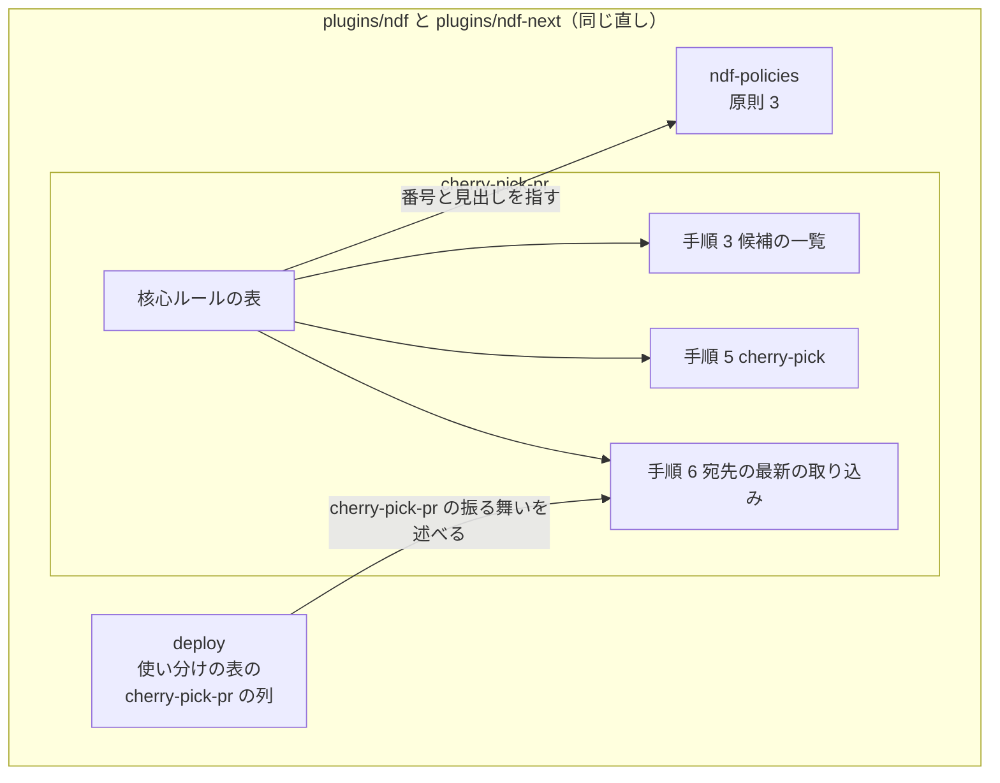
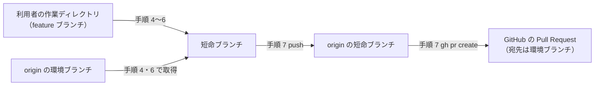
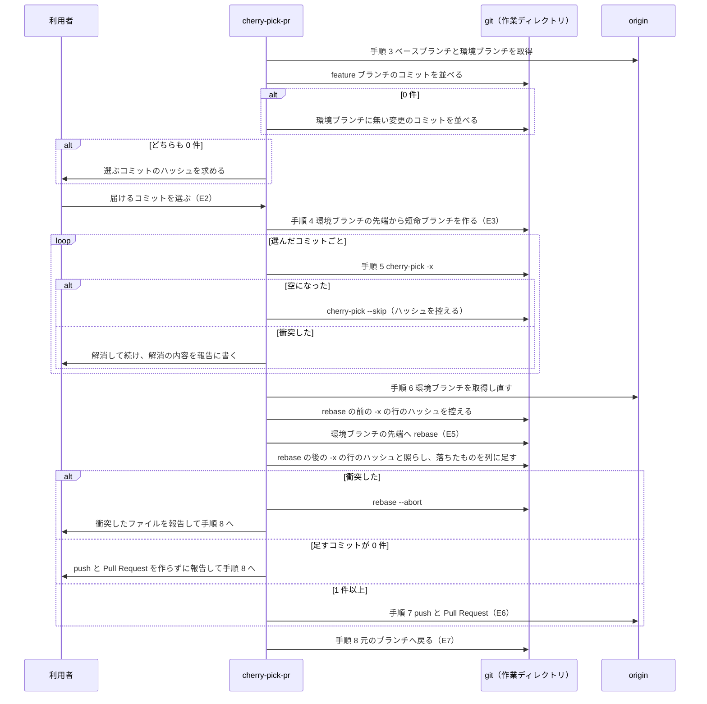

# cherry-pick-pr: 選んだコミットだけを環境ブランチへ届け、push の直前に宛先の最新を取り込む（#3503）

## 目的

- **今どうなっているか**: `/ndf:cherry-pick-pr` の手順 5 が、短命ブランチへ開発のベースブランチ全体を merge する。選んでいない機能も環境ブランチ宛の Pull Request に載る。選んだ修正がベースブランチへマージ済みなら、続く cherry-pick は空になって止まる
- **誰に効くか**: 検証や本番の環境ブランチ（`qa/*`・`staging/*`・`release/*`）へ、一部の修正だけを届ける利用者
- **変えると何が成り立つか**: 環境ブランチに届くのは、選んだコミットの cherry-pick だけになる。push の直前に宛先の環境ブランチの最新を取り込むため、「最新の起点」を求める CI も満たす

## 適用範囲

- **働く範囲**: NDF を使い、環境ブランチを持つすべてのリポジトリで働く。直すのは配る側（`plugins/ndf/`）と作り直し（`plugins/ndf-next/`）の同じ Skill である。ai-plugins は環境ブランチを持たない
- **プロジェクトごとに違うもの**: 宛先の環境ブランチは引数で受ける（今と同じ）。開発のベースブランチは `.ndf/worktree.json` の `base_branch` で受ける（今と同じ）。新しい設定と引数は足さない
- **当たるモード**: `standard`

## あるべき姿の根拠

| 根拠 | 種類 | 何を示すか |
| --- | --- | --- |
| STD1 | 外部の一次情報 | GitHub の「マージ前にブランチを最新にする」の保護は、Pull Request の宛先（base branch）の最新を含むことを求める。宛先と別のブランチの最新は求めない |
| PRD1 | 外部の一次情報 | GitLab の早送りのマージ（fast-forward）と半線形の履歴は、マージの前にソースブランチを宛先（target branch）の最新へ rebase することを求める |
| 使い捨ての git リポジトリで再現手順 1 の状態を作り、書き直す手順の形を打った結果（下の「処理の流れ」の実測） | 実測 | 宛先の先端から切った短命ブランチへ 1 件ずつ cherry-pick すると、差分は選んだコミットだけになる。空になったコミットは飛ばせる。push の直前の rebase で、宛先の新しい先端を含む |
| 「環境ブランチへ届くのは、選んだコミットだけになる。CI が最新の起点を求めるリポジトリでも、環境に入っていない別の機能は入らない」（#3503 の期待する結果） | 起票者の文 | 利用者の指示の原文ではない。PR #3502 の cross-review の指摘を起票者が本文へ書いたもの |

要求と受け入れ条件は #3503 の本文にある（コピーは [issues/issue-3503-requirements.md](issue-3503-requirements.md) ）。この文書は「どう作るか」だけを扱う。詳細設計（手順ごとのコマンドの全文と異常系）は後のステップが `issues/issue-3503-design-detail.md` に書く。

## ドメインモデル

### コンテキスト

| コンテキスト | 何の語が 1 つの意味に決まるか |
| --- | --- |
| 環境ブランチへ届ける手順（`cherry-pick-pr` と `ndf-policies` の「ブランチ運用の原則」） | 環境ブランチ・短命ブランチ・ベースブランチ・取り込む・届ける |
| ブランチ全体を環境へ届ける手順（`/ndf:deploy`） | deploy ブランチ・ベースブランチの取り込み |

この課題が直すのは 1 つ目のコンテキストである。`/ndf:deploy` は同じ語を使う別のコンテキストで、その振る舞いは変えない。2 つのコンテキストの関係は次のとおり。

| 上流（正本） | 下流（合わせる側） | 関係 | 何を合わせるか |
| --- | --- | --- | --- |
| 環境ブランチへ届ける手順（`cherry-pick-pr` の手順 3〜8） | ブランチ全体を環境へ届ける手順（`deploy` の「cherry-pick-pr との使い分け」の表） | 順応者（下流が上流の振る舞いをそのまま書き写す） | 表の cherry-pick-pr の列。表の持ち主は `deploy` で、cherry-pick-pr の列は `cherry-pick-pr` の手順が変わったときに `deploy` の側が合わせる（決定 5）。deploy の列と処理フローは `deploy` だけが決める |

### 集約

| 集約 | 持ち主（書き換えてよいもの） | 根 | エンティティ | 値オブジェクト |
| --- | --- | --- | --- | --- |
| 短命ブランチ | `cherry-pick-pr` の手順 4〜8 | 短命ブランチ | cherry-pick したコミット | 宛先の環境ブランチ名・選んだコミットのハッシュの列・飛ばしたコミットのハッシュの列 |
| ブランチ運用の原則 | `ndf-policies` の「ブランチ運用の原則」 | 原則の一覧 | 原則 1〜5 | — |
| 原則と手順の対応 | `cherry-pick-pr` の「核心ルール」の表と「なぜ必要か」 | 対応の表 | 表の行（原則の見出しと手順の番号の組） | 原則の番号・手順の番号 |

短命ブランチは、手順 4 で作ってから手順 8 で元のブランチへ戻るまでの間、`cherry-pick-pr` だけが書き換える。原則の文は `ndf-policies` が正本である。原則と手順の対応は `cherry-pick-pr` が持ち、原則の番号と見出しを指す（原則の文を写さない）。

飛ばしたコミットのハッシュの列には、元のコミットのハッシュ（`-x` の行のハッシュ）を並べる。載るのは、手順 5 の cherry-pick で空になって飛ばしたものと、手順 6 の rebase で落ちたものの 2 種類である。

### 不変条件

| # | 集約 | 条件 | 破れたときの扱い |
| --- | --- | --- | --- |
| I1 | 短命ブランチ | push する短命ブランチが宛先の環境ブランチに足すコミットは、選んで空にならなかったコミットの cherry-pick だけである。merge のコミットと、選んでいないコミットを含まない | 手順にベースブランチの merge を置かない。宛先の最新の取り込みは rebase で行い、merge のコミットを作らない |
| I2 | 短命ブランチ | push する短命ブランチは、push の直前に取得した宛先の環境ブランチの先端を含む | 取り込みで衝突したら rebase を中止し、push せずに衝突したファイルを報告して止まる |
| I3 | 短命ブランチ | cherry-pick したコミットのメッセージには、元のコミットのハッシュの行（`-x` が足す行）がある | cherry-pick は必ず `-x` を付けて打つ |
| I4 | 短命ブランチ | 空のコミットを作らない。選んだコミットのうち宛先へ足さなかったものは、すべて飛ばしたコミットのハッシュの列に載る | 手順 5 で空になったコミットは `--skip` で飛ばして列に載せる。手順 6 の rebase で落ちたコミットは、rebase の前後の `-x` の行のハッシュを照らし合わせて列に載せる（決定 2） |
| I5 | 短命ブランチ | 宛先へ足すコミットが 0 件なら、push も Pull Request の作成もしない | 0 件なら飛ばしたコミットの列を報告して手順 8 へ進む |
| I6 | 短命ブランチ | 選ぶコミットが決まらないまま短命ブランチを作らない | 候補が 0 件なら、選ぶコミットのハッシュを利用者に求め、手順 4 へ進まない |
| I7 | 原則と手順の対応 | 原則 3 の見出しと、`cherry-pick-pr` の「核心ルール」の表の行・手順 5・6 の見出しが同じ内容を指す | 原則 3 を直す変更で、表の行と手順の見出しも直す |
| I8 | すべての集約 | `plugins/ndf/` と `plugins/ndf-next/` の同じ Skill が同じ直しを持つ | 片方だけを直さない。作り直しの側だけにある手順 4 の止まり方は残す（決定 7） |

### ドメインイベント

| # | イベント | 発生元 | 受け手 |
| --- | --- | --- | --- |
| E1 | 宛先の環境ブランチとベースブランチを決めた | 手順 1 | 手順 3（候補の一覧） |
| E2 | 届けるコミットを候補から決めた | 手順 3 と利用者 | 手順 4（短命ブランチの作成） |
| E3 | 短命ブランチを環境ブランチの先端から作った | 手順 4 | 手順 5（cherry-pick） |
| E4 | 選んだコミットを短命ブランチへ cherry-pick した | 手順 5 | 手順 6（宛先の最新の取り込み）、報告（飛ばしたコミット） |
| E5 | push の直前に環境ブランチの最新を取り込んだ | 手順 6 | 手順 7（push と Pull Request）、報告（rebase で落ちたコミット） |
| E6 | 短命ブランチを push し、環境ブランチ宛の Pull Request を作った | 手順 7 | 利用者（Pull Request のレビュー） |
| E7 | 元のブランチへ戻った | 手順 8 | 利用者（報告） |

### 用語

| 用語 | 意味 | 用語集への反映 |
| --- | --- | --- |
| 環境ブランチ | 検証や本番の環境へ載せるブランチ（`qa/*`・`staging/*`・`release/*` など）。`/ndf:cherry-pick-pr` の引数で指し、短命ブランチの Pull Request の宛先になる | 反映済み（要求のステップで追加） |
| 短命ブランチ | 環境ブランチの先端から切り、選んだコミットだけを cherry-pick して環境ブランチ宛の Pull Request を出すためのブランチ | 反映済み（要求のステップで追加） |

## 外部の調査

| 種類 | 調べるか | 理由 |
| --- | --- | --- |
| 標準・仕様 | 調べる | 「最新の起点」を求める保護が、どのブランチの最新を求めるかが原則 3 の書き直しの根拠になる。git の cherry-pick と rebase が空のコミットをどう扱うかが手順 5・6 の形を決める |
| 主要な製品 | 調べる | GitHub 以外の主要な製品が、マージ前の「最新にする」をどのブランチに対して求めるかを比べる |
| ライブラリとサービス | 調べる | 手順は git のコマンドで組む。git の版によって使えるオプションが違うため、使う機能の入った版を確かめる |

### 標準・仕様

| # | 標準・仕様 | 何を定めているか | 設計への反映 | 出典 |
| --- | --- | --- | --- | --- |
| STD1 | GitHub の保護されたブランチ（Require status checks / strict） | strict のとき「The branch must be up to date with the base branch before merging.」。対象は Pull Request の宛先（base branch）である | 原則 3 は宛先の環境ブランチの最新を取り込むことを定める（決定 1） | https://docs.github.com/en/repositories/configuring-branches-and-merges-in-your-repository/managing-protected-branches/about-protected-branches （2026-11-14） |
| STD2 | git rebase の空のコミットの扱い | 上流にすでにある変更（clean cherry-pick）はrebase の前に落とし、rebase で空になるコミットは既定（`--empty=drop`）で落とす。もとから空のコミットは残す | 手順 6 の rebase で落ちたコミットを飛ばしたコミットの列に載せ（I4）、足すコミットが 0 件になれば push しない（I5、決定 2） | https://git-scm.com/docs/git-rebase （2026-11-14） |
| STD3 | git cherry-pick の空のコミットの扱い | 既定では空になると止まる。`--skip` で飛ばして続ける。`--empty=(drop\|keep\|stop)` は git 2.45.0 で入った | 1 件ずつ打ち、空で止まったら `--skip` で飛ばす（決定 3） | `git cherry-pick -h`（git 2.53.0、2026-11-14）、https://raw.githubusercontent.com/git/git/master/Documentation/RelNotes/2.45.0.adoc （2026-11-14） |
| STD4 | git log の `--cherry-pick --right-only`（対称差の右側から、左側に同じ変更があるコミットを除く） | `origin/<環境ブランチ>...HEAD` で、HEAD にあって環境ブランチに無い変更のコミットだけを並べる | 手順 3 の 2 つ目の一覧に使う（決定 4） | 使い捨てのリポジトリでの実行（`git log --oneline --no-merges --cherry-pick --right-only "origin/qa/staging...HEAD"`、git 2.53.0、2026-11-14） |

### 主要な製品

| # | 製品 | どう解いているか | 設計への反映 | 出典 |
| --- | --- | --- | --- | --- |
| PRD1 | GitLab の merge request（fast-forward merge・semi-linear） | 「you can merge only when your source branch is up-to-date with the target branch」。宛先が進んでいれば、ソースブランチを宛先へ rebase する | 宛先の最新の取り込みを rebase で行う（決定 2）。求められるのは宛先の最新であり、別のブランチではない（決定 1） | https://docs.gitlab.com/user/project/merge_requests/methods/ （2026-11-14） |

### ライブラリとサービス

| # | 候補 | 版 | ライセンス | 最後のリリースの日付 | 終了のアナウンス | 要件を満たすか | 出典 |
| --- | --- | --- | --- | --- | --- | --- | --- |
| LIB1 | git の `cherry-pick` を 1 件ずつ打ち、空で止まったら `--skip` | 手元の版は 2.53.0 | GPL-2.0 | 未確認（手元の版を使った） | 無し | 満たす。`--skip` は 2.45 より前の版にもある。飛ばしたコミットをハッシュ単位で数えられる | `git cherry-pick -h`（2026-11-14）と使い捨てのリポジトリでの実行 |
| LIB2 | git の `cherry-pick --empty=drop` | 2.45.0 以降 | GPL-2.0 | 未確認（手元の版を使った） | 無し | 一部。2.45.0 より前の git では使えない。まとめて打つと、どのコミットを飛ばしたかは出力の文字から読むことになる | STD3 と同じ |

### 確かめられなかったこと

| 対象 | 試した手段 | 結果と理由 |
| --- | --- | --- |
| NDF の利用者の手元の git の版の分布 | 試していない | 公開の資料が無い。2.45.0 より前の git を使う利用者がいる前提で、LIB1 の形を採る |
| ベースブランチの先端を含むことを CI で求めるリポジトリが NDF の利用者にあるか（要求の未決 1） | 試していない | 利用者のリポジトリの設定は手元から読めない |

調べた量: 候補 7 件・取得の試み 4 回。

## 機能一覧

| # | 機能 | 誰が使うか |
| --- | --- | --- |
| F1 | 候補の一覧（手順 3）: feature ブランチのコミットを並べ、無ければ環境ブランチに無い変更のコミットを並べ、どちらも無ければハッシュを求める | `/ndf:cherry-pick-pr` を打つ利用者 |
| F2 | cherry-pick（手順 5）: 選んだコミットを 1 件ずつ `-x` 付きで cherry-pick し、空になったものを飛ばして報告する | 同上 |
| F3 | 宛先の最新の取り込み（手順 6）: push の直前に環境ブランチを取得し直し、短命ブランチをその先端へ rebase する。rebase で落ちたコミットを報告する | 同上。最新の起点を求める CI を持つリポジトリ |
| F4 | 原則 3 の書き直し: 短命ブランチを push する前に、宛先の環境ブランチの最新を取り込む | `ndf-policies` を読むすべての Skill と利用者 |

## 構成要素

| 要素 | 責務 |
| --- | --- |
| `cherry-pick-pr` の手順 3 | 候補の一覧を出し、選ぶコミットを決める（F1）。候補が 0 件なら手順 4 へ進まない（I6） |
| `cherry-pick-pr` の手順 5（新しい中身） | 選んだコミットを 1 件ずつ cherry-pick し、空を飛ばして列に載せる（F2・I3・I4） |
| `cherry-pick-pr` の手順 6（新しい中身） | 宛先の最新を rebase で取り込み、落ちたコミットを列に載せ、足すコミットが 0 件なら push に進まない（F3・I1・I2・I4・I5） |
| `cherry-pick-pr` の「核心ルール」の表と「なぜ必要か」 | 原則と手順の番号の対応を、書き直した原則 3 と手順 5・6 に合わせる（I7） |
| `ndf-policies` の原則 3 | 宛先の環境ブランチの最新を取り込むことと理由を定める（F4・I7） |
| `deploy` の「cherry-pick-pr との使い分け」の表の cherry-pick-pr の列 | 取り込むものを「宛先の環境ブランチの最新」へ合わせる。deploy の列と処理フローは変えない（決定 5） |
| 作り直し（`plugins/ndf-next/`）の同じ 3 つの Skill | 上の 6 つと同じ直しを持つ。作り直しの手順 4 の止まり方は残す（I8） |

変えない要素は、手順 1・2・4・7・8 のコマンドと、原則 1・2・4・5 の文である（受け入れ条件 8）。

**原則 3 か手順 5 を引いてベースブランチの取り込みを書くほかの本文**（要求の対象範囲の 4 つ目）は、`deploy` の使い分けの表の 1 セルだけである。検索の結果（2026-11-14、この設計の起点のコミット）:

| 検索 | 当たった箇所 | 判定 |
| --- | --- | --- |
| `grep -rnE "原則 ?3\|ブランチ運用の原則" --include=*.md plugins/ docs/ README.md AGENTS.md CLAUDE.md`（`docs/development-history/` と `docs/changelog/` を除く） | `cherry-pick-pr` の 2 か所（35 行目の表の前置き・原則 5 を引く行）と `ndf-policies` の見出し（`plugins/ndf/` と `plugins/ndf-next/` の両方）、`docs/specifications/cross-refactoring-verify-and-final-gate.md:31` | `cherry-pick-pr` と `ndf-policies` は構成要素の表に載る。`cross-refactoring-verify-and-final-gate.md` の「原則 3」は #1932 の原則で、ブランチ運用の原則ではない |
| `grep -rnE "ベースブランチ(を\|の)?(最新(を\|の)?)?取り込" --include=*.md plugins/ docs/` | `cherry-pick-pr` の表と手順 5、`ndf-policies` の原則 3、`deploy` の 13・28・102（作り直しは 117）・131・150・157 行目、`merged`・`pr`・`release`・`development-workflow` と `docs/specifications/` の 6 文書 | `deploy` の 28 行目の cherry-pick-pr の列だけが cherry-pick-pr の振る舞いを述べる（構成要素の表に載る）。`deploy` の残りは deploy 自身の振る舞いである。`merged`・`pr`・`release`・`development-workflow`・`docs/specifications/` は、作業中のブランチや実装のプランへの取り込みを述べ、cherry-pick-pr を引かない |
| `cherry-pick-pr` を含む `.md` の各行のうち、取り込み・merge・手順 5・ベースブランチを含む行（`plugins/`・`docs/`・`README.md`） | `issue-plan-strategy` の 386 行目、`merged` の 332 行目、`problem-solving` の 177 行目 | いずれも「環境ブランチを feature に merge しない」「ベースブランチを汚染しない」を述べ、書き直した手順と食い違わない |

システムの文脈と配置は今と同じである。手順は利用者の作業ディレクトリで動き、`origin` の環境ブランチへ push し、GitHub に Pull Request を作る。

## 処理の流れ

手順 5 の merge を除き、cherry-pick を手順 5 に、宛先の最新の取り込みを手順 6 に置く。手順 2・4・7・8 の番号とコマンドは変わらない。

図は実行のときに動く手順 3〜8 だけを描く。核心ルールの表・原則 3・`deploy` の使い分けの表は、読まれる文書で実行されないため描かない。

手順 6 の衝突は、手順 5 の衝突と扱いを分ける。手順 5 は利用者が選んだ差分を当てる場面で、今の扱い（解消して続け、報告に書く）を変えない（要求の前提 2）。手順 6 は手順 4 の後に宛先へ入った別のコミットとの衝突で、push せずに止まる（要求の E5）。

**形の実測**（使い捨てのリポジトリ。`develop` に機能 A と修正 B を `--no-ff` の merge でマージし、`qa/staging` はどちらも持たない。git 2.53.0、2026-11-14）:

| 確かめたこと | 打った形 | 結果 |
| --- | --- | --- |
| 修正 B のブランチで、今の手順 3 の一覧 | `git log --oneline --no-merges origin/develop..HEAD` | 0 件 |
| 手順 3 の 2 つ目の一覧 | `git log --oneline --no-merges --cherry-pick --right-only "origin/qa/staging...HEAD"` | 修正 B と機能 A の 2 件 |
| 環境ブランチの先端から切って修正 B を cherry-pick | `git cherry-pick -x <B>` の後 `git log origin/qa/staging..HEAD` | 修正 B の 1 件。本文に `(cherry picked from commit <B>)` の行がある |
| 修正 B がすでに環境ブランチにある | 1 件ずつ打ち、失敗したら未解決のファイルが無く索引に差分が無いことを見て `git cherry-pick --skip` | 飛ばした。終了コード 0、`git status --short` は空、`origin/qa/staging..HEAD` は 0 件 |
| 手順 4 の後に環境ブランチが進んだ | `git fetch` の後 `git merge-base --is-ancestor origin/qa/staging HEAD` | 取り込む前は 1、`git rebase origin/qa/staging` の後は 0 |
| rebase で足すコミットが無くなる | 環境ブランチに修正 B が入った後に `git rebase` | 成功し、`git rev-list --count origin/qa/staging..HEAD` は 0 |
| rebase で一部だけ落ちる | 短命ブランチに修正 B と修正 C を `-x` 付きで cherry-pick した後、環境ブランチへ別のコミットと修正 B の cherry-pick を入れて `git rebase origin/qa/staging`。前後で `git log --format=%B origin/qa/staging..HEAD` から `cherry picked from commit` の行を抜く | 前は 2 件（B と C）、後は 1 件（C）。rebase は終了コード 0 で `skipped previously applied commit` を出す。前後の差が落ちた B である。残ったコミットの `-x` の行は rebase の後も残る |

受け入れ条件 9 の実行の記録（受け入れ条件 1〜5 の状態をそれぞれ作り、書き直した本文のコマンドをそのまま打った出力）は、実装の Pull Request に残す。上の表は形を選ぶための実測で、本文の全文を打ったものではない。

## 決定の記録

### 決定 1: 選んだコミットだけを届けるため、ベースブランチの merge を除き、原則 3 を「宛先の環境ブランチの最新を取り込む」へ書き直す

原則 3 の理由は「CI に最新の起点を求める Workflow がある」ことである。GitHub の保護（STD1）も GitLab の早送りのマージ（PRD1）も、求めるのは Pull Request の宛先の最新である。宛先の最新を取り込めば、理由をそのまま満たし、選んでいない機能は入らない。

ベースブランチの merge を残したまま、merge した後に選んでいないコミットを打ち消す形は採らない。打ち消しのコミットが環境ブランチ宛の Pull Request に載り、原則 5（revert を連鎖させない）とぶつかる。

- 作り方: 標準に倣う
- 比べた候補: STD1 / PRD1

根拠: Value 7 / Value 12（MVV 版 7）

### 決定 2: 宛先の最新を取り込んでも I1 を保つため、取り込みを rebase で行い、push の直前に置く

merge で取り込むと、宛先が手順 4 の後に進んだとき、短命ブランチに merge のコミットが載り、宛先へ足すコミットが選んだものだけでなくなる。rebase は短命ブランチ自身のコミット（push 前で、ほかの人がまだ持たない）だけを付け直すため、共有の履歴を書き換えない。強制 push も要らない。rebase は上流にすでにある変更を既定で落とす（STD2）ので、足すコミットが 0 件になったら push しない（I5）。

rebase が一部のコミットだけを落とす場合もある（手順 4 の後に、選んだコミットと同じ変更が宛先へ入ったとき）。落ちたコミットも飛ばしたコミットの列に載せる（I4）。rebase の前と後で `git log --format=%B origin/<環境ブランチ>..HEAD` から `-x` の行のハッシュを抜き、前にあって後に無いハッシュを列に足す。`-x` の行は元のコミットのハッシュで、rebase の前後で変わらない（I3、実測の 7 行目）。rebase の出力の `skipped previously applied commit` は短命ブランチ側のハッシュで、元のコミットのハッシュではないため使わない。

置き場所は push の直前（手順 6）にする。手順 4 で作った直後に取り込んでも、cherry-pick と利用者の衝突の解消の間に宛先が進む。

- 作り方: 標準に倣う
- 比べた候補: STD2 / PRD1

根拠: Value 7 / Value 3（MVV 版 7）

### 決定 3: どの版の git でも空のコミットを飛ばせるよう、1 件ずつ cherry-pick し、空で止まったら `--skip` する

`--empty=drop`（LIB2）は git 2.45.0 で入ったオプションで、それより前の git では打てない。1 件ずつ打てば、空で止まったことを「未解決のファイルが無く、索引に差分が無い」で見分けられ、飛ばしたコミットのハッシュをそのまま報告に並べられる（LIB1）。衝突で止まったときは未解決のファイルが残るため、空と取り違えない。

`--empty=drop` でまとめて打つ形は採らない。打てる版が限られ、どのコミットを飛ばしたかを git の出力の文字から読むことになる。

- 作り方: 自前で作る・ライブラリやサービスを使う
- 比べた候補: LIB1 / LIB2 / STD3

根拠: Value 4 / Value 3（MVV 版 7）

### 決定 4: マージ済みの修正も選べるよう、手順 3 の候補を 2 つの一覧で出し、どちらも空ならハッシュを求める

1 つ目の一覧は今の一覧（feature ブランチにあってベースブランチに無いコミット）である。feature ブランチから届ける今の使い方を変えない。1 つ目が空のときだけ、2 つ目の一覧として HEAD にあって環境ブランチに無い変更のコミット（STD4）を並べる。修正 B がベースブランチへマージ済みの再現手順 1 の状態で、修正 B が候補に出る（実測）。2 つ目の一覧は機能 A も並べるが、選ぶのは利用者で、選んだものだけが届く。どちらも空なら、選ぶコミットのハッシュを利用者に求め、手順 4 へ進まない（I6）。

マージ済みの Pull Request の番号から元のコミットを引く形は採らない。`gh` と Pull Request の番号を前提にし、squash でマージした修正では元のコミットが feature ブランチの側にしか残らない。2 つ目の一覧を常に出す形も採らない。ベースブランチが環境ブランチより大きく進んでいると一覧が長くなり、feature ブランチから届ける今の使い方で選びにくくなる。

- 作り方: 自前で作る・標準に倣う
- 比べた候補: STD4 / LIB1

根拠: Value 1 / Value 4（MVV 版 7）

### 決定 5: 書き直した手順と別の記述が食い違わないよう、`deploy` の使い分けの表の cherry-pick-pr の列を合わせる

`deploy` の「cherry-pick-pr との使い分け」の表は、cherry-pick-pr の「ベースブランチの取り込み」を「必須」と書く。直さないと、同じ版の中で 2 つの Skill が cherry-pick-pr の振る舞いを違って述べる。直すのは cherry-pick-pr の列の 1 セルで、deploy の列と処理フローは変えない。要求の受け入れ条件 8 と境界は、この範囲で書いてある。表の持ち主は `deploy` で、cherry-pick-pr の列は `cherry-pick-pr` の手順を正本として合わせる順応者の関係である（「コンテキスト」の関係の表）。

表から cherry-pick-pr の列を消して cherry-pick-pr の本文を指す形は採らない。使い分けを 1 か所で比べる表の役割がなくなる。

根拠: Value 11 / Value 14（MVV 版 7）

### 決定 6: 受け入れ条件 8 が指す手順の番号を保つため、手順 5 を cherry-pick に、手順 6 を宛先の最新の取り込みにする

手順 5 の merge を除くと、cherry-pick と取り込みの 2 つが手順 5・6 に入る。並びを「cherry-pick → 取り込み → push」にすれば、手順 4・7・8 の番号とコマンドが変わらず、ほかの Skill が手順を番号で引いていても食い違わない。「核心ルール」の表は「cherry-pick で届ける」を 3・5、「push 前に宛先の環境ブランチの最新を取り込む」を 6 に対応させる。

根拠: Value 14（MVV 版 7）

### 決定 7: 2 つの置き場の振る舞いをそろえるため、`plugins/ndf/` と `plugins/ndf-next/` を同じ変更で直す

作り直し（#1142）は今の振る舞いと同等であることを求める。片方だけを直すと、作り直しへ移ったときに不具合が戻る。作り直しの手順 4 にだけある止まり方（短命ブランチを作れなければ止まる）は、この課題で触らない。

根拠: Value 7 / Value 11（MVV 版 7）

## テスト設計

`.md` の文言を照合するテストは書かない（`AGENTS.md`）。確かめは、使い捨ての git リポジトリ（`git init --bare` を origin にした手元の clone）で状態を作り、書き直した本文のコマンドをそのまま打って行う（要求の検証手段）。`gh pr create` は打たず、push までを見る。

| 受け入れ条件・不変条件 | どの振る舞いで縛るか | どう壊したら落ちるべきか |
| --- | --- | --- |
| 受け入れ条件 1・I1 | 再現手順 1 の状態で修正 B だけを選ぶと、`git log origin/qa/staging..<短命ブランチ>` が修正 B の cherry-pick の 1 件だけになる | 手順にベースブランチの merge を戻すと、機能 A と merge のコミットが並ぶ |
| 受け入れ条件 2・I3 | 同じ状態で、修正 B の cherry-pick が空にならず、`git log -1 --format=%B` に元のハッシュの行がある | `-x` を外すと行が消える。merge を戻すと空になって止まる |
| 受け入れ条件 3・I6 | 修正 B のブランチで 1 つ目の一覧が空のとき、2 つ目の一覧に修正 B が出る。2 つとも空の状態では、ハッシュを求めて手順 4 へ進まない | 2 つ目の一覧を除くと候補が 0 件のまま手順 4 へ進む |
| 受け入れ条件 4・I2 | 手順 4 の後に環境ブランチへ別のコミットを入れても、push した短命ブランチで `git merge-base --is-ancestor origin/<環境ブランチ> <短命ブランチ>` が 0 になる | 手順 6 の取得し直しを外すと 1 になる |
| 手順 6 の衝突（要求の E5） | 宛先へ入ったコミットと衝突すると、rebase を中止し、push せずに衝突したファイルを報告する | 中止を外すと、rebase の途中の状態で push に進む |
| 受け入れ条件 5・I4（手順 5 で空） | 選んだコミットのうち手順 4 の時点で環境ブランチにあるものは、cherry-pick で空になって飛ばされ、元のハッシュが報告の列に並ぶ。空のコミットはできない | 空の判定を外すと空で止まったままになる |
| 受け入れ条件 5・I4（手順 6 で落ちる） | 修正 B と修正 C を選び、手順 5 の後に環境ブランチへ修正 B の cherry-pick を入れると、rebase の後の差分は修正 C の 1 件になり、修正 B の元のハッシュが報告の列に並ぶ | 前後の照らし合わせを外すと、修正 B が列に載らない |
| 受け入れ条件 5・I5 | 選んだコミットがすべて飛ばされるか落ちると、push と Pull Request を作らず、列を報告して元のブランチへ戻る | 0 件の判定を外すと、差分の無いブランチを push する |
| 受け入れ条件 6・I7 | 原則 3 の文が宛先の環境ブランチの最新を取り込むことと理由を持ち、核心ルールの表の行と手順 5・6 の見出しが同じ内容を指す | 片方だけを直すと、表の行と手順の見出しが別の内容を指す（レビューで見る） |
| 受け入れ条件 7・I8 | `plugins/ndf/` と `plugins/ndf-next/` の 2 つの Skill の差分が、作り直しの手順 4 の止まり方だけになる | 片方だけを直すと `diff` に手順 3・5・6 が出る |
| 受け入れ条件 8 | `deploy` の処理フローと deploy の列、原則 1・2・4・5、手順 2・4・7・8 のコマンドが `git diff` に出ない | それらの行を書き換えると差分に出る |
| 受け入れ条件 9 | 受け入れ条件 1〜5 の状態ごとの実行の出力が、実装の Pull Request に残る | 実行の記録が無い |
| 静的解析 | `python3 scripts/check-skill-frontmatter.py` と `claude plugin validate .` が通る | frontmatter を壊すと落ちる |

## 設計の結果

| 課題 | 扱い | 取り込み先 | 触るファイル |
| --- | --- | --- | --- |
| #3503 | 実装する | — | `plugins/ndf/skills/cherry-pick-pr/SKILL.md`、`plugins/ndf-next/skills/cherry-pick-pr/SKILL.md`、`plugins/ndf/skills/ndf-policies/SKILL.md`、`plugins/ndf-next/skills/ndf-policies/SKILL.md`、`plugins/ndf/skills/deploy/SKILL.md`、`plugins/ndf-next/skills/deploy/SKILL.md` |

## 人へ残す判断

無し

## 未確認のまま残ること

| 項目 | 内容 |
| --- | --- |
| ベースブランチの先端を含むことを CI で求めるリポジトリ | そうしたリポジトリでは、書き直した手順の Pull Request が検査で落ちる。NDF の利用者にあるかは手元から読めない（要求の未決 1）。リリース後テストで環境ブランチを持つ NDF の外のリポジトリに打ったとき、または利用者からの報告で分かる |
| 利用者の手元の git の版 | 決定 3 は 2.45.0 より前の git でも動く形を採ったが、どの版が使われているかは分からない。リリース後テストで打った git の版を記録して分かる |
