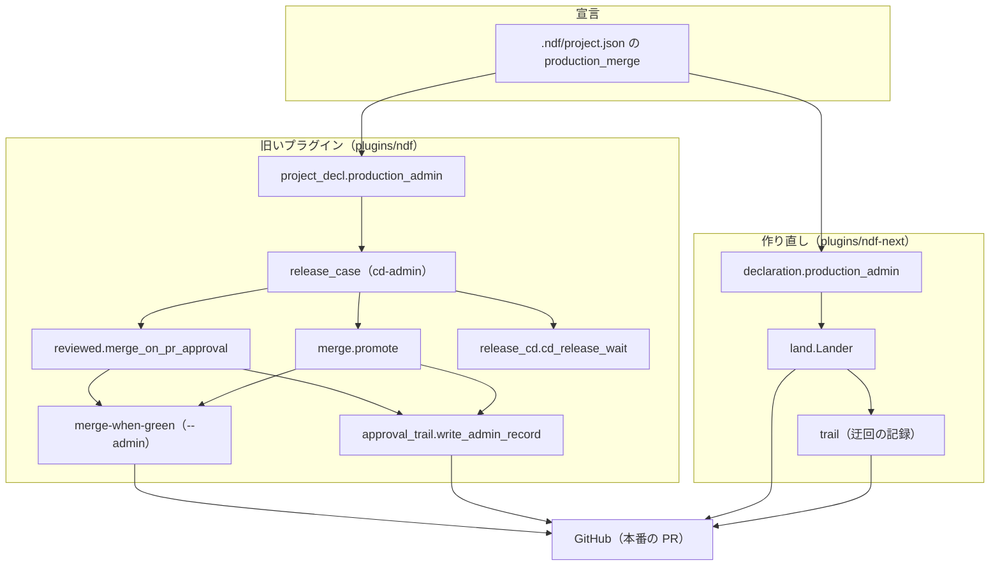
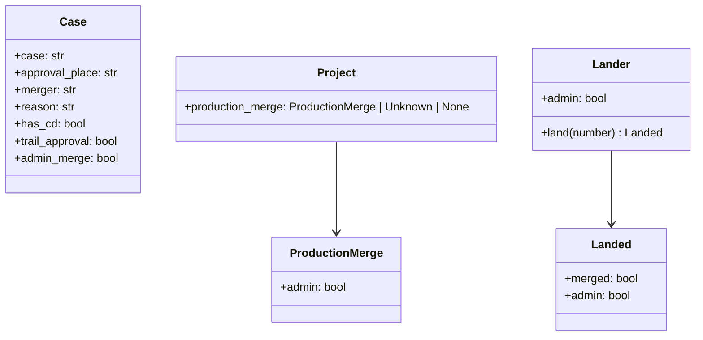
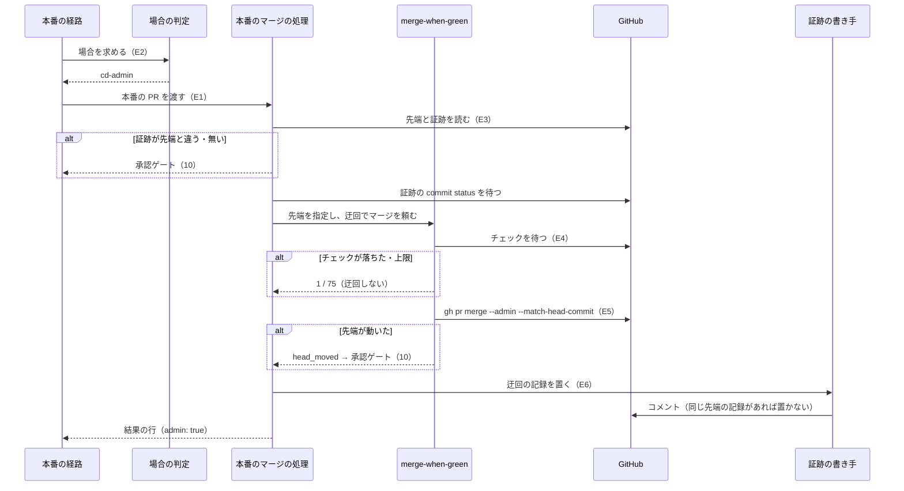

# リリース: 本番の PR を宣言に従って管理者の迂回でマージし、承認ゲートの 1 回の承認でマージまで進める（#3506）

## 目的

- **今どうなっているか**: 本番チャネル（`main`）の ruleset が承認レビュー 1 件を必須にし、本番の PR の作者が利用者自身のため、承認レビューを付けられない。リリース承認ゲートを通ったリリースが、人が手でマージするまで止まる（2026-11-15 の本番の PR #3505）
- **誰に効くか**: 本番チャネルが承認レビューを必須にし、利用者が自分のアカウントで本番の PR を出すリポジトリの利用者（ai-plugins を含む）
- **変えると何が成り立つか**: 迂回の宣言を置いたリポジトリでは、承認ゲートの承認が本番の PR の先端と一致し、必須のチェックが通った後に、NDF が管理者の迂回でマージする。宣言の無いリポジトリは今の振る舞いのまま変わらない

## 適用範囲

- **働く範囲**: NDF を使うすべてのリポジトリで、本番の経路（`release-steps.py release --channel prod`・選んで集める取り込み方の `release`・`merged-steps.py promote`）と、作り直し（`plugins/ndf-next/`）のリリースのマージで働く。迂回するのは宣言を置いたリポジトリだけである
- **プロジェクトごとに違うもの**: 迂回するかは `.ndf/project.json` の `production_merge.admin` で受ける。引数では受けない（リポジトリの決まりであり、打つたびに変わるものではない）
- **当たるモード**: `standard`

## あるべき姿の根拠

| 根拠 | 種類 | 何を示すか |
| --- | --- | --- |
| 「次回以降、--admin をつけてmergeするようにしてください」（#3506 の依頼の原文、2026-11-15） | 利用者の指示の原文 | 本番の PR を迂回でマージすることを利用者が求めている |
| PRD1 | 外部の一次情報 | `gh pr merge --admin` は要件を満たさない PR のマージを、迂回を許された人の権限で通す |
| PRD2 | 外部の一次情報 | `--match-head-commit` で先端を指定すれば、承認した先端と違う先端のマージを GitHub が断る |
| STD1 | 外部の一次情報 | 迂回は ruleset ごとに人へ許す仕組みで、規則ごとに迂回の範囲を分けられない。必須のチェックの通過は NDF が迂回の前に確かめる必要がある |
| 2026-11-15 の本番の PR #3505 が `reviewDecision` の `REVIEW_REQUIRED` で止まり、人の手でマージした | 実測 | 今の形では承認ゲートの後に人の操作が 1 回要る |

要求と受け入れ条件は #3506 の本文にある（コピーは [issues/issue-3506-requirements.md](issue-3506-requirements.md) ）。この文書は「どう作るか」だけを扱う。

## ドメインモデル

### コンテキスト

| コンテキスト | 何の語が 1 つの意味に決まるか |
| --- | --- |
| リリース（`ndf-release`） | 本番の PR・リリースの場合・承認の証跡・管理者の迂回・迂回の宣言・迂回の記録 |

変更は 1 つのコンテキストに収まる。作り直し（`plugins/ndf-next/`）も同じコンテキストの語を使い、同じ宣言のキーを読む。

### 集約

| 集約 | 持ち主（書き換えてよいもの） | 根 | エンティティ | 値オブジェクト |
| --- | --- | --- | --- | --- |
| リリースの場合 | 場合の判定（`lib/release_case.py`） | リリースの場合 | — | CD の有無・承認数・迂回の宣言・承認を取る場所・マージの主体 |
| 本番の PR | 本番のマージの処理（`release_lib/reviewed.py` の `merge_on_pr_approval`・`merged_lib/merge.py` の `promote`・作り直しの `land.Lander`） | 本番の PR | — | 先端のコミット・宛先・マージの方式（迂回の有無） |
| 承認の証跡 | 証跡の書き手（`release_lib/approval_trail.py`。作り直しは `domains/release/trail.py`） | 証跡のコメント | 迂回の記録 | 承認したコミット・書いた人・作成の時刻 |

迂回の宣言は利用者が書く値で、NDF は読むだけである。リリースの場合の値オブジェクトとして判定に入る。

### 不変条件

| # | 集約 | 条件 | 破れたときの扱い |
| --- | --- | --- | --- |
| I1 | リリースの場合 | `production_merge.admin` が JSON の `true` のときだけ迂回の宣言があるとみなす。キーが無い・`true` 以外の値・型の違いは宣言なしとして扱う | 宣言なしの場合（`cd-no-review` / `cd-review`）で進む |
| I2 | リリースの場合 | `cd-admin` になるのは、CD があり、本番チャネルの承認数が 1 以上と読め、迂回の宣言があるときだけである。承認数が 0 か読めないときは宣言があっても `cd-no-review` にする | 迂回しない場合で進む |
| I3 | 本番の PR | 管理者の迂回でマージするのは `cd-admin` のときだけである。`cd-no-review`・`cd-review` は今と同じく迂回なしでマージする | — |
| I4 | 本番の PR | `cd-admin` の迂回は、承認の証跡が本番の PR の先端と完全に一致するときだけ打つ | 承認ゲート（終了コード 10）で止まり、PR は開いたまま残る |
| I5 | 本番の PR | `cd-admin` の迂回は、本番の PR のチェックがすべて通った後にだけ打つ | 落ちたら 1、上限までに終わらなければ 75 で止まり、迂回しない |
| I6 | 本番の PR | 迂回のマージは、照らした先端を指定して打つ | 先端が動いていれば GitHub が断り、承認ゲート（10）で止まる |
| I7 | 承認の証跡 | 迂回でマージした本番の PR には、マージした先端と照らした証跡を指す迂回の記録が 1 件だけ残る。同じ先端の記録が既にあれば書き足さない | 書けなければ本番の完了と分けて 1 で報告し、打ち直しで書く |
| I8 | 本番の PR | 迂回でマージしたとき、結果 JSON の本番の PR の行の `admin` が `true`、迂回なしなら `false` である | — |

### ドメインイベント

| # | イベント | 発生元 | 受け手 |
| --- | --- | --- | --- |
| E1 | 本番の PR を開いた（か、開いている PR を引いた） | 本番の経路（`release --channel prod`・`promote`） | 本番のマージの処理 |
| E2 | 迂回の宣言を読んだ | 場合の判定 | 本番のマージの処理（場合の値として受ける） |
| E3 | 承認ゲートの利用者の承認を、本番の PR の先端と照らした | 本番のマージの処理 | 本番のマージの処理（一致しなければ承認ゲートで止まる） |
| E4 | 本番の PR の必須のチェックが通った | `merge-when-green`（作り直しは `Lander._watch`） | 本番のマージの処理 |
| E5 | 本番の PR を迂回でマージした | 本番のマージの処理 | 証跡の書き手・CD |
| E6 | 迂回してマージしたことを記録した | 証跡の書き手 | 利用者（PR の画面）・結果 JSON の読み手 |
| E7 | CD がタグと GitHub Release を作った | CD（`release-cd.yml`） | 公開の後の手順（既存） |

### 用語

| 用語 | 意味 | 用語集への反映 |
| --- | --- | --- |
| リリースの場合 | CD の有無・本番チャネルの承認数・迂回の宣言で決まる 4 つの場合（`cd-no-review` / `cd-review` / `cd-admin` / `no-cd`）。承認を取る場所とマージの主体を決める | 意味の変更（`ndf-release`） |
| 迂回の記録 | 本番の PR を管理者の迂回でマージしたことを示す、本番の PR へ置くコメント。マージした先端と、照らした承認の証跡を指す。証跡とは別の印を持ち、承認の判定に数えない | 追加（`ndf-release`） |
| 迂回の宣言 | 本番の PR を管理者の迂回でマージすることを選ぶ、`.ndf/project.json` の `production_merge.admin` の値。`true` のときだけ宣言があるとみなす | 意味の変更（`ndf-release`。置き場とキーを決めた） |

## 外部の調査

| 種類 | 調べるか | 理由 |
| --- | --- | --- |
| 標準・仕様 | 調べる | ruleset の迂回の範囲（規則ごとに分けられるか）が、必須のチェックを NDF が待つかを決める |
| 主要な製品 | 調べる | 迂回でマージする手段（`gh` と GitHub の API）が先端の指定と迂回をどう受けるかを確かめる |
| ライブラリとサービス | 調べない | 使う手段は既に依存している `gh` と GitHub の API に限られ、足す依存が無い |

### 標準・仕様

| # | 標準・仕様 | 何を定めているか | 設計への反映 | 出典 |
| --- | --- | --- | --- | --- |
| STD1 | GitHub の ruleset の迂回の一覧（bypass list） | 迂回は ruleset ごとに役割・人へ許す。"For pull requests only" は PR を開いた上で迂回してマージできる形。規則ごとに迂回の範囲を分ける設定は説明に無い | 迂回は必須のチェックも満たさずに通す前提で、NDF が迂回の前にチェックの通過を確かめる（I5） | https://docs.github.com/en/repositories/configuring-branches-and-merges-in-your-repository/managing-rulesets/creating-rulesets-for-a-repository （2026-11-14） |

### 主要な製品

| # | 製品 | どう解いているか | 設計への反映 | 出典 |
| --- | --- | --- | --- | --- |
| PRD1 | `gh pr merge --admin` | "Use administrator privileges to merge a pull request that does not meet requirements"。実装は手元の要件の判定とマージキューを飛ばし、通常のマージ（GraphQL の `mergePullRequest`）を呼ぶ。迂回の引数は API へ送らない | 旧いプラグインの迂回は既存の `merge-when-green` の `--admin` の経路をそのまま使う | https://cli.github.com/manual/gh_pr_merge ・ https://raw.githubusercontent.com/cli/cli/trunk/pkg/cmd/pr/merge/merge.go ・ `pkg/cmd/pr/merge/http.go`（2026-11-14） |
| PRD2 | `gh pr merge --match-head-commit` と REST の `sha` | 指定した SHA と PR の先端が一致するときだけマージを許す | 迂回のマージにも照らした先端を添える（I6）。既存の `--expect-head` の経路が添えている | 同上・ https://docs.github.com/en/rest/pulls/pulls （2026-11-14） |
| PRD3 | REST の PR のマージ（`PUT .../pulls/{n}/merge`）と非同期のマージ（`PUT .../pulls/{n}/merge-async`） | 同期のマージに迂回の引数は無い。非同期のマージは `bypass_rules`（"Whether to bypass repository rules that the authenticated actor is permitted to bypass."、既定 `false`）を持ち、結果は後から届く | 作り直しは同期のマージのまま打つ（決定 5）。非同期のマージは採らない | https://docs.github.com/en/rest/pulls/pulls （2026-11-14） |

### 確かめられなかったこと

| 対象 | 試した手段 | 結果と理由 |
| --- | --- | --- |
| 同期の REST のマージを迂回を許された人の token で打ったとき、必須の承認レビューを満たさない PR を GitHub が通すか | https://docs.github.com/en/rest/pulls/pulls を読んだ | 文書に記述が無い。GraphQL の通常のマージで `gh --admin` が通ることから同じ扱いと見込むが、試していない（「未確認のまま残ること」） |

調べた量: 候補 4 件・取得の試み 7 回。

## 機能一覧

| # | 機能 | 誰が使うか |
| --- | --- | --- |
| F1 | 迂回の宣言を読み、リリースの場合 `cd-admin` を決める | 本番の経路の全部（場合の判定を通して） |
| F2 | `cd-admin` の本番の PR を、承認の証跡で照らし、チェックの通過の後に迂回でマージする | `release --channel prod`・選んで集める取り込み方の `release` |
| F3 | `cd-admin` の `promote` で、証跡を書いてから迂回でマージする | `merged-steps.py promote --gate-approved` |
| F4 | 迂回の記録を本番の PR へ置き、結果 JSON の `admin` に迂回の有無を出す | F2・F3・F5 の後 |
| F5 | 作り直しのリリースのマージが同じ宣言を読み、迂回したことを記録する | `ndf-next-release.yml` の `merge` |
| F6 | ai-plugins の `.ndf/project.json` に迂回の宣言を書く | ai-plugins の本番のリリース |

## 構成要素

| 要素 | 責務 |
| --- | --- |
| 宣言の型（`project_lib/model.py` の `ProductionMerge`・`Project.production_merge`）とスキーマ（`project.schema.json`） | `production_merge` のキーの形を定める。値は `{"admin": <真偽>}` か `Unknown` |
| 宣言の読み取り（`lib/project_decl.py` の `production_admin`） | I1 の判定を 1 か所で持ち、`true` のときだけ真を返す |
| 場合の判定（`lib/release_case.py`） | 4 つ目の値 `cd-admin` と、場合の属性 `trail_approval`（証跡で承認を取る）・`admin_merge`（迂回でマージする）を持つ。I2 を守る |
| 本番のマージの処理（`release_lib/reviewed.py` の `release_prod`・`merge_on_pr_approval`） | 場合の属性で証跡の待ちと迂回を切り替え、結果の行の `admin` を書き、迂回の記録を書かせる |
| 承認の照合の文言（`release_lib/approval.py` の `_approved_from_pr`） | 場合の属性で、承認を書く手順の案内を切り替える |
| `promote`（`merged_lib/merge.py` の `promote`・`_trail_before_merge`・`_merge_pr`） | `cd-admin` で証跡を書き、迂回でマージし、結果の行に `admin: true` を書く |
| 本番のプランの部品（`supervise_lib/release_cd.py` の `cd_release_wait`） | `cd-admin` を `cd-no-review` と同じく MVV 判定の行き先へつなぐ |
| 証跡の書き手（`release_lib/approval_trail.py` の `write_admin_record`） | 迂回の記録を 1 件だけ置く（I7）。証跡の判定はこの記録を数えない |
| 作り直しの宣言の読み取り（`ndf-next` の `domains/release/declaration.py` の `production_admin`） | 同じキーを I1 と同じ規則で読む |
| 作り直しのマージ（`ndf-next` の `domains/release/land.py` の `Lander`・`cli.py` の `cmd_merge`） | 宣言のあるとき、マージの後に迂回の記録を置き、出力の `admin` を書く |
| 作り直しの証跡（`ndf-next` の `domains/release/trail.py`） | 迂回の記録の書き込み（I7）を持つ |
| ai-plugins の宣言（`.ndf/project.json`） | `production_merge.admin: true` を持つ |
| 確定仕様（`docs/specifications/ndf-release-approval-on-pr.md`） | リリースの場合の表と不変条件 I7 を、宣言の有無で分けて書き直す |
| 手順書（`skills/release/SKILL.md`・`skills/release/references/release-steps.md`・`skills/development-workflow/references/production-merge.md`・`skills/merged/SKILL.md`）と `lib/README.md` | リリースの場合の表に `cd-admin` の行を足す |
| 用語集（`docs/glossary/glossary.json`・`docs/glossary.md`） | リリースの場合・迂回の宣言・迂回の記録の意味を持つ |

**リリースの場合の値で分かれる既存の規則のうち、`cd-admin` に当てはまらないもの**（集合の名前と値の名前で `plugins/ndf` を検索し、`cd-admin` が通る `release --channel prod` と `promote` の手順を読んで集めた）。

| 規則の置き場 | 今の規則 | `cd-admin` で要る形 |
| --- | --- | --- |
| `release_lib/reviewed.py` の `release_prod` の `waiting` | `cd-no-review` だけ証跡を書く手順を案内する | `trail_approval` で証跡の案内を出す |
| `release_lib/reviewed.py` の `merge_on_pr_approval` | `cd-no-review` だけ証跡の commit status を待ち、迂回なしを固定で渡す | `trail_approval` で待ち、`admin_merge` で迂回を渡す |
| `release_lib/reviewed.py` の `release_prod` の結果の行 | `admin: False` を固定で書く | 迂回の有無を書く |
| `release_lib/approval.py` の `_approved_from_pr` | `cd-no-review` だけ証跡の案内を出す | `trail_approval` で案内を出す |
| `merged_lib/merge.py` の `promote` | CD のある場合は迂回なしを固定にする | `admin_merge` のときだけ迂回を使う |
| `merged_lib/merge.py` の `_trail_before_merge` | `cd-no-review` だけ証跡を書き、ほかはレビューを照らす | `trail_approval` で証跡を書く |
| `merged_lib/merge.py` の `_merge_pr` | 迂回なしのときだけ結果の行に `admin` を書く | 迂回したときも `admin: true` を書く |
| `supervise_lib/release_cd.py` の `cd_release_wait` | MVV 判定のプランで `cd-no-review` だけ承認ゲートに数えない | `trail_approval` で同じ行き先にする |
| `lib/release_case.py` の冒頭の表と `release_cd_case` の説明 | 3 つの場合を並べる | 4 つの場合を並べる |
| 手順書 4 本と確定仕様の場合の表・I7 | 2 つの CD のある場合を並べ、迂回なしを定める | `cd-admin` の行と、宣言のあるときの迂回を書く |

当てはまる規則（`approval.approved_on_pr` の `cd-review` 以外は証跡で照らす分岐、`reviewed.approval_check` の `cd-review` だけ付けない分岐、`supervise_lib/release_cd.py` の `cd_prod_steps` と `supervise_lib/sprint_routes.py` の `normal_cd_gate_2` の `cd-review` だけ証跡を書かない分岐）は変えない。



## 構造



| 値 | `trail_approval` | `admin_merge` |
| --- | --- | --- |
| `cd-no-review` | 真 | 偽 |
| `cd-review` | 偽 | 偽 |
| `cd-admin` | 真 | 真 |
| `no-cd` | 偽 | 偽 |

`Case` の属性は値から導く。値どうしの比較（`case.case == CD_NO_REVIEW`）を、当てはまらない規則の表の置き場で属性へ置き換える。

## 入出力の契約

### 宣言（`.ndf/project.json`）

```json
{
  "production_merge": {
    "admin": true
  }
}
```

| キー | 型 | 既定 | 意味 |
| --- | --- | --- | --- |
| `production_merge` | オブジェクトか `Unknown`（`{"unknown": "<理由>"}`） | 無し | 本番の PR のマージの方式 |
| `production_merge.admin` | 真偽 | 無し（偽と同じ） | 真なら、本番チャネルが承認レビューを必須にするとき、本番の PR を管理者の迂回でマージする |

スキーマ（`project.schema.json`）は型から作る既存の手順で作り直す。解析（`project_lib`）はこのキーを書かず、利用者が書いた値を残す（`ndf_policies` と同じ扱い）。

### リリースの場合（`release-steps.py release-case` の `metrics`）

| `case` | `approval_place` | `merger` |
| --- | --- | --- |
| `cd-admin` | リリースの PR の証跡のコメント | 利用者のアカウント（管理者の迂回） |

ほかの 3 つの値の出力は変わらない。

### 結果 JSON の本番の PR の行

`release --channel prod` と `promote` の `items` の本番の PR の行（`"result": "merged"`）に `admin` を必ず書く。迂回したら `true`、迂回なしなら `false`。終了コード（0・1・10・75）の意味は変わらない。迂回の記録の行は `{"kind": "comment", "name": "<URL>", "result": "written" | "kept" | "unwritten"}` で足す。

作り直しの `release-steps merge` の出力（`outputs`）に `admin`（真偽）と、記録を書いたときは `admin_record`（URL）を足す。

### 迂回の記録（本番の PR のコメント）

```markdown
<!-- ndf:admin-merge -->
## 管理者の迂回でマージした

マージした先端: `<40 桁の SHA>`
照らした承認の証跡: <証跡のコメントの URL>
宣言: `.ndf/project.json` の `production_merge.admin`
```

印 `ndf:admin-merge` は証跡の印（`ndf:release-approval`）と別で、証跡の判定と `release-approval.yml` の起動の条件に掛からない。

## 処理の流れ



図に含めない要素: 宣言の型とスキーマ・宣言の読み取り（場合の判定の中で働く）、承認の照合の文言（承認したコミットの引数を受けたときだけ働く）、本番のプランの部品（プランを組む時点で働く）、ai-plugins の宣言・確定仕様・手順書・用語集（文書と設定）、作り直しの要素（次の段落）。選んで集める取り込み方の `release` は、本番の経路として同じ本番のマージの処理を呼ぶ。

`promote` は、証跡を書いてから（`_trail_before_merge`）同じく `merge-when-green` へ迂回でマージを頼み、マージの後に迂回の記録を置く。作り直しは `Lander` が既存の順（チェックの待ち → 証跡の読み直し → 先端を添えたマージ）で進め、マージの後に記録を置く。

**再開の流れ**: 打ち直したときに本番の PR がマージ済みで、場合が `cd-admin` で、PR の `reviewDecision` が `APPROVED` でなければ（承認レビューを満たさずにマージされた）、迂回の記録が無いときだけ書く。記録の書き込みは同じ先端の記録があれば置かないため、何度打ち直しても 1 件である。

## 非機能の実現方式

| 大項目 | 条件 | 実現方式 |
| --- | --- | --- |
| セキュリティ | 迂回は承認の一致・チェックの通過の後にだけ打つ | 迂回の指定は `merge-when-green` の既存の待ちと先端の照合の後でだけ効く（I4〜I6）。場合の判定は宣言が `true` でなければ迂回の場合を返さない（I1・I2） |
| セキュリティ | 宣言を読めないときは迂回しない | 値が `true` 以外なら宣言なし（I1）。`.ndf/project.json` 自体が読めなければ、今と同じく場合を決められずに 3 で止まる |
| 運用・保守性 | 迂回したかを結果 JSON と PR の上の両方から読める | 結果の行の `admin`（I8）と、本番の PR の迂回の記録（I7） |

## 決定の記録

### 決定 1: 宣言の読み手を 1 つにするため、迂回の宣言を `.ndf/project.json` の最上位のキー `production_merge.admin` に置く

旧いプラグインと作り直しの両方が既に読む宣言は `.ndf/project.json` である（作り直しの hook が `delivery` を読む）。`delivery` の行は CD の届け先ごとの並びで、本番チャネルのマージの方式は届け先に依らず 1 つに決まるため、行の属性にすると行どうしで値が食い違いうる。値は真偽を持つオブジェクトにし、`ndf_policies` と同じく `Unknown` を受けられる形にする。

`.ndf/worktree.json` はブランチの起点の宣言で、作り直しが読まない。`.ndf/supervise.json` の `release` は旧いプラグインの進め方の宣言で、作り直しが読まない。どちらに置いても、作り直しへ同じ値を渡す 2 つ目の読み手が要る。

根拠: Value 4 / Value 11（MVV 版 7）

### 決定 2: 承認数を変えずに承認を証跡で取れるようにするため、リリースの場合に 4 つ目の値 `cd-admin` を足し、分岐を場合の属性で書く

宣言のあるリポジトリでは、承認を PR のレビューで取れない（作者本人のレビューは付かない）。承認を取る場所が証跡になり、マージの主体の権限の使い方が変わるため、場合そのものが変わる。値を足し、`trail_approval` と `admin_merge` の 2 つの属性を値から導く。値どうしの比較を属性に置き換えると、次に値を足すときも分岐の書き換えが 1 か所で済む。

`cd-review` のまま迂回だけを許すと、承認を照らす相手（レビュー）が存在しないため承認ゲートを抜けられない。`cd-no-review` に寄せると、場合の理由（承認数 0）と事実が食い違い、`release-case` の出力を読む人が承認数を誤る。

根拠: Value 3 / Value 9 / Value 11（MVV 版 7）

### 決定 3: 迂回を必要なときだけに限るため、承認数が 0 か読めないときは宣言があっても迂回しない

承認数が 0 なら迂回なしでマージでき、迂回は要らない。承認数が読めないときに迂回へ倒すと、本当は必須の規則を NDF が見ないまま通す側へ誤る（要求の前提 3 と同じ向き）。読めないときは今と同じく `cd-no-review` で迂回なしに打ち、レビューが本当に必須なら GitHub が断って止まる。

根拠: Value 1 / C2（MVV 版 7）

### 決定 4: 迂回の前の待ちと先端の照合を作り直さないため、旧いプラグインの迂回は既存の `merge-when-green` の `--admin` の経路を使う

`merge-when-green` は既定で `--admin` を付け、`--expect-head` で先端を照らし、チェックの通過を待ってから `--match-head-commit` 付きでマージする。`cd-admin` では `no_admin` を偽で渡すだけで、I4〜I6 が既存の照合と待ちで成り立つ。

迂回の指定を GitHub の API で直に打つ形は採らない。待ちと先端の照合を 2 つ目に持つことになる。

- 作り方: ライブラリやサービスを使う
- 比べた候補: PRD1 / PRD2 / PRD3

根拠: Value 3 / Value 11（MVV 版 7）

### 決定 5: 作り直しのマージの手段を変えないため、作り直しは同期の REST のマージのまま打ち、宣言は記録と出力に効かせる

`gh --admin` は迂回の引数を送らず、通常のマージを呼ぶ（PRD1）。迂回はマージを打つ人の権限で GitHub が決めるため、作り直しの同期のマージ（利用者の token の `NDF_RELEASE_TOKEN`）も同じく通ると見込む。作り直しの `Lander` は既に、チェックの待ち・証跡の読み直し・先端を添えたマージの順を持ち、I4〜I6 を満たす。宣言のあるときは、マージの後に迂回の記録を置き、出力に `admin` を書く。宣言の無いときは今の振る舞いのまま変えない。

非同期のマージ（`bypass_rules`、PRD3）は採らない。結果が後から届くため、マージの完了を待つ処理が新しく要り、先端を添えたマージの結果を同じ呼び出しで受けられない。

- 作り方: ライブラリやサービスを使う
- 比べた候補: PRD1 / PRD3

根拠: Value 3 / Value 4（MVV 版 7）

### 決定 6: 迂回したことを承認と同じ場所で読めるよう、迂回の記録を本番の PR のコメントとして承認の証跡の書き手が置く

承認の証跡は本番の PR の上にあり、迂回の記録が同じ PR にあれば、誰がどの先端を承認し、それをどう通したかを 1 つの画面で読める。記録は証跡と別の印を持ち、証跡の判定に数えない。リリース記録（公開の後の `record` の手順）は打たれる時点と打つ担い手が本番のマージと別で、迂回の有無を受け渡す経路が新しく要るため、置き場にしない。

根拠: Value 13 / Value 14（MVV 版 7）

### 決定 7: マージ済みの本番を巻き戻さないため、記録を書けなければ本番の完了と分けて 1 で報告し、打ち直しで書く

記録はマージの後に書くため、書けない時点で本番は出ている。公開の後の手順（タグと GitHub Release の確認）は止めずに進め、結果の要約で「本番は出した・迂回の記録を書けなかった」と分けて 1 を返す。戻すマージの失敗の報告（`promotion.merge_back_after`）と同じ形である。打ち直しは再開の流れで記録だけを書く。

記録を書けないときにマージを止める形は採らない。記録はマージした事実を書くため、マージの前には書けない。

根拠: Value 13（MVV 版 7）

### 決定 8: 承認ゲートの扱いを場合の間でそろえるため、`cd-admin` の MVV 判定の扱いは `cd-no-review` と同じにする

`cd-admin` の承認は証跡で取り、証跡は `approve --pr --by mvv` でも書ける。MVV 判定が承認ゲートを代えてよいかは `pace` の規則（`development-workflow` の `references/pace.md`）が決め、場合ごとに変えない。`cd-review` だけを別にしているのは、レビューの承認を MVV 判定で代えられないためで、証跡で承認を取る `cd-admin` には当たらない。

根拠: Value 1（MVV 版 7）

## テスト設計

| 受け入れ条件・不変条件 | どの振る舞いで縛るか | どう壊したら落ちるべきか |
| --- | --- | --- |
| 受け入れ条件 1・I3・I8 | `cd-admin` で証跡が先端と一致し、チェックが通ると、`merge-when-green` へ迂回ありで頼み、結果の行が `admin: true`、終了コード 0 | 迂回なしを固定で渡す・`admin` を `false` で書くと落ちる |
| 受け入れ条件 2・I4 | `cd-admin` で証跡が無いと、マージを頼まずに 10 で止まる | 証跡を照らさずにマージを頼むと落ちる |
| 受け入れ条件 3・I5 | `cd-admin` でチェックが落ちると 1、上限なら 75 で止まり、マージを打たない | 迂回のときにチェックの待ちを飛ばすと落ちる |
| 受け入れ条件 4・I6 | `cd-admin` で承認の後に先端が動くと 10 で止まる | 先端を添えずに迂回すると落ちる |
| 受け入れ条件 5 | `promote --gate-approved` の `cd-admin` で、証跡を書いてから迂回でマージし、条件 1〜4 と同じ終了コードになる | `promote` が迂回なしを固定にする・証跡を書かないと落ちる |
| 受け入れ条件 6・I7 | 迂回でマージすると迂回の記録が 1 件置かれ、打ち直しても増えない。書けないと本番の完了と分けて 1 で報告する | 記録を書かない・同じ先端で 2 件置く・書けないときに 0 を返すと落ちる |
| 受け入れ条件 7・I1 | 宣言が無い・`"admin": "true"` のような型の違い・`Unknown` では、承認数 1 なら `cd-review`、迂回なしで頼む | `true` 以外の値を宣言ありとして読むと落ちる |
| I2 | 承認数 0 か読めないときは、宣言があっても `cd-no-review` | 承認数を見ずに宣言だけで `cd-admin` を返すと落ちる |
| 受け入れ条件 8 | 作り直しの `Lander` が宣言のあるときマージの後に記録を置いて出力に `admin: true` を書き、宣言の無いときは記録を置かず今の出力のまま | 宣言を読まない・宣言の無いときに記録を置くと落ちる |
| 受け入れ条件 9 | ai-plugins の宣言を場合の判定に通すと、承認数 1 で `cd-admin` になる | 宣言のキーを書き誤ると落ちる |
| `cd_release_wait` の分岐 | MVV 判定のプランで `cd-admin` は `cd-no-review` と同じ行き先になる | `cd-no-review` との値の比較のまま残すと落ちる |

GitHub の操作は差し替えた操作の層で確かめる。実際の迂回のマージは次の本番のリリースのリリース後テストで確かめる（要求の検証手段）。

## 設計の結果

| 課題 | 扱い | 取り込み先 | 触るファイル |
| --- | --- | --- | --- |
| #3506 | 実装する | — | `plugins/ndf/scripts/project_lib/model.py`、`plugins/ndf/skills/development-workflow/schemas/project.schema.json`、`plugins/ndf/scripts/lib/project_decl.py`、`plugins/ndf/scripts/lib/release_case.py`、`plugins/ndf/scripts/lib/README.md`、`plugins/ndf/scripts/release_lib/reviewed.py`、`plugins/ndf/scripts/release_lib/approval.py`、`plugins/ndf/scripts/release_lib/approval_trail.py`、`plugins/ndf/scripts/merged_lib/merge.py`、`plugins/ndf/scripts/supervise_lib/release_cd.py`、`plugins/ndf/scripts/tests/test_release_case.py`、`plugins/ndf/scripts/tests/test_release_steps.py`、`plugins/ndf/scripts/tests/test_release_cd.py`、`plugins/ndf/scripts/tests/test_sprint_close_merge_green.py`、`plugins/ndf-next/src/ndf/domains/release/declaration.py`、`plugins/ndf-next/src/ndf/domains/release/land.py`、`plugins/ndf-next/src/ndf/domains/release/trail.py`、`plugins/ndf-next/src/ndf/domains/release/cli.py`、`plugins/ndf-next/tests/domains/release/test_release_approval.py`、`.ndf/project.json`、`docs/specifications/ndf-release-approval-on-pr.md`、`plugins/ndf/skills/release/SKILL.md`、`plugins/ndf/skills/release/references/release-steps.md`、`plugins/ndf/skills/development-workflow/references/production-merge.md`、`plugins/ndf/skills/merged/SKILL.md`、`docs/glossary/glossary.json`、`docs/glossary.md` |

## 人へ残す判断

| 判断 | 当たるレッドライン | なぜ当たるか |
| --- | --- | --- |
| ai-plugins の `.ndf/project.json` に `production_merge.admin: true` を書く | C7 | 利用者の設定（`.ndf/`）を書き換える。変更は実装の中でコミットし、リリース承認ゲートで人が見る |
| 宣言のあるリポジトリで、本番チャネルの必須の承認レビューを迂回してマージする | C2 | ruleset が定めた「誰の承認でマージできるか」を、承認ゲートの承認（証跡）で代える。ruleset は変えないが、本番へ通る条件の実際の運用が変わる |

## 未確認のまま残ること

| 項目 | 内容 |
| --- | --- |
| 同期の REST のマージの迂回 | 迂回を許された人の token で打った同期の REST のマージ（作り直しの `Lander`）を、必須の承認レビューを満たさない PR で GitHub が通すかは文書に無く、試していない。作り直しで本番の PR をマージする最初のリリースで、`ndf-next-release.yml` の `merge` の結果で分かる。断られたときは既存の拒否の種類で止まり、迂回の記録は置かれない |
| `gh pr merge --admin` が必須のチェックも迂回するか | チェックが落ちた PR で試していない。NDF はチェックの通過を迂回の前に確かめる（I5）ため、どちらでも振る舞いは変わらない |
| 迂回のマージの push が CD を起動するか | 利用者のアカウントでのマージが CD を起動することは 2026-11-15 の手でのマージで確かめた。迂回で打った場合も同じアカウントのマージだが、NDF が打った迂回のマージでは試していない。次の本番のリリースのリリース後テストで分かる |
