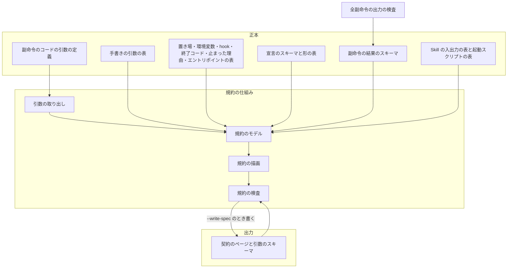
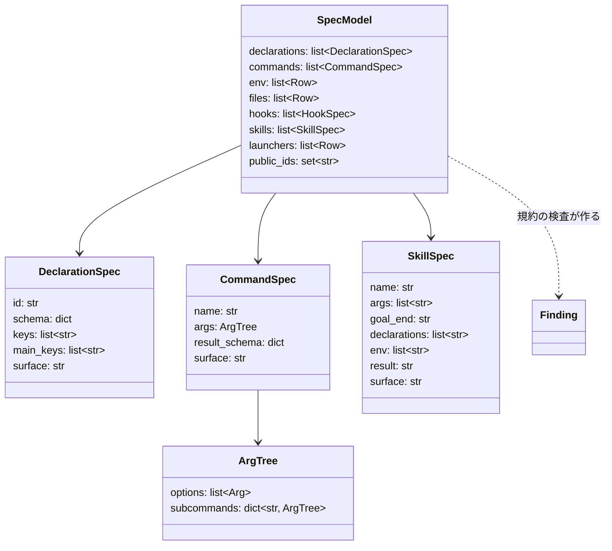
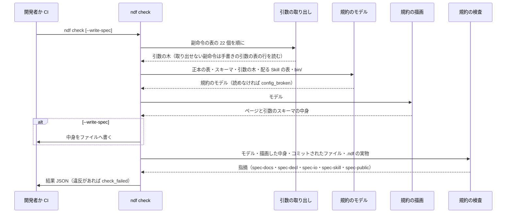

# ndf-next の宣言と入出力の規約: 設定ページと呼び出しの検証に使う JSON Schema と文書を 1 か所に置き、コードとずれたら CI が落とす（#3518）

## 目的

- **今どうなっているか**: ndf-next の `.ndf/` の宣言のキーと、副命令・環境変数・受け渡しのファイル・hook・Skill の入出力が、置き場の表・環境変数の表・hook の表・5 種だけの JSON Schema・各副命令のコードに分かれている。宣言のキーの一覧（置き場の表の `keys`）は、読み手のコードが読むキー（例: worktree の宣言の `deps`・`localenv`・`testenv`・`follow_branch`）を欠く
- **誰に効くか**: 設定ページを作る連携システム、NDF を呼び出しの形で検証する連携システム、Skill の本文から `ndf` を打つ AI
- **変えると何が成り立つか**: 宣言はファイルごとの JSON Schema と生成した文書で、入出力は面ごとの生成した文書と副命令ごとの JSON Schema で引ける。ndf-next の子が宣言・副命令・Skill を変えて文書を生成し直さなければ、`ndf check` が落ちる

## 適用範囲

- **働く範囲**: このリポジトリの `plugins/ndf-next/`（入れ替えの後は `plugins/ndf/`）。検査はこのリポジトリの CI と手元の `ndf check` で働き、利用先のリポジトリでは働かない
- **プロジェクトごとに違うもの**: 無し（文書とスキーマは NDF の版ごとに 1 つ）。実物の宣言の検証だけは、検査を打つリポジトリの `.ndf/` を読む
- **当たるモード**: `standard`

## あるべき姿の根拠

| 根拠 | 種類 | 何を示すか |
| --- | --- | --- |
| STD1・STD2 | 外部の一次情報 | 既定値・取りうる値・例・非推奨は JSON Schema 2020-12 の注釈の語で書け、知らない語は注釈として読み飛ばされる |
| STD3 | 外部の一次情報 | OpenAPI 3.1 のスキーマは JSON Schema 2020-12 の上位集合で、連携システムが HTTP で包むときにこのスキーマをそのまま参照できる |
| PRD1・PRD2 | 外部の一次情報 | 主要なエディタは設定の画面を JSON Schema から作り、設定ファイルのスキーマはカタログで引く形が広く使われている |
| `plugins/ndf-next/src/ndf/domains/worktree/declaration.py:24-28` と `contracts/domains/ndf-files.json` の `worktree` の `keys` | 実測（2026-11-14） | 読み手が読む `deps`・`localenv`・`testenv`・`follow_branch` が表の `keys` に無い。手で書いた一覧はコードから外れる |
| 実物の `.ndf/` 10 種と表の `keys` の突き合わせ（2026-11-14） | 実測 | `project.json` の `test_duration`・`supervise.json` の `test` は表に無く、`backlog.json` の `depths`・`worktree.json` の `tool_paths` は実物に無い |
| 依頼の原文（#3518・#3519 の範囲の追加） | 利用者の指示の原文 | 宣言の仕様書、入出力の規約、内部のスラッシュコマンドと AI が打つ CLI の入出力を求めている |

要求と受け入れ条件は #3518 の本文にある（コピーは [issue-3518-requirements.md](issue-3518-requirements.md) ）。#3519 の受け入れ内容はその本文へ取り込んである。この文書は「どう作るか」だけを扱う。

## ドメインモデル

### コンテキスト

| コンテキスト | 何の語が 1 つの意味に決まるか |
| --- | --- |
| 開発の工程（`ndf-workflow`） | 宣言・副命令・公開する面・内部の面・契約のページ・Skill の入出力の表 |
| サービス（`ndf-factory`） | 連携システム |

**関係は公開された言語である。** NDF が JSON Schema と生成した文書という文書化された形式を出し、連携システムはその形式だけを読んで設定ページと呼び出しの検証を作る。受け手が連携システムと AI の 2 つあり、NDF の側の変更と連携システムの側の変更を互いに独立して進めるためである。

### 集約

| 集約 | 持ち主（書き換えてよいもの） | 根 | エンティティ | 値オブジェクト |
| --- | --- | --- | --- | --- |
| 宣言の規約 | 宣言を読む子（宣言のスキーマと Markdown の宣言の形の表） | 宣言のファイル（置き場の表の宣言の行） | キー | 型・既定値・取りうる値・例・置き場・範囲・読む工程 |
| 副命令の規約 | 副命令を持つ子（結果のスキーマと、手書きの引数の表の行） | 副命令（副命令の表の行） | 下位の命令・引数 | 結果の `metrics` と `items` の形・終了コード・止まった理由 |
| Skill の規約 | Skill を移す子（Skill の入出力の表の行） | Skill（配る Skill の表の行） | — | 引数の形・`/goal` の終わりの条件・読む宣言・読む環境変数・結果の形 |
| 生成した規約 | 規約の生成だけ | 面ごとの契約のページと、副命令ごとの引数のスキーマ | 表の行・引数 | 公開か内部か・引数の形 |

**規約の検査はどの集約の持ち主でもない。** 規約の検査はファイルを読んで突き合わせるだけで、書き換えない。`ndf check --write-spec` で書くのは規約の生成で、書く先は「生成した規約」の集約だけである。手で書くファイル（宣言のスキーマ・結果のスキーマ・手書きの引数の表・Skill の入出力の表）は規約の生成が書かない。

環境変数・受け渡しのファイル・hook・終了コード・止まった理由・起動スクリプトは、それぞれの正本の表がそのまま集約の根になる。この課題はそれらの表を読むだけで、契約のページへ写さずに生成する。

### 不変条件

| # | 集約 | 条件 | 破れたときの扱い |
| --- | --- | --- | --- |
| I1 | 宣言の規約 | 置き場の表の宣言の行はすべて、スキーマ（JSON の宣言）か形の表（Markdown の宣言）を 1 つずつ持つ | `ndf check` が無い行の id を出して落ちる |
| I2 | 宣言の規約 | スキーマの最上位のキーのうち非推奨でないものの集まりが、置き場の表の行の `keys` に等しい | 食い違うキーを宣言の id と並べて落ちる |
| I12 | 宣言の規約 | 置き場の表の行の `main_keys` は、その行の `keys` の部分集合である | `keys` に無い `main_keys` のキーを宣言の id と並べて落ちる |
| I3 | 宣言の規約 | 検査を打つリポジトリの `.ndf/` の JSON の宣言は、その宣言のスキーマに通る | 通らないファイルと JSON Pointer を出して落ちる |
| I4 | 副命令の規約 | 副命令の表の副命令はすべて、引数のスキーマと結果のスキーマを 1 つずつ持つ | 無い副命令とスキーマの種類を出して落ちる |
| I13 | 副命令の規約 | 副命令ごとに、引数を与えるのは引数の取り出しか手書きの引数の表のどちらか一方である（argparse から取り出せる副命令は表に行を持たず、取り出せない副命令は表に行を持つ） | 両方に当たる副命令・どちらにも当たらない副命令を出して落ちる |
| I5 | 副命令の規約 | 副命令が出した結果 JSON と終了コードの組は、結果の契約（形と、状態・止まった理由と終了コードの対応）に通る | 通らなかった副命令と項目を出してテストが落ちる |
| I14 | 副命令の規約 | 副命令が出した結果 JSON は、その副命令の結果のスキーマに通る | 通らなかった副命令と項目を出してテストが落ちる |
| I6 | 副命令の規約 | コードが名前の文字列で読む環境変数は、すべて環境変数の表に載る | 載っていない名前とファイルと行を出して落ちる |
| I7 | Skill の規約 | 配る Skill の表の行のうち実体のある Skill は、すべて Skill の入出力の表に行を持つ | 無い Skill の名前を出して落ちる |
| I8 | Skill の規約 | Skill の本文・references・エージェント定義に書かれた `ndf <副命令>` の呼び出しは、副命令と下位の命令と引数の名前が引数のスキーマにある | ファイル・行・呼び出しを出して落ちる |
| I9 | 生成した規約 | コミットされた契約のページと引数のスキーマは、正本の表・スキーマ・コードの引数の定義・手書きの引数の表から生成し直した中身と 1 字も違わない | 差分のあるファイルを出して落ちる |
| I10 | 生成した規約 | 公開する面の表の行はすべて、契約のページのどれかの項目に当たる。当たった項目だけが公開になり、ほかは内部になる | 当たらない行の id を出して落ちる |
| I15 | 生成した規約 | 公開する面の表は種類 `spec` の行を、契約のページ・宣言のスキーマ・入出力のスキーマの 3 つの置き場について 1 つずつ持ち、各行の `target` がプラグインの中に実在するディレクトリを指す | 欠けた置き場・実在しない `target` を出して落ちる |
| I11 | 生成した規約 | `bin/` のファイルはすべて起動スクリプトの表に行を持つ | 無いファイルの名前を出して落ちる |

hook の登録のファイル（`hooks/claude.json`・`codex.json`）の事象が hook の表に載ることは、この課題の不変条件に持たない。登録のファイルは hook の表から生成する生成物で、既存のテスト `tests/domains/hooks/test_registration.py` の `test_registration_files_are_what_render_makes`（`registration.stale` が生成し直した中身との差分を出す）が既に縛っている（`src/ndf/domains/hooks/registration.py:1-13`）。

### ドメインイベント

| # | イベント | 発生元 | 受け手 |
| --- | --- | --- | --- |
| E1 | 開発者が宣言・副命令・環境変数・受け渡しのファイル・hook を足した・変えた | ndf-next の子の Pull Request | 規約の検査（E3） |
| E2 | 規約の生成が文書と引数のスキーマを作り直した | `ndf check --write-spec` | 開発者（コミットする） |
| E3 | 規約の検査が、コードと正本の表と規約を突き合わせた | `ndf check`（CI と手元） | 開発者（落ちた項目を直す） |
| E4 | 規約の検査が、生成し直した文書とコミットされた文書の差分を見た | `ndf check` | 開発者 |
| E5 | 規約の検査が、このリポジトリの `.ndf/` の実物をスキーマで確かめた | `ndf check` | 開発者 |
| E6 | テストが、副命令の実際の出力を結果のスキーマで確かめた | テストの実行（CI のジョブ ndf-next） | 開発者 |
| E7 | 入れ替え（S2 #3304）で、文書とスキーマが行き先の表どおりの置き場へ移った | 入れ替えの Pull Request | 公開する面の表（置き場の行） |
| E8 | 連携システムが、公開する面の表から規約の置き場を引いた | 版のリリース | 連携システム |
| E9 | Skill が ndf-next の `skills/` へ移った | Skill を移す子の Pull Request | 規約の検査（I7・I8）と規約の生成 |

### 用語

| 用語 | 意味 | 用語集への反映 |
| --- | --- | --- |
| 契約のページ | 宣言と入出力の規約を面ごとのページで表した文書。正本の表とスキーマから生成し、手で書かない（`plugins/ndf-next/docs/contracts/`） | 追加 |
| Skill の入出力の表 | 配る Skill ごとの引数の形・`/goal` の終わりの条件・読む宣言と環境変数・結果の形を持つ事実の表（`contracts/domains/skill-io.json`） | 追加 |
| 起動スクリプトの表 | `plugins/ndf-next/bin/` のファイルごとに、利用者と AI が打つ起動スクリプトか内部の部品かを持つ事実の表（`contracts/domains/launchers.json`） | 追加 |

要求の「宣言の文書」と「規約の文書」は、契約のページの `declarations.md` と、残りの 7 ページに当たる。用語集の「規約の文書」は supervisor が読む Skill の文書を指す別の語のため、この設計では使わない。

## 外部の調査

| 種類 | 調べるか | 理由 |
| --- | --- | --- |
| 標準・仕様 | 調べる | 宣言と引数と結果の形を書く形式（JSON Schema）と、HTTP で包むときの形式（OpenAPI）に公開の仕様がある |
| 主要な製品 | 調べる | 設定のスキーマから設定の画面を作る製品と、設定のスキーマを引く仕組みが広く使われている |
| ライブラリとサービス | 調べる | スキーマの検証、スキーマからの文書の生成、argparse からの文書の生成に既存のライブラリがある |

### 標準・仕様

| # | 標準・仕様 | 何を定めているか | 設計への反映 | 出典 |
| --- | --- | --- | --- | --- |
| STD1 | JSON Schema 2020-12 Validation の 9 章（Basic Meta-Data） | `title`・`description`・`default`・`deprecated`・`readOnly`・`examples` を注釈の語として定める | キーの説明・既定値・例・非推奨をこの語で書き、独自の語を作らない | https://json-schema.org/draft/2020-12/json-schema-validation （2026-11-14） |
| STD2 | JSON Schema 2020-12 Core | 知らない語は値が注釈として集められるだけで、検証を変えない | 置き場・読む工程は `x-ndf-` で始まる注釈の語で書く。連携システムの検証器はそのまま通す | https://json-schema.org/draft/2020-12/json-schema-core （2026-11-14） |
| STD3 | OpenAPI 3.1.0 の Schema Object | JSON Schema 2020-12 の上位集合 | HTTP の API は作らず、連携システムが包むときに `$ref` でこのスキーマを指せる形にする | https://spec.openapis.org/oas/v3.1.0.html （2026-11-14） |

### 主要な製品

| # | 製品 | どう解いているか | 設計への反映 | 出典 |
| --- | --- | --- | --- | --- |
| PRD1 | Visual Studio Code（`contributes.configuration`） | 拡張が設定を JSON Schema で宣言し、設定の画面と `settings.json` の補完がそこから作られる。設定ごとに範囲（scope）を持つ | 設定ページの入力欄をスキーマから作れる形にし、範囲（チームか個人か）をファイルごとに持たせる | https://code.visualstudio.com/api/references/contribution-points （2026-11-14） |
| PRD2 | SchemaStore | JSON・YAML・TOML の設定ファイルのスキーマのカタログで、エディタと Tool が検証・補完・文書の表示に使う | スキーマを 1 ファイル 1 宣言で置き、`$id` で引ける形にする | https://www.schemastore.org/ （2026-11-14） |

### ライブラリとサービス

| # | 候補 | 版 | ライセンス | 最後のリリースの日付 | 終了のアナウンス | 要件を満たすか | 出典 |
| --- | --- | --- | --- | --- | --- | --- | --- |
| LIB1 | jsonschema（Python） | 4.26.0 | MIT | 2026-01-07 | 無し | 満たす。2020-12 の検証器を持ち、ndf-next が既に依存している（`pyproject.toml` の `jsonschema==4.26.0`。`ndf contracts check` が使う） | https://pypi.org/pypi/jsonschema/json （2026-11-14） |
| LIB2 | json-schema-for-humans | 1.5.1 | Apache-2.0 | 2025-11-21 | 無し | 一部。スキーマから HTML・Markdown を作るが、置き場の表・環境変数の表・hook の表・副命令の表を同じ文書に組めず、Jinja2・click など 6 つの依存が増える | https://pypi.org/pypi/json-schema-for-humans/json （2026-11-14） |
| LIB3 | jsonschema2md | 1.7.0 | Apache-2.0 | 2025-08-14 | 無し | 一部。スキーマ 1 つから Markdown を作るだけで、表の結合と公開か内部かの列を持てない。開発の状態は Beta | https://pypi.org/pypi/jsonschema2md/json （2026-11-14） |
| LIB4 | sphinx-argparse | 0.6.1 | MIT | 2026-08-21 | 無し | 満たさない。argparse から文書を作るが Sphinx と docutils が要り、JSON Schema を出さない | https://pypi.org/pypi/sphinx-argparse/json （2026-11-14） |
| LIB5 | argparse-manpage | 4.8 | Apache-2.0 | 2026-10-14 | 無し | 満たさない。argparse から man ページを作るだけで、JSON Schema も Markdown の表も出さない | https://pypi.org/pypi/argparse-manpage/json （2026-11-14） |
| LIB6 | Python 標準の argparse | 3.13 系（ndf-next の実行環境） | PSF | — | 無し | 一部。引数の定義を読む公開の API は無く、読むには `_actions`・`_SubParsersAction` の内部の属性を使う | 手元の `uv run --frozen --project plugins/ndf-next python` で 22 個の副命令を試し、20 個から引数の木を取り出せた（2026-11-14。下の決定 3） |

終了のアナウンスの「無し」は、PyPI の JSON（`info.classifiers`・`info.yanked`）に非推奨・アーカイブの記載が無いことを指す。リポジトリのアーカイブの状態は確かめていない（下の表）。

### 確かめられなかったこと

| 対象 | 試した手段 | 結果と理由 |
| --- | --- | --- |
| LIB2〜LIB5 のリポジトリのアーカイブの状態 | 試していない | PyPI の情報だけで採否が決まった（いずれも採らない）ため、取得の試みを使わなかった |
| 設定の文書とスキーマを同じ定義から生成する製品（Renovate など） | https://docs.renovatebot.com/configuration-options/ を取得 | 取得はできた（HTTP 200）が、文書とスキーマを何から作るかがページに書かれておらず、生成の元は確かめていない |

調べた量: 候補 11 件・取得の試み 12 回。

## 機能一覧

| # | 機能 | 誰が使うか |
| --- | --- | --- |
| F1 | 宣言のファイルごとのキー・型・既定値・取りうる値・必須か・置き場・範囲・読む工程・例を、文書と JSON Schema で引く | 連携システム（設定ページ） |
| F2 | 副命令ごとの引数と結果（`metrics`・`items`）・終了コード・止まった理由を、文書と JSON Schema で引く | 連携システム・AI |
| F3 | 環境変数・受け渡しのファイル・hook の入出力・起動スクリプトを、公開か内部かと並べて文書で引く | 連携システム・AI |
| F4 | 配る Skill ごとの引数の形・`/goal` の終わりの条件・読む宣言と環境変数・結果の形を文書で引く | AI・連携システム |
| F5 | 契約のページと引数のスキーマを、正本の表・スキーマ・コードから作り直す | ndf-next の開発者 |
| F6 | コードと正本の表と規約の食い違い・生成し忘れ・実物の宣言の誤りを、`ndf check` で落とす | ndf-next の開発者・CI |
| F7 | 副命令の実際の出力が結果のスキーマに通ることを、テストで落とす | ndf-next の開発者・CI |

## 構成要素

| 要素 | 責務 |
| --- | --- |
| 宣言のスキーマ（`contracts/schemas/declarations/<id>.schema.json`、18 個） | JSON の宣言ごとのキー・型・説明・既定値・取りうる値・例・非推奨と、ファイルの置き場・範囲・読む工程の注釈を持つ。手で書く |
| Markdown の宣言の形の表（`contracts/schemas/declarations/mvv-body.sections.json`） | `mvv.md` の節の並びと、置き場・範囲・読む工程を持つ。手で書く |
| 副命令の引数のスキーマ（`contracts/schemas/io/<副命令>.args.schema.json`、22 個） | 副命令・下位の命令ごとの引数の名前・型・必須・既定値・取りうる値・説明を持つ。22 個すべてを規約の生成が作り、手で直さない |
| 手書きの引数の表（`contracts/domains/manual-args.json`） | argparse を使わない副命令（2026-11-14 時点で `launch-args`・`notify` の 2 個）の下位の命令と引数を持つ事実の表。規約の生成はこの表の行から、その副命令の引数のスキーマを作る |
| 副命令の結果のスキーマ（`contracts/schemas/io/<副命令>.result.schema.json`、22 個） | 副命令の結果 JSON の `metrics` と `items` の形を持つ。結果の契約（`result.schema.json`）を `$ref` で指し、共通の欄を写さない。副命令を持つ子が手で書く |
| Skill の入出力の表（`contracts/domains/skill-io.json`） | 実体のある配る Skill ごとの `/goal` の終わりの条件・読む宣言・結果の形と、公開する面に無い Skill の引数の形と環境変数を持つ |
| 起動スクリプトの表（`contracts/domains/launchers.json`） | `bin/` のファイルごとの種類（起動スクリプトか内部の部品か）と、渡し先・意味を持つ |
| 置き場の表の直し（`contracts/domains/ndf-files.json`） | 宣言の行の `keys` を、読み手のコードが読むキーへ合わせる（形と値は変えず、欠けたキーを足し、読まれないキーを外す） |
| 環境変数の表の直し（`contracts/domains/env.json`） | コードが名前の文字列で読むのに表に無い変数（2026-11-14 の測りで `HOME`・`UV_PROJECT_ENVIRONMENT`）の行を足す。変数の追加ではなく、今読んでいる変数を書き表す |
| 公開する面の表の行の追加（`contracts/domains/entrypoints.json`・`entrypoint-cases.json`） | 種類 `spec`（規約の置き場）の行を 3 つ足す: 契約のページの置き場、宣言のスキーマの置き場（`files` に公開する宣言の id）、入出力のスキーマの置き場 |
| 規約のモデル（`src/ndf/checks/spec_model.py`） | 正本の表・スキーマ・配る Skill の表・`bin/` を読み、面ごとの項目と公開か内部かを 1 つのモデルに組む。ファイルを読むだけで書かない |
| 引数の取り出し（`src/ndf/checks/spec_args.py`） | 副命令のモジュールの `main` を、引数を読む直前で止めて argparse の定義を受け取り、下位の命令まで辿って引数の木を作る |
| 規約の描画（`src/ndf/checks/spec_render.py`） | モデルから契約のページのページと引数のスキーマの中身を文字列で作る。純粋な処理で、ファイルを触らない |
| 規約の検査（`src/ndf/checks/spec_docs.py`） | 規則 `spec-docs`（I9）・`spec-decl`（I1〜I3・I12）・`spec-io`（I4・I6・I11・I13）・`spec-skill`（I7・I8）・`spec-public`（I10・I15）を当て、指摘を返す。`--write-spec` のときは描画した中身を書く |
| `ndf check` の配線（`src/ndf/checks/run.py`・`checks/README.md`・`checks/rules.json`） | 規約の検査を規則の 1 つとして呼ぶ。`--write-spec` を受ける。規則の名前と規約の置き場を `rules.json` に置く |
| 全副命令の出力の検査（`tests/conftest.py`・`tests/cli/test_every_output.py`） | テストの間に出た結果 JSON と終了コードの組を結果の契約で、結果 JSON を副命令の結果のスキーマで確かめ、実行の終わりに、ok の出力が 1 度も確かめられなかった副命令を落とす（I5・I14） |
| 契約のページ（`docs/contracts/` の 8 ページ） | `index.md`（面の一覧と公開か内部かの約束）・`declarations.md`・`commands.md`・`exit-codes.md`（終了コードと止まった理由）・`env.md`・`files.md`・`hooks.md`・`skills.md`（Skill と起動スクリプト）。すべて生成する |
| 行き先の表（`docs/ndf-swap-doc-destinations.md`） | 契約のページ・宣言のスキーマ・入出力のスキーマの 3 行（扱い・持ち主・時期）を足す |

**値の集合へ値を足す変更が 1 つある。** エントリポイントの表の種類（`kind`）に `spec` を足す。種類で分岐する既存の規則を集め、当てはまらないものを次のとおり変える。

| 規則 | 置き場 | `spec` に当てはまるか | 扱い |
| --- | --- | --- | --- |
| 呼び手の値の判定 `accepts`（`block`・引数の種類・`hook` 以外は置き場のファイルとして `files` を読む） | `tests/domains/test_entrypoints.py:27-41` | 当てはまらない（`spec` の値はプラグインの根からのパスで、置き場の表のパスではない） | `spec` の枝を足す（`target` で始まるパスを受ける） |
| どのエントリポイントにも受ける見本がある | `tests/domains/test_entrypoints.py:48-53` | 当てはまる | 3 行の見本を `entrypoint-cases.json` へ足す |
| 引数を持つ種類だけが `args` を持つ（`ARG_KINDS`） | `tests/domains/test_entrypoints.py:19,64` | 当てはまる（`spec` は引数を持たない） | 変えない |
| 種類 `file` の行の検査・サービスが読むファイルにエントリポイントがある | `tests/domains/test_entrypoints.py:65-72` | 当てはまる（`kind="file"` で絞る） | 変えない |
| 列 `kind`・`target` の説明 | `contracts/domains/entrypoints.json` の `columns` | 当てはまらない | `spec` の意味を足す |
| 組織の受け渡し（`file-organizer` を id で引く） | `src/ndf/progress/plan/external.py:52` | 当てはまる（種類で分岐しない） | 変えない |



配置は変わらない。規約の仕組みは `ndf check` の 1 プロセスの中で動き、ネットワークへ出ない。全副命令の出力の検査はテストのプロセスの中で動く。

## 構造



`Finding` は `ndf check` の既存の指摘の型（`src/ndf/checks/model.py`）で、規約の検査はこれを返す。型の細部（欄の型・関数の引数）は詳細設計が決める。

## データ構造

永続データは持たない。新しく置くのはリポジトリに追跡されるスキーマ・事実の表・生成した文書で、どれも git の履歴が版を持つ。

| ファイル | 形 | 書き手 |
| --- | --- | --- |
| 宣言のスキーマ | JSON Schema 2020-12。最上位は `type: object`・`additionalProperties: false`。キーごとに `type`・`description`、既定値のあるキーは `default`、取りうる値が有限なら `enum`、ファイルに `examples` を 1 つ以上。ndf-next が読まないが実物に残るキーは `deprecated: true`。注釈 `x-ndf-place`（`worktree` か `main`）・`x-ndf-read-by`（読む副命令か工程と、読む時点の配列） | 宣言を読む子（初版はこの課題） |
| Markdown の宣言の形の表 | 事実の表の形（`fact.schema.json`）。行は節の見出しと順番と必須か | 同上 |
| 引数のスキーマ | JSON Schema 2020-12。下位の命令ごとに `oneOf` の枝を持ち、枝は引数の名前をキーにした `properties`（`type`・`description`・`default`・`enum`・配列なら `items`）と `required` を持つ | 規約の生成だけ（22 個すべて） |
| 手書きの引数の表 | 事実の表の形。行は副命令で、列は下位の命令ごとの引数の並び（名前・型・必須・説明） | 副命令を持つ子（初版はこの課題） |
| 結果のスキーマ | JSON Schema 2020-12。`allOf` で結果の契約を `$ref` し、`metrics` と `items` の形だけを足す | 副命令を持つ子（初版はこの課題） |
| Skill の入出力の表 | 事実の表の形。列は `goal_end`（文字列か無し）・`declarations`（置き場の表の id）・`env`（環境変数の表の id）・`result`（`block`・`report`・`none`）・`args`（正規表現の配列。公開する面の Skill は持たない） | Skill を移す子（初版はこの課題） |
| 起動スクリプトの表 | 事実の表の形。列は `kind`（`launcher`・`part`）・`passes_to`・`meaning` | 起動スクリプトを足す子（初版はこの課題） |

**範囲（チームか個人か）は置き場の表の `tracked` から導き、スキーマに写さない。** 追跡するファイルはチーム、追跡しないファイル（`worktree.local.json`）は個人である。キーがメインディレクトリから読まれることは置き場の表の `main_keys` から導く。

## 入出力の契約

| 項目 | 内容 |
| --- | --- |
| 置き場所 | 宣言のスキーマは `plugins/ndf-next/contracts/schemas/declarations/`、入出力のスキーマは `plugins/ndf-next/contracts/schemas/io/`、契約のページは `plugins/ndf-next/docs/contracts/`。入れ替えの後は `plugins/ndf/` の同じ相対パス |
| 変わる約束 | 公開する面に規約の置き場の 3 行が加わる。宣言・副命令・環境変数・受け渡しのファイル・hook の名前と形は変わらない |
| 互換性の扱い | 既存の呼び出し側は壊れない。連携システムは公開する面の表の種類 `spec` の行から置き場を引き、置き場を変えるときは版で約束する |
| 検査の手段 | `plugins/ndf-next/bin/ndf check`（規約の検査を含む）・`plugins/ndf-next/bin/ndf contracts check`（事実の表の形）・テスト（全副命令の出力の検査） |

開発者の打ち方:

```bash
plugins/ndf-next/bin/ndf check --write-spec   # 契約のページと引数のスキーマを作り直して書き、続けて検査する
plugins/ndf-next/bin/ndf check                # 書かずに検査だけ（CI と同じ）
```

規約の検査の指摘は、既存の検査と同じく 1 件 1 行で標準エラーへ出し、結果 JSON の `items` に載る（止まった理由は `check_failed`、終了コード 1）。正本の表かスキーマが読めないときは `config_broken`（終了コード 2）で止まる。

**公開か内部かは文書の列で示す。** 公開する面の表（エントリポイントの表と、置き場の表の列 `reader` を持つ行）に当たる項目が公開、ほかが内部である。内部の行の文書には「予告なく変えてよい」と書く。環境変数は、公開する面のエントリポイントの `env` に載るものが公開である。

## 処理の流れ



図に現れない構成要素は、データの直しと追加（置き場の表・環境変数の表・手書きの引数の表・エントリポイントの表と見本・行き先の表）と、`ndf check` の配線である。データは図の「正本の表」として読まれ、配線は図の `ndf check` そのものである。`--write-spec` が書くのは契約のページと引数のスキーマだけで、手書きの引数の表は入力として読むだけである。

全副命令の出力の検査は、テストの実行の中で別に動く。結果 JSON を出す 1 か所（`ndf.contracts.result.emit`。結果 JSON と終了コードを受け、標準出力へ書いて終了コードを返す。`src/ndf/contracts/result.py:144-154`）をテストの間だけ包み、受けた結果 JSON と終了コードの組を結果の契約（`result.errors`。状態・止まった理由と終了コードの対応を見る）で、結果 JSON をその副命令の結果のスキーマで確かめ、ok の出力を確かめた副命令の名前を記録する。テストの並列のプロセスの記録は、実行の終わりに 1 か所で集める。

## 非機能の実現方式

| 大項目 | 要求の条件 | 実現方式 | 確かめ方 |
| --- | --- | --- | --- |
| 性能・拡張性 | 生成と検査はネットワークへ出ずにリポジトリの中のファイルだけで完結する | 規約のモデルはリポジトリの中の表・スキーマ・Markdown・`bin/` と、副命令のモジュールの import だけを読む。引数の取り出しは引数を読む直前で止め、副命令の処理を流さない | ネットワークを断った環境で `ndf check` を打ち、結果が変わらないこと（テストでは外へ出る呼び出しを禁じた中で規約の検査を流す） |
| 運用・保守性 | 宣言・副命令・環境変数・受け渡しのファイル・hook・Skill を足した子の Pull Request は、文書を生成し直さないと CI で落ちる（受け入れ条件 3・5・11・18） | 契約のページと引数のスキーマを生成物としてコミットし、`ndf check` が生成し直した中身と比べる。CI のジョブ ndf-next は既に `ndf check` を打つため、ワークフローは変えない | 副命令に引数を 1 つ足した状態で `ndf check` を打ち、`spec-docs` の指摘で落ちること |
| 移行性 | 入れ替え（S2）の後、文書とスキーマは行き先の表どおりの置き場にあり、公開する面の表がその置き場を指す | 置き場はプラグインの根からの相対パスだけで書き、プラグインの名前とディレクトリ名を文書とスキーマに入れない。CI の一時コピー（`plugins/ndf/` へ写すジョブ）でも同じ中身が生成される | 一時コピーのジョブで `ndf check` が通ること |
| セキュリティ | 文書・スキーマ・例に、秘密の値（トークン・鍵）と実在の利用者のデータを載せない（受け入れ条件 8） | 環境変数の表の `secret` が真の行は名前と意味だけを描き、値の例の欄を描かない。宣言のスキーマの `examples` は実物から写さず、架空の値で書く | 秘密の変数に例を足した表で生成すると、規約の検査が落ちること。`python3 scripts/check-repo-secrets.py` が通ること |

## 決定の記録

決定の記録は [issue-3518-design-decisions.md](issue-3518-design-decisions.md) にある。

## テスト設計

| 受け入れ条件・不変条件 | どの振る舞いで縛るか | どう壊したら落ちるべきか |
| --- | --- | --- |
| 受け入れ条件 1・I1 | 置き場の表の宣言の 19 行が宣言の文書に載り、各ファイルが置き場・範囲・キー・型・既定値・取りうる値・必須か・読む工程・例を持つ。`main_keys` のキーにメインディレクトリから読む印が付く | 置き場の表へ宣言の行を 1 つ足し、スキーマを置かないと、その id で落ちる |
| 受け入れ条件 2 | JSON の宣言の 18 種にスキーマがあり、キーごとに型と説明、既定値のあるキーは `default`、有限の値は `enum` を持つ | キーの `description` を消すと落ちる |
| 受け入れ条件 3・4・I2・I12 | 置き場の表の `keys` とスキーマの最上位のキーが等しく、`main_keys` が `keys` に含まれる。「コードが読むキー」を置き場の表の `keys` で代える扱いは「人へ残す判断」の 1 で決める | 表の `keys` へキーを 1 つ足すと、宣言の id とキーの名前を出して 0 以外で落ちる。スキーマだけにキーを足しても落ちる。`main_keys` へ `keys` に無いキーを足すと落ちる |
| 受け入れ条件 5・I4・I13・I9 | 副命令の表の 22 個が規約に載り、引数のスキーマが引数の定義か手書きの引数の表から生成した中身と一致する | 副命令の定義へ引数を 1 つ足すと、副命令と引数の名前を出して落ちる。副命令の表へ 1 行足しても落ちる。argparse を使う副命令を手書きの引数の表にも載せると落ちる |
| 受け入れ条件 5（環境変数）・I6 | コードが名前の文字列で読む環境変数がすべて環境変数の表に載る | 表に無い名前を読むコードを足すと、名前・ファイル・行を出して落ちる |
| 受け入れ条件 5（受け渡しのファイル） | 置き場の表のすべての行が受け渡しのファイルのページに載り、形は外の呼び手が読む行だけに載る。置き場の表に無いファイルを読み書きするコードを見つける検査は持たず、扱いは「人へ残す判断」の 2 で決める | 置き場の表に行を足して生成し直さないと `spec-docs` で落ちる |
| 受け入れ条件 6・I5・I14 | どの副命令の出力も、結果 JSON と終了コードの組が結果の契約に、結果 JSON が副命令の結果のスキーマに通る。全体の実行では、どの副命令も ok の出力が 1 度は確かめられる | 結果のスキーマに無い `metrics` の項目を出すように副命令を壊すと、その副命令と項目を出して落ちる。状態と食い違う終了コードを渡すように副命令を壊すと落ちる。ある副命令の ok の出力を出すテストを外すと、実行の終わりにその副命令の名前で落ちる |
| 受け入れ条件 7 | 終了コードと止まった理由のページが 2 つの表の全行を持つ | 止まった理由の表へ行を足して生成し直さないと `spec-docs` で落ちる |
| 受け入れ条件 8 | 環境変数の表の 49 行がページに載り、秘密の 4 行に値の例が無い | 秘密の行に例を描くように描画を壊すと落ちる |
| 受け入れ条件 9 | hook の表のランタイム 2 つ・事象ごとに、読む入力の鍵と判定ごとの出力の形がページに載る。hook の登録のファイルの事象が hook の表に載る（既存のテスト `tests/domains/hooks/test_registration.py` の `test_registration_files_are_what_render_makes` が縛り、この課題では足さない） | 登録のファイルへ表に無い事象を足すと、既存のテストが生成し直した中身との差分で落ちる。hook の表へ事象を足して契約のページを生成し直さないと `spec-docs` で落ちる |
| 受け入れ条件 10・I10 | 公開する面の表の行がすべて規約の項目に当たり、当たった項目だけが公開と描かれる | 公開する面の表へ実在しない副命令を指す行を足すと、行の id を出して落ちる |
| 受け入れ条件 11・I9 | 生成し直した中身とコミットされた文書・引数のスキーマが 1 字も違わない | 契約のページを手で 1 字直すと、そのページで落ちる。`--write-spec` の後は通る |
| 受け入れ条件 12・I3 | このリポジトリの `.ndf/` の JSON の宣言 10 種がスキーマに通る。`.ndf/` の無いリポジトリでは 0 件で通る | 実物の宣言の値を型の違う値にしたコピーで検査すると、ファイルと JSON Pointer を出して落ちる |
| 受け入れ条件 13 | 行き先の表に契約のページ・宣言のスキーマ・入出力のスキーマの 3 行がある | 行き先の表を読む検査は無い（2026-11-14 に `grep -rln ndf-swap-doc-destinations scripts plugins .github` で 0 件）。3 行の有無は実装の Pull Request のレビューで見る。`.md` の文言を照合するテストは書かない |
| 受け入れ条件 14・I15 | 公開する面の表に種類 `spec` の 3 行があり、それぞれが実在の置き場を指し、受ける見本がある | `spec` の行を消すと、`spec-public` が欠けた置き場の名前で落ちる。`target` を実在しないパスにしても落ちる |
| 受け入れ条件 15 | ndf-next の既存のテストと `ndf check` が通り、宣言を読む側のコードを変えない | 宣言の読み手のファイル（`domains/worktree/declaration.py` ほか）が差分に入っていないことをレビューで見る |
| 受け入れ条件 16・I7 | 実体のある配る Skill（2026-11-14 時点で 11 個）がすべて Skill のページに載る | `skills/` に Skill を 1 つ足して配る Skill の表に行を足し、Skill の入出力の表に行を足さないと、その名前で落ちる |
| 受け入れ条件 17・I8 | Skill の本文・references・エージェント定義の `ndf <副命令>` の呼び出しが、副命令・下位の命令・引数の名前で規約に当たる | 規約に無い引数を使う呼び出しを 1 行足すと、ファイル・行・呼び出しを出して落ちる |
| 受け入れ条件 18 | Skill を移した状態で生成し直さないと落ち、生成し直すと通る | Skill を移して `--write-spec` を打たないと `spec-docs` で落ちる |
| 受け入れ条件 19・I11 | `bin/` の 3 ファイルが起動スクリプトの表にあり、起動スクリプト（`ndf`・`ndf-claude`）だけがページに載る | `bin/` にファイルを足すと、その名前で落ちる |

## 設計の結果

| 課題 | 扱い | 取り込み先 | 触るファイル |
| --- | --- | --- | --- |
| #3518 | 実装する | — | `plugins/ndf-next/contracts/schemas/declarations/project.schema.json`、`plugins/ndf-next/contracts/schemas/declarations/supervise.schema.json`、`plugins/ndf-next/contracts/schemas/declarations/release.schema.json`、`plugins/ndf-next/contracts/schemas/declarations/worktree.schema.json`、`plugins/ndf-next/contracts/schemas/declarations/worktree-local.schema.json`、`plugins/ndf-next/contracts/schemas/declarations/glossary.schema.json`、`plugins/ndf-next/contracts/schemas/declarations/instructions.schema.json`、`plugins/ndf-next/contracts/schemas/declarations/mvv.schema.json`、`plugins/ndf-next/contracts/schemas/declarations/pace.schema.json`、`plugins/ndf-next/contracts/schemas/declarations/review.schema.json`、`plugins/ndf-next/contracts/schemas/declarations/backlog.schema.json`、`plugins/ndf-next/contracts/schemas/declarations/runtime-policy.schema.json`、`plugins/ndf-next/contracts/schemas/declarations/ask.schema.json`、`plugins/ndf-next/contracts/schemas/declarations/context.schema.json`、`plugins/ndf-next/contracts/schemas/declarations/estimate.schema.json`、`plugins/ndf-next/contracts/schemas/declarations/issue-items.schema.json`、`plugins/ndf-next/contracts/schemas/declarations/projects.schema.json`、`plugins/ndf-next/contracts/schemas/declarations/code-metrics.schema.json`、`plugins/ndf-next/contracts/schemas/declarations/mvv-body.sections.json`、`plugins/ndf-next/contracts/schemas/io/`（副命令ごとの引数のスキーマ 22 個は生成物、結果のスキーマ 22 個は手書き）、`plugins/ndf-next/contracts/domains/manual-args.json`、`plugins/ndf-next/contracts/domains/skill-io.json`、`plugins/ndf-next/contracts/domains/launchers.json`、`plugins/ndf-next/contracts/domains/ndf-files.json`、`plugins/ndf-next/contracts/domains/env.json`、`plugins/ndf-next/contracts/domains/entrypoints.json`、`plugins/ndf-next/contracts/domains/entrypoint-cases.json`、`plugins/ndf-next/src/ndf/checks/spec_model.py`、`plugins/ndf-next/src/ndf/checks/spec_args.py`、`plugins/ndf-next/src/ndf/checks/spec_render.py`、`plugins/ndf-next/src/ndf/checks/spec_docs.py`、`plugins/ndf-next/src/ndf/checks/run.py`、`plugins/ndf-next/src/ndf/checks/rules.json`、`plugins/ndf-next/src/ndf/checks/README.md`、`plugins/ndf-next/tests/checks/test_spec_docs.py`、`plugins/ndf-next/tests/checks/test_spec_args.py`、`plugins/ndf-next/tests/conftest.py`、`plugins/ndf-next/tests/cli/test_every_output.py`、`plugins/ndf-next/tests/domains/test_entrypoints.py`、`plugins/ndf-next/docs/contracts/index.md`、`plugins/ndf-next/docs/contracts/declarations.md`、`plugins/ndf-next/docs/contracts/commands.md`、`plugins/ndf-next/docs/contracts/exit-codes.md`、`plugins/ndf-next/docs/contracts/env.md`、`plugins/ndf-next/docs/contracts/files.md`、`plugins/ndf-next/docs/contracts/hooks.md`、`plugins/ndf-next/docs/contracts/skills.md`、`docs/ndf-swap-doc-destinations.md`、`docs/glossary.md`・`docs/glossary/glossary.json`（用語の 3 語。設計の Pull Request で足し、実装で意味が変われば直す） |
| #3519 | 取り込む | #3518 | — |

## 人へ残す判断

設計承認ゲートで決める。3 つとも、受け入れ条件の文言とこの設計の届く範囲が食い違う所である。

| # | 判断 | 経緯 | 選択肢 | 推奨と理由 |
| --- | --- | --- | --- | --- |
| 1 | 受け入れ条件 3 の「ndf-next のコードが読むのに文書とスキーマに無いキー」を、「置き場の表の `keys` に載るのにスキーマに無いキー」と読んでよいか | 要求の未決は「コードが読む名前」を見つける方法を設計に委ね、選択肢に「読み手が置き場の表だけから名前を引くことを前提にする」を挙げている。この設計はその前提を採る（決定 1）。このとき、表の `keys` に載らないキーを読むコードを足したことは機械で見つからず、受け入れ条件 3 の「読むキーを 1 つ足した入力では落ちる」は「表の `keys` へキーを 1 つ足した入力では落ちる」に狭まる | (a) 狭めた読み方で受け入れ、コードから見つける検査は別の課題（決定 1 の最後の段落）へ回す。(b) この課題で読み手を 1 つの読み口へ寄せ、コードから見つける。宣言を読む 10 前後のモジュールを書き換え、レーン lr-tail・lr-fix-b のファイルを含むため、両レーンのマージまで着手を待つ | (a)。(b) は要求の境界（lr-tail・lr-fix-b のコードを変えない）に当たり、この課題が両レーンの完了を待つことになる（Value 5）。構文木からキーを集める方法は 65 件の候補の大半が宣言のキーでなく、使えなかった（決定 1） |
| 2 | 受け入れ条件 5 の「コードにあって規約に無い受け渡しのファイル」を、「置き場の表にあって規約に無いファイル」と読んでよいか | 受け渡しのファイルのページは置き場の表から生成するため、表の行は必ず規約に載る。表に無いパスを文字列で書いて読み書きするコードを見つける規則はこの設計に無い。読み手がパスを置き場の表から引く例は `domains/release/declaration.py:69-70`・`domains/worktree/declaration.py:54-55`・`domains/backlog/state.py:21`・`progress/plan/external.py:45` にあるが、すべての読み書きが表を通ることは確かめていない | (a) 狭めた読み方で受け入れ、パスの文字列を書いたコードを見つける検査は判断 1 の別の課題に含める。(b) この課題で、`.ndf/` や状態の置き場を指すパスの文字列を構文木から集める規則を `spec-io` に足す。誤検出の数は測っていない | (a)。(b) は判断 1 の構文木の方法と同じく誤検出の数が分からず、測らずに足すと検査が落ち続けるおそれがある（Value 13） |
| 3 | 公開する面の表の行 `gate-record`（副命令の表に無い `gate` を指す）を、規約の検査 I10 でどう扱うか | この行は順番が `caller-first`（呼び手を先に合わせる行）で、持ち主は子 P2 である。実装の時点で残っていれば I10 が落とし、P2 の子が直すまでこの課題はマージできない | (a) P2 の子が直すまで待つ。(b) この課題で行を直すか消す。(c) 順番が `caller-first` の行を I10 の対象から外し、契約のページに「呼び手と合わせる前の行」として載せる | (c)。(a) は他の子の進み具合でこの課題が止まる（Value 5）。(b) は持ち主の違う表の行と、呼び手（volareinc/nd-factory#183）との約束を変える。(c) は表の既存の列 `order` だけで決まり、他の子の行を変えない |

## 未確認のまま残ること

| 項目 | 内容 |
| --- | --- |
| 置き場の表に載らないキーを読むコード | 規約の検査は、読み手が置き場の表の `keys` に載るキーだけを読むことを前提にし、表とスキーマの食い違いを落とす（決定 1）。表に載らないキーを読むコードを足したことは機械では見つからず、レビューに頼る。扱いは「人へ残す判断」の 1 で決める |
| 置き場の表に無い受け渡しのファイルを読み書きするコード | 同じく機械では見つからない。扱いは「人へ残す判断」の 2 で決める |
| 結果を `emit` を通さずに終わる副命令の経路 | 全副命令の出力の検査は `emit` が受けた結果 JSON と終了コードを見る。`emit` を通らずに `sys.exit` などで終わる経路があれば、その終了コードは確かめられない。経路の有無は実装で全副命令の `main` を辿って分かる |
| 実物の宣言 10 種がスキーマに通るか | 実物には ndf-next の表に無いキー（`project.json` の `test_duration`・`supervise.json` の `test`）がある。非推奨のキーとして載せて通す（決定 5）が、入れ子のキーの食い違いの数はスキーマを書くまで分からない。実装で全 10 種を検査に通して分かる |
| 公開する面の表の `gate-record` | 種類 `command` で `target` が `gate` だが、副命令の表に `gate` は無い（2026-11-14 の `cli.py` の `COMMANDS`）。順番が `caller-first` で、入れ替えの前に呼び手と合わせる行である。実装の時点で残っているかは、実装の着手時に `COMMANDS` を見て分かる。残っていたときの扱いは「人へ残す判断」の 3 で決める |
| 全副命令の出力の検査で ok の出力が無い副命令 | 既存のテストが ok の出力を出さない副命令があれば、`tests/cli/test_every_output.py` に呼び出しを足す。何個あるかは、出力の検査を入れて全体テストを流すまで分からない |
| 書かれた呼び出しの件数 | 要求の前提 12 は `ndf hooks` の 1 件を挙げるが、2026-11-14 に `plugins/ndf-next/skills/` と `agents/` を `grep -rn 'ndf ' … \| grep -v 'ndf:'` で探して 0 件だった。検査は 0 件でも働き、S1a #3303 で Skill が移るにつれて増える |
