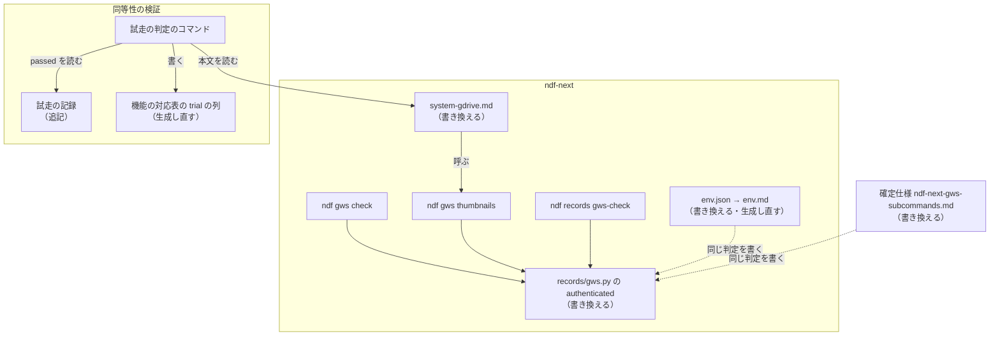
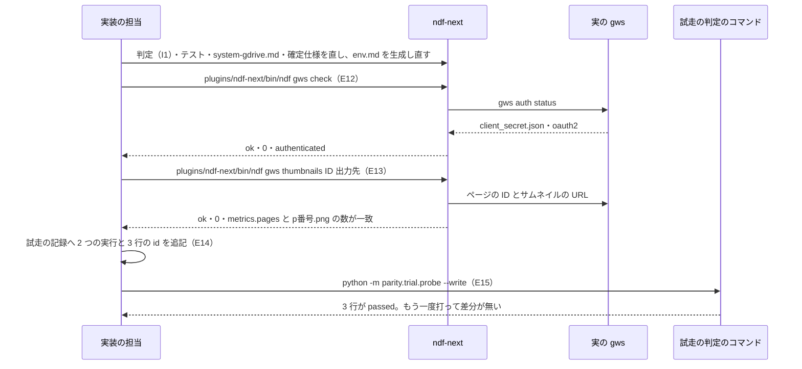

# ndf gws: OAuth でログインした gws を認証済みと判定し、試走で 2 つのサブコマンドと document-systems を ndf-next だけで通す（#3547）

## 目的

- **今どうなっているか**: `ndf gws check`・`ndf gws thumbnails` と google-workspace の Skill の本文は develop にある。ただし、OAuth でログインした gws（`credential_source` が `client_secret.json`・`auth_method` が `oauth2`）を未認証と判定し、`ndf gws check` が終了コード 11 を返す。document-systems の Skill の `system-gdrive.md` は旧い `slides-thumbnails.py` を呼び、試走の判定は機能の対応表の 3 行を `not_run`・`failed`・`failed` にしている
- **誰に効くか**: ndf-next で Google Drive・Google スライドを扱う利用者と、入れ替え S2 #3304 の前に試走の判定を見る開発者
- **変えると何が成り立つか**: ログイン済みの利用者が要らない `gws auth login` を頼まれない。ndf-next の本文が旧いスクリプトを 1 つも呼ばず、試走の判定が 3 行を `passed` にする

## 適用範囲

- **働く範囲**: 認証済みの判定は ndf-next を使う利用先のリポジトリでも働く。試走の記録と機能の対応表はこのリポジトリだけにある
- **プロジェクトごとに違うもの**: 無し（gws の認証の状態は利用者の手元の gws が持ち、NDF の設定と引数では受けない）
- **当たるモード**: `standard`

### 代表のリポジトリでの振る舞い

| 代表のリポジトリ | 設定の要点 | 直した後に起きること | この種類で扱えなくなること |
| --- | --- | --- | --- |
| Web サービス | Google Drive・Google スライドを使うかは利用者次第で、NDF の設定のキーは無い | ログイン済みの gws で `ndf gws check` が終了コード 0 を返す。設計・設計の検査・cross-review・MVV 判定の振る舞いは変わらない | 無し |
| モバイルアプリ | 同上 | 同上 | 無し |
| 業務文書だけ | 文書を Google Drive・Google スライドへ出す運用がある | 同上。document-systems の Skill が Google スライドの描画をサブコマンドで行う | 無し |

### ai-plugins だけの事情

| 値 | 置く所 | 持つ Issue |
| --- | --- | --- |
| 試走の記録と機能の対応表 | `scripts/ndf-next-parity/parity/`（ndf-next の外。入れ替えの前の検証のためだけに置く） | #3411 |
| 今の `plugins/ndf/` の gws-check.py を許す例外 | `scripts/contract-allow/`（今の NDF を外すまで残す） | #3304 |

## あるべき姿の根拠

| 根拠 | 種類 | 何を示すか |
| --- | --- | --- |
| gws の `gws auth status` の実装（PRD1） | 外部の一次情報 | `auth_method` はログインで得た資格情報のファイルの有無、`credential_source` は OAuth クライアントの設定の出所を表す。ログインの有無は `auth_method` が持つ |
| 2026-11-16 の実の環境の `gws auth status` と `gws drive files list`（要求の「今の状態」） | 実測 | `client_secret.json`・`oauth2` の状態で gws は 1 件を返して動く。その状態で `ndf gws check` は終了コード 11 を返す |
| 試走の判定のコマンド（`scripts/ndf-next-parity/parity/trial/probe.py` の冒頭の説明と `judge_row`） | 実測（コードの読み取りと要求の再現） | `failed` は本文の `.py` 付きの旧いスクリプトの呼び出しで決まり、`passed` は試走の記録の `passed` で決まる |
| 「試走 T2 の記録が失敗・未実施とした 3 行を通る形にする」（2026-11-16、設計承認ゲートの変更要求） | 利用者の指示の原文 | 3 行を `passed` にすることが完了の形である |

要求と受け入れ条件は #3547 の本文にある（コピーは [issue-3547-requirements.md](issue-3547-requirements.md) ）。この文書は「どう作るか」だけを扱う。2 つのサブコマンドの作りは確定仕様 [ndf-next-gws-subcommands.md](../docs/specifications/ndf-next-gws-subcommands.md) にあり、この文書では変える所だけを書く。

## ドメインモデル

### コンテキスト

| コンテキスト | 何の語が 1 つの意味に決まるか |
| --- | --- |
| Google Workspace の連携（`ndf gws`） | 確認の状態（`authenticated`・`unauthenticated`・`missing`・`uninstallable`）、サムネイル |
| 記録（`ndf records`。gws の部品 `records/gws.py`） | 認証済み・未認証 |
| 同等性の検証（`scripts/ndf-next-parity`） | 機能の対応表の行、試走の結果（`passed`・`failed`・`not_run`）、試走の記録 |

Google Workspace の連携と記録は共有カーネルの関係にある。共有するのは認証済みの判定（`authenticated`）だけで、記録の gws の部品がオーナーとして変え、連携の側は呼ぶだけである。同等性の検証は ndf-next に対して順応者の関係にある。試走の判定は ndf-next の本文を書き換えずにそのまま読み、ndf-next は判定のために形を変えない。

### 集約

| 集約 | オーナー（書き換えてよいもの） | 根 | エンティティ | 値オブジェクト |
| --- | --- | --- | --- | --- |
| 認証の判定 | 記録の gws の部品（`plugins/ndf-next/src/ndf/domains/records/gws.py`） | 認証の状態（`gws auth status` の応答） | — | `credential_source`・`auth_method`・`client_config_exists`、環境変数のトークンの有無 |
| 試走の記録 | 試走を打つ実装の担当（追記だけ） | 記録のファイル（`trial/<日付>.json`） | 実行（`runs` の 1 件） | 通した行の id（`passed` の 1 件） |
| 機能の対応表の試走の結果 | 試走の判定のコマンド（`python -m parity.trial.probe --write`） | 機能の対応表の行 | — | 試走の結果（`result`・`reason`・`record`） |
| Google スライドの描画の手段 | document-systems の Skill（`system-gdrive.md`） | 描画して見る手段の表 | — | 呼ぶサブコマンド |

### 不変条件

| # | 集約 | 条件 | 破れたときの扱い |
| --- | --- | --- | --- |
| I1 | 認証の判定 | トークンを環境変数で渡していないとき、未認証は `credential_source` が `none` の形と、`credential_source` が `client_secret.json` で `auth_method` が `none` の形の 2 つだけで、それ以外は認証済みである | 判定のテストが落ちる |
| I2 | 認証の判定 | 環境変数 `GOOGLE_WORKSPACE_CLI_TOKEN` があれば、応答に依らず認証済みである。値は読まない | 判定のテストが落ちる |
| I3 | 認証の判定 | 判定は `authenticated` の 1 か所にあり、`ndf gws check`・`ndf gws thumbnails`・`ndf records gws-check` が同じ関数を呼ぶ | `ndf check` の事実の重複の規則（`const-fact`）が書き写しを落とす |
| I4 | 認証の判定 | `gws auth status` から読むのは 3 つのキーだけで、結果へ写すのも 3 つだけである | 確認のテスト（ほかのキーを写さない）が落ちる |
| I5 | Google スライドの描画の手段 | ndf-next の Skill・エージェント・hook の本文に、旧いスクリプト（`gws-check.py`・`slides-thumbnails.py`）を呼ぶファイルが 0 件である | 試走の判定のコマンドが 3 行を `failed` にする |
| I6 | 機能の対応表の試走の結果 | `trial` の列は試走の判定のコマンドだけが書く。打ち直しても機能の対応表に差分が出ない | 打ち直した差分が残る。マージの前に打ち直して確かめる |
| I7 | 試走の記録 | 記録は追記だけで変える。既存の `runs`・`passed` の要素を書き換えない。プレゼンテーションの ID・Google のアカウント・ファイルの名前と中身を書かない | 差分のレビューで見る |
| I8 | 試走の記録 | `passed` に載せる行は、ndf-next だけで打って `ok` を得た行だけである | 載せた行の実行が `runs` に無い。差分のレビューで見る |

### ドメインイベント

要求のドメインイベントの番号を引き継ぐ。E1〜E11 は develop にあり、このやり直しで変わるのは E3 と E11 の判定の中身（I1）だけである。

| # | イベント | 発生元 | 受け手 |
| --- | --- | --- | --- |
| E1 | gws を PATH の上で探した | `ndf gws check` | E2・E4・E5 |
| E2 | gws の認証の状態を 1 回読んだ | `ndf gws check` | E3 |
| E3 | 認証済みか未認証かを決めた（I1 の判定へ直す） | 記録の gws の部品の `authenticated` | E6 |
| E4 | 導入の同意を求める承認資料を書いた | `ndf gws check` | 利用者（承認ゲート） |
| E5 | npm で gws を全体インストールした | `ndf gws check` | E2 |
| E6 | 確認の結果を返した | `ndf gws check` | Skill の本文の手順・E12 |
| E7 | 引数を読んだ | `ndf gws thumbnails` | E8 |
| E8 | ページの ID をページ順に取った | `ndf gws thumbnails` | E9・E11 |
| E9 | 各ページのサムネイルを保存した | `ndf gws thumbnails` | E10・E11 |
| E10 | サムネイルの結果を返した | `ndf gws thumbnails` | Skill の本文の手順・E13 |
| E11 | gws の失敗が未認証によるものかを決めた（I1 の判定へ直す） | 記録の gws の部品の `authenticated` | `ndf gws thumbnails` の結果 |
| E12 | 試走で、ndf-next だけから確認のサブコマンドを打った | 実装の担当 | E14 |
| E13 | 試走で、`system-gdrive.md` の手順に従ってサムネイルのサブコマンドを打った | 実装の担当 | E14 |
| E14 | 試走の記録に実行と通した行の id を追記した | 実装の担当 | E15 |
| E15 | 機能の対応表の `trial` の列を書き直した | 試走の判定のコマンド | 入れ替え S2 #3304 の判断 |

### 用語

新しく足す語と意味を変える語は無い。試走・機能の対応表は用語集の語（「入れ替えの前の試走」「機能の対応表」）を、要求の「用語」の表の意味で使う。

## 外部の調査

| 種類 | 調べるか | 理由 |
| --- | --- | --- |
| 標準・仕様 | 調べない | 変えるのは gws の `auth status` の応答の読み方で、OAuth の仕様ではなく gws の実装が応答の意味を決める |
| 主要な製品 | 調べる | 判定の入力を作る gws 自身が、`credential_source`・`auth_method` の値をどう決めるかを一次情報で確かめる |
| ライブラリとサービス | 調べない | 依存を足さない。gws の呼び出しと結果の部品は develop にあり、変えない |

### 主要な製品

| # | 製品 | どう解いているか | 設計への反映 | 出典 |
| --- | --- | --- | --- | --- |
| PRD1 | gws の `gws auth status`（`crates/google-workspace-cli/src/auth_commands.rs`、main の `cd3697e07`） | `auth_method` は、ログインで得た資格情報のファイル（暗号化したもの・平文のもの）がどちらかあれば `oauth2`、無ければ `none`。`credential_source` は、環境変数のトークンがあれば `token_env_var`、無ければ OAuth クライアントの設定を解決できた出所（`environment_variables`・`client_secret.json`）、解決できなければ `none` | ログインの有無は `auth_method` で読む。`client_secret.json` の形を `auth_method` で分ける（決定 1） | `gh api repos/googleworkspace/cli/contents/crates/google-workspace-cli/src/auth_commands.rs`（2026-11-16） |
| PRD2 | gws の README の資格情報の優先順位 | 1 環境変数のトークン、2 資格情報のファイル（`GOOGLE_WORKSPACE_CLI_CREDENTIALS_FILE`）、3 `gws auth login` の暗号化した資格情報、4 平文の資格情報の順に使う | 環境変数のトークンを最優先で認証済みとする判定（I2）は gws の優先順位と同じである | `gh api repos/googleworkspace/cli/readme`（2026-11-16）。npm の最新は 0.22.5・Apache-2.0（ https://registry.npmjs.org/@googleworkspace/cli 、2026-11-16） |

### 確かめられなかったこと

| 対象 | 試した手段 | 結果と理由 |
| --- | --- | --- |
| 資格情報のファイル（PRD2 の 2）だけで動く状態の `gws auth status` の応答 | 試していない | `auth_method` は暗号化・平文の資格情報のファイルだけを見るため、この状態は `none` を返すとコードから読める。実の環境では打っていない。判定は要求の前提 7 に従い、この状態を変えない（「未確認のまま残ること」） |

調べた量: 候補 2 件・取得の試み 6 回。

## 機能一覧

| # | 機能 | 誰が使うか |
| --- | --- | --- |
| F1 | OAuth でログインした gws を認証済みと判定する（I1） | `ndf gws check`・`ndf gws thumbnails`・`ndf records gws-check` を打つ利用者と Skill |
| F2 | document-systems の Skill が Google スライドの描画を `ndf gws thumbnails` で行う | 体裁レビューで Google スライドを描画する利用者 |
| F3 | 実の gws で 2 つのサブコマンドを ndf-next だけで打ち、試走の記録へ追記する | 試走の判定を見る開発者 |
| F4 | 試走の判定のコマンドで機能の対応表の `trial` の列を書き直す | 入れ替え S2 #3304 の判断をする開発者 |

## 構成要素

**新しく作るファイルと消すファイルは無い。** 次の表が、このやり直しで扱いを決めたファイルのすべてである。実装のプランの触る範囲は「書き換える」と「生成し直す」の行と、「設計の結果」の表から作る。

| 要素 | 扱い | 責務・扱いの理由 |
| --- | --- | --- |
| `plugins/ndf-next/src/ndf/domains/records/gws.py` | 書き換える | `decide` を I1 の判定へ直す。冒頭の説明の判定の文も同じに直す。`authenticated`・`auth_status`・`public_keys` のシグネチャは変えない |
| `plugins/ndf-next/tests/domains/gws/test_check.py` | 書き換える | 受け入れ条件 1 のログイン済みの形（`client_secret.json`・`oauth2`・`client_config_exists` が真）が `authenticated` になる場合を足す。今の未認証の 3 つの場合は残す |
| `plugins/ndf-next/tests/domains/gws/test_thumbnails.py` | 書き換える | 受け入れ条件 10 のログイン済みの形で gws が失敗したとき、未認証にならず終了コード 1 になる場合を足す |
| `plugins/ndf-next/tests/domains/records/test_close.py` | 書き換える | `test_gws_client_secret_only_is_not_authenticated` にログイン済みの形の行を足す（I1 を判定の関数の単位で縛る） |
| `plugins/ndf-next/skills/document-systems/references/system-gdrive.md` | 書き換える | 描画して見る手段の Google スライドの行を `ndf gws thumbnails` を打つ形にする（決定 3） |
| `plugins/ndf-next/contracts/domains/env.json` | 書き換える | `GOOGLE_WORKSPACE_CLI_TOKEN` の行の `meaning` を I1・I2 の判定の文にする |
| `plugins/ndf-next/docs/contracts/env.md` | 生成し直す | `ndf check --write-spec` で `env.json` から作り直す。手で書かない |
| `docs/specifications/ndf-next-gws-subcommands.md` | 書き換える | 「認証済みの判定」の段落・関連する仕様の表の行・テストの表の未認証と認証済みの行を I1 に合わせる |
| `scripts/ndf-next-parity/parity/trial/2026-11-16.json` | 書き換える（追記） | `runs` に受け入れ条件 20 の 2 つの実行を、`passed` に 3 行の id を追記する（決定 2）。実装の時点で `trial/` により新しい日付の記録があれば、その最新の記録へ追記する |
| `scripts/ndf-next-parity/parity/features.json` | 生成し直す | 試走の判定のコマンドを `--write` で打ち、`trial` の列を書き直す。`entrypoint:skills/google-workspace/scripts/gws-check.py`・`entrypoint:skills/google-workspace/scripts/slides-thumbnails.py`・`skill:document-systems` の 3 行は `passed` になる。3 行の `now`・`to` は手で変えない（決定 4） |
| `scripts/contract-allow/plugins__ndf__skills__google-workspace__scripts__gws-check.py--core-entry.json` | 残す | 今の `plugins/ndf/` の gws-check.py の外れを許す例外で、消すと `check-ndf-contracts.py` が違反を返す。消すのは今の NDF を外す #3304（決定 4） |
| `plugins/ndf-next/src/ndf/domains/gws/`（`__init__.py`・`check.py`・`thumbnails.py`・`cli.py`・`material.py`・`report_decide.py`） | 残す | `authenticated` を呼ぶだけで、判定の値を持たない。I1 の直しは呼び先で効く |
| `plugins/ndf-next/src/ndf/domains/records/cli.py` | 残す | `ndf records gws-check` は `authenticated` を呼ぶだけである |
| `plugins/ndf-next/tests/domains/gws/__init__.py`・`conftest.py` | 残す | 偽の gws の規則（`status_rule`）は `auth_method` を引数で受けるため、足すテストもこの部品で書ける |
| `plugins/ndf-next/skills/google-workspace/SKILL.md` | 残す | 旧いスクリプトの参照は 0 件で、サブコマンドを打つ形が develop にある（受け入れ条件 14） |
| `plugins/ndf-next/contracts/` の 2 つのサブコマンドの引数と結果のスキーマ・`docs/contracts/commands.md` | 残す | 名前・引数・結果の形は変えない（受け入れ条件 12） |
| `plugins/ndf/` のすべて・`docs/specifications/ndf-google-workspace-gws.md` | 残す | 今の NDF は変えない（受け入れ条件 16） |

## 処理の流れ

実装の担当（計画 p8 のレーン ls1d）が進める順序である。判定の直しと本文の書き換えが先で、試走はその後に打つ。試走で `passed` に載せる行は、直した本文と判定の上で通した行だけにするためである（I8）。

`ok` 以外が返ったら、その行を記録の `passed` に載せず、原因を直してから打ち直す（要求の E12・E13 の失敗の扱い）。

## 非機能の実現方式

| 大項目 | 実現方式 |
| --- | --- |
| セキュリティ | 判定は `gws auth status` の 3 つのキーだけを読み、資格情報のファイルとトークンを開かない（I4）。環境変数のトークンは値を読まずに有無だけを見る（I2）。試走の記録には打ったコマンドを `<プレゼンテーションの ID>`・`<出力のディレクトリ>` に置き換えて書き、`observed` にはページ数と保存したファイルの数だけを書く（I7） |
| 運用・保守性 | 失敗のときに gws の出力の末尾を `items` に載せる振る舞いは develop のまま変えない |
| システム環境 | gws・npm・curl は PATH の上で探し、上限の秒数は `contracts/limits.json` の値を変えない |

## 決定の記録

### 決定 1: ログイン済みの gws を認証済みにするため、`client_secret.json` の形を `auth_method` で分ける

未認証は、`credential_source` が `none` の形と、`credential_source` が `client_secret.json` で `auth_method` が `none` の形の 2 つだけにし、それ以外は認証済みにする（I1。要求の前提 7）。gws の実装では、ログインの有無は `auth_method` が持ち、`credential_source` は OAuth クライアントの設定の出所を表す（PRD1）。このため `client_secret.json` の応答だけではログインの有無が決まらず、`auth_method` で分ける。読むキーは今の 3 つのままで、結果の形も変わらない。

`has_refresh_token`・`token_valid` を読む形は採らない。資格情報を復号して得る値で、読むキーを 3 つに限る非機能の条件（I4）から外れる。`auth_method` が `none` なら `credential_source` に依らず未認証とする形も採らない。要求の前提 7 は、`credential_source` が `environment_variables` の形を認証済みと決めており、それと食い違う。

- 作り方: 自前で作る
- 比べた候補: PRD1 / PRD2

根拠: Value 7 / Value 13（MVV 版 8）

### 決定 2: ほかの行の記録の指し先を動かさないため、試走の記録は最新の記録へ追記する

受け入れ条件 20 の 2 つの実行と 3 行の id は、新しい日付のファイルを作らず、`trial/` の最新の記録（2026-11-16 の時点で `trial/2026-11-16.json`）の `runs` と `passed` へ追記する（要求の未決 1）。試走の判定のコマンドは、どの記録にも載らない行の `record` を最新の記録へ向ける。新しいファイルを作ると、試走のスプリントが届かなかった `not_run` の 90 行（2026-11-16 の機能の対応表の `not_run` の 91 行から、この課題の 1 行を除いた数）の `record` が、2 つのサブコマンドだけを打った記録へ移る。その記録の `runs` には、それらの行で試走が止まった所が無い。

追記は既存の要素を書き換えない（I7）。追記する実行には、打った日付と、ndf-next の何を打ったかを書く。新しいファイルにする形は、上の指し先の移動があるため採らない。

根拠: Value 8 / Value 13（MVV 版 8）

### 決定 3: 描画の手段の SSOT を 1 か所にするため、system-gdrive.md はサブコマンドの名前と google-workspace の対応表を指す

`system-gdrive.md` の Google スライドの行は、`google-workspace` の `ndf gws thumbnails <ID> <出力のディレクトリ>` が全ページを `p<番号>.png` で保存すると書き、大きさの値と終了コードの扱いは google-workspace の Skill の操作の対応表を指す。引数の細部は google-workspace の Skill の本文が持ち、2 か所に写さない。サムネイルの大きさ・終了コード 11 の扱いまで `system-gdrive.md` に写す形は、同じ事実を 2 か所に持つため採らない。

根拠: Value 11（MVV 版 8）

### 決定 4: 試走の判定の手がかりと今の NDF の例外を保つため、機能の対応表の `now`・`to` と旧い許可ファイルを残す

機能の対応表の 2 行の `now`（旧いスクリプトのパス）は、試走の判定のコマンドが ndf-next の本文の旧い呼び出しを探す手がかりで、`to`（`S1d`）は移行先の子を表す。`passed` は `now`・`to` に依らず記録と本文で決まり、前例の `entrypoint:scripts/project-decl.py` も `now`・`to` を変えずに `passed` になっている。旧い許可ファイルは今の `plugins/ndf/` の gws-check.py の例外で、今の NDF を変えないこの課題では消すと `check-ndf-contracts.py` が違反を返す。消すのは今の NDF を外す #3304 である（要求の S12・S13）。

`now` を新しいサブコマンドへ書き換える形は、試走の判定のコマンドが旧い呼び出しを探せなくなるため採らない。

根拠: Value 3 / Value 13（MVV 版 8）

### 決定 5: 試走の結果が実行ごとにぶれないよう、試走は Claude の起動を通さず `plugins/ndf-next/bin/ndf` を直に打つ

受け入れ条件 20 の (a)・(b) は、`plugins/ndf-next/bin/ndf gws check` と、`system-gdrive.md` に書いたとおりの `plugins/ndf-next/bin/ndf gws thumbnails <プレゼンテーションの ID> <出力のディレクトリ>` をシェルから打つ。`bin/ndf` は ndf-next のパッケージだけを読むため、ndf-next だけから打った実行になる。記録には打ったコマンドと、今の `plugins/ndf/` の scripts を経由していないことの確かめ（`bin/ndf` の解決先）を書く。`plugins/ndf-next/bin/ndf-claude -p` で Skill に打たせる形は、確かめたいサブコマンドの振る舞いに言語モデルの判断が入り、費用も掛かるため採らない。

根拠: Value 2 / Value 3（MVV 版 8）

## テスト設計

| 受け入れ条件・不変条件 | どの振る舞いで縛るか | どう壊したら落ちるべきか |
| --- | --- | --- |
| 受け入れ条件 1・I1 | `client_secret.json`・`oauth2`・`client_config_exists` が真の応答で、`ndf gws check` が `ok`・0・`authenticated` と 3 つのキーを返す | 判定を `credential_source` だけで決める形に戻すと落ちる |
| 受け入れ条件 2・I1 | `none`・`none` の応答と、`client_secret.json`・`none`・真の応答で `gate`・11・`unauthenticated`（develop のテストをそのまま使う） | `auth_method` だけで決める形・`client_secret.json` を一律に認証済みにする形で落ちる |
| 受け入れ条件 10・I1 | `client_secret.json`・`oauth2` の応答で gws が失敗したとき、`ndf gws thumbnails` が `stopped`・1 を返し、11 を返さない | サムネイルの側に判定を書き写して直し忘れると落ちる |
| I1・I2（判定の関数） | `authenticated` が、ログイン済みの形を真、#2067 の形と `none` を偽、環境変数のトークンがあれば真で返す | 環境変数を見ない形・`auth_method` を見ない形で落ちる |
| I3・受け入れ条件 17 | 3 つのサブコマンドが同じ `authenticated` を呼ぶ | `ndf check` の `const-fact` が判定の値の書き写しを落とす |
| I4 | develop のテスト（`test_does_not_copy_other_keys`）のまま | ほかのキーを結果へ写すと落ちる |
| 受け入れ条件 13 | `plugins/ndf-next/bin/ndf check --base origin/develop` が 0 | 生成し直していない `env.md` があると落ちる |
| 受け入れ条件 16 | `git diff --stat origin/develop -- plugins/ndf/` が空 | 今の NDF を触ると空でなくなる |
| 受け入れ条件 18・I5 | 試走の判定のコマンドが 3 行を `failed` にしない。ndf-next の本文に `.py` 付きの旧いスクリプトの呼び出しが 0 件 | `system-gdrive.md` に `slides-thumbnails.py` を戻すと 2 行が `failed` になる |
| 受け入れ条件 15・19・20・I8 | 試走の記録に (a)・(b) の実行と 3 行の id があり、試走の判定のコマンドが 3 行を `passed`・`record` をその記録にする | 記録から id を外すと `not_run` になる |
| 受け入れ条件 21・I6 | `--write` を打ち直しても機能の対応表に差分が無い | 手で `trial` の列を書くと打ち直しで差分が出る |
| 受け入れ条件 20・I7 | 試走の記録の差分に、プレゼンテーションの ID・アカウント・ファイルの名前が無い | 実の ID を書くと差分のレビューで見つかる |
| 受け入れ条件 22 | 確定仕様と `env.md` の判定の文が I1・I2 と同じ | レビューで見る（`.md` の文言を検証するテストは書かない） |
| 受け入れ条件 23 | `python3 scripts/check-ndf-contracts.py` が `ok`・使われていない例外 0 件 | 旧い許可ファイルを消すと違反が出る |

済んだ受け入れ条件（3〜9・11・12・14）は、develop のテストと生成物をそのまま使い、新しいテストを足さない。2026-11-16 に次で確かめた: Skill の本文の旧い参照の `grep -cE` が 0、`commands.md` の 73〜80 行目に `## ndf gws` と 2 つのサブコマンドの行、`git diff --stat origin/develop -- plugins/ndf/` が空、`check-ndf-contracts.py` が `violations: 0`・`allowed: 256`。テストの名前と PR #3577 の CI の結果は要求の受け入れ条件の根拠の欄にある（このリポジトリは手元でテストを走らせず CI で走らせる）。

## 設計の結果

| 課題 | 扱い | 取り込み先 | 触るファイル |
| --- | --- | --- | --- |
| #3547 | 実装する | — | `plugins/ndf-next/src/ndf/domains/records/gws.py`、`plugins/ndf-next/tests/domains/gws/test_check.py`、`plugins/ndf-next/tests/domains/gws/test_thumbnails.py`、`plugins/ndf-next/tests/domains/records/test_close.py`、`plugins/ndf-next/skills/document-systems/references/system-gdrive.md`、`plugins/ndf-next/contracts/domains/env.json`、`plugins/ndf-next/docs/contracts/env.md`、`docs/specifications/ndf-next-gws-subcommands.md`、`scripts/ndf-next-parity/parity/trial/2026-11-16.json`、`scripts/ndf-next-parity/parity/features.json` |

## 人へ残す判断

無し

## 未確認のまま残ること

| 項目 | 内容 |
| --- | --- |
| 受け入れ条件 20 (b) のプレゼンテーション | 実の環境のアカウントで読めるプレゼンテーションのうち、どれを使うかは実装で決める（要求の未決 2）。ID は記録に書かない |
| 資格情報のファイルだけの状態 | `GOOGLE_WORKSPACE_CLI_CREDENTIALS_FILE` だけで動く状態と、`credential_source` が `environment_variables` でログインしていない状態の `gws auth status` の応答は実測していない。PRD1 のコードからは、前者は未認証、後者は認証済みと判定される形になると読める。要求の前提 7 の範囲の外で、実の環境で当たったときに分かる |
| 試走の記録の衝突 | 試走 T2 #3411 のレーンが同じ記録へ同時に書くと、マージで衝突する。実装の Pull Request を develop へ合わせるときに分かる |

## 出し直しの指摘への対応

| 項目 | 指摘 | 対応 | 直した箇所・直せない理由 |
| --- | --- | --- | --- |
| ld-s1d:1-1 | 既にできているものを作り直さず、済んだ受け入れ条件は検証のコマンドで確かめて済んだと記す | 直した | 「構成要素」で 2 つのサブコマンド・Skill の本文・スキーマを「残す」にした。「テスト設計」の末尾に、2026-11-16 に打ったコマンドと結果を書いた |
| ld-s1d:1-2 | 試走が失敗・未実施とした 3 行を通る形にする。`system-gdrive.md` の 72 行目を含む | 直した | 「構成要素」の `system-gdrive.md`・試走の記録・機能の対応表の行、「処理の流れ」、決定 2・3・5 |
| ld-s1d:1-3 | ndf-next の上で設計し、今の `plugins/ndf/` は変えない | 直した | 「構成要素」で `plugins/ndf/` を「残す」にし、「テスト設計」の受け入れ条件 16 の行で差分が空であることを縛る |
| ld-s1d:1-4 | 用語は #3613 の対応表に合わせる | 直した | 本文をサブコマンド・移行先・コントラクト・オーナー・フラグ・SSOT など #3613 の置き換え先の語で書いた |
| ld-s1d:1-5 | ファイル配置の表に、作る・消す・書き換えるファイルとテストをすべて載せ、旧い許可ファイルと機能の対応表の行も消すか残すかを決める | 直した | 「構成要素」の表に、書き換える・生成し直す・残すのファイルとテストを 1 行ずつ載せた（作る・消すファイルは無い）。旧い許可ファイルと機能の対応表の 3 行の扱いは決定 4。詳細設計の文書のファイル配置は、後のステップがこの表から書く |
| ld-s1d:1-6 | 実装はこのスプリントでは行わず、設計 PR は develop 宛て | 直した | この変更は設計文書だけを持つ。実装の担当は「処理の流れ」のとおり計画 p8 のレーン ls1d とした |
