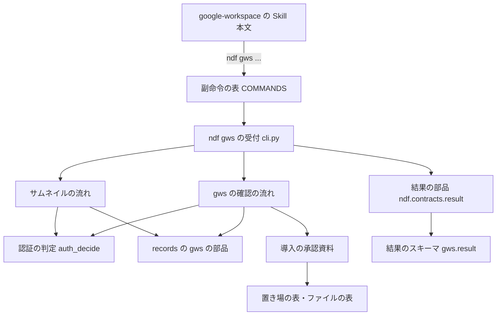
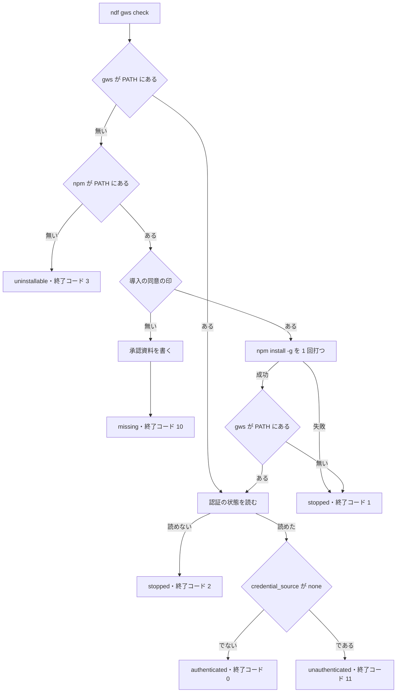
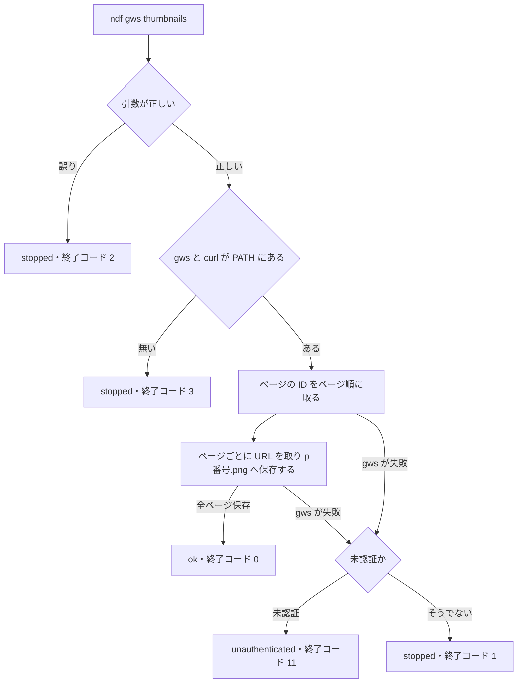

# google-workspace: gws の確認とスライドのサムネイルの保存を `ndf gws` の副命令で行う（#3547）

## 目的

- **今どうなっているか**: 新しい NDF（`plugins/ndf-next/`）の google-workspace の Skill 本文は、gws（Google Workspace CLI）の確認と Google Slides のサムネイルの保存を、今の NDF のスクリプト（`gws-check.py`・`slides-thumbnails.py`）の名前のまま指している。新しい NDF にはそのスクリプトも副命令も無く、入れ替えた後は Skill の流れの手順 1・2 とサムネイルの操作が打てない
- **誰に効くか**: google-workspace の Skill で Google Drive・Docs・Slides を読み書きする利用者と、入れ替え（#3304）の前に機能の対応表を確かめる試走（#3411）
- **変えると何が成り立つか**: 新しいエントリポイントの `ndf gws check` と `ndf gws thumbnails` が今のスクリプトと同じ判定・同じ保存の結果を、新しい結果の契約で返す。Skill 本文は今のスクリプトのパスを 1 つも指さずに、確かめる → 同意のうえ入れる → 認証を案内する → 操作する の流れを通せる

## 適用範囲

- **働く範囲**: 新しい NDF を入れたすべての環境（リポジトリの外でも働く。gws の確認はリポジトリを読まない）。今の `plugins/ndf/` は変えない（決定 11）
- **プロジェクトごとに違うもの**: 無い。設定を読まず、引数（導入の同意の印・プレゼンテーションの ID・出力のディレクトリ・大きさ）だけを受ける
- **当たるモード**: `standard`

## あるべき姿の根拠

| 根拠 | 種類 | 何を示すか |
| --- | --- | --- |
| 確定仕様 [docs/specifications/ndf-google-workspace-gws.md](../docs/specifications/ndf-google-workspace-gws.md) の「決定の理由」（gws 0.22.5 の実測） | 実測 | 認証済みかを `credential_source` で決める理由（環境変数のトークンを渡しても `auth_method` は `none` のまま）。状態ごとの `status` と終了コード（0・10・11・3）と、失敗の形（1・2） |
| 新しい NDF の結果の契約（`plugins/ndf-next/contracts/schemas/result.schema.json`）と終了コードの表（`plugins/ndf-next/docs/contracts/exit-codes.md`） | 既存の形に揃える | 承認ゲートの結果は `routes` が必須で、キーは答えの語彙、行き先の `argv` の先頭は `ndf`。`stopped` は `cause.kind` を持ち、終了コードは種類から決まる |
| 「2 本を `bin/ndf` の副命令として作り直す」「結果は新しい契約の JSON」「今の `plugins/ndf/` は変えない」（#3547 の本文の「やること」と「進め方の決まり」） | 起票者の文 | 利用者の指示の原文ではない。レーン lrebuild の conductor と並列の計画 p6 のオーガナイザーが書いた |

要求と受け入れ条件は #3547 の本文にある（コピーは [issues/issue-3547-requirements.md](issue-3547-requirements.md) ）。この文書は「どう作るか」だけを扱う。詳細設計（ファイルごとの関数と異常系）は後のステップが別のファイルに書く。

用語の対応（説明文は左の語で書く）:

| この文書の語 | 指すもの |
| --- | --- |
| gws の確認 | 副命令 `ndf gws check`。今の `gws-check.py` の行き先 |
| サムネイルの保存 | 副命令 `ndf gws thumbnails`。今の `slides-thumbnails.py` の行き先 |
| 導入の同意の印 | gws の確認の引数 `--install`。利用者が gws の導入に同意したことを示す |
| 認証の状態の読み取り | `gws auth status` を 1 回打ち、3 つのキー（`credential_source`・`auth_method`・`client_config_exists`）を読むこと |
| records の gws の部品 | 新しい NDF の `src/ndf/domains/records/gws.py`。`ndf records gws-check` が認証の状態の読み取りに使っている |

## ドメインモデル

### コンテキスト

| コンテキスト | 何の語が 1 つの意味に決まるか |
| --- | --- |
| Google Workspace の操作（google-workspace の Skill と `ndf gws`） | gws の状態（`authenticated` / `missing` / `unauthenticated` / `uninstallable`）・導入の同意の印・サムネイル・承認資料 |
| 結果の契約（新しい NDF の `ndf.contracts`） | 結果 JSON・`status`・`cause.kind`・`routes`・答えの語彙・終了コードの区分 |
| gws（外部の CLI。持ち主は利用者と gws） | 認証の状態の 3 つのキー・資格情報・npm の全体インストール |
| 記録（新しい NDF の `ndf.domains.records`。持ち主は子 M7） | `ndf records gws-check` の認証済みの判定・認証の状態の読み取り |

| 上流（正本） | 下流（合わせる側） | 関係 | 何を合わせるか |
| --- | --- | --- | --- |
| 結果の契約 | Google Workspace の操作 | 順応者（conformist。下流が上流の形をそのまま使う） | 結果 JSON の外枠・止まった理由の種類・答えの語彙。Google Workspace の操作は語彙を足さない（決定 6） |
| gws | Google Workspace の操作 | 順応者 | `gws auth status` の JSON を翻訳の層を置かずに読む（確定仕様と同じ） |
| 記録 | Google Workspace の操作 | 共有カーネル（2 つのコンテキストが同じ部品を使い、変えるときは両方の持ち主が合わせる） | 認証の状態の読み取りだけを共有する。認証済みの判定は共有しない（決定 4） |

### 集約

| 集約 | 持ち主（書き換えてよいもの） | 根 | エンティティ | 値オブジェクト |
| --- | --- | --- | --- | --- |
| gws の確認の結果 | `ndf.domains.gws` の確認の流れ（1 回の起動の中だけ） | gws の状態 | — | 認証の状態の 3 つのキー・承認資料のパス |
| サムネイルの保存の結果 | `ndf.domains.gws` のサムネイルの流れ（1 回の起動の中だけ） | 出力のディレクトリ | 保存したページ（`p<番号>.png`） | プレゼンテーションの ID・大きさ・ページの ID の列 |
| 導入の承認資料 | `ndf.domains.gws` の確認の流れ（書くたびに置き換える） | 承認資料のファイル | — | 取得元・打つコマンド・入る先・戻し方 |
| 認証の状態の読み取り | records の gws の部品（`ndf.domains.records.gws`。持ち主は子 M7。この課題は足すだけの変更を入れる。決定 3） | `gws auth status` の応答 | — | 3 つのキー・標準エラー・上限の名前 |

利用者の環境の gws（導入・資格情報）と Drive・Slides のファイルは NDF の集約にしない。持ち主は利用者と gws で、NDF は同意か依頼があるときに gws を通して触るだけである。

### 不変条件

| # | 集約 | 条件 | 破れたときの扱い |
| --- | --- | --- | --- |
| I1 | gws の確認の結果 | 導入の同意の印が無い限り `npm install -g` を起動しない | 起動の経路を持たない |
| I2 | gws の確認の結果 | どの引数でも gws の副命令は `auth status` だけを起動する（`auth login`・`setup`・`export`・`logout` を呼ばない） | 起動の経路を持たない |
| I3 | gws の確認の結果 | gws の状態は 4 つのどれか 1 つで、状態ごとに `status` と終了コードが 1 つに決まる（0・10・11・3） | 状態を決められないときは 4 つのどれにもせず、`stopped`（`invalid`）・終了コード 2 で返す |
| I4 | 認証の状態の読み取り | 結果へ写す gws の出力は 3 つのキーだけで、資格情報のファイルとトークンを開かない | 3 つのキーのほかを `metrics` に置かない。結果のスキーマが `metrics` を閉じる |
| I5 | gws の確認の結果 | `uninstallable` と導入の失敗は 0 以外の終了コードで終わる | `stopped` で返す |
| I6 | gws の確認の結果・サムネイルの保存の結果 | 承認ゲートの結果は `routes` を持ち、キーは答えの語彙の中、行き先の `argv` の先頭は `ndf` | 結果の部品（`result.emit`）が出す前に落とし、`invalid` で止まる |
| I7 | サムネイルの保存の結果 | 保存したファイルの名前はページ順に `p1.png` から番号が振られ、`items` の並びもページ順である | 1 ページでも保存できなければ `ok` を返さない |
| I8 | サムネイルの保存の結果 | 全ページを保存できたときは `gws auth status` を打たない。未認証かを確かめるのは gws が失敗したときの 1 回だけ | 起動の経路を持たない |
| I9 | 認証の状態の読み取り | `gws auth status` を読む処理は新しい NDF の中で 1 か所（records の gws の部品）にある | 確かめる側の重複を `ndf check` の事実の重複の規則（`const-fact`）が落とす |
| I10 | gws の確認の結果・サムネイルの保存の結果 | 認証済みかの判定（`credential_source` が `none` でない）は 2 つの副命令で 1 つの関数を使う | 判定の関数を 1 つにする（決定 4） |

### ドメインイベント

要求のドメインイベントの番号を引き継ぐ。受け手は、そのイベントの結果を読む側である。

| # | イベント | 発生元 | 受け手 |
| --- | --- | --- | --- |
| E1 | gws を PATH の上で探した | gws の確認 | gws の確認（E2・E4・E5 の分かれ目） |
| E2 | gws の認証の状態を 1 回読んだ | records の gws の部品 | gws の確認 |
| E3 | 認証済みか未認証かを決めた | 認証の判定（`auth_decide`） | gws の確認 |
| E4 | 導入の同意を求める承認資料を書いた | gws の確認 | Skill の手順 2（利用者へ示す） |
| E5 | npm で gws を全体インストールした | gws の確認 | gws の確認（同じ起動の中で E2 へ戻る） |
| E6 | 確認の結果を返した | gws の確認 | Skill の流れの手順 1 |
| E7 | 引数を読んだ | 副命令の表（argparse） | サムネイルの保存 |
| E8 | ページの ID をページ順に取った | サムネイルの保存 | サムネイルの保存（E9） |
| E9 | 各ページのサムネイルを保存した | サムネイルの保存 | サムネイルの保存（E10） |
| E10 | サムネイルの結果を返した | サムネイルの保存 | Skill の操作の対応表を打った手順 |
| E11 | gws の失敗が未認証によるものかを決めた | 認証の判定（records の gws の部品で読んだ値を渡す） | サムネイルの保存 |

### 用語

| 用語 | 意味 | 用語集への反映 |
| --- | --- | --- |
| gws の状態 | gws の確認が返す 4 つの値（`authenticated` / `missing` / `unauthenticated` / `uninstallable`）。状態ごとに次の手が 1 つに決まる | 変えない（4 つの値と意味は今と同じ。確かめる副命令の名前は入れ替えの後に確定仕様へ移すときに書き直す） |
| 導入の同意の印 | gws の確認の引数 `--install`。利用者が gws の導入に同意したことを示し、付いたときだけ npm で入れる | 追加 |

## 外部の調査

省く: 判定・呼ぶ外部のコマンド（gws・npm・curl）・承認資料の中身は確定仕様（gws 0.22.5 の実測を含む）のまま移し、形は新しい NDF の結果の契約と副命令の仕組み（プロジェクトの中の取り決め）だけで決まるため。既存の部品の使い方を変えずに呼ぶ場所を増やす変更に当たる

## 機能一覧

| # | 機能 | 誰が使うか |
| --- | --- | --- |
| F1 | gws の有無と認証の状態を確かめ、gws の状態と次の手（`routes`）を返す（受け入れ条件 1・2・4・5・7） | google-workspace の Skill の手順 1 |
| F2 | 導入の同意の印が無いとき、導入の承認資料を書いて承認ゲートで止まる（受け入れ条件 3・4） | Skill の手順 2 |
| F3 | 導入の同意の印があるとき、npm で gws を入れて同じ起動の中で確かめ直す（受け入れ条件 6） | Skill の手順 2 |
| F4 | Google Slides の全ページのサムネイルを `p<番号>.png` で保存する（受け入れ条件 8・9） | Skill の操作の対応表 |
| F5 | サムネイルの保存で gws が失敗したとき、未認証なら承認ゲート、そうでなければ失敗で返す（受け入れ条件 10・11） | Skill の操作の対応表 |
| F6 | 2 つの副命令の引数と結果のスキーマを、副命令の引数と結果の仕組みに載せる（受け入れ条件 12・13） | `ndf check`・生成された副命令の一覧の読み手 |
| F7 | Skill 本文と機能の対応表を新しい副命令へ向ける（受け入れ条件 14・15） | Skill の利用者・試走（#3411） |

## 構成要素

| 要素 | 責務 |
| --- | --- |
| 副命令の表（`src/ndf/cli.py` の `COMMANDS`） | 行 `"gws": "ndf.domains.gws.cli"` を 1 行足す（決定 1） |
| `ndf gws` の受付（`src/ndf/domains/gws/cli.py`） | 下位の命令 `check`・`thumbnails` の引数を argparse で読み、流れへ渡し、結果 JSON を出して終了コードを返す。結果の `tool` は `gws`（`cli.tool_of` で引く） |
| gws の確認の流れ（`src/ndf/domains/gws/check.py`） | gws と npm を PATH の上で探し、認証の状態の読み取り・承認資料の書き出し・npm の全体インストールを順に行い、gws の確認の結果を組む（F1〜F3） |
| サムネイルの流れ（`src/ndf/domains/gws/thumbnails.py`） | gws と curl を PATH の上で探し、ページの ID の取得・各ページのサムネイルの URL の取得・画像の保存を行い、サムネイルの保存の結果を組む（F4・F5） |
| 認証の判定（`src/ndf/domains/gws/auth_decide.py`） | 純粋な判断。読み取った認証の状態から未認証かを決め、`metrics` へ写す 3 つのキーを取り出す（I4・I10）。出力の末尾（20 行まで）を切り出す（前提 4 の 1 か所） |
| 導入の承認資料（`src/ndf/domains/gws/material.py`） | 承認資料の Markdown（対象を開くためのもの・承認の判断に使うもの・同意を求めること・戻し方）を組み、状態の置き場の下へ書く（決定 7） |
| records の gws の部品（`src/ndf/domains/records/gws.py`） | 認証の状態の読み取りの 1 か所（I9）。読めないときの誤りに標準エラーを持たせ、3 つのキーの定数を公開の名前にし、上限の名前を呼ぶ側が渡せるようにする（既定は今の `gws.auth-status`）。`ndf records gws-check` の振る舞いは変えない（決定 3） |
| 結果のスキーマ（`contracts/schemas/io/gws.result.schema.json`） | 手書き。`metrics` と `items` の要素を閉じる（決定 2） |
| 引数のスキーマ（`contracts/schemas/io/gws.args.schema.json`）と副命令の一覧（`docs/contracts/commands.md`） | 生成物。`ndf check --write-spec` が副命令の引数の定義から書く（決定 2） |
| 置き場の表（`contracts/domains/places.json`）とファイルの表（`contracts/domains/ndf-files.json`） | 承認資料の置き場 `gws`（状態の置き場の下）とファイル `gws-install-material` の行を 1 行ずつ足す（決定 7）。生成物の契約のページ（`docs/contracts/files.md`）も作り直す |
| 子の表（`src/ndf/checks/children.json`） | 子 S1d の `packages` に `ndf.domains.gws` を書く（決定 9） |
| 機能の対応表（`src/ndf/parity/features.json`） | 2 行から `unowned` を外す。`to`（`S1d`）と `trial`（`null`）は変えない（決定 8） |
| google-workspace の Skill 本文（`skills/google-workspace/SKILL.md`） | 移したときの注記を消し、流れの手順 1・2 と操作の対応表のサムネイルの行を副命令に書き換える。案内の文の読み方を `next` の文から `metrics.client_config_exists` と `summary` へ移す（決定 10） |
| テスト（`tests/domains/gws/`） | 偽の gws・npm・curl を PATH に置いた単体のテスト（テスト設計） |

パスは `plugins/ndf-next/` からの相対である。

### 要求の触る場所の外へ広げるもの

要求の「進め方の決まり」（S9）が挙げる触る場所は `src/ndf/domains/gws/`・`tests/domains/gws/`・Skill 本文・機能の対応表で、副命令の登録とスキーマの置き場を設計に委ねている。そのほかに触るものと理由は次のとおりである。

| 触るもの | 理由 | 要求との関係 |
| --- | --- | --- |
| 副命令の表（`src/ndf/cli.py`） | 副命令の登録 | 設計に委ねられた範囲 |
| 結果と引数のスキーマ・副命令の一覧（`contracts/schemas/io/`・`docs/contracts/commands.md`） | スキーマの置き場 | 設計に委ねられた範囲 |
| 子の表（`src/ndf/checks/children.json`） | 新しいモジュールの持ち主の登録。無いと子の表の規則が落とし、受け入れ条件 13 を満たさない（決定 9） | 設計に委ねられた範囲（登録） |
| 置き場の表・ファイルの表（`contracts/domains/places.json`・`contracts/domains/ndf-files.json`）と生成物の契約のページ | 承認資料の置き場の登録。無いと承認資料がファイルの契約の外に書かれる（決定 7） | 設計に委ねられた範囲（登録） |
| records の gws の部品（`src/ndf/domains/records/gws.py`） | 認証の状態の読み取りを 1 か所に保つ（I9）。足すだけの変更に限る（決定 3） | 要求の触る場所の外。「人へ残す判断」に挙げる |
| 用語集（`docs/glossary/glossary.json`・`docs/glossary.md`） | 用語「導入の同意の印」の追加 | 要求の触る場所の外。設計の手順が用語集への反映を求める |

records の gws の部品に足す変更は、`tests/domains/gws/` のテストが gws の確認とサムネイルの保存を通して確かめる（テスト設計の I9 の行）。records のテスト（`tests/domains/records/`）は変えない。`ndf records gws-check` の振る舞いが変わらないことは、今の records のテストがそのまま通ることで確かめる。

### 構成要素図

参照と呼び出しの関係だけを描く。生成物（引数のスキーマ・副命令の一覧・ファイルの契約のページ）・子の表・機能の対応表・テストは描かない。

## 入出力の契約

### 呼び方

| 呼び方 | 引数 |
| --- | --- |
| `ndf gws check` | `--install`（boolean・任意）: 導入の同意の印。gws が無ければ npm で入れる |
| `ndf gws thumbnails` | `presentation_id`（string・必須・位置）: プレゼンテーションの ID `out_dir`（string・必須・位置）: 出力のディレクトリ（無ければ作る） `--size`（string・任意・既定 `LARGE`）: `SMALL`・`MEDIUM`・`LARGE` のどれか |

- 引数の誤り（足りない・知らない引数・3 つ以外の大きさ・下位の命令が無い）は、`ndf gws` の受付の argparse が終了コード 2 で止め、副命令の表の側（`ndf.cli`）が `stopped`（`invalid`）の結果 JSON を出す（受け入れ条件 9）
- 結果 JSON は標準出力の最後の 1 行に出す。`tool` は `gws`

### gws の確認の結果

| 場合 | `status` | 終了コード | `cause.kind` | `metrics` | ほかの項目 |
| --- | --- | --- | --- | --- | --- |
| gws があり、`credential_source` が `none` でない | `ok` | 0 | — | `state: authenticated` と 3 つのキー | — |
| gws があり、`credential_source` が `none` | `gate` | 11 | — | `state: unauthenticated` と 3 つのキー | `routes`: `retry` → `ndf gws check`、`cancel` → `null` |
| gws が無く npm があり、導入の同意の印が無い | `gate` | 10 | — | `state: missing` | `presentation_path`（承認資料）。`routes`: `approved` → `ndf gws check --install`、`rejected` → `null` |
| gws も npm も無い | `stopped` | 3 | `precondition` | `state: uninstallable` | — |
| 導入の同意の印があり、npm が起動できない・0 以外で終わる | `stopped` | 1 | `unknown` | — | `items` に npm の出力の末尾。`summary` は `sudo` で打ち直さないと示す |
| 導入の同意の印があり、npm が上限の秒数を超えた | `stopped` | 1 | `interrupted` | — | — |
| 入れた後も gws が PATH に無い | `stopped` | 1 | `unknown` | — | `summary` が `npm prefix -g` の `bin` を PATH へ足す案内を持つ |
| `gws auth status` が起動できない・上限の秒数を超えた・0 以外・JSON でない・3 つのキーが欠ける | `stopped` | 2 | `invalid` | — | `items` に gws の標準エラーの末尾（上限を超えたときと起動できないときは標準エラーが無く、`items` を持たない） |

- 導入の同意の印があって gws が既にあるときは npm を打たず、1 行目か 2 行目を返す。入れた後に gws が見つかったときも同じ起動の中で 1 行目か 2 行目を返す（受け入れ条件 6）
- 3 つのキーの型は `credential_source`・`auth_method` が文字列、`client_config_exists` が真偽値（gws 0.22.5 の応答の形）
- `summary` は利用者への案内を持つ。未認証で `client_config_exists` が偽のときは、`gws auth login` の前に `gws auth setup` か OAuth クライアントの用意が要ると書く（前提 2）

### サムネイルの保存の結果

| 場合 | `status` | 終了コード | `cause.kind` | 中身 |
| --- | --- | --- | --- | --- |
| 全ページを保存した | `ok` | 0 | — | `items`: ページごとに `name`（`p<番号>`）・`result`（`saved`）・`objectId`・`detail`（保存先のパス）。`metrics`: `pages`・`size`・`out_dir` |
| gws が 0 以外で終わり、未認証 | `gate` | 11 | — | `items`: 失敗した操作の `name`・`result`（`unauthenticated`）・`detail`（gws の出力の末尾）。`metrics`: `state: unauthenticated`。`routes`: `retry` → 同じ引数の `ndf gws thumbnails <ID> <出力のディレクトリ> --size <大きさ>`、`cancel` → `null` |
| gws が 0 以外で終わり、未認証でない（認証の状態の読み取りが起動できない・上限の秒数を超えた・読めないときを含む） | `stopped` | 1 | `unknown` | `items`: `result`（`gws-failed`）・`detail`（gws の出力の末尾） |
| 画像を取れない（curl が 0 以外） | `stopped` | 1 | `unknown` | `items`: `result`（`download-failed`）・`detail`（curl の標準エラーの末尾） |
| gws・curl が起動できない | `stopped` | 1 | `unknown` | — |
| gws のスライドの操作・curl が上限の秒数を超えた | `stopped` | 1 | `interrupted` | — |
| gws の応答が JSON でない・ページの ID が読めない・応答に `contentUrl` が無い | `stopped` | 2 | `invalid` | JSON でないときは `items` に gws の出力の末尾 |
| gws か curl が PATH に無い | `stopped` | 3 | `precondition` | — |

- 打つ gws のコマンドは今と同じ（`gws slides presentations get` と `gws slides presentations pages getThumbnail`）。画像は `contentUrl` を curl（`-fsSL --max-time <上限>`）で取る
- 上限の秒数は要求の前提 6 のとおり、今のスクリプトと同じ宣言を使い、値を変えない。gws の確認は認証の状態の読み取りと `npm prefix -g` に `google-workspace.call`、npm の導入に `google-workspace.install` を使う。サムネイルの保存は gws のスライドの操作・認証の状態の読み取り・curl に `google-workspace.thumbnails` を使う（決定 3）
- 認証の状態の読み取りが上限の秒数を超えたときは、読めないときの 1 つとして扱う。gws の確認では `invalid`・2、サムネイルの保存では未認証でないとして元の gws の失敗（`unknown`・1）で返す（決定 6。今のスクリプトと同じ）

### 結果のスキーマ

`contracts/schemas/io/gws.result.schema.json` は結果の契約を `allOf` で引き、`tool` を `gws` に固定し、`metrics` と `items` の要素を閉じる（載せた項目のほかを持つと通らない）。

| 置き場 | 項目 |
| --- | --- |
| `metrics` | `state`（string。gws の状態の 4 つ）・`credential_source`（string）・`auth_method`（string）・`client_config_exists`（boolean）・`pages`（integer）・`size`（string。3 つの大きさ）・`out_dir`（string） |
| `items` の要素 | `name`（string）・`result`（string）・`objectId`（string）・`detail`（string） |

### 互換性

新しい NDF はまだ利用者へ配っていないため、壊れる呼び出し元は無い。今のスクリプトのパスで呼ぶ互換の経路は持たない（前提 3）。結果の `tool`（今は `google-workspace`・`slides-thumbnails`）と `next` の文は新しい契約の形に変わり、判定・終了コード・`metrics.state`・保存するファイルは変わらない。

## 処理の流れ

### gws の確認

### サムネイルの保存

応答を読めないとき（終了コード 2）と、画像を取れないとき（終了コード 1）の分かれ目は図から外した。対応は「入出力の契約」の表にある。未認証かは、records の gws の部品で認証の状態を読み、認証の判定へ渡して決める。読めなければ未認証でないとする。

## 非機能の実現方式

| 条件 | 実現方式 |
| --- | --- |
| 失敗の切り分け（出力の末尾 20 行まで） | 認証の判定のモジュールが末尾の切り出しを 1 か所で持ち、gws・npm・curl の失敗の `items` の `detail` に載せる。認証の状態を読めないときの標準エラーは、records の gws の部品の誤りが持つ値から切り出す |
| 資格情報を開かない・写さない | 読むのは `gws auth status` の応答だけで、`metrics` へ写すのは 3 つのキーだけ（I4）。結果のスキーマが `metrics` を閉じる |
| 利用者の環境の書き換え（C6） | npm の全体インストールは導入の同意の印があるときだけ。`sudo` を打たず、PATH と設定のファイルを書き換えない |
| 上限の秒数 | 既存の上限の宣言（`contracts/limits.json`）のうち要求の前提 6 の 3 つ（`google-workspace.call`・`google-workspace.install`・`google-workspace.thumbnails`）から引き、値を変えない |

## 決定の記録

### 決定 1: 呼ぶ側が機能の場所を名前から読めるよう、群を `ndf gws`、下位の命令を `check` と `thumbnails` にする

副命令の表は最上位の名前 1 つにモジュール 1 つを対応させ、下位の命令は argparse で分ける（`ndf ci merge`・`ndf worktree list` と同じ形）。2 つの機能はどちらも gws を呼ぶ機能で、Skill の外から見た場所が 1 つにまとまる。名前は gws のコマンドの語（gws の CLI 名）と確定仕様の語（確認・サムネイル）に合わせる。

採らなかった案: 最上位に 2 つの名前（`gws-check`・`slides-thumbnails`）を置く案。副命令の表と結果のスキーマが 2 つずつになり、同じ部品（認証の判定・末尾の切り出し）を持つ機能が 2 か所に分かれる。`ndf records gws-check` の下へ足す案。records は記録の領域で、gws の導入とスライドの操作は記録ではない。

根拠: Value 9 / Value 11（MVV 版 7）

### 決定 2: 引数のスキーマは argparse の定義から生成し、結果のスキーマは群に 1 本を手書きする

規約の規則（spec-io）は、副命令ごとに `<副命令>.result.schema.json` を求め、引数は argparse の取り出しか手書きの引数の表のどちらか 1 つから読む。`ndf gws` は argparse で引数を読むので、手書きの引数の表に行を足さない。引数のスキーマと副命令の一覧は `ndf check --write-spec` が書く生成物で、手で書かない。

採らなかった案: 手書きの引数の表（`contracts/domains/manual-args.json`）に置く案。argparse の定義と表の両方が出所になり、spec-io が落とす。

根拠: Value 11（MVV 版 7）

### 決定 3: `gws auth status` を読む処理を 2 か所に持たないよう、records の gws の部品を使い、足すだけの変更で 3 つを渡せるようにする

新しい NDF には `ndf records gws-check` のための認証の状態の読み取り（`records.gws.auth_status`）が既にあり、起動・終了コード・JSON・3 つのキーの確かめ方が今の `gws-check.py` と同じである。2 つ目を作ると、同じ確かめ方と 3 つのキーの集まりを 2 か所に持ち、事実の重複の規則（`const-fact`）が 3 つのキーの集まりを落とす。部品には次の 3 つを足す。

- 読めないときの誤り（`GwsError`）に gws の標準エラーを持たせる。確定仕様の失敗の形（`items` に標準エラーの末尾）を保つため
- 3 つのキーの定数を公開の名前にする。gws の確認が `metrics` へ写すキーを同じ定数から引くため
- 上限の名前を呼ぶ側が渡せる引数を足す。既定は今の `gws.auth-status` で、gws の確認は `google-workspace.call`、サムネイルの保存は `google-workspace.thumbnails` を渡す。要求の前提 6 のとおり、今のスクリプトと同じ上限を値を変えずに使うため

3 つとも足すだけの変更で、records の側の呼び出しと `ndf records gws-check` の判定・上限・誤りの文は変わらない。records の部品の持ち主は子 M7 で、M7 はまだ閉じていない（別のレーンで進む）。記録のコンテキストとは、認証の状態の読み取りだけを共有カーネルとして共有する（コンテキストマップ）。M7 のモジュールをこの課題が書き換えることは、要求の触る場所（S9）の外であるため「人へ残す判断」に挙げる。

子の表の依存は、S1d が S1a を、S1a が M7（records）を要るため、records のモジュールを読んでよい（IG1）。

採らなかった案:

- `ndf.domains.gws` に読み取りを持ち、records から gws を読む案。M7 は S1d を要らず、IG1 に反する
- `ndf.domains.gws` に 2 つ目の読み取りを持ち、records と別に置く案。要求の触る場所には収まるが、同じ確かめ方と 3 つのキーの集まりを 2 か所に持つ。事実の重複の規則が落とし、受け入れ条件 13 を満たさない
- 読み取りを `ndf.adapters` へ移す案。部品の置き場を移し、records の側の呼び出しとテストも書き換える変更になる。採った案は、records の部品へ足すだけで、呼び出しもテストも変えない
- records の部品を変えずに使う案。上限が `gws.auth-status`（30 秒）になり前提 6 と合わず、誤りが標準エラーを持たないため受け入れ条件 7 の失敗の形（`items` に標準エラーの末尾）を保てない

根拠: Value 11 / Value 9（MVV 版 7）

### 決定 4: 判定を変えないため、認証済みの判定は今の `gws-check.py` と同じ関数を新しく置き、2 つの副命令で使う

認証の判定（`auth_decide`）は「`credential_source` が `none` でなければ認証済み」の 1 つで、gws の確認とサムネイルの保存の両方が使う（I10）。records の gws の部品の判定（`decide`）は、`credential_source` が `client_secret.json` のときも未認証とし、環境変数のトークンがあれば認証済みとする別の規則で、受け入れ条件 1・2 と合わない。判定の変更はこの課題の範囲の外であるため、records の判定は使わない。2 つの規則のどちらを正とし、いつ 1 つにまとめるかは、この課題では決めない。決めるには `client_secret.json` だけを置いた状態の実測が要り、まとめると `ndf records gws-check` の判定が変わる（M7 の範囲）。後続の Issue として起票し、「人へ残す判断」に挙げる。

`_decide.py` で終わる名前にし、副作用のある部品を読まない（`decide-pure` の規則）。出力の末尾の切り出しも純粋な処理で、同じモジュールに置く。

採らなかった案: records の判定を使う案。`credential_source` が `client_secret.json` の応答で gws の確認の状態が変わり、受け入れ条件 1 を満たさない。

根拠: Value 11 / Value 13（MVV 版 7）

### 決定 5: 承認ゲートの答えで次に打つものを機械で選べるよう、`routes` を答えの語彙の 4 つの語で組む

| 結果 | 答えのキー | 行き先 |
| --- | --- | --- |
| gws の確認の `missing` | `approved` | `ndf gws check --install` |
| | `rejected` | `null`（入れずに止まる） |
| gws の確認の `unauthenticated` | `retry` | `ndf gws check`（利用者がログインを終えた後に打ち直す） |
| | `cancel` | `null` |
| サムネイルの保存の `unauthenticated` | `retry` | 同じ引数の `ndf gws thumbnails` |
| | `cancel` | `null` |

行き先は結果の部品の `result.command` で組み、`argv` の先頭は必ず `ndf` になる。答えの語彙に語を足さない。

採らなかった案: 未認証の行き先を `approved` にする案。未認証で利用者に頼むのはログインの操作で、承認ではない。答えの語彙の「同じ作業を打ち直す」（`retry`）が意味に合う。

根拠: Value 3 / Value 14（MVV 版 7）

### 決定 6: 止まった理由は既存の種類から選び、新しい種類を足さない

| 事象 | 種類 | 終了コード |
| --- | --- | --- |
| gws・npm・curl が起動できない・0 以外で終わる（未認証を除く）・入れた後も gws が見つからない | `unknown`（結果 JSON を出さない外部のコマンド） | 1 |
| gws のスライドの操作・npm・curl が上限の秒数を超えた | `interrupted`（期限で打ち切った） | 1 |
| gws の確認で、認証の状態を読めない（起動できない・上限の秒数を超えた・0 以外・JSON でない・キーが欠ける）・gws の応答を読めない・引数の誤り | `invalid` | 2 |
| サムネイルの保存で、gws の失敗の後に認証の状態を読めない（上限の秒数を超えたときを含む） | 元の gws の失敗の種類（`unknown`） | 1 |
| gws も npm も無い・gws か curl が無い | `precondition` | 3 |

認証の状態の読み取りの打ち切りは、期限の打ち切り（`interrupted`）にせず、読めないときの 1 つとして扱う。今の `gws-check.py` は打ち切りを読めないとき（2）に、今の `slides-thumbnails.py` は未認証でないとき（元の失敗の 1）に入れており、判定を変えないためである。終了コードは今のスクリプトと同じで、種類の表（`contracts/causes.json`）を変えない。

採らなかった案: gws の失敗に新しい種類を足す案。終了コード 1 の種類の行き先は今の種類で足り、種類の表の書き手（D1）の範囲を広げる。gws か curl が無いときに `deps_missing` を使う案。終了コードが 69 になり、受け入れ条件 11 の 3 と合わない。

根拠: Value 3 / Value 11（MVV 版 7）

### 決定 7: 承認資料をリポジトリの外でも書けるよう、状態の置き場の下の置き場 `gws` に、書くたびに置き換える 1 ファイルで書く

gws の確認はリポジトリの外でも打たれるため、置き場はリポジトリでなく状態の置き場（`identity` の `state_dir`）の下にする。置き場の表に行 `gws`（起点 `state`・パス `gws`）、ファイルの表に行 `gws-install-material`（パス `install.md`・種類 `document`・書き手 S1d・消す時点 `replaced`）を足す。同じ名前に書き直すので、打つたびにファイルが増えない。中身は今の承認資料と同じ 4 つの節（対象を開くためのもの・承認の判断に使うもの・同意を求めること・戻し方）と項目（取得元・打つコマンド・入る先・Google の公式サポート外で版は 0.x・戻し方 `npm uninstall -g @googleworkspace/cli`）である。

採らなかった案: 一時ディレクトリ（今の `NDF_PRESENTATION_DIR` か `/tmp/ndf`）に書く案。新しい NDF の置き場の表に無い置き場になり、ファイルの契約のページに載らない。

根拠: Value 6 / Value 11（MVV 版 7）

### 決定 8: 試走が行き先の副命令を引けるよう、機能の対応表の 2 行は `to` と `trial` を変えず、`unowned` を外す

試走は、行の `to`（`S1d`）を `places` の `S1d`（`src/ndf/domains/gws/`）へ引き、その下にモジュールを持つ副命令を副命令の表から引く（`parity.table`）。副命令の表に `gws` → `ndf.domains.gws.cli` を足せば、2 行はそのまま作った副命令を指す。`trial` は試走が書く鍵で、この課題では書かない。`unowned`（子の本文に持ち主が無い印）は、#3547 の本文が 2 行を持つようになったので外す。

採らなかった案: `now` を新しい副命令の名前に書き換える案。`now` は今の置き場で、行の同一性（`id`）の出所でもある。

根拠: Value 11 / Value 13（MVV 版 7）

### 決定 9: 新しいモジュールに持ち主の子を持たせるため、子の表の S1d の `packages` に `ndf.domains.gws` を書く

子の表の規則は、`src/` のモジュールに持ち主の子が無いと落とす。S1d は今 `packages` が空である。子の表の正本の設計文書（#3347・#3395）に S1d の行は無く、行は #3303 の後半で子の表へ直接足された。このため、この課題の実装の中で子の表を書き換える。

根拠: Value 11（MVV 版 7）

### 決定 10: `next` が文を持てないため、利用者への案内は Skill 本文と `summary` に置き、分かれ目は `metrics` で読む

新しい契約の `next` はそのまま打てるコマンドだけを持つ。今の `next` の文が持つ案内は次へ移す。

| 案内 | 移す先 |
| --- | --- |
| `gws auth login` の打ち方（Claude Code では `! gws auth login`） | Skill の手順 3 |
| OAuth クライアントが無いときの `gws auth setup` の案内 | Skill の手順 3（`metrics.client_config_exists` が偽のとき）と `summary` |
| 導入に失敗したときに `sudo` で打ち直さない | Skill の手順 2 と `summary` |
| 入れた後に PATH へ足す `bin` の場所 | `summary`（`npm prefix -g` の値を添える） |

根拠: Value 1 / Value 3（MVV 版 7）

### 決定 11: 入れ替えまでの間だけ効く変更に工程を使わないため、今の `plugins/ndf/` は変えない

今のスクリプト・テスト・Skill 本文は入れ替え（#3304）で新しい NDF に置き換わる。今の NDF の利用者の判定と結果は変わらない。

根拠: Value 5 / Value 6（MVV 版 7）

## テスト設計

| 受け入れ条件・不変条件 | どの振る舞いで縛るか | どう壊したら落ちるべきか |
| --- | --- | --- |
| 受け入れ条件 1・I3 | `credential_source` が `token_env_var` で `auth_method` が `none` の応答で、`ok`・0・`authenticated` と 3 つのキーが返る | 判定を `auth_method` に変える・3 つのキーのどれかを `metrics` から落とす |
| 受け入れ条件 2・I10 | `credential_source` が `none` の応答で、`gate`・11・`unauthenticated` と gws が返した `client_config_exists`（真と偽の両方）が返る | 判定を records の `decide` に変える・`client_config_exists` を固定の値にする |
| 受け入れ条件 3・I1 | gws が無く npm があり、導入の同意の印が無いとき、npm の `install` が 1 度も起動されず、`gate`・10・`missing` と、承認資料のファイル（取得元・打つコマンド・入る先・戻し方を含む）が返る | 印が無くても npm を打つ・承認資料を書かない |
| 受け入れ条件 4・I6 | 2・3・10 の結果の `routes` のキーが答えの語彙の中にあり、各行き先の `argv` の先頭が `ndf`。3 の結果は `approved` が `ndf gws check --install` を指す | 行き先の先頭をエントリポイントのパスにする・語彙に無いキーを使う |
| 受け入れ条件 5・I5 | gws も npm も無いとき、`stopped`・3・`uninstallable` | 0 で終える・`missing` を返す |
| 受け入れ条件 6 | 印を付けて打つと npm の `install -g @googleworkspace/cli` が 1 回だけ起動され、入った gws で 1・2 の判定が返る。gws が既にあれば npm は起動されない。npm が 0 以外のとき・入れた後も gws が無いときは `stopped`・1 | 入れた後に確かめ直さない・gws があっても入れる・失敗を 0 で返す |
| 受け入れ条件 7・I2・I4 | `gws auth status` が起動できない・0 以外・JSON でない・キーが欠けるときに `stopped`・2 になり、`unauthenticated` に倒れない。どの場合も gws に渡った引数は `auth status` だけ。応答に余分のキー（トークンの値）を混ぜても結果に現れない | 読めない応答を未認証として扱う・`auth login` を打つ・応答をそのまま `metrics` に写す |
| 受け入れ条件 8・I7・I8 | 3 ページの応答で `p1.png`〜`p3.png` がページ順に保存され、`items` の `name`・`objectId`・保存先、`metrics` の `pages`・`size`・`out_dir` が返る。gws に `auth status` が渡らない | ページの順を変える・番号を 0 から振る・成功時に認証の状態を読む |
| 受け入れ条件 9 | 大きさの指定が無いと `LARGE` で要求する。引数が足りない・3 つ以外の大きさで `stopped`・2 | 既定を変える・知らない大きさを受ける |
| 受け入れ条件 10・I6 | gws が 0 以外で終わり、認証の状態が `none` のとき、`gate`・11・`unauthenticated` と、同じ引数の `ndf gws thumbnails` を指す `routes` が返る | gws のエラーの文言で判定する・`routes` を持たない |
| 受け入れ条件 11 | gws が 0 以外で終わり未認証でないとき（認証の状態を読めないときを含む）、`stopped`・1 と、`items` に gws の出力の末尾（20 行まで）が返る。gws か curl が無いときは 3 | 読めない認証の状態を未認証とする・末尾を切らずに全部を載せる・前提の欠けを 1 で返す |
| I9 | records の gws の部品を読めないときの誤りが標準エラーを持ち、gws の確認の `items` に載る。gws の確認は `google-workspace.call`、サムネイルの保存は `google-workspace.thumbnails` の上限で読む。読み取りが上限を超えたとき、gws の確認は `stopped`・2、サムネイルの保存は `stopped`・1 になる | 標準エラーを誤りから落とす・上限の名前を渡さない・打ち切りを `interrupted` にする |
| 受け入れ条件 12・13 | `ndf check --base origin/develop` が 0 で終わる（spec-io・spec-skill・spec-docs・const-fact・child-deps・decide-pure を含む）。副命令の一覧に `ndf gws check`・`ndf gws thumbnails` の行がある | 結果のスキーマを置かない・生成物を書き直さない・子の表に `packages` を書かない |
| 受け入れ条件 14 | `ndf check` の spec-skill が Skill 本文の `ndf gws ...` の呼び出しを副命令の引数の木に当てる。`git grep` で 3 つの文字列と注記が 0 件 | Skill 本文に知らない引数を書く・今のスクリプトのパスを残す |
| 受け入れ条件 15 | 機能の対応表の 2 行から `parity.table` の利用者のコマンドの引き方で `gws` が引ける（`to` が `S1d`、置き場の下に副命令のモジュールがある） | 副命令のモジュールを置き場の外に置く・`to` を消す |
| 受け入れ条件 16 | `git diff --stat origin/develop -- plugins/ndf/` が空 | 今のスクリプトかテストを変える |

結果 JSON の形（結果の契約と `gws.result.schema.json`）は、テストの間に出たすべての結果 JSON を `tests/conftest.py` が確かめる。偽の gws・npm・curl の組み方と呼ばれた引数の記録の仕方は実装（`tdd-cycle`）で決める。

## 設計の結果

| 課題 | 扱い | 取り込み先 | 触るファイル |
| --- | --- | --- | --- |
| #3547 | 実装する | — | `plugins/ndf-next/src/ndf/cli.py`、`plugins/ndf-next/src/ndf/domains/gws/__init__.py`、`plugins/ndf-next/src/ndf/domains/gws/cli.py`、`plugins/ndf-next/src/ndf/domains/gws/check.py`、`plugins/ndf-next/src/ndf/domains/gws/thumbnails.py`、`plugins/ndf-next/src/ndf/domains/gws/auth_decide.py`、`plugins/ndf-next/src/ndf/domains/gws/material.py`、`plugins/ndf-next/src/ndf/domains/records/gws.py`、`plugins/ndf-next/contracts/schemas/io/gws.result.schema.json`、`plugins/ndf-next/contracts/schemas/io/gws.args.schema.json`（生成物）、`plugins/ndf-next/docs/contracts/commands.md`（生成物）、`plugins/ndf-next/docs/contracts/files.md`（生成物）、`plugins/ndf-next/contracts/domains/places.json`、`plugins/ndf-next/contracts/domains/ndf-files.json`、`plugins/ndf-next/src/ndf/checks/children.json`、`plugins/ndf-next/src/ndf/parity/features.json`、`plugins/ndf-next/skills/google-workspace/SKILL.md`、`plugins/ndf-next/tests/domains/gws/__init__.py`、`plugins/ndf-next/tests/domains/gws/test_check.py`、`plugins/ndf-next/tests/domains/gws/test_thumbnails.py`、`docs/glossary/glossary.json`、`docs/glossary.md` |

## 人へ残す判断

| 判断 | 材料 | 設計が採った扱い |
| --- | --- | --- |
| records の gws の部品（子 M7 のモジュール）を、この課題が書き換えてよいか | 要求の触る場所（S9）の外である。変更は足すだけの 3 つ（標準エラー・公開の定数・上限の名前の引数）で、`ndf records gws-check` の振る舞いは変えない。M7 はまだ閉じておらず、別のレーンが同じファイルを触ると衝突しうる。書き換えないと、読み取りを 2 か所に持つか（事実の重複の規則が落とす）、前提 6 の上限と標準エラーの失敗の形を保てない（決定 3） | 書き換える。承認されなければ、M7 にこの 3 つを足してもらってから実装する |
| 認証済みの判定が 2 つ並ぶ状態を、後続の Issue に回してよいか | records の判定（`decide`）は `credential_source` が `client_secret.json` のときも未認証とし、gws の確認の判定（`auth_decide`）は認証済みとする。その状態では `ndf records gws-check` と `ndf gws check` が別の答えを返す。gws がその値を返すかは実測していない（未確認のまま残ること）。この課題は受け入れ条件 1・2 のとおり今の `gws-check.py` の判定を移す（決定 4） | 2 つを残し、後続の Issue を起票する。Issue は、実の gws で `client_secret.json` だけを置いた状態の `gws auth status` を打って正の規則を決め、判定を 1 つの関数にまとめる。入れ替え（#3304）の後のリリース後テストで実測する |

## 未確認のまま残ること

| 項目 | 内容 |
| --- | --- |
| records の判定との違い | records の gws の部品の判定は `credential_source` が `client_secret.json` のときも未認証とする。gws がその値を返す状態があるか（OAuth クライアントだけを置きトークンが無い状態）を、gws 0.22.5 の実測では確かめていない。返すなら、gws の確認は認証済みと答え、後の操作のコマンドが gws の誤りで止まる。扱いは「人へ残す判断」の 2 行目にある |
| 実の gws と Google のアカウントでの動き | 偽のコマンドのテストでは、実の gws の応答の形（特に `getThumbnail` の `contentUrl`）と実のプレゼンテーションの全ページの保存を確かめられない。入れ替えの後のリリース後テストで確かめる |
