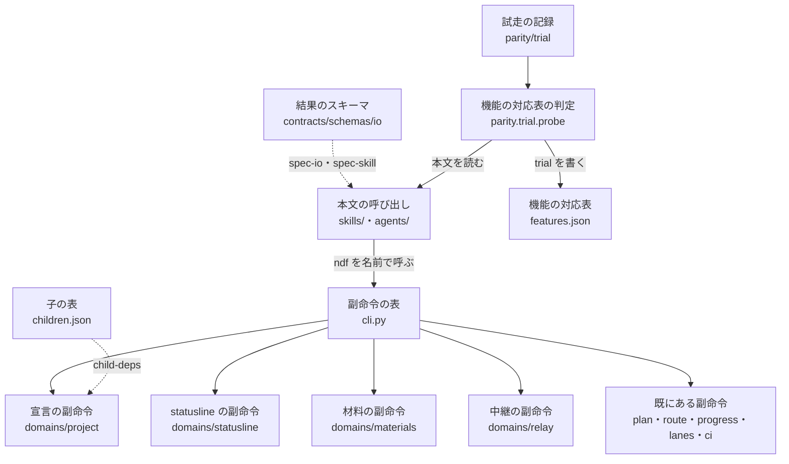
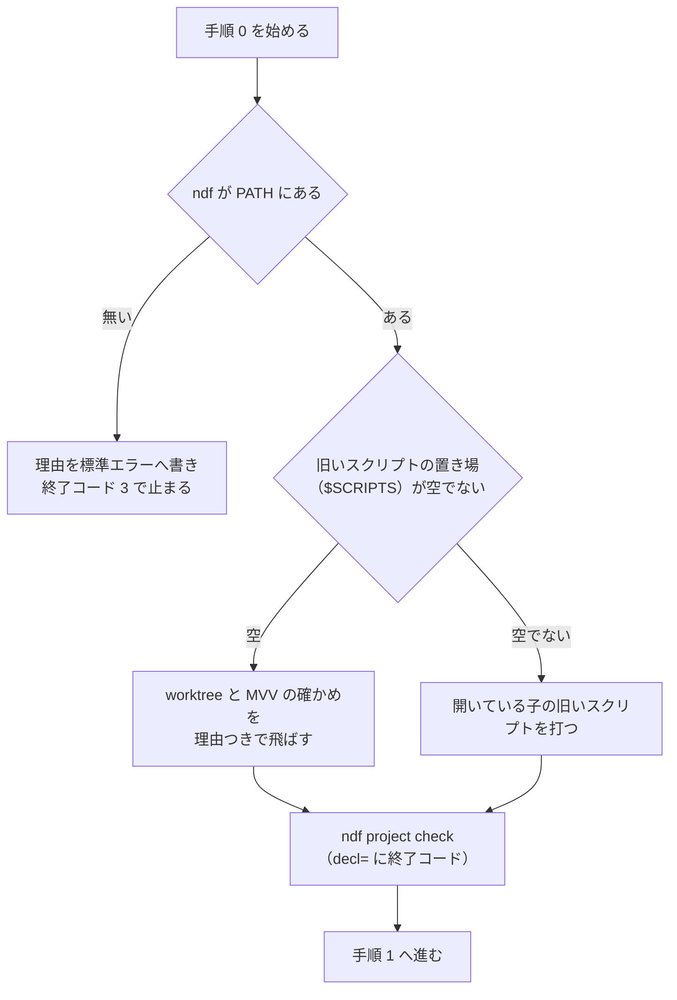

# ndf-next: 閉じた子の 10 本の機能を `ndf` の副命令で呼び、旧いプラグインへ解決しない（#3569）

## 目的

- **今どうなっているか**: 新しいプラグイン（`plugins/ndf-next/`）だけを読む起動で Skill の手順 0 を流すと、スクリプトの置き場（`$SCRIPTS`）が旧いプラグインに決まる。決まる先は `plugins/ndf/scripts` で、旧いスクリプトが走る。行き先の子が閉じた 10 本のスクリプトには `bin/ndf` の副命令が無い。Skill とエージェントの本文の 49 ファイルは、まだ旧い名前で呼ぶ
- **誰に効くか**: 入れ替え（S2 #3304）の判定が読む試走（T2 #3411）と、入れ替えの後に新しいプラグインを使うすべての利用者
- **変えると何が成り立つか**: 本文が呼ぶ 10 本の機能が、`ndf <副命令>` か、作らない理由を持つ行のどちらかになる。新しいプラグインだけの起動で、旧いプラグインのスクリプトへ解決する経路が無くなる

## 適用範囲

- **働く範囲**: 新しいプラグインを読み込んだすべてのリポジトリ。変えるのは `plugins/ndf-next/` の中だけで、旧いプラグイン（`plugins/ndf/`）は変えない
- **プロジェクトごとに違うもの**: 新しい設定と引数は足さない。宣言（`.ndf/project.json`）・再起動の方針の設定（`.ndf/context.json`）・アカウントの登録は、旧いスクリプトと同じ置き場と形を読む
- **当たるモード**: `standard`

## あるべき姿の根拠

| 根拠 | 種類 | 何を示すか |
| --- | --- | --- |
| PRD1 | 外部の一次情報 | Claude Code は、有効なプラグインの `bin/` を Bash の `PATH` へ足す。Skill の本文はプラグインの置き場を探さずに、名前でコマンドを呼べる |
| PRD2 | 外部の一次情報 | kubectl は、`PATH` 上の `kubectl-<名前>` を副命令として名前で見つける。置き場を探す処理を呼び手に持たせない形が、副命令を足す仕組みの標準の解き方である |
| PRD4 | 外部の一次情報 | Anthropic の公式 Skill（docx・pptx・xlsx・pdf）は、Claude Code のプラグインのマーケットプレイス（`anthropics/skills`）として配られている |
| `python -m ndf.parity.trial.probe` の判定（2026-11-15、#3569 の本文の「事象」） | 実測 | 10 本の行・その名前だけを理由に落ちる 4 行・両方を理由に落ちる 17 行が `failed` である |
| `grep -rlE '<10 本の名前>' skills agents hooks manifests`（2026-11-15、このブランチ） | 実測 | 10 本のどれかの名前を書いた本文は 49 ファイルある。`hooks/` と `manifests/` には 0 件 |

要求と受け入れ条件は #3569 の本文にある（コピーは [issues/issue-3569-requirements.md](issue-3569-requirements.md) ）。この文書は「どう作るか」だけを扱う。

| 何を | どこにあるか |
| --- | --- |
| 旧い副命令ごとの行き先・新しい副命令の引数と結果の契約 | [issues/issue-3569-design-commands.md](issue-3569-design-commands.md) |

## ドメインモデル

### コンテキスト

| コンテキスト | 何の語が 1 つの意味に決まるか |
| --- | --- |
| 呼び出しの契約（`bin/ndf` の副命令の表・規約のページ・Skill とエージェントの本文） | 副命令・引数・結果 JSON・終了コード・本文の呼び出し |
| 作り直しの計画（機能の対応表・子の表・試走の記録） | 行き先の子・作らない理由・試走の結果・閉じた子 |

2 つの関係は「公開された言語」である。呼び出しの契約は、規約のページ（`docs/contracts/`）と結果のスキーマ（`contracts/schemas/io/`）として文書化した形を持つ。作り直しの計画の判定（`ndf.parity.trial.probe`）は、本文をこの形のとおりに読み、旧い名前が残るかで行を判定する。どちらも相手の内部を読まない。

### 集約

| 集約 | 持ち主（書き換えてよいもの） | 根 | エンティティ | 値オブジェクト |
| --- | --- | --- | --- | --- |
| 副命令の表 | `src/ndf/cli.py` の `COMMANDS`（この課題が 3 行足す） | 副命令の表 | 副命令 | 副命令の名前・モジュールのパス |
| 副命令の契約 | 副命令のモジュール（argparse の定義）と結果のスキーマ | 副命令 | 下位の命令 | 引数・結果 JSON の `items` と `metrics` の形・終了コード |
| 本文の呼び出し | この課題（S1e）。単位は、49 ファイルのうち 10 本の名前を書いた呼び出しの行・冒頭の注記・`$SCRIPTS` の決め方である。ファイルの置き場は本文を移した子（S1a）が作ったもので、同じファイルのほかの行（開いている子の旧いスクリプトの呼び出し）はそれぞれの子が持つ | 呼び出しの行 | — | 副命令と引数の並び・`$SCRIPTS` の決め方 |
| 機能の対応表の行き先（この課題の行） | この課題（S1e）だけ。この課題の行は、`to` が閉じた子か S1e の行と、`not_built` を持つ行である。具体的には行き先の子が閉じた 10 行と、作らない機能の 5 行で、その `id`・`kind`・`feature`・`now`・`to`・`not_built`・`unowned`・`source` の列を書く。10 行の行き先の子はどれも閉じており、この課題が引き継ぐ。`trial` の列は書かない | 対応表の行 | — | 行き先の子・作らない理由 |
| 機能の対応表の行き先（ほかの行） | 行の `to` に書いた開いている子だけ。回す 2 行（`to: M7`・`to: P1b`。決定 5）はこの課題が 1 回だけ足し、足した後は M7・P1b が持つ。この課題は足した後のこの 2 行と、ほかの行を書き換えない | 対応表の行 | — | 行き先の子・作らない理由 |
| 機能の対応表の試走の結果 | 判定（`probe --write`）だけ。`trial` の列を書く | 対応表の行の `trial` | — | 試走の結果・理由・記録のファイル |
| 子の表の行 | 並列の計画 p6 のレーン lr-t2 のオーガナイザーだけ。この課題は、オーガナイザーが設計承認ゲートで承認した 2 か所（S1e の行を足す・T2 の行の `needs` に S1e を足す）だけを書く。根拠は、子の表での記号・`order`・`needs` をオーガナイザーが設計承認ゲートで決めること（要求の「未決」1）と、この課題を入れ替え S2 の先に要るものとして子の表へ載せるというオーガナイザーの判断（要求の「進め方の決まり」）である。T2 の行の `needs` は T2 の順番を決める値で、子の順番を決めるのはオーガナイザーであるため、T2 の行もオーガナイザーの承認で書く | 子の表（`children.json`） | 子の行 | 記号・番号・パッケージ・依存・順番・レーン |
| 試走の記録 | 試走をした worker | 記録のファイル（`trial/<日付>.json`） | 通した行 | 日付・起動の版・通した行の id の並び |

オーガナイザーは対応表を書かない。`unowned` の行を読み、行き先の子の Issue の本文へその行を足す（`parity/README.md` の `unowned`）。書く先は子の Issue であり、対応表の集約の外である。

### 不変条件

| # | 集約 | 条件 | 破れたときの扱い |
| --- | --- | --- | --- |
| I1 | 機能の対応表の行き先（この課題の行） | 10 本の行は、副命令を持つ子の `to` と `not_built` のどちらか 1 つだけを持つ | 形の確かめ（`table.shape_errors`）が落ちる |
| I2 | 本文の呼び出し | `skills/`・`agents/`・`hooks/`・`manifests/` の本文に、10 本の名前が出ない（冒頭の注記を含む） | 判定がその行と、その名前を呼ぶ Skill・エージェントの行を `failed` にする |
| I3 | 本文の呼び出し | 本文に書いた `ndf` の呼び出しは、副命令の表と規約の引数に当たる | `ndf check` の規則 spec-skill が落ちる |
| I4 | 副命令の契約 | 足した・変えた副命令は、結果のスキーマを持ち、結果 JSON の共通の形（`tool`・`status`・`summary`・`items`・`metrics`）と終了コードの表の値で終わる | `ndf check` の規則 spec-io と、結果 JSON の契約のテストが落ちる |
| I5 | 本文の呼び出し | `$SCRIPTS` の決め方は、旧いプラグインの置き場を候補に持たない | 旧いプラグインを候補に書くと、`grep` の確かめ（テスト設計）と手順 0 の報告（受け入れ条件 8）に出る |
| I10 | 本文の呼び出し | `$SCRIPTS` の決め方は、`ndf` が見つからなければ、理由を標準エラーへ書いて終了コード 3 で止まる | `PATH` から `ndf` を外した起動で、止まらずに進むか終了コードが 3 でなければ、単体テスト（`tests/skills/test_scripts_lookup.py`。テスト設計の受け入れ条件 6・I10）が落ちる |
| I6 | 子の表の行 | 子の表に 3569 の行があり、足したモジュールはどれも持ち主の子を持つ | 規則 child-deps が落ちる |
| I7 | すべての集約 | 旧いプラグイン（`plugins/ndf/`）に差分が無い | `git diff --stat origin/develop -- plugins/ndf/` に出る |
| I8 | 機能の対応表の行き先（ほかの行） | ほかの子へ回した機能（引継ぎの表への追記・設計の結果の取り込み）は、行き先の子を持つ行として対応表に載る | 行を足さずに本文から名前を消すと、機能が対応表から消える。レビューで機能の一覧と対応表の行を突き合わせて見る。判定では回した 2 行が `not_run` になる |
| I11 | 機能の対応表の行き先（この課題の行） | 旧い副命令の下位の命令・オプションのうち作らないもの（決定 2）は、`not_built` を持つ行として対応表に載る | 行を足さずに本文から名前を消すと、機能が対応表から消える。レビューで機能の一覧と対応表の行を突き合わせて見る。判定では作らない 5 行が `passed` になる |
| I9 | 試走の記録 | 2 回目の試走は新しい記録のファイルとして足し、1 回目の記録を書き換えない | 1 回目の記録の差分が出る |

### ドメインイベント

| # | イベント | 発生元 | 受け手 |
| --- | --- | --- | --- |
| E1 | 新しいプラグインだけを読む起動が始まった | 利用者か conductor（`bin/ndf-claude`） | Skill の手順 0 |
| E2 | Skill の手順 0 が、スクリプトの呼び方を決めた | Skill の本文の手順 0（`ndf` の有無の確かめ） | 本文の以降の手順。決められなければ止まる |
| E3 | Skill・エージェントの本文が副命令を呼んだ | 本文の手順 | 副命令（`bin/ndf`） |
| E4 | 副命令が結果 JSON を返した | 副命令 | 本文の手順・`ndf check`（結果のスキーマ） |
| E5 | 機能の対応表の判定が行ごとの結果を出した（試走の前。対応表は書かない） | `python -m ndf.parity.trial.probe`（`--write` なし） | 試走をする worker。10 本の行と 4 行が `failed` でないのを見てから試走を始める |
| E6 | 2 回目の試走の記録が書かれた | 試走をした worker | 試走の記録を取り込む判定（E8） |
| E8 | 試走の記録を取り込んだ判定が、対応表の `trial` の列を書いた | `python -m ndf.parity.trial.probe --write` | 原因ごとの一覧を作る worker |
| E7 | 原因ごとの一覧がオーガナイザーへ返った | 試走をした worker（この課題のコメント） | オーガナイザー（レーン lr-t2） |

判定は試走の前と後の 2 回起きる。前の判定は要求の E5 で、本文の置き換えが済んだことを確かめ、試走（E6）の前提になる。後の判定（E8）は、試走の記録の `passed` を対応表へ取り込む別のイベントで、E6 の後・E7 の前に起きる。要求のイベントの順序（E5 → E6 → E7）は変わらない。

### 用語

| 用語 | 意味 | 用語集への反映 |
| --- | --- | --- |
| 旧いプラグイン | #1142 の作り直しの前から配っている NDF のプラグイン（`plugins/ndf/`） | 反映済み（要求のステップで追加） |
| 機能の対応表 | 旧いプラグインの機能 1 つを 1 行に持つ表（`features.json`） | 反映済み（要求のステップで追加） |
| 子の表 | #1142 の作り直しの子の Issue の表（`children.json`） | 反映済み（要求のステップで追加） |
| 入れ替えの前の試走 | 新しいプラグインだけを読む起動でスプリントを流し、対応表の行ごとに機能が届くかを確かめること（T2 #3411） | 反映済み（要求のステップで追加） |
| 副命令 | `bin/ndf <名前>` の `<名前>` | 反映済み（既存） |
| 閉じた子 | 行き先の子のうち、設計を書く時点で Issue が CLOSED のもの | 反映済み（既存） |

## 外部の調査

| 種類 | 調べるか | 理由 |
| --- | --- | --- |
| 標準・仕様 | 調べる | 副命令の引数の書き方と、結果 JSON のスキーマの書き方に従う形がある |
| 主要な製品 | 調べる | プラグインのコマンドを名前で見つける仕組みと、公式 Skill の配り方を比べ、置き場の解決を残すか・公式 Skill の導入を作るかを決める |
| ライブラリとサービス | 調べる | 副命令の引数の定義に、今の argparse を使い続けるかを決める |

### 標準・仕様

| # | 標準・仕様 | 何を定めているか | 設計への反映 | 出典 |
| --- | --- | --- | --- | --- |
| STD1 | POSIX の Utility Conventions（12 章） | オプションと位置引数の並び・オプションの名前の形 | 新しい副命令の引数は、既存の副命令と同じく argparse の位置引数と `--` 付きのオプションで受ける | https://pubs.opengroup.org/onlinepubs/9799919799/basedefs/V1_chap12.html （2026-11-15） |
| STD2 | JSON Schema 2020-12 | スキーマの語彙と検証の意味 | 新しい副命令の結果のスキーマは、既存の `contracts/schemas/io/*.result.schema.json` と同じく 2020-12 で書き、`result.schema.json` を `$ref` で引く | `plugins/ndf-next/contracts/schemas/io/relay.result.schema.json` の `$schema`（2026-11-15） |

### 主要な製品

| # | 製品 | どう解いているか | 設計への反映 | 出典 |
| --- | --- | --- | --- | --- |
| PRD1 | Claude Code のプラグイン | プラグインの `bin/` のファイルは、プラグインが有効な間、Bash のツールの `PATH` に載り、名前だけで呼べる | Skill の本文は `ndf` を名前で呼び、置き場を探す処理を持たない（決定 1） | https://code.claude.com/docs/en/plugins-reference.md の「Executables」の行（2026-11-15） |
| PRD2 | kubectl のプラグイン | `kubectl-` で始まる実行ファイルを `PATH` のどこかに置くと副命令になり、`kubectl plugin list` が `PATH` を走査して見つける | 名前で見つける形を採る根拠（決定 1） | https://kubernetes.io/docs/tasks/extend-kubectl/kubectl-plugins/ （2026-11-15） |
| PRD3 | git | 副命令の実体の置き場は `--exec-path` が 1 つ持ち、呼び手は `git <副命令>` の名前で呼ぶ | 置き場の解決を副命令の側（`bin/ndf`）に閉じ、本文へ置き場を書かない形の例（決定 1） | https://git-scm.com/docs/git の `--exec-path`（2026-11-15） |
| PRD4 | Anthropic の公式 Skill（`anthropics/skills`） | マーケットプレイス `anthropic-agent-skills` が、`document-skills`（xlsx・docx・pptx・pdf）と `example-skills` をプラグインとして配る。`/plugin marketplace add anthropics/skills` の後に `/plugin install document-skills@anthropic-agent-skills` で入る | 公式 Skill の導入を自前で作らず、プラグインの導入で入れる（決定 4） | https://raw.githubusercontent.com/anthropics/skills/main/README.md と `.claude-plugin/marketplace.json`（2026-11-15）、`claude plugin install --help`（Claude Code 2.1.x、2026-11-15） |

### ライブラリとサービス

| # | 候補 | 版 | ライセンス | 最後のリリースの日付 | 終了のアナウンス | 要件を満たすか | 出典 |
| --- | --- | --- | --- | --- | --- | --- | --- |
| LIB1 | argparse（Python の標準ライブラリ） | Python 3.13 に同梱 | PSF | Python の版に従う | 無し | 満たす。既存の 23 の副命令がすべて使い、規約の生成（`spec_args.py`）が argparse の定義から引数のスキーマを作る | `plugins/ndf-next/src/ndf/checks/spec_args.py`（2026-11-15） |
| LIB2 | click | 8.5.1 | BSD-3-Clause | 2026-11-06 | 無し | 満たすが、規約の生成が argparse の定義を読む形のため、移すと生成の側の作り直しが要る | https://pypi.org/pypi/click/json （2026-11-15） |
| LIB3 | typer | 0.29.1 | MIT | 2026-11-11 | 無し | LIB2 と同じ理由で、規約の生成の作り直しが要る | https://pypi.org/pypi/typer/json （2026-11-15） |

### 確かめられなかったこと

| 対象 | 試した手段 | 結果と理由 |
| --- | --- | --- |
| POSIX の 12 章の各ガイドラインの本文 | https://pubs.opengroup.org/onlinepubs/9799919799/basedefs/V1_chap12.html の取得（HTTP 200） | 取得はできたが、ガイドラインの番号の行を文字の抽出で取り出せなかった。STD1 は章の題と節の構成だけを根拠にした |

調べた量: 候補 9 件・取得の試み 14 回。

## 機能一覧

| # | 機能 | 誰が使うか |
| --- | --- | --- |
| F1 | 本文が `ndf` を名前で呼び、`ndf` が見つからなければ理由を出して止まる（`$SCRIPTS` の決め方） | すべての Skill・エージェントの本文 |
| F2 | 旧い副命令を、既にある副命令（`ndf plan`・`ndf route`・`ndf progress`・`ndf relay`・`ndf lanes`・`ndf ci`）の呼び出しへ置き換える | conductor・supervisor・利用者 |
| F3 | プロジェクトの宣言の判定・測定・書き出し・ずれ・スキーマ（`ndf project`） | conductor（development-workflow の手順 0）・worktree・retrospective・backlog-refinement |
| F4 | statusline の導入・切り替え・復元（`ndf statusline`） | 利用者（statusline の Skill） |
| F5 | モードの判定の材料を集める（`ndf materials`） | conductor（開発ループ） |
| F6 | 中継の足りない操作（カットポイントのアナウンス・すべて止める・アカウントの登録・再起動の方針）を `ndf relay` に足す | conductor・中継のラッパー・利用者 |
| F7 | 作らない 2 本（置き場の解決・公式 Skill の導入）の理由を対応表に書き、本文を代わりの手順へ書き換える | 入れ替えの判定・利用者 |
| F8 | 子の表へこの課題の行を足す | オーガナイザー・規則 child-deps |
| F9 | 2 回目の試走をし、落ちた行を原因ごとに分けた一覧を返す | オーガナイザー（レーン lr-t2） |

## 構成要素

| 要素 | 責務 |
| --- | --- |
| 副命令の表（`src/ndf/cli.py`） | `project`・`statusline`・`materials` の 3 行を足す |
| 宣言の副命令（`src/ndf/domains/project/`） | 旧い `project-decl.py` の 5 つの下位の命令を移す。新しいパッケージで、持ち主はこの課題（子の表の S1e） |
| statusline の副命令（`src/ndf/domains/statusline/`） | 旧い `statusline-switch.sh` の 4 つの下位の命令と、表示の本体（旧い `scripts/statusline.sh`）を移す。持ち主は S1e |
| 材料の副命令（`src/ndf/domains/materials/`） | 旧い `mode-materials.py` を移す。持ち主は S1e |
| 中継の副命令（`src/ndf/domains/relay/`） | `notice`・`stop --all`・アカウントの登録の 9 つ・再起動の方針の 4 つ（`context`）を足す。持ち主は M3b（閉じた子のパッケージ） |
| 結果のスキーマ（`contracts/schemas/io/`） | 3 つの副命令の結果のスキーマを足し、`relay` の結果のスキーマへ足した下位の命令の形を足す。引数のスキーマと規約のページは `ndf check --write-spec` が生成する |
| 本文の呼び出し（`skills/`・`agents/` の 49 ファイル） | 10 本の呼び出しを `ndf` の呼び出しへ置き換え、冒頭の注記から 10 本の名前を外す。`$SCRIPTS` の決め方を `ndf` の有無の確かめへ置き換える |
| 機能の対応表（`src/ndf/parity/features.json`） | 10 行のうち 5 行（作らない 2 行と S1e へ移す 3 行）と、表示の本体（`statusline.sh`）の行の `to` か `not_built` を直し、ほかの子へ回す 2 機能の行と、作らない下位の命令・オプションの 5 行を足し、`places` に S1e を足す。`trial` の列は判定が書く |
| 子の表（`src/ndf/checks/children.json`） | S1e の行を足し、T2 の `needs` に S1e を足す |
| 試走の記録（`src/ndf/parity/trial/`） | 2 回目の試走の記録を新しいファイルで足す |

旧い副命令ごとの行き先は [issue-3569-design-commands.md の「旧い副命令の行き先」](issue-3569-design-commands.md#旧い副命令の行き先) にある。行き先は、置き換える・作る・作らない・ほかの子へ回すの 4 つである。

### 構成要素図



## 処理の流れ

### 手順 0 の呼び方の決まり方

`development-workflow` の手順 0 は、旧いスクリプトの置き場を探さずに `ndf` の有無だけを確かめる。宣言の判定は `ndf project check` で行い、`decl=` に終了コードを出す。開いている子が持つ旧いスクリプトは、置き場が無いことを理由に飛ばし、判定結果の出力の `宣言:` の行に理由を書く。

| 飛ばす旧いスクリプト | 何を確かめるか | 持つ子 |
| --- | --- | --- |
| `worktree-setup.sh` | worktree の設定 | M8 |
| `project-mvv.py` | MVV | M7 |



新しいプラグインだけの起動では `$SCRIPTS` はいつも空である（決定 1）。「空でない」の枝は、開いている子が副命令へ置き換えるまでの間の本文の形を表す。

`decl=` の値の読み方（`project-analysis.md`）は、`ndf project check` の終了コードで書き直す。終了コードの値は [issue-3569-design-commands.md の `ndf project`](issue-3569-design-commands.md#ndf-project) にある。

### 2 回目の試走までの順序


この順序は、すべてこの課題のブランチの上で、Pull Request のマージの前に進む。試走の記録（`trial/<日付>.json`）と `probe --write` が書いた `trial` の列は、この課題の Pull Request の差分に入る。原因ごとの一覧は、マージの前にこの課題のコメントへ書く。これで受け入れ条件 9 をこの課題の Pull Request の中で満たす（要求の検証手段の「手動確認（マージ前）」）。

2 回目の試走の記録（`trial/<日付>.json`）は、判定（`probe --write`）が読む前に足す。判定は記録の `passed` を、静的な確かめで `failed` にならない行にだけ効かせる（`probe.judge_row`）。

## 決定の記録

### 決定 1: 旧いプラグインへ倒れる経路を無くすため、置き場の解決のエントリポイントを作らず、本文は `ndf` を名前で呼ぶ

`resolve.sh` の行は `not_built` にし、理由に「`ndf` は名前で見つかる（X0 の `bin/ndf`）。本文は置き場を決めない」と書く。呼び手が置き場を知る必要が無いためである。

- 旧い `resolve.sh` は、4 つのランタイムのどこにプラグインがあるかを探して `scripts/` の置き場を返す
- 新しいプラグインの機能は `bin/ndf` の副命令である。Claude Code は有効なプラグインの `bin/` を `PATH` に載せる（PRD1）
- Codex と端末は `PATH` 上の `bin/ndf` へのリンクで呼ぶ（`bin/ndf` の冒頭の注記）

本文の `$SCRIPTS` の決め方は、`command -v ndf` で `ndf` の有無を確かめる形にする。無ければ理由を標準エラーへ書いて終了コード 3 で止まる。`$SCRIPTS` は決めず空にする。書き換えるのは `development-workflow/references/scripts-lookup.md` と、同じ探索を持つ 11 ファイルである。

開いている子の旧いスクリプトを `$SCRIPTS` の下で呼ぶ行は、それぞれの子が副命令へ置き換えるまで残る。新しいプラグインだけの起動では、既定は「打たずに飛ばし、置き場が無いことを理由として 1 行出す」形にする。止まる形は、飛ばすと誤った値で進む場合だけに使う。誤った値で進むのは、後の手順がその旧いスクリプトの出力を入力にしている場合である（[issue-3569-design-commands.md の「本文の書き換えの形」](issue-3569-design-commands.md#本文の書き換えの形)）。

どちらの形でも本文に旧いスクリプトの名前が残るため、その子の行は判定で `failed` として見える（要求の前提 2）。飛ばす形を既定にするのは、試走が手順の終わりまで進み、受け入れ条件 9 の一覧が試走の全体から取れるためである。

新しいプラグインに解決のエントリポイントを置く形は採らない。置くと、旧いスクリプトが無い新しいプラグインで「置き場」を返す処理が残り、開いている子が置き換えた後に消す手間が増える。

- 作り方: 標準に倣う
- 比べた候補: PRD1 / PRD2 / PRD3

根拠: Value 3 / Value 11 / Value 4（MVV 版 7）

### 決定 2: 同じ機能を 2 か所に持たないため、既にある副命令で足りる旧い副命令はそこへ置き換え、旧いオプションの形は持ち込まない

旧い副命令は、既にある副命令へ置き換える。`supervise.py` の置き換え先は C2・C3・P1a が作った。

| 旧い | 置き換え先 |
| --- | --- |
| `supervise.py` の `new`・`queue`・`run`・`wait`・`advance` | `ndf route render`・`ndf plan queue`・`ndf plan next`・`ndf plan wait`・`ndf progress new` |
| `test-run.py` | `ndf route test`・`ndf ci watch` |
| `stage-check.sh report` | `ndf progress show` |
| `relay.py` の `run`・`spawn`・`restart`・`ls`・`status`・`install`・`stop <名前>`・`account use`・`role` | `ndf relay` |
| `relay.py cap` | `ndf lanes limits` |

新しい副命令に無いオプション（`queue` の `--max`・`--done`、`run` の `--slow` など）は足さない。本文の呼び出しを新しい副命令の引数へ書き換える。要求の前提 4（後方互換は持たない）に従う。

置き換え先の無い下位の命令のうち、新しい仕組みが役目を持つものは作らない。

| 作らない旧い下位の命令 | 役目を持つもの |
| --- | --- |
| `relay.py mark` | Stop の hook の guard（`hooks/guards/relay_mark.py`） |
| `relay.py startup` | `ndf relay install` |
| `relay.py is-child` | `ndf relay notice` の結果 |
| `relay.py attach` | `tmux attach` |
| `test-run.py whole` の手元の全体テストと落ちの分類 | CI（`ndf ci watch`） |

作らない下位の命令とオプションは、旧いスクリプトの行とは別の行として対応表に足し、`not_built` に作らない理由を書く。機能を対応表から消さないためである（I11）。旧いスクリプトの 10 行は、置き換える下位の命令の行き先として `to` のまま残す。1 行に `to` と `not_built` を両方持たせないため（I1）、作らない部分は行を分ける。

足す行は次の 5 行である（[issue-3569-design-commands.md の「機能の対応表の変更」](issue-3569-design-commands.md#機能の対応表の変更)）。

- `supervise.py` の持ち込まないオプション
- `test-run.py whole`
- `relay.py attach`
- `relay.py` の hook の本体（`mark`・`startup`・`is-child`）
- `context-policy.py report` の `--format table`

行き先の一覧は [issue-3569-design-commands.md](issue-3569-design-commands.md#旧い副命令の行き先) にある。

旧いオプションを新しい副命令へ足す形は採らない。同じ働きを 2 つの名前で持つことになる。

根拠: Value 11 / Value 3（MVV 版 7）

### 決定 3: 閉じた子の機能を入れ替えの前に届けるため、置き換え先の無い 4 本と中継の足りない操作は、旧い実装を新しい副命令へ移す

旧い実装の振る舞い（引数・判定・書くファイルの置き場と形）を変えずに、新しいプラグインの副命令の形（結果 JSON・終了コードの表・argparse）へ移す。移すのは下の表の 5 つで、移す理由は次の 2 つである。

- 新しいプラグインに同じ働きの部品が無い（[issue-3569-design-commands.md](issue-3569-design-commands.md#旧い副命令の行き先) の根拠の列）
- どれも利用者か conductor が手順で打つ機能で、作り直しの同等版はその振る舞いを持つ必要がある

入れ替えの前は、旧い実装と同じ状態を新しい副命令も書く。その間の排他と形の一致は、[issue-3569-design-commands.md の「旧い実装と並ぶ間の状態の書き手」](issue-3569-design-commands.md#旧い実装と並ぶ間の状態の書き手) にある。

| 旧い | 新しい副命令 | 置き場 | パッケージの持ち主 |
| --- | --- | --- | --- |
| `project-decl.py` | `ndf project` | `src/ndf/domains/project/` | S1e（この課題） |
| `statusline-switch.sh`・`statusline.sh` | `ndf statusline` | `src/ndf/domains/statusline/` | S1e |
| `mode-materials.py` | `ndf materials` | `src/ndf/domains/materials/` | S1e |
| `context-policy.py` | `ndf relay context` | `src/ndf/domains/relay/` | M3b |
| `relay.py` の `notice`・`stop`（すべて）・`account` の 9 つ | `ndf relay` | `src/ndf/domains/relay/` | M3b |

表示の本体（旧い `scripts/statusline.sh`、対応表の S1b の行）は、同じパッケージへ移す。`ndf statusline set` が `~/.claude/ndf-statusline.sh` へ置く元になり、statusline の Skill の働きに要るためである。再起動の方針と中継の操作を `ndf relay` に置くのは、旧い対応表がどちらも M3b を行き先にしており、中継の置き場（`signals.relay_dir`）と設定を読む部品を共有するためである。

引数の定義は既存の副命令と同じ argparse で書く（LIB1）。click・typer へ移す形は採らない。規約の生成（`spec_args.py`）が argparse の定義を読むため、生成の作り直しが要る。

- 作り方: 自前で作る
- 比べた候補: LIB1 / LIB2 / LIB3

根拠: Value 4 / Value 13（MVV 版 7）

### 決定 4: 自前の導入を持たないため、公式 Skill の導入は作らず、プラグインのマーケットプレイスで入れる

`install-official-skills.sh` の行は `not_built` にし、理由に「公式 Skill はプラグインのマーケットプレイスで提供される（anthropics/skills）。導入は Claude Code のプラグインの導入が持つ」と書く。旧い `install-official-skills.sh` は `anthropics/skills` を clone し、Skill のディレクトリを `~/.claude/skills/` へ置く。公式 Skill は今はプラグインのマーケットプレイスとして配られている（PRD4）。

`official-skills-autoloader` の本文は、取得元を示して同意を得た後に次の 2 つを打つ手順へ書き換える。

```bash
claude plugin marketplace add anthropics/skills
claude plugin install document-skills@anthropic-agent-skills
```

clone して置く形を新しい副命令に移す形は採らない。提供元が更新の仕組みを持つプラグインを、自前のコピーで置き換えることになる。

- 作り方: ライブラリやサービスを使う
- 比べた候補: PRD4

根拠: Value 12 / Value 3（MVV 版 7）

### 決定 5: 機能を対応表から消さないため、開いている子の領分の 2 機能は、その子を行き先にした行を足して回す

対応表に 2 行を `unowned: true`・`now: "—"` で足す。開いている子のパッケージを並行して書き換えると、その子の変更と衝突するためである。

| 旧い | 働き | 領分の子 | 足す行 |
| --- | --- | --- | --- |
| `supervise.py note` | 報告から引継ぎ文書の表へ 1 行足す | 引継ぎの記録を持つ M7 #3302 | `from-issue:3569-handoff-note`（`to: M7`） |
| `supervise.py design-results` | マージした設計 PR の「設計の結果」から実装のプランを書き換える | スプリントの工程を流す P1b #3092 | `from-issue:3569-design-results`（`to: P1b`） |

本文の呼び出しの行は「この機能は <子> が `ndf` の副命令に足す。新しいプラグインだけではまだ打てない」の形へ書き換える。オーガナイザーが行き先の子の本文へ足す（`parity/README.md` の `unowned`）。

`now` を `scripts/supervise.py` にしない。判定は `now` を鍵に旧いスクリプトの行を引く（`probe.old_scripts`）。同じ `now` の行が 3 つになると、後の行が鍵を上書きする。すると本文に `supervise.py` が残る間は、2 行が `failed` になり理由に `supervise.py` が出る（受け入れ条件 3 に反する）。Skill・エージェントの行の理由の行き先の子も C2 から P1b へ変わる。置き場の無い行の `now` を `—` にする形は、既にある `from-issue` の 3 行と同じである（`parity/README.md` の `now`）。判定を打った結果は [issue-3569-design-commands.md の「機能の対応表の変更」](issue-3569-design-commands.md#機能の対応表の変更) にある。

この課題で 2 機能を作る形は採らない。開いている子の設計がまだ形を決めていない領分を、先に決めることになる。

根拠: Value 11 / Value 13（MVV 版 7）

### 決定 6: 試走の前に流れるようにするため、子の表へ S1e をレーン lr-t2・順番 8 で足し、T2 の先に要るものに入れる

記号は S1e にする。直すのが本文の置き換え（S1a）と配る表（S1b）の残りで、S1 を分けた子の続きであるためである。`needs` は、足すモジュールが読む子と、置き換えの前提の閉じた子（X0・D1・D1+・D2+・AD1・AD2・AD3・C2・C3・P1a・M3b・S1a・S1b）にする。どれも閉じているため、順番の制約（IG2）は開いている子に掛からない。順番は T2（9）より前の 8 にし、T2 の `needs` に S1e を足す。2 回目の試走そのものは、この課題のブランチでマージの前に流す（「2 回目の試走までの順序」）。T2 が S1e を待つのは、T2 が入れ替え（S2）の判定へ渡す試走の記録と対応表を、S1e のマージで develop に載った後の状態から読むためである。レーンは、この課題を直すレーン lr-t2 にする。`packages` は `ndf.domains.project`・`ndf.domains.statusline`・`ndf.domains.materials` の 3 つである。

要求の未決 1 の答えであり、オーガナイザーはこの値を設計承認ゲートで見る。

根拠: Value 5 / Value 13（MVV 版 7）

### 決定 7: 移した先と対応表の行き先を一致させるため、新しいパッケージへ移した 4 行の `to` を S1e にする

`project-decl.py`・`statusline-switch.sh`・`statusline.sh`・`mode-materials.py` の行の `to` を S1e にする。`places` には次を足す。

```json
"S1e": ["src/ndf/domains/project/", "src/ndf/domains/statusline/", "src/ndf/domains/materials/"]
```

判定は `to` の `places` が実在するかを見る（`probe._missing_places`）ため、置き場と行き先が食い違うと正しく判定できない。`relay.py`・`context-policy.py`・`supervise.py`・`test-run.py`・`stage-check.sh` の行は、副命令を持つ子（M3b・C2・P1a）のまま残す。`parity/README.md` の「行き先の子が自分の行の `to` を書き直す（子を分けた・寄せた）」に当たる。

根拠: Value 8（MVV 版 7）

## テスト設計

| 受け入れ条件・不変条件 | どの振る舞いで縛るか | どう壊したら落ちるべきか |
| --- | --- | --- |
| 受け入れ条件 1・2・3・I2 | `probe` の判定で、10 本の行と 4 行が `failed` でなく、`failed` の行の理由に 10 本の名前が出ない | 本文のどこかに 10 本の名前を 1 つ残すと、その行と、それを呼ぶ Skill の行が `failed` になる |
| 受け入れ条件 4・I1 | 10 行のそれぞれが `to`（副命令を持つ子）か `not_built` の一方だけを持つ。新しい副命令の `--help` が終了コード 0 で終わる | 1 行に両方を書くと形の確かめが落ちる。副命令の表に行を足し忘れると `--help` が使い方の誤りで終わる |
| 受け入れ条件 4・I3・I4 | `ndf check` の規則 spec-io・spec-skill・spec-docs が通る | 結果のスキーマを置き忘れると spec-io、本文に無い引数を書くと spec-skill、規約のページを生成し直さないと spec-docs が落ちる |
| 受け入れ条件 4・I4（副命令の振る舞い） | `ndf project` の 5 つ・`ndf statusline` の 4 つ・`ndf materials`・`ndf relay` の足した下位の命令が、旧い実装と同じ入力で同じ判定と同じファイルを書き、結果 JSON の共通の形で終わる | 判定の終了コードを旧いと変える・書く置き場を変えると、副命令ごとの単体テストが落ちる |
| 受け入れ条件 5 | 冒頭の注記の行に 10 本の名前が出ない（`grep` の確かめ） | 注記から名前を外し忘れると `grep` に出る |
| 受け入れ条件 6・I5 | 本文の `$SCRIPTS` の決め方に `plugins/ndf` の候補が無い | 探索の候補に `plugins/ndf` を残すと `grep` に出る |
| 受け入れ条件 6・I10 | `ndf` が見つからなければ、理由を標準エラーへ書いて終了コード 3 で止まる。正本（`scripts-lookup.md`）の 1 行を取り出し、`ndf` を含まない `PATH` の `bash -c` で打つ（`tests/skills/test_scripts_lookup.py`。観点は詳細設計の「単体テストの観点」） | `PATH` から `ndf` を外した起動で止まらずに進むか、終了コードが 3 でなければ落ちる |
| 受け入れ条件 7・I6 | 子の表に 3569 の行があり、規則 child-deps が通る | 足したパッケージを子の表に載せ忘れると、持ち主の無いモジュールとして落ちる |
| 受け入れ条件 8 | `bin/ndf-claude -p` で手順 0 を流した報告に `plugins/ndf/scripts` が出ない | 手順 0 が旧い置き場を探すと報告に出る（手動確認） |
| 受け入れ条件 9・I9 | 2 回目の試走の記録が `trial/` に新しいファイルとして加わり、原因ごとの一覧が課題のコメントにある | 1 回目の記録を書き換えると差分に出る（手動確認） |
| 受け入れ条件 10・I7 | `git diff --stat origin/develop -- plugins/ndf/` が空 | 旧いプラグインを触ると差分に出る |
| 受け入れ条件 11 | 変えた副命令・本文・対応表を見る既存のテスト（`tests/parity/`・`tests/checks/`・`tests/domains/relay/`・`tests/cli/`）が通る | 既存の副命令の引数を変えると、その副命令のテストが落ちる |
| I8 | 対応表に `to: M7`・`to: P1b` の 2 行があり、形の確かめが通る。判定で、回す 2 行は `not_run` になる | 行を足さずに本文から名前を消すと、レビューで見る（機能の一覧と対応表の行の突き合わせ） |
| I11 | 対応表に `not_built` を持つ作らない機能の 5 行があり、形の確かめが通る。判定で、作らない 5 行は `passed` になる | 行を足さずに本文から名前を消すと、レビューで見る（機能の一覧と対応表の行の突き合わせ） |

## 設計の結果

| 課題 | 扱い | 取り込み先 | 触るファイル |
| --- | --- | --- | --- |
| #3569 | 実装する | — | `plugins/ndf-next/src/ndf/cli.py`、`plugins/ndf-next/src/ndf/domains/project/__init__.py`（新設）、`plugins/ndf-next/src/ndf/domains/project/cli.py`（新設）、`plugins/ndf-next/src/ndf/domains/project/check.py`（新設）、`plugins/ndf-next/src/ndf/domains/project/measure_repo.py`（新設）、`plugins/ndf-next/src/ndf/domains/project/measure_ci.py`（新設）、`plugins/ndf-next/src/ndf/domains/project/measure_flow.py`（新設）、`plugins/ndf-next/src/ndf/domains/project/write.py`（新設）、`plugins/ndf-next/src/ndf/domains/statusline/__init__.py`（新設）、`plugins/ndf-next/src/ndf/domains/statusline/cli.py`（新設）、`plugins/ndf-next/src/ndf/domains/statusline/settings.py`（新設）、`plugins/ndf-next/src/ndf/domains/statusline/statusline.sh`（新設）、`plugins/ndf-next/src/ndf/domains/materials/__init__.py`（新設）、`plugins/ndf-next/src/ndf/domains/materials/cli.py`（新設）、`plugins/ndf-next/src/ndf/domains/materials/collect.py`（新設）、`plugins/ndf-next/src/ndf/domains/relay/cli.py`、`plugins/ndf-next/src/ndf/domains/relay/registry.py`（変更）、`plugins/ndf-next/src/ndf/domains/relay/notice.py`（新設）、`plugins/ndf-next/src/ndf/domains/relay/account_registry.py`（新設）、`plugins/ndf-next/src/ndf/domains/relay/account_login.py`（新設）、`plugins/ndf-next/src/ndf/domains/relay/account_metered.py`（新設）、`plugins/ndf-next/src/ndf/domains/relay/context_policy.py`（新設）、`plugins/ndf-next/src/ndf/domains/relay/context_records.py`（新設）、`plugins/ndf-next/src/ndf/domains/relay/context_report.py`（新設）、`plugins/ndf-next/contracts/domains/env.json`（変更）、`plugins/ndf-next/contracts/limits.json`（変更）、`plugins/ndf-next/contracts/schemas/io/project.result.schema.json`（新設）、`plugins/ndf-next/contracts/schemas/io/statusline.result.schema.json`（新設）、`plugins/ndf-next/contracts/schemas/io/materials.result.schema.json`（新設）、`plugins/ndf-next/contracts/schemas/io/relay.result.schema.json`、`plugins/ndf-next/contracts/schemas/io/project.args.schema.json`（生成）、`plugins/ndf-next/contracts/schemas/io/statusline.args.schema.json`（生成）、`plugins/ndf-next/contracts/schemas/io/materials.args.schema.json`（生成）、`plugins/ndf-next/contracts/schemas/io/relay.args.schema.json`（生成）、`plugins/ndf-next/docs/contracts/commands.md`（生成）、`plugins/ndf-next/docs/contracts/env.md`（生成）、`plugins/ndf-next/src/ndf/parity/features.json`、`plugins/ndf-next/src/ndf/checks/children.json`、`plugins/ndf-next/src/ndf/parity/trial/`（2 回目の試走の記録を日付の名前で足す）、`plugins/ndf-next/agents/supervisor.md`、`plugins/ndf-next/agents/supervisor-waits.md`、`plugins/ndf-next/skills/backlog-refinement/SKILL.md`、`plugins/ndf-next/skills/backlog-refinement/references/ranking.md`、`plugins/ndf-next/skills/backlog-refinement/references/research.md`、`plugins/ndf-next/skills/cross-refactoring/SKILL.md`、`plugins/ndf-next/skills/cross-refactoring/docs/01-state-and-propose.md`、`plugins/ndf-next/skills/cross-review/SKILL.md`、`plugins/ndf-next/skills/cross-review/docs/01-state-and-review.md`、`plugins/ndf-next/skills/design/references/design-template.md`、`plugins/ndf-next/skills/design/references/detailed-design.md`、`plugins/ndf-next/skills/development-workflow/SKILL.md`、`plugins/ndf-next/skills/development-workflow/references/agent-layers.md`、`plugins/ndf-next/skills/development-workflow/references/approval-request.md`、`plugins/ndf-next/skills/development-workflow/references/asking.md`、`plugins/ndf-next/skills/development-workflow/references/conductor-entrypoints.md`、`plugins/ndf-next/skills/development-workflow/references/context-window.md`、`plugins/ndf-next/skills/development-workflow/references/glossary.md`、`plugins/ndf-next/skills/development-workflow/references/handoff.md`、`plugins/ndf-next/skills/development-workflow/references/interrupt-resume.md`、`plugins/ndf-next/skills/development-workflow/references/loop.md`、`plugins/ndf-next/skills/development-workflow/references/pace.md`、`plugins/ndf-next/skills/development-workflow/references/parallel-checks.md`、`plugins/ndf-next/skills/development-workflow/references/parallel.md`、`plugins/ndf-next/skills/development-workflow/references/project-analysis.md`、`plugins/ndf-next/skills/development-workflow/references/project-mvv.md`、`plugins/ndf-next/skills/development-workflow/references/relay-accounts.md`、`plugins/ndf-next/skills/development-workflow/references/relay.md`、`plugins/ndf-next/skills/development-workflow/references/scripts-lookup.md`、`plugins/ndf-next/skills/development-workflow/references/stage-completeness.md`、`plugins/ndf-next/skills/development-workflow/references/stage-notes.md`、`plugins/ndf-next/skills/development-workflow/references/waiting.md`、`plugins/ndf-next/skills/development-workflow/references/work-vessels.md`、`plugins/ndf-next/skills/estimate/SKILL.md`、`plugins/ndf-next/skills/fix/SKILL.md`、`plugins/ndf-next/skills/install-wrapper/SKILL.md`、`plugins/ndf-next/skills/issue-plan-strategy/references/execution-plan.md`、`plugins/ndf-next/skills/issue-plan-strategy/references/parallel-plan.md`、`plugins/ndf-next/skills/merged/SKILL.md`、`plugins/ndf-next/skills/official-skills-autoloader/SKILL.md`、`plugins/ndf-next/skills/progress-tracking/SKILL.md`、`plugins/ndf-next/skills/pr-review/SKILL.md`、`plugins/ndf-next/skills/quality-gates/references/design-match.md`、`plugins/ndf-next/skills/release/references/form-package-plugin.md`、`plugins/ndf-next/skills/restart/SKILL.md`、`plugins/ndf-next/skills/retrospective/SKILL.md`、`plugins/ndf-next/skills/statusline/SKILL.md`、`plugins/ndf-next/skills/worktree/references/declaration.md`、`plugins/ndf-next/skills/worktree/references/test-execution.md`、`plugins/ndf-next/tests/domains/project/test_project_cli.py`（新設）、`plugins/ndf-next/tests/domains/project/test_project_measure.py`（新設）、`plugins/ndf-next/tests/domains/statusline/test_statusline_cli.py`（新設）、`plugins/ndf-next/tests/domains/materials/test_materials_cli.py`（新設）、`plugins/ndf-next/tests/domains/relay/test_notice.py`（新設）、`plugins/ndf-next/tests/domains/relay/test_account_registry.py`（新設）、`plugins/ndf-next/tests/domains/relay/test_account_metered.py`（新設）、`plugins/ndf-next/tests/domains/relay/test_context_policy.py`（新設）、`plugins/ndf-next/tests/domains/relay/test_context_report.py`（新設）、`plugins/ndf-next/tests/skills/test_scripts_lookup.py`（新設） |

## 人へ残す判断

| 判断 | 当たるレッドライン | なぜ当たるか |
| --- | --- | --- |
| アカウントの登録（`ndf relay account add`・`add-bedrock`・`add-api-key`・`api-key-monthly`・`api-key-use`・`check`・`remove`）を、旧い実装と同じ保存の置き場と形のまま新しいプラグインへ移す（決定 3） | C1 / C2 | API キーを標準入力かファイルから受けて保存し（C1）、アカウントごとの OAuth のログインと、従量の接続（Bedrock・API キー）の宣言を扱う（C2） |
| 既にある宣言（`.ndf/project.json`）を書き換える経路（`ndf project write`）を、旧い実装と同じ振る舞いのまま新しいプラグインへ移す（決定 3） | C7 | `write` は、宣言が無いときに解析の結果から新しく作るだけでなく、既にある宣言のキーを測定の結果と答えで書き換える。新しく作る場合は C7 の除外に当たるが、書き換える場合（`decl=` が古いを示し、解析が `解析: 更新した` を出す場合）は利用者の設定の書き換えに当たる。旧い手順は、人が書いた値を書き換えず、書き出した宣言はコミットしない限り取り消せるとして、書き換えの前に承認を求めない（`development-workflow/references/project-analysis.md` の「手順 0 での扱い」）。この課題は振る舞いを変えずに移すため、その手順をそのまま新しいプラグインへ持ち込んでよいかを設計承認ゲートで人が決める |

## レッドラインに当たらないと判断した操作

| 操作 | 当たらない理由 |
| --- | --- |
| `ndf statusline set`・`restore`・`ensure` が `settings.json` と `~/.claude/ndf-statusline.sh` を書く | 書く先は Claude Code の設定の置き場（`CLAUDE_CONFIG_DIR`、無ければ `~/.claude`）の中である。C6 は `~/.claude/` の外を対象にする。利用者が statusline の Skill を呼んだときと SessionStart の `ensure` だけが書き、他の値の `statusLine` は書き換えない（旧いと同じ） |
| `ndf relay context record`・`calibrate` が記録と見込みを書く | 書く先は NDF の状態の置き場で、利用者の設定（`.ndf/`）ではない。設定の `.ndf/context.json` は読むだけである |

## 未確認のまま残ること

| 項目 | 内容 |
| --- | --- |
| `ndf` が `PATH` に載らない起動 | Codex と端末は、`PATH` 上に `bin/ndf` へのリンクを置いて呼ぶ（`bin/ndf` の冒頭の注記）。リンクを置く手順（`install-wrapper` の Skill）を通していない利用者の手元では、手順 0 が理由を出して止まる。2 回目の試走は Claude Code で流すため、Codex での振る舞いは入れ替えの後のリリース後テストで分かる |
| 2 回目の試走で残る `failed` の行数 | 開いている子の旧いスクリプトを呼ぶ行（要求の前提 2）がいくつ残るかは、試走を流すまで分からない。2 回目の試走の原因ごとの一覧で分かる |
| アカウントの登録の OAuth のログイン | 旧い実装は、アカウントごとの設定ディレクトリで `claude auth login` を動かす。新しいプラグインの子の起動（`session_env.child_env`）とその設定ディレクトリの渡し方が同じに働くかは、実際にログインするまで分からない。実装の手動確認で、登録したアカウントで子の `claude -p` が起動するかを見て分かる |
| `claude plugin install` の範囲の指定 | 旧い `--scope project` に当たる指定（`claude plugin install` の範囲のオプション）が利用者の Claude Code の版で使えるかは、版ごとに違いうる。`official-skills-autoloader` の手順を実装で打ったときの `--help` の出力で分かる |
