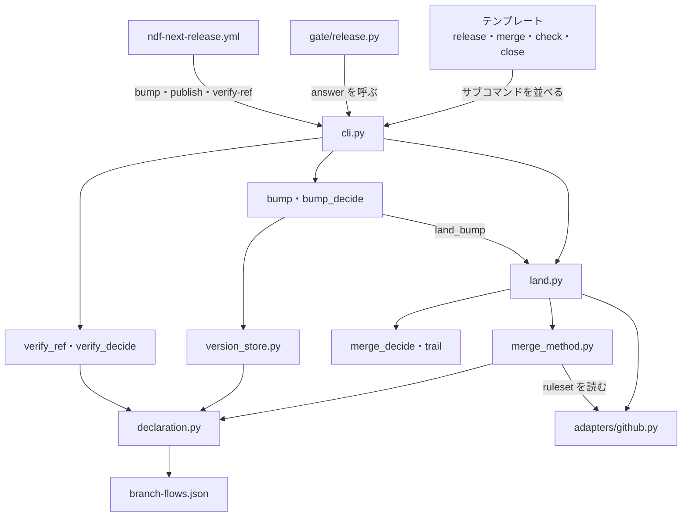
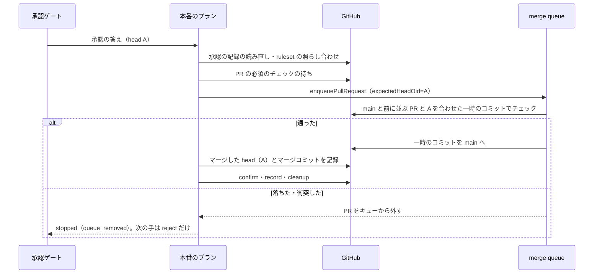
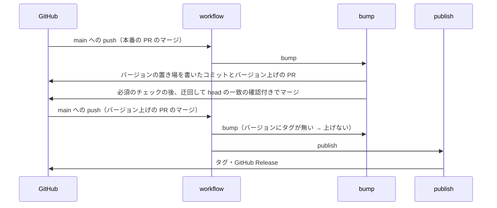
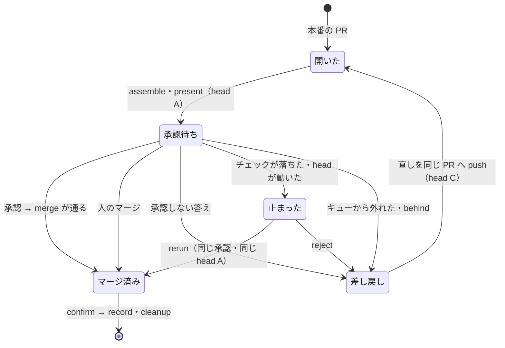

# ndf-next のリリース: リポジトリごとのブランチ戦略で承認した head だけを本番へ入れ、同時の承認は merge queue で確かめる（#3572）

## 目的

- **今どうなっているか**: ndf-next の本番のプラン（テンプレート `release.json`）は承認ゲートの後に worker 1 つへリリースを任せ、worker は CI が落ちるとコードを直して本番の PR へ push できる（今の NDF でリリース 8・14 に同じ形が 2 回起きた）。ほぼ同時に承認された 2 つの PR は、main の必須のチェックが最新の取り込みを求めない（`strict` が偽）ため、組み合わせを CI に通さずに本番へ入る
- **誰に効くか**: ndf-next を使うすべてのリポジトリ（Web サービス・アプリ・プラグイン）の、本番のリリースを承認する利用者と、リリースを流すオーガナイザー・一時レーン
- **変えると何が成り立つか**: 承認の後にコードを直すステップが無くなり、承認した head だけが本番へ入る。利用者の GitHub でのマージも承認として扱われる。ブランチ戦略・マージの方式・検証環境・バージョンの置き場はリポジトリごとに設定ファイルで選び、develop と main を分けるリポジトリは今の行のまま動く。GitHub flow を選んだリポジトリでは、同時に承認された PR の組み合わせを merge queue（使えなければ最新の取り込みの必須）で確かめてから main へ入れる

## 適用範囲

- **働く範囲**: ndf-next（`plugins/ndf-next/`）を使う利用者のリポジトリ。リリースのサブコマンド（NDF の内部の呼び名は「副命令」）`ndf release-steps` と本番のプランのテンプレート、ndf-next のリリースの workflow（`.github/workflows/ndf-next-release.yml`）が働く。今の NDF（`plugins/ndf/`）と今の CD（`.github/workflows/release-cd.yml`）は 11.0.0 の入れ替えまで変えない
- **リポジトリごとに違うもの（設定ファイルで受ける）**: ブランチ戦略は `.ndf/worktree.json` の `branch_flow`、マージの方式は `.ndf/project.json` の `production_merge.method`、検証環境は `.ndf/project.json` の `delivery` の検証の行、バージョンの置き場は `.ndf/release.json` の `version_store` で受ける（形は「設定ファイルの形」）。必須のチェックの待ちの秒は引数 `ci_budget` で受ける
- **ai-plugins だけの事情（設定ファイルの値へ移すもの）**: `github-flow` の行・`merge-queue`・検証用マーケットプレイス `ai-plugins-next` と検証用ブランチ `verify/next`・バージョンの置き場 `plugin`・タグ `ndf--v<バージョン>`。どれも ai-plugins の設定ファイルの値で、ndf-next のコードに決め打たない
- **当たるモード**: リリース承認ゲートを通る本番のリリース（デプロイの工程）と、その前後のスプリントの PR・検証環境の更新・CD のバージョン上げ

**代表のリポジトリでの振る舞い。** どの行も、承認の後に fix の worker を流さず、承認した head との一致の確認付きで本番の PR をマージする（決定 1・2）。

| リポジトリ | 設定ファイルの値 | 何が起きるか |
| --- | --- | --- |
| ai-plugins（11.0.0 の入れ替えの後） | `github-flow`・`merge-queue`・検証用マーケットプレイス・`plugin` | スプリントを main から切り、PR を main へ出す。承認の後にキューへ入れ、GitHub が main と前に並ぶ PR を合わせて確かめてからマージする。CD がバージョン上げの PR で `plugin.json` を上げ、タグを作る。マージの前の PR は `ai-plugins-next` から試せる |
| ai-plugins（入れ替えまで） | `promote-whole`・`base_branch: develop`・マージの方式なし | 今の NDF が develop と main で動く。ndf-next のリリースの workflow は変数 `NDF_RELEASE_RUNNER` が ndf-next でないため動かない |
| GitHub flow の Web サービス（private で Enterprise Cloud でない） | `github-flow`・`strict`・`deploy`（staging）・`json`（`package.json`） | merge queue が使えないため `strict` を選ぶ。先に A がマージされると B はマージの前に止まり、main を取り込んだ新しい head で承認を取り直す。staging へは設定ファイルのコマンドで配る。CD が `package.json` のバージョンを上げる |
| develop を持つ Web・アプリ | `promote-whole` か `promote-selected`・`base_branch: develop`・マージの方式は任意 | 今の行のまま動く。スプリントは develop（`promote-selected` は main）から切り、リリースブランチの PR が本番の PR になる。組み合わせは develop（かリリースブランチ）で既に CI を通っており、本番の PR は 1 度に 1 つのため、マージの方式を書かなくても止まらない。書けば ruleset と照らして使う。同期の PR は今のまま作る |
| 設定ファイルの無いリポジトリ | どれも無い | ブランチ戦略は既定の行 `promote-whole`（本番ブランチはリポジトリの既定ブランチ）で、今と同じに動く。マージの方式は無く、今のマージ（head の一致の確認付き）を打つ。検証環境は使わない。CD のバージョン上げは `github-flow` の行でだけ動くため流れない |

リリースの承認資料・タグ・CHANGELOG を、プラグインの登録（`.claude-plugin/marketplace.json`）を持たないリポジトリで組めるようにするのは #3615 の範囲である（決定 22 の境の表）。develop を持つ Web のリポジトリの今の行の経路はこの課題で後退させないが、#3615 が直るまでは承認資料の組み立てで止まる（今と同じ）。

## あるべき姿の根拠

| 根拠 | 種類 | 何を示すか |
| --- | --- | --- |
| STD1・STD10 | 外部の一次情報 | マージの API とキューへ入れる API は、どちらも承認した head（`sha`・`expectedHeadOid`）を受け、違えば GitHub が断る |
| STD7・STD8・STD9 | 外部の一次情報 | merge queue は main の先端と前に並ぶ PR を合わせた一時のコミットで必須のチェックを回し、通ったものだけを順にマージする。Organization の public か Enterprise Cloud の private で使える |
| 確かめ 7（2026-11-15） | 実測 | 公開リポジトリの記録で、キューで確かめた一時のコミットがそのまま PR のマージコミットになり、`merged_by` はキューへ入れた人だった（[issue-3572-design-evidence.md](issue-3572-design-evidence.md) ） |
| 確かめ 6（2026-11-15） | 実測 | ai-plugins の main の必須のチェックは `strict` が偽で、merge queue も無い。後にマージする PR は先の PR を取り込まずに入れる |
| 確かめ 1〜3（2026-11-15） | 実測 | 同じリポジトリを違う名前と ref で登録すると両方が残り、検証用ブランチの作り直しが更新で入り、正式版の登録は変わらない |
| リリース 8（2026-11-14）・リリース 14（2026-11-15） | 実測 | 承認の後に直しの worker が承認の外のコミット（168affe0・5538d759）を積んだ |
| 利用者の指示（2026-11-16 01:1x JST、課題の本文の「設計のやり直し」） | 利用者の指示の原文 | 「取り込み方の表から `promote-whole`・`promote-selected` を外さない。GitHub flow は宣言で選ぶ行の 1 つとして足す」「同時に承認されたスプリントの組み合わせは、GitHub の merge queue で確かめてから入れる」 |
| 利用者の指示（2026-11-15、課題の本文の「承認とマージの扱い」） | 利用者の指示の原文 | 「リリース承認と github 操作による merge は等価とします」 |

要求と受け入れ条件は #3572 の本文にある（コピーは [issue-3572-requirements.md](issue-3572-requirements.md) ）。この文書は「どう作るか」だけを扱う。
#3119 の設計の差分は [issue-3119-design.md](issue-3119-design.md) の決定 21 にあり、その判断は決定 25 が持つ。

| 分けた文書 | 中身 |
| --- | --- |
| [issue-3572-design-decisions.md](issue-3572-design-decisions.md) | 決定の記録（決定 1〜25。置き換えた決定は superseded と置き換え先を添えて残す） |
| [issue-3572-design-evidence.md](issue-3572-design-evidence.md) | 実物の確かめ（確かめ 1〜7。打ったコマンドと出力） |
| [issue-3572-design-detail.md](issue-3572-design-detail.md) | 詳細設計（後のステップが、この文書に合わせて書き直す） |

## ドメインモデル

### コンテキスト

| コンテキスト | 何の語が 1 つの意味に決まるか |
| --- | --- |
| リリース（ndf-next の `domains/release`） | 本番の PR・承認した head・head の一致の確認・承認の経路・マージの方式・キューへの投入・バージョン上げの PR・上げ幅のラベル・検証環境・検証用ブランチ・バージョンの置き場 |
| 工程の承認ゲート（`progress/gate`） | 承認ゲートの問い・答え・見た対象（PR の head） |
| プランのテンプレート（`contracts/templates`） | プランのステップの並び |
| ブランチ戦略の設定ファイル（`contracts/domains/branch-flows.json`） | 取り込み方の表の行（スプリントの起点・宛先・リリースの単位） |
| スプリントの経路（`domains/worktree`） | スプリントブランチ・スプリントの起点・スプリントの PR の宛先・マージの後の片付け |
| GitHub（外部の系） | PR・ruleset・merge queue・キューの一時のコミット |

リリースが供給者、承認ゲートとプランのテンプレートとスプリントの経路が顧客である（**顧客 / 供給者**）。承認ゲートはリリースの公開する判定
（PR がマージ済みか、誰がどの head をマージしたか）を読み、本番の PR へ書くことはサブコマンド `release-steps answer` を呼んで行う。
テンプレートはサブコマンドを並べるだけで判定を持たない。取り込み方の表は**公表された言語**で、リリースとスプリントの経路が同じ行を読む。
GitHub との間は**腐敗防止層**で、ruleset と merge queue の語はアダプタ（`adapters/github.py`）とリリースの読み分け（`merge_method`）の中に閉じ、
ほかのコンテキストへ出さない。スプリントの経路は本番の PR（`github-flow` ではスプリントの PR）を作って上げ幅のラベルを書き、head へコミットを足す。
リリースは PR の head とラベルを読むだけで、スプリントブランチへ書かない。

### 集約

| 集約 | 持ち主（書き換えてよいもの） | 根 | エンティティ | 値オブジェクト |
| --- | --- | --- | --- | --- |
| スプリントブランチ | スプリントの経路。本番の PR の head を動かすのと、PR の作成と上げ幅のラベルを書くのはこの持ち主だけ | ブランチの名前 | コミット | head・上げ幅のラベル |
| 本番の PR | リリース。書き換える範囲はサブコマンドごとに分ける（下の表）。head とラベルは読むだけ | 本番の PR（番号） | 承認の記録のコメント・人のマージの記録のコメント・作ったバージョンの記録のコメント・本文の承認資料の節 | 承認した head・マージした head・マージコミット・承認の経路 |
| バージョン上げの PR | リリース（`bump`） | バージョン上げの PR（番号） | — | バージョン・上げ幅・起点のコミット |
| 検証用ブランチ | リリース（`verify-ref`） | ブランチの名前（設定ファイルの値） | — | 含めた PR と head の一覧・検証のバージョン |
| 本番のプラン | テンプレート `release.json` | プラン | ステップ | ステップの起動の引数 |

| サブコマンド | 本番の PR で書き換える範囲 | ほかの集約・外部の系で書き換える範囲 |
| --- | --- | --- |
| `assemble` | PR の本文の承認資料の節 | 今の行（`promote-*`）ではリリースブランチ（今のまま） |
| `answer` | 承認の記録のコメント（経路 `gate` と `github-merge`） | — |
| `merge`（`land`） | マージかキューへの投入と、迂回の記録・人のマージの記録のコメント | 今の行では同期の PR（今のまま） |
| `confirm` | 作ったバージョンの記録のコメント | — |
| `bump` | — | バージョン上げの PR の作成・コミット・マージ |
| `publish` | — | タグと GitHub Release |
| `verify-ref` | — | 検証用ブランチのコミット（fast-forward だけ）。種類 `deploy` では設定ファイルのコマンドの起動 |

承認資料は PR の本文に置き、head を動かさない。そのため承認資料の書き直しは承認の対象を変えない。

### 不変条件

| # | 集約 | 条件 | 破れたときの扱い |
| --- | --- | --- | --- |
| I1 | 本番のプラン | 承認の後に流れる本番のプランに、コードを変えるステップ（worker の起動）と、本番の PR の head へ push するステップが無い（どの行でも） | テンプレートの検査（`release_plan.forbidden`）が該当のステップを返し、テンプレートのテストが落ちる |
| I2 | 本番のプラン | 本番のプランの最初のステップが本番の PR のマージ（`ndf release-steps merge`）である | 同上 |
| I3 | 本番の PR | 本番ブランチへ入るのは、承認した head と一致する head を持つ PR だけである。マージとキューへの投入は承認した head を渡して打つ | head が動いていれば `refused` で止まり、動いた先の SHA を理由に出す。GitHub も断る（STD1・STD10） |
| I4 | 本番の PR | 承認の後に必須のチェック（キューの一時のコミットのものを含む）が落ちたら、コードを直さず、head を変えずに止まる | `land` が落ちたチェックと次の手を結果に出して止まる |
| I5 | 本番の PR | 人のマージ（キューへの投入を含む）は、マージした head への承認として記録し、承認ゲートの承認が別の head への承認であれば両方を残す | 記録を書けなければ `stopped` にし、本番が出ていることと理由を出す |
| I6 | 本番の PR | `merge` の部品を持つテンプレート（`merge`・`check`・`close`）は、本番の PR をマージしない | `release-guard` が終了コード 3 を返し、テンプレートは `end` へ進む |
| I7 | 本番の PR | `github-flow` の行で、main 宛ての PR はバージョンの置き場のバージョンを変えない。例外はバージョン上げの PR だけ | `release-steps pr-check` が落ち、理由に「バージョンは CD がマージの時点に上げる」を出す |
| I8 | バージョン上げの PR | 1 回の main へのマージにつき、バージョンは 1 回だけ上がる | `bump` は開いたバージョン上げの PR を使い直す |
| I9 | 検証用ブランチ | 検証用ブランチは本番ブランチへ入らない | 検証用ブランチを head にした PR は、`release-guard` と `pr-check` が断る |
| I10 | 本番の PR | `github-flow` の行では、本番のマージの後に次のバージョンのブランチも同期の PR も作らない。今の行では今の振る舞いのまま | 行の値で分けた振る舞いを `land` のテストが見る |
| I11 | バージョン上げの PR | 範囲にリリース対象の変化が無ければバージョンを上げない | `bump` が `not_applicable` を返す |
| I12 | 検証用ブランチ | 検証用ブランチは fast-forward でだけ進み、強制 push を使わない | `verify-ref` は止まる |
| I13 | 本番のプラン | `merge` の部品（`check.json` では `merge-gate`）の直前に `release-guard` がある | テンプレートの検査が返す |
| I14 | 本番の PR | `github-flow` の行で、本番ブランチへ入るコミットは、その時点の本番ブランチの先端と承認した head を合わせたもので必須のチェックを通ったものである（`merge-queue` はキューの一時のコミット、`strict` は最新の取り込み済みの head） | マージの方式が無い・表に無い値・ruleset と食い違うときは、マージもキューへの投入もせずに止まる（I15）。`strict` で head が本番ブランチの先端を含まなければ止まる |
| I15 | 本番の PR | 設定ファイルのマージの方式と、本番ブランチの ruleset の実際の設定（merge queue の有無・`strict` の値）が一致する。`github-flow` の行では方式の記述が必須で、既定の方式へ倒さない | `land` が原因 `precondition`・理由に設定の値と ruleset の値を出して止まる |
| I16 | 本番の PR | キューから外れた PR は、同じ head のままキューへ入れ直さない。入れ直すのは新しい head が承認された後だけ | `land` は外れた PR の次の手に `rerun` を出さず、`reject` だけを出す |
| I17 | 本番の PR | マージの方式が `merge-queue` のとき、本番の PR を管理者の迂回でマージしない。キューを迂回するのはバージョン上げの PR だけ | `land` は `merge-queue` の本番の PR で迂回のマージを呼ばない。`land_bump` は差分がバージョンの置き場・CHANGELOG・手順の書き先に限られ、本番ブランチの先端が head の祖先のときだけ迂回する |
| I18 | バージョン上げの PR | バージョン上げの経路は、設定ファイルのバージョンの置き場が選んだアダプタだけを通る。プラグインの登録のパスを、置き場が `plugin` でないときに読まない | 置き場が無ければ `bump` は原因 `precondition`・理由に取れる値を出して止まる |

### ドメインイベント

| # | イベント | 発生元 | 受け手 |
| --- | --- | --- | --- |
| E1 | スプリントブランチを行の起点から切った | スプリントの経路 | スプリントの PR の作成（E2） |
| E2 | スプリントの PR を作り、上げ幅のラベルを付けた | スプリントの経路・`pr` のテンプレート | `pr-check`・`verify-ref` |
| E3 | 検証環境へ、マージの前の PR を集めたものを配った | `verify-ref`（本番ブランチ宛ての PR の作成・更新・閉じ） | 検証環境の利用者 |
| E4 | 承認資料を本番の PR に書き、提示した | `assemble`・`release-steps present` | 工程の承認ゲート |
| E5 | 利用者が承認ゲートで承認の答えを書いた | `release-steps answer` | 本番のプラン（最初のステップのマージ） |
| E6 | 本番の PR を承認した head との一致の確認付きでマージした、またはキューへ入れた | `land` | E6a（`merge-queue`）か CD・`confirm` |
| E6a | merge queue が一時のコミットで必須のチェックを通し、PR をマージした | GitHub | `land` の待ち・CD |
| E7 | 利用者が GitHub で本番の PR をマージした（キューへ入れたものを含む）ことを検知した | 承認ゲートの待ちの読み直しと `land`（マージ済みからの再開） | 本番のプラン |
| E8 | 差し戻した、または CI かキューで落ちた本番の PR を止めた | `release-steps answer`（差し戻し）・`land`（止まった結果） | スプリントの経路 |
| E9 | 直しを PR へ入れた新しい head で承認を取り直した | スプリントの経路の push の後の `assemble`・`present` と `answer` | 本番のプラン。古い head への承認は `stale` |
| E10 | CD がバージョン上げ・タグ・GitHub Release を作った | CD（`bump` がバージョン上げの PR をマージし、その push で `publish`） | `confirm`・リリース後テスト |
| E11 | 後片付けと終わりの記録を行った | 本番のプランの `record`・`cleanup` | — |

番号は要求のドメインイベントと同じ意味で使う。`github-flow` の行で要求の E10 は、バージョン上げの PR のマージと、その後のタグと GitHub Release の作成の
2 回に分かれる（main の ruleset が PR を通さない push を断るため。決定 7）。今の行の E10 は今のまま（リリースブランチでバージョンを上げ、マージの後にタグ）である。

### 用語

| 用語 | 意味 | 用語集への反映 |
| --- | --- | --- |
| 承認した head | 承認ゲートの承認か、人のマージ（キューへの投入を含む）が対象にした本番の PR の head コミット | 要求のステップで反映済み（旧称は用語集の廃止した語の欄にある） |
| head の一致の確認 | マージかキューへの投入の API に承認した head を渡して違えば GitHub に断らせることと、マージの前の承認の記録の読み直し | 要求のステップで反映済み（旧称は用語集の廃止した語の欄にある） |
| 承認の経路 | 本番の PR の承認がどこで与えられたか。承認ゲート（`gate`）か、人の GitHub でのマージ（`github-merge`） | 用語集の既存の行の意味のまま |
| 差し戻し | 承認ゲートで承認しない答え、または CI かキューで落ちた本番の PR を出さずに止めること。直しを同じ本番の PR へ入れた head で承認を取り直す | 用語集の既存の行の意味のまま（要求のステップで「キュー」を足した） |
| fix の worker | CI が落ちたときにコードを直して push するプランのステップ（テンプレートの `ci-fix`・`fix-push`・`fix-base` と、それに続く `push`） | 用語集の既存の行の意味のまま |
| マージの方式 | 承認した複数の PR の組み合わせを確かめてから本番ブランチへマージする方式（`merge-queue`・`strict`） | 要求のステップで追加済み |
| キューへの投入 | 承認した head を `expectedHeadOid` に渡して、本番の PR を merge queue へ入れること（`enqueuePullRequest`） | 追加 |
| バージョンの置き場 | バージョンを持つファイルと、その読み書きのアダプタ（`plugin`・`json`）。`.ndf/release.json` の `version_store` で選ぶ | 追加 |
| 版上げの PR | main へのマージの後に CD が作る、バージョン上げのコミットだけを持つ main 宛ての PR。本文では業界の語に寄せて「バージョン上げの PR」と書く | 用語集の既存の行の意味の範囲で使う |
| 本番の PR | 宛先が本番ブランチの PR。`github-flow` の行ではスプリントの PR が兼ね、今の行ではリリースブランチの PR である | 意味の変更（行ごとの意味を書き分けた） |
| リリースブランチ | `github-flow` の行ではバージョン上げの PR の head、今の行では本番チャネルへ入れる変更を集めるブランチ | 意味の変更（行ごとの意味を書き分けた） |

検証環境・検証用ブランチ・検証用マーケットプレイス・上げ幅のラベル・ブランチ戦略・取り込み方の表・merge queue は、要求のステップで用語集へ足した意味のまま使う。

## 外部の調査

| 種類 | 調べるか | 理由 |
| --- | --- | --- |
| 標準・仕様 | 調べる | マージの一致の確認・merge queue・ruleset の迂回・ブランチ戦略・マーケットプレイスの登録は GitHub と Claude Code の仕様で決まる |
| 主要な製品 | 調べる | マージの後にバージョンとタグを CI が作る形と、merge queue を使う運用には広く使われる例がある |
| ライブラリとサービス | 調べる | バージョン上げと組み合わせの確かめを既存のツールに任せられるかを比べる |

### 標準・仕様

| # | 標準・仕様 | 何を定めているか | 設計への反映 | 出典 |
| --- | --- | --- | --- | --- |
| STD1 | GitHub REST「Merge a pull request」 | 本文の `sha` は「SHA that pull request head must match to allow merge」。一致しなければ 409 | 承認した head を `expect_head` で渡す今のマージを残す（I3） | https://docs.github.com/en/rest/pulls/pulls#merge-a-pull-request （2026-11-15） |
| STD2 | GitHub REST「Get a pull request」 | 応答に `merged`・`merged_by`・`merge_commit_sha` を持つ | 人のマージの記録をこの応答から読む（I5） | https://docs.github.com/en/rest/pulls/pulls#get-a-pull-request （2026-11-15） |
| STD3 | GitHub Docs「GitHub flow」 | 既定ブランチから切ったブランチを PR でマージする | `github-flow` の行（決定 5） | https://docs.github.com/en/get-started/using-github/github-flow （2026-11-15） |
| STD4 | Claude Code「Host a marketplace」の「Run release channels」 | 名前の違う 2 つのマーケットプレイスが同じプラグインの違う ref を指す形を勧める。バージョンの変わらない ref の移動は利用者のキャッシュに残る | 検証用マーケットプレイス（決定 9・21） | https://code.claude.com/docs/en/plugins/host-marketplace.md （2026-11-15） |
| STD5 | Claude Code「Marketplace reference」 | 「Each user registers one marketplace per `name`」。git の取得元は `#ref` で ref を固定する | 検証用マーケットプレイスは `#<検証用ブランチ>` で登録する | https://code.claude.com/docs/en/plugins/marketplace-reference.md （2026-11-15） |
| STD6 | GitHub Docs「Available rules for rulesets」 | 迂回は役割・チーム・GitHub App に許せる。「Require a pull request before merging」は本番ブランチへの変更を PR に結び付ける | CD のバージョン上げを PR で入れる（決定 7） | https://docs.github.com/en/repositories/configuring-branches-and-merges-in-your-repository/managing-rulesets/available-rules-for-rulesets （2026-11-15） |
| STD7 | GitHub Docs「Managing a merge queue」 | キューは PR を本番ブランチの最新と前に並ぶ PR と合わせた `merge_group` で必須のチェックに通し、通ったものを先入れ先出しでマージする。落ちるか衝突すれば PR を外す。「Require branches to be up to date before merging」と同じ利点を、作者の取り込みなしで得る。GitHub Actions は `merge_group` で起動しなければチェックが報告されずマージが失敗する | マージの方式 `merge-queue`（決定 17・18）、workflow への `merge_group` の追加（決定 23） | https://docs.github.com/en/repositories/configuring-branches-and-merges-in-your-repository/configuring-pull-request-merges/managing-a-merge-queue （2026-11-15） |
| STD8 | GitHub Docs「Events that trigger workflows」の `merge_group` | 活動の種類は `checks_requested`。`GITHUB_SHA` は一時のコミット、`GITHUB_REF` はそのブランチ | 同上（決定 23） | https://docs.github.com/en/actions/reference/workflows-and-actions/events-that-trigger-workflows#merge_group （2026-11-15） |
| STD9 | 同じ頁の提供条件 | 「Pull request merge queues are available in any public repository owned by an organization, or in private repositories owned by organizations using GitHub Enterprise Cloud」 | 使えないリポジトリの代わりに `strict` を持つ（決定 17・19） | STD7 と同じ（2026-11-15） |
| STD10 | GitHub GraphQL の `enqueuePullRequest` | 引数 `pullRequestId`（必須）・`expectedHeadOid`・`jump`。エントリの状態は `QUEUED`・`AWAITING_CHECKS`・`MERGEABLE`・`UNMERGEABLE`・`LOCKED` | キューへの投入に承認した head を渡す（I3・決定 18） | 型の照会（確かめ 4・5、2026-11-15） |
| STD11 | GitHub Docs「Merging a pull request with a merge queue」 | 管理者は保護の迂回で直接マージできる（許されていれば）。`gh pr merge` はキューのある本番ブランチでは PR をキューへ入れる | 本番の PR は迂回せずキューへ入れ、迂回はバージョン上げの PR だけ（決定 20） | https://docs.github.com/en/pull-requests/collaborating-with-pull-requests/incorporating-changes-from-a-pull-request/merging-a-pull-request-with-a-merge-queue （2026-11-15） |

### 主要な製品

| # | 製品 | どう解いているか | 設計への反映 | 出典 |
| --- | --- | --- | --- | --- |
| PRD1 | release-please | Conventional Commits から上げ幅を決め、CHANGELOG とバージョンのファイルを更新する Release PR を保ち、そのマージでタグと GitHub Release を作る。バージョンのファイルの種類を「release type」（node・python・simple など）で選ぶ | バージョン上げを PR で入れる形と、バージョンの置き場を種類で選ぶ形に倣う（決定 7・22） | https://github.com/googleapis/release-please （2026-11-15） |
| PRD2 | semantic-release | リリースのブランチへのビルドの成功ごとに CI でバージョンを決め、タグを作る | マージの後に CI がバージョンを決める点に倣う | https://github.com/semantic-release/semantic-release （2026-11-15） |
| PRD3 | microsoft/vscode の merge queue の運用 | main に merge queue を置き、`merge_group` で必須の workflow を走らせ、キューで確かめた一時のコミットをマージコミットにする | 組み合わせの確かめを GitHub の merge queue に任せる（決定 17・18） | 確かめ 7（2026-11-15） |

### ライブラリとサービス

| # | 候補 | 何を持つか | 採否と理由 | 出典 |
| --- | --- | --- | --- | --- |
| LIB1 | release-please-action | バージョン上げの Release PR・CHANGELOG・タグ | 採らない。上げ幅を Conventional Commits から読み、このリポジトリのコミットの書式（`Add:`・`Fix:` などの日本語の題）と合わない。CHANGELOG の節の形も今の `changelog_decide` と違う | PRD1 と同じ |
| LIB2 | semantic-release | CI でのバージョンの決定とタグ | 採らない。LIB1 と同じくコミットの書式から上げ幅を読む。Node の依存が増える | PRD2 と同じ |
| LIB3 | GitHub merge queue | 組み合わせを一時のコミットで確かめ、通ったものだけを順にマージする | 採る（使えるリポジトリで）。組み合わせの確かめを自前で作らない | STD7 |
| LIB4 | bors-ng（ボットによる組み合わせの確かめ） | 承認した PR を一時のブランチで合わせて確かめ、通ればマージする | 採らない。リポジトリはアーカイブ済みで、README の Deprecation notice が「use GitHub's built-in merge queue」と案内している | https://github.com/bors-ng/bors-ng （`gh api repos/bors-ng/bors-ng` の `archived: true`、2026-11-15） |

### 確かめられなかったこと

| 対象 | 試した手段 | 結果と理由 |
| --- | --- | --- |
| semantic-release が版上げのコミットを書き戻すか | README と gitbook | どちらにも記述が無い。決定 7 は自前の `bump` で組むため、結論に影響しない |
| `enqueuePullRequest` に違う `expectedHeadOid` を渡したときの応答の形 | 型の照会（確かめ 4） | 型は分かったが、キューの無い本番ブランチでは確かめられない。実装のときに確かめる（「未確認のまま残ること」） |

調べた量: 候補 18 件・取得の試み 20 回。

## 本番の PR を流すプランと、承認の後に通るステップ（受け入れ条件 2）

ndf-next で本番の PR を扱うプランを、テンプレートと工程の定義から特定した結果である（develop の 154c4e507 と #3587 の d7d5fe0b1 の時点）。

| プラン | どこから流れるか | 承認の後に通るステップ（今） | 承認の後に通るステップ（変更後） |
| --- | --- | --- | --- |
| `release`（`contracts/templates/release.json`。`release: true`） | 工程「デプロイ」の `release-gate` の答えの後の `call ndf.plan release` | `work`（`{{worker}} release`）の 1 つ。worker がサブコマンドとコードの直しを自分の判断で打つ | `merge` → `confirm` → `record` → `cleanup`（どの行・どのマージの方式でも同じ 4 つ） |
| `merge`・`check`・`close`（`merge` の部品を持つテンプレート） | 本番の PR を `ndf route merge` などで流したとき | `ci` →（落ちたら）`repeat-check` → `ci-fix` → `ci-local` → `push` → … → `merge` | 承認の前の `ci` と直しは残る。`merge` の直前の `release-guard` が本番の PR なら `end` へ進め、デプロイの工程へ渡す。承認の後に通るステップは無い |

`merge` のステップの中の振る舞いは、マージの方式で分かれる。

| マージの方式 | `merge`（`land`）の中の順 | 止まるところ |
| --- | --- | --- |
| `merge-queue` | 承認の記録の読み直し → 設定ファイルと ruleset の照らし合わせ → PR の必須のチェックの待ち → キューへの投入（`expectedHeadOid` = 承認した head）→ マージかキューから外れるのを待つ → マージした head とマージコミットの記録 | head が動いた（`refused`）・ruleset と食い違う（`precondition`）・PR のチェックが落ちた（`test_failed`・`check_failed`）・キューから外れた（`queue_removed`）・待ちの時間切れ（`ci_pending`） |
| `strict` | 承認の記録の読み直し → 照らし合わせ → head が本番ブランチの先端を含むかの確かめ → 必須のチェックの待ち → マージ（`expect_head` = 承認した head） | 上の `queue_removed` の代わりに、head が先端を含まない（`behind`） |
| 方式なし（今の行だけ） | 今と同じ（承認の記録の読み直し → 必須のチェックの待ち → マージ → 今の行の同期の PR） | 今と同じ |

## 機能一覧

| # | 機能 | 誰が使うか |
| --- | --- | --- |
| F1 | 承認の直後に、承認した head との一致の確認付きで本番の PR をマージするか、キューへ入れる | オーガナイザー・一時レーン |
| F2 | 承認の後に必須のチェックが落ちるか、キューから外れたら、直さずに止まり、落ちたチェックと次の手を返す | オーガナイザー・利用者 |
| F3 | 利用者が GitHub で本番の PR をマージした（キューへ入れたものを含む）ら、承認として記録し、記録・後片付けへ進む | 利用者 |
| F4 | 差し戻しの後、直しを入れた同じ PR の新しい head で承認資料を作り直し、承認を取り直す | オーガナイザー・利用者 |
| F5 | `github-flow` の行で、main へのマージの後に CD が上げ幅のラベルからバージョンを決め、設定ファイルのバージョンの置き場を上げ、タグと GitHub Release を作る | CD |
| F6 | `github-flow` の行で、main 宛ての PR がバージョンを変えていれば PR の検査で落とす | 開発者 |
| F7 | 本番ブランチ宛ての開いた PR を集めて検証用ブランチを組み、設定ファイルの種類の検証環境へ配る | マージの前に試したい利用者 |
| F8 | ブランチ戦略・マージの方式・検証環境・バージョンの置き場を設定ファイルで選び、表に無い値・ruleset との食い違いで止まる | リポジトリの持ち主 |
| F9 | テンプレートが承認の後に fix の worker を持たないこと、本番の PR を `merge` の部品でマージしないことを、テンプレートのテストで落とす | ndf-next の開発者 |

## 構成要素

| 要素 | 責務 |
| --- | --- |
| テンプレート `contracts/templates/release.json`（変更） | 本番のプランを `merge` → `confirm` → `record` → `cleanup` の 4 ステップにする。worker・push・次のバージョンの用意を持たない（I1・I2） |
| テンプレート `merge.json`・`check.json`・`close.json` と部品 `parts/steps.json`（変更） | 部品 `release-guard` を `merge` の部品の直前に置く。本番の PR（宛先が本番ブランチの PR）なら終了コード 3（原因 `production_pr`）で `end` へ進める（I6・I13） |
| テンプレートの検査 `domains/release/release_plan.py`（新設） | 純粋な処理。プランの JSON を受け、I1・I2・I13 を破るステップを返す |
| マージ `domains/release/land.py`（変更） | 行とマージの方式で振る舞いを選ぶ。`merge-queue` はキューへの投入と待ち、`strict` は先端の取り込みの確かめとマージ、方式なしは今のマージ。止まったら落ちたチェックと次の手を返す（I3・I4・I16）。マージ済みの PR から再開したら人のマージの記録を書く（I5）。同期の PR は今の行でだけ作る（I10）。`merge-queue` の本番の PR で迂回を呼ばない（I17） |
| マージの方式の読み分け `domains/release/merge_method.py`（新設） | 純粋な処理。設定ファイルの `production_merge.method` と、アダプタが読んだ ruleset の事実（merge queue の有無・`strict`）を受け、方式か食い違いの理由を返す（I15） |
| GitHub のアダプタ `adapters/github.py`（変更） | `enqueue(number, expect_head)`（GraphQL `enqueuePullRequest`）・`queue_entry(number)`（`mergeQueueEntry` と `isInMergeQueue`）・`branch_rules(branch)`（`GET /repos/{o}/{r}/rules/branches/{branch}` と GraphQL `mergeQueue(branch)`）を足す。どれも読むか投入するだけで、ruleset を書かない |
| 承認の記録 `domains/release/trail.py`（変更） | 人のマージの記録をコメントで書き、読む |
| 人のマージの判定 `domains/release/merge_decide.py`（新設） | 純粋な処理。PR の応答と承認の記録から、承認の経路・承認した人・承認した head・マージした head を決める |
| 承認資料 `domains/release/assemble.py`（変更） | `github-flow` の行ではブランチを作らず、本番の PR の範囲（main の先端..PR の head）から承認資料を組んで本文の節へ書く。今の行ではリリースブランチを今のまま組む |
| CD の確かめ `domains/release/confirm.py`（新設） | `github-flow` の行で、マージコミットを含む main に、バージョン上げの PR のマージ・タグ・GitHub Release がそろうのを `ci_budget` の秒まで待つ。今の行ではタグと GitHub Release を待つ |
| バージョン上げ `domains/release/bump.py`・`bump_decide.py`（新設） | `github-flow` の行で、範囲の PR のラベルから上げ幅を決め、バージョンの置き場のアダプタでバージョンを書き、CHANGELOG と手順を流し、バージョン上げの PR を作ってマージする（I7・I8・I11・I17・I18） |
| バージョンの置き場 `domains/release/version_store.py`（新設） | アダプタの口（リリースの単位の一覧・ある ref のバージョンの読み・新しいバージョンの書き・書き換えるパスの一覧）と、2 つのアダプタ `plugin`（今の `plugins.py` を包む）と `json`（JSON のファイルの 1 つの鍵）。設定ファイルの値でアダプタを選び、無い値で止まる（I18） |
| PR の検査 `domains/release/pr_check.py`（新設） | `github-flow` の行で、バージョンの置き場のバージョンを変えていないか、上げ幅のラベルが 2 つ以上無いか、head が検証用ブランチでないかを見る（I7・I9）。PR の種類ごとのレビューの単位の行も見る（#3119 の I2） |
| 検証環境 `domains/release/verify_ref.py`・`verify_decide.py`（新設） | `verify_decide` は含める PR の並びと検証のバージョンを決める。`verify_ref` は検証用ブランチを組んで fast-forward で push し、種類が `marketplace` なら `marketplace.json` の名前とバージョンを書き換え、`deploy` なら設定ファイルのコマンドを流す（I9・I12） |
| 設定ファイルの読み分け `domains/release/declaration.py`（変更） | 取り込み方の行（`flow_of`）・マージの方式・検証の行・バージョンの置き場を読む。`require_github_flow` を外し、行ごとの振る舞いの選択に置き換える |
| 取り込み方の表 `contracts/domains/branch-flows.json`（変更） | 行 `github-flow` を足し、`promote-whole`・`promote-selected` を残す。既定の行は `promote-whole` のまま（決定 16） |
| 設定ファイルのスキーマ `contracts/schemas/declarations/{worktree,project,release}.schema.json`（変更） | `branch_flow.promotion` に `direct`・`integrate` に `release`、`production_merge.method`、`delivery` の検証の行の `verify.kind`、`.ndf/release.json` の `version_store` を足す |
| スプリントの経路 `domains/worktree/`（変更なし。テストを足す） | 起点・宛先・後片付けは今のコードが設定ファイルと表から読む |
| リリース記録 `record.py`・承認資料の節 `materials_decide.py`・タグ `tagging.py`（変更） | バージョンを `confirm` の記録から読む。本文の承認資料の節だけを差し替える。タグはバージョン上げの PR のマージのコミットで作る |
| 止まった理由の表 `contracts/causes.json`（変更） | `production_pr`・`queue_removed`・`behind` を足す |
| サブコマンド `domains/release/cli.py` と契約のスキーマ（変更） | `guard`・`bump`・`pr-check`・`verify-ref`・`confirm` を足す。結果と引数のスキーマを同じ変更で合わせる |
| 承認ゲートの待ち `progress/gate/release.py`（変更） | 待ちの読み直しで本番の PR がマージ済みなら `release-steps answer --route github-merge` を呼ぶ（E7） |
| workflow `.github/workflows/ndf-next-release.yml`（変更） | main への push で `bump` と `publish`、本番ブランチ宛ての PR の出来事で `pr-check` と `verify-ref` を打つ |
| 必須のチェックを出す workflow（変更） | `merge_group`（`checks_requested`）を引き金に足す。PR の本文や宛先を読むチェックは、キューの一時のコミットでは PR の時点の結論を引き継いで通す（決定 23） |

呼び出しの関係（リリースの領域の中核だけを描く。図に含めない要素は、テンプレートの検査 `release_plan`（テストが呼ぶ）・`assemble`・`confirm`・
`pr_check`・`record`・`materials_decide`・`tagging`・`causes.json`・設定ファイルのスキーマ・スプリントの経路・必須のチェックを出す workflow で、
どれも `cli` から呼ばれるか、ファイルとして読まれるだけである）:

スプリントの経路（`domains/worktree`）が行 `github-flow` の設定ファイルをコードの変更なしで扱える根拠（develop の 154c4e507 の時点）:

| 振る舞い | 今のコード | 行 `github-flow` での結果 |
| --- | --- | --- |
| スプリントの起点 | `domains/worktree/create.py` の `start_branch` が、`branch_flow.start` が `production` なら `production_branch` を返す | `origin/main` から切る |
| スプリントの PR の宛先 | `core/route/__init__.py` の `default_base` が `base_branch` を返す | `base_branch` が main のため、宛先は main |
| マージの後の片付け | `domains/worktree/merged_decide.py` が `promotion` で表の行を引き、`keeps_sprint` が偽なら残さない | 残さない |
| `integrate`・`doc_prs` の値 | Python は読まない（`grep -rn 'integrate\|doc_prs' plugins/ndf-next/src/ndf --include=*.py` の該当は 0 件） | スキーマに `release` を足せば通る |

## 設定ファイルの形（受け入れ条件 2f）

| 設定 | 置き場とキー | 取る値 | 既定 | 表に無い値 |
| --- | --- | --- | --- | --- |
| ブランチ戦略 | `.ndf/worktree.json` の `branch_flow.promotion`（と `start`・`integrate`・`doc_prs`） | `whole`（`promote-whole`）・`selected`（`promote-selected`）・`direct`（`github-flow`） | `branch_flow` が無ければ `promote-whole` | 止まる（今の規則） |
| マージの方式 | `.ndf/project.json` の `production_merge.method` | `merge-queue`・`strict` | `github-flow` では無し（必須）。今の行では無ければ今のマージ | 止まる。取れる値を出す |
| 検証環境 | `.ndf/project.json` の `delivery` の `channel: "verify"` の行の `verify` | `kind: "marketplace"`（`ref`・`marketplace`）・`kind: "deploy"`（`ref`・`command`・`timeout_seconds`） | 無ければ検証環境を使わない | 止まる |
| バージョンの置き場 | `.ndf/release.json` の `version_store` | `kind: "plugin"`（プラグインの登録と `plugin.json`）・`kind: "json"`（`path`・`key`・`name`） | `github-flow` では無し（CD のバージョン上げが止まる）。今の行は今の経路（#3615 の範囲） | 止まる |
| バージョン上げの手順 | `.ndf/release.json` の `steps`（`stage: "production"`）と `changelog` | 今の形（`command` の `{version}`・`writes`） | 無し | 今の規則 |

| 設定 | ai-plugins の値（11.0.0 の入れ替えの後） | develop と main を分ける Web のリポジトリの例 |
| --- | --- | --- |
| ブランチ戦略 | `{"base_branch": "main", "production_branch": "main", "branch_flow": {"promotion": "direct", "start": "production", "integrate": "release", "doc_prs": "sprint"}}` | `{"base_branch": "develop", "production_branch": "main", "branch_flow": {"promotion": "whole", "start": "base", "integrate": "check", "doc_prs": "base"}}` |
| マージの方式 | `{"production_merge": {"admin": true, "method": "merge-queue"}}` | 書かない（今のマージ）。書くなら `strict` か `merge-queue` |
| 検証環境 | `{"channel": "verify", "verify": {"kind": "marketplace", "ref": "verify/next", "marketplace": "ai-plugins-next"}}` | `{"channel": "verify", "verify": {"kind": "deploy", "ref": "verify/staging", "command": ["gh", "workflow", "run", "deploy-staging.yml", "-f", "ref={ref}"], "timeout_seconds": 900}}` |
| バージョンの置き場 | `{"version_store": {"kind": "plugin"}}` | `{"version_store": {"kind": "json", "path": "package.json", "key": "version", "name": "web"}}` と、手順 `{"name": "lock", "stage": "production", "command": ["npm", "install", "--package-lock-only"], "writes": ["package-lock.json"]}` |

`deploy` のコマンドが受ける置き換えの語は `{ref}`（検証用ブランチの名前）と `{head}`（組んだコミットの SHA）である。どのクラウドへどう配るかはコマンドが持ち、ndf-next は中身を知らない（要求の「含まない」）。
`json` のアダプタの `name` はリリースの単位の名前で、タグと CHANGELOG の見出しに使う（形は今の `<名前>--v<バージョン>`。形を設定ファイルで変えるのは #3615）。

## 処理の流れ

### スプリントから main へのマージまで（経路 (a)、`github-flow`・`merge-queue`）

ほぼ同時に A と B が承認されると、2 つのレーンがそれぞれ A と B をキューへ入れる。GitHub は B を「main + A + B」の一時のコミットで確かめ、
A のマージの後に B をマージする（STD7）。A・B の head は承認した head のまま変わらず、承認を取り直さない（受け入れ条件 22）。
A が落ちて外れると、B は「main + B」で確かめ直される（GitHub の振る舞い）。B のレーンは何もせず待つ。

### 経路 (a)、`github-flow`・`strict`

1. 承認の記録を読み直し、ruleset の `strict` が真であることを確かめる（I15）
2. PR の head が main の先端を含むかを確かめる。含まなければ原因 `behind` で止まり、次の手は `reject`（main を取り込んで head を進め、新しい head で承認を取り直す）だけを出す。取り込んだ後は古い承認が `stale` になる（受け入れ条件 23）
3. 必須のチェックを待ち、`expect_head` = 承認した head でマージする。待ちの間に main が動けば GitHub がマージを断り（strict の規則）、`land` は 2 へ戻って `behind` で止まる

### 今の行（`promote-whole`・`promote-selected`）

本番の PR はリリースブランチの PR で、組み立て（`assemble`）・マージ・同期の PR・タグは今の振る舞いのまま動く。変わるのは 2 つだけで、
承認の後のプランが 4 ステップ（fix の worker なし）になることと、マージの方式を書いたリポジトリでは `land` が方式と ruleset を照らしてから
マージすることである。

### main へのマージの後（CD、`github-flow`）

`bump` の範囲は「前のバージョン上げのコミットの起点..main の先端」で、起点はバージョン上げのコミットのメッセージの行 `起点: <SHA>` に残す。
上げ幅と CHANGELOG のバージョンの節は、この範囲にマージされた PR から決める。

| main の先端 | `bump` の動き |
| --- | --- |
| 先端のバージョンにタグが無い（バージョン上げの PR のマージ） | 上げず、`publish` へ進む |
| タグがあり、範囲にリリース対象の変化がある | 開いたバージョン上げの PR があれば下の表のとおり進め、無ければ作る |
| タグがあり、範囲に変化が無い | 何もしない（`not_applicable`） |

| バージョン上げの PR が開いている間に別の PR が main へ入った | `bump` の動き |
| --- | --- |
| 決め直したバージョンが同じ | main をバージョン上げのブランチへマージするコミットと、節を組み直したコミットを足し（強制 push を使わない）、必須のチェックを待ち直す |
| 決め直したバージョンが違う | 開いた PR を理由つきで閉じてブランチを消し、新しいバージョンの PR を作る |
| マージの直前 | main の先端がバージョン上げの PR の head に含まれていなければマージしない。次の push の `bump` が進める |

**バージョン上げの PR とキュー。** バージョン上げの PR はキューを通さず、管理者の迂回でマージする（決定 20）。迂回するのは、差分がバージョンの
置き場・CHANGELOG・手順の書き先に限られ、main の先端が head の祖先であるときだけである。祖先であることで、マージした後の main は
バージョン上げの PR の CI が確かめたコミットと同じ木になる。

**リリースとバージョンの間の時間。** main へのマージで本番の中身は新しいコードになり、バージョンはバージョン上げの PR のマージで変わる。
この間に新しく入れた利用者は、前のバージョンの番号で新しいコードを受け取る（「人へ残す判断」の P1 の行）。

**CD が止まったとき。** バージョン上げの PR のチェックが落ちた・迂回が断られた・取り込みが衝突したときは、`bump` はタグを作らずに止まり、
workflow の結果とバージョン上げの PR のコメントに理由を書く。`confirm` は `ci_budget` まで待って `stopped` になり、「本番はマージ済み」と
理由を出す。次の手は `rerun` の 1 つで、足りないものが `bump` なら手動の起動 `step=bump`、タグか GitHub Release なら `step=publish`
（入力 `revision` に `outputs.bump_revision`）を打ち直した後に `confirm` を打ち直す。

### 人が GitHub でマージした（経路 (b)）

| 順 | 起きること | 担うもの |
| --- | --- | --- |
| 1 | 利用者が GitHub で本番の PR を head A でマージする（キューへ入れたものを含む） | 利用者 |
| 2 | 承認ゲートが待ちの読み直しで `merged`・`merged_by`・head を読み、`release-steps answer --route github-merge` を呼ぶ | 工程の承認ゲート |
| 3 | 本番のプランの `merge` が PR をマージ済みと読み、人のマージの記録を書く | `land`・`merge_decide`・`trail` |
| 4 | `confirm`・`record`・`cleanup` が続く | 本番のプラン・CD |

利用者がキューへ入れた PR が外れたときは、承認ゲートはマージ済みを読まず、待ちを続ける（キューへの投入は、マージされるまで承認として扱わない）。
承認ゲートで A を承認した後に B が積まれ、人が B をマージした場合は、`land` が経路 `github-merge`・承認した head B・承認ゲートの head A を両方記録する。

### 差し戻しと取り直し

直しは同じ本番の PR へ入れ、新しいブランチを作らない。A への承認は承認の記録の判定で `stale` になる。

### 検証環境の更新

1. 設定ファイルの検証の行を読む。行が無ければ `not_applicable` で終わる。種類が表に無ければ止まる
2. 本番ブランチ宛ての開いた PR のうち、下書きでなく、head が検証用ブランチでもバージョン上げの PR でもフォークでもないものを番号の順に並べる
3. 本番ブランチの先端から作業用のブランチを作り、PR の head を順にマージする。衝突すればそこで止め、衝突した PR を結果に出し、検証用ブランチを動かさない
4. 種類が `marketplace` なら、`.claude-plugin/marketplace.json` の `name` を検証用マーケットプレイスの名前へ、リリース対象のバージョンを `<main のバージョン>-next.<組んだ時刻 UTC の YYYYMMDDHHMMSS>` へ書き換えたコミットを足す。`deploy` なら書き換えない
5. 前の検証用ブランチの head を親に足したコミットを fast-forward で push する
6. 種類が `deploy` なら、`{ref}`・`{head}` を置き換えたコマンドを `timeout_seconds` まで流す。失敗すれば理由を結果に出す（検証用ブランチは 5 のまま残す）

## 入出力の契約

`ndf release-steps` の結果 JSON（`contracts/schemas/io/release-steps.result.schema.json`）と引数。互換は持たない（ndf-next は未リリース）。

| サブコマンド | 足す・変えるもの | 形 |
| --- | --- | --- |
| `merge` | `outputs.version`・`outputs.approval`・`outputs.method` | 予定のバージョン、`{"route": "gate" \| "github-merge", "by": <ログイン>, "approved_head": <SHA>, "merged_head": <SHA>, "merge_sha": <SHA>, "gate_head": <SHA か null>}`、`merge-queue`・`strict`・`null` |
| `merge`（止まったとき） | `items`・`routes`・`outputs.suggested` | 落ちたチェック `{"kind": "check", "name": <名前>, "outcome": <結論>}`。キューから外れたときは `{"kind": "queue", "name": "removed", "detail": <理由>}`、ruleset との食い違いは `{"kind": "method", "name": <設定の値>, "detail": <ruleset の値>}`。次の手は決定 3 の表 |
| `merge` | 外すもの（`github-flow` の行だけ） | `outputs.sync_pr` |
| `answer` | 引数 `--route gate \| github-merge` | `github-merge` の答えた者は `merged_by`、対象は `merged_head`。省けば `gate` |
| `confirm`（新設） | `outputs.version`・`outputs.tag`・`outputs.bump_pr`・`outputs.bump_revision`・`items`・`routes` | 作ったバージョン・タグ・バージョン上げの PR・そのマージコミット。そろわなければ `stopped` で、`items` に `{"kind": "cd", "name": <bump か publish>, "detail": <理由>}`、次の手は `rerun` の 1 つ |
| `guard`（新設） | 終了コード | 本番の PR なら 3（原因 `production_pr`）、head が検証用ブランチなら 1（原因 `refused`）、ほかは 0 |
| `bump`（新設） | `outputs.version`・`outputs.level`・`outputs.pr`・`outputs.state`・`outputs.store` | 上げたバージョン、上げ幅、バージョン上げの PR、`merged`・`reused`・`published`・`not_applicable` のどれか、バージョンの置き場の種類 |
| `pr-check`（新設） | 終了コード・`items` | 0 か 1。`items` に `{"kind": "version" \| "level" \| "verify-ref" \| "reviews", "name": <パスかラベル>, "detail": <理由>}` |
| `verify-ref`（新設） | `outputs.ref`・`outputs.head`・`outputs.version`・`outputs.included`・`outputs.kind`・`items` | 組んだブランチと head、検証のバージョン（`deploy` では `null`）、含めた PR と head、種類、衝突は `{"kind": "conflict", "name": "#<番号>"}`、コマンドの失敗は `{"kind": "deploy", "name": <終了コード>, "detail": <理由>}` |
| `assemble`・`materials` | 変えるもの | `github-flow` の行ではブランチを作らず、`--pr` の本文の承認資料の節を書く。今の行では今のまま（`--channel`・`--source` を残す） |

上げ幅のラベルは `release:major`・`release:minor`・`release:patch` である。どれも無ければ PATCH とし、1 つの PR に 2 つ以上あれば
`pr-check` が落とす。範囲に複数の PR が入っていれば、最も大きい上げ幅を採る（決定 7）。

人のマージの記録は、本番の PR のコメントに置く（マーカー `<!-- ndf:merge-approval -->`）。行は `承認の経路:`・`承認した人:`・`マージした head:`・
`マージコミット:`・`承認ゲートの承認の head:`・`マージの方式:` の 6 つで、1 回だけ書く。

## 非機能の実現方式

| 大項目 | 実現方式 |
| --- | --- |
| 運用・保守性 | 止まった・マージした・キューへ入れた・キューから外れた・人のマージを検知した・バージョンを上げたことは、結果 JSON の `outputs`・`items`・`routes` と、本番の PR とバージョン上げの PR のコメントに、承認した head・マージした head・承認した人・作ったバージョンと一緒に残る |
| セキュリティ | token は今の `secrets.NDF_RELEASE_TOKEN`（キューへの投入・バージョン上げの PR・検証用ブランチの push）と `github.token`（タグと GitHub Release）だけで、新しい秘密を足さない。工程は ruleset を読むだけで書き換えない。迂回のマージはバージョン上げの PR だけに、迂回の設定（`production_merge.admin`）と差分の判定と祖先の確かめの 3 つがそろうときだけ打つ（I17） |
| セキュリティ（PR の中身と秘密） | 秘密を持つジョブで PR 側のコードを実行しない。`verify-ref` は `pull_request_target` で動き、workflow と `ndf` は本番ブランチから取り出したものだけを使う。PR の head は `git fetch` でデータとして取り込んでマージするだけで、取り込んだ木のスクリプト・依存の導入・hook を実行しない。フォークの PR は含めない。種類 `deploy` のコマンドは本番ブランチの設定ファイルにあるものだけを流し、PR の側で書き換えたコマンドは流さない。`pr-check` は秘密を使わない `pull_request` で動く。`bump`・`publish` は main への `push` で動き、main のコードだけを実行する |
| 移植性 | ブランチ戦略・マージの方式・検証環境・バージョンの置き場は設定ファイルの値だけで切り替わる。`ndf`・`verify/next`・`ai-plugins-next`・`plugin.json` はコードに決め打たない（`plugin.json` のパスは `plugin` のアダプタの中だけに置く） |

## 決定の記録

決定 1〜25 は [issue-3572-design-decisions.md](issue-3572-design-decisions.md) にある。

| # | 決定 | 状態 |
| --- | --- | --- |
| 1・2 | 本番のプランから worker を外し、承認の後に fix の worker を置かない。`merge` の部品の前に `release-guard` を置く | 有効 |
| 3 | 止まった本番の PR の次の手は `rerun` と `reject`。キューから外れた・`behind` は `reject` だけ | 有効（決定 18・19 が行を足した） |
| 4・8 | 人のマージを承認ゲートの待ちで検知し、本番の PR のコメントに記録する | 有効 |
| 5 | 取り込み方の表に行 `github-flow` を足す | 一部 superseded（既定にする・2 行を外す部分は決定 16） |
| 6 | `github-flow` の行で main へのマージをリリースにし、スプリントの PR を本番の PR にする | 有効（`github-flow` の行に限る。決定 16） |
| 7 | バージョンは CD が上げ幅のラベルから決め、バージョン上げの PR で main へ入れてからタグを作る | 一部 superseded（書き換え先の決め打ちは決定 22、キューとの関係は決定 20） |
| 9 | 検証用ブランチと検証用マーケットプレイスでマージの前に試す | 一部 superseded（種類を選ぶ形は決定 21） |
| 10 | 同期の PR を作らない | 有効（`github-flow` の行に限る。決定 16） |
| 11・12・13 | `CHANGELOG.md` を残して CD が書く・`AGENTS.md` と正本の書き直しの置き方・#3576 を閉じる | 有効 |
| 14 | #3119 の決定 21 を置き換える | superseded（決定 25） |
| 15 | #3587 を閉じずに直す | superseded（決定 24） |
| 16 | 取り込み方の表の 3 行を残し、既定は `promote-whole`、リリースのサブコマンドは行ごとに振る舞いを選ぶ | 新設 |
| 17〜20 | マージの方式を設定ファイルで選んで ruleset と照らす・`merge-queue` の投入と待ち・`strict` の止め方・バージョン上げの PR はキューを迂回する | 新設 |
| 21・22 | 検証環境の種類を選ぶ・バージョンの置き場をアダプタで受け、#3615 との境を決める | 新設 |
| 23 | ruleset へ merge queue を足すのは 11.0.0 の入れ替えと同時、`merge_group` は実装で足す | 新設 |
| 24・25 | #3587 に足す変更の一覧・#3119 の決定 21 の見直し | 新設 |

## テスト設計

| 受け入れ条件・不変条件 | どの振る舞いで縛るか | どう壊したら落ちるべきか |
| --- | --- | --- |
| 受け入れ条件 1b・1c・2・2a〜2k | この文書と決定の記録・実物の確かめ・#3119 の決定 21 を設計レビューで見る | — （設計の成果物の条件） |
| 受け入れ条件 3・I1 | テンプレートから生成した `release` のプランを `release_plan.forbidden` が空と返す。`merge.json` に `release: true` を付けた形は `ci-fix`・`push`・`fix-push` を返す | `release.json` に worker・`push` のステップを戻すと落ちる |
| 受け入れ条件 4・I4 | 必須のチェックが落ちた本番の PR で `land` が `stopped` を返し、`items` に落ちたチェック、`routes` に `rerun`・`reject` を持ち、push もマージも呼ばない | 止まった後に push かマージを呼ぶと落ちる |
| 受け入れ条件 5・I2・I3 | 生成した `release` のプランの最初のステップが `merge` で、アダプタの記録で `merge` の `expect_head`、`enqueue` の `expect_head` が承認した head である | head を渡さないと落ちる |
| 受け入れ条件 6・I3 | head が A から B へ動いた本番の PR で `land` が `refused` を返し、`merge` も `enqueue` も呼ばない | 読み直しを外すと落ちる |
| 受け入れ条件 7・8・I5 | 答え待ちの承認ゲートで PR がマージ済みなら `answer --route github-merge` を呼び、`land` が人のマージの記録を書く。B のマージでは `approved_head` が B、`gate_head` が A | マージ済みを読まないと待ち続けて落ちる。`gate_head` を B にすると落ちる |
| 受け入れ条件 9 | 差し戻しの後に head が C になると、承認資料が C で書き直され、A への承認が `stale` になり、ブランチを作らない | 資料の対象を A のまま残すと落ちる |
| 受け入れ条件 10・I8・I11 | main のバージョン X.Y.Z で MINOR の PR がマージされると、`bump` が X.(Y+1).0 のバージョン上げの PR を作ってマージし、`publish` がタグを作る。2 回打っても PR は 1 つ。変化の無い範囲では `not_applicable` | 2 回目で別の PR を作ると落ちる。置き場の外のファイルを足すと判定が断る |
| 受け入れ条件 10（競合） | バージョン上げの PR が開いたまま PATCH と MINOR の PR が続くと、古い PR を閉じて作り直す。同じ上げ幅なら main を取り込むコミットを足し、強制 push を呼ばない | 古いバージョンのままマージすると落ちる |
| 受け入れ条件 11・I7 | `github-flow` で置き場のバージョンを変えた PR に `pr-check` が 1 を返す。バージョン上げの PR は 0。今の行では 0 を返して何も見ない | バージョンの比べを外すと落ちる |
| 受け入れ条件 12・I12 | 種類 `marketplace` で P1・P2 を取り込み、`marketplace.json` の名前が設定の値になる。衝突すれば動かさない。前の検証用ブランチの子になる | 名前を書き換えないと落ちる。強制 push を呼ぶと落ちる |
| 受け入れ条件 13・I10 | `github-flow` の本番のマージの後に、次のバージョンのブランチと同期の PR の作成が呼ばれない | 同期の PR を作ると落ちる |
| 受け入れ条件 14・I9 | head が検証用ブランチの PR で `guard` が 1、`pr-check` が 1 | 判定を外すと落ちる |
| 受け入れ条件 15 | `github-flow` の設定ファイルがスキーマに通り、起点が `origin/main`、宛先が main、マージの後に残さない（`domains/worktree` の今のテストの形で） | スキーマに `direct`・`release` が無いと落ちる |
| 受け入れ条件 18 | `promote-whole` の設定ファイルで、取り込み方の表に 3 行があり、既定の行が `promote-whole`、`assemble`・`land` の今の行のテスト（リリースブランチの組み立て・同期の PR）が通る。`pr-check` と `bump` は何もしない | 行を外すか既定を `github-flow` にすると落ちる。今の行で `require_github_flow` 相当の停止が出ると落ちる |
| 受け入れ条件 19 | ai-plugins の設定ファイルの値は、11.0.0 の入れ替えの PR の確認の手順で `jq -e '.branch_flow.promotion == "direct"' .ndf/worktree.json` が 0 を返すことで見る | — （ai-plugins の値で、コードのテストにしない） |
| 受け入れ条件 20 | 種類 `deploy` で、設定のコマンドが `{ref}`・`{head}` を置き換えて呼ばれ、`marketplace.json` を読まない。表に無い種類で止まり、理由に取れる値が出る | `marketplace` の書き換えが走ると落ちる |
| 受け入れ条件 21・I18 | `.claude-plugin` の無いリポジトリで置き場 `json`（`package.json`）のとき、`bump` が `package.json` だけを上げ、プラグインの登録を読まない（アダプタの差し替えで記録した読み取り）。置き場が無ければ止まる | `plugins.load` を呼ぶと落ちる |
| 受け入れ条件 22・I14 | `merge-queue` で A・B を承認すると、どちらも承認した head で `enqueue` が呼ばれ、キューのアダプタがマージを返すと両方の記録が残り、head は変わらない | `enqueue` の代わりに `merge` を呼ぶと落ちる |
| 受け入れ条件 23 | `strict` で head が先端を含まない PR に `land` が `behind` で止まり、次の手が `reject` だけで、マージを呼ばない | 先端の確かめを外すとマージが呼ばれて落ちる |
| 受け入れ条件 24・I15 | 方式が無い・表に無い値・`merge-queue` なのにキューが無い・`strict` なのに偽、の 4 つで `land` が `precondition` で止まり、マージも `enqueue` も呼ばない | 既定の方式へ倒すと落ちる |
| 受け入れ条件 25・I16 | キューから外れた PR で `land` が `queue_removed` で止まり、次の手が `reject` だけで、`enqueue` を 2 回呼ばない | 同じ head で入れ直すと落ちる |
| 受け入れ条件 26・I17 | `merge-queue` で、本番の PR は `production_merge.admin` が真でも迂回のマージを呼ばない。バージョン上げの PR は差分の判定と祖先の確かめが通るときだけ迂回する | 本番の PR で迂回を呼ぶと落ちる。置き場の外のファイルを含むバージョン上げの PR を迂回すると落ちる |
| I6・I13 | `merge`・`check`・`close` のテンプレートで、`merge` の直前が `release-guard` で、本番の PR では終了コード 3 で `end` へ進み、マージが呼ばれない | `release-guard` を外すと落ちる |
| 受け入れ条件 16 | `AGENTS.md` と `docs/versioning-and-distribution.md` を実装 PR のレビューで読み、4 つの問いに答えられるかを見る。`instructions-check.py --root .` が 0 | — （文書の条件） |
| 受け入れ条件 17 | 実装 PR の `git diff --name-only` に `plugins/ndf/` が無い | — （差分の条件） |

## 設計の結果

| 課題 | 扱い | 取り込み先 | 触るファイル |
| --- | --- | --- | --- |
| #3572 | 実装する（#3587 に足す。決定 24） | — | `plugins/ndf-next/contracts/templates/release.json`、`plugins/ndf-next/contracts/templates/merge.json`、`plugins/ndf-next/contracts/templates/check.json`、`plugins/ndf-next/contracts/templates/close.json`、`plugins/ndf-next/contracts/templates/parts/steps.json`、`plugins/ndf-next/contracts/templates/params.json`、`plugins/ndf-next/contracts/causes.json`、`plugins/ndf-next/contracts/domains/branch-flows.json`、`plugins/ndf-next/contracts/schemas/declarations/worktree.schema.json`、`plugins/ndf-next/contracts/schemas/declarations/project.schema.json`、`plugins/ndf-next/contracts/schemas/declarations/release.schema.json`、`plugins/ndf-next/contracts/schemas/io/release-steps.result.schema.json`、`plugins/ndf-next/contracts/schemas/io/release-steps.args.schema.json`、`plugins/ndf-next/docs/contracts/commands.md`、`plugins/ndf-next/src/ndf/adapters/github.py`、`plugins/ndf-next/src/ndf/domains/release/release_plan.py`、`plugins/ndf-next/src/ndf/domains/release/merge_decide.py`、`plugins/ndf-next/src/ndf/domains/release/merge_method.py`、`plugins/ndf-next/src/ndf/domains/release/version_store.py`、`plugins/ndf-next/src/ndf/domains/release/confirm.py`、`plugins/ndf-next/src/ndf/domains/release/bump.py`、`plugins/ndf-next/src/ndf/domains/release/bump_decide.py`、`plugins/ndf-next/src/ndf/domains/release/pr_check.py`、`plugins/ndf-next/src/ndf/domains/release/verify_ref.py`、`plugins/ndf-next/src/ndf/domains/release/verify_decide.py`、`plugins/ndf-next/src/ndf/domains/release/land.py`、`plugins/ndf-next/src/ndf/domains/release/trail.py`、`plugins/ndf-next/src/ndf/domains/release/assemble.py`、`plugins/ndf-next/src/ndf/domains/release/materials_decide.py`、`plugins/ndf-next/src/ndf/domains/release/declaration.py`、`plugins/ndf-next/src/ndf/domains/release/record.py`、`plugins/ndf-next/src/ndf/domains/release/tagging.py`、`plugins/ndf-next/src/ndf/domains/release/cli.py`、`plugins/ndf-next/src/ndf/progress/gate/release.py`、`plugins/ndf-next/tests/domains/release/test_release_plan.py`、`plugins/ndf-next/tests/domains/release/test_release_approval.py`、`plugins/ndf-next/tests/domains/release/test_release_assemble.py`、`plugins/ndf-next/tests/domains/release/test_release_bump.py`、`plugins/ndf-next/tests/domains/release/test_release_confirm.py`、`plugins/ndf-next/tests/domains/release/test_release_pr_check.py`、`plugins/ndf-next/tests/domains/release/test_release_verify_ref.py`、`plugins/ndf-next/tests/domains/release/test_release_merge_method.py`、`plugins/ndf-next/tests/domains/release/test_release_version_store.py`、`plugins/ndf-next/tests/domains/release/test_release_record.py`、`plugins/ndf-next/tests/domains/worktree/test_worktree_merged.py`、`plugins/ndf-next/tests/route/test_flows.py`、`.github/workflows/ndf-next-release.yml`、`.github/workflows/pytest.yml`、`.github/workflows/lint.yml`、`.github/workflows/glossary.yml`、`.github/workflows/script-structure.yml`、`.github/workflows/runtime-plugin-smoke.yml`、`.github/workflows/runtime-plugin-validate.yml`、`.github/workflows/pr-base-guard.yml`、`.github/workflows/pr-body-decisions.yml`、`.ndf/project.json`、`.ndf/release.json`、`AGENTS.md`、`docs/versioning-and-distribution.md` |
| #3576 | 閉じる | — | — |

#3576 を閉じる理由は決定 13 にある。#3119 は設計の決定 21 を見直す（決定 25）。差分は同じ設計 PR の `issues/issue-3119-design.md` にあり、
実装の差分を持たないためこの表に行を置かない。必須のチェックを出す workflow の一覧は実装のときに ruleset の 17 個の名前から引き直す
（上の表の workflow は 2026-11-15 の名前から引いた候補で、1 つの workflow が複数のチェックを出す）。`.ndf/project.json`・`.ndf/release.json`・
`.ndf/worktree.json` の ai-plugins の値の書き換えは 11.0.0 の入れ替え（#3304）の PR で行い、この課題の実装では設定ファイルのスキーマと
読み分けだけを入れる（決定 23）。#3587 で消した `prepare.py` は戻さない（次のバージョンのリリースブランチの用意は、今の行でも ndf-next の
工程が持たない）。

## 人へ残す判断

| 判断 | 当たるレッドライン | なぜ当たるか |
| --- | --- | --- |
| main の ruleset へ merge queue の規則を足し、必須のチェックの設定を合わせる（実行は 11.0.0 の入れ替えのとき。決定 23） | C2 | 本番ブランチへ誰がどの条件でマージできるかが変わる（直接のマージができなくなり、キューへの投入が要る）。ruleset は承認ゲートを通らない外部の系の設定で、実行の前に止めて人へ戻す。足す設定の案は決定 23 にある |
| ai-plugins のブランチ戦略を `github-flow` にし、バージョンを CD がマージの後に上げ、`CHANGELOG.md` を CD が書く規則にしてよいか（決定 5・7・11・16） | P1 | 既定ブランチへ何がどの経路で入るかとバージョンの規則を変え、11.0.0 の入れ替えで利用者全員に効く。main へのマージからバージョン上げの PR のマージまでの間に入れた利用者が前のバージョンの番号で新しいコードを持つことも含む |
| 検証用マーケットプレイス（`ai-plugins-next`、検証用ブランチ `verify/next`）をリリース対象の取得元として足してよいか（決定 9・21） | P1 | リリース対象の取得元を 1 つ足す。登録した利用者は消す操作が要る |
| `.ndf/project.json`・`.ndf/release.json`・`.ndf/worktree.json` の ai-plugins の値と `AGENTS.md` の「版とリリースの方針」を書き換えてよいか（決定 12・23） | C7 | 利用者の設定と指示書の運用の節の書き換えである。入れ替えの PR の中でコミットし、リリース承認ゲートで人が見る |
| バージョン上げの PR を、merge queue と承認 1 を迂回してマージしてよいか（決定 7・20） | C2 | 承認 1 とキューを求める main の規則を、人の承認なしの機械のマージで越える。迂回の設定（#3506）の範囲をバージョン上げの PR へ広げる。`NDF_RELEASE_TOKEN` の持ち主が迂回の役割を持つかは未確認で、通らなければ `bump` が止まって人へ戻る |
| `verify-ref` が `pull_request_target` の出来事で `NDF_RELEASE_TOKEN` を使い、未承認の PR の head を検証用ブランチへ取り込んで push し、種類 `deploy` では設定ファイルのコマンドを流してよいか（決定 9・21） | C1 | 秘密を持つジョブが、承認の前の PR の中身を扱う。PR 側のコードを実行しない分け方は「非機能の実現方式」の行。staging へ配ったコードが何を実行するかは、コマンドの先の配り方が持つ |
| 実物の確かめの 1 回で、利用者の登録の `lastUpdated` が書き換わったことをどう扱うか（受け入れ条件 2d） | C6 | 受け入れ条件 2d は利用者の登録を変えない場所で確かめることを求める。1 回（取得に失敗した試み）で利用者の登録の `lastUpdated` が 2026-11-15T11:53:54Z に書き換わった。取得元と ref は前後で同じだった（[issue-3572-design-evidence.md](issue-3572-design-evidence.md) ） |

## 未確認のまま残ること

| 項目 | 内容 |
| --- | --- |
| キューへの投入で head が違うときの応答・キューで落ちた PR の扱い | `expectedHeadOid` が違うときの応答の形、キューの一時のコミットで ai-plugins の必須のチェックが起動すること、落ちた PR がキューから外れてマージされないことは、ai-plugins の main にキューが無いため実物で確かめていない。11.0.0 の入れ替えで ruleset へキューを足した直後に、次の手順で確かめる: (1) 違う `expectedHeadOid` で投入して断られることと応答の形 (2) テスト用の PR を投入し、`gh run list --event merge_group` でチェックが一時のコミットで走ること (3) 必須のチェックを落とす PR を投入し、`isInMergeQueue` が偽・`merged` が偽になること。応答の形が設計と違えば、`land` の判定をその応答に合わせる |
| キューの一時のコミットの形（マージコミットか） | 公開リポジトリの記録（squash）では一時のコミットがマージコミットになった。ai-plugins は `merge` だけを許すため、親が 2 つになる見込みで、上の (2) で確かめる |
| キューへ入れた PR へ push したとき | キューに入った後に PR の head が動いたとき、GitHub が PR を外すかは、取得した頁に記述が無い。`land` はマージの後に PR の head が承認した head と一致するかを確かめ、違えば `stopped` にして記録する。上の (2) で確かめる |
| バージョン上げの PR の迂回のマージが、merge queue のある main で通ること | 迂回の役割を持つ token で、キューの規則のある main へ REST のマージが通るかは確かめていない。`NDF_RELEASE_TOKEN` の持ち主が迂回の役割を持つかも確かめていない（秘密の中身を読まず、main へマージする操作になるため）。入れ替えの後の最初のバージョン上げで分かり、断られたら `bump` が止まって人へ戻る |
| 古い保護（branch protection）だけを使うリポジトリでの `strict` の読み取り | ruleset は `rules/branches` で読めるが、古い保護の `strict` は管理の権限が要る API にある。読めなければ `land` は「ruleset を読めない」で止まる。この止まり方が利用者に通じるかは、最初に `strict` を選んだ外のリポジトリで分かる |
| PR の本文や宛先を読むチェックの `merge_group` での結論 | `pr-body-decisions-check` などはキューの一時のコミットで PR の本文を持たない。PR の時点の結論を引き継いで通す形を実装で決め、上の (2) で確かめる |
| バージョン上げの PR の CI の時間・リリースとバージョンの間の時間 | main へのマージからタグまでに CI 1 回分かかる。実測は 11.0.0 の後の最初のリリースで分かる |
| 2 つの NDF を同時に有効にしたとき | `ndf@ai-plugins` と `ndf@ai-plugins-next` を同時に有効にしたときの Skill・hook の重なりは確かめていない。手順は片方を `claude plugin disable` で止める形にする |
| Codex での検証用マーケットプレイス | 確かめは Claude Code だけで行った。Codex の登録の形は実装のステップで確かめる |
| 人のマージの検知の遅れ | 承認ゲートの待ちの読み直しの間隔だけ、人のマージから記録までが遅れる。実測は最初に人が GitHub でマージしたリリースで分かる |

## 出し直しの指摘への対応

| 項目 | 指摘 | 対応 | 直した箇所・直せない理由 |
| --- | --- | --- | --- |
| p6-redesign:1-1 | 取り込み方の表の 2 行を外さず、`github-flow` は選ぶ行の 1 つ。ai-plugins が選ぶ。#3119 の決定 21 を見直す。develop と main を分けるリポジトリが今の行で動く | 直した | 決定 16（3 行を残し既定は `promote-whole`、行ごとに振る舞いを選ぶ）、決定 5・14 を superseded、決定 25 と `issue-3119-design.md` の決定 21、「適用範囲」の代表のリポジトリの表、受け入れ条件 18 のテスト設計 |
| p6-redesign:1-2 | 検証環境を設定ファイルで選ぶ。バージョン上げの対象を設定ファイルで受け、プラグイン固有の決め打ちを残さない | 直した | 決定 21（`marketplace`・`deploy`）、決定 22（`version_store` のアダプタ・`write_bump` の決め打ちの箇所・#3615 との境）、「設定ファイルの形」、I18 |
| p6-redesign:1-3 | 同時に承認された PR の組み合わせを merge queue で確かめてから入れる。承認は各 PR の head に付いたまま | 直した | 決定 17・18、「処理の流れ」の `merge-queue` の図と同時の承認の段落、I14、受け入れ条件 22 のテスト設計 |
| p6-redesign:1-4 | merge queue を使うかを設定ファイルで選び、`strict` を別の値として持ち、どちらでもない設定を許さない | 直した | 決定 17・19、I15、「設定ファイルの形」のマージの方式の行、受け入れ条件 23・24 のテスト設計 |
| p6-redesign:1-5 | `enqueuePullRequest` とキューの一時のコミットの CI を実物で確かめる。キューで落ちた PR の扱い | 直した | [issue-3572-design-evidence.md](issue-3572-design-evidence.md) の確かめ 4〜7、決定 18（外れた PR は `reject` だけ）、I16。ruleset の書き換えが要る確かめは「未確認のまま残ること」に手順と一緒に置いた |
| p6-redesign:1-6 | バージョン上げの PR と merge queue の関係 | 直した | 決定 20（キューを迂回し、本番の PR は迂回しない）、I17、受け入れ条件 26 のテスト設計 |
| p6-redesign:1-7 | ruleset へ merge queue を足す操作を「人へ残す判断」に載せ、実行は実装のとき | 直した | 「人へ残す判断」の C2 の 1 行目、決定 23（足す時点と設定の案） |
| p6-redesign:1-8 | 置き換える決定を superseded として残し、新しい決定を書く | 直した | 決定の記録の決定 5・7・9・14・15 の冒頭の状態の行と置き換え先、決定 16〜25 |
| p6-redesign:1-9 | 承認資料と依頼の問いを業界の語で書く | 直した | この文書の全体と決定の記録を業界の語（head・バージョン・サブコマンド・設定ファイル・テンプレート・マーカー）で書き直した。NDF の内部の呼び名は初出で括弧に添えた |
| p6-redesign:1-10 | #3587 は止めたまま、どう直すかを設計で決める | 直した | 決定 24（閉じずに直す。d7d5fe0b1 に足す変更の一覧） |
| p6-ghflow:1-1〜1-11 | 前の差し戻し（GitHub flow の 5 項目・決定 1・2・承認とマージの等価・#3576・#3119・#3587・検証用マーケットプレイスの確かめ・`CHANGELOG.md`） | 直した | 5 項目は決定 5〜7・9・10 を `github-flow` の行の決定として残した。決定 1〜4・8・11〜13 は有効のまま。#3119・#3587 は決定 25・24 へ置き換えた。確かめ 1〜3 は [issue-3572-design-evidence.md](issue-3572-design-evidence.md) へ移した |
