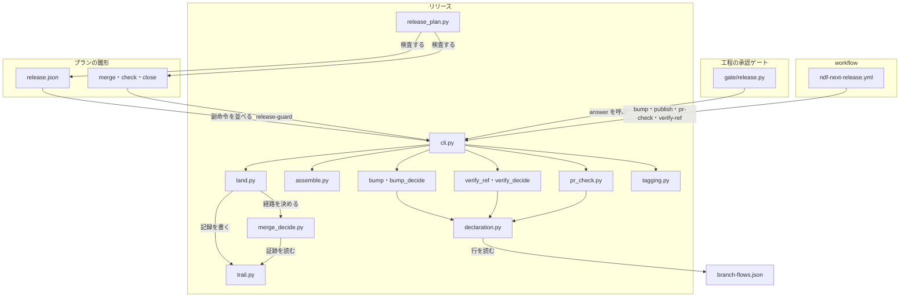
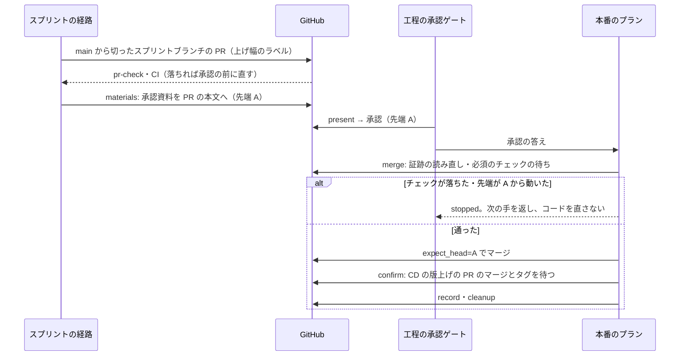
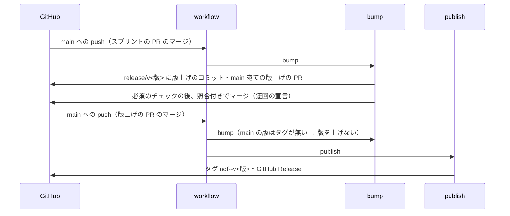
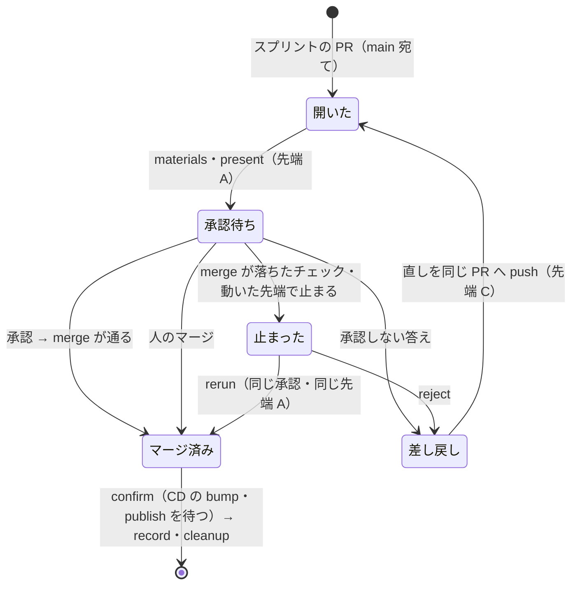

# ndf-next のリリース: GitHub flow を土台にし、承認した先端だけを main へ入れ、承認の後にコードを直すステップを持たない（#3572）

## 目的

- **今どうなっているか**: ndf-next の本番のプラン（雛形 `release.json`）は、承認ゲートの後に worker 1 つへリリースの作業を任せる。worker は CI が落ちるとコードを直して本番の PR へ push でき、承認の外のコミットが積まれる（今の NDF でリリース 8・14 に同じ形が 2 回起きた）。ブランチの運用は develop と main の 2 本で、リリースのたびに版上げのコミットを積んだリリースブランチを組み、main へのマージの後に develop へ戻す同期の PR を作る
- **誰に効くか**: 本番のリリースを承認する利用者と、リリースを流すオーガナイザー・一時レーン。11.0.0 の入れ替えの後に ndf-next を使うすべての利用者
- **変えると何が成り立つか**: ブランチの運用が GitHub flow になる。スプリントブランチを main から切り、スプリントの PR（本番の PR を兼ねる）を承認した先端との照合付きで main へマージし、それがリリースになる。版数とタグは CD がマージの後に作り、PR は版数を触らない。承認の後にコードを直すステップは無く、CI が落ちれば直さずに止まって承認を取り直す。利用者が GitHub でマージしても承認として扱われる。マージの前の変更は、名前の違う 2 つ目のマーケットプレイスで試せる

## 適用範囲

- **働く範囲**: ndf-next（`plugins/ndf-next/`）と、ndf-next のリリースの workflow（`.github/workflows/ndf-next-release.yml`）。今の NDF（`plugins/ndf/`）と今の CD（`.github/workflows/release-cd.yml`）は 11.0.0 の入れ替えまで変えない
- **プロジェクトごとに違うもの**: 本番ブランチの名前は宣言（`.ndf/worktree.json` の `production_branch`）から読む。ブランチの運用は宣言の `branch_flow` の値（決定 5 の行）で受ける。検証の ref の名前と 2 つ目のマーケットプレイスの名前は `.ndf/project.json` の `delivery` の検証の行で受ける（決定 9）。必須のチェックの待ちの秒は引数 `ci_budget` で受ける
- **当たるモード**: リリース承認ゲートを通る本番のリリース（デプロイの工程）と、その前後のスプリントの PR・検証の ref の組み立て・CD の版上げ

## あるべき姿の根拠

| 根拠 | 種類 | 何を示すか |
| --- | --- | --- |
| STD1 | 外部の一次情報 | GitHub はマージの API に渡した先端と PR の先端が違えば 409 で断る。承認した先端の外が入らないことを、ロックなしで GitHub の側が守る |
| STD3・STD4 | 外部の一次情報 | GitHub flow は既定ブランチから切ったブランチを PR でマージする。Claude Code は、リリースチャネルを名前の違う 2 つのマーケットプレイスが違う ref を指す形で作るよう勧める |
| 実物の確かめ（2026-11-15） | 実測 | 同じリポジトリを違う名前と違う ref で登録すると両方が残り、検証の ref の作り直しは更新で入り、正式版の登録は変わらない（「実物の確かめ」） |
| main の ruleset（2026-11-15 の API の応答） | 実測 | 迂回できるのは管理者の役割だけで、迂回の形は `pull_request`（PR を通すときだけ）。CD が main へ直接 push する経路は無い（決定 7） |
| リリース 8（2026-11-14）・リリース 14（2026-11-15） | 実測 | 承認の後に直しの worker が承認の外のコミット（168affe0・5538d759）を積み、承認を取り直すか外して出した |
| 利用者の指示（2026-11-15 21:0x JST、課題の本文の「方針の転換」） | 利用者の指示の原文 | 「git flow ではなく github flow を考え方のベースにしたい」 |
| 利用者の指示（2026-11-15、課題の本文の「承認とマージの扱い」） | 利用者の指示の原文 | 「リリース承認と github 操作による merge は等価とします。つまりどちらもリリース承認かつ、マージ承認とみなします」 |

要求と受け入れ条件は #3572 の本文にある（コピーは [issue-3572-requirements.md](issue-3572-requirements.md) ）。この文書は「どう作るか」だけを扱う。
#3119 の設計の差分は [issue-3119-design.md](issue-3119-design.md) の決定 21 と [issue-3119-design-detail.md](issue-3119-design-detail.md) の宣言の値に置く。その判断は決定 14 が持つ。

| 分けた文書 | 中身 |
| --- | --- |
| [issue-3572-design-decisions.md](issue-3572-design-decisions.md) | 決定の記録（決定 1〜15） |
| [issue-3572-design-detail.md](issue-3572-design-detail.md) | 詳細設計（後のステップが、この文書に合わせて書く） |

## ドメインモデル

### コンテキスト

| コンテキスト | 何の語が 1 つの意味に決まるか |
| --- | --- |
| リリース（ndf-next の `domains/release`） | 本番の PR・承認した先端・先端の照合・承認の経路・人のマージの記録・版上げの PR・上げ幅の宣言・検証の ref |
| 工程の承認ゲート（ndf-next の `progress/gate`） | 承認ゲートの問い・答え・見た対象（PR の先端） |
| プランの雛形（ndf-next の `contracts/templates`） | プランのステップの並び |
| ブランチの運用の宣言（ndf-next の `contracts/domains/branch-flows.json`） | 取り込み方の行（スプリントの起点・宛先・リリースの単位） |
| スプリントの経路（ndf-next の `domains/worktree`） | スプリントブランチ・スプリントの起点・スプリントの PR の宛先・マージの後の片付け |

関係は**顧客 / 供給者**とする。リリースが供給者で、承認ゲートとプランの雛形が顧客である。承認ゲートはリリースの公開する判定
（PR がマージ済みか、誰がどの先端をマージしたか）を読み、本番の PR へ書くことは副命令 `release-steps answer` を呼んで行う。
雛形はリリースの副命令（`ndf release-steps`）を並べるだけで、判定を持たない。ブランチの運用の宣言は**公表された言語**で、
リリースとスプリントの経路（`domains/worktree`）の両方が同じ行を読む。

### 集約

| 集約 | 持ち主（書き換えてよいもの） | 根 | エンティティ | 値オブジェクト |
| --- | --- | --- | --- | --- |
| スプリントブランチ | スプリントの経路（`domains/worktree` とスプリントのプラン）。本番の PR の head を動かす（コードのコミットを足す）のはこの持ち主だけ | ブランチの名前（本番の PR の head） | コミット | 先端（本番の PR の先端） |
| 本番の PR | リリースの領域。書き換える範囲は副命令ごとに分ける（下の表）。head は読むだけで動かさない | 本番の PR（番号。スプリントの PR が兼ねる） | 承認の証跡のコメント・人のマージの記録のコメント・作った版の記録のコメント・本文の承認資料の節 | 承認した先端・マージした先端・承認の経路・上げ幅の宣言（ラベル） |
| 版上げの PR | リリースの領域（`bump`） | 版上げの PR（番号） | — | 版・上げ幅・起点のコミット |
| 検証の ref | リリースの領域（`verify-ref`） | ref の名前（宣言の値） | — | 含めた PR と先端の一覧・検証の版 |
| 本番のプラン | プランの雛形 `release.json` | プラン | ステップ | ステップの起動の引数 |

| 副命令 | 本番の PR で書き換える範囲 | ほかの集約で書き換える範囲 |
| --- | --- | --- |
| `materials` | PR の本文の承認資料の節 | — |
| `answer` | 承認の証跡のコメント（経路 `gate` と `github-merge`） | — |
| `merge`（`land`） | マージと、迂回の記録・人のマージの記録のコメント | — |
| `confirm` | 作った版の記録のコメント | — （版上げの PR とタグは読むだけ） |
| `bump` | — | 版上げの PR の作成・版上げのコミット・マージ |
| `publish` | — | タグと GitHub Release（版上げの PR のマージの後） |
| `verify-ref` | — | 検証の ref のコミット（fast-forward だけ） |

スプリントの PR へコードのコミットを足すのはスプリントブランチの持ち主（スプリントの経路）で、本番の PR の持ち主（リリースの領域）ではない。
I3 が守るのは、スプリントブランチの先端が承認した先端から動いたときに main へ入れないことである。先端を動かす書き手はスプリントの経路
（と、GitHub で直接 push する人）で、リリースの領域はマージの直前に先端を読み直して照らすだけである。

承認資料の書き込み（`materials`）はリリースの領域の副命令で、本文の承認資料の節だけを書く。経路 (a) の流れでスプリントの経路が
`materials` を打つのは、副命令を呼ぶ順をスプリントのプランが持つためで、書き換えの持ち主はリリースの領域のままである。
承認資料は PR の本文に置き、先端を動かさない。そのため承認資料の書き直しは本番の PR の先端と承認の対象を変えない。

### 不変条件

| # | 集約 | 条件 | 破れたときの扱い |
| --- | --- | --- | --- |
| I1 | 本番のプラン | 承認の後に流れる本番のプランに、コードを変えるステップ（worker の起動）と、本番の PR の head へ push するステップが無い | 雛形の検査（`release_plan.forbidden`）が該当のステップを返し、雛形のテストが落ちる |
| I2 | 本番のプラン | 本番のプランの最初のステップが本番の PR のマージ（`ndf release-steps merge`）である | 同上 |
| I3 | 本番の PR | main へ入るのは、承認した先端と一致する先端だけである。マージは承認した先端との照合（`expect_head`）付きで打つ | 先端が動いていれば `refused` で止まり、動いた先の SHA を理由に出す。GitHub も 409 で断る |
| I4 | 本番の PR | 承認の後に必須のチェックが落ちたら、コードを直さず、先端を変えずに止まる | `land` が落ちたチェックの名前と次の手を結果に出して止まる |
| I5 | 本番の PR | 人のマージは、マージした先端への承認として記録し、承認ゲートの承認が別の先端への承認であれば両方を記録に残す | 記録を書けなければ結果を `stopped` にし、本番が出ていることと書けなかった理由を出す |
| I6 | 本番の PR | `merge` の部品を持つ雛形（`merge`・`check`・`close`）は、本番の PR をマージしない | `release-guard` が本番の PR で終了コード 3 を返し、雛形は `end` へ進む |
| I7 | 本番の PR | main 宛ての PR は版数（`plugin.json` の `version`）を変えない。例外は版上げの PR だけで、その差分は版数の文字列と CHANGELOG の版の節に限る | PR の検査（`release-steps pr-check`）が落ち、理由に「版数は CD がマージの時点に上げる」を出す |
| I8 | 版上げの PR | 1 回の main へのマージにつき、版は 1 回だけ上がる | `bump` は、同じ版の版上げの PR が開いていれば作らずに使い直し、main の版がタグ済みでなければタグを作る側（`publish`）へ回す |
| I9 | 検証の ref | 検証の ref は main へ入らない | 検証の ref を head にした main 宛ての PR は、`release-guard` と `pr-check` が理由「検証の ref は main へ戻さない」で断る |
| I10 | 本番の PR | 本番のマージの後に、次の版のブランチも同期の PR も作らない | 本番のプランに該当のステップが無いことを雛形の検査が見る |
| I11 | 版上げの PR | 前の版上げのコミットの起点から main の先端までにリリース対象の変化が無ければ版を上げない | `bump` が `not_applicable` を返し、版上げの PR を作らない |
| I12 | 検証の ref | 検証の ref は fast-forward でだけ進み、強制 push を使わない | `verify-ref` は前の検証の ref の先端を親に持たないコミットを push せず、止まる |
| I13 | 本番のプラン | `merge` の部品（`check.json` では `merge-gate`）の直前に `release-guard` がある | 雛形の検査が、`merge` の部品の直前に `release-guard` が無い雛形を返す |

### ドメインイベント

| # | イベント | 発生元 | 受け手 |
| --- | --- | --- | --- |
| E1 | スプリントブランチを main から切った | スプリントの経路（宣言の `start: production`） | スプリントの経路の PR の作成（E2） |
| E2 | スプリントの PR（main 宛て）を作り、上げ幅を宣言した | スプリントの経路・`pr` の雛形 | `pr-check`・`verify-ref` |
| E3 | 検証の ref を組み直した | `verify-ref`（main 宛ての PR の作成・更新・閉じ） | 2 つ目のマーケットプレイスの利用者 |
| E4 | 承認資料を本番の PR に書き、提示した | `materials`・`release-steps present` | 工程の承認ゲート |
| E5 | 利用者が承認ゲートで承認の答えを書いた | `release-steps answer` | 本番のプラン（最初のステップのマージ） |
| E6 | 本番の PR を承認した先端との照合付きでマージした | `land` | CD の `bump`（main への push）・本番のプランの `confirm` |
| E7 | 利用者が GitHub で本番の PR をマージしたことを検知した | 承認ゲートの待ちの読み直しと `land`（マージ済みからの再開） | 本番のプラン（承認ゲートを問い直さずに進む） |
| E8 | 差し戻した、または必須のチェックの落ちた本番の PR を止めた | `release-steps answer`（差し戻し）・`land`（止まった結果） | スプリントの経路（直しを同じ PR へ入れる） |
| E9 | 直しを PR へ入れた新しい先端で承認を取り直した | スプリントの経路の push の後の `materials`・`present` と `release-steps answer` | 本番のプラン（新しい先端でのマージ）。古い先端への承認は `stale` |
| E10 | CD が版上げのコミット・タグ・GitHub Release を作った | CD（`bump` が版上げの PR を作ってマージし、その push で `publish` がタグと GitHub Release を作る） | 本番のプランの `confirm`・リリース後テスト |
| E11 | 後片付けと終わりの記録を行った | 本番のプランの `record`・`cleanup`（`confirm` の後） | — （プランの終わり） |

番号は要求のドメインイベントと同じ意味で使う。要求の E10 は、設計では版上げの PR のマージと、その後のタグと GitHub Release の作成の
2 回の出来事に分かれる（main の ruleset が PR を通さない push を断るため。決定 7）。E10 が終わったと読むのは、`confirm` が版上げの PR の
マージとタグの両方を確かめた時点である。

### 用語

| 用語 | 意味 | 用語集への反映 |
| --- | --- | --- |
| 承認した先端 | 承認ゲートの承認の答えか、人のマージが対象にした本番の PR の先端のコミット | 同じ変更の用語集に `ndf-release` の行がある（意味は同じ。`ndf-workflow` の同じ語は設計 PR の先端を指す） |
| 先端の照合 | マージの API に承認した先端を渡して、先端が違えば GitHub に断らせることと、マージの前の承認の証跡の読み直し | 同じ変更の用語集に `ndf-release` の行がある（意味は同じ） |
| 承認の経路 | 本番の PR の承認がどこで与えられたか。承認ゲート（`gate`）か、人の GitHub でのマージ（`github-merge`）のどちらか | 同じ変更の用語集に `ndf-release` の行がある（意味は同じ） |
| 差し戻し | 承認ゲートで承認しない答え、または必須のチェックの落ちた本番の PR を出さずに止めること。直しを同じ本番の PR（スプリントの PR）へ入れた先端で承認を取り直す | 同じ変更の用語集の `ndf-release` の行を、この意味へ書き直した（`ndf-cross-refactoring` の同じ語は改善項目の直させを指す） |
| 直しのステップ | CI が落ちたときにコードを直して push するプランのステップ（雛形の `ci-fix`・`fix-push`・`fix-base` と、それに続く `push`）。要求の「fix の worker」と同じものを指す | 同じ変更の用語集に `ndf-release` の行がある（意味は同じ） |
| 版上げの PR | main へのマージの後に CD が作る、版上げのコミットだけを持つ main 宛ての PR。head は `release/v<版>` で、マージで消える | 用語集の既存の `ndf-release` の行（head が `release/` で始まり、版数と CHANGELOG だけを変える PR）の意味の範囲で使う |
| 版上げのコミット | main へのマージの後に CD が作り、版上げの PR を通して main へ入るコミット。`plugin.json` の `version` と CHANGELOG の版の節だけを変える | 同じ変更の用語集の行を、この意味へ書き直した（要求の「CD が作るコミット」に、main へ入る経路を足した） |
| リリースブランチ | ndf-next では版上げの PR の head（`release/v<版>`）。CD が main の先端から作り、版上げの PR のマージで消える | 同じ変更の用語集の `ndf-release` の行を、この意味へ書き直した。今の NDF の意味の行（`development-workflow` の用語集が出典）は 11.0.0 の入れ替えまで残す |
| 上げ幅の宣言 | 用語集の意味のまま使う | 追加済み（要求のステップ） |
| 検証の ref | 用語集の意味のまま使う | 追加済み（要求のステップ） |
| 2 つ目のマーケットプレイス | 用語集の意味のまま使う | 追加済み（要求のステップ） |

本番の PR・スプリントブランチ・本番チャネル・戻すマージは、用語集の既存の意味で使う。止まった本番の PR を閉じて次の版へ回す手は
持たない（決定 3）ため、同じ変更の用語集から `ndf-release` の「次の版への回し」の行を外した。

## 外部の調査

| 種類 | 調べるか | 理由 |
| --- | --- | --- |
| 標準・仕様 | 調べる | マージの照合・ruleset の迂回・ブランチの運用・マーケットプレイスの登録は GitHub と Claude Code の仕様で決まる |
| 主要な製品 | 調べる | マージの後に版数とタグと CHANGELOG を CI が作る形には広く使われるツールがある |
| ライブラリとサービス | 調べる | 版上げを既存のツールに任せられるかを比べる（決定 7） |

### 標準・仕様

| # | 標準・仕様 | 何を定めているか | 設計への反映 | 出典 |
| --- | --- | --- | --- | --- |
| STD1 | GitHub REST「Merge a pull request」 | 本文の `sha` は「SHA that pull request head must match to allow merge」。一致しなければ 409 | 承認した先端を `expect_head` で渡す今のマージを残す（I3） | https://docs.github.com/en/rest/pulls/pulls#merge-a-pull-request （2026-11-15） |
| STD2 | GitHub REST「Get a pull request」 | 応答に `merged`・`merged_by`・`merge_commit_sha` を持つ | 人のマージの記録の材料をこの応答から読む（I5） | https://docs.github.com/en/rest/pulls/pulls#get-a-pull-request （2026-11-15） |
| STD3 | GitHub Docs「GitHub flow」 | Create a branch → … → Create a pull request → … → Merge your pull request → Delete your branch。「By creating a branch, you create a space to work without affecting the default branch」 | スプリントブランチを main から切り、PR で main へマージする（決定 5） | https://docs.github.com/en/get-started/using-github/github-flow （2026-11-15） |
| STD4 | Claude Code「Host a marketplace」の「Run release channels」 | 「host two marketplaces whose entries point at different refs of the same plugin」「Give the two `marketplace.json` files different `name` values」「Updates are detected by comparing versions, so a ref that moves without a version change leaves users on the cached copy」 | 検証の ref の `marketplace.json` の名前を変え、組み直すたびに検証の版を変える（決定 9） | https://code.claude.com/docs/en/plugins/host-marketplace.md （2026-11-15） |
| STD5 | Claude Code「Marketplace reference」 | 「Each user registers one marketplace per `name`」。git の取得元は「`#ref` pins a ref」 | 2 つ目のマーケットプレイスは `#<検証の ref>` を付けて登録する（決定 9） | https://code.claude.com/docs/en/plugins/marketplace-reference.md （2026-11-15） |
| STD6 | GitHub Docs「Available rules for rulesets」 | 迂回は「users with certain roles, specific teams, or GitHub Apps」に許せる。「Require a pull request before merging」は main への変更を PR に結び付ける | CD の版上げを PR で入れる（決定 7）。ruleset は変えない | https://docs.github.com/en/repositories/configuring-branches-and-merges-in-your-repository/managing-rulesets/available-rules-for-rulesets （2026-11-15） |

### 主要な製品

| # | 製品 | どう解いているか | 設計への反映 | 出典 |
| --- | --- | --- | --- | --- |
| PRD1 | release-please | Conventional Commits から上げ幅を決め（fix → PATCH・feat → MINOR・`!` → MAJOR）、CHANGELOG と版のファイルを更新する Release PR を保ち、そのマージでタグと GitHub Release を作る | 版上げを PR で入れ、マージの後にタグを作る 2 回のマージの形に倣う。上げ幅はコミットの書式ではなく PR のラベルで受ける（決定 7） | https://github.com/googleapis/release-please （2026-11-15） |
| PRD2 | semantic-release | リリースのブランチへのビルドの成功ごとに CI で版を決め、タグを作る | マージの後に CI が版を決める点に倣う。版上げのコミットを書き戻すかは確かめられなかった（下の表） | https://github.com/semantic-release/semantic-release （2026-11-15） |

### ライブラリとサービス

| # | 候補 | 何を持つか | 採否と理由 | 出典 |
| --- | --- | --- | --- | --- |
| LIB1 | release-please-action | 版上げの Release PR・CHANGELOG・タグ | 採らない。上げ幅を Conventional Commits から読み、このリポジトリのコミットの書式（`Add:`・`Fix:` などの日本語の題）と合わない。CHANGELOG の節の形も今の `changelog_decide`（プラグインごとの版の見出し）と違い、読むスクリプト 25 本を書き換えることになる | PRD1 と同じ |
| LIB2 | semantic-release | CI での版の決定とタグ | 採らない。LIB1 と同じくコミットの書式から上げ幅を読む。Node の依存が増える | PRD2 と同じ |

### 確かめられなかったこと

| 対象 | 試した手段 | 結果と理由 |
| --- | --- | --- |
| semantic-release が版上げのコミットを書き戻すか（`@semantic-release/git`） | README と https://semantic-release.gitbook.io/semantic-release/ | どちらにも記述が無い。gitbook は「no longer maintained」で、移転先は取得していない。決定 7 は自前の `bump` で組むため、結論に影響しない |

調べた量: 候補 10 件・取得の試み 8 回（STD1・STD2 は前の調査の取得を使った）。

## 実物の確かめ（受け入れ条件 2d）

使い捨てのディレクトリに、正式版の `main` と検証の ref `verify/next` を持つ git のリポジトリを作り、HTTPS で配った
（`git http-backend`。`claude plugin marketplace add` は `file://` と `git://` を「Invalid marketplace source format」で受け付けない）。
`HOME`・`CLAUDE_CONFIG_DIR`・`CLAUDE_CODE_PLUGIN_CACHE_DIR` を使い捨てのディレクトリへ向け、Claude Code 2.1.325 で打った。
`main` の `marketplace.json` の名前は `exp-plugins`、`verify/next` は `exp-plugins-next` である。

**確かめ 1: 同じリポジトリを違う名前と違う ref で登録すると、両方が残る**

```text
$ claude plugin marketplace add https://127.0.0.1:18443/repo.git
✔ Successfully added marketplace: exp-plugins (declared in user settings)
$ claude plugin marketplace add https://127.0.0.1:18443/repo.git#verify/next
Cloning repository (timeout: 120s): https://127.0.0.1:18443/repo.git (ref: verify/next)
✔ Successfully added marketplace: exp-plugins-next (declared in user settings)
$ claude plugin marketplace list
  ❯ exp-plugins       Source: Git (https://127.0.0.1:18443/repo.git)
  ❯ exp-plugins-next  Source: Git (https://127.0.0.1:18443/repo.git@verify/next)
```

登録（`known_marketplaces.json`）は `exp-plugins` が `{"source": "git", "url": ...}`、`exp-plugins-next` が同じ URL に `"ref": "verify/next"` を持つ。
同じプラグイン `demo` を両方から入れると、`demo@exp-plugins` と `demo@exp-plugins-next` が両方とも有効になる。
`claude plugin disable demo@exp-plugins` で片方だけを止められた。

**確かめ 2: 検証の ref を作り直した後に、更新で新しい中身が入る**

```text
（作り直しの前の exp-plugins-next の marketplace.json の説明）v1.1.0-pr1
$ claude plugin marketplace update exp-plugins-next
Cloning repository (timeout: 120s): https://127.0.0.1:18443/repo.git (ref: verify/next)
Replacing the existing marketplace clone…
✔ Successfully updated marketplace: exp-plugins-next
（作り直しの後）v1.2.0-pr2、先端のコミット a1f94fe verify2
```

**確かめ 3: 正式版の登録が変わらない**

`exp-plugins` の `marketplace.json` の SHA-256 は作り直しの前後とも `89aeee40…5265f7`、先端は `2b72bc9 main1`、登録の取得元は
`{'source': 'git', 'url': 'https://127.0.0.1:18443/repo.git'}` のままだった。

**あわせて確かめたこと: 名前を正式版と同じにした ref は登録できない**

```text
$ claude plugin marketplace add https://127.0.0.1:18443/repo.git#verify/same
✘ Failed to add marketplace: Cannot add marketplace "exp-plugins": its source doesn't match its extraKnownMarketplaces entry in user or managed settings; ...
```

利用者の登録への影響: 利用者の登録の取得元は前後で同じだった（`ai-plugins` は `https://github.com/devbasex/ai-plugins.git`）。
ただし、`CLAUDE_CODE_PLUGIN_CACHE_DIR` を向ける前の 1 回（取得に失敗した試み）で、利用者の登録の `lastUpdated` が 2026-11-15T11:53:54Z
（20:53 JST）に書き換わった。取得元と ref は変わっていない。この 1 回は受け入れ条件 2d の「利用者の登録を変えない場所」を満たしておらず、
扱いを「人へ残す判断」の C6 の行で人が判断する。使い捨ての確かめには、3 つの変数をそろえて向ける。

## 機能一覧

| # | 機能 | 誰が使うか |
| --- | --- | --- |
| F1 | 承認の直後に、承認した先端との照合付きで本番の PR を main へマージする | オーガナイザー・一時レーン（本番のプラン） |
| F2 | 承認の後に必須のチェックが落ちたら、直さずに止まり、落ちたチェックと次の手を返す | オーガナイザー・利用者 |
| F3 | 利用者が GitHub で本番の PR をマージしたら、承認として記録し、記録・後片付けへ進む | 利用者 |
| F4 | 差し戻しの後、直しを入れた同じ PR の新しい先端で承認資料を作り直し、承認を取り直す | オーガナイザー・利用者 |
| F5 | main へのマージの後に、CD が上げ幅の宣言から版を決め、版上げの PR・タグ・GitHub Release を作る | CD |
| F6 | main 宛ての PR が版数を変えていれば、PR の検査で落とす | ndf-next を使う開発者 |
| F7 | main 宛ての開いた PR を集めて検証の ref を組み、2 つ目のマーケットプレイスから試せるようにする | マージの前に試したい利用者 |
| F8 | 雛形が承認の後に直しのステップを持たないこと、本番の PR を `merge` の部品でマージしないことを、雛形のテストで落とす | ndf-next の開発者 |

## 構成要素

| 要素 | 責務 |
| --- | --- |
| 雛形 `contracts/templates/release.json`（変更） | 本番のプランを、マージ → CD の確かめ → 終わりの記録 → 後片付けの 4 ステップ（`merge` → `confirm` → `record` → `cleanup`）にする。worker・push・次の版の用意・同期を持たない（I1・I2・I10） |
| 雛形 `merge.json`・`check.json`・`close.json` と部品 `parts/steps.json`（変更） | 部品 `release-guard` を足し、`merge` の部品（`check.json` では `merge-gate`）の直前に置く。本番の PR なら終了コード 3 を原因 `production_pr` にして `end` へ進め、デプロイの工程へ引き渡す（I6・I13）。承認の前の CI の直しはこの手前に残る |
| 雛形の検査 `domains/release/release_plan.py`（新設） | 純粋な処理。プランの JSON を受け、I1・I2・I10・I13 を破るステップを返す。PR の base と head と宣言を受け、`merge` の部品で流してよいかを返す |
| マージ `domains/release/land.py`（変更） | 照合付きのマージ（今のまま）。必須のチェックが落ちたら落ちたチェックの名前と次の手を返す（I4）。マージ済みの PR から再開したら人のマージの記録を書く（I5）。ベースブランチへ戻す同期の PR を作らない（I10） |
| 証跡 `domains/release/trail.py`（変更） | 人のマージの記録をコメントで書き、読む |
| 人のマージの判定 `domains/release/merge_decide.py`（新設） | 純粋な処理。PR の応答と証跡から、承認の経路・承認した人・承認した先端・マージした先端を決める |
| 承認資料 `domains/release/assemble.py`（変更） | ブランチを作らず、本番の PR（スプリントの PR）の範囲（main の先端..PR の先端）から承認資料を組み、PR の本文の承認資料の節へ書く。予定の版は上げ幅の宣言から出す |
| CD の確かめ `domains/release/confirm.py`（新設） | 本番の PR のマージコミットを含む main の先端に、版上げの PR のマージとタグ `ndf--v<版>` がそろうのを引数 `ci_budget` の秒まで待つ。そろえば版・タグ・版上げの PR を結果に出し、本番の PR の人のマージの記録・迂回の記録と同じ PR へ「作った版」のコメントを 1 回だけ書く。そろわなければ止まる（下の「main へのマージの後（CD）」） |
| 版上げ `domains/release/bump.py`・`bump_decide.py`（新設） | `bump_decide` は純粋な処理で、前の版上げのコミットの起点から main の先端までにマージされた PR のラベルから上げ幅を決め、版上げの PR の差分が版数の文字列と CHANGELOG の版の節に限られるかを判定する。`bump` は版上げの PR を作り、必須のチェックの後に照合付きでマージする（I7・I8・I11） |
| PR の検査 `domains/release/pr_check.py`（新設） | 宣言が GitHub flow の行のとき、main 宛ての PR が版数を変えていないか、上げ幅のラベルが 2 つ以上無いか、head が検証の ref でないかを見る（I7・I9） |
| 検証の ref `domains/release/verify_ref.py`・`verify_decide.py`（新設） | `verify_decide` は純粋な処理で、含める PR の並びと検証の版と `marketplace.json` の書き換えを決める。`verify_ref` は main の先端へ PR の先端を順に取り込み、前の検証の ref を親に足したコミットを fast-forward で push する（I9・I12） |
| 宣言の読み分け `domains/release/declaration.py`（変更） | `.ndf/project.json` の `delivery` の検証の行（ref の名前・マーケットプレイスの名前）と、`.ndf/worktree.json` の取り込み方の行を読む |
| 取り込み方の表 `contracts/domains/branch-flows.json`（変更） | 行 `github-flow` を足して既定にする。`promote-whole`・`promote-selected` は 11.0.0 の入れ替え（#3304）で外し、それまでは残す（決定 5） |
| 宣言のスキーマ `contracts/schemas/declarations/worktree.schema.json`（変更） | `branch_flow.promotion` の値に `direct`、`branch_flow.integrate` の値に `release` を足す。今の値は `promotion` が `whole`・`selected`、`integrate` が `check` だけで、行 `github-flow` の宣言が検査で断られる |
| スプリントの経路 `domains/worktree/`（変更なし。テストを足す） | 起点・宛先・後片付けは今のコードが宣言と表から読む。根拠は下の表 |
| リリース記録 `domains/release/record.py`（変更） | リリース記録の版を、本番の PR の head の名前ではなく `confirm` が書いた作った版の記録から読む（スプリントの PR の head は `release/v` で始まらない） |
| 承認資料の節 `domains/release/materials_decide.py`（変更） | PR の本文のうち承認資料の節だけを差し替える。スプリントの PR の本文のほかの部分を消さない |
| 止まった理由の表 `contracts/causes.json`（変更） | `release-guard` が本番の PR をデプロイの工程へ渡す原因 `production_pr`（区分 `precondition`、終了コード 3）を足す |
| タグ `domains/release/tagging.py`（変更） | 版上げの PR のマージで入ったコミットの版で、タグと GitHub Release を作る（今の判定のまま。本文は CHANGELOG の版の節） |
| 副命令 `domains/release/cli.py` と契約のスキーマ（変更） | 副命令 `guard`・`bump`・`pr-check`・`verify-ref` を足し、`assemble` の開発版の経路と `--source` を外す。結果と引数のスキーマ（`contracts/schemas/io/release-steps.*.schema.json`）を同じ変更で合わせる |
| 承認ゲートの待ち `progress/gate/release.py`（変更） | 待ちの読み直しで本番の PR がマージ済みなら `release-steps answer --route github-merge` を呼び、自分の答えを承認にする（E7） |
| workflow `.github/workflows/ndf-next-release.yml`（変更） | main への push で `bump` と `publish` を、main 宛ての PR の出来事で `pr-check` と `verify-ref` を打つ。今の変数 `NDF_RELEASE_RUNNER` が ndf-next のときだけ動く。引き金と秘密の扱いは「非機能の実現方式」のセキュリティの行 |

スプリントの経路（`domains/worktree`）が行 `github-flow` の宣言をコードの変更なしで扱える根拠（develop の 154c4e507 の時点）:

| 振る舞い（受け入れ条件 15・I10） | 今のコード | 行 `github-flow` の宣言での結果 |
| --- | --- | --- |
| スプリントの起点 | `domains/worktree/create.py` の `start_branch` が、`branch_flow.start` が `production` なら `production_branch` を返す。`declaration.py` の `START_CHANNELS` は `base`・`production` を受ける | `origin/main` から切る |
| スプリントの PR の宛先 | `core/route/__init__.py` の `default_base` が宣言の `base_branch` を返す | `base_branch` が main のため、宛先は main |
| マージの後のスプリントブランチの片付け | `domains/worktree/merged_decide.py` が宣言の `promotion` で表の行を引き、`keeps_sprint` が偽なら残さない | 行 `github-flow` の `keeps_sprint` は偽で、残さない |
| `integrate`・`doc_prs` の値 | ndf-next の Python はどちらも読まない（`grep -rn 'integrate\|doc_prs' plugins/ndf-next/src/ndf --include=*.py` の該当は 0 件）。値の検査は宣言のスキーマだけが行う | スキーマに `release` を足せば通る（上の表の宣言のスキーマの行） |



## 処理の流れ

### スプリントから main へのマージまで（経路 (a)：承認ゲートで承認する）



### main へのマージの後（CD）



`bump` の範囲は「前の版上げのコミットの起点..main の先端」である。起点は、版上げのコミットを組んだときの main の先端で、
版上げのコミットのメッセージの行 `起点: <SHA>` に残す。上げ幅と CHANGELOG の版の節は、この範囲にマージされた PR から決める。
範囲をタグからではなく起点から取るのは、版上げの PR を組んだ後に main へ入った PR を、次の版の節で拾うためである（下の競合の表）。

`bump` の判定は main の先端で決まる。

| main の先端 | `bump` の動き |
| --- | --- |
| 先端の版にタグが無い（版上げの PR のマージ） | 版を上げず、`publish` へ進む |
| 先端の版にタグがあり、範囲にリリース対象の変化がある | 開いた版上げの PR があれば下の競合の表のとおり進め、無ければ作る |
| 先端の版にタグがあり、範囲にリリース対象の変化が無い | 何もしない（`not_applicable`） |

**リリースと版数の間の時間。** main へのマージで、正式版のマーケットプレイス（main を指す）の中身は新しいコードになる。これが
前提 6 のリリースである。版数は、版上げの PR がマージされた時点で変わる。main の ruleset が PR を通さない push を断るため（決定 7）、
この 2 つの時点の間は版上げの PR の必須のチェック 1 回分になる。この間の利用者への届き方は次のとおりである。

| 利用者 | 版上げの PR のマージまで | 版上げの PR のマージの後 |
| --- | --- | --- |
| 前の版を入れている | 版が変わらないため、更新で新しいコードは届かない（STD4） | 版が変わり、更新で新しいコードが届く |
| この間に新しく入れた | 新しいコードを、前の版の番号で受け取る | 更新で同じコードに新しい版の番号が付く |

この間に入れた利用者が前の版の番号で新しいコードを持つことは、版数の規則の判断（「人へ残す判断」の P1 の行）に含めて人が見る。

**この間に別の PR が main へマージされたとき。** workflow は `concurrency` で 1 本ずつ流れ、main への push ごとに `bump` が動く。

| 状況 | `bump` の動き |
| --- | --- |
| 開いた版上げの PR があり、範囲から決め直した版が同じ | main を版上げのブランチへマージするコミットと、版の節を範囲の PR で組み直したコミットを足し（強制 push を使わない）、必須のチェックを待ち直す。起点は main の新しい先端にする |
| 開いた版上げの PR があり、決め直した版が違う（後の PR が上げ幅を大きくした） | 開いた版上げの PR を理由「版 <古い版> を <新しい版> へ置き換えた」で閉じてそのブランチを消し、新しい版の版上げの PR を作る |
| 版上げの PR のマージの直前 | main の先端が版上げの PR の head に含まれていなければマージしない。次の push の `bump` が上の行で進める |

マージの直前の確かめと GitHub のマージの間に main が動くと、版の節に載らない PR を含むコミットにタグが付く。その PR は範囲の
起点より後にあるため、次の版の節に載る。`publish` は、タグを打つコミットに含まれ版の節に載っていない PR を `items` と GitHub Release
の本文の末尾に「次の版の節に載る PR」として出す。

**CD が止まったとき（要求の E10 の失敗）。** 版上げの PR の必須のチェックが落ちた・迂回のマージが断られた・版上げのブランチへの
マージが衝突したときは、`bump` はタグを作らずに止まり、workflow の結果と版上げの PR のコメントに理由を書く。本番（main のコード）は
出ており、版数とタグだけが出ていない状態である。本番のプランの `confirm` は `ci_budget` の秒まで待って `stopped` になり、理由と
「本番はマージ済み」を結果に出す。次の手は、workflow を手動の起動（`step=bump`）で打ち直してから `confirm` を打ち直す `rerun` の 1 つである。
`record` と `cleanup` は `confirm` が通ってから流れる。

### 人が GitHub でマージした（経路 (b)）

| 順 | 起きること | 担うもの |
| --- | --- | --- |
| 1 | 利用者が GitHub で本番の PR を先端 A でマージする | 利用者 |
| 2 | 承認ゲートが待ちの読み直しで `merged`・`merged_by`・head を読み、`release-steps answer --route github-merge` を呼んで承認の証跡を書かせ、自分の答えを承認にする | 工程の承認ゲート |
| 3 | 本番のプランの `merge` が PR をマージ済みと読み、`_resume_merged` から人のマージの記録を書く | `land`・`merge_decide`・`trail` |
| 4 | main への push で CD の `bump` が動く。本番のプランの `confirm` が版上げの PR のマージとタグを待ち、`record`・`cleanup` が続く | 本番のプラン・CD |

承認ゲートで A を承認した後に B が積まれ、人が B をマージした場合（受け入れ条件 8）は、`merge` が `refused` で止まった後の打ち直し
（次の手 `rerun`）で `land` がマージ済みと読み、経路 `github-merge`・承認した先端 B・承認ゲートの承認の先端 A を両方記録する。
承認ゲートの承認は B へ引き継がない。

### 差し戻しと取り直し



直しは同じスプリントの PR へ入れ、新しいブランチを作らない。承認資料は PR の本文を C で書き直し、A への承認は証跡の判定で `stale` になる。

### 検証の ref の組み立て

1. 宣言から検証の ref の名前と 2 つ目のマーケットプレイスの名前を読む
2. main 宛ての開いた PR のうち、下書きでなく、head が検証の ref でも版上げの PR でもないものを番号の順に並べる
3. main の先端から作業用の ref を作り、PR の先端を順にマージする。衝突すればそこで止め、衝突した PR の番号を結果に出し、ref を動かさない
4. `.claude-plugin/marketplace.json` の `name` を 2 つ目のマーケットプレイスの名前へ、リリース対象のプラグインの版を `<main の版>-next.<組んだ時刻 UTC の YYYYMMDDHHMMSS>` へ書き換えたコミットを足す
5. 前の検証の ref の先端と 4 のコミットを親にし、4 の木を持つコミットを作って fast-forward で push する（強制 push を使わない）

## 本番の PR を流すプランと、承認の後に通るステップ（受け入れ条件 2）

ndf-next で本番の PR を扱うプランを、雛形と工程の定義から特定した結果である（develop の 154c4e507 の時点）。

| プラン | どこから流れるか | 承認の後に通るステップ（今） | 承認の後に通るステップ（変更後） |
| --- | --- | --- | --- |
| `release`（`contracts/templates/release.json`。`release: true`） | 工程「デプロイ」（`contracts/workflow/stages/deploy.json`）の `release-gate` の答えの後の `call ndf.plan release` | `work`（`{{worker}} release`）の 1 つ。worker が `ndf release-steps` の副命令とコードの直しを自分の判断で打つ | `merge` → `confirm` → `record` → `cleanup` |
| `merge`・`check`・`close`（`merge` の部品を持つ雛形） | 本番の PR を `ndf route merge` などで流したとき | `ci` →（落ちたら）`repeat-check` → `ci-fix` → `ci-local` → `push` → … → `merge` | 承認の前の `ci` と直しは残る。`merge`（`check` は `merge-gate`）の直前の `release-guard` が本番の PR なら `end` へ進め、デプロイの工程へ引き渡す。承認の後に通るステップは無い |

## 入出力の契約

`ndf release-steps` の結果 JSON（`contracts/schemas/io/release-steps.result.schema.json`）と引数。互換は持たない（ndf-next は未リリース）。

| 副命令 | 足す・変えるもの | 形 |
| --- | --- | --- |
| `merge` | `outputs.version`・`outputs.approval` | 予定の版と、`{"route": "gate" \| "github-merge", "by": <ログイン>, "approved_head": <SHA>, "merged_head": <SHA>, "merge_sha": <SHA>, "gate_head": <SHA か null>}` |
| `merge`（止まったとき） | `items`・`routes`・`outputs.suggested` | 落ちたチェック `{"kind": "check", "name": <名前>, "outcome": <結論>}`。次の手 `rerun`・`reject` の 2 つを常に出し、既定の手を 1 つ載せる（決定 3） |
| `merge` | 外すもの | `outputs.sync_pr`（同期の PR） |
| `answer` | 引数 `--route gate \| github-merge` | `github-merge` の答えた者は `merged_by`、対象は `merged_head`。省けば `gate` |
| `confirm`（新設） | `outputs.version`・`outputs.tag`・`outputs.bump_pr`・`items`・`routes` | 作った版・タグ・版上げの PR の番号。そろわなければ `stopped` で、`items` に `{"kind": "cd", "name": <bump か publish>, "detail": <理由>}`、次の手は `rerun`（CD を打ち直した後に `confirm` を打ち直す）の 1 つ。本番はマージ済みであることを理由に出す |
| `guard`（新設） | 終了コード | 本番の PR なら 3（原因 `production_pr`、理由に「デプロイの工程で流す」）、head が検証の ref なら 1（原因 `refused`）、ほかは 0 |
| `bump`（新設） | `outputs.version`・`outputs.level`・`outputs.pr`・`outputs.state` | 上げた版、上げ幅（`major`・`minor`・`patch`）、版上げの PR の番号、`merged`・`reused`・`published`・`not_applicable` のどれか |
| `pr-check`（新設） | 終了コード・`items` | 0 か 1。`items` に `{"kind": "version" \| "level" \| "verify-ref", "name": <パスかラベル>, "detail": <理由>}` |
| `verify-ref`（新設） | `outputs.ref`・`outputs.head`・`outputs.version`・`outputs.included`・`items` | 組んだ ref と先端、検証の版、含めた PR の番号と先端、衝突したときは `{"kind": "conflict", "name": "#<番号>"}` |
| `assemble`・`materials` | 外すもの・変えるもの | `--channel dev` と `--source` を外す。`assemble` はブランチを作らず、`--pr` の本文の承認資料の節を書く |

上げ幅の宣言は PR のラベル `release:major`・`release:minor`・`release:patch` である。どれも無ければ PATCH とし、1 つの PR に 2 つ以上あれば
`pr-check` が落とす。前の版上げのコミットの起点から main の先端までに複数の PR が入っていれば、最も大きい上げ幅を採る（決定 7）。

宣言 `.ndf/project.json` の `delivery` に、検証の行を 1 つ足す。

```json
{"target": "ndf プラグインの検証版（Claude Code）", "kind": "auto", "channel": "verify",
 "trigger": ".github/workflows/ndf-next-release.yml（main 宛ての PR の作成・更新・閉じで検証の ref を組み直す）",
 "versioned": false, "publishes_release": false,
 "verify": {"ref": "verify/next", "marketplace": "ai-plugins-next"}}
```

人のマージの記録は、本番の PR のコメントに置く（印 `<!-- ndf:merge-approval -->`）。行は `承認の経路:`・`承認した人:`・`マージした先端:`・
`マージコミット:`・`承認ゲートの承認の先端:` の 5 つで、1 回だけ書き、打ち直しでは書き直さない。

## 非機能の実現方式

| 大項目 | 実現方式 |
| --- | --- |
| 運用・保守性 | 止まった・マージした・人のマージを検知した・版を上げたことは、結果 JSON の `outputs.approval`・`items`・`routes`・`bump` の `outputs` と、本番の PR と版上げの PR のコメント・本文に、承認した先端・マージした先端・承認した人・作った版と一緒に残る |
| セキュリティ | token は今の `secrets.NDF_RELEASE_TOKEN`（版上げの PR の作成とマージ・検証の ref の push）と `github.token`（タグと GitHub Release）だけで、新しい秘密を足さない。ruleset は読むだけで書き換えない。版上げの PR の迂回のマージは、今の迂回の宣言（`.ndf/project.json` の `production_merge.admin`）と、差分が版数の文字列と CHANGELOG に限られる判定の両方がそろうときだけ打つ |
| セキュリティ（PR の中身と秘密） | 秘密を持つジョブで PR 側のコードを実行しない。引き金とジョブを次のように分ける。`verify-ref` は `pull_request_target`（`opened`・`synchronize`・`reopened`・`closed`・`ready_for_review`）で動き、workflow と `ndf` は main の先端から取り出したものだけを使う。PR の先端は `git fetch` でデータとして取り込んでマージするだけで、取り込んだ木のスクリプト・依存の導入・hook を実行しない（`actions/checkout` は main を取り出し、`persist-credentials: false`。push はこのジョブの最後の 1 回だけ token を渡して打つ）。head が別のリポジトリ（フォーク）の PR は検証の ref に含めない。`pr-check` は秘密を使わない `pull_request` で動き、`github.token` の読み取りの権限（`contents: read`・`pull-requests: read`）だけを持つ。`pull_request` は PR 側の workflow の定義で動くため、秘密を渡すジョブをこの引き金に置かない。`bump`・`publish` は main への `push` で動き、main のコードだけを実行する |

## 決定の記録

決定 1〜15 は [issue-3572-design-decisions.md](issue-3572-design-decisions.md) にある。

| # | 決定 | 新しい土台の行 |
| --- | --- | --- |
| 1・2 | 本番のプランから worker を外し、承認の後に直しのステップを置かない。`merge` の部品の前に `release-guard` を置く | 承認の外のコミット |
| 3 | 止まった本番の PR の次の手は `rerun` と `reject` の 2 つ | — |
| 4・8 | 人のマージを承認ゲートの待ちで検知し、本番の PR のコメントに記録する | リリース |
| 5 | GitHub flow を取り込み方の行 `github-flow` で表し、develop と常設のリリースブランチを持たない | 土台 |
| 6 | main へのマージをリリースにし、スプリントの PR を本番の PR にする | リリース |
| 7 | 版数は CD が上げ幅のラベルから決め、版上げの PR で main へ入れてからタグを作る | 版数 |
| 9 | 検証の ref と 2 つ目のマーケットプレイスでマージの前に試す | マージの前の検証 |
| 10 | 同期の PR を作らない | 同期の PR |
| 11 | `CHANGELOG.md` は残し、版上げのコミットで CD が書く | — |
| 12 | `AGENTS.md` と版数の正本の書き直しの置き方 | — |
| 13・14・15 | #3576 を閉じる・#3119 の決定 21 を置き換える・#3587 を直して出す | — |

## テスト設計

| 受け入れ条件・不変条件 | どの振る舞いで縛るか | どう壊したら落ちるべきか |
| --- | --- | --- |
| 受け入れ条件 1a・2・2a〜2e | この文書と決定の記録、#3119 の設計の決定 21 を設計レビューで見る | — （設計の成果物の条件で、テストでは縛らない） |
| 受け入れ条件 3・I1・I10 | 雛形から生成した `release` のプランを `release_plan.forbidden` が空と返す。`merge.json` に `release: true` を付けた形は `ci-fix`・`push`・`fix-push` を返す | `release.json` に `{{worker}}` のステップ・`push`・次の版の用意・同期のステップを戻すと落ちる |
| 受け入れ条件 4・I4 | 必須のチェックが落ちた本番の PR で `land` が `stopped` を返し、`items` に落ちたチェック、`routes` に `rerun`・`reject` を持ち、push もマージも呼ばない | 落ちたチェックを結果から外すと落ちる。止まった後に push かマージを呼ぶと落ちる |
| 受け入れ条件 5・I2 | 生成した `release` のプランの最初のステップが `ndf release-steps merge` で、マージの呼び出しの `expect_head` が承認した先端である（GitHub のアダプタを差し替えて記録した呼び出しで見る） | 最初のステップの前に別のステップを足すと落ちる。`expect_head` を渡さないと落ちる |
| 受け入れ条件 6・I3 | 承認の後に先端が A から B へ動いた本番の PR で `land` が `refused` を返し、理由に A と B の先頭 12 文字が出る | 先端の読み直しを外すと落ちる |
| 受け入れ条件 7・I5 | 答え待ちの承認ゲートで本番の PR が A でマージ済みなら、承認ゲートが `answer --route github-merge` を呼び、続く `land` が人のマージの記録を書く。生成した `release` のプランで `merge` の次が `confirm`、その後が `record`・`cleanup` である | マージ済みを読まないと承認ゲートが待ち続けて落ちる。記録にマージした人を書かないと落ちる。`confirm` を `record` の後へ移すと落ちる |
| 受け入れ条件 7（CD の確かめ） | 版上げの PR のマージとタグがそろった main で `confirm` が版・タグ・版上げの PR を返し、作った版のコメントを 1 回だけ書く。そろわないまま `ci_budget` を過ぎると `stopped` を返し、理由に「本番はマージ済み」と CD の止まった理由が出て、次の手が `rerun` の 1 つである | 待ちの切れで `ok` を返すと落ちる。打ち直しでコメントを 2 回書くと落ちる |
| 受け入れ条件 10（競合） | 版上げの PR が開いたまま、PATCH の PR に続いて MINOR の PR が main へマージされると、`bump` が古い版上げの PR を閉じて新しい版の版上げの PR を作る。同じ上げ幅の PR が続けば、開いた版上げの PR へ main をマージするコミットと版の節の組み直しのコミットを足し、強制 push を呼ばない。main の先端を含まない版上げの PR をマージしない | 古い版のままマージすると落ちる。強制 push を呼ぶと落ちる。後の PR が版の節に載らないと落ちる |
| 受け入れ条件 8・I5 | `refused` の後に B がマージ済みになった PR で `merge` を打ち直すと、記録の `approved_head` が B、`gate_head` が A で残る | `gate_head` を B に置き換えると落ちる |
| 受け入れ条件 9 | 差し戻しの後に同じ PR の先端が C になったとき、`materials` が承認資料を C で書き直し、A への承認の判定が `stale` になり、ブランチを作らない | 資料の対象を A のまま残すと落ちる。ブランチを作ると落ちる |
| 受け入れ条件 10・I8 | main の版 X.Y.Z で MINOR のラベルの PR がマージされると、`bump` が X.(Y+1).0 の版上げの PR を作ってマージし、次の push で `publish` がタグを作る。同じ main の先端で `bump` を 2 回打っても版上げの PR は 1 つ。版上げの PR の差分を `bump_decide` が版数と CHANGELOG に限られると判定する | 2 回目で別の PR を作ると落ちる。版上げのコミットにほかのファイルを足すと判定が断る |
| I11 | 範囲（前の版上げのコミットの起点..main の先端）に文書の変更だけの PR しか無い main で、`bump` が `not_applicable` を返し、版上げの PR を作らない | 変化の判定を外すと版上げの PR が作られて落ちる |
| I12 | 前の検証の ref の先端を親に持たないコミットを組んだとき、`verify-ref` が push せずに止まる。push の呼び出しに強制の指定が無い | 親の付け足しを外すと落ちる。強制 push を呼ぶと落ちる |
| 受け入れ条件 11・I7 | 宣言が `github-flow` のとき、`plugin.json` の `version` を変えた main 宛ての PR で `pr-check` が 1 を返し、理由に「版数は CD がマージの時点に上げる」が出る。版上げの PR は 0 | 版の比べを外すと落ちる。版上げの PR を落とすと落ちる |
| 受け入れ条件 12 | main 宛ての PR P1・P2 で `verify-ref` が main の先端に P1・P2 を取り込み、`marketplace.json` の名前が宣言の値になる。P1 と P2 が衝突すれば ref を動かさず衝突した PR を返す。組み直しが前の検証の ref の子になる | 名前を書き換えないと落ちる。衝突でも ref を動かすと落ちる。強制 push を呼ぶと落ちる |
| 受け入れ条件 13・I10 | 本番のマージの後の結果に同期の PR が無く、GitHub のアダプタに次の版のブランチの作成と同期の PR の作成が呼ばれない | 同期の PR を作ると落ちる |
| 受け入れ条件 14・I9 | head が検証の ref の main 宛ての PR で `guard` が 1、`pr-check` が 1 を返す | 検証の ref の判定を外すと落ちる |
| 受け入れ条件 15 | 宣言が `github-flow` の行のとき、宣言のスキーマの検査が通り、スプリントの起点が `origin/main`、スプリントの PR の宛先が main になり、マージの後にスプリントブランチを残さない（`domains/worktree` の今のテストの形で） | 行の `start` を読まないと落ちる。スキーマに `direct`・`release` が無いと落ちる |
| I6 | `merge`・`check`・`close` の雛形を本番の PR で流すと、`release-guard` が終了コード 3（原因 `production_pr`）を返して `end` へ進み、マージの呼び出しが無い | 本番の PR の判定を外すとマージが呼ばれて落ちる |
| I13 | `merge`・`check`・`close` の雛形で、`merge`（`merge-gate`）の直前が `release-guard` である | `release-guard` を外すか前へ移すと雛形のテストが落ちる |
| 受け入れ条件 16 | `AGENTS.md` と `docs/versioning-and-distribution.md` を設計レビューと実装 PR のレビューで読み、3 つの問いに答えられるかを見る。`instructions-check.py --root .` が 0 | — （文書の条件で、文言を照合するテストは書かない） |
| 受け入れ条件 17 | 実装 PR の `git diff --name-only` に `plugins/ndf/` が無い | — （差分の条件で、コードレビューで見る） |

## 設計の結果

| 課題 | 扱い | 取り込み先 | 触るファイル |
| --- | --- | --- | --- |
| #3572 | 実装する | — | `plugins/ndf-next/contracts/templates/release.json`、`plugins/ndf-next/contracts/templates/merge.json`、`plugins/ndf-next/contracts/templates/check.json`、`plugins/ndf-next/contracts/templates/close.json`、`plugins/ndf-next/contracts/templates/parts/steps.json`、`plugins/ndf-next/contracts/templates/params.json`、`plugins/ndf-next/contracts/causes.json`、`plugins/ndf-next/contracts/domains/branch-flows.json`、`plugins/ndf-next/contracts/schemas/declarations/worktree.schema.json`、`plugins/ndf-next/contracts/schemas/io/release-steps.result.schema.json`、`plugins/ndf-next/contracts/schemas/io/release-steps.args.schema.json`、`plugins/ndf-next/docs/contracts/commands.md`、`plugins/ndf-next/src/ndf/domains/release/release_plan.py`、`plugins/ndf-next/src/ndf/domains/release/merge_decide.py`、`plugins/ndf-next/src/ndf/domains/release/confirm.py`、`plugins/ndf-next/src/ndf/domains/release/bump.py`、`plugins/ndf-next/src/ndf/domains/release/bump_decide.py`、`plugins/ndf-next/src/ndf/domains/release/pr_check.py`、`plugins/ndf-next/src/ndf/domains/release/verify_ref.py`、`plugins/ndf-next/src/ndf/domains/release/verify_decide.py`、`plugins/ndf-next/src/ndf/domains/release/land.py`、`plugins/ndf-next/src/ndf/domains/release/trail.py`、`plugins/ndf-next/src/ndf/domains/release/assemble.py`、`plugins/ndf-next/src/ndf/domains/release/materials_decide.py`、`plugins/ndf-next/src/ndf/domains/release/declaration.py`、`plugins/ndf-next/src/ndf/domains/release/record.py`、`plugins/ndf-next/src/ndf/domains/release/tagging.py`、`plugins/ndf-next/src/ndf/domains/release/cli.py`、`plugins/ndf-next/src/ndf/domains/release/prepare.py`、`plugins/ndf-next/src/ndf/progress/gate/release.py`、`plugins/ndf-next/tests/domains/release/test_release_plan.py`、`plugins/ndf-next/tests/domains/release/test_release_approval.py`、`plugins/ndf-next/tests/domains/release/test_release_assemble.py`、`plugins/ndf-next/tests/domains/release/test_release_bump.py`、`plugins/ndf-next/tests/domains/release/test_release_confirm.py`、`plugins/ndf-next/tests/domains/release/test_release_pr_check.py`、`plugins/ndf-next/tests/domains/release/test_release_verify_ref.py`、`plugins/ndf-next/tests/domains/release/test_release_record.py`、`plugins/ndf-next/tests/domains/release/test_release_prepare.py`、`plugins/ndf-next/tests/domains/worktree/test_worktree_merged.py`、`plugins/ndf-next/tests/route/test_flows.py`、`.github/workflows/ndf-next-release.yml`、`.ndf/project.json`、`AGENTS.md`、`docs/versioning-and-distribution.md` |
| #3576 | 閉じる | — | — |

#3576 を閉じる理由は決定 13 にある。#3119 は設計の決定 21 を置き換える（決定 14）。差分は同じ設計 PR の `issues/issue-3119-design.md` と
`issues/issue-3119-design-detail.md` にあり、実装の差分を持たないためこの表に行を置かない。
`prepare.py` とそのテストは削除し、`progress/gate/release.py` は 441dc236e の形のまま使う（詳細設計の「ファイル配置」）。

結果 JSON と引数のスキーマ（`contracts/schemas/io/`）は副命令の契約の正本で、副命令を変えると同じ変更で合わせる。

## 人へ残す判断

| 判断 | 当たるレッドライン | なぜ当たるか |
| --- | --- | --- |
| ndf-next のブランチの運用を GitHub flow にし、版数を CD がマージの後に上げ、`CHANGELOG.md` を CD が書く規則にしてよいか（決定 5・7・11） | P1 | 版の規則と、既定ブランチへ何がどの経路で入るかの規則を変える。11.0.0 の入れ替えで利用者全員に効く。main へのマージから版上げの PR のマージまでの間に新しく入れた利用者が、前の版の番号で新しいコードを持つこと（「main へのマージの後（CD）」）も、この規則に含まれる |
| 2 つ目のマーケットプレイス（`ai-plugins-next`、検証の ref `verify/next`）をリリース対象の取得元として足してよいか（決定 9） | P1 | リリース対象の取得元を 1 つ足す。登録した利用者は取得元を消す操作が要る |
| `.ndf/project.json` の `delivery` と `AGENTS.md` の「版とリリースの方針」を書き換えてよいか（決定 9・12） | C7 | 利用者の設定と指示書の運用の節の書き換えである。実装の中でコミットし、リリース承認ゲートで人が見る |
| 版上げの PR を迂回の宣言でマージしてよいか（決定 7） | C2 | 承認 1 を求める main の規則を、人の承認なしの機械のマージで越える。迂回の宣言（#3506）の範囲を版上げの PR へ広げる。迂回が通るには `NDF_RELEASE_TOKEN` の持ち主が管理者の役割（`RepositoryRole` 5）を持つ必要があり、これは未確認である（「未確認のまま残ること」）。通らなければ `bump` は止まり、ruleset を変えずに済む手段が無いとして人へ戻す（要求の未決 3） |
| `verify-ref` が `pull_request_target` の出来事で `NDF_RELEASE_TOKEN` を使い、未承認の PR の先端を検証の ref へ取り込んで push してよいか（決定 9） | C1 | 秘密を持つジョブが、承認の前の PR の中身を扱う。PR 側のコードを実行しない分け方は「非機能の実現方式」のセキュリティ（PR の中身と秘密）の行 |
| 実物の確かめの 1 回で、利用者の登録の `lastUpdated` が書き換わったことをどう扱うか（受け入れ条件 2d） | C6 | 受け入れ条件 2d は利用者の登録を変えない場所で確かめることを求める。`CLAUDE_CODE_PLUGIN_CACHE_DIR` を向ける前の 1 回（取得に失敗した試み）で、利用者の登録（`known_marketplaces.json`）の `ai-plugins` の `lastUpdated` が 2026-11-15T11:53:54Z（20:53 JST）に書き換わった。取得元と ref は前後で同じだった。条件を 1 回満たさなかった事実で、利用者のローカル環境の書き換えに当たるかを人が判断する |

## 出し直しの指摘への対応

| 項目 | 指摘 | 対応 | 直した箇所・直せない理由 |
| --- | --- | --- | --- |
| p6-ghflow:1-1 | 決定 5〜7・9 と #3119 の決定 21 を置き換える | 直した | 決定の記録の決定 5〜7・9 を GitHub flow の決定へ書き直した。#3119 は決定 14 と `issue-3119-design.md` の決定 21・`issue-3119-design-detail.md` の宣言の値 |
| p6-ghflow:1-2 | 決定 1・2 を残す。承認するのは PR の先端、マージは照合つき | 直した | 決定 1・2、不変条件 I1〜I3・I6・I13 |
| p6-ghflow:1-3 | 承認と GitHub でのマージは等価を残す | 直した | 決定 4・8、「人が GitHub でマージした」、I5 |
| p6-ghflow:1-4 | 新しい土台の 5 行をそれぞれ決定にする | 直した | 決定 5（土台）・6（リリース）・7（版数）・9（マージの前の検証）・10（同期の PR）。「決定の記録」の対応の表 |
| p6-ghflow:1-5 | ndf-next の `domains/release/`・雛形・`progress/gate/` を合わせ、`plugins/ndf/` は変えない | 直した | 「構成要素」「設計の結果」。`plugins/ndf/` と今の CD を触らないことは「適用範囲」と受け入れ条件 17 の行 |
| p6-ghflow:1-6 | `AGENTS.md` と版数の正本の書き直し、#188 の理由を 2 つ目のマーケットプレイスで受ける | 直した | 決定 12 |
| p6-ghflow:1-7 | #3576 を閉じるか書き換えるか | 直した | 決定 13（閉じる） |
| p6-ghflow:1-8 | #3119 の常設のリリースブランチの構想の扱い | 直した | 決定 14 と #3119 の設計の差分 |
| p6-ghflow:1-9 | #3587 の残すもの・外すものと進め方 | 直した | 決定 15 |
| p6-ghflow:1-10 | 2 つ目のマーケットプレイスを実物で確かめる | 直した | 「実物の確かめ」（打ったコマンドと出力） |
| p6-ghflow:1-11 | `CHANGELOG.md` の扱いの得失 | 直した | 決定 11（2 つの案の得失、読むスクリプト 25 本、廃止したときの書き換え先）。採否は「人へ残す判断」の P1 の行で人が見る |

## 未確認のまま残ること

| 項目 | 内容 |
| --- | --- |
| 版上げの PR の CI の時間 | 版上げの PR は必須のチェック（pytest など）を待つため、main へのマージからタグまでに CI 1 回分の時間がかかる。実測は 11.0.0 の後の最初のリリースで分かる |
| 版上げの PR の迂回のマージが通ること | 迂回は管理者の役割（`RepositoryRole` 5）だけに許されている（ruleset の応答）。`NDF_RELEASE_TOKEN` の持ち主がこの役割を持つかと、その token で版上げの PR を迂回してマージできるかは実測していない（秘密の中身を読まず、main へマージする操作になるため）。実装の後の最初の版上げで確かめ、断られたら `bump` が止まって人へ戻る |
| リリースと版数の間の時間 | main へのマージから版上げの PR のマージまで、正式版の利用者のうち新しく入れた人は前の版の番号で新しいコードを持つ（「main へのマージの後（CD）」）。間の長さと、その間に入れる利用者の数は測っていない |
| マージの直前の確かめと GitHub のマージの間の main の移動 | 版上げの PR のマージの直前に main の先端を含むかを確かめるが、確かめと GitHub のマージの間に main が動くと、タグを打つコミットに版の節に載らない PR が入る。その PR は次の版の節に載り、`publish` が知らせる。この間の移動が起きる頻度は測っていない |
| `bypass_mode: pull_request` で直接 push が断られること | ruleset の応答（迂回は管理者の役割だけ、形は `pull_request`）から読んだ。直接 push を実際に打っては確かめていない（main を書き換えるため） |
| 2 つの NDF を同時に有効にしたとき | 確かめ 1 で同じ名前のプラグインが両方とも有効になった。`ndf@ai-plugins` と `ndf@ai-plugins-next` を同時に有効にしたときの Skill・hook の重なりは確かめていない。手順は片方を `claude plugin disable` で止める形にする（決定 9） |
| Codex での 2 つ目のマーケットプレイス | 確かめは Claude Code だけで行った。Codex の登録の形は実装のステップで確かめる |
| develop を持つリポジトリの ndf-next のリリース | ndf-next のリリースは取り込み方の行 `github-flow` だけを扱い、ほかの行では止まる。表の 2 行も 11.0.0 の入れ替えで外す（決定 5）。ベースブランチが本番ブランチと違うリポジトリのリリースを ndf-next で扱うかは範囲外の課題で決める |
| 人のマージの検知の遅れ | 承認ゲートの待ちの読み直しの間隔だけ、人のマージから記録までが遅れる。実測は最初に人が GitHub でマージしたリリースで分かる |
