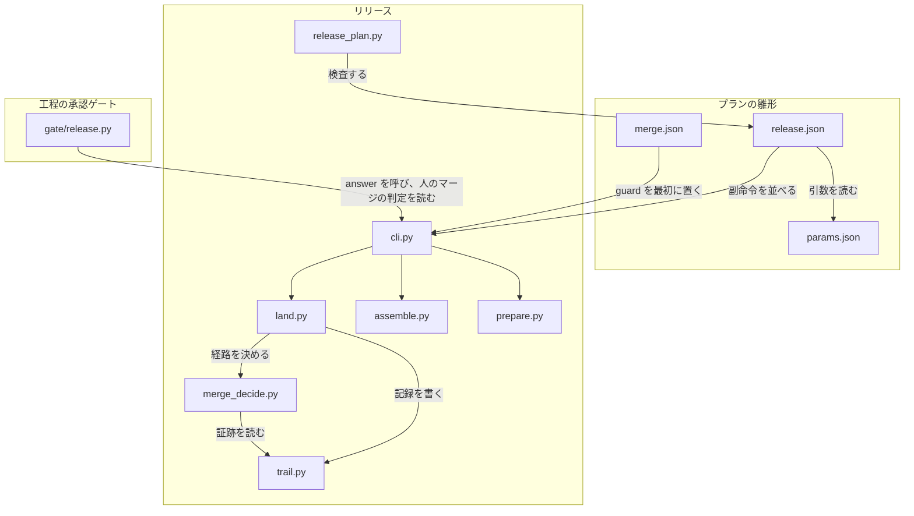
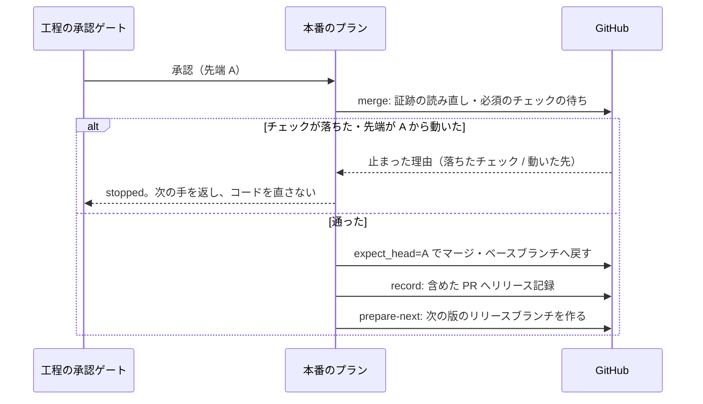
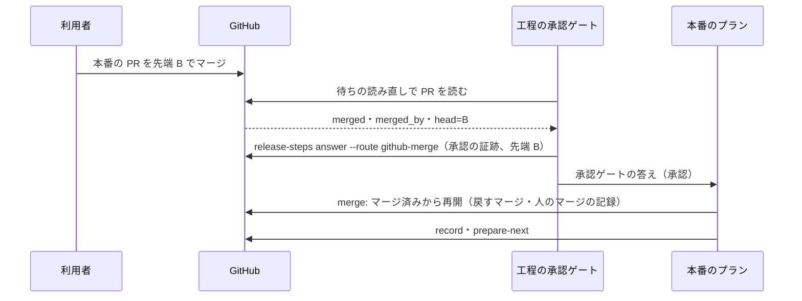
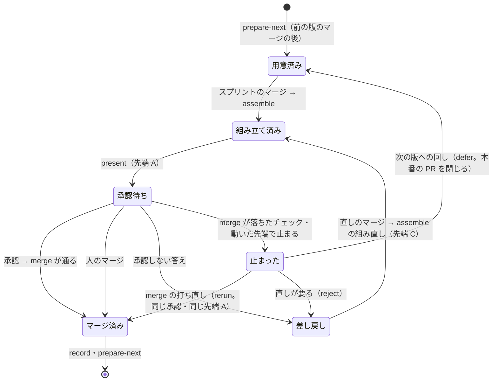

# ndf-next のリリース: 承認した先端だけを本番ブランチへ入れ、承認の後にコードを直すステップを持たない（#3572）

## 目的

- **今どうなっているか**: ndf-next の本番のプラン（雛形 `release.json`）は、承認ゲートの後に worker 1 つへリリースの作業を任せる。worker は CI が落ちるとコードを直してリリースブランチへ push でき、承認の外のコミットが本番の PR に積まれる（今の NDF でリリース 8・14 に同じ形が 2 回起きた）
- **誰に効くか**: 本番のリリースを承認する利用者と、リリースを流すオーガナイザー・一時レーン
- **変えると何が成り立つか**: 承認の直後のステップが、承認した先端との照合付きの本番の PR のマージになり、承認の後にコードを直すステップが無くなる。CI が落ちれば直さずに止まり、直しは差し戻しで承認を取り直す。利用者が GitHub で本番の PR をマージしても承認として扱われ、同期と記録へ進む。前の版が出た直後に次の版のリリースブランチが本番ブランチから用意される

## 適用範囲

- **働く範囲**: ndf-next（`plugins/ndf-next/`）を使うすべてのリポジトリ。今の NDF（`plugins/ndf/`）は変えない
- **プロジェクトごとに違うもの**: 本番ブランチとベースブランチは宣言（`.ndf/worktree.json` の `production_branch`・`base_branch`）を雛形の引数で受ける。必須のチェックの待ちの秒は引数 `ci_budget` で受ける。リリースブランチを常設するかは引数 `--source`（`base` / `release`）で受け、宣言の値で決める部分は #3119 の差分（決定 9）の側が持つ
- **当たるモード**: リリース承認ゲートを通る本番のリリース（デプロイの工程）。開発版チャネルのリリースは承認ゲートを通らないため当たらない

## あるべき姿の根拠

| 根拠 | 種類 | 何を示すか |
| --- | --- | --- |
| STD1 | 外部の一次情報 | GitHub はマージの API に渡した先端と PR の先端が違えば 409 で断る。承認した先端の外が入らないことを、ロックなしで GitHub の側が守る |
| STD3 | 外部の一次情報 | リリースブランチに入れてよいのは小さな直しと版などのメタデータの準備だけで、大きな変更は禁じられる。承認の後に積むコミットを無くす向きと一致する |
| リリース 8（2026-11-14）・リリース 14（2026-11-15） | 実測 | 承認の後に直しの worker が承認の外のコミット（168affe0・5538d759）を積み、承認を取り直すか外して出した |
| 利用者の指示（2026-11-15、課題の本文の「ロックの方針」） | 利用者の指示の原文 | 「ロックは rules を使うほど強固なものでなくともいいかも。そんな手間かけるより main にマージするほうが早い」 |
| 利用者の指示（2026-11-15、課題の本文の「承認とマージの扱い」） | 利用者の指示の原文 | 「リリース承認と github 操作による merge は等価とします。つまりどちらもリリース承認かつ、マージ承認とみなします」 |
| 利用者の指示（2026-11-15、課題の本文の「範囲の決定」） | 利用者の指示の原文 | 「リリースブランチは前のバージョンが出たらすぐ用意する」「スプリントブランチはリリースブランチにマージし、リリースブランチから develop や main にマージする」 |

要求と受け入れ条件は #3572 の本文にある（コピーは [issue-3572-requirements.md](issue-3572-requirements.md) ）。この文書は「どう作るか」だけを扱う。
#3119 の設計の差分は [issue-3119-design.md](issue-3119-design.md) の決定 21 と [issue-3119-design-detail.md](issue-3119-design-detail.md) の宣言の値（「内部のデータと定数」）に置く。その判断は、この文書の決定 9 が持つ。

| 分けた文書 | 中身 |
| --- | --- |
| [issue-3572-design-decisions.md](issue-3572-design-decisions.md) | 決定の記録（決定 1〜9） |
| [issue-3572-design-detail.md](issue-3572-design-detail.md) | 詳細設計（ファイル配置・関数の仕様・異常系の処理） |

## ドメインモデル

### コンテキスト

| コンテキスト | 何の語が 1 つの意味に決まるか |
| --- | --- |
| リリース（ndf-next の `domains/release`） | 本番の PR・承認した先端・先端の照合・承認の経路・人のマージの記録・次の版のリリースブランチの用意 |
| 工程の承認ゲート（ndf-next の `progress/gate`） | 承認ゲートの問い・答え・見た対象（PR の先端） |
| プランの雛形（ndf-next の `contracts/templates`） | 本番のプランのステップの並び |

関係は**顧客 / 供給者**とする。リリースが供給者で、承認ゲートとプランの雛形が顧客である。承認ゲートはリリースの公開する判定を読む。
判定は、PR がマージ済みか、誰がどの先端をマージしたかである。本番の PR へ書くこと（人のマージを承認とする答えの証跡）は、
リリースの副命令 `release-steps answer` を呼んで行う。承認ゲートが書き換えるのは自分の問いと答えの状態だけで、証跡の形を自分で解かず、
本番の PR のコメントを直接書かない。雛形はリリースの副命令（`ndf release-steps`）を並べるだけで、判定を持たない。

### 集約

| 集約 | 持ち主（書き換えてよいもの） | 根 | エンティティ | 値オブジェクト |
| --- | --- | --- | --- | --- |
| 本番の PR | リリースの領域（`domains/release`）。書き換える範囲は副命令ごとに分ける（下の表） | 本番の PR（番号） | 承認の証跡のコメント・人のマージの記録のコメント | 承認した先端・マージした先端・承認の経路 |
| リリースブランチ | リリースの領域。書き換える範囲は副命令ごとに分ける（下の表） | `release/v<版>` | — | 版・起点のコミット |
| 本番のプラン | プランの雛形 `release.json` | プラン | ステップ | ステップの起動の引数 |

集約の持ち主はリリースの領域の 1 つで、ほかのコンテキスト（承認ゲート・雛形・スプリントの経路）は集約を直接書き換えない。
領域の中では、副命令ごとに書き換えてよい範囲を重ならないように分ける。

| 副命令 | 本番の PR で書き換える範囲 | リリースブランチで書き換える範囲 |
| --- | --- | --- |
| `prepare-next` | — | ブランチの作成（ref を作るだけで、コミットを足さない） |
| `assemble` | PR の作成と、PR の本文（承認資料） | 起点のコミットからの進め（fast-forward か取り込みのマージ）・版と CHANGELOG のコミット・改名 |
| `answer` | 承認の証跡のコメント（経路 `gate` と `github-merge`） | — |
| `merge`（`land`） | マージと、迂回の記録・人のマージの記録のコメント | — |

`assemble` だけが 2 つの集約を書き換える。承認資料の対象はリリースブランチの先端であり、先端を進めるコミットと資料の書き直しを
別の副命令に分けると、資料が古い先端を指したまま提示される間が生じるためである。本番の PR とリリースブランチは別の集約にし、
PR はリリースブランチを名前（head の ref）で参照する。スプリントの PR がリリースブランチへコミットを足すのは、スプリントの経路
（#3119 の差分で決める宛先）であり、リリースの集約の持ち主ではない。

### 不変条件

| # | 集約 | 条件 | 破れたときの扱い |
| --- | --- | --- | --- |
| I1 | 本番のプラン | 承認の後に流れる本番のプランに、コードを変えるステップ（worker の起動）と、リリースブランチか本番の PR の head へ push するステップが無い | 雛形の検査（`release_plan.forbidden`）が該当のステップを返し、雛形のテストが落ちる |
| I2 | 本番のプラン | 本番のプランの最初のステップが本番の PR のマージ（`ndf release-steps merge`）である | 同上 |
| I3 | 本番の PR | 本番ブランチへ入るのは、承認した先端と一致する先端だけである。マージは承認した先端との照合（`expect_head`）付きで打つ | 先端が動いていれば `refused` で止まり、動いた先の SHA を理由に出す。GitHub も 409 で断る |
| I4 | 本番の PR | 承認の後に必須のチェックが落ちたら、コードを直さず、リリースブランチの先端を変えずに止まる | `land` が落ちたチェックの名前と次の手を結果に出して止まる |
| I5 | 本番の PR | 人のマージは、マージした先端への承認として記録し、承認ゲートの承認が別の先端への承認であれば両方を記録に残す | 記録を書けなければ結果を `stopped` にし、本番が出ていることと書けなかった理由を出す |
| I6 | リリースブランチ | 本番のマージの後に、次の版のリリースブランチが本番ブランチのマージ後の先端から 1 本だけ用意される。`assemble` は同じ名前のブランチがあれば作り直さずに使う | 既にあれば作らずに名前を返す。作れなければ `stopped` で理由を返す。開いた本番の PR の無い組み立てで、`assemble` が既にあるブランチを進められなければ（先端が組む起点の祖先でない）`precondition` で止まる。開いた本番の PR のある組み直しは祖先でなくても止めず、I7 のとおり取り込みのマージで進める |
| I7 | リリースブランチ | 差し戻しの後の承認の取り直しは、同じリリースブランチと同じ本番の PR の新しい先端で行い、新しいリリースブランチを作らない（`--source` の値に関わらない） | `assemble` は開いた本番の PR があるリリースブランチを組み直し、別の名前のブランチを作らない |
| I8 | 本番の PR | 本番の PR（base が本番ブランチ）は、直しのステップを持つ `merge` のプランで流れない | `merge` のプランの最初のステップ（`release-steps guard`）が終了コード 3 で止まり、`release` のプランで流すよう理由に出す |

### ドメインイベント

| # | イベント | 発生元 | 受け手 |
| --- | --- | --- | --- |
| E1 | 次の版のリリースブランチを本番ブランチから用意した | `prepare-next`（本番のプランの最後のステップ） | スプリントの宛先（#3119 の差分の経路） |
| E2 | スプリントをリリースブランチへマージした | スプリントの PR のマージ | `assemble`（組み立ての材料） |
| E3 | リリースブランチを組み立て、本番の PR を作り、承認資料を提示した | `assemble`・`release-steps present` | 工程の承認ゲート |
| E4 | 利用者が承認ゲートで承認の答えを書いた | `release-steps answer` | 本番のプラン（最初のステップのマージ） |
| E5 | 本番の PR を承認した先端との照合付きでマージした | `land` | `record`・`prepare-next` |
| E6 | 利用者が GitHub で本番の PR をマージしたことを検知した | 工程の承認ゲート（待ちの読み直し。証跡は `release-steps answer` が書く）と `land`（マージ済みからの再開） | 本番のプラン（承認ゲートを問い直さずに進む） |
| E7 | 差し戻した、または必須のチェックの落ちた本番の PR を止めた | `release-steps answer`（差し戻し）・`land`（止まった結果） | 直しのスプリント（リリースブランチへ入る） |
| E8 | 直しを入れた先端で承認を取り直した、または直しを次の版のリリースブランチへ回した | `assemble`（組み直し）・`release-steps present` | 工程の承認ゲート |
| E9 | 開発版との同期・後片付け・終わりの記録を行った | `land`（同期）・`record`・`cleanup` | 開発版の利用者・リリース後テスト |

### 用語

| 用語 | 意味 | 用語集への反映 |
| --- | --- | --- |
| 承認した先端 | 承認ゲートの承認の答えか、人のマージが対象にした本番の PR の先端のコミット | 追加（`ndf-release`。`ndf-workflow` の同じ語は設計 PR の先端を指す） |
| 先端の照合 | マージの API に承認した先端を渡して、先端が違えば GitHub に断らせることと、マージの前の承認の証跡の読み直し | 追加（`ndf-release`） |
| 承認の経路 | 本番の PR の承認がどこで与えられたか。承認ゲート（`gate`）か、人の GitHub でのマージ（`github-merge`）のどちらか | 追加（`ndf-release`） |
| 差し戻し | 承認ゲートで承認しない答え、または必須のチェックの落ちた本番の PR を出さずに止めること。直しを入れた先端で承認を取り直す | 追加（`ndf-release`。`ndf-cross-refactoring` の同じ語は改善項目の直させを指す） |
| 次の版への回し | 必須のチェックの落ちた本番の PR を閉じてこの時点では出さず、リリースブランチを残して後のスプリントと一緒に出すこと（決定 3） | 追加（`ndf-release`） |
| リリースブランチ | 版ごとに 1 本の `release/v<版>` のブランチ。前の版が出た直後に本番ブランチから用意し（決定 6）、本番の PR の head になる | 追加（`ndf-release`。`ndf-workflow` の同じ語は確定仕様の意味のまま残し、この意味は確定仕様化で正本へ移す） |
| 直しのステップ | CI が落ちたときにコードを直して push するプランのステップ（雛形の `ci-fix`・`fix-push`・`fix-base` と、それに続く `push`）。要求の「fix の worker」と同じものを指す | 追加（`ndf-release`。要求の「fix の worker」も同じ意味で追加） |

本番の PR・スプリントブランチ・本番チャネル・ベースブランチ・戻すマージは、用語集の既存の意味で使う。

## 外部の調査

| 種類 | 調べるか | 理由 |
| --- | --- | --- |
| 標準・仕様 | 調べる | マージの照合・ブランチの改名・マージの検知は GitHub の API の仕様で決まる。リリースブランチに積んでよいものには広く参照されるブランチの運用のモデルがある |
| 主要な製品 | 調べる | 主要なブランチの運用（GitLab のもの）がリリースブランチと直しをどう扱うかを比べる |
| ライブラリとサービス | 調べない | 使う手段は GitHub の REST API だけで、既存のアダプタ（`ndf.adapters.github`）が持つ。新しい依存を足す対象が無い |

### 標準・仕様

| # | 標準・仕様 | 何を定めているか | 設計への反映 | 出典 |
| --- | --- | --- | --- | --- |
| STD1 | GitHub REST「Merge a pull request」 | 本文の `sha` は「SHA that pull request head must match to allow merge」。一致しなければ 409 | 承認した先端を `expect_head` で渡す今のマージを残す（I3） | https://docs.github.com/en/rest/pulls/pulls#merge-a-pull-request （2026-11-15） |
| STD2 | GitHub REST「Get a pull request」 | 応答に `merged`・`merged_by`・`merge_commit_sha` を持つ | 人のマージの記録の材料（マージした人・マージした先端・マージコミット）をこの応答から読む（I5） | https://docs.github.com/en/rest/pulls/pulls#get-a-pull-request （2026-11-15） |
| STD3 | A successful Git branching model | リリースブランチは「minor bug fixes and preparing meta-data for a release」だけを許し、「Adding large new features here is strictly prohibited」 | 承認の後は版などのメタデータも積まない（承認の前に積み終える。前提 3） | https://nvie.com/posts/a-successful-git-branching-model/ （2026-11-15） |
| STD4 | GitHub「Renaming a branch」と REST「Rename a branch」 | 改名すると、そのブランチを base にする開いた PR は新しい名前へ付け替わる。head にする開いた PR は閉じる。push の権限で改名できる（既定ブランチと保護のあるブランチは管理者） | 版の上げ幅が上がるときの改名は、本番の PR を作る前にだけ行う（決定 5） | https://docs.github.com/en/repositories/configuring-branches-and-merges-in-your-repository/managing-branches-in-your-repository/renaming-a-branch ・ https://docs.github.com/en/rest/branches/branches#rename-a-branch （2026-11-15） |
| STD5 | GitHub Actions「pull_request」の `closed` | マージの検知は `closed` と `github.event.pull_request.merged == true` の条件で行う | workflow での検知は採らず、工程の読み直しで検知する（決定 4） | https://docs.github.com/en/actions/writing-workflows/choosing-when-your-workflow-runs/events-that-trigger-workflows#pull_request （2026-11-15） |

### 主要な製品

| # | 製品 | どう解いているか | 設計への反映 | 出典 |
| --- | --- | --- | --- | --- |
| PRD1 | GitLab Flow | リリースブランチ（`v1`・`v2`）を個別に保守し、`main` へ入れる前に直しを入れる | 直しはリリースブランチへスプリントとして入れ、先端を新しくしてから承認を取り直す（決定 3） | https://about.gitlab.com/topics/version-control/what-is-gitlab-flow/ （2026-11-15） |

### 確かめられなかったこと

| 対象 | 試した手段 | 結果と理由 |
| --- | --- | --- |
| GitLab Flow の公式文書（リリースブランチへの直しを上流から入れる規則） | https://docs.gitlab.com/ee/topics/gitlab_flow.html | HTTP 404。代わりに PRD1 の紹介のページを読んだが、上流から入れる規則と cherry-pick の扱いは書かれていない |

調べた量: 候補 6 件・取得の試み 8 回。

## 機能一覧

| # | 機能 | 誰が使うか |
| --- | --- | --- |
| F1 | 承認の直後に、承認した先端との照合付きで本番の PR をマージする | オーガナイザー・一時レーン（本番のプラン） |
| F2 | 承認の後に必須のチェックが落ちたら、直さずに止まり、落ちたチェックと次の手を返す | オーガナイザー・利用者 |
| F3 | 利用者が GitHub で本番の PR をマージしたら、承認として記録し、同期・記録・後片付けへ進む | 利用者 |
| F4 | 差し戻しの後、直しを入れた同じリリースブランチの先端で承認資料を作り直し、承認を取り直す | オーガナイザー・利用者 |
| F5 | 本番のマージの後に、次の版のリリースブランチを本番ブランチから用意する | オーガナイザー・スプリントを回すレーン |
| F6 | 本番のプランの雛形が承認の後に直しのステップを持たないことを、雛形のテストで落とす | ndf-next の開発者 |

## 構成要素

| 要素 | 責務 |
| --- | --- |
| 雛形 `contracts/templates/release.json`（変更） | 本番のプランを、マージ → 終わりの記録 → 次の版のリリースブランチの用意の 3 ステップにする。worker のステップを持たない（I1・I2） |
| 雛形 `contracts/templates/merge.json`（変更） | 最初のステップに `release-guard`（`ndf release-steps guard --root {{repo}} --branch {{branch}}`）を置き、終了コード 3 を止まった理由の表の既存の種類 `refused`（不変条件で操作を断った）にする（I8） |
| 雛形の引数 `contracts/templates/params.json`（変更） | 本番のプランが使う引数 `pr` を足す。本番ブランチは引数にせず、副命令が宣言（`.ndf/worktree.json` の `production_branch`）から読む |
| 雛形の検査 `domains/release/release_plan.py`（新設） | 純粋な処理。本番のプランの JSON を受け、I1・I2 を破るステップの一覧を返す。PR の base と本番ブランチの名前を受け、`merge` のプランで流してよいかを返す（I8） |
| マージ `domains/release/land.py`（変更） | 照合付きのマージ（今のまま）。必須のチェックが落ちたら落ちたチェックの名前と次の手を返す（I4）。マージ済みの PR から再開したら、人のマージの記録を書く（I5）。結果に版と承認の経路を載せる |
| 証跡 `domains/release/trail.py`（変更） | 人のマージの記録をコメントで書き、読む。マージした人・マージした先端・マージコミット・承認ゲートの最新の承認の先端を持つ |
| 人のマージの判定 `domains/release/merge_decide.py`（新設） | 純粋な処理。PR の応答と証跡から、承認の経路・承認した人・承認した先端・マージした先端を決める（受け入れ条件 7・8） |
| 次の版の用意 `domains/release/prepare.py`（新設） | 本番ブランチの先端から、出した版の PATCH を 1 つ上げた名前の `release/v<版>` を作る。既にあれば作らない（I6） |
| 組み立て `domains/release/assemble.py`（変更） | 引数 `--source release` のとき、常設のリリースブランチを組み立てる。どちらの `--source` でも、同じ名前のリリースブランチがあれば作り直さずに進め（I6）、開いた本番の PR があれば同じブランチと PR を組み直す（I7）。版の上げ幅が上がれば PR を作る前に改名する |
| 副命令 `domains/release/cli.py`（変更） | 副命令 `prepare-next`・`guard`・`defer` を足し、`assemble`・`materials` に `--source` を、`answer` に `--route` を、`merge` の結果に版・承認の経路・落ちたチェック・次の手を足す |
| 承認ゲートの待ち `progress/gate/release.py`（変更） | リリース承認ゲートの待ちで、本番の PR がマージ済みなら `release-steps answer --route github-merge` を呼んで証跡を書かせ、承認ゲートの自分の答えを承認にする（E6）。本番の PR のコメントを直接書かない |

## 処理の流れ

### 本番のプラン（経路 (a)：承認ゲートで承認する）

承認の前の組み立てと提示（E2・E3）は今のまま、`assemble` と `release-steps present` が行う。承認ゲートの答えの後に流れるのは
次の 3 ステップだけである。

### 人が GitHub でマージした（経路 (b)）

承認ゲートで A を承認した後に B が積まれ、人が B をマージした場合（受け入れ条件 8）は、承認ゲートが既に答え済みのため待ちの読み直しが
走らない。この形は、止まった `merge` を打ち直す経路で拾う。

| 順 | 起きること | 担うもの |
| --- | --- | --- |
| 1 | 承認ゲートが A を承認し、本番のプランの `merge` が流れる | 工程の承認ゲート・本番のプラン |
| 2 | B が積まれて先端が A から動いたため、`merge` が `refused` で止まる。`routes` に `rerun`・`reject`・`defer` を出す | `land` |
| 3 | 利用者が GitHub で B をマージする | 利用者 |
| 4 | 止まったプランを再開すると、`merge` が打ち直される（止まったプランの再開は、オーガナイザーか一時レーンが止まった結果を読んで行う。`rerun` の手と同じ） | オーガナイザー・一時レーン |
| 5 | `land` が PR をマージ済みと読み、`_resume_merged` へ進む。`merge_decide` が経路 `github-merge`・承認した先端 B・承認ゲートの承認の先端 A を決め、人のマージの記録を書き、戻すマージを行う | `land`・`merge_decide`・`trail` |
| 6 | `record`・`prepare-next` が続く | 本番のプラン |

`_resume_merged` の迂回の記録の補い（利用者の証跡がマージした先端への承認のときだけ書く）は今のまま残す。B への承認の証跡は無いため
迂回の記録は書かれないが、この判定はマージ済みの PR を拒む判定ではなく、記録を補うかどうかの判定である。B のマージを承認として残すのは
人のマージの記録（経路 `github-merge`）が担う。記録には、承認ゲートの承認が A に対するもので、マージした先端が B であることを両方残す。
承認ゲートの承認は B へ引き継がない。

### 差し戻しと取り直し

承認の後に見つかったが本番のマージを止めない直しは、次の版のリリースブランチへスプリントとして入れる（決定 3）。

直しがリリースブランチへ入る経路は、組み立ての引数 `--source` で分かれる。

| `--source` | 直しを入れる先 | 取り直しの `assemble` | 使える時期 |
| --- | --- | --- | --- |
| `base`（既定） | ベースブランチ（今の実装のプランのまま） | 開いた本番の PR の head のリリースブランチへ、ベースブランチの先端を取り込みのマージで入れ、版と CHANGELOG のコミットを足して先端 C にする。PR と承認資料は同じ PR の本文を C で書き直す | #3572 の実装の時点から |
| `release` | リリースブランチ（スプリントの宛先） | リリースブランチの先端（直しが入った C'）に版と CHANGELOG のコミットを足し、同じ PR の本文を書き直す | #3576 がスプリントの宛先をリリースブランチにした後 |

`release` の取り直しの前提（直しのスプリントがリリースブランチへ入ること）は #3576 が作る。そのため実装の順序は #3572 → #3576 で、
#3576 が出るまでは `base` の取り直しで受け入れ条件 9 を満たす。#3572 のテストは、どちらの `--source` でも、直しのコミットを
リリースブランチかベースブランチへ直接足した状態から `assemble` を打って縛り、#3576 を待たない。

### 本番の PR を流すプランと、承認の後に通るステップ（受け入れ条件 2）

ndf-next で本番の PR を扱うプランを、雛形と工程の定義から特定した結果である（develop の ddaf18781 の時点）。

| プラン | どこから流れるか | 承認の後に通るステップ（今） | 承認の後に通るステップ（変更後） |
| --- | --- | --- | --- |
| `release`（`contracts/templates/release.json`。`release: true`） | 工程「デプロイ」（`contracts/workflow/stages/deploy.json`）の `release-gate` の答えの後の `call ndf.plan release` | `work`（`{{worker}} release`）の 1 つ。worker が `ndf release-steps` の副命令とコードの直しを自分の判断で打つ | `merge` → `record` → `prepare-next` |
| `merge`（`contracts/templates/merge.json`） | 本番の PR を `ndf route merge` で流したとき | `conflict-check` → `ci` →（落ちたら）`repeat-check` → `ci-fix` → `ci-local` → `push` → `fix-push`・`base-sync` → `fix-base` → `merge` | 本番の PR を受け付けない。最初のステップ `release-guard`（`ndf release-steps guard`）が、PR の base が本番ブランチなら終了コード 3 で止め、ほかのステップへ進まない（I8・決定 2）。本番の PR は `release` のプランだけが流す |

## 入出力の契約

`ndf release-steps` の結果 JSON（`contracts/schemas/io/release-steps.result.schema.json`）に足すもの。互換は持たない
（ndf-next は未リリース）。

| 副命令 | 足すもの | 形 |
| --- | --- | --- |
| `merge` | `outputs.version` | 本番の PR の head の ref から読んだ版（`version_decide.version_of_branch`） |
| `merge` | `outputs.approval` | `{"route": "gate" \| "github-merge", "by": <ログイン>, "approved_head": <SHA>, "merged_head": <SHA>, "merge_sha": <SHA>, "gate_head": <SHA か null>}`。`gate_head` は承認ゲートの最新の承認の先端で、`merged_head` と違えば両方が残る |
| `merge`（止まったとき） | `items` に落ちたチェック | `{"kind": "check", "name": <名前>, "outcome": <結論>}` を 1 件ずつ |
| `merge`（止まったとき） | `routes` に次の手 | `rerun`（同じ先端で `merge` を打ち直す）・`reject`（`answer --answer rejected` で差し戻す）・`defer`（`release-steps defer` で本番の PR を閉じ、次の版へ回す）。3 つを常に出し、止まった理由の種類から既定の手を `outputs.suggested` に 1 つ載せる（決定 3） |
| `answer` | 引数 `--route gate \| github-merge` | `github-merge` は承認ゲートが人のマージを読んだときに打つ。答えた者は `merged_by`、対象は `merged_head`。省けば `gate` |
| `defer`（新設） | `outputs.closed`・`outputs.branch` | 閉じた本番の PR の番号と、残したリリースブランチの名前 |
| `guard`（新設） | 終了コード | PR の base が本番ブランチなら 3、そうでなければ 0。理由を標準エラーに出す |
| `prepare-next`（新設） | `outputs.branch`・`outputs.version`・`outputs.created` | 作ったか既にあったリリースブランチの名前と版、作ったか |
| `assemble`・`materials` | 引数 `--source base \| release` | `release` は常設のリリースブランチを組む。省けば `base`（今の形）。どちらも同じ名前のリリースブランチがあれば作り直さずに使う（決定 6・決定 7） |

人のマージの記録は、本番の PR のコメントに置く（印 `<!-- ndf:merge-approval -->`）。行は `承認の経路:`・`承認した人:`・`マージした先端:`・
`マージコミット:`・`承認ゲートの承認の先端:` の 5 つで、迂回の記録（`ADMIN_MARK`）と同じく 1 回だけ書き、打ち直しでは書き直さない。

## 非機能の実現方式

| 大項目 | 実現方式 |
| --- | --- |
| 運用・保守性 | 止まった・マージした・人のマージを検知したことは、`merge` の結果 JSON の `outputs.approval`・`items`・`routes` と、本番の PR のコメント（人のマージの記録・迂回の記録・承認の証跡）に、承認した先端・マージした先端・承認した人と一緒に残る |
| セキュリティ | 本番のマージ・検知・次の版のブランチの作成に使う token は今の `secrets.NDF_RELEASE_TOKEN`（workflow）と利用者の `gh` の token だけで、新しい秘密を足さない。ruleset と保護の設定を読むだけで書き換えない。リリースブランチの作成と改名は push の権限で足りる（STD4） |

## 決定の記録

決定 1〜9 は [issue-3572-design-decisions.md](issue-3572-design-decisions.md) にある。

## テスト設計

| 受け入れ条件・不変条件 | どの振る舞いで縛るか | どう壊したら落ちるべきか |
| --- | --- | --- |
| 受け入れ条件 1 | `issue-3119-design.md` の決定 21、`issue-3119-design-detail.md` の宣言の値（「内部のデータと定数」）と、この文書の決定 9 に同じ `branch_flow` の値があることを設計レビューで見る | — （設計の成果物の条件で、テストでは縛らない） |
| 受け入れ条件 2 | この文書の「本番の PR を流すプランと、承認の後に通るステップ」の表を設計レビューで見る | — （同上） |
| 受け入れ条件 3・I1 | `contracts/templates/` の雛形から生成した `release` のプランを `release_plan.forbidden` が空と返す。`merge.json` に `release: true` を付けた形は `ci-fix`・`push`・`fix-push` を返す | `release.json` に `{{worker}}` のステップか `push` を戻すと雛形のテストが落ちる |
| 受け入れ条件 3・I8 | base が本番ブランチの PR で `guard` が終了コード 3 を返し、ベースブランチ宛ての PR で 0 を返す。`merge.json` から生成したプランの最初のステップが `release-guard` で、終了コード 3 の原因 `refused` に行き先が無い | `merge.json` の最初のステップを外すか、`refused` に `ci-fix` への行き先を足すと落ちる |
| I2・受け入れ条件 5 | 生成した `release` のプランの最初のステップが `ndf release-steps merge` で、`--pr` と本番ブランチを渡す。マージの呼び出しの `expect_head` が承認した先端である（GitHub のアダプタを差し替えて記録した呼び出しで見る） | 最初のステップの前に別のステップを足すと落ちる。`expect_head` を渡さないと落ちる |
| 受け入れ条件 4・I4 | 必須のチェックが落ちた本番の PR で `land` が `stopped` を返し、`items` に落ちたチェックの名前、`routes` に `rerun`・`reject`・`defer` を持ち、push もマージも呼ばない。`defer` が本番の PR を閉じ、リリースブランチを消さない | 落ちたチェックを結果から外すと落ちる。`routes` から `defer` を外すと落ちる。止まった後に push かマージを呼ぶと落ちる |
| 受け入れ条件 6・I3 | 承認の後に先端が A から B へ動いた本番の PR で `land` が `refused` を返し、理由に A と B の先頭 12 文字が出る（今のテスト `test_judge_reports_stale_and_missing` と `_refusal` のテストを残す） | 先端の読み直しを外すと落ちる |
| 受け入れ条件 7・I5 | 答え待ちのリリース承認ゲートで、本番の PR が先端 A でマージ済みなら、承認ゲートが `release-steps answer --route github-merge` を呼び、経路 `github-merge`・答えた者がマージした利用者のログインの承認の証跡が書かれる。続く `land` が人のマージの記録（マージした先端 A・マージコミット）を書き、戻すマージへ進む | マージ済みを読まないと承認ゲートが待ち続けて落ちる。記録にマージした人を書かないと落ちる |
| 受け入れ条件 8・I5 | `refused` で止まった後に B がマージ済みになった本番の PR で `merge` を打ち直すと、`land` がマージ済みからの再開へ進み、記録の `approved_head` が B、`gate_head` が A で、両方が残る | `gate_head` を B に置き換えると落ちる。A への承認で B を承認済みと扱うと落ちる |
| 受け入れ条件 9・I7 | 開いた本番の PR のあるリリースブランチへ直しが入り先端が C になったとき（`--source release` はリリースブランチへ、`--source base` はベースブランチへ直しのコミットを足す）、`assemble` が新しいブランチと PR を作らず、強制 push をせずに承認資料を C で書き直し、A への承認の判定が `stale` になる | `assemble` が別の名前のブランチを作ると落ちる。強制 push を呼ぶと落ちる。資料の対象を A のまま残すと落ちる |
| 受け入れ条件 10・I6 | 本番のマージの後の `prepare-next` が、本番ブランチのマージ後の先端から `release/v<出した版の PATCH+1>` を作り、結果に名前を出す。既にあれば作らずに `created: false` で名前を出す。用意したブランチがあるとき `assemble --source base` がそれを fast-forward で進め、開いた本番の PR が無く先端がベースブランチの祖先でなければ `precondition` で止まる | 起点をベースブランチにすると落ちる。2 回打って 2 本作ると落ちる。`base` の組み立てが用意したブランチを作り直すと落ちる |
| 受け入れ条件 11 | 開発版チャネルの `assemble` と、ベースブランチ宛ての PR の `land` が今の結果を返す（今のテストを残す） | 開発版の PR に承認の照合を掛けると落ちる |
| 受け入れ条件 12 | 実装 PR の差分のパスがすべて `plugins/ndf-next/` の下にあり（「設計の結果」の触るファイル。決定 4）、`plugins/ndf/` に無いことを `git diff --name-only` で見る | — （差分の条件で、コードレビューで見る） |
| 決定 5 | 計画した版がブランチの版より大きい上げ幅のとき、本番の PR が無ければ改名を呼び、あれば改名を呼ばずに `precondition` で止まる | PR があるのに改名を呼ぶと落ちる |

## 設計の結果

| 課題 | 扱い | 取り込み先 | 触るファイル |
| --- | --- | --- | --- |
| #3572 | 実装する | — | `plugins/ndf-next/contracts/templates/release.json`、`plugins/ndf-next/contracts/templates/merge.json`、`plugins/ndf-next/contracts/templates/params.json`、`plugins/ndf-next/src/ndf/domains/release/release_plan.py`、`plugins/ndf-next/src/ndf/domains/release/merge_decide.py`、`plugins/ndf-next/src/ndf/domains/release/prepare.py`、`plugins/ndf-next/src/ndf/domains/release/land.py`、`plugins/ndf-next/src/ndf/domains/release/trail.py`、`plugins/ndf-next/src/ndf/domains/release/assemble.py`、`plugins/ndf-next/src/ndf/domains/release/cli.py`、`plugins/ndf-next/src/ndf/progress/gate/release.py`、`plugins/ndf-next/contracts/schemas/io/release-steps.result.schema.json`、`plugins/ndf-next/contracts/schemas/io/release-steps.args.schema.json`、`plugins/ndf-next/tests/domains/release/test_release_plan.py`、`plugins/ndf-next/tests/domains/release/test_release_approval.py`、`plugins/ndf-next/tests/domains/release/test_release_assemble.py`、`plugins/ndf-next/tests/domains/release/test_release_prepare.py`、`plugins/ndf-next/tests/progress/gate/test_gate_release.py`、`plugins/ndf-next/src/ndf/domains/release/declaration.py` |

結果 JSON と引数のスキーマ（`contracts/schemas/io/`）は副命令の契約の正本で、副命令を変えると同じ変更で合わせる。

## 人へ残す判断

| 判断 | 当たるレッドライン | なぜ当たるか |
| --- | --- | --- |
| ai-plugins のブランチの流れを常設のリリースブランチの取り込み方（決定 9）にしてよいか | P1 | 既定ブランチへ何がどの経路で入るかの規則を変える（#3119 の決定 21） |

実装の範囲を ndf-next の中へ広げること（決定 4）と、止まった本番の PR の既定の手と差し戻しの選び方（決定 3）は、決定の記録が持つ。
どちらも新しい人の判断を置かないためである。範囲を広げたことは設計承認ゲートの資料に載せる。

## 未確認のまま残ること

| 項目 | 内容 |
| --- | --- |
| 工程「デプロイ」の承認ゲートの前に本番の PR を組む主体 | 前提 1 は `assemble` が承認の前に本番の PR を作ることを確かめたが、ndf-next の工程の中で `assemble` を打つ主体（工程の前のステージか、オーガナイザーか）はこの時点のコードでは定まっていない。実装の計画で工程の入力 `pr` の出所を読み、決まっていなければ範囲外として起票する |
| 改名の後のスプリントの作業場所 | 改名で GitHub の PR の base は付け替わるが、手元の clone と worktree の追跡先は付け替わらない（STD4）。スプリントの作業場所が古い名前を追ったときの振る舞いは、最初に上げ幅が PATCH より大きいリリースで分かる |
| 人のマージの検知の遅れ | 承認ゲートの待ちの読み直しの間隔だけ、人のマージから同期と記録までが遅れる。間隔の実測は、最初に人が GitHub でマージしたリリースで分かる |
