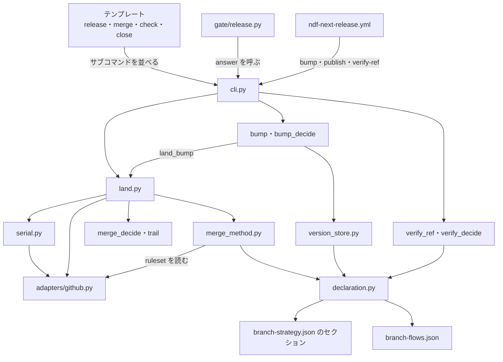
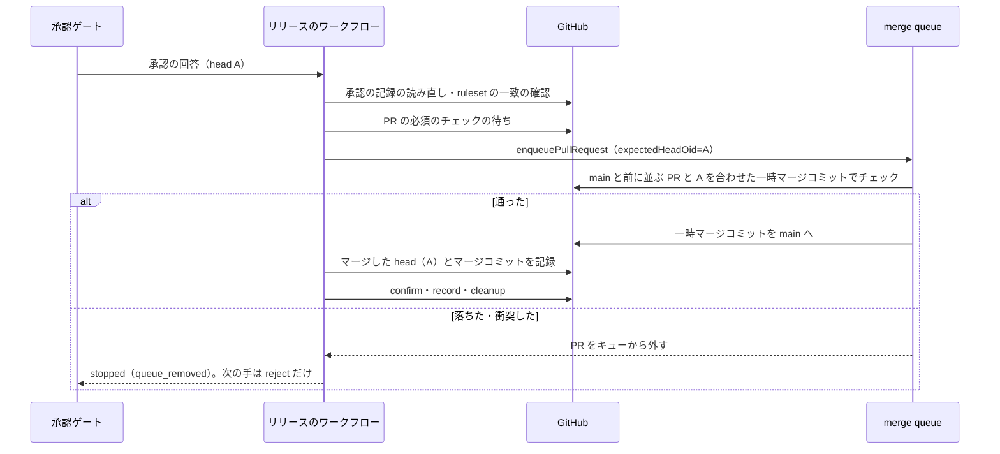
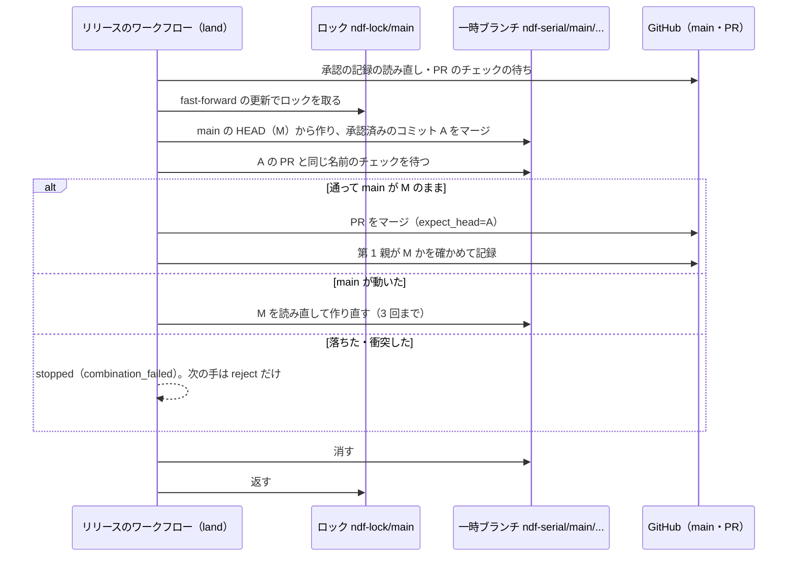
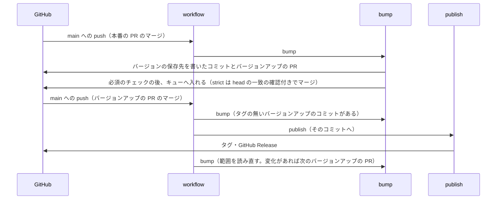
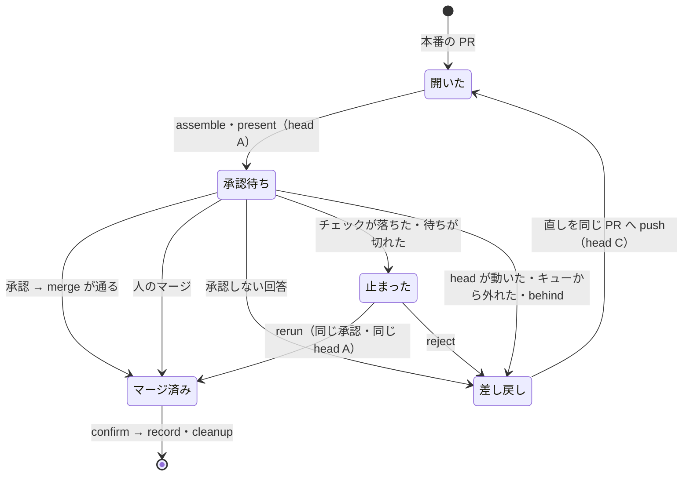

# ndf-next のリリース: リポジトリごとのブランチ戦略で承認済みのコミットだけを本番へ入れ、同時の承認は merge queue で確かめる（#3572）

## 目的

- **今どうなっているか**: ndf-next のリリースのワークフロー（テンプレート `release.json`）は、承認ゲートの後に worker 1 つへリリースを任せる。worker は CI が落ちるとコードを直して本番の PR へ push できる（今の NDF でリリース 8・14 に同じ形が 2 回起きた）。ほぼ同時に承認された 2 つの PR は、main の必須のチェックが最新の取り込みを求めない（`strict` が偽）ため、組み合わせを CI に通さずに本番へ入る
- **誰に効くか**: ndf-next を使うすべてのリポジトリ（Web サービス・アプリ・プラグイン）の、本番のリリースを承認する利用者と、リリースを実行するオーガナイザー・一時レーン
- **変えると何が成り立つか**: 承認の後にコードを直すステップが無くなり、承認済みのコミットだけが本番へ入る。利用者の GitHub でのマージも承認として扱われる。ブランチ戦略・マージの方式・検証環境・バージョンの保存先はリポジトリごとに 1 つの設定ファイル `.ndf/branch-strategy.json` のセクション `branch_strategy` で選ぶ。develop と main を分けるリポジトリは既存のブランチ戦略のまま動く。GitHub flow を選んだリポジトリでは、同時に承認された PR の組み合わせを merge queue で確かめてから main へ入れる。merge queue が使えなければ最新の取り込みの必須（`strict`）、どちらも使えない private の Free では NDF が順に確かめる `serial` を使う

## 適用範囲

- **働く範囲**: ndf-next（`plugins/ndf-next/`）を使う利用者のリポジトリ。リリースのサブコマンド `ndf release-steps`（NDF の内部の呼び名は「副命令」）とリリースのワークフローのテンプレートが働く。ndf-next のリリースの workflow（`.github/workflows/ndf-next-release.yml`）も働く。今の NDF（`plugins/ndf/`）と今の CD（`.github/workflows/release-cd.yml`）は 11.0.0 の入れ替えまで変えない
- **リポジトリごとに違うもの（設定ファイルで受ける）**: ブランチ戦略・マージの方式・検証環境・バージョンの保存先を、`.ndf/branch-strategy.json` のセクション `branch_strategy` の 1 か所で受ける。形と設定の例は「ブランチ戦略のセクション」にある。必須のチェックの待ちの秒は引数 `ci_budget` で受ける
- **キーと値の名前**: ブランチ戦略のキーと値は #3613 の改名の後の名前で書く。キーは `branch_strategy.release_strategy`、値は `merge_base_branch`・`release_branch`・`trunk` である。値とブランチ戦略の一覧の行の名前は同じである。改名と、旧い 3 つのファイルの値をセクションへ移す移行のコマンドは #3613 が持つ（決定 26・29）。要求（ [issue-3572-requirements.md](issue-3572-requirements.md) ）と利用者の指示の原文は改名の前の名前で書かれており、下の読み替えの表で読む
- **当たるモード**: リリース承認ゲートを通る本番のリリース（デプロイの工程）と、その前後のスプリントの PR・検証環境の更新・CD のバージョンアップ

| 要求と利用者の指示の原文の名前（改名の前） | この設計の名前（#3613 の改名の後） |
| --- | --- |
| `branch_flow` が「〜の行」である（行を選ぶキー） | `branch_strategy.release_strategy` の値 |
| `promote-whole` | `merge_base_branch` |
| `promote-selected` | `release_branch` |
| `github-flow` | `trunk` |

受け入れ条件 1b・15・18・19 などの旧い名前は、この表で読み替えて満たす。要求の本文は書き換えない（利用者の指示の日付ごとの原文と、それを写した条件を保つため）。

### 代表のリポジトリでの振る舞い

どのブランチ戦略も、承認の後に fix の worker を実行せず、承認済みのコミットとの一致の確認付きで本番の PR をマージする（決定 1・2）。

| リポジトリ | 設定ファイルの値 | 何が起きるか |
| --- | --- | --- |
| ai-plugins（11.0.0 の入れ替えの後） | `trunk`・`merge-queue`・検証マーケットプレイス・`plugin` | スプリントを main から切り、PR を main へ出す。承認の後にキューへ入れ、GitHub が main と前に並ぶ PR を合わせて確かめてからマージする。CD がバージョンアップの PR で `plugin.json` を上げ、タグを作る。マージの前の PR は `ai-plugins-next` から試せる |
| ai-plugins（入れ替えまで） | `.ndf/branch-strategy.json` は無い。今の NDF の値は旧いキー（`.ndf/worktree.json` の `base_branch: develop`・`branch_flow`、`.ndf/project.json` の `production_merge.admin`）にある | 今の NDF が旧いキーを読み、develop と main で動く（#3613 の前提 7）。この期間、ai-plugins のスプリント・マージ先・解析・リリースは ndf-next で実行しない（下の「ai-plugins の入れ替えまでの期間」）。ndf-next のリリースの workflow は変数 `NDF_RELEASE_RUNNER` が ndf-next でないため動かない |
| GitHub flow の Web サービス（private の Pro・Team） | `trunk`・`strict`・`deploy`（staging）・`json`（`package.json`） | merge queue が使えないため `strict` を選ぶ。先に A がマージされると B はマージの前に止まり、main を取り込んだ新しい head で承認を取り直す。staging へは設定ファイルのコマンドで配る。CD が `package.json` のバージョンを上げる。ただし CD を起動する workflow のテンプレートは #3615 の範囲で、それが入るまでは、利用者が自分の workflow から main への push で `ndf release-steps bump`・`publish` を呼ぶ形になる（この課題が届けるのはサブコマンドと保存先 `json` のアダプタまで） |
| GitHub flow の Web サービス（private の Free） | `trunk`・`serial`・`deploy`（staging）・`json`（`package.json`） | merge queue もブランチ保護（`strict`）も使えないため `serial` を選ぶ。承認の後、NDF が main のロックを取り、main の HEAD と承認済みのコミットを合わせた一時ブランチで CI を走らせ、通って main が動いていなければ承認済みのコミットのまま PR をマージする。A と B が同時に承認されると、B は A のロックが返った後に「A を入れた main + B」で確かめられ、承認は取り直さない。GitHub はマージを縛らないため、人が GitHub で本番の PR を直接マージする（経路 (b)）と、組み合わせを確かめずに入る。NDF はこの経路を止めず、確かめも検出もしない（組み合わせを確かめる保証の外。不変条件 I14・決定 32）。NDF が検出して止まるのは、`land` が自分でマージする直前に人が別の PR をマージして割り込んだときだけである。staging への配り方とバージョンは上の行と同じ |
| develop を持つ Web・アプリ | `merge_base_branch` か `release_branch`・`base_branch: develop`・マージの方式は任意 | 既存のブランチ戦略のまま動く。スプリントは develop（`release_branch` は main）から切り、リリースブランチの PR が本番の PR になる。組み合わせは develop（かリリースブランチ）で既に CI を通っており、本番の PR は 1 度に 1 つのため、マージの方式を書かなくても止まらない。書けば ruleset との一致を確かめて使う。同期の PR は今のまま作る |
| `.ndf/branch-strategy.json` の無いリポジトリ | どれも無い | ブランチ戦略は既定の `merge_base_branch` 戦略（本番ブランチはリポジトリの既定ブランチ）で、今と同じに動く。マージの方式は無く、今のマージ（head の一致の確認付き）を実行する。検証環境は使わない。CD のバージョンアップは `trunk` 戦略でだけ動くため実行されない |

`trunk` 戦略では、承認資料（`assemble`）・バージョンアップ（`bump`）・タグと GitHub Release（`publish`）がバージョンの保存先のアダプタのインタフェースだけを通る。プラグインの登録（`.claude-plugin/marketplace.json`）は読まない（決定 22）。そのため上の表の `trunk`・保存先 `json` の Web サービスは、プラグインの登録が無くても承認からタグまで止まらない。既存のブランチ戦略（`merge_base_branch`・`release_branch`）では、承認資料・リリースブランチの組み立て・タグがプラグインの登録を読む。プラグインの登録を持たないリポジトリでこれらを作成できるようにするのは #3615 の範囲である。境は決定 22 の表にある。develop を持つ Web のリポジトリの既存のブランチ戦略の経路はこの課題で後退させないが、#3615 が直るまでは承認資料の組み立てで止まる（今と同じ）。

### ai-plugins だけの事情

次の 5 つは、どれも ai-plugins の設定ファイルの値である。ndf-next のコードに決め打たない。

- `trunk` 戦略
- `merge-queue`
- 検証マーケットプレイス `ai-plugins-next` と検証ブランチ `verify/next`
- バージョンの保存先 `plugin`
- タグ `ndf--v<バージョン>`

### ai-plugins の入れ替えまでの期間

この期間は #3587 が develop へ入ってから 11.0.0 の入れ替え（#3304）の PR がマージされるまでである。
この間、ai-plugins の開発は今の NDF で行い、ndf-next の工程（スプリントの分岐元・マージ先・解析・リリース）を ai-plugins で実行しない。ndf-next は新しいキーだけを読み、入れ替えまで `.ndf/` を書かない（#3613 の前提 7・I11）ため、
この期間の ai-plugins には ndf-next が読む値が無い。それでも ndf-next を実行したときの読み取りの結果は次のとおりで、どれも ai-plugins の今の運用（develop へのスプリント）と合わない。

| ndf-next の処理 | 読み取りの結果 |
| --- | --- |
| スプリントの経路（`domains/worktree`。`.ndf/worktree.json` を読む） | 移す行を持つ改名表で `base_branch`・`branch_flow` が旧いキーになり、旧いキーと移行のコマンドを示して止まる（#3613 の I6・E8） |
| マージ先の既定（`core/route`）・リリースの設定の解決（`declaration.py`）・リポジトリの解析 | セクションのファイルが無いため既定の `merge_base_branch` 戦略と既定ブランチ（ai-plugins は `main`）を使う |

入れ替えの PR が、移行のコマンドで `.ndf/branch-strategy.json` を作ってから ndf-next の工程を ai-plugins で使い始める。

## あるべき姿の根拠

| 根拠 | 種類 | 何を示すか |
| --- | --- | --- |
| STD1・STD10 | 外部の一次情報 | マージの API とキューへ入れる API は、どちらも承認済みのコミット（`sha`・`expectedHeadOid`）を受け、違えば GitHub が断る |
| STD7・STD8・STD9 | 外部の一次情報 | merge queue は main の HEAD と前に並ぶ PR を合わせた一時マージコミットで必須のチェックを回し、通ったものだけを順にマージする。Organization の public か Enterprise Cloud の private で使える |
| STD9・STD14・STD15 | 外部の一次情報 | merge queue は Organization の public と Enterprise Cloud の private だけ、ブランチ保護（`strict` を含む）は private の Free で使えない。どの方式も使えないリポジトリがある |
| 確かめ 7（2026-11-15） | 実測 | 公開リポジトリの記録で、キューで確かめた一時マージコミットがそのまま PR のマージコミットになり、`merged_by` はキューへ入れた人だった（[issue-3572-design-evidence.md](issue-3572-design-evidence.md) ） |
| 確かめ 6（2026-11-15） | 実測 | ai-plugins の main の必須のチェックは `strict` が偽で、merge queue も無い。後にマージする PR は先の PR を取り込まずに入れる |
| 確かめ 1〜3（2026-11-15） | 実測 | 同じリポジトリを違う名前と ref で登録すると両方が残り、検証ブランチの作り直しが更新で入り、正式版の登録は変わらない |
| リリース 8（2026-11-14）・リリース 14（2026-11-15） | 実測 | 承認の後に修正用の worker が承認の外のコミット（168affe0・5538d759）を積んだ |
| 利用者の指示（2026-11-16 01:1x JST、課題の本文の「設計のやり直し」） | 利用者の指示の原文 | 「取り込み方の表から `promote-whole`・`promote-selected` を**外さない**。GitHub flow は宣言で選ぶ行の 1 つとして足す」「**同時に承認されたスプリントの組み合わせは、GitHub の merge queue で確かめてから入れる。**」（名前は改名の前。「適用範囲」の読み替えの表で `merge_base_branch`・`release_branch` に当たる） |
| 利用者の指示（2026-11-15、課題の本文の「承認とマージの扱い」） | 利用者の指示の原文 | 「リリース承認と github 操作による merge は等価とします」 |

要求と受け入れ条件は #3572 の本文にある（コピーは [issue-3572-requirements.md](issue-3572-requirements.md) ）。この文書は「どう作るか」だけを扱う。
#3119 の設計の差分は [issue-3119-design.md](issue-3119-design.md) の決定 21 にあり、その判断は決定 25 が持つ。

| 分けた文書 | 中身 |
| --- | --- |
| [issue-3572-design-decisions.md](issue-3572-design-decisions.md) | 決定の記録（決定 1〜33。置き換えた決定は superseded と置き換え先を添えて残す） |
| [issue-3572-design-evidence.md](issue-3572-design-evidence.md) | 実物の確かめ（確かめ 1〜8。実行したコマンドと出力） |
| [issue-3572-design-detail.md](issue-3572-design-detail.md) | 詳細設計（ファイル配置・関数の仕様・異常系の処理。#3587 の HEAD 84e6c33b4 からの、ブランチ戦略のセクションを読む形への差分） |

## ドメインモデル

### コンテキスト

| コンテキスト | 何の語が 1 つの意味に決まるか |
| --- | --- |
| リリース（ndf-next の `domains/release`） | 本番の PR・承認済みのコミット・head の一致の確認・承認の経路・マージの方式・merge queue への追加・バージョンアップの PR・バージョン種別のラベル・検証環境・検証ブランチ・バージョンの保存先 |
| 工程の承認ゲート（`progress/gate`） | 承認ゲートの質問・回答・見た対象（PR の head） |
| プランのテンプレート（`contracts/templates`） | プランのステップの並び |
| ブランチ戦略の一覧（`contracts/domains/branch-flows.json`） | ブランチ戦略の一覧の行（戦略ごとの振る舞い。マージの後にスプリントを残すか・リリースの元・リリースの単位） |
| ブランチ戦略のセクション（`.ndf/branch-strategy.json` のセクション `branch_strategy` と、そのスキーマ `contracts/schemas/ndf-settings/branch-strategy.schema.json`） | リポジトリが選んだブランチ戦略・本番ブランチ・スプリントの PR のマージ先・マージの方式・検証環境・バージョンの保存先 |
| スプリントの経路（`domains/worktree`） | スプリントブランチ・スプリントの分岐元・スプリントの PR のマージ先・マージの後のクリーンアップ |
| マージ先の既定（`core/route`） | 工程が既定で選ぶスプリントの PR のマージ先 |
| リポジトリの解析（`domains/project`） | 解析の書き出し・書き出しの指紋（前の解析が書いた値のままか）・リポジトリの事実から推した設定の値 |
| 工程の記録（`progress`） | スプリントの差分の範囲（ベースブランチからの分岐点）・プランの条件の語 `prod_branch`（本番ブランチ） |
| 必須のチェック（CI の workflow。`.github/workflows/` の `pr-body-decisions` など） | 必須のチェックの名前と結論・トリガーのイベント（`pull_request`・`merge_group`） |
| GitHub（外部の系） | PR・ruleset・merge queue・キューの一時マージコミット |

リリースが供給者、承認ゲートとプランのテンプレートとスプリントの経路が顧客である（**顧客 / 供給者**）。承認ゲートはリリースの公開する判定
（PR がマージ済みか、誰がどの head をマージしたか）を読み、本番の PR へ書くことはサブコマンド `release-steps answer` を呼んで行う。
テンプレートはサブコマンドを並べるだけで判定を持たない。ブランチ戦略の一覧は**公表された言語**で、リリースとスプリントの経路が同じ行を読む。
ブランチ戦略のセクションも**公表された言語**で、形の正本はセクションのスキーマである。セクションを読むのは、リリース（`declaration.py`）・スプリントの経路（`domains/worktree`）・
マージ先の既定（`core/route`）・リポジトリの解析（`domains/project`）・工程の記録（`progress`）の 5 つである。5 つはスキーマに**順応者**として従い、セクションの形を自分で足したり読み替えたりしない。
リポジトリの解析は、11.0.0 の入れ替えの後にセクションの書き手も兼ねる（「集約」のセクションの行）。書き手としての解析とほかの 4 つの読み手の関係は**顧客 / 供給者**（解析が供給者）で、解析もスキーマに順応者として従い、スキーマに合う値だけを書く。
5 つのどれも、ほかの 4 つを呼ばずに、共通の読み取り（`core/branch_strategy.py`）を通して同じファイルを読む。セクションを書くプログラムは「集約」の表の行のとおり期間ごとに 1 つだけである。
GitHub との間は**腐敗防止層**である。ruleset と merge queue の語はアダプタ（`adapters/github.py`）とリリースの解決（`merge_method`）の中に閉じ、
ほかのコンテキストへ出さない。スプリントの経路はスプリントの PR（`trunk` では本番の PR を兼ねる）を作ってバージョン種別のラベルを書き、head へコミットを足す。
リリースは PR の head とラベルを読むだけで、スプリントブランチへ書かない。
必須のチェックは GitHub の merge queue に**順応者**として従い、`merge_group` のイベントの形（一時マージコミットの SHA とブランチ）をそのまま受けて結論を報告する。
リリースと必須のチェックは互いを呼ばず、GitHub の必須のチェックの結論を介して結ばれる（必須のチェックが供給者、リリースが顧客）。
リリースが前提にするのは「キューの一時マージコミットに、必須のチェックがすべて報告される」ことだけで、チェックの中身は読まない（決定 23）。

### 集約

| 集約 | 持ち主（書き換えてよいもの） | 根 | エンティティ | 値オブジェクト |
| --- | --- | --- | --- | --- |
| スプリントブランチとスプリントの PR | スプリントの経路。スプリントの PR（`trunk` では本番の PR を兼ねる）の作成・head の移動・バージョン種別のラベルを書くのはこの持ち主だけ | ブランチの名前 | コミット・スプリントの PR | head・バージョン種別のラベル |
| リリースブランチとリリースブランチの PR（既存のブランチ戦略だけ） | リリース（`assemble`）。既存のブランチ戦略の本番の PR の作成・head の移動はこの持ち主だけ | ブランチの名前 | コミット・リリースブランチの PR | head・含めたスプリントの一覧・バージョン |
| 本番の PR の承認とマージの記録 | リリース。書き換える範囲はサブコマンドごとに分ける（下の表）。PR の作成・head・ラベルは上の 2 つの集約が持ち、ここは読むだけ | 本番の PR（番号） | 承認の記録のコメント・merge queue への追加の記録のコメント・人のマージの記録のコメント・作ったバージョンの記録のコメント・本文の承認資料のセクション | 承認済みのコミット・マージした head・マージコミット・承認の経路 |
| 同期の PR（既存のブランチ戦略だけ） | リリース（`land`） | 同期の PR（番号） | — | 戻す元のマージコミット・マージ先のベースブランチ |
| バージョンアップの PR | リリース（`bump`） | バージョンアップの PR（番号） | — | バージョン・バージョン種別・分岐元のコミット |
| 検証ブランチ | リリース（`verify-ref`） | ブランチの名前（設定ファイルの値） | — | 含めた PR と head の一覧・検証のバージョン |
| 本番ブランチのロックと一時ブランチ（`serial` だけ） | リリース（`land`・`land_bump` の `serial.py`）。ロックのブランチはロックを持つ処理だけが fast-forward で進め、一時ブランチはそれを作った処理だけが作り・消す | ロックのブランチの名前（`ndf-lock/<本番ブランチ>`） | ロックのコミット・一時ブランチ | 持ち主の PR・承認済みのコミット・期限・確かめた本番ブランチの HEAD |
| リリースのワークフロー | テンプレート `release.json` | プラン | ステップ | ステップの起動の引数 |
| ブランチ戦略のセクション | 利用者（設定は利用者のもの。C7）。利用者の代わりに書くプログラムは期間ごとに 1 つだけ（#3613 の I11）。11.0.0 の入れ替えまでは無し（ndf-next は `.ndf/` を書かない。#3613 の前提 7）。入れ替えのときは #3613 の移行のコマンド（`ndf settings migrate --apply`）が、リポジトリごとに利用者が承認した差分だけを書く。入れ替えの後はリポジトリの解析（`domains/project/write.py`）が、キーの無い項目と、前の解析の書き出しの値のまま（指紋が一致する）の項目だけを書く。セクションを読むコンテキストのうち、リポジトリの解析を除く 4 つ（リリース・スプリントの経路・マージ先の既定・工程の記録）は読むだけで書かない | ファイル `.ndf/branch-strategy.json` | — | セクションのキーの値（下の「ブランチ戦略のセクション」の表） |

| サブコマンド | 本番の PR で書き換える範囲 | ほかの集約・外部の系で書き換える範囲 |
| --- | --- | --- |
| `assemble` | PR の本文の承認資料のセクション | 既存のブランチ戦略（`merge_base_branch`・`release_branch`）ではリリースブランチとリリースブランチの PR の集約（今のまま） |
| `answer` | 承認の記録のコメント（経路 `gate` と `github-merge`） | — |
| `merge`（`land`） | マージか merge queue への追加と、merge queue への追加の記録・迂回の記録・人のマージの記録のコメント | 既存のブランチ戦略では同期の PR の集約（今のまま）。`serial` では本番ブランチのロックと一時ブランチ |
| `confirm` | 作ったバージョンの記録のコメント | — |
| `bump` | — | バージョンアップの PR の作成・コミット・マージ |
| `publish` | — | タグと GitHub Release |
| `verify-ref` | — | 検証ブランチのコミット（fast-forward だけ）。種類 `deploy` では設定ファイルのコマンドの起動 |

承認資料は PR の本文に置き、head を動かさない。そのため承認資料の書き直しは承認の対象を変えない。

### 不変条件

I15 と I17 は条件ごとに行を分け、I15a〜I15d・I17a〜I17e と番号を振る。ほかの節で I15・I17 と書いた参照は、その番号を持つ行のまとまりを指す。

| # | 集約 | 条件 | 破れたときの扱い |
| --- | --- | --- | --- |
| I1 | リリースのワークフロー | 承認の後に実行されるリリースのワークフローに、コードを変えるステップ（worker の起動）と、本番の PR の head へ push するステップが無い（どのブランチ戦略でも） | テンプレートの検査（`release_plan.forbidden`）が該当のステップを返し、テンプレートのテストが落ちる |
| I2 | リリースのワークフロー | リリースのワークフローの最初のステップが本番の PR のマージ（`ndf release-steps merge`）である | 同上 |
| I3 | 本番の PR の承認とマージの記録 | 本番の PR で本番ブランチへ入るのは、承認済みのコミットと一致する head を持つ PR だけである。マージと merge queue への追加は承認済みのコミットを渡して実行する。承認を持たないバージョンアップの PR は、この条件ではなく I17 の守りで入る | head が動いていれば `refused` で止まり、動いた先の SHA を理由に出す。GitHub も断る（STD1・STD10） |
| I4 | 本番の PR の承認とマージの記録 | 承認の後に必須のチェック（キューの一時マージコミットのものを含む）が落ちたら、コードを直さず、head を変えずに止まる | `land` が落ちたチェックと次の手を結果に出して止まる |
| I5 | 本番の PR の承認とマージの記録 | 人のマージ（merge queue への追加を含む）は、マージした head への承認として記録し、承認ゲートの承認が別の head への承認であれば両方を残す。`land` が自分で実行するマージと merge queue への追加は承認済みのコミットだけを渡すため、マージした head が承認済みのコミットと違うマージは `land` の操作ではなく人の操作と見分け、人のマージとして扱う（決定 18） | 記録を書けなければ `stopped` にし、本番が出ていることと理由を出す |
| I6 | 本番の PR の承認とマージの記録 | `merge` のコンポーネントを持つテンプレート（`merge`・`check`・`close`）は、本番の PR をマージしない | `release-guard` が終了コード 3 を返し、テンプレートは `end` へ進む |
| I7 | 本番の PR の承認とマージの記録 | `trunk` 戦略で、main 宛ての PR はバージョンの保存先のバージョンを変えない。例外はバージョンアップの PR だけで、head のブランチの名前（`release/v<バージョン>`）に加えて、差分がバージョンの保存先・CHANGELOG・手順の書き先に限られること（`bump` の `_outside` と同じ判定）で見分ける。名前が `release/` で始まるだけの PR は例外に入らない | `release-steps pr-check` が落ち、理由に「バージョンは CD がマージの時点に上げる」を出す |
| I8 | バージョンアップの PR | 1 回の main へのマージにつき、バージョンは 1 回だけ上がる | `bump` は開いたバージョンアップの PR を使い直す |
| I9 | 検証ブランチ | 検証ブランチは本番ブランチへ入らない | 検証ブランチを head にした PR は、`release-guard` と `pr-check` が断る |
| I10 | 本番の PR の承認とマージの記録 | `trunk` 戦略では、本番のマージの後に次のバージョンのブランチも同期の PR も作らない。既存のブランチ戦略では今の振る舞いのまま | ブランチ戦略の値で分けた振る舞いを `land` のテストが見る |
| I11 | バージョンアップの PR | 範囲にリリース対象の変化が無ければバージョンを上げない | `bump` が `not_applicable` を返す |
| I12 | 検証ブランチ | 検証ブランチは fast-forward でだけ進み、強制 push を使わない | `verify-ref` は止まる |
| I13 | リリースのワークフロー | `merge` のコンポーネント（`check.json` では `merge-gate`）の直前に `release-guard` がある | テンプレートの検査が返す |
| I14 | 本番の PR の承認とマージの記録 | `trunk` 戦略で、工程（`land`・`land_bump`）が本番の PR から本番ブランチへ入れるコミットは、その時点の本番ブランチの HEAD と承認済みのコミットを合わせたもので必須のチェックを通ったものである（`merge-queue` はキューの一時マージコミット、`strict` は最新の取り込み済みの head、`serial` は一時ブランチのマージコミット）。バージョンアップの PR も迂回せずに同じマージの方式を通るため、同じ条件で入る（I17）。人が GitHub でマージした経路 (b) では、`merge-queue` と `strict` は GitHub が同じ条件を縛るが、`serial` は GitHub が縛らないため、この条件を保証しない（決定 32 の「守れないこと」） | マージの方式が無い・表に無い値・ruleset と食い違うときは、マージも merge queue への追加もせずに止まる（I15）。`strict` で head が本番ブランチの HEAD を含まなければ止まる。`serial` で確かめた HEAD とマージコミットの第 1 親が違えば `untested_merge` で止まる（I19） |
| I15a | 本番の PR の承認とマージの記録 | 設定ファイルのマージの方式と、本番ブランチの ruleset の実際の設定（merge queue の有無・`strict` の値）が一致する（`serial` は merge queue の規則が無いことだけを求める） | `land`・`land_bump` が原因 `precondition`・理由に設定の値と ruleset の値を出して止まる |
| I15b | 本番の PR の承認とマージの記録 | マージの方式は、リポジトリのプランと公開範囲で使える方式である（決定 33） | `land`・`land_bump` が原因 `precondition`・理由に使える方式の一覧を出して止まる |
| I15c | 本番の PR の承認とマージの記録 | `trunk` 戦略ではマージの方式の記述が必須で、既定の方式へ倒さない | セクションのスキーマが設定を読む時点で落とし、セクションを読む関数が原因 `precondition` を返す |
| I15d | 本番の PR の承認とマージの記録 | 本番ブランチの規則がレビューの承認（`required_approving_review_count` が 1 以上）を求めるときは、PR がその承認を持つ（決定 17） | `land` が原因 `precondition` で止まる（決定 17） |
| I16 | 本番の PR の承認とマージの記録 | キューから外れた PR は、同じ head のままキューへ入れ直さない。入れ直すのは新しい head が承認された後だけ。`land` はキューへ入れた時点で、入れた head を本番の PR の追加の記録のコメントに残す。再実行（`ci_pending` の後の `rerun` など）で始まった `land` も、この記録で初めての追加と見分ける | `land` は外れた PR の次の手に `rerun` を出さず、`reject` だけを出す。始めに追加の記録を読み、承認済みのコミットの記録があり、PR がマージされておらずキューにも無ければ、入れ直さずに `queue_removed` で止まる |
| I17a | 本番の PR の承認とマージの記録 | マージの方式があるとき（`merge-queue`・`strict`・`serial`）、本番の PR もバージョンアップの PR も管理者の迂回でマージしない。迂回を使えるのは、マージの方式の無い既存のブランチ戦略の PR（今の規則）だけで、迂回は PR のマージで実行する | セクションのスキーマが、マージの方式と `production_merge.admin` の真の組み合わせを設定を読む時点で落とす。`land` と `land_bump` も、マージの方式があるとき `production_merge.admin` が真でも迂回のマージを呼ばない |
| I17b | 本番の PR の承認とマージの記録 | 工程は本番ブランチの ref を PR を通さずに更新しない（ruleset の迂回の形 `pull_request` は PR を通さない更新を許さない。STD12） | 本番ブランチへ入れる手段は PR のマージと merge queue への追加だけで、アダプタの ref の更新は `serial` のロックと一時ブランチ（`ndf-lock/`・`ndf-serial/` の下）にだけ使う（決定 32） |
| I17c | 本番の PR の承認とマージの記録 | `land_bump` がバージョンアップの PR を入れるのは、差分がバージョンの保存先・CHANGELOG・手順の書き先に限られるときだけである。入れる前に `land` と同じく I15a〜I15b を確かめる | 外れれば入れずに止まり、次の push の `bump` が進める |
| I17d | 本番の PR の承認とマージの記録 | `merge-queue` では、バージョンアップの PR の head が本番ブランチの HEAD を含むときだけ、その head を `expectedHeadOid` に渡してキューの先頭へ入れる（`jump`）。組み合わせはキューの一時マージコミットで確かめられ、キューで前に並んだ PR に追い越されたマージコミットにはタグを作らない | 含まなければ入れずに止まる。キューから外れたら止まり、次の push の `bump` が進める |
| I17e | 本番の PR の承認とマージの記録 | `strict` では、バージョンアップの PR の head が本番ブランチの HEAD を含むときだけ head の一致の確認付きでマージする | 含まなければ止まる。確かめの後に本番ブランチが動けば GitHub の最新の取り込みの規則が断り、止まって次の push の `bump` が進める |
| I19 | 本番ブランチのロック | `serial` で本番ブランチへマージする `land`・`land_bump` は、その本番ブランチのロックを期限の内に持つものだけで、同時に 1 つである。マージは、一時ブランチで確かめた本番ブランチの HEAD が動いていないときだけ実行する | ロックを取れなければマージせずに待ち、`ci_budget` を過ぎたら `ci_pending` で止まる。期限が切れたかほかの持ち主へ移っていればマージせずに `ci_pending` で止まる。HEAD が動いていれば一時ブランチを作り直す（決定 32） |
| I18 | バージョンアップの PR | バージョンアップの経路は、設定ファイルのバージョンの保存先が選んだアダプタだけを通る。プラグインの登録のパスを、保存先が `plugin` でないときに読まない | 保存先が無ければ `bump` は原因 `precondition`・理由に取れる値を出して止まる |

### ドメインイベント

| # | イベント | 発生元 | 受け手 |
| --- | --- | --- | --- |
| E1 | スプリントブランチをブランチ戦略が決める分岐元から切った | スプリントの経路 | スプリントの PR の作成（E2） |
| E2 | スプリントの PR を作り、バージョン種別のラベルを付けた | スプリントの経路・`pr` のテンプレート | `pr-check`・`verify-ref` |
| E3 | 検証環境へ、マージの前の PR を集めたものを配った | `verify-ref`（本番ブランチ宛ての PR の作成・更新・閉じ） | 検証環境の利用者 |
| E4 | 承認資料を本番の PR に書き、提示した | `assemble`・`release-steps present` | 工程の承認ゲート |
| E5 | 利用者が承認ゲートで承認の回答を書いた | `release-steps answer` | リリースのワークフロー（最初のステップのマージ） |
| E6 | 本番の PR を承認済みのコミットとの一致の確認付きでマージした、またはキューへ入れた | `land` | E6a（`merge-queue`）・E6b（`serial`）か CD・`confirm` |
| E6a | merge queue が一時マージコミットで必須のチェックを通し、PR をマージした | GitHub | `land` の待ち・CD |
| E6b | `serial` で、ロックを持つ `land` が一時ブランチのチェックを通し、承認済みのコミットで PR をマージした | `land` | CD・`confirm` |
| E7 | 利用者が GitHub で本番の PR をマージした（キューへ入れたものを含む）ことを検知した | 承認ゲートの待ちの読み直しと `land`（マージ済みからの再開） | リリースのワークフロー |
| E8 | 差し戻した、または CI かキューで落ちた本番の PR を止めた | `release-steps answer`（差し戻し）・`land`（止まった結果） | スプリントの経路 |
| E9 | 直しを PR へ入れた新しい head で承認を取り直した | スプリントの経路の push の後の `assemble`・`present` と `answer` | リリースのワークフロー。古い head への承認は `stale` |
| E10 | CD がバージョンアップ・タグ・GitHub Release を作った | CD（`bump` がバージョンアップの PR をマージし、その push で `publish`） | `confirm`・リリース後テスト |
| E11 | クリーンアップと終わりの記録を行った | リリースのワークフローの `record`・`cleanup` | リリース後テスト（終わりの記録の承認の経路・承認した人・承認済みのコミット・マージした head・作ったバージョンを読む。決定 8） |

番号は要求のドメインイベントと同じ意味で使う。`trunk` 戦略で要求の E10 は 2 回に分かれる。バージョンアップの PR のマージと、
その後のタグと GitHub Release の作成である（main の ruleset が PR を通さない push を断るため。決定 7）。既存のブランチ戦略の E10 は今のまま（リリースブランチでバージョンを上げ、マージの後にタグ）である。

### 用語

| 用語 | 意味 | 用語集への反映 |
| --- | --- | --- |
| 承認済みのコミット | 承認ゲートの承認か、人のマージ（merge queue への追加を含む）が対象にした本番の PR の head コミット | 要求のステップで反映済み（旧称は用語集の廃止した語の欄にある） |
| head の一致の確認 | マージか merge queue への追加の API に承認済みのコミットを渡して違えば GitHub に断らせることと、マージの前の承認の記録の読み直し | 要求のステップで反映済み（旧称は用語集の廃止した語の欄にある） |
| 承認の経路 | 本番の PR の承認がどこで与えられたか。承認ゲート（`gate`）か、人の GitHub でのマージ（`github-merge`） | 用語集の既存の行の意味のまま |
| 差し戻し | 承認ゲートで承認しない回答、または CI かキューで落ちた本番の PR を出さずに止めること。直しを同じ本番の PR へ入れた head で承認を取り直す | 用語集の既存の行の意味のまま（要求のステップで「キュー」を足した） |
| fix の worker | CI が落ちたときにコードを直して push するプランのステップ（テンプレートの `ci-fix`・`fix-push`・`fix-base` と、それに続く `push`） | 用語集の既存の行の意味のまま |
| マージの方式 | 承認した複数の PR の組み合わせを確かめてから本番ブランチへマージする方式（`merge-queue`・`strict`・`serial`） | 意味の変更（`serial` を足した） |
| 一時ブランチ | `serial` で、本番ブランチの HEAD と承認済みのコミットを合わせて CI に通すために NDF が作るブランチ `ndf-serial/<本番ブランチ>/<PR の番号>-<回数>`。確かめた後に消す | 追加 |
| 本番ブランチのロック | `serial` で、本番ブランチへマージする `land` を 1 つにするための、origin のブランチ `ndf-lock/<本番ブランチ>` のコミットの列。fast-forward の更新で取り合う | 追加 |
| merge queue への追加 | 承認済みのコミットを `expectedHeadOid` に渡して、本番の PR を merge queue へ入れること（`enqueuePullRequest`） | 追加 |
| バージョンの保存先 | バージョンを持つファイルと、その読み書きのアダプタ（`plugin`・`json`）。ブランチ戦略のセクションの `release.version_store` で選ぶ | 追加 |
| バージョンアップの PR | `trunk` 戦略で、main へのマージの後に CD の `bump` が main の HEAD から作る、バージョンアップのコミットだけを持つ main 宛ての PR。head のブランチの名前（`release/v<バージョン>`）と差分の範囲（バージョンの保存先・CHANGELOG・手順の書き先）の両方で見分ける | 意味の変更と改名（今の NDF の意味「head のブランチが `release/` で始まる PR」に、`trunk` 戦略の意味を書き分けて足した。見出し語を業界の語へ改名し、旧い語は用語集の廃止した語の欄へ移した） |
| バージョンアップのコミット | `trunk` 戦略で、main へのマージの後に CD が作り、バージョンアップの PR を通して main へ入るコミット。バージョンの保存先・CHANGELOG・手順の書き先だけを変える | 改名（見出し語を業界の語へ改名し、旧い語は用語集の廃止した語の欄へ移した） |
| 本番の PR | マージ先が本番ブランチの、承認を受ける PR。`trunk` 戦略ではスプリントの PR が兼ね、バージョンアップの PR は含まない。既存のブランチ戦略ではリリースブランチの PR である | 意味の変更（ブランチ戦略ごとの意味を書き分けた。用語集の行と同じ） |
| リリースブランチ | `trunk` 戦略ではバージョンアップの PR の head、既存のブランチ戦略では本番チャネルへ入れる変更を集めるブランチ | 意味の変更（ブランチ戦略ごとの意味を書き分けた。用語集の行と同じ） |
| ブランチ戦略のセクション | ブランチ戦略・マージの方式・検証環境・バージョンの保存先をまとめて書く、`.ndf/branch-strategy.json` のセクション `branch_strategy`。組み合わせの検査はセクションのスキーマ `contracts/schemas/ndf-settings/branch-strategy.schema.json` が持つ | 追加 |
| ブランチ戦略 | リポジトリがどのブランチから作業を切り、どこへマージし、どこから本番へ出すかの決まり。ndf-next ではブランチ戦略のセクションの `release_strategy` でブランチ戦略の一覧の行を選ぶ | 意味の変更（保存先を `.ndf/worktree.json` の `branch_flow` からセクションへ移した） |
| ブランチ戦略の一覧 | ndf-next がブランチ戦略として選べる行の一覧（`contracts/domains/branch-flows.json`）。戦略ごとの振る舞いの列を持ち、戦略が許す値はセクションのスキーマが持つ | 意味の変更（保存先をセクションへ移し、戦略が許す値の列をセクションのスキーマへ移した） |
| 迂回の宣言 | 本番の PR を管理者の迂回でマージすることを選ぶ値。ndf-next ではブランチ戦略のセクションの `production_merge.admin` | 意味の変更（保存先を `.ndf/project.json` の `production_merge.admin` からセクションへ移した） |

検証環境・検証ブランチ・検証マーケットプレイス・バージョン種別のラベル・merge queue は、要求のステップで用語集へ足した意味のまま使う。

## 外部の調査

| 種類 | 調べるか | 理由 |
| --- | --- | --- |
| 標準・仕様 | 調べる | マージの一致の確認・merge queue・ruleset の迂回・ブランチ戦略・マーケットプレイスの登録は GitHub と Claude Code の仕様で決まる |
| 主要な製品 | 調べる | マージの後にバージョンとタグを CI が作る形と、merge queue を使う運用には広く使われる例がある |
| ライブラリとサービス | 調べる | バージョンアップと組み合わせの確かめを既存のツールに任せられるかを比べる |

### 標準・仕様

| # | 標準・仕様 | 何を定めているか | 設計への反映 | 出典 |
| --- | --- | --- | --- | --- |
| STD1 | GitHub REST「Merge a pull request」 | 本文の `sha` は「SHA that pull request head must match to allow merge」。一致しなければ 409 | 承認済みのコミットを `expect_head` で渡す今のマージを残す（I3） | https://docs.github.com/en/rest/pulls/pulls#merge-a-pull-request （2026-11-15） |
| STD2 | GitHub REST「Get a pull request」 | 応答に `merged`・`merged_by`・`merge_commit_sha` を持つ | 人のマージの記録をこの応答から読む（I5） | https://docs.github.com/en/rest/pulls/pulls#get-a-pull-request （2026-11-15） |
| STD3 | GitHub Docs「GitHub flow」 | 既定ブランチから切ったブランチを PR でマージする | `trunk` 戦略（決定 5） | https://docs.github.com/en/get-started/using-github/github-flow （2026-11-15） |
| STD4 | Claude Code「Host a marketplace」の「Run release channels」 | 名前の違う 2 つのマーケットプレイスが同じプラグインの違う ref を指す形を勧める。バージョンの変わらない ref の移動は利用者のキャッシュに残る | 検証マーケットプレイス（決定 9・21） | https://code.claude.com/docs/en/plugins/host-marketplace.md （2026-11-15） |
| STD5 | Claude Code「Marketplace reference」 | 「Each user registers one marketplace per `name`」。git の取得元は `#ref` で ref を固定する | 検証マーケットプレイスは `#<検証ブランチ>` で登録する | https://code.claude.com/docs/en/plugins/marketplace-reference.md （2026-11-15） |
| STD6 | GitHub Docs「Available rules for rulesets」 | 迂回は役割・チーム・GitHub App に許せる。「Require a pull request before merging」は本番ブランチへの変更を PR に結び付ける | CD のバージョンアップを PR で入れる（決定 7） | https://docs.github.com/en/repositories/configuring-branches-and-merges-in-your-repository/managing-rulesets/available-rules-for-rulesets （2026-11-15） |
| STD7 | GitHub Docs「Managing a merge queue」 | キューは PR を本番ブランチの最新と前に並ぶ PR と合わせた `merge_group` で必須のチェックに通し、通ったものを先入れ先出しでマージする。落ちるか衝突すれば PR を外す。「Require branches to be up to date before merging」と同じ利点を、作者の取り込みなしで得る。GitHub Actions は `merge_group` で起動しなければチェックが報告されずマージが失敗する | マージの方式 `merge-queue`（決定 17・18）、workflow への `merge_group` の追加（決定 23） | https://docs.github.com/en/repositories/configuring-branches-and-merges-in-your-repository/configuring-pull-request-merges/managing-a-merge-queue （2026-11-15） |
| STD8 | GitHub Docs「Events that trigger workflows」の `merge_group` | 活動の種類は `checks_requested`。`GITHUB_SHA` は一時マージコミット、`GITHUB_REF` はそのブランチ | 同上（決定 23） | https://docs.github.com/en/actions/reference/workflows-and-actions/events-that-trigger-workflows#merge_group （2026-11-15） |
| STD9 | 同じページの提供条件 | 「Pull request merge queues are available in any public repository owned by an organization, or in private repositories owned by organizations using GitHub Enterprise Cloud」 | 使えないリポジトリの代わりに `strict` を持つ（決定 17・19） | STD7 と同じ（2026-11-15） |
| STD10 | GitHub GraphQL の `enqueuePullRequest` | 引数 `pullRequestId`（必須）・`expectedHeadOid`・`jump`。エントリの状態は `QUEUED`・`AWAITING_CHECKS`・`MERGEABLE`・`UNMERGEABLE`・`LOCKED` | merge queue への追加に承認済みのコミットを渡す（I3・決定 18） | 型の照会（確かめ 4・5、2026-11-15） |
| STD11 | GitHub Docs「Merging a pull request with a merge queue」 | 管理者は保護の迂回で直接マージできる（許されていれば）。`gh pr merge` はキューのある本番ブランチでは PR をキューへ入れる | 本番の PR もバージョンアップの PR も迂回せずキューへ入れる（決定 20） | https://docs.github.com/en/pull-requests/collaborating-with-pull-requests/incorporating-changes-from-a-pull-request/merging-a-pull-request-with-a-merge-queue （2026-11-15） |
| STD13 | JSON Schema「Conditional subschemas」 | 「The `if`, `then` and `else` keywords allow the application of a subschema based on the outcome of another schema.」`if` が通れば `then` も通らなければならない。値（`const`）で別のキーを必須にする例を持つ | 戦略が許す値と `trunk` 戦略で必須のキーをセクションのスキーマの `if`/`then` で縛る（決定 28） | https://json-schema.org/understanding-json-schema/reference/conditionals （2026-11-16） |
| STD14 | GitHub Docs「About protected branches」の提供条件 | 「Protected branches are available in public repositories with GitHub Free and GitHub Free for organizations. Protected branches are also available in public and private repositories with GitHub Pro, GitHub Team, GitHub Enterprise Cloud, and GitHub Enterprise Server」 | private の Free では `strict` も使えないため、`serial` を足す（決定 32）。プランと公開範囲から方式を選ぶ表（決定 33） | https://docs.github.com/en/repositories/configuring-branches-and-merges-in-your-repository/managing-protected-branches/about-protected-branches （2026-11-16） |
| STD15 | GitHub Docs「About rulesets」の提供条件 | 「Rulesets are available in public repositories with GitHub Free and GitHub Free for organizations, and in public and private repositories with GitHub Pro, GitHub Team, and GitHub Enterprise Cloud」 | 同上（決定 32・33） | https://docs.github.com/en/repositories/configuring-branches-and-merges-in-your-repository/managing-rulesets/about-rulesets （2026-11-16） |
| STD16 | GitHub REST「Git references」と「Merge a branch」 | 「Update a reference」の `force` は「Leaving this out or setting it to false will make sure you're not overwriting work」で、偽なら fast-forward だけを許す。「Merge a branch」（`POST /merges`）は衝突で 409 を返す | `serial` のロックを fast-forward の更新で取り合い、一時ブランチのマージコミットを API で作る（決定 32） | https://docs.github.com/en/rest/git/refs ・ https://docs.github.com/en/rest/branches/branches#merge-a-branch （2026-11-16） |
| STD12 | GitHub Docs「Creating rulesets for a repository」の「Granting bypass permissions for your branch or tag ruleset」 | 迂回の形「For pull requests only」は、直接の push を許さずに迂回を与える。迂回する者は変更に PR を開く必要があり、その PR の保護を迂回してマージできる | 工程は本番ブランチの ref を直接更新せず、バージョンアップの PR もマージの方式があればキューか最新の取り込みの規則を通す（決定 20・I17） | https://docs.github.com/en/repositories/configuring-branches-and-merges-in-your-repository/managing-rulesets/creating-rulesets-for-a-repository （2026-11-15） |

### 主要な製品

| # | 製品 | どう解いているか | 設計への反映 | 出典 |
| --- | --- | --- | --- | --- |
| PRD1 | release-please | Conventional Commits からバージョン種別を決め、CHANGELOG とバージョンのファイルを更新する Release PR を保ち、そのマージでタグと GitHub Release を作る。バージョンのファイルの種類を「release type」（node・python・simple など）で選ぶ | バージョンアップを PR で入れる形と、バージョンの保存先を種類で選ぶ形に倣う（決定 7・22） | https://github.com/googleapis/release-please （2026-11-15） |
| PRD2 | semantic-release | リリースのブランチへのビルドの成功ごとに CI でバージョンを決め、タグを作る | マージの後に CI がバージョンを決める点に倣う | https://github.com/semantic-release/semantic-release （2026-11-15） |
| PRD4 | release-please の設定ファイル | リリースの種類（`release-type`）・CHANGELOG の保存先（`changelog-path`）などのリリースの設定を、既定ブランチの HEAD の 1 つのファイル `release-please-config.json` に持ち、バージョンの記録だけを `.release-please-manifest.json` に分ける | ブランチ戦略とリリースの形の設定を 1 つのファイルのセクションにまとめる（決定 27・30） | https://github.com/googleapis/release-please/blob/main/docs/manifest-releaser.md （2026-11-16） |
| PRD3 | microsoft/vscode の merge queue の運用 | main に merge queue を置き、`merge_group` で必須の workflow を走らせ、キューで確かめた一時マージコミットをマージコミットにする | 組み合わせの確かめを GitHub の merge queue に任せる（決定 17・18） | 確かめ 7（2026-11-15） |

### ライブラリとサービス

| # | 候補 | 何を持つか | 採否と理由 | 出典 |
| --- | --- | --- | --- | --- |
| LIB1 | release-please-action | バージョンアップの Release PR・CHANGELOG・タグ | 採らない。バージョン種別を Conventional Commits から読み、このリポジトリのコミットの書式（`Add:`・`Fix:` などの日本語の題）と合わない。CHANGELOG のセクションの形も今の `changelog_decide` と違う | PRD1 と同じ |
| LIB2 | semantic-release | CI でのバージョンの決定とタグ | 採らない。LIB1 と同じくコミットの書式からバージョン種別を読む。Node の依存が増える | PRD2 と同じ |
| LIB3 | GitHub merge queue | 組み合わせを一時マージコミットで確かめ、通ったものだけを順にマージする | 採る（使えるリポジトリで）。組み合わせの確かめを自前で作らない | STD7 |
| LIB4 | bors-ng（ボットによる組み合わせの確かめ） | 承認した PR を main のコピーの staging のブランチへマージして確かめ、通れば staging を main へ入れる | ツールは採らない（2024-04-04 にアーカイブ済みで、README の Deprecation notice が「use GitHub's built-in merge queue」と案内している）。merge queue も `strict` も使えないリポジトリ向けの `serial` は、この形に倣う。ただし staging を main へ入れず、承認済みのコミットで PR をマージする（決定 32） | https://github.com/bors-ng/bors-ng （`gh api repos/bors-ng/bors-ng` の `archived: true`、2026-11-15） |
| LIB5 | Mergify の Merge Queue（GitHub App のサービス） | GitHub のプランに依らない merge queue。public と private の 5 人までは無料、それより大きいチームは席ごとに月 21 ドルまで | 採らない。費用と、GitHub App へ private のリポジトリの書き込みの権限を渡すこと（決定 32） | https://docs.mergify.com/merge-queue/ ・ https://mergify.com/pricing （2026-11-16） |

### 確かめられなかったこと

| 対象 | 試した手段 | 結果と理由 |
| --- | --- | --- |
| semantic-release がバージョンアップのコミットを書き戻すか | README と gitbook | どちらにも記述が無い。決定 7 は自前の `bump` で作成するため、結論に影響しない |
| `enqueuePullRequest` に違う `expectedHeadOid` を渡したときの応答の形 | 型の照会（確かめ 4） | 型は分かったが、キューの無い本番ブランチでは確かめられない。実装のときに確かめる（「未確認のまま残ること」） |

| private の Free で規則の読み取り（`rules/branches`）が返す応答の形 | 公式のページの提供条件（STD14・STD15） | 断られることは提供条件から分かるが、応答の状態と本文は private の Free のリポジトリが無く確かめていない。決定 33 の読み取りの形は実装のときに確かめる（「未確認のまま残ること」） |
| ref が既にあるときの「Create a reference」の状態 | 公式のページ（STD16） | 状態の一覧に 409・422 があるが、どちらが返るかの記述が無い。決定 32 は 201 以外をすべて「取れなかった」と読み、読み直すため結論に影響しない |

調べた量: 候補 26 件・取得の試み 30 回。

## 機能一覧

| # | 機能 | 誰が使うか |
| --- | --- | --- |
| F1 | 承認の直後に、承認済みのコミットとの一致の確認付きで本番の PR をマージするか、キューへ入れる | オーガナイザー・一時レーン |
| F2 | 承認の後に必須のチェックが落ちるか、キューから外れたら、直さずに止まり、落ちたチェックと次の手を返す | オーガナイザー・利用者 |
| F3 | 利用者が GitHub で本番の PR をマージした（キューへ入れたものを含む）ら、承認として記録し、記録・クリーンアップへ進む | 利用者 |
| F4 | 差し戻しの後、直しを入れた同じ PR の新しい head で承認資料を作り直し、承認を取り直す | オーガナイザー・利用者 |
| F5 | `trunk` 戦略で、main へのマージの後に CD がバージョン種別のラベルからバージョンを決め、設定ファイルのバージョンの保存先を上げ、タグと GitHub Release を作る | CD |
| F6 | `trunk` 戦略で、main 宛ての PR がバージョンを変えていれば PR の検査で落とす | 開発者 |
| F7 | 本番ブランチ宛ての開いた PR を集めて検証ブランチを作成し、設定ファイルの種類の検証環境へ配る | マージの前に試したい利用者 |
| F8 | ブランチ戦略・マージの方式・検証環境・バージョンの保存先を 1 つの設定ファイルのセクションで選び、セクションのスキーマに合わない組み合わせ・ruleset との食い違いで止まる | リポジトリの持ち主 |
| F9 | テンプレートが承認の後に fix の worker を持たないこと、本番の PR を `merge` のコンポーネントでマージしないことを、テンプレートのテストで落とす | ndf-next の開発者 |

## 構成要素

| 要素 | 責務 |
| --- | --- |
| テンプレート `contracts/templates/release.json`（変更） | リリースのワークフローを `merge` → `confirm` → `record` → `cleanup` の 4 ステップにする。worker・push・次のバージョンの用意を持たない（I1・I2） |
| テンプレート `merge.json`・`check.json`・`close.json` とコンポーネント `parts/steps.json`（変更） | コンポーネント `release-guard` を `merge` のコンポーネントの直前に置く。本番の PR（マージ先が本番ブランチの PR）なら終了コード 3（原因 `production_pr`）で `end` へ進める（I6・I13） |
| テンプレートの検査 `domains/release/release_plan.py`（新設） | 純粋な処理。プランの JSON を受け、I1・I2・I13 を破るステップを返す |
| マージ `domains/release/land.py`（変更） | ブランチ戦略とマージの方式で振る舞いを選ぶ。`merge-queue` は merge queue への追加と待ち、`strict` は本番ブランチの HEAD を取り込んだかの確かめとマージ、`serial` はロックと一時ブランチでの確かめとマージ（`serial.py`）、方式なしは今のマージ。止まったら落ちたチェックと次の手を返す（I3・I4・I16・I19）。マージ済みの PR から再開したら人のマージの記録を書く（I5）。同期の PR は既存のブランチ戦略でだけ作る（I10）。マージの方式があるとき、本番の PR でもバージョンアップの PR でも迂回を呼ばない（I17） |
| マージの方式の解決 `domains/release/merge_method.py`（新設） | 純粋な処理。ブランチ戦略のセクションの `production_merge.method` と、アダプタが読んだ ruleset の事実（merge queue の有無・`strict`）とリポジトリの事実（公開範囲・持ち主の種類・ブランチ保護を使えるか）を受け、方式か、食い違いの理由と使える方式の一覧を返す（I15・決定 33） |
| `serial` の確かめ `domains/release/serial.py`（新設） | 本番ブランチのロックの取り・返し・期限の延長、一時ブランチの作成・消去・作り直しの回数、確かめた HEAD とマージコミットの第 1 親の比べ（I19・決定 32）。GitHub はアダプタだけを通す |
| GitHub のアダプタ `adapters/github.py`（変更） | `enqueue(number, expect_head)`（GraphQL `enqueuePullRequest`）・`queue_entry(number)`（`mergeQueueEntry` と `isInMergeQueue`）・`branch_rules(branch)`（`GET /repos/{o}/{r}/rules/branches/{branch}` と GraphQL `mergeQueue(branch)`）を足す。`serial` のために `merge_branches(base, head)`（`POST /merges`）・`create_ref`・`update_ref`（`force: false` だけ）・`delete_ref`（`ndf-serial/` の下だけ）・`repo_facts()`（`private`・`owner.type`・規則の読み取りの可否）を足す。どれも ruleset を書かない |
| 承認の記録 `domains/release/trail.py`（変更） | 人のマージの記録をコメントで書き、読む |
| 人のマージの判定 `domains/release/merge_decide.py`（新設） | 純粋な処理。PR の応答と承認の記録から、承認の経路・承認した人・承認済みのコミット・マージした head を決める |
| 承認資料 `domains/release/assemble.py`（変更） | `trunk` 戦略ではブランチを作らず、本番の PR の範囲（main の HEAD..PR の head）から承認資料を作成して本文のセクションへ書く。既存のブランチ戦略ではリリースブランチを今のまま作成する |
| CD の確かめ `domains/release/confirm.py`（新設） | `trunk` 戦略で、マージコミットを含む main に、バージョンアップの PR のマージ・タグ・GitHub Release がそろうのを `ci_budget` の秒まで待つ。既存のブランチ戦略ではタグと GitHub Release を待つ |
| バージョンアップ `domains/release/bump.py`・`bump_decide.py`（新設） | `trunk` 戦略で、範囲の PR のラベルからバージョン種別を決め、バージョンの保存先のアダプタでバージョンを書き、CHANGELOG と手順を実行し、バージョンアップの PR を作ってマージする（I7・I8・I11・I17・I18） |
| バージョンの保存先 `domains/release/version_store.py`（新設） | アダプタのインタフェース（リリースの単位の一覧・ある ref のバージョンの読み・新しいバージョンの書き・書き換えるパスの一覧）と、2 つのアダプタ `plugin`（今の `plugins.py` を包む）と `json`（JSON のファイルの 1 つの鍵）。セクションの `release.version_store` でアダプタを選び、無い値で止まる（I18） |
| PR の検査 `domains/release/pr_check.py`（新設） | `trunk` 戦略で、バージョンの保存先のバージョンを変えていないか、バージョン種別のラベルが 2 つ以上無いか、head が検証ブランチでないかを見る（I7・I9）。PR の種類ごとのレビューの単位の行も見る（#3119 の I2） |
| 検証環境 `domains/release/verify_ref.py`・`verify_decide.py`（新設） | `verify_decide` は含める PR の並びと検証のバージョンを決める。`verify_ref` は検証ブランチを作成して fast-forward で push し、種類が `marketplace` なら `marketplace.json` の名前とバージョンを書き換え、`deploy` なら設定ファイルのコマンドを実行する（I9・I12） |
| 設定ファイルの解決 `domains/release/declaration.py`（変更） | ブランチ戦略のセクションから、ブランチ戦略（`flow_of`）・マージの方式と迂回の設定・検証環境（`verify`）・バージョンの保存先を読む。`require_github_flow` を外し、戦略ごとの振る舞いの選択に置き換える |
| ブランチ戦略の一覧 `contracts/domains/branch-flows.json`（変更） | `trunk` 戦略を足し、`merge_base_branch`・`release_branch` を残す。既定のブランチ戦略は `merge_base_branch` のまま（決定 16）。戦略が許す値の列を外し、振る舞いの列だけにする（決定 28） |
| ブランチ戦略のセクションのスキーマ `contracts/schemas/ndf-settings/branch-strategy.schema.json`（新設）と保存先の表 `contracts/domains/ndf-files.json`（変更） | セクションのキーと組み合わせの検査（戦略が許す値・`trunk` 戦略で必須のキー）を持つ（決定 27・28）。保存先の表に行 `branch-strategy`（`main_keys: ["branch_strategy"]`）を足す |
| 移す前の設定ファイルのスキーマ `contracts/schemas/ndf-settings/{worktree,project}.schema.json`（変更） | セクションへ移したキー（`base_branch`・`production_branch`・`branch_flow`・`production_merge`）を外す。`release.schema.json` には `version_store` を足さない |
| セクションの読み取り `core/branch_strategy.py`（新設） | `.ndf/branch-strategy.json` をメインディレクトリから読み、セクションのスキーマで確かめ、既定を埋めた値を返す。セクションを読むどの領域もこれだけを通す（決定 27・28） |
| スプリントの経路 `domains/worktree/`・マージ先の既定 `core/route`・リポジトリの解析 `domains/project/`・工程の記録 `progress/command.py`・`progress/gate/release.py`（変更） | 分岐元・マージ先・クリーンアップ・解析の書き出し・差分の範囲・本番ブランチの判定の規則は変えず、読み書きする設定を `.ndf/worktree.json` からブランチ戦略のセクションへ移す（決定 24 の 12 の行） |
| リリース記録 `record.py`・承認資料のセクション `materials_decide.py`・タグ `tagging.py`（変更） | バージョンを `confirm` の記録から読む。本文の承認資料のセクションだけを差し替える。タグはバージョンアップの PR のマージのコミットで作る |
| 止まった理由の表 `contracts/causes.json`（変更） | `production_pr`・`queue_removed`・`behind`・`combination_failed`・`untested_merge` を足す |
| サブコマンド `domains/release/cli.py` と契約のスキーマ（変更） | `guard`・`bump`・`pr-check`・`verify-ref`・`confirm` を足す。結果と引数のスキーマを同じ変更で合わせる |
| 承認ゲートの待ち `progress/gate/release.py`（変更） | 待ちの読み直しで本番の PR がマージ済みなら `release-steps answer --route github-merge` を呼ぶ（E7） |
| workflow `.github/workflows/ndf-next-release.yml`（変更） | main への push で `bump` と `publish`、本番ブランチ宛ての PR のイベントで `pr-check` と `verify-ref` を実行する |
| 必須のチェックを出す workflow（変更） | `merge_group`（`checks_requested`）をトリガーに足す。PR の本文やマージ先を読むチェックは、キューの一時マージコミットでは PR の時点の結論を引き継いで通す（決定 23） |

## 構造

呼び出しの関係を、リリースの領域の中核だけで描く。図に含めない要素の扱いは次のとおりである。

| 図に含めない要素 | 扱い |
| --- | --- |
| テンプレートの検査 `release_plan`（テストが呼ぶ）・`assemble`・`confirm`・`pr_check`・`record`・`materials_decide`・`tagging`・`causes.json`・設定ファイルのスキーマ・スプリントの経路・必須のチェックを出す workflow | `cli` から呼ばれるか、ファイルとして読まれるだけ |
| セクションのスキーマと保存先の表 | `declaration.py` がセクションを読むときに使う |
| セクションを読むほかの領域（`domains/worktree`・`core/route`・`domains/project`） | 同じセクションのファイルを読むだけで、リリースの領域を呼ばない |



スプリントの経路（`domains/worktree`）が `trunk` 戦略の設定を、読む設定ファイルの差し替えのほかにコードの変更なしで扱える根拠（develop の 154c4e507 の時点。読むキーはセクションの同じ名前のキーになる）:

| 振る舞い | 今のコード | `trunk` 戦略での結果 |
| --- | --- | --- |
| スプリントの分岐元 | `domains/worktree/create.py` の `start_branch` が、`branch_flow.start` が `production` なら `production_branch` を返す | `origin/main` から切る |
| スプリントの PR のマージ先 | `core/route/__init__.py` の `default_base` が `base_branch` を返す | `base_branch` が main のため、マージ先は main |
| マージの後のクリーンアップ | `domains/worktree/merged_decide.py` が `release_strategy` で表の行を引き、`keeps_sprint` が偽なら残さない | 残さない |
| `integrate`・`doc_prs` の値 | Python は読まない（`grep -rn 'integrate\|doc_prs' plugins/ndf-next/src/ndf --include=*.py` の該当は 0 件） | セクションのスキーマが `trunk` 戦略で `integrate: release`・`doc_prs: sprint` を許す（決定 28） |

## ブランチ戦略のセクション（どの設定ファイルに何を書くか。受け入れ条件 2l・2m・2p・2r）

**リポジトリのブランチ戦略は、`.ndf/branch-strategy.json` のセクション `branch_strategy` の 1 か所に書く。** スプリントの分岐元・PR のマージ先・リリースの形・
マージの方式・マージの前に試す場所・バージョンの上げ方は、このセクションだけを読めば分かる（決定 27）。ファイルの最上位は `$schema`・`version`・
`branch_strategy` だけで、セクションはメインディレクトリ（既定ブランチの worktree）のファイルから読む（`base_branch` も含む。呼ばれた worktree から読む今との差と理由は決定 27）。ファイルが無ければ、どのキーも下の表の既定になる。この文書の `production_merge.method`・`production_merge.admin`・`verify`・`release.version_store` は、どれもこのセクションのキーを指す。

### 6 つの質問とキー

| 質問 | 決めるキー | 例（ai-plugins） |
| --- | --- | --- |
| スプリントをどこから切るか | `start`（`base` は `base_branch`、`production` は `production_branch`） | `production` → `main` から切る |
| PR をどこへ出すか | `base_branch`（スプリントの PR のマージ先）・`doc_prs`（設計 PR と確定仕様化の PR のマージ先） | `main`・`sprint` |
| リリースをどう構成するか | `release_strategy`（ブランチ戦略）・`integrate`・`production_branch` | `trunk` → スプリントの PR の `main` へのマージがリリース |
| 本番ブランチへどうマージするか | `production_merge.method`・`production_merge.admin` | `merge-queue` |
| マージの前にどこで試すか | `verify` | 検証マーケットプレイス `ai-plugins-next` |
| バージョンをどう上げるか | `trunk` 戦略: `release.version_store`（CD がマージの後にバージョン種別のラベルから上げる。決定 7）。既存のブランチ戦略（`merge_base_branch`・`release_branch`）: セクションでは決めない（下の段落） | `plugin`（`plugin.json`） |

**既存のブランチ戦略のバージョンの上げ方はセクションの外にある。** 既存のブランチ戦略では、リリースブランチの経路がバージョンを上げる。読むのはプラグインの登録（`.claude-plugin/marketplace.json`）と `.ndf/release.json`
（`version_files`・`steps`）である。`release.version_store` は読まない。既存のブランチ戦略の `bump` は `not_applicable` を返す。読まれない値を書けないよう、
セクションのスキーマは `trunk` 以外のブランチ戦略で `release.version_store` を落とす（「組み合わせの検査」）。`trunk` 戦略で保存先 `plugin` を選んだときも、
プラグインの名前を含む行を書き換える追加のファイルはセクションの外にある。保存先は `.ndf/release.json` の `version_files` である（決定 22 の表）。
次の 2 つは #3615 の範囲である。既存のブランチ戦略のバージョンの上げ方をセクションへ移すことと、プラグインの登録の無いリポジトリで既存のブランチ戦略のバージョンを上げることである。
この形は受け入れ条件 2l（セクションだけを読めばバージョンの上げ方が分かる）と 2r（develop を持つ Web サービスの例に `package.json` のバージョン）と差がある。差と比べた候補は決定 31 にある。

### セクションのキー

| キー | 取る値 | 既定 | 必須になるブランチ戦略 |
| --- | --- | --- | --- |
| `base_branch` | ブランチの名前 | リポジトリの既定ブランチ | — |
| `production_branch` | ブランチの名前 | リポジトリの既定ブランチ | — |
| `release_strategy` | `merge_base_branch`・`release_branch`・`trunk`（ブランチ戦略の一覧の行） | `merge_base_branch` | — |
| `start` | `base`・`production`（戦略が許す値だけ） | `base` | `release_branch`・`trunk` |
| `doc_prs` | `base`・`sprint`（戦略が許す値だけ） | `base` | `release_branch`・`trunk` |
| `integrate` | `check`・`release`（戦略が許す値だけ） | `check` | `trunk` |
| `reviews` | PR の種類ごとのレビューの単位（今の `branch_flow.reviews` の形。`release` の種類は `release_branch` 戦略だけ） | 種類ごとの今の既定 | — |
| `production_merge.method` | `merge-queue`・`strict`・`serial`（使えるかはプランと公開範囲で決まる。下の「マージの方式の選び方」） | 無し（既存のブランチ戦略では今のマージ） | `trunk` |
| `production_merge.admin` | 真偽（マージの方式の無い既存のブランチ戦略で、迂回のマージを使うか。I17）。`production_merge.method` と一緒に真を書けない | 偽 | — |
| `verify` | `kind: "marketplace"`（`ref`・`marketplace`）・`kind: "deploy"`（`ref`・`command`・`timeout_seconds`） | 無し（検証環境を使わない） | — |
| `release.version_store` | `kind: "plugin"`・`kind: "json"`（`path`・`key`・`name`）。`trunk` 戦略でだけ書ける | 無し（既存のブランチ戦略はセクションの外の今の経路。#3615） | `trunk` |

戦略が許す値:

| ブランチ戦略 | `start` | `doc_prs` | `integrate` | `reviews` に書ける種類 |
| --- | --- | --- | --- | --- |
| `merge_base_branch` | `base` | `base` | `check` | `impl`・`sprint`・`design`・`spec` |
| `release_branch` | `production` | `sprint` | `check` | 上の 4 つと `release` |
| `trunk` | `production` | `sprint` | `release` | `impl`・`sprint`・`design`・`spec` |

`deploy` のコマンドが受ける置き換えの語は `{ref}`（検証ブランチの名前）と `{head}`（作成したコミットの SHA）である。どのクラウドへどう配るかはコマンドが持ち、ndf-next は中身を知らない（要求の「含まない」）。
`json` のアダプタの `name` はリリースの単位の名前で、タグと CHANGELOG の見出しに使う（形は今の `<名前>--v<バージョン>`。形を設定ファイルで変えるのは #3615）。
バージョンアップのときに一緒に実行するコマンド（`package-lock.json` の更新など）は、今のまま `.ndf/release.json` の `steps`（`stage: "production"`）に書く。

**リリースの形の設定の入る場所。** `release` は、リリースの形（何をどこへどの形で出すか）の設定を置くキーである。この課題が置くのは `release.version_store` だけである。
リリースの形・タグ・CHANGELOG の見出し・リリースブランチの名前の形と、`version_store` の種類の足しは、#3615 が `release` の下に足す（決定 30）。

### セクションへ移さない設定

| 設定 | 保存先 | 理由 |
| --- | --- | --- |
| `guard`・`follow_branch`・`deps`・`localenv`・`testenv` | `.ndf/worktree.json`（機械ごとの上書きは `worktree.local.json`） | worktree の作り方とメインディレクトリの扱いだけの設定で、6 つの質問に回答しない |
| `delivery` の検証環境でない行 | `.ndf/project.json` | リリース対象の届け先で、マージの前に試す場所ではない |
| `steps`・`changelog`・`version_files`・`undistributed`・`bump_undistributed` | `.ndf/release.json` | リリースのステップごとのコマンドと書き換えるファイルで、今の NDF も読む。`release` の下へ移すかは #3615（決定 30） |

### 組み合わせの検査

どの検査も入力は `.ndf/branch-strategy.json` の 1 つで、2 つ以上の設定ファイルを読む検査は無い（決定 28）。

| 検査 | 入力 | どこで行うか | 合わないとき |
| --- | --- | --- | --- |
| キーの形・表に無い値（ブランチ戦略・マージの方式・検証環境の種類・バージョンの保存先の種類） | `.ndf/branch-strategy.json` | セクションのスキーマ（`ndf check` の spec-decl と、セクションを読む関数） | 読む側が原因 `precondition` で止まり、スキーマの誤りの位置を出す |
| 戦略が許す値（`start`・`doc_prs`・`integrate`・`reviews` の種類） | `.ndf/branch-strategy.json` | セクションのスキーマの `if`/`then` | 同上 |
| `trunk` 戦略で必須のキー（`production_merge.method`・`release.version_store`） | `.ndf/branch-strategy.json` | セクションのスキーマの `if`/`then` の `required` | 同上。既定の方式・保存先へ倒さない |
| `trunk` 以外のブランチ戦略の `release.version_store`（既存のブランチ戦略はこの値を読まない） | `.ndf/branch-strategy.json` | セクションのスキーマの `if`/`then` | 同上 |
| マージの方式と `production_merge.admin` の真の組み合わせ（方式があるとき迂回は使われない。I17） | `.ndf/branch-strategy.json` | `production_merge` のスキーマの `if`/`then`（`method` があれば `admin` は偽だけ） | 同上 |
| マージの方式と ruleset の一致の確認・プランと公開範囲で使える方式か（I15・決定 33） | `.ndf/branch-strategy.json` の `production_merge.method` と、本番ブランチの規則とリポジトリの読み取り | `merge_method`（`land`・`land_bump` が呼ぶ） | 原因 `precondition`・理由に設定の値と ruleset の値と使える方式の一覧 |

スキーマの案の検査の結果は確かめ 8（[issue-3572-design-evidence.md](issue-3572-design-evidence.md) ）にある。次の例が通り、組み合わせを壊した 14 の例が落ちる。通る例は、下の 2 つの例と、Web サービスの例を `trunk` 戦略へ書き換えた例（マージの方式が `strict` のものと `serial` のもの）である。

### マージの方式の選び方（プランと公開範囲）

使えるマージの方式は、リポジトリの持ち主の種類・公開範囲・GitHub のプランで決まる（STD9・STD14・STD15。決定 33）。

| リポジトリ | 使える方式 | 勧める方式 |
| --- | --- | --- |
| Organization の public | `merge-queue`・`strict`・`serial` | `merge-queue`（作者の取り込みも承認の取り直しも要らない） |
| 個人アカウントの public | `strict`・`serial` | `strict` |
| private（Free） | `serial` | `serial` |
| private（Pro・Team） | `strict`・`serial` | `strict` |
| private（Enterprise Cloud） | `merge-queue`・`strict`・`serial` | `merge-queue` |

`strict` を勧める行で `serial` を選ぶこともできる。`strict` は先にマージされた PR を取り込んで承認を取り直すが、`serial` は取り直さない代わりに一時ブランチの CI が 1 回増える。
`land` はプランを直接読まず、公開範囲と持ち主の種類・規則の読み取りの可否・キューの有無の 3 つで行を決める。設定の方式が行に無ければ、マージせずに `precondition` で止まり、使える方式の一覧を出す。
規則の読み取りがプランの不足でない理由で失敗したときは行を決めず、`merge-queue`・`strict` は止まり、`serial` は進める（決定 33）。

### 設定の例

ai-plugins（11.0.0 の入れ替えの後。`trunk`・merge queue・検証マーケットプレイス・`plugin.json` のバージョン）:

```json
{
  "version": 1,
  "branch_strategy": {
    "base_branch": "main",
    "production_branch": "main",
    "release_strategy": "trunk",
    "start": "production",
    "integrate": "release",
    "doc_prs": "sprint",
    "reviews": {
      "impl": {"checks": ["cross-review"], "diff": "pr"},
      "sprint": {"checks": ["cross-refactoring", "behavior"], "diff": "unchecked"},
      "design": {"checks": ["cross-review"], "diff": "pr"},
      "spec": {"checks": [], "diff": "none"}
    },
    "production_merge": {"method": "merge-queue"},
    "verify": {"kind": "marketplace", "ref": "verify/next", "marketplace": "ai-plugins-next"},
    "release": {"version_store": {"kind": "plugin"}}
  }
}
```

ai-plugins は今 `.ndf/project.json` に `production_merge.admin: true` を持つ（今の NDF の迂回のマージ）。11.0.0 の入れ替えの PR は、移行のコマンドがセクションへ移した
`admin` を外してから `method` を書く（I17 と上の組み合わせの検査）。

develop を持つ Web サービス（`merge_base_branch`・staging 環境へ配る）。このブランチ戦略のバージョンの上げ方はセクションの外にある（「6 つの質問とキー」の後の段落）:

```json
{
  "version": 1,
  "branch_strategy": {
    "base_branch": "develop",
    "production_branch": "main",
    "release_strategy": "merge_base_branch",
    "start": "base",
    "integrate": "check",
    "doc_prs": "base",
    "verify": {
      "kind": "deploy",
      "ref": "verify/staging",
      "command": ["gh", "workflow", "run", "deploy-staging.yml", "-f", "ref={ref}"],
      "timeout_seconds": 900
    }
  }
}
```

バージョンアップのときに実行する手順は、`.ndf/release.json` の `steps` に次のように書く:

```json
{"name": "lock", "stage": "production", "command": ["npm", "install", "--package-lock-only"], "writes": ["package-lock.json"]}
```

Web サービスの例はマージの方式を書かない（今のマージ）。書くなら `production_merge.method` に上の表で使える方式を書き、ruleset との一致を確かめて使う。
同じ Web サービスが `trunk` 戦略を選ぶと、`package.json` のバージョンはセクションの次の値で選ぶ（確かめ 8 の `web-trunk` の例）:

```json
"release": {"version_store": {"kind": "json", "path": "package.json", "key": "version", "name": "web"}}
```

その Web サービスが private の Free なら、`trunk` 戦略で必須のマージの方式は `serial` だけを書ける（確かめ 8 の `web-trunk-serial` の例）:

```json
"production_merge": {"method": "serial"}
```

## 入出力の契約

`ndf release-steps` の結果 JSON（`contracts/schemas/io/release-steps.result.schema.json`）と引数。互換は持たない（ndf-next は未リリース）。

| サブコマンド | 足す・変えるもの | 形 |
| --- | --- | --- |
| `merge` | `outputs.version`・`outputs.approval`・`outputs.method` | 予定のバージョン、`{"route": "gate" \| "github-merge", "by": <ログイン>, "approved_head": <SHA>, "merged_head": <SHA>, "merge_sha": <SHA>, "gate_head": <SHA か null>, "tested_base": <`serial` で確かめた本番ブランチの HEAD か null>}`、`merge-queue`・`strict`・`serial`・`null` |
| `merge`（止まったとき） | `items`・`routes`・`outputs.suggested` | 落ちたチェック `{"kind": "check", "name": <名前>, "outcome": <結論>}`。キューから外れたときは `{"kind": "queue", "name": "removed", "detail": <理由>}`、ruleset との食い違いと使えない方式は `{"kind": "method", "name": <設定の値>, "detail": <ruleset の値と使える方式の一覧>}`。`serial` のロックの待ちの切れは `{"kind": "lock", "name": <持ち主の PR>}`、一時ブランチの衝突は `{"kind": "conflict", "name": <一時ブランチ>}`、確かめの外のマージは `{"kind": "serial", "name": "untested", "detail": <確かめた HEAD と第 1 親>}`。次の手は決定 3 の表 |
| `merge` | 外すもの（`trunk` 戦略だけ） | `outputs.sync_pr` |
| `answer` | 引数 `--route gate \| github-merge` | `github-merge` の回答者は `merged_by`、対象は `merged_head`。省けば `gate` |
| `confirm`（新設） | `outputs.version`・`outputs.tag`・`outputs.bump_pr`・`outputs.bump_revision`・`items`・`routes` | 作ったバージョン・タグ・バージョンアップの PR・そのマージコミット。そろわなければ `stopped` で、`items` に `{"kind": "cd", "name": <bump か publish>, "detail": <理由>}`、次の手は `rerun` の 1 つ |
| `guard`（新設） | 終了コード | 本番の PR なら 3（原因 `production_pr`）、head が検証ブランチなら 1（原因 `refused`）、ほかは 0 |
| `bump`（新設） | `outputs.version`・`outputs.level`・`outputs.pr`・`outputs.state`・`outputs.store` | 上げたバージョン、バージョン種別、バージョンアップの PR、`merged`・`reused`・`published`・`not_applicable` のどれか、バージョンの保存先の種類 |
| `pr-check`（新設） | 終了コード・`items` | 0 か 1。`items` に `{"kind": "version" \| "level" \| "verify-ref" \| "reviews", "name": <パスかラベル>, "detail": <理由>}` |
| `verify-ref`（新設） | `outputs.ref`・`outputs.head`・`outputs.version`・`outputs.included`・`outputs.kind`・`items` | 作成したブランチと head、検証のバージョン（`deploy` では `null`）、含めた PR と head、種類、衝突は `{"kind": "conflict", "name": "#<番号>"}`、コマンドの失敗は `{"kind": "deploy", "name": <終了コード>, "detail": <理由>}` |
| `assemble`・`materials` | 変えるもの | `trunk` 戦略ではブランチを作らず、`--pr` の本文の承認資料のセクションを書く。既存のブランチ戦略では今のまま（`--channel`・`--source` を残す） |

バージョン種別のラベルは `release:major`・`release:minor`・`release:patch` である。どれも無ければ PATCH とし、1 つの PR に 2 つ以上あれば
`pr-check` が落とす。範囲に複数の PR が入っていれば、最も大きいバージョン種別を採る（決定 7）。

人のマージの記録は、本番の PR のコメントに置く（マーカー `<!-- ndf:merge-approval -->`）。行は `承認の経路:`・`承認した人:`・`マージした head:`・
`マージコミット:`・`承認ゲートの承認の head:`・`マージの方式:` の 6 つで、1 回だけ書く。

## 処理の流れ

### 本番の PR を扱うプランと、承認の後に通るステップ（受け入れ条件 2）

ndf-next で本番の PR を扱うプランを、テンプレートと工程の定義から特定した結果である（develop の 154c4e507 と #3587 の d7d5fe0b1 の時点）。

| プラン | どこから実行されるか | 承認の後に通るステップ（今） | 承認の後に通るステップ（変更後） |
| --- | --- | --- | --- |
| `release`（`contracts/templates/release.json`。`release: true`） | 工程「デプロイ」の `release-gate` の回答の後の `call ndf.plan release` | `work`（`{{worker}} release`）の 1 つ。worker がサブコマンドとコードの直しを自分の判断で実行する | `merge` → `confirm` → `record` → `cleanup`（どのブランチ戦略・どのマージの方式でも同じ 4 つ） |
| `merge`・`check`・`close`（`merge` のコンポーネントを持つテンプレート） | 本番の PR を `ndf route merge` などで実行したとき | `ci` →（落ちたら）`repeat-check` → `ci-fix` → `ci-local` → `push` → … → `merge` | 承認の前の `ci` と直しは残る。`merge` の直前の `release-guard` が本番の PR なら `end` へ進め、デプロイの工程へ渡す。承認の後に通るステップは無い |

`merge` のステップの中の振る舞いは、マージの方式で分かれる。

| マージの方式 | `merge`（`land`）の中の順 | 止まるところ |
| --- | --- | --- |
| `merge-queue` | 承認の記録の読み直し → 設定ファイルと ruleset の一致の確認 → PR の必須のチェックの待ち → merge queue への追加（`expectedHeadOid` = 承認済みのコミット）→ マージかキューから外れるのを待つ → マージした head とマージコミットの記録 | head が動いた（`refused`）・ruleset と食い違う（`precondition`）・PR のチェックが落ちた（`test_failed`・`check_failed`）・キューから外れた（`queue_removed`）・待ちの時間切れ（`ci_pending`） |
| `strict` | 承認の記録の読み直し → 一致の確認 → head が本番ブランチの HEAD を含むかの確かめ → 必須のチェックの待ち → マージ（`expect_head` = 承認済みのコミット） | 上の `queue_removed` の代わりに、head が本番ブランチの HEAD を含まない（`behind`） |
| `serial` | 承認の記録の読み直し → 使える方式か（merge queue の規則が無いこと）の確かめ → PR のチェックの待ち → 本番ブランチのロックを取る → 一時ブランチで HEAD と承認済みのコミットをマージ → 一時ブランチのチェックの待ち → HEAD が動いていなければマージ（`expect_head` = 承認済みのコミット）→ 第 1 親の確かめと記録 → 一時ブランチを消してロックを返す | 上の `queue_removed` の代わりに、衝突か一時ブランチのチェックが落ちた（`combination_failed`）・ロックか一時ブランチの待ちの時間切れ（`ci_pending`）・確かめた HEAD と第 1 親が違う（`untested_merge`） |
| 方式なし（既存のブランチ戦略だけ） | 今と同じ（承認の記録の読み直し → 必須のチェックの待ち → マージ → 既存のブランチ戦略の同期の PR） | 今と同じ |

### スプリントから main へのマージまで（経路 (a)、`trunk`・`merge-queue`）



ほぼ同時に A と B が承認されると、2 つのレーンがそれぞれ A と B をキューへ入れる。GitHub は B を「main + A + B」の一時マージコミットで確かめ、
A のマージの後に B をマージする（STD7）。A・B の head は承認済みのコミットのまま変わらず、承認を取り直さない（受け入れ条件 22）。
A が落ちて外れると、B は「main + B」で確かめ直される（GitHub の振る舞い）。B のレーンは何もせず待つ。

### 経路 (a)、`trunk`・`strict`

1. 承認の記録を読み直し、ruleset の `strict` が真であることを確かめる（I15）
2. PR の head が main の HEAD を含むかを確かめる。含まなければ原因 `behind` で止まり、次の手は `reject`（main を取り込んで head を進め、新しい head で承認を取り直す）だけを出す。取り込んだ後は古い承認が `stale` になる（受け入れ条件 23）
3. 必須のチェックを待ち、`expect_head` = 承認済みのコミットでマージする。本番の PR は `production_merge.admin` が真でも迂回せずに実行する（I17）。迂回は最新の取り込みの規則も越えるため、迂回しないことで、待ちの間に main が動けば GitHub がマージを断り（strict の規則）、`land` は 2 へ戻って `behind` で止まる

### 経路 (a)、`trunk`・`serial`



A と B がほぼ同時に承認されると、先にロックを取った A のレーンが確かめてマージし、B のレーンはロックが返るのを待って「A を入れた main + B」で確かめる。A・B の head は承認済みのコミットのままで、承認を取り直さない。
ロック・期限・取りこぼし・待ちの上限・GitHub が縛らないことの扱いは決定 32 にある。バージョンアップの PR も `land_bump` が同じロックと一時ブランチを通して入れる（決定 20）。

### 既存のブランチ戦略（`merge_base_branch`・`release_branch`）

本番の PR はリリースブランチの PR で、組み立て（`assemble`）・マージ・同期の PR は今の振る舞いのまま動く。変わるのは次の 3 つである。

- 承認の後のプランが 4 ステップ（fix の worker なし）になる
- マージの方式を書いたリポジトリでは、`land` が方式と ruleset の一致を確かめてからマージする
- タグと GitHub Release を作るのが、main への push で動く workflow の `publish` になる

今の workflow は自分の run の中でマージした後に `publish` を続けるが、承認の後のマージはプランの `merge` が実行するため、その run が無い。
そのため、main への push で `bump` と `publish` を実行する workflow を既存のブランチ戦略でも同じに動かす。既存のブランチ戦略の `bump` は何もしない（`not_applicable`）。
`publish` はリリースブランチで上げたバージョンでマージコミットにタグと GitHub Release を作る（今の `tagging.publish` のまま。あれば作らない）。
`confirm` はそれがそろうのを待つ（決定 16 の表）。

### main へのマージの後（CD、`trunk`）



workflow は main への push の run を `concurrency`（グループ 1 つ・`cancel-in-progress: false`）で 1 本ずつ実行する。そのため `bump` と `publish` が
2 つの run で同時に動かず、待っている run は前の run の `publish` の後の main を読む。

`bump` の範囲は「前のバージョンアップのコミットの分岐元..main の HEAD」で、分岐元はバージョンアップのコミットのメッセージの行 `起点: <SHA>` に残す。
バージョン種別と CHANGELOG のバージョンのセクションは、この範囲にマージされた PR から決める。

| main の HEAD | `bump` の動き |
| --- | --- |
| 最後のバージョンアップのコミットが追い越された（マージコミットの第 1 親が、バージョンアップの PR の head の祖先でない） | タグを作らない。キューで前に並んだ PR がそのコミットの祖先に入り、そのバージョンの範囲から外れているためである。範囲（そのコミットの分岐元..HEAD）で、そのコミットのバージョンより大きいバージョンのバージョンアップの PR を作る（そのコミットのバージョンは欠番になる） |
| 最後のバージョンアップのコミットのバージョンにタグが無い | 上げずに、そのコミットを `publish` へ渡す。`publish` の後に範囲（そのコミット..HEAD）を読み直し、下の 2 行のとおり続ける。バージョンアップの PR のマージから `publish` までの間に別の PR が main へ入っても、同じ run でその PR のバージョンアップへ進む |
| タグがあり、範囲にリリース対象の変化がある | 開いたバージョンアップの PR があれば下の表のとおり進め、無ければ作る |
| タグがあり、範囲に変化が無い | 何もしない（`not_applicable`） |

### バージョンアップの PR の競合・キュー・止まったとき（CD、`trunk`）

| バージョンアップの PR が開いている間に別の PR が main へ入った | `bump` の動き |
| --- | --- |
| 決め直したバージョンが同じ | main をバージョンアップのブランチへマージするコミットと、セクションを作り直したコミットを足し（強制 push を使わない）、必須のチェックを待ち直す |
| 決め直したバージョンが違う | 開いた PR を理由つきで閉じてブランチを消し、新しいバージョンの PR を作る |
| マージの直前 | main の HEAD がバージョンアップの PR の head に含まれていなければマージしない。次の push の `bump` が進める |

**バージョンアップの PR とキュー。** バージョンアップの PR も迂回せず、本番の PR と同じマージの方式で入る（決定 20）。`merge-queue` では、
次の 3 つがそろうときだけ、head を `expectedHeadOid` に渡してキューの先頭へ入れる（`jump`）。
差分がバージョンの保存先・CHANGELOG・手順の書き先に限られること、設定ファイルの方式が ruleset と一致すること、head が main の HEAD を含むことである。キューは一時マージコミットで必須のチェックを走らせるため、
確かめていない組み合わせは main へ入らない。先頭へ入れる理由は、前に並んだ PR の扱いにある。その PR がバージョンアップのマージコミットの祖先に入ると、
タグの範囲（そのコミット..HEAD）から外れる。するとバージョンアップも CHANGELOG の行も無いまま、前のバージョンとして出る。
作り直しが間に合わずに追い越されたときは、上の表の最初の行のとおり `bump` がタグを作らずに上げ直す。`strict` では head が main の HEAD を含むときだけ head の一致の確認付きでマージし、確かめの後に
main が動けば GitHub の最新の取り込みの規則が断る。`serial` では本番の PR と同じロックと一時ブランチで確かめてからマージする。キューから外れた・断られたときは `bump` はタグを作らずに止まり、次の main への push の
`bump` が開いたバージョンアップの PR を上の表のとおり進める。

**リリースとバージョンの間の時間。** main へのマージで本番の中身は新しいコードになり、バージョンはバージョンアップの PR のマージで変わる。
この間に新しく入れた利用者は、前のバージョンの番号で新しいコードを受け取る（「人へ残す判断」の P1 の行）。

**CD が止まったとき。** バージョンアップの PR のチェックが落ちた・キューから外れた・最新の取り込みの規則で断られた・取り込みが衝突したときは、`bump` はタグを作らずに止まる。
理由は workflow の結果とバージョンアップの PR のコメントに書く。`confirm` は `ci_budget` まで待って `stopped` になり、「本番はマージ済み」と
理由を出す。次の手は `rerun` の 1 つである。足りないものが `bump` なら手動の起動 `step=bump` を再実行する。
タグか GitHub Release なら `step=publish`（入力 `revision` に `outputs.bump_revision`）を再実行する。どちらも、その後に `confirm` を再実行する。

### 人が GitHub でマージした（経路 (b)）

| 順 | 起きること | 担うもの |
| --- | --- | --- |
| 1 | 利用者が GitHub で本番の PR を head A でマージする（キューへ入れたものを含む） | 利用者 |
| 2 | 承認ゲートが待ちの読み直しで `merged`・`merged_by`・head を読み、`release-steps answer --route github-merge` を呼ぶ | 工程の承認ゲート |
| 3 | リリースのワークフローの `merge` が PR をマージ済みと読み、人のマージの記録を書く | `land`・`merge_decide`・`trail` |
| 4 | `confirm`・`record`・`cleanup` が続く | リリースのワークフロー・CD |

利用者がキューへ入れた PR が外れたときは、承認ゲートはマージ済みを読まず、待ちを続ける（merge queue への追加は、マージされるまで承認として扱わない）。
承認ゲートで A を承認した後に B が積まれ、人が B をマージした場合は、`land` が経路 `github-merge`・承認済みのコミット B・承認ゲートの head A を両方記録する。

**経路 (a) と (b) の見分け。** `land` が自分で実行するマージ（`expect_head`）と merge queue への追加（`expectedHeadOid`）は、承認済みのコミットだけを渡す。
GitHub は head が違えば断るため、`land` の操作でマージされるのは承認済みのコミットだけである。そのため、マージ済みの PR を読んだ `land` は
マージした head だけで見分ける。承認済みのコミットと一致すれば経路 (a)（`land` がキューへ入れた後のマージを含む）、違えば人の操作のマージで
経路 (b) として人のマージの記録を書く（I5。決定 18）。キューへ入れた人（`merged_by`）は NDF の token の持ち主と利用者が同じことがあり、見分けに使わない。

**`serial` での経路 (b)。** `serial` の本番ブランチには GitHub の規則が無く、人が GitHub で本番の PR をマージすると、ロックも一時ブランチの確かめも通らずに入る。`land` と `merge_decide` はこの経路でも人のマージの記録を書くだけで、組み合わせを確かめない。人の GitHub でのマージは承認と等価（利用者の指示、2026-11-15）のため、工程は止めない。この経路の組み合わせは I14 の保証の外で、確かめるのはマージの後の本番ブランチの push で走る CI だけである（決定 32 の「守れないこと」）。

### 差し戻しと取り直し



直しは同じ本番の PR へ入れ、新しいブランチを作らない。A への承認は承認の記録の判定で `stale` になる。
head が動いた（`refused`）・キューから外れた（`queue_removed`）・`behind` は、同じ承認・同じ head では通らないため、次の手は `reject` だけである（決定 3）。

### 検証環境の更新

1. ブランチ戦略のセクションの `verify` を読む。無ければ `not_applicable` で終わる。種類が表に無ければ止まる
2. 本番ブランチ宛ての開いた PR のうち、下書きでなく、head が検証ブランチでもバージョンアップの PR でもフォークでもないものを番号の順に並べる
3. 本番ブランチの HEAD から作業用のブランチを作り、PR の head を順にマージする。衝突すればそこで止め、衝突した PR を結果に出し、検証ブランチを動かさない
4. 種類が `marketplace` なら、2 つを書き換えたコミットを足す。`.claude-plugin/marketplace.json` の `name` は検証マーケットプレイスの名前へ書き換える。リリース対象のバージョンは `<main のバージョン>-next.<組んだ時刻 UTC の YYYYMMDDHHMMSS>` へ書き換える。`deploy` なら書き換えない
5. 前の検証ブランチの head を親に足したコミットを fast-forward で push する
6. 種類が `deploy` なら、`{ref}`・`{head}` を置き換えたコマンドを `timeout_seconds` まで実行する。失敗すれば理由を結果に出す（検証ブランチは 5 のまま残す）

## 非機能の実現方式

| 大項目 | 実現方式 |
| --- | --- |
| 運用・保守性 | 止まった・マージした・キューへ入れた・キューから外れた・人のマージを検知した・バージョンを上げたことは、結果 JSON の `outputs`・`items`・`routes` と、本番の PR とバージョンアップの PR のコメントに、承認済みのコミット・マージした head・承認した人・作ったバージョンと一緒に残る |
| セキュリティ | token は今の `secrets.NDF_RELEASE_TOKEN`（merge queue への追加・バージョンアップの PR・検証ブランチの push・`serial` のロックと一時ブランチの ref の更新）と `github.token`（タグと GitHub Release）だけで、新しい秘密を足さない。工程は ruleset を読むだけで書き換えない。マージの方式があるとき、工程は迂回のマージを実行しない。迂回のマージは方式の無い既存のブランチ戦略で迂回の設定（`production_merge.admin`）があるときだけ、PR のマージで実行する（I17） |
| セキュリティ（PR の中身と秘密） | 秘密を持つジョブで PR 側のコードを実行しない。`verify-ref` は `pull_request_target` で動き、workflow と `ndf` は本番ブランチから取り出したものだけを使う。PR の head は `git fetch` でデータとして取り込んでマージするだけで、取り込んだ木のスクリプト・依存の導入・hook を実行しない。フォークの PR は含めない。種類 `deploy` のコマンドは本番ブランチの設定ファイルにあるものだけを実行し、PR の側で書き換えたコマンドは実行しない。`pr-check` は秘密を使わない `pull_request` で動く。`bump`・`publish` は main への `push` で動き、main のコードだけを実行する。検証ブランチの push は、`NDF_RELEASE_TOKEN` の push のため、リポジトリの `push` の workflow を起動しうる。そのとき起動する workflow の定義は push したコミットの木（PR が書き換えた `.github/workflows` を含む）から読まれる。この経路の扱いは次の 2 つである。(1) 前提: 含める PR はフォークでない PR だけで、その作者はリポジトリへの書き込みの権限を持ち、自分でブランチを push して同じ workflow を起動できる。そのため、この経路は書き込みの権限を持つ人ができることを広げない (2) 絞り込み: 本番ブランチの木の `push` の workflow は `branches`（ai-plugins では `push` をトリガーに持つ 8 本とも `main` か `main`・`develop` だけ。2026-11-15 の `.github/workflows/*.yml`）で起動のブランチを絞り、検証ブランチでは起動しない。絞りの無い `push` の workflow を足す PR は、レビューで `branches-ignore` に検証ブランチを足す |
| 費用（`serial`） | 一時ブランチで CI をもう 1 回走らせる。待ちは 1 回の確かめで `ci_budget`、作り直しを含めて 1 回の `land` で最大 `ci_budget` の 4 倍。private の Free の GitHub Actions の実行時間の上限に効くため、勧める方式は表のとおり使える中で CI の回数の少ないものにする（決定 32・33） |
| 移植性 | ブランチ戦略・マージの方式・検証環境・バージョンの保存先はブランチ戦略のセクションの値だけで切り替わる。`ndf`・`verify/next`・`ai-plugins-next`・`plugin.json` はコードに決め打たない（`plugin.json` のパスは `plugin` のアダプタの中だけに置く） |

## 決定の記録

決定 1〜33 は [issue-3572-design-decisions.md](issue-3572-design-decisions.md) にある。

| # | 決定 | 状態 |
| --- | --- | --- |
| 1・2 | リリースのワークフローから worker を外し、承認の後に fix の worker を置かない。`merge` のコンポーネントの前に `release-guard` を置く | 有効 |
| 3 | 止まった本番の PR の次の手は `rerun` と `reject`。head が動いた・キューから外れた・`behind`・`combination_failed` は `reject` だけ | 有効（決定 18・19・32 が行を足した） |
| 4・8 | 人のマージを承認ゲートの待ちで検知し、本番の PR のコメントに記録する | 有効 |
| 5 | ブランチ戦略の一覧に `trunk` 戦略を足す | 一部 superseded（既定にする・2 行を外す部分は決定 16） |
| 6 | `trunk` 戦略で main へのマージをリリースにし、スプリントの PR を本番の PR にする | 有効（`trunk` 戦略に限る。決定 16） |
| 7 | バージョンは CD がバージョン種別のラベルから決め、バージョンアップの PR で main へ入れてからタグを作る | 一部 superseded（書き換え先の決め打ちは決定 22、キューとの関係は決定 20） |
| 9 | 検証ブランチと検証マーケットプレイスでマージの前に試す | 一部 superseded（種類を選ぶ形は決定 21） |
| 10 | 同期の PR を作らない | 有効（`trunk` 戦略に限る。決定 16） |
| 11・12・13 | `CHANGELOG.md` を残して CD が書く・`AGENTS.md` と正本の書き直しの置き方・#3576 を閉じる | 有効 |
| 14 | #3119 の決定 21 を置き換える | superseded（決定 25） |
| 15 | #3587 を閉じずに直す | superseded（決定 24） |
| 16 | ブランチ戦略の一覧の 3 行を残し、既定は `merge_base_branch`、リリースのサブコマンドは戦略ごとに振る舞いを選ぶ | 一部 superseded（設定の保存先と戦略が許す値の保存先は決定 27・28） |
| 17〜20 | マージの方式を設定ファイルで選んで ruleset（レビューの承認の数を含む）との一致を確かめる・`merge-queue` での追加と待ちと経路の見分け・`strict` の止め方・マージの方式があるとき本番の PR もバージョンアップの PR も迂回しない | 17・19・20 は一部 superseded（設定の保存先は決定 27。17 の値を 2 つにする部分は決定 32、使えない方式の止まり方は決定 33）。18 は有効 |
| 21・22 | 検証環境の種類を選ぶ・バージョンの保存先をアダプタで受け、#3615 との境を決める | 一部 superseded（設定の保存先は決定 27、`release` の下のキーは決定 30） |
| 23 | ruleset へ merge queue を足すのは 11.0.0 の入れ替えと同時、`merge_group` は実装で足す | 一部 superseded（書き換える設定ファイルは決定 27） |
| 24・25 | #3587 に足す変更の一覧・#3119 の決定 21 の見直し | 24 は有効（12・13・14 の行を足した）。25 は一部 superseded（設定の保存先は決定 27） |
| 26 | ブランチ戦略のキーと値は #3613 の改名の後の名前（`release_strategy`・`merge_base_branch`・`release_branch`・`trunk`）で書き、改名と移行は #3613 が持つ | 一部 superseded（キーの保存先は決定 27） |
| 27 | ブランチ戦略・マージの方式・検証環境・バージョンの保存先を `.ndf/branch-strategy.json` のセクション `branch_strategy` にまとめ、`base_branch` もメインディレクトリから読む（前提 18・受け入れ条件 2n・18 との差） | 新設 |
| 28 | 組み合わせの検査をセクションのスキーマと ruleset の読み取りだけで行い、戦略が許す値をブランチ戦略の一覧からスキーマへ移す | 新設 |
| 29 | #3613 との境と実装の受け持ち（移す行は #3613 の続きの PR、セクションを読む側は #3587）・取り込みの順序 | 新設 |
| 30 | #3615 のリリースの形の設定はセクションのキー `release` の下に置く | 新設 |
| 31 | 既存のブランチ戦略のバージョンの上げ方はセクションに置かず、セクションへ移すのは #3615 に任せる（受け入れ条件 2l・2r との差） | 新設 |
| 32 | merge queue も `strict` も使えないリポジトリのため、マージの方式 `serial`（本番ブランチのロック・一時ブランチでの確かめ・承認済みのコミットでのマージ）を足す | 新設 |
| 33 | プランと公開範囲から使える方式を決め、設定が使えない方式を指していたら使える方式を示して止める。プランを読めないときは `merge-queue`・`strict` は止まり、`serial` は進める | 新設 |

## テスト設計

| 受け入れ条件・不変条件 | どの振る舞いで縛るか | どう壊したら落ちるべきか |
| --- | --- | --- |
| 受け入れ条件 1b・1c・2・2a〜2s | この文書と決定の記録・実物の確かめ・#3119 の決定 21 を設計レビューで見る | — （設計の成果物の条件） |
| 受け入れ条件 3・I1 | テンプレートから生成した `release` のプランを `release_plan.forbidden` が空と返す。`merge.json` に `release: true` を付けた形は `ci-fix`・`push`・`fix-push` を返す | `release.json` に worker・`push` のステップを戻すと落ちる |
| 受け入れ条件 4・I4 | 必須のチェックが落ちた本番の PR で `land` が `stopped` を返し、`items` に落ちたチェック、`routes` に `rerun`・`reject` を持ち、push もマージも呼ばない | 止まった後に push かマージを呼ぶと落ちる |
| 受け入れ条件 5・I2・I3 | 生成した `release` のプランの最初のステップが `merge` で、アダプタの記録で `merge` の `expect_head`、`enqueue` の `expect_head` が承認済みのコミットである | head を渡さないと落ちる |
| 受け入れ条件 6・I3 | head が A から B へ動いた本番の PR で `land` が `refused` を返し、次の手が `reject` だけで、`merge` も `enqueue` も呼ばない | 読み直しを外すと落ちる。`rerun` を出すと落ちる |
| 受け入れ条件 7・8・I5 | 回答待ちの承認ゲートで PR がマージ済みなら `answer --route github-merge` を呼び、`land` が人のマージの記録を書く。B のマージでは `approved_head` が B、`gate_head` が A。`land` が A をキューへ入れた後に PR が B でマージ済みになっても、同じく人のマージの記録を書き `refused` にしない | マージ済みを読まないと待ち続けて落ちる。`gate_head` を B にすると落ちる。キューへ入れた後の B のマージで `refused` を返すと落ちる |
| 受け入れ条件 9 | 差し戻しの後に head が C になると、承認資料が C で書き直され、A への承認が `stale` になり、ブランチを作らない | 資料の対象を A のまま残すと落ちる |
| 受け入れ条件 10・I8・I11 | main のバージョン X.Y.Z で MINOR の PR がマージされると、`bump` が X.(Y+1).0 のバージョンアップの PR を作ってマージし、`publish` がタグを作る。2 回実行しても PR は 1 つ。変化の無い範囲では `not_applicable` | 2 回目で別の PR を作ると落ちる。保存先の外のファイルを足すと判定が断る |
| 受け入れ条件 10（競合） | バージョンアップの PR が開いたまま PATCH と MINOR の PR が続くと、古い PR を閉じて作り直す。同じバージョン種別なら main を取り込むコミットを足し、強制 push を呼ばない。バージョンアップの PR のマージの後、タグの前に別の PR が main へ入ると、同じ run で `publish` の後にその PR のバージョンアップの PR を作る | 古いバージョンのままマージすると落ちる。`publish` の後に範囲を読み直さないと、後の PR のバージョンアップが作られず落ちる |
| 受け入れ条件 11・I7 | `trunk` で保存先のバージョンを変えた PR に `pr-check` が 1 を返す。バージョンアップの PR は 0。既存のブランチ戦略では 0 を返して何も見ない | バージョンの比べを外すと落ちる |
| 受け入れ条件 12・I12 | 種類 `marketplace` で P1・P2 を取り込み、`marketplace.json` の名前が設定の値になる。衝突すれば動かさない。前の検証ブランチの子になる | 名前を書き換えないと落ちる。強制 push を呼ぶと落ちる |
| 受け入れ条件 13・I10 | `trunk` の本番のマージの後に、次のバージョンのブランチと同期の PR の作成が呼ばれない | 同期の PR を作ると落ちる |
| 受け入れ条件 14・I9 | head が検証ブランチの PR で `guard` が 1、`pr-check` が 1 | 判定を外すと落ちる |
| 受け入れ条件 15 | `trunk` のセクションがスキーマに通り、分岐元が `origin/main`、マージ先が main、マージの後に残さない（`domains/worktree` の今のテストの形で） | スキーマに `trunk`・`release` が無いと落ちる |
| 受け入れ条件 18 | `merge_base_branch` の設定ファイルで、ブランチ戦略の一覧に 3 行があり、既定のブランチ戦略が `merge_base_branch`、`assemble`・`land` の既存のブランチ戦略のテスト（リリースブランチの組み立て・同期の PR）が通る。`pr-check` と `bump` は何もしない。main への push の `publish` がマージコミットにリリースブランチのバージョンのタグを作り、`confirm` がそれを待つ | ブランチ戦略を外すか既定を `trunk` にすると落ちる。既存のブランチ戦略で `require_github_flow` 相当の停止が出ると落ちる |
| 受け入れ条件 19 | ai-plugins の設定ファイルの値は、11.0.0 の入れ替えの PR の確認の手順で `jq -e '.branch_strategy.release_strategy == "trunk"' .ndf/branch-strategy.json` が 0 を返すことで見る | — （ai-plugins の値で、コードのテストにしない） |
| 受け入れ条件 2m・決定 28 | セクションのスキーマが、確かめ 8 の 2 つの例と `web-trunk`・`web-trunk-serial`・`release_branch` の例を通し、14 の壊した例（`trunk` でマージの方式かバージョンの保存先が無い・戦略が許さない `start`・`trunk` の `reviews` に `release`・表に無いブランチ戦略と方式と種類・マージの方式と `admin` の真・`trunk` 以外のブランチ戦略のバージョンの保存先 など）を落とす。セクションを読む関数は、スキーマに合わないセクションで原因 `precondition` を返し、ほかの設定ファイルを読まない | `if`/`then` を外すと壊した例が通って落ちる。読む関数が `.ndf/worktree.json`・`.ndf/project.json`・`.ndf/release.json` を開くと、アダプタの記録で落ちる |
| 受け入れ条件 20 | 種類 `deploy` で、設定のコマンドが `{ref}`・`{head}` を置き換えて呼ばれ、`marketplace.json` を読まない。表に無い種類で止まり、理由に取れる値が出る | `marketplace` の書き換えが走ると落ちる |
| 受け入れ条件 21・I18 | `.claude-plugin` の無いリポジトリで保存先 `json`（`package.json`）のとき、サブコマンド `bump` が `package.json` だけを上げ、プラグインの登録を読まない（アダプタの差し替えで記録した読み取り）。保存先が無ければ止まる。条件の操作「CD のバージョンアップを実行する」は、この課題ではサブコマンド `bump` を実行することで満たす（CD の workflow のテンプレートは #3615 の範囲。決定 22）。同じリポジトリの `trunk` 戦略で、`assemble` が承認資料を作り、`publish` が `<名前>--v<バージョン>` のタグを作り、どちらもプラグインの登録を読まないコードの検索の結果（`plugins.load` を呼ぶ箇所が `plugin` のアダプタの中だけ）を実装 PR に添える | `plugins.load` を呼ぶと落ちる |
| 受け入れ条件 22・I14 | `merge-queue` で A・B を承認すると、どちらも承認済みのコミットで `enqueue` が呼ばれ、キューのアダプタがマージを返すと両方の記録が残り、head は変わらない | `enqueue` の代わりに `merge` を呼ぶと落ちる |
| 受け入れ条件 23 | `strict` で head が本番ブランチの HEAD を含まない PR に `land` が `behind` で止まり、次の手が `reject` だけで、マージを呼ばない | HEAD を含むかの確かめを外すとマージが呼ばれて落ちる |
| 受け入れ条件 24・I15 | 方式が無い・表に無い値・`merge-queue` なのにキューが無い・`strict` なのに偽、の 4 つで `land` が `precondition` で止まり、マージも `enqueue` も呼ばない | 既定の方式へ倒すと落ちる |
| 受け入れ条件 25・I16 | キューから外れた PR で `land` が `queue_removed` で止まり、次の手が `reject` だけで、`enqueue` を 2 回呼ばない | 同じ head で入れ直すと落ちる |
| 受け入れ条件 26・I17 | `merge-queue` と `strict` で、本番の PR もバージョンアップの PR も `production_merge.admin` が真でも迂回のマージを呼ばない。バージョンアップの PR は差分の判定と方式の検証が通り、本番ブランチの HEAD を含むときだけ、`merge-queue` ではキューの先頭へ入れ、`strict` ではマージする。ruleset が設定ファイルと食い違えば `precondition` で止まる | 迂回を呼ぶと落ちる。保存先の外のファイルを含むバージョンアップの PR をキューへ入れるかマージすると落ちる。方式の検証を外すと、宣言 `strict` で ruleset の `strict` が偽のときにマージが呼ばれて落ちる。`jump` を渡さないと落ちる |
| 指摘 p6-onefile:2-4・I19・決定 32 | `serial` で A・B を承認すると、ロックを先に取った A が一時ブランチ（M+A）のチェックの後に `expect_head` = A でマージされ、B は返った後に（M+A+B）で確かめられてマージされる。どちらも head は変わらない。確かめの間に main が動くと一時ブランチを作り直し、3 回を超えると `ci_pending`。一時ブランチのチェックが落ちるか衝突すると `combination_failed` で `reject` だけ。期限切れのロックは上書きされ、期限の切れた持ち主はマージしない。マージコミットの第 1 親が M でなければ `untested_merge` | ロックを取らずにマージすると、2 つの `land` が同じ M でマージして落ちる。HEAD の読み直しを外すと、動いた main の上でマージされて落ちる。ロックの更新に `force: true` を渡すと落ちる。一時ブランチでなく PR の head のチェックだけでマージすると落ちる |
| 指摘 p6-onefile:2-5・I15・決定 33 | 公開範囲・持ち主の種類・規則の読み取りの可否・キューの有無の組み合わせで、`merge_method` が表のとおりの使える方式を返す。private の Free で `strict` を設定すると `precondition` で止まり、`items` の使える方式が `serial` だけ。規則の読み取りが権限の不足で失敗すると、`merge-queue`・`strict` は止まり `serial` は進む | 使えない方式でマージを呼ぶと落ちる。使える方式へ切り替えてマージすると落ちる |
| 受け入れ条件 10（追い越し）・I8 | キューで前の PR を祖先に含むバージョンアップのマージコミットに、`publish` がタグを作らず、`bump` がそのコミットの分岐元からの範囲で、より大きいバージョンのバージョンアップの PR を作る | 追い越しの判定を外すと、前の PR を含まない範囲でタグが作られて落ちる |
| I6・I13 | `merge`・`check`・`close` のテンプレートで、`merge` の直前が `release-guard` で、本番の PR では終了コード 3 で `end` へ進み、マージが呼ばれない | `release-guard` を外すと落ちる |
| 受け入れ条件 16 | `AGENTS.md` と `docs/versioning-and-distribution.md` を実装 PR のレビューで読み、4 つの質問に回答できるかを見る。`instructions-check.py --root .` が 0 | — （文書の条件） |
| 受け入れ条件 17 | 実装 PR の `git diff --name-only` に `plugins/ndf/` が無い | — （差分の条件） |

## 設計の結果

| 課題 | 扱い | 取り込み先 | 触るファイル |
| --- | --- | --- | --- |
| #3572 | 実装する | — | `plugins/ndf-next/contracts/templates/release.json`、`plugins/ndf-next/contracts/templates/merge.json`、`plugins/ndf-next/contracts/templates/check.json`、`plugins/ndf-next/contracts/templates/close.json`、`plugins/ndf-next/contracts/templates/parts/steps.json`、`plugins/ndf-next/contracts/templates/params.json`、`plugins/ndf-next/contracts/causes.json`、`plugins/ndf-next/contracts/domains/branch-flows.json`、`plugins/ndf-next/contracts/schemas/ndf-settings/worktree.schema.json`、`plugins/ndf-next/contracts/schemas/ndf-settings/project.schema.json`、`plugins/ndf-next/contracts/schemas/ndf-settings/branch-strategy.schema.json`、`plugins/ndf-next/contracts/domains/ndf-files.json`、`plugins/ndf-next/contracts/schemas/io/release-steps.result.schema.json`、`plugins/ndf-next/contracts/schemas/io/release-steps.args.schema.json`、`plugins/ndf-next/docs/contracts/commands.md`、`plugins/ndf-next/src/ndf/adapters/github.py`、`plugins/ndf-next/src/ndf/domains/release/release_plan.py`、`plugins/ndf-next/src/ndf/domains/release/merge_decide.py`、`plugins/ndf-next/src/ndf/domains/release/merge_method.py`、`plugins/ndf-next/src/ndf/domains/release/serial.py`、`plugins/ndf-next/tests/domains/release/test_release_serial.py`、`plugins/ndf-next/src/ndf/domains/release/version_store.py`、`plugins/ndf-next/src/ndf/domains/release/confirm.py`、`plugins/ndf-next/src/ndf/domains/release/bump.py`、`plugins/ndf-next/src/ndf/domains/release/bump_decide.py`、`plugins/ndf-next/src/ndf/domains/release/pr_check.py`、`plugins/ndf-next/src/ndf/domains/release/verify_ref.py`、`plugins/ndf-next/src/ndf/domains/release/verify_decide.py`、`plugins/ndf-next/src/ndf/domains/release/land.py`、`plugins/ndf-next/src/ndf/domains/release/trail.py`、`plugins/ndf-next/src/ndf/domains/release/assemble.py`、`plugins/ndf-next/src/ndf/domains/release/materials_decide.py`、`plugins/ndf-next/src/ndf/domains/release/declaration.py`、`plugins/ndf-next/src/ndf/domains/release/record.py`、`plugins/ndf-next/src/ndf/domains/release/tagging.py`、`plugins/ndf-next/src/ndf/domains/release/cli.py`、`plugins/ndf-next/src/ndf/progress/gate/release.py`、`plugins/ndf-next/src/ndf/domains/worktree/declaration.py`、`plugins/ndf-next/src/ndf/core/route/__init__.py`、`plugins/ndf-next/src/ndf/domains/project/check.py`、`plugins/ndf-next/src/ndf/domains/project/write.py`、`plugins/ndf-next/src/ndf/domains/project/cli.py`、`plugins/ndf-next/src/ndf/domains/project/measure_flow.py`、`plugins/ndf-next/tests/domains/release/test_release_plan.py`、`plugins/ndf-next/tests/domains/release/test_release_approval.py`、`plugins/ndf-next/tests/domains/release/test_release_assemble.py`、`plugins/ndf-next/tests/domains/release/test_release_bump.py`、`plugins/ndf-next/tests/domains/release/test_release_confirm.py`、`plugins/ndf-next/tests/domains/release/test_release_pr_check.py`、`plugins/ndf-next/tests/domains/release/test_release_verify_ref.py`、`plugins/ndf-next/tests/domains/release/test_release_merge_method.py`、`plugins/ndf-next/tests/domains/release/test_release_version_store.py`、`plugins/ndf-next/tests/domains/release/test_release_record.py`、`plugins/ndf-next/tests/domains/worktree/test_worktree_merged.py`、`plugins/ndf-next/tests/route/test_flows.py`、`plugins/ndf-next/tests/domains/release/test_release_branch_strategy.py`、`.github/workflows/ndf-next-release.yml`、`.github/workflows/pytest.yml`、`.github/workflows/lint.yml`、`.github/workflows/glossary.yml`、`.github/workflows/script-structure.yml`、`.github/workflows/runtime-plugin-smoke.yml`、`.github/workflows/runtime-plugin-validate.yml`、`.github/workflows/pr-base-guard.yml`、`.github/workflows/pr-body-decisions.yml`、`AGENTS.md`、`docs/versioning-and-distribution.md`、`plugins/ndf-next/src/ndf/core/branch_strategy.py`、`plugins/ndf-next/contracts/schemas/ndf-settings/release.schema.json`、`plugins/ndf-next/contracts/schemas/io/project.result.schema.json`、`plugins/ndf-next/contracts/schemas/io/worktree.args.schema.json`、`plugins/ndf-next/docs/contracts/ndf-settings.md`、`plugins/ndf-next/docs/contracts/files.md`、`plugins/ndf-next/src/ndf/domains/release/records_trail.py`、`plugins/ndf-next/src/ndf/progress/command.py`、`plugins/ndf-next/skills/worktree/SKILL.md`、`plugins/ndf-next/skills/worktree/references/ndf-settings.md`、`plugins/ndf-next/skills/worktree/schemas/worktree.schema.json`、`plugins/ndf-next/skills/development-workflow/schemas/project.schema.json`、`plugins/ndf-next/skills/development-workflow/references/production-merge.md`、`plugins/ndf-next/skills/development-workflow/references/project-analysis.md`、`plugins/ndf-next/skills/development-workflow/references/parallel.md`、`plugins/ndf-next/skills/development-workflow/references/parallel-work.md`、`plugins/ndf-next/skills/development-workflow/references/glossary.md`、`plugins/ndf-next/skills/merged/SKILL.md`、`plugins/ndf-next/skills/release/SKILL.md`、`plugins/ndf-next/skills/release/references/release-steps.md`、`plugins/ndf-next/tests/core/test_branch_strategy.py`、`plugins/ndf-next/tests/domains/project/test_project_cli.py`、`plugins/ndf-next/tests/domains/project/test_project_measure.py`、`plugins/ndf-next/tests/domains/release/test_release_files.py`、`plugins/ndf-next/tests/domains/test_branch_flows.py`、`plugins/ndf-next/tests/domains/test_ndf_settings.py`、`plugins/ndf-next/tests/domains/worktree/conftest.py`、`plugins/ndf-next/tests/domains/worktree/test_worktree_decide.py`、`plugins/ndf-next/tests/domains/worktree/test_worktree_env_decide.py`、`plugins/ndf-next/tests/domains/worktree/test_worktree_envs.py`、`plugins/ndf-next/tests/domains/worktree/test_worktree_git.py`、`plugins/ndf-next/tests/progress/gate/test_gate_release.py`、`plugins/ndf-next/tests/progress/test_invoke.py`、`plugins/ndf-next/tests/progress/test_run.py`、`plugins/ndf-next/tests/progress/test_sprint_templates.py`、`plugins/ndf-next/tests/route/test_cli.py`、`plugins/ndf-next/tests/skills/test_schema_refs.py` |
| #3576 | 閉じる | — | — |

#3572 の実装は #3587 に足す（決定 24）。#3576 を閉じる理由は決定 13 にある。#3119 は設計の決定 21 を見直す（決定 25）。差分は同じ設計 PR の `issues/issue-3119-design.md` にあり、
実装の差分を持たないためこの表に行を置かない。必須のチェックを出す workflow の一覧は、実装のときに ruleset の 17 個の名前から引き直す。
上の表の workflow は 2026-11-15 の名前から引いた候補で、1 つの workflow が複数のチェックを出す。

次の 2 つは、11.0.0 の入れ替え（#3304）の PR で #3613 の移行のコマンドが行う。

- ai-plugins の `.ndf/branch-strategy.json` の作成
- 移す前の 3 つのファイル（`.ndf/worktree.json`・`.ndf/project.json`・`.ndf/release.json`）から、セクションへ移したキーを外す書き換え

この課題の実装では、セクションのスキーマと
設定の解決だけを入れる（決定 23・29）。#3587 で消した `prepare.py` は戻さない（次のバージョンのリリースブランチの用意は、既存のブランチ戦略でも ndf-next の
工程が持たない）。

## 人へ残す判断

| 判断 | 当たるレッドライン | なぜ当たるか |
| --- | --- | --- |
| main の ruleset へ merge queue の規則を足し、必須のチェックの設定を合わせ、PR の規則の承認の数を 1 から 0 にする（実行は 11.0.0 の入れ替えのとき。決定 17・23） | C2 | 本番ブランチへ誰がどの条件でマージできるかが変わる（直接のマージができなくなり、merge queue への追加が要る。GitHub のレビューの承認が無くても、必須のチェックとキューを通ればマージできる）。承認の数を 0 にするのは、NDF の承認ゲートの承認は PR のコメントで GitHub のレビューの承認ではなく、承認 1 のままでは `land` の merge queue への追加が保護の条件を満たさず、PR の作者が利用者本人なら経路 (b) でも自分で承認できないためである。人の承認はリリース承認ゲートと人の GitHub でのマージ（等価）が持つ。ほかの候補（承認ゲートで GitHub のレビューを書く・迂回の役割でキューへ入れる）と採らない理由は決定 17 にある。ruleset は承認ゲートを通らない外部の系の設定で、実行の前に止めて人へ戻す。足す設定の案は決定 23 にある |
| ai-plugins のブランチ戦略を `trunk` にし、バージョンを CD がマージの後に上げ、`CHANGELOG.md` を CD が書く規則にしてよいか（決定 5・7・11・16） | P1 | 既定ブランチへ何がどの経路で入るかとバージョンの規則を変え、11.0.0 の入れ替えで利用者全員に効く。main へのマージからバージョンアップの PR のマージまでの間に入れた利用者が前のバージョンの番号で新しいコードを持つことも含む |
| 検証マーケットプレイス（`ai-plugins-next`、検証ブランチ `verify/next`）をリリース対象の取得元として足してよいか（決定 9・21） | P1 | リリース対象の取得元を 1 つ足す。登録した利用者は消す操作が要る |
| `AGENTS.md` の「版とリリースの方針」と、ai-plugins の設定（`.ndf/branch-strategy.json` の作成と、移す前の 3 つのファイルからキーを外すこと）を書き換えてよいか（決定 12・23・27） | C7 | 利用者の設定と指示書の運用のセクションの書き換えである。この課題の実装 PR が書き換えるのは `AGENTS.md` の 1 段落（11.0.0 で移ることと正本のセクションへのリンク。決定 12）だけで、設定ファイルは書き換えない（実装はスキーマと設定の解決だけ）。設定ファイルの値と `AGENTS.md` のチャネルの表は 11.0.0 の入れ替え（#3304）の PR が書き換える。どちらも PR の中でコミットし、リリース承認ゲートで人が見る |
| `verify-ref` が `pull_request_target` のイベントで `NDF_RELEASE_TOKEN` を使い、未承認の PR の head を検証ブランチへ取り込んで push し、種類 `deploy` では設定ファイルのコマンドを実行してよいか（決定 9・21） | C1 | 秘密を持つジョブが、承認の前の PR の中身を扱う。PR 側のコードを実行しない分け方は「非機能の実現方式」の行。検証ブランチの push は、push したコミットの木の `push` の workflow を起動しうる。含める PR はフォークでない PR だけで、作者は書き込みの権限を持ち同じ workflow を自分の push で起動できるため、できることは広がらない、という前提で受けてよいか。起動の絞り込みは本番ブランチの木の `push` の workflow の `branches` で行う（同じ行）。staging へ配ったコードが何を実行するかは、コマンドの先の配り方が持つ |
| 実物の確かめの 1 回で、利用者の登録の `lastUpdated` が書き換わったことをどう扱うか（受け入れ条件 2d） | C6 | 受け入れ条件 2d は利用者の登録を変えない場所で確かめることを求める。1 回（取得に失敗した試み）で利用者の登録の `lastUpdated` が 2026-11-15T11:53:54Z に書き換わった。取得元と ref は前後で同じだった（[issue-3572-design-evidence.md](issue-3572-design-evidence.md) ） |

## 未確認のまま残ること

| 項目 | 内容 |
| --- | --- |
| merge queue への追加で head が違うときの応答・キューで落ちた PR の扱い | `expectedHeadOid` が違うときの応答の形、キューの一時マージコミットで ai-plugins の必須のチェックが起動すること、落ちた PR がキューから外れてマージされないことは、ai-plugins の main にキューが無いため実物で確かめていない。11.0.0 の入れ替えで ruleset へキューを足した直後に、次の手順で確かめる: (1) 違う `expectedHeadOid` で追加して断られることと応答の形 (2) テスト用の PR を追加し、`gh run list --event merge_group` でチェックが一時マージコミットで走ること (3) 必須のチェックを落とす PR を追加し、`isInMergeQueue` が偽・`merged` が偽になること。応答の形が設計と違えば、`land` の判定をその応答に合わせる |
| キューの一時マージコミットの形（マージコミットか） | 公開リポジトリの記録（squash）では一時マージコミットがマージコミットになった。ai-plugins は `merge` だけを許すため、親が 2 つになる見込みで、上の (2) で確かめる |
| キューへ入れた PR へ push したとき | キューに入った後に PR の head が動いたとき、GitHub が PR を外すかは、取得したページに記述が無い。`land` はマージした head で経路を見分け、承認済みのコミットと違えば人の操作のマージとして記録する（「人が GitHub でマージした」の見分け）。キューに入った後の push で、GitHub が PR の head と違うコミットをマージするか（マージした head の読み方が変わるか）を上の (2) で確かめ、違えば `merge_decide` の読み方をその応答に合わせる |
| バージョンアップの PR が承認なしでキューの必須のチェックを通ること | バージョンアップの PR は承認ゲートの承認を持たない。キューの一時マージコミットで、承認を確かめるチェック（`ndf/release-approval` など）がバージョンアップの PR を通すかは、ai-plugins の main にキューが無いため確かめていない。方式の無い既存のブランチ戦略で承認の数 0 のときの普通のマージ（d7d5fe0b1）と同じ前提である。入れ替えの後の最初のバージョンアップで分かり、外れれば `bump` が `queue_removed` で止まって人へ戻る |
| バージョンアップの PR をキューの先頭へ入れる権限 | `enqueuePullRequest` の `jump` は「Add the pull request to the front of the queue」とだけ書かれ（STD10）、先頭へ入れられる役割は GitHub のページで確かめていない。`secrets.NDF_RELEASE_TOKEN` の役割で断られれば `land_bump` が `refused` で止まり、人が token の役割を見る。入れ替えの後の最初のバージョンアップで分かる |
| 古い保護（branch protection）だけを使うリポジトリでの `strict` の読み取り | ruleset は `rules/branches` で読めるが、古い保護の `strict` は管理の権限が要る API にある。読めなければ `land` は「ruleset を読めない」で止まる。この止まり方が利用者に通じるかは、最初に `strict` を選んだ外のリポジトリで分かる |
| PR の本文やマージ先を読むチェックの `merge_group` での結論 | `pr-body-decisions-check` などはキューの一時マージコミットで PR の本文を持たない。PR の時点の結論を引き継いで通す形を実装で決め、上の (2) で確かめる |
| バージョンアップの PR の CI の時間・リリースとバージョンの間の時間 | main へのマージからタグまでに、`merge-queue` ではバージョンアップの PR の CI とキューの CI の 2 回分かかる。実測は 11.0.0 の後の最初のリリースで分かる |
| `serial` の実物での動き | private の Free のリポジトリを持たず、`serial` を実物で走らせていない。最初に `serial` を選んだリポジトリで次を確かめる: (1) 規則の読み取り（`rules/branches`）がプランの不足で断られるときの状態と本文（決定 33 の見分けに使う） (2) `POST /merges` で作った一時ブランチのマージコミットの木と、PR のマージ（マージの方法 `merge`・`squash`）の木が同じこと (3) 作り直しの上限 3 回と、ロックの期限 `ci_budget` が足りるか (4) ツリーが空のロックのコミットを `POST /git/commits` が受け、ロックのブランチへの push で workflow が起動しないこと、一時ブランチを作った時点の M の run を `concurrency` が取り消すこと。合わなければ値を直す |
| `serial` で人が本番の PR を GitHub で直接マージする頻度 | `serial` の本番ブランチは GitHub が縛らず、経路 (b) のマージは組み合わせの確かめの外で入る（I14 の保証の外）。マージの後に確かめていない組み合わせを検出して止める手順を足すかは、最初に `serial` を選んだリポジトリで経路 (b) のマージの数と、その後の本番ブランチの push の CI の失敗の数を見て決める |
| 2 つの NDF を同時に有効にしたとき | `ndf@ai-plugins` と `ndf@ai-plugins-next` を同時に有効にしたときの Skill・hook の重なりは確かめていない。手順は片方を `claude plugin disable` で止める形にする |
| Codex での検証マーケットプレイス | 確かめは Claude Code だけで行った。Codex の登録の形は実装のステップで確かめる |
| 人のマージの検知の遅れ | 承認ゲートの待ちの読み直しの間隔だけ、人のマージから記録までが遅れる。実測は最初に人が GitHub でマージしたリリースで分かる |

## 出し直しの指摘への対応

| 項目 | 指摘 | 対応 | 直した箇所・直せない理由 |
| --- | --- | --- | --- |
| p6-redesign:1-1 | ブランチ戦略の一覧の 2 行を外さず、`trunk` は選べるブランチ戦略の 1 つ。ai-plugins が選ぶ。#3119 の決定 21 を見直す。develop と main を分けるリポジトリが既存のブランチ戦略で動く | 直した | 決定 16（3 行を残し既定は `merge_base_branch`、戦略ごとに振る舞いを選ぶ）、決定 5・14 を superseded、決定 25 と `issue-3119-design.md` の決定 21、「適用範囲」の代表のリポジトリの表、受け入れ条件 18 のテスト設計 |
| p6-redesign:1-2 | 検証環境を設定ファイルで選ぶ。バージョンアップの対象を設定ファイルで受け、プラグイン固有の決め打ちを残さない | 直した | 決定 21（`marketplace`・`deploy`）、決定 22（`version_store` のアダプタ・`write_bump` の決め打ちの箇所・#3615 との境）、「設定ファイルの形」、I18 |
| p6-redesign:1-3 | 同時に承認された PR の組み合わせを merge queue で確かめてから入れる。承認は各 PR の head に付いたまま | 直した | 決定 17・18、「処理の流れ」の `merge-queue` の図と同時の承認の段落、I14、受け入れ条件 22 のテスト設計 |
| p6-redesign:1-4 | merge queue を使うかを設定ファイルで選び、`strict` を別の値として持ち、どちらでもない設定を許さない | 直した | 決定 17・19、I15、「設定ファイルの形」のマージの方式の行、受け入れ条件 23・24 のテスト設計 |
| p6-redesign:1-5 | `enqueuePullRequest` とキューの一時マージコミットの CI を実物で確かめる。キューで落ちた PR の扱い | 直した | [issue-3572-design-evidence.md](issue-3572-design-evidence.md) の確かめ 4〜7、決定 18（外れた PR は `reject` だけ）、I16。ruleset の書き換えが要る確かめは「未確認のまま残ること」に手順と一緒に置いた |
| p6-redesign:1-6 | バージョンアップの PR と merge queue の関係 | 直した | 決定 20（マージの方式があるとき、バージョンアップの PR もキューか最新の取り込みの規則を通し、迂回しない）、I17、受け入れ条件 26 のテスト設計 |
| p6-redesign:1-7 | ruleset へ merge queue を足す操作を「人へ残す判断」に載せ、実行は実装のとき | 直した | 「人へ残す判断」の C2 の 1 行目、決定 23（足す時点と設定の案） |
| p6-redesign:1-8 | 置き換える決定を superseded として残し、新しい決定を書く | 直した | 決定の記録の決定 5・7・9・14・15 の冒頭の状態の行と置き換え先、決定 16〜25 |
| p6-redesign:1-9 | 承認資料と承認リクエストの質問を業界の語で書く | 直した | この文書の全体と決定の記録を業界の語（head・バージョン・サブコマンド・設定ファイル・テンプレート・マーカー）で書き直した。NDF の内部の呼び名は初出で括弧に添えた |
| p6-redesign:1-10 | #3587 は止めたまま、どう直すかを設計で決める | 直した | 決定 24（閉じずに直す。d7d5fe0b1 に足す変更の一覧） |
| 追記（#3615 との境） | 決定 7・9 を #3615 と食い違わない形で直し、バージョンの保存先・タグと CHANGELOG の形・配り方は設定ファイルとアダプタで受ける。境を決定の記録に書く | 直した | 決定 21（検証環境の種類）・決定 22（バージョンの保存先のアダプタと #3615 との境の表）、決定 7・9 の superseded の行、「適用範囲」の #3615 の段落 |
| 追記（代表のリポジトリでの振る舞い） | 「適用範囲」に、Web サービス・develop を持つリポジトリ・設定ファイルの無いリポジトリで何が起きるかを書く | 直した | 「適用範囲」の代表のリポジトリでの振る舞いの表（5 行） |
| p6-redesign:1-13 | ブランチ戦略のキーを `branch_flow.release_strategy`、値を `merge_base_branch`・`release_branch`・`trunk` にし、古い名前を残さない。改名の実装と移行は #3613 が持つ | 直した | この文書・決定の記録・`issue-3119-design.md` の決定 21 とその不変条件・`issue-3119-design-detail.md` の設定ファイルの値・用語集の 4 行を新しい名前へ書き直した。「適用範囲」の「キーと値の名前」、決定 26（#3613 との境・#3587 の取り込みの順）、決定 24 の 11 行目。詳細設計（`issue-3572-design-detail.md`）も新しい名前で書いた。`issue-3119-design.md` の決定 1〜10 と、用語集の「取り込み方」の行は、今の NDF（`plugins/ndf/`）が読むキーの事実で、改名は #3613 が持つため残した |
| p6-ghflow:1-1〜1-11 | 前の差し戻し（GitHub flow の 5 項目・決定 1・2・承認とマージの等価・#3576・#3119・#3587・検証マーケットプレイスの確かめ・`CHANGELOG.md`） | 直した | 5 項目は決定 5〜7・9・10 を `trunk` 戦略の決定として残した。決定 1〜4・8・11〜13 は有効のまま。#3119・#3587 は決定 25・24 へ置き換えた。確かめ 1〜3 は [issue-3572-design-evidence.md](issue-3572-design-evidence.md) へ移した |
| p6-onefile:1-1 | ブランチ戦略・マージの方式・検証環境・バージョンの保存先を 1 つの設定ファイルの 1 つのセクションへまとめ、保存先とセクションの名前・比べた候補・理由を決定の記録に書く | 直した | 決定 27（`.ndf/branch-strategy.json` のセクション `branch_strategy`。比べた候補は新しいファイル・`.ndf/worktree.json`・`.ndf/project.json`・`.ndf/release.json`・3 つのファイルのまま表示）、「ブランチ戦略のセクション」の「6 つの質問とキー」「セクションのキー」「セクションへ移さない設定」 |
| p6-onefile:1-2 | 組み合わせの検査をセクションのスキーマで行い、ファイルをまたぐ検査を残さない | 直した | 決定 28（戦略が許す値をブランチ戦略の一覧からセクションのスキーマの `if`/`then` へ移す）、「ブランチ戦略のセクション」の「組み合わせの検査」の表（各行の入力が `.ndf/branch-strategy.json` の 1 つ）、確かめ 8、「テスト設計」の受け入れ条件 2m の行。詳細設計（`issue-3572-design-detail.md`）の関数の仕様・異常系・テストの観点（セクションの読み取り `core/branch_strategy.py` と、セクションを読む 5 つの領域） |
| p6-onefile:1-3 | 3 つのファイルに分けて書いた箇所をセクションの形で書き直し、置き換える決定を superseded として残す。振る舞いは変えない | 直した | 決定 16・17・19〜23・25・26 の状態の行（一部 superseded と置き換え先の決定 27〜30）、「適用範囲」、「構成要素」、「ブランチ戦略のセクション」の設定の例、「テスト設計」の受け入れ条件 15・19、「設計の結果」、「人へ残す判断」の C7 の行、`issue-3119-design.md` の決定 21 と `issue-3119-design-detail.md` の設定の値。置き換えた決定と新しい決定の差は保存先とキーの位置と、次の 2 つである。リリースの経路・merge queue・head の一致の確認の決定（1〜4・6〜8・10・18）は変えていない。(1) `base_branch` を読む場所がメインディレクトリになる（決定 27）。(2) 既存のブランチ戦略のバージョンの上げ方はセクションの外に残る。どちらも要求との差として、(1) は決定 27、(2) は決定 31 に書いた。#3572 の詳細設計（`issue-3572-design-detail.md`）を、セクションから読む形の差分として書き直した |
| p6-onefile:1-4 | 移行は #3613 が持ち、境を決定の記録に書き、#3613 の設計と保存先・キーの名前が食い違わないことを確かめる | 直した | 決定 29（境の表と取り込みの順序）。`issue-3613-design.md` の「ブランチ戦略のセクションへ移す行」に同じ保存先・セクションの名前・キーを書き、検索の結果を確かめ 9（[issue-3572-design-evidence.md](issue-3572-design-evidence.md) ）に置いた |
| p6-onefile:1-5 | #3615 のリリースの形の設定が入る場所をセクションの中に決める | 直した | 決定 30（セクションのキー `release` の下。#3572 は `release.version_store` だけを置き、ほかのキーは #3615）、「ブランチ戦略のセクション」の「リリースの形の設定の入る場所」 |
| p6-onefile:1-6 | 決定 24 に、設定の解決をセクションから読む形へ直す行を足し、実装は設計の承認の後とする | 直した | 決定 24 の 12 の行（`declaration.py`・`merge_method.py`・`version_store.py`・セクションのスキーマ・保存先の表・セクションを読むほかの箇所）と 13 の行（ブランチ戦略の一覧の列）、「12・13 の行の実装はこの設計の承認の後」の文 |
| p6-onefile:1-7 | 承認の資料と承認リクエストの質問を業界の語で書き、どの設定ファイルに何を書くかに 1 か所で回答するセクションに ai-plugins と develop を持つ Web サービスの例を置く | 直した | 「ブランチ戦略のセクション（どの設定ファイルに何を書くか）」のセクションと、その「設定の例」の 2 つの全文（スキーマの案に通ることは確かめ 8）。足した文は業界の語（ブランチ戦略・設定ファイル・スキーマ・merge queue・ruleset）で書いた |
| p6-onefile:1-8 | lterms の移行の側の差分の記号へ値を入れて #3613 の設計へ反映し、実装の受け持ちを決定の記録に書く | 直した | `issue-3613-design.md` の「ブランチ戦略のセクションへ移す行」（`<F>` = `.ndf/branch-strategy.json`、`<S>` = `branch_strategy`、キーの名前と検証環境の持ち方 `verify` を入れた行・列 `to_file`・`where`・移行のコマンドと不変条件の変更）と `issue-3613-design-detail.md` の改名表の列と行の注記。受け持ちは決定 29 |

| p6-onefile:2-1 | 直訳調の言い回しを、指摘の対応表の業界の語へ直す（設計 PR の差分の文書すべて） | 直した | コミット 48cba7912 で要求・設計・決定の記録・証跡・詳細設計と #3119・#3613 の設計の差分を直した。この回で足した文（決定 32・33 と設計文書の `serial` の行）も同じ語で書いた。スクリプトが見出しで読む「人へ残す判断」「既存の部品の再利用」は見出しのまま残した |
| p6-onefile:2-2 | 表に無い直訳の語も直し、1 語 1 意味を保つ。用語集の見出し語が変わるなら用語集も直す | 直した | 用語集（`docs/glossary/glossary.json` と `docs/glossary.md`）の見出し語を、設計の語へ改名した（`承認した head` → 承認済みのコミット、`ブランチ戦略の節` → ブランチ戦略のセクション、`取り込み方の表` → ブランチ戦略の一覧、`キューへの投入` → merge queue への追加、`バージョンの置き場` → バージョンの保存先、`検証用ブランチ` → 検証ブランチ、`検証用マーケットプレイス` → 検証マーケットプレイス、`バージョン上げ` → バージョンアップ、`上げ幅のラベル` → バージョン種別のラベル。廃止した語はインラインコードで書く）。旧い語は廃止した語の欄へ移し、ほかの行の意味の欄も直した。`issue-3119-design.md` の用語の行は、用語集の今の NDF の語（取り込み方）へ戻した。`glossary.py check --diff origin/develop --rules all` は当たりなし。「あるべき姿の根拠」の利用者の指示の原文（「`取り込み方の表`から」）は原文のまま残した |
| p6-onefile:2-3 | 設計承認のリクエストの文も同じ基準で書く | 直した | リクエストの文はオーガナイザーが送るため、この文書には置かない。この回の作業の報告に、業界の語で書いたリクエストの文の案を添えた |
| p6-onefile:2-4 | merge queue も strict も使えないプラン向けに、NDF がロックと一時ブランチで確かめてからマージする 3 つ目の方式を足し、得失・ロックの保存先・取りこぼし・CI の待ちの上限・比べた候補と出典を決める | 直した | 決定 32（値 `serial`。ロックは origin のブランチ `ndf-lock/<本番ブランチ>` のコミットの列を fast-forward の更新で取り合う。期限は取った時刻 + `ci_budget`、期限切れは次の取り手が上書きし、期限切れの持ち主はマージしない。作り直しは 3 回まで。比べた候補は Mergify・bors-ng の fast-forward・ロックなし・ローカルのファイル・`concurrency`・ラベル）、決定 17 の状態の行、決定 3 の表の `combination_failed`・`untested_merge`、決定 24 の 14 の行、「外部の調査」の STD14〜16・LIB4・LIB5、I14・I15・I17・I19、E6b、「処理の流れ」の `serial` の行と経路 (a) の `serial` の図、「入出力の契約」、「テスト設計」の p6-onefile:2-4 の行、「未確認のまま残ること」の `serial` の行。詳細設計（`serial.py` の関数・異常系）は、詳細設計のステップが書く |
| p6-onefile:2-5 | プランと公開範囲から使える方式を選ぶ表を置き、出典を書く。設定が使えない方式なら使える方式を示して止める。プランを読めないときの扱いを決める | 直した | 「ブランチ戦略のセクション」の「マージの方式の選び方（プランと公開範囲）」の表、決定 33（公開範囲と持ち主の種類・規則の読み取りの可否・キューの有無の 3 つで行を決める。読めないときは `merge-queue`・`strict` は止まり、`serial` は進める）、STD9・STD14・STD15、「組み合わせの検査」の表の最後の行、「テスト設計」の p6-onefile:2-5 の行 |
| p6-onefile:2-6 | 代表のリポジトリでの振る舞いの表に「private の Free の Web サービス」の行を足す | 直した | 「適用範囲」の代表のリポジトリの表に「GitHub flow の Web サービス（private の Free）」の行を足した。`strict` の行は提供条件（STD14・STD15）に合わせて「private の Pro・Team」に直した。「設定の例」に `serial` の 1 行を足した |
