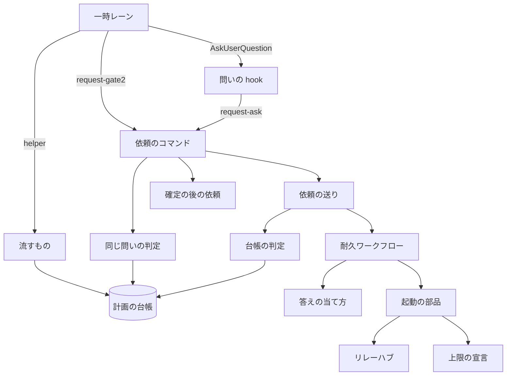
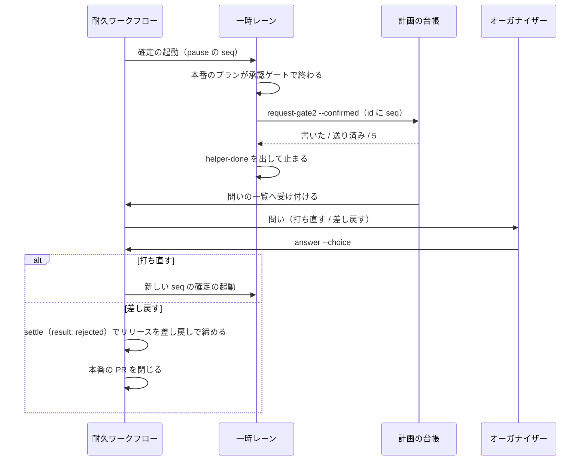
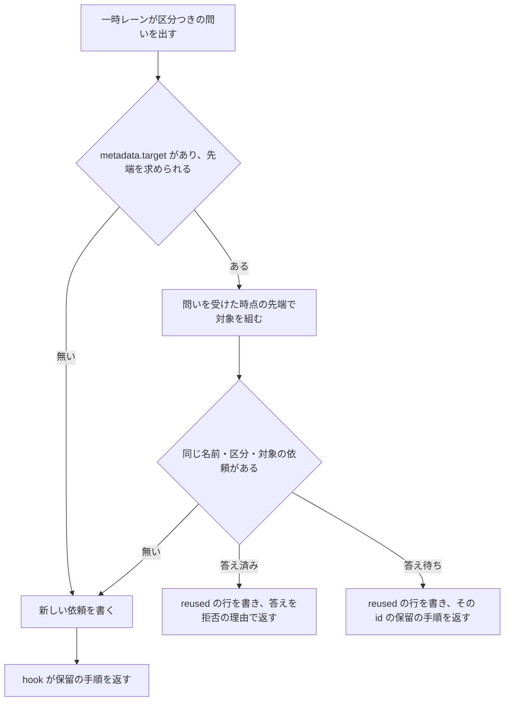
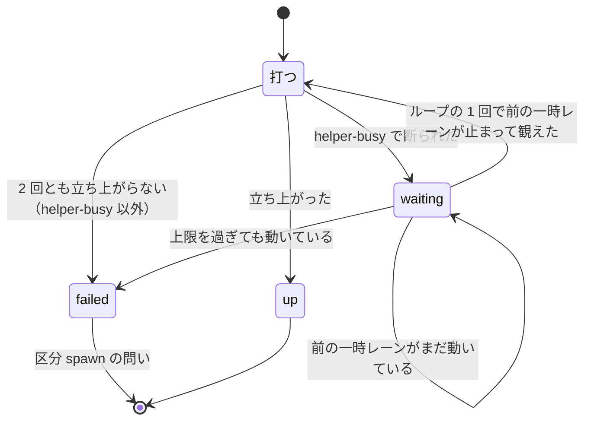

# 並列の計画の一時レーン: 確定の後の承認ゲートで依頼を送り、答えのある問いを引き継ぎ、前の一時レーンを待って起動する（#3597）

## 目的

- **今どうなっているか**: リリース承認ゲートの承認（確定）の後に本番のプランが承認ゲートで終わると、一時レーンの依頼は提示 1 の依頼と同じ id になり、台帳に書かれないまま「送った」と返る。起き直した一時レーンは、答えのある `-D` の削除の問いを新しい id で送り直す。一時レーンの起動は、前の一時レーンが動いている間に断られると、待たずに人への問いになる
- **誰に効くか**: 並列の計画でリリースを人の承認で進める利用者と、その計画のオーガナイザー
- **変えると何が成り立つか**: 確定の後の承認ゲートは「打ち直す」「差し戻す」を選ぶ依頼として人へ届く。送らなかった依頼は送ったと返らない。同じ一時レーンの同じ問いは 1 回だけ人へ届く。一時レーンどうしの起動の重なりは耐久ワークフローが待って解く

## 適用範囲

- **働く範囲**: 今の NDF（`plugins/ndf/`）の並列の計画。利用先のリポジトリでも、並列の計画を使うときに働く。ndf-next（`plugins/ndf-next/`）は変えない
- **プロジェクトごとに違うもの**: 無し（並列の計画の内部の決まりで、宣言にも引数にも出さない。待つ上限だけは上限の宣言 `contracts/limits.json` と環境変数で変えられる）
- **当たるモード**: `standard`

## あるべき姿の根拠

| 根拠 | 種類 | 何を示すか |
| --- | --- | --- |
| STD1（Idempotency-Key の標準案） | 外部の一次情報 | 同じキーの再送は、処理済みなら最初の結果に沿った応答、処理中なら 409、別の中身なら 422 で返す。黙って成功を返さない |
| PRD1（Stripe の冪等な要求） | 外部の一次情報 | 同じキーの再送には保存した最初の結果を返し、引数が違えば誤りを返す |
| PRD2（GitHub Actions の同時実行のグループ） | 外部の一次情報 | 同じグループで実行中のものがあれば、新しい実行は断られずに待ちへ入る |
| 一時レーンの稼働時間の実測（リレーハブの記録 84 回） | 実測 | 中央値 165 秒・90 パーセンタイル 2,057 秒・最大 3,512 秒。待つ上限 3,600 秒の根拠 |
| 課題の本文の「期待する結果」 | 利用者の指示の原文（起票者の文） | 黙って止まらない・同じ問いを送り直さない・前の一時レーンを待つ |

要求と受け入れ条件は #3597 の本文にある（コピーは [issue-3597-requirements.md](issue-3597-requirements.md) ）。この文書は「どう作るか」だけを扱う。
決定の記録は [issue-3597-design-decisions.md](issue-3597-design-decisions.md) に分けた。

## ドメインモデル

### コンテキスト

| コンテキスト | 何の語が 1 つの意味に決まるか |
| --- | --- |
| NDF の工程（`ndf-workflow`） | 依頼・一時レーン・計画の台帳・耐久ワークフロー・リレーハブ・確定の後の承認ゲート・同じ問い・起き直し |

変更は 1 つのコンテキストに収まる。リレーハブも同じコンテキストの語であり、関係の宣言は要らない。

### 集約

| 集約 | 持ち主（書き換えてよいもの） | 根 | エンティティ | 値オブジェクト |
| --- | --- | --- | --- | --- |
| 計画の台帳 | 台帳へ行を足す部品（`parallel_ledger.append_ledger_row`。送り手は `parallel_lane.deliver_message` を通す） | 計画の台帳 | 台帳の行（依頼・答え・答えの引き継ぎ） | 依頼の id・重複の判定のキー・問いの対象・送った結果 |
| 問いの一覧 | 耐久ワークフロー（`parallel_run._Run`） | 問いの一覧 | 問い（依頼と、耐久ワークフローが立てた問い） | 問いの区分・選択肢 |
| 起動の記録 | 耐久ワークフローの起動の部品（`parallel_launch.LaunchRouting`） | 起動の記録 | 起動の目的ごとの結果 | 起動の結果（up / failed / waiting）・空き待ちの始まりの時刻・動いている一時レーンの名前 |

台帳の行は追記だけで持ち、送ったか・答えがあるかは最新の行から引く（要求の前提 5）。

起動の記録の値（目的ごとの `up` / `failed` / `waiting`）を決めて書き換えるのは、起動の部品（`LaunchRouting`）のメソッドだけである。空き待ちの `waiting` から `up` / `failed` へ移すのも、起動の部品がループの 1 回の観測から呼ばれたときに行う。耐久ワークフロー（`_Run`）は起動の部品を継ぐ持ち主で、問いの一覧と一緒に起動の記録を台帳のチェックポイントへ保存するが、保存のときに値を変えない。今のコードでも、起動の記録へ書くのは `LaunchRouting.launch_once` だけである。

```console
$ grep -rn "launches\[" plugins/ndf/scripts/lib/parallel_launch.py plugins/ndf/scripts/lib/parallel_run.py plugins/ndf/scripts/lib/parallel_observe.py   # 2026-11-15
plugins/ndf/scripts/lib/parallel_launch.py:108:            return self.launches[purpose]
plugins/ndf/scripts/lib/parallel_launch.py:111:        self.launches[purpose] = rec
```

### 不変条件

| # | 集約 | 条件 | 破れたときの扱い |
| --- | --- | --- | --- |
| I1 | 計画の台帳 | 1 つの依頼の id は 1 つの依頼だけを指す。確定の後の承認ゲートの依頼の id は、提示の依頼の id とも、前の確定の起動の依頼の id とも重ならない | 重なる id では書かず、送り手へ「送らなかった」を返す（I2） |
| I2 | 計画の台帳 | 台帳に書かなかった依頼を、送ったと返さない。同じキーの行と中身が違う依頼は、別の依頼として断る | 同じキーで中身の違う行があれば終了コード 5。中身が同じ再送には、答え待ち・答え済み・処理済みのどれでも、最初に書いた結果（送り済み）を返す（決定 5） |
| I3 | 計画の台帳 | 答えの引き継ぎは、同じ一時レーンの名前・同じ区分・同じ問いの対象の依頼の答えに限る | 1 つでも違えば引き継がず、新しい依頼を送る |
| I4 | 計画の台帳 | 答え待ちの同じ問いがあれば、新しい依頼を作らない | 答え待ちの依頼の id を返す |
| I5 | 起動の記録 | 一時レーンの空き待ちの間は、区分 `spawn` の問いを立てない。上限を過ぎて前の一時レーンが動いていれば立てる | 待ちの間に立った問いは、テストで落とす |
| I6 | 起動の記録 | 空き待ちはループの 1 回をまたいで持ち、ループの 1 回の中で眠らない | 眠る実装は、ループの 1 回の時間を測るテストで落とす |
| I7 | 計画の台帳 | 既存の台帳の行を書き換えない | 追記の部品の外から台帳を書かない |

### ドメインイベント

| # | イベント | 発生元 | 受け手 |
| --- | --- | --- | --- |
| E1 | 提示 1 のリリース承認ゲートの依頼を台帳へ書いた | 一時レーン（`request-gate2`） | 耐久ワークフロー（問いの一覧） |
| E2 | オーガナイザーが確定（承認）の答えを送った | オーガナイザー（`confirm`） | 耐久ワークフロー（確定の起動） |
| E3 | 確定の本番のプランが承認ゲートで終わった | 本番のプラン | 一時レーン |
| E4 | 一時レーンが確定の後の承認ゲートの依頼を台帳へ書いた | 一時レーン（`request-gate2 --confirmed`） | 耐久ワークフロー（問いの一覧）・オーガナイザー |
| E5 | 一時レーンが停止した | 一時レーン | 耐久ワークフロー（途中停止の問いの判定） |
| E6 | 一時レーンが区分つきの問いを依頼として台帳へ書いた | 問いの hook（`request-ask`） | 耐久ワークフロー（問いの一覧） |
| E7 | オーガナイザーが E6 の依頼に答えを送った | オーガナイザー（`answer`） | 耐久ワークフロー（答えのイベント） |
| E8 | 同じ名前の一時レーンが起き直し、前の起動の依頼と答えを読んだ | 一時レーン（`parallel.py helper` の `asked`） | 一時レーン |
| E9 | 起き直した一時レーンが、同じ問いの答えを引き継いだ | 問いの hook（`request-ask`） | 一時レーン（hook の拒否の理由に答えが載る）・計画の台帳（`reused` の行） |
| E10 | リレーハブが一時レーン B の起動を `helper-busy` で断った | リレーハブ | 耐久ワークフロー（起動の記録を空き待ちにする） |
| E11 | 一時レーン A が止まったのを観て、B の起動を打ち直した | 耐久ワークフロー（ループの 1 回の観測） | リレーハブ・起動の記録 |

E4 は、要求の E4（依頼を台帳へ書いた、または送らない理由を記録した）から「送らない理由を記録した」場合を外した。確定の後の承認ゲートで依頼を送らない場合を持たないと決めたためである（決定 4）。番号は要求の E4 を引き継ぐ。

E8 は E7 より前に起きうる。そのときは答え待ちの同じ問いの id を返し、新しい依頼を作らない（I4）。

### 用語

| 用語 | 意味 | 用語集への反映 |
| --- | --- | --- |
| 問いの対象 | 区分つきの問いが操作する対象を表す 1 つの文字列。`<ブランチ名>@<先端のコミットの 40 桁>` か `#<課題か PR の番号>`。一時レーンは問いの `metadata.target` にブランチ名か `#<番号>` だけを載せ、先端のコミットは `request-ask` が問いを受けた時点で求めて足す | 追加（この設計の変更で用語集へ足した） |
| 答えの引き継ぎ | 起き直した一時レーンの同じ問いへ、前の起動で送った依頼の答えを当てること。新しい依頼を作らず、台帳に `reused` の行で残る | 追加（この設計の変更で用語集へ足した） |
| 一時レーンの空き待ち | 一時レーンの起動が、別の一時レーンが動いているために断られた後、耐久ワークフローが前の一時レーンが止まるまで区分 `spawn` の問いを立てずに待つこと。上限は既定 3,600 秒 | 追加（この設計の変更で用語集へ足した） |
| 確定の後の承認ゲート | 要求の用語のまま | 変えない（要求の工程で追加済み） |
| 同じ問い | 要求の用語のまま。問いの対象は `metadata.target` から読む | 変えない（要求の工程で追加済み） |

## 外部の調査

| 種類 | 調べるか | 理由 |
| --- | --- | --- |
| 標準・仕様 | 調べる | 同じキーの再送の返し方（冪等キー）と、断られた要求の打ち直しの待ち方に公開の仕様がある |
| 主要な製品 | 調べる | 決済の API と CI の製品が、冪等な要求と同時実行の重なりをどう解いているかを比べる |
| ライブラリとサービス | 調べる | 待ちと打ち直しを、すでに依存している耐久の部品（DBOS）と打ち直しのライブラリ（tenacity）で賄えるかを決める |

### 標準・仕様

| # | 標準・仕様 | 何を定めているか | 設計への反映 | 出典 |
| --- | --- | --- | --- | --- |
| STD1 | IETF の Idempotency-Key ヘッダの標準案（draft-ietf-httpapi-idempotency-key-header-08、2026-10-22。RFC になる前の案） | 同じキーの再送は、処理済みなら最初の要求の結果に沿った応答、処理中なら 409、別の中身なら 422 を返す（SHOULD）。別の中身で同じキーを使ってはならない（MUST NOT） | 同じキーで中身が同じ再送には最初の結果（送り済み）を返し、中身が違えば終了コード 5 で断る（決定 5） | https://datatracker.ietf.org/doc/draft-ietf-httpapi-idempotency-key-header/ （2026-11-15） |
| STD2 | RFC 9110 の Retry-After（10.2.3 節）と 503（15.6.4 節） | 一時的に処理できないときに、次の要求まで待つ時間を返し、クライアントは待ってから打ち直す | 一時レーンの同時数の断りを、ほかの断りと分けた結果の値で返し、耐久ワークフローが待ってから打ち直す（決定 9・決定 10） | https://www.rfc-editor.org/rfc/rfc9110.html （2026-11-15） |

### 主要な製品

| # | 製品 | どう解いているか | 設計への反映 | 出典 |
| --- | --- | --- | --- | --- |
| PRD1 | Stripe の冪等な要求 | 同じキーの再送には保存した最初の状態コードと本文を返す（500 も含む）。引数が違えば誤りを返す。キーは 24 時間を過ぎると消えうる | 中身が同じ依頼の再送には最初の結果を返し、中身が違えば断る（決定 5）。答え済みの同じ問いには、保存した最初の答えを返す（決定 7）。台帳は計画を閉じるまで消えないため、期限を置かない | https://docs.stripe.com/api/idempotent_requests （2026-11-15） |
| PRD2 | GitHub Actions の同時実行のグループ（`concurrency`） | 同じグループで実行中のものがあれば、新しい実行は `pending` で待つ。既定の待ちは 1 件で、新しいものが前の待ちと入れ替わる | 一時レーンの起動を、断りではなく空き待ちとして持つ（決定 10）。待つのは流れているリリースの 1 本だけで、入れ替えはしない | https://docs.github.com/en/actions/writing-workflows/choosing-what-your-workflow-does/control-the-concurrency-of-workflows-and-jobs （2026-11-15） |

### ライブラリとサービス

| # | 候補 | 版 | ライセンス | 最後のリリースの日付 | 終了のアナウンス | 要件を満たすか | 出典 |
| --- | --- | --- | --- | --- | --- | --- | --- |
| LIB1 | DBOS（`DBOS.sleep`・`DBOS.recv` のタイムアウト。リポジトリは 3.1.0 を固定） | 3.5.0 | MIT | 2026-11-10 | 無し | 一部。耐久の待ちは持つが、ループの 1 回の中で眠ると他のレーンの観測と答えの処理が止まる（非機能の可用性）。待ちの判定は既存の耐久ステップの記録で持てる | https://docs.dbos.dev/python/reference/contexts ・ https://pypi.org/pypi/dbos/json （2026-11-15） |
| LIB2 | tenacity（リポジトリは 9.1.4 を固定。`waits` の土台） | 9.2.1 | Apache-2.0 | 2026-10-07 | 無し | 満たさない。同じ呼び出しを同じプロセスの中で打ち直す部品で、ループの 1 回をまたぐ待ちを持たない | https://pypi.org/pypi/tenacity/json （2026-11-15） |

### 確かめられなかったこと

| 対象 | 試した手段 | 結果と理由 |
| --- | --- | --- |
| Claude Code の `AskUserQuestion` が、`metadata` の `source` 以外の欄を PreToolUse の hook へ渡すか | 手元の `claude -p`（Haiku）に `metadata.target` を付けた呼び出しを打たせ、hook で入力を保存した。実行ファイルの中の説明文も読んだ | `claude -p` では `AskUserQuestion` が使えず、呼び出しが起きなかった。説明文は「追跡と分析のための任意の metadata」とだけあり、欄の形は読めなかった |

調べた量: 候補 6 件・取得の試み 10 回。

## 機能一覧

| # | 機能 | 誰が使うか |
| --- | --- | --- |
| F1 | 確定の後の承認ゲートの依頼（`request-gate2 --confirmed`）と、その答え「打ち直す」「差し戻す」の当て方 | 一時レーン・オーガナイザー・耐久ワークフロー |
| F2 | 送らなかった依頼を送ったと返さない、依頼のコマンドの結果 | 一時レーン・レーン・問いの hook |
| F3 | 同じ問いの答えの引き継ぎと、答え待ちの同じ問いの id の引き継ぎ | 一時レーン（問いの hook を通す） |
| F4 | 起き直した一時レーンが前の依頼と答えを読む場所（`parallel.py helper` の `asked`） | 一時レーン |
| F5 | 一時レーンの空き待ち | 耐久ワークフロー |

## 構成要素

| 要素 | 責務 |
| --- | --- |
| 依頼の送り（`lib/parallel_lane.py` の `deliver_message`） | 台帳へ書いた結果（書いた / 同じキーの行があった）を呼び出し元へ返す。返さずに捨てない |
| 台帳の判定（`lib/parallel_ledger.py`） | 同じキーの行と中身（`at` を除いた `msg`）が同じかを判定し、同じなら答え済みか処理済みかを返す。行の種類 `reused` を足す。処理済みのリリース承認ゲートの判定（`settled_gates`）は、確定の後の依頼（`after: confirmed`）を確定の行では処理済みにせず、その id の答えの行かそれより後の締めの行があるときだけ処理済みにする |
| 確定の後の依頼（`lib/parallel_gate2.py` を新設。`request_gate2` を `parallel_lane.py` から移す） | 提示の依頼と、確定の後の依頼の id と中身を組む。確定の後の依頼への答えの当て方（`_Run` が継ぐ部品）と、本番の PR を閉じる耐久ステップも持つ。`parallel_lane.py` は 499 行、`parallel_run.py` は行数の例外の 840 行で、足すと行数の検査の上限を超えるため分ける |
| 同じ問いの判定（`lib/parallel_question.py`） | 問いの対象を読み、同じ一時レーンの名前・区分・対象の最新の依頼と、その答えを台帳から引く。純粋な関数で、台帳の行を受け取る |
| 依頼のコマンド（`parallel.py` の `request`・`request-ask`・`request-gate2`・`answer`・`confirm`・`settle`） | 送った結果に応じて終了コードと結果を返す。`request-ask` は、`metadata.target` のブランチ名へ問いを受けた時点の先端のコミットを `git rev-parse` で求めて問いの対象を組み、同じ問いを先に引く |
| 問いの hook（`hook_lib/ask_guard.py`） | `request-ask` が答えを引き継いだら、答えを拒否の理由に載せて返す。答え待ちの同じ問いなら、その id で保留の手順を返す。対象を組むのは `request-ask` で、hook は `metadata` をそのまま渡す |
| 一時レーンの流すもの（`lib/parallel_helper.py` の `helper_task`） | `phase: confirmed` で、確定の後の依頼の 1 行（`gate2`）を返す。自分の名前の前の依頼と答え（`asked`）を返す |
| 耐久ワークフローの答えの当て方（`lib/parallel_run.py` の `apply_own` から `parallel_gate2.py` の部品を呼ぶ） | 確定の後の依頼の「打ち直す」で確定の起動を新しい目的で流し直す。「差し戻す」で、締めの再開（`settle`）と同じメソッド `settle` を `result: rejected` で呼んでリリースを差し戻しとして締め、本番の PR を閉じる。締めは `parallel.py settle --rejected` と同じく `_release_result`（本番のプランの done を読む部品）を通らない |
| 途中停止の問いの判定（`lib/parallel_observe.py` の `_ask_helper`） | 変えない。今の判定は問いの一覧に同じ連番の種類 `gate2` の問いがあれば問いを立てず、id と `after` を見ないため、確定の後の依頼でも立たない（決定 4）。テストで縛る |
| 起動の部品（`lib/parallel_launch.py` の `LaunchRouting`） | `helper-busy` の断りを 2 回目を打たずに返し、起動の記録を空き待ちにする。ループの 1 回ごとに空き待ちを読み直し、前の一時レーンが止まれば打ち直し、上限を過ぎれば区分 `spawn` の問いを立てる。起動の記録の値を書き換える唯一の部品で、記録のある目的を打ち直さない今の決まり（`launch_once`）の例外は `waiting` だけにする |
| リレーハブ（`relay_lib/hub.py` の `Hub.judge`） | 一時レーンの同時数の断りを結果の値 `helper-busy` で返し、動いている一時レーンの名前を載せる。全体の上限の断りは `limit` のまま |
| 上限の宣言（`contracts/limits.json`） | 空き待ちの上限 `parallel-launch.helper-wait`（既定 3,600 秒）を持つ。`NDF_PARALLEL_HELPER_WAIT_SECONDS` で変えられる |
| 手順書（`references/parallel.md`・`references/asking.md`） | 一時レーンの手順・起動と再起動・オーガナイザーの答え方・一時レーンの答えの読み方を、上の振る舞いに合わせる |



手順書は、上の要素の振る舞いを書き写す先で、図に含めない。

## データ構造

台帳（`ledger.jsonl`）の行の形（`v`・`key`・`kind`・`id`・`at`・`by`・`ver`・`msg`）は変えない。足すのは行の種類 1 つと、既存の種類の `msg` の欄である。

| 行の種類 | 重複の判定のキー | `msg` の欄 | 変更 |
| --- | --- | --- | --- |
| `gate2`（提示） | `gate2:<計画名>-p<連番>-<提示>` | `n`・`k`・`report`・`stamp`（提示したコミット） | 変えない |
| `gate2`（確定の後） | `gate2:<計画名>-p<連番>-<提示>-c<確定の起動の連番>` | 提示の欄に `after: "confirmed"`・`reason`（承認ゲートの判定の理由）・`pr`（本番の PR の番号）・`options: ["打ち直す", "差し戻す"]` を足す。`stamp` は承認したコミット | 足す |
| `ask` | `ask:<送り手>-q<判定の記録の id>` | 既存の欄に `target`（`request-ask` が組んだ問いの対象。`metadata.target` が無いか、ブランチの先端を求められなければ欄を置かない）を足す | 欄を足す |
| `reused` | `reused:<引き継いだ依頼の id>:<判定の記録の id>` | `id`（引き継いだ依頼）・`lane`・`source`・`target`・`ledger_id`（今の問いの判定の記録の id）・`result`（`answered` / `pending`） | 種類を足す |

確定の起動の連番は、耐久ワークフローが確定の起動で立てるイベント `pause` の `seq` である。打ち直しは新しいイベント `pause` を立てるため、連番が変わる。

`reused` は問いではない。耐久ワークフローが受け取る種類（`TAKE`）と問いの種類（`QUESTIONS`）に入れず、知っている種類（`KINDS`）にだけ入れる。

起動の記録（台帳のチェックポイントの `launches`）の目的ごとの値に、`result: "waiting"`・`since`（最初に断られた時刻）・`busy`（動いている一時レーンの名前）を足す。待ちの後に立ち上がったら `result: "up"` に `waited: {"busy": <名前>, "seconds": <秒>}` を残す。

## 入出力の契約

### 依頼のコマンドの終了コード

| 台帳の状態 | `request` | `request-gate2` | `request-ask` |
| --- | --- | --- | --- |
| 書いた | 10（今と同じ） | 0（今と同じ） | 0（今と同じ） |
| 同じキーの行があり、中身が同じ（答え待ち・答え済み・処理済みのどれでも） | 10。`metrics.already: true`、`metrics.answered`（答えの行があれば `true`）、要約は「送り済み」 | 0。同上 | 0。同上 |
| 同じキーの行があり、中身が違う | 5。`status: stopped`、`metrics.existing` に id、`metrics.reason` に理由 | 5。同上 | 5。同上 |
| 同じ問いが答え済み（`metadata.target` があるときだけ） | — | — | 0。`metrics.reused: "answered"`・`metrics.id`（引き継いだ依頼）・`metrics.answer`（答えの `choice` と `result`） |
| 同じ問いが答え待ち | — | — | 0。`metrics.reused: "pending"`・`metrics.id` |
| 台帳を書けない・読めない | 2（今と同じ） | 2（今と同じ） | 2（今と同じ） |

中身が同じとは、送るたびに変わる欄（`at`）を除いた `msg` が一致することを指す。答え済みは台帳に同じ id の `answer` の行があること、処理済みは処理済みのリリース承認ゲート（`settled_gates`）に入ることを指す。
レーンが答えを受けた後に起き直して `request` を打ち直すと、中身が同じため 10 と送り済みが返り、続く `parallel.py await` が答えを読んで進む。今の振る舞いと同じである（受け入れ条件 12）。
`answer`・`confirm`・`settle`・`stop` は依頼ではないため終了コードを変えず、同じキーの行があれば要約を「送り済み」にして `metrics.already: true` を足す。

### `request-gate2` の引数

```text
parallel.py request-gate2 <計画名> <連番> <提示> --report <承認資料>            # 提示（今と同じ）
parallel.py request-gate2 <計画名> <連番> <提示> --confirmed --done <本番のプランの done>
```

`--confirmed` は、耐久ワークフローの最後の確定の起動（イベント `pause`）の連番と、`--done` の承認ゲートの理由と本番の PR の番号から依頼を組む。最後の起動が同じ連番と提示の確定でなければ終了コード 4 で断る。

### `parallel.py helper` の結果

| 欄 | `phase` | 中身 |
| --- | --- | --- |
| `gate2` | `present` | 今と同じ（提示の依頼の 1 行） |
| `gate2` | `confirmed` | 確定の後の依頼の 1 行（`request-gate2 ... --confirmed --done <release-done.json>`） |
| `asked` | 両方 | 自分の名前の一時レーンが送った依頼の一覧。依頼ごとに `id`・`kind`・`source`・`target`・`at` と、答えがあれば `answer`（`result`・`choice`） |

### 問いの入力

一時レーンが操作の対象を持つ区分つきの問い（`ndf-ask:redline:*` と `ndf-ask:irreversible`）を出すときは、`metadata` に `target` としてブランチ名か `#<番号>` を載せる。先端のコミットは書かない。

```json
{"metadata": {"source": "ndf-ask:redline:C4", "target": "sprint/lr-t2"}}
```

`request-ask` は、問いを出した作業ディレクトリでブランチ名の先端を `git rev-parse --verify` で求め、`sprint/lr-t2@81d3baa54ee35f6fc217376a78ed3820df8612e9` の形の問いの対象を組む。`#<番号>` はそのまま対象にする。

| 一時レーンの載せ方 | 起きること |
| --- | --- |
| `target` を載せ忘れた | 今と同じく新しい依頼になり、同じ問いが人へもう一度届く。前の答えは当たらない |
| 先端を求められないブランチ名を載せた | `target` の欄を置かずに新しい依頼にする |
| 正しいブランチ名を載せた | 問いを受けた時点の先端で対象を組む。一時レーンが古い先端を書き写す道が無いため、先端が動いた後の問いに前の答えは当たらない（受け入れ条件 6） |

一時レーンの手順に頼る部分は「ブランチ名を載せるか」だけで、載せ忘れても前の答えを別の先端へ当てる側には倒れない。

### オーガナイザーの答え方

| 依頼 | 問いの答え | 送るコマンド |
| --- | --- | --- |
| `gate2` で `after: confirmed` | 「打ち直す」「差し戻す」。止まった理由と本番の PR の URL を添えて問う | `parallel.py answer <計画名> <id> --choice 打ち直す` / `--choice 差し戻す` |

## 処理の流れ

### 確定の後の承認ゲート



「差し戻す」の締めは、`parallel.py settle --rejected` が送る締めの再開と同じメソッド（`_Run.settle` から `_answer_settled`）を通る。範囲のレーンの依頼へは、提示の差し戻しと同じ `rejected` と理由が返る。今の `_release_result` が確定の後の締めを終了コード 4 で断るのは、本番のプランの done を読んで `settle` を送るコマンドの側で、耐久ワークフローの中の締めは通らない。

本番の PR（リリース 17 では PR #3593）は、耐久ワークフローが `gh pr close` で閉じ、コメントに差し戻しの理由と依頼の id を残す。閉じた PR は開き直せるため、戻せない操作（C4）に当たらない。次のリリースの本番のプランは、開いている本番の PR だけを使い回す（`release-steps.py` の `_merge_prod_pr` が `find_pr(..., states=("OPEN",))` で探す）ため、閉じた PR を使い回さずに新しい PR を作り、提示から承認を取り直す。PR を閉じられなかったときも締めは進め、閉じられなかったことを締めの理由に足す。

### 同じ問いの引き継ぎ



先端のコミットが動いた問いは対象の文字列が違うため、「無い」へ進む。別の名前の一時レーンの依頼は、名前が違うため「無い」へ進む。

### 一時レーンの空き待ち



空き待ちの読み直しは、ループの 1 回の観測（`_tick_govern`）で再起動の対象と同じ時点に行う。待つ間も他のレーンの観測と答えの処理は止まらない。

## 非機能の実現方式

| 大項目 | 条件 | 実現方式 |
| --- | --- | --- |
| 可用性 | 待つ間も耐久ワークフローは他のレーンの観測と答えの処理を止めない | 空き待ちは起動の記録に持ち、ループの 1 回ごとに 1 度だけ読み直す。眠る呼び出しを置かない |
| 運用・保守性 | 送らなかった依頼・引き継いだ問い・待ってから打ち直した起動が、id・対象・理由と一緒に残る | 送らなかった依頼は結果の `metrics.existing` と `reason`、引き継いだ問いは台帳の `reused` の行、待った起動は起動の記録の `waited` |
| セキュリティ | 戻せない操作の答えは、同じ一時レーンの名前・同じ対象の問いにだけ当てる | 問いの対象に、`request-ask` が問いを受けた時点で求めた先端のコミットの 40 桁を含め、名前と区分と対象の 3 つが一致したときだけ引き継ぐ（I3）。一時レーンは先端を書かない |

## 決定の記録

[issue-3597-design-decisions.md](issue-3597-design-decisions.md) にある。

## テスト設計

| 受け入れ条件・不変条件 | どの振る舞いで縛るか | どう壊したら落ちるべきか |
| --- | --- | --- |
| 受け入れ条件 1・I1 | 提示 1 の依頼と確定の答えのある台帳で `request-gate2 --confirmed` を打つと、提示の id と違う id の行が 1 行増え、止まった理由と本番の PR の番号が載る | id を `<計画名>-p<連番>-<提示>` のままにする / 理由か PR の番号を落とす |
| 受け入れ条件 2 | 確定の起動の後の `parallel.py helper` が、`--confirmed` の `gate2` の 1 行と `settle` の 1 行を返す | `phase: confirmed` で提示の `gate2` を返す |
| 受け入れ条件 3・I2 | 同じキーで中身の違う行があると、3 つの依頼のコマンドが終了コード 5 と既にある id と理由を返す。中身が同じ再送は、答え待ち・答え済みのどちらでも送り済みと返し、台帳の行が増えない | `deliver_message` の結果を捨てる / 中身を比べずに答え済みを 5 で断る |
| 受け入れ条件 12・I2 | 答えのある `request` の依頼を同じ id と中身で打ち直すと、終了コード 10・`metrics.already: true`・`metrics.answered: true` が返り、続く `parallel.py await` が答えを読む | 答え済みの再送を 5 で断る |
| 受け入れ条件 4 | 確定の後の承認ゲートの依頼（id が `-c<連番>`、`after: confirmed`）が問いの一覧にある一時レーンが止まっても、区分 `helper` の問いが立たない。台帳のチェックポイントを挟んでも、確定の行で処理済みにならない | 途中停止の問いの判定に id か `after` の条件を足す / `settled_gates` が確定の行で確定の後の依頼を処理済みにする |
| 決定 2 の差し戻し | 確定の後の依頼に「差し戻す」を答えると、範囲のレーンの依頼へ `parallel.py settle --rejected` と同じ `rejected` と理由が返り、本番の PR を閉じる呼び出しが 1 回起きる。閉じる呼び出しが失敗しても締めは進む | 差し戻しで `_release_result` を通す / 範囲のレーンへ返す結果を変える / PR を閉じない |
| 受け入れ条件 5・I3 | 答え済みの同じ問い（名前・区分・対象が同じ）を出すと、依頼の行が増えず、`reused` の行と答えが返る | 対象を比べずに区分だけで引き継ぐ / 答えを返さない |
| 受け入れ条件 6 | 同じブランチ名の `target` でも、問いを受けた時点の先端のコミットが違えば、新しい依頼の行になる。先端を求められないブランチ名は `target` の欄の無い新しい依頼になる | 対象からコミットを外してブランチ名だけで比べる / 一時レーンが書いた文字列をそのまま対象にする |
| 受け入れ条件 7・I4 | 答え待ちの同じ問いを出すと、依頼の行が増えず、答え待ちの id が返る | 答え待ちのときに新しい依頼を作る |
| 受け入れ条件 8 | 別の名前の一時レーンの答え済みの同じ対象の問いは、引き継がずに新しい依頼になる | 名前を比べずに引き継ぐ |
| 受け入れ条件 9・I5 | `helper-busy` で断られた起動は問いを立てず空き待ちになり、前の一時レーンが止まって観えたループの 1 回で打ち直して立ち上がり、起動の記録に `waited` が残る | 断りで問いを立てる / 止まった後も打ち直さない |
| 受け入れ条件 10 | 上限を過ぎても前の一時レーンが動いていると、区分 `spawn` の問いが立ち、本文に一時レーンの同時数の上限と前の一時レーンの名前が出る | 上限を見ない / 本文に名前を載せない |
| 受け入れ条件 11 | `limit`（全体の上限）・名前の重なり・tmux の失敗の断りは、今と同じく 1 回だけ打ち直し、2 回とも立ち上がらなければ問いが立つ | `limit` も空き待ちにする |
| I6 | 空き待ちの間のループの 1 回が、眠らずに次の手順へ進む | ループの 1 回の中で前の一時レーンを待つ |
| I7 | 引き継ぎ・送り済み・5 のどれでも、既存の行のバイト列が変わらない | 既存の行を書き換えて答えを足す |
| リレーハブ | 動いている一時レーンがあると、一時レーンの起動が `helper-busy` と動いている名前で断られ、ほかの役割は `limit` のまま | 一時レーンの断りを `limit` のまま返す |
| 受け入れ条件 12 | 既存の `tests/test_parallel_*.py`・`tests/test_ask_guard.py`・`tests/test_relay_hub.py` が通る | 提示の依頼・`settle`・区分 `helper` の問いの条件を変える |
| 受け入れ条件 13・14 | 決定の記録の決定 11（ndf-next）と決定 2 の対応表（#3572）の行で確かめる。テストは書かない | — |
| 受け入れ条件 15 | 実装の PR の差分に `plugins/ndf-next/` が無いことを、PR の変更ファイルの一覧で確かめる | — |

## 設計の結果

| 課題 | 扱い | 取り込み先 | 触るファイル |
| --- | --- | --- | --- |
| #3597 | 実装する | — | `plugins/ndf/scripts/parallel.py`、`plugins/ndf/scripts/lib/parallel_lane.py`、`plugins/ndf/scripts/lib/parallel_gate2.py`（新設）、`plugins/ndf/scripts/lib/parallel_ledger.py`、`plugins/ndf/scripts/lib/parallel_question.py`、`plugins/ndf/scripts/lib/parallel_helper.py`、`plugins/ndf/scripts/lib/parallel_run.py`、`plugins/ndf/scripts/lib/parallel_launch.py`、`plugins/ndf/scripts/lib/parallel_args.py`、`plugins/ndf/scripts/lib/parallel_answer.py`、`scripts/script-structure-allow/plugins__ndf__scripts__lib__parallel_run.py--lines.json`、`plugins/ndf/scripts/relay_lib/hub.py`、`plugins/ndf/scripts/hook_lib/ask_guard.py`、`plugins/ndf/contracts/limits.json`、`plugins/ndf/skills/development-workflow/references/parallel.md`、`plugins/ndf/skills/development-workflow/references/asking.md`、`plugins/ndf/scripts/tests/test_parallel_lane.py`、`plugins/ndf/scripts/tests/test_parallel_ledger.py`、`plugins/ndf/scripts/tests/test_parallel_launch.py`、`plugins/ndf/scripts/tests/test_parallel_run.py`、`plugins/ndf/scripts/tests/test_ask_guard.py`、`plugins/ndf/scripts/tests/test_relay_hub.py` |

途中停止の問いの判定（`plugins/ndf/scripts/lib/parallel_observe.py`）は変えず、受け入れ条件 4 のテストは `test_parallel_run.py` に置く。

用語集（`docs/glossary.md`・`docs/glossary/glossary.json`）は、用語の表の 3 語をこの設計の変更で足した。実装の変更では触らない。

## 人へ残す判断

| 判断 | 材料 | 選べる道 |
| --- | --- | --- |
| `metadata.target` が問いの hook へ届くことを確かめないまま、受け入れ条件 5〜8 の直しを含めて設計を承認するか | 受け入れ条件 5〜8 の直し（同じ問いの答えの引き継ぎ）は、Claude Code の `AskUserQuestion` が `metadata` の `source` 以外の欄を PreToolUse の hook へ渡すことに頼る。手元の `claude -p` では `AskUserQuestion` が使えず、確かめられなかった（外部の調査の「確かめられなかったこと」）。届かなくても、`target` の無い問いと同じく新しい依頼になるだけで、前の答えを別の対象へ当てる側には倒れない（問いの入力） | 承認して実装の最初にリレーの対話のセッションで 1 回打って確かめ、届かなければ受け入れ条件 5〜8 の実装を止めて人へ戻す / 確かめるまで受け入れ条件 5〜8 を別の課題へ分け、残りの受け入れ条件だけで進める |

## 未確認のまま残ること

| 項目 | 内容 |
| --- | --- |
| `metadata.target` が hook へ届くか | 確かめられていない。扱いは「人へ残す判断」の表にある |
| 実際の重なりでの振る舞い | 確定の後の承認ゲート・一時レーンの起き直し・一時レーンの起動の重なりが次の並列の計画のリリースで起きたときに、台帳と起動の記録で受け入れ条件 1・5・9 を確かめる（リリース後テスト）。起きなければ未確認のまま残る |
