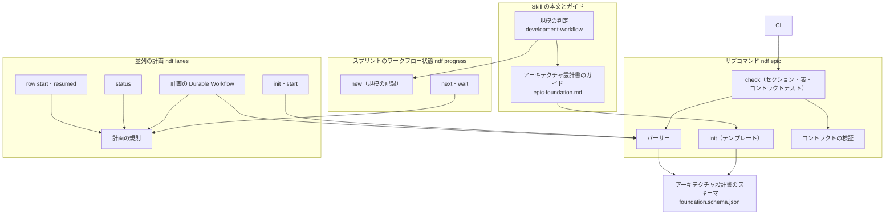
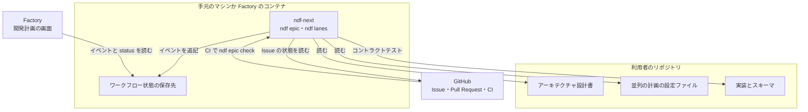
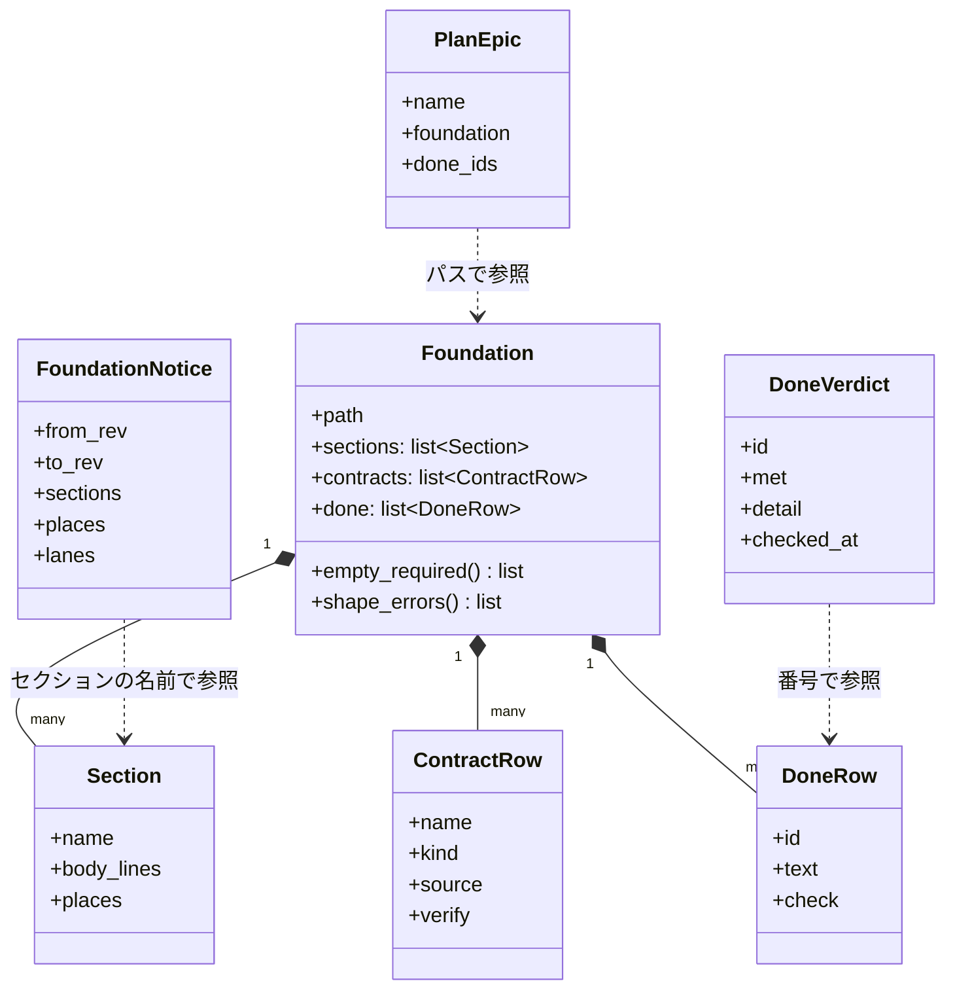
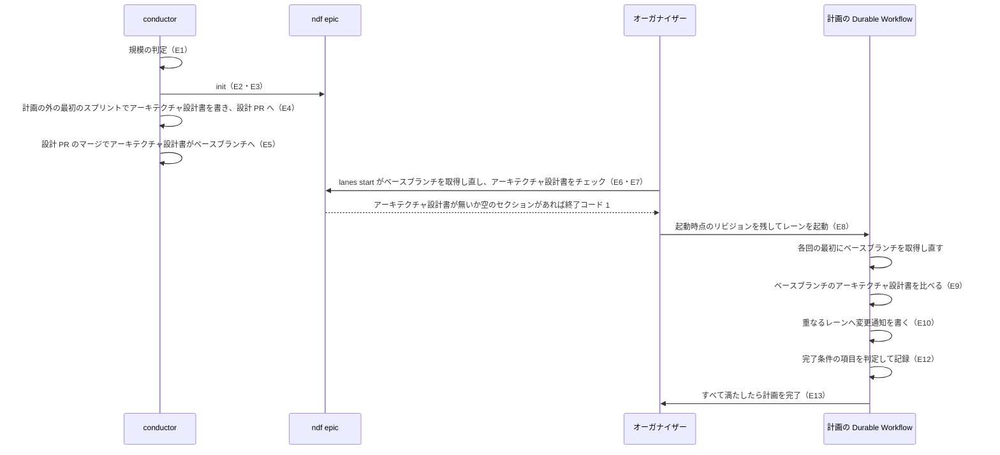
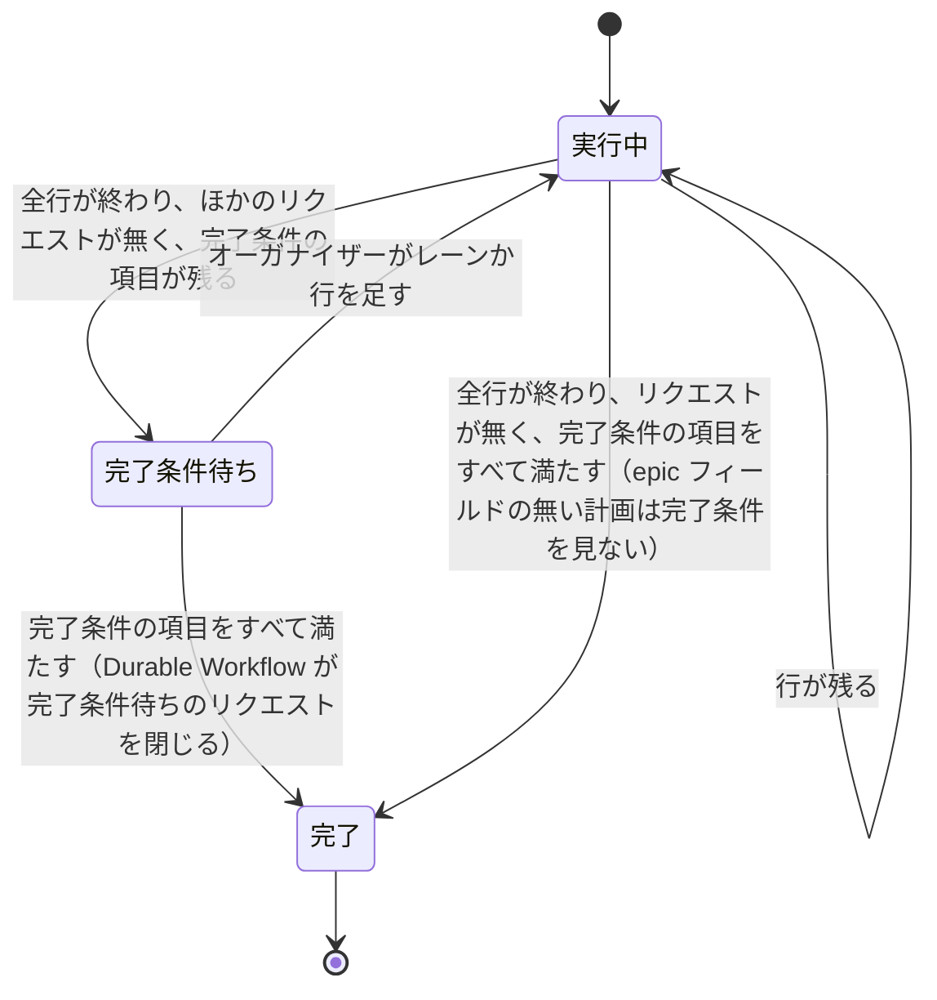

# エピック: 全レーンが読むアーキテクチャ設計書を先に置き、起動前チェックと CI で守らせる（#3600）

## 目的

- **今どうなっているか**: NDF の工程はスプリントまでしか扱わない。複数のスプリントやレーンにまたがる作業でも、全体の設計・入出力のコントラクト・データ構造・設定を先にまとめる手順と配置先が無い。ndf-next 11.0（#1142）では、横断の仕様を走りながら後から書いた。その結果、閉じたサブ Issue への追補が 10 単位、マージ済みの不具合が 12 件、着手の停止が 2 回起きた
- **誰に効くか**: エピックを並列の計画で進めるオーガナイザーと、各レーンの conductor・worker。Factory で開発計画を見る利用者
- **変えると何が成り立つか**: エピックの全レーンが同じ 1 つのアーキテクチャ設計書を先に読む。アーキテクチャ設計書の必須セクションが空のままではレーンが起動しない。アーキテクチャ設計書のコントラクトと実装の食い違いは CI のコントラクトテストが落とす。並列の計画は、全レーンが止まったときではなく、エピックの完了条件を満たしたときに終わる

## 適用範囲

- **働く範囲**: NDF を使うすべてのリポジトリ。実装の配置先は 11.x の ndf-next（`plugins/ndf-next/`）で、今の `plugins/ndf/` には足さない
- **プロジェクトごとに違うもの**: アーキテクチャ設計書の配置先と、検証に使うコマンド・ファイルの位置。アーキテクチャ設計書（パス）と並列の計画の設定ファイル（`plan.json` のフィールド）で受ける。NDF の側に既定の配置先を持たせない
- **当たるモード**: モードを問わず、エピックに当たる作業に当たる。アーキテクチャ設計書を載せる最初のスプリントは、判定したモードと進め方にかかわらず、モード `standard`・進め方 `normal` で進める。`ndf progress new` がこの組み合わせ以外を断る（決定 2）
- **最初のスプリントの位置**: 最初のスプリントは並列の計画の外で、単独のスプリントとして走る。並列の計画は、その設計 PR がマージされ、アーキテクチャ設計書がベースブランチに入った後（E5 の後）にだけ起動できる（決定 18）

## あるべき姿の根拠

| 根拠 | 種類 | 何を示すか |
| --- | --- | --- |
| STD1（arc42 の横断の概念） | 外部の一次情報 | 複数の構成要素にまたがる概念を 1 か所にまとめ、必要な話題だけを選ぶ |
| STD3（Google の design doc） | 外部の一次情報 | 目標と非目標・横断の関心事を先に書き、書く価値の無い小さな作業には書かない |
| STD4（KEP の implementable） | 外部の一次情報 | 設計の詳細・テストの計画・段階の基準がそろうまで実装可能にしない |
| STD5（ADR） | 外部の一次情報 | 決定を 1 件ずつ残し、覆したものは消さずに superseded と記す |
| PRD3（Böckeler の SDD の比較） | 外部の一次情報 | 小さな作業に仕様の工程は重く、エージェントは仕様の文を守り切らない |
| #1142 の時系列（要求の「目的」） | 実測 | コントラクト・規約の文書がサブ Issue の実装の後から生まれ、追補 10・不具合 12・停止 2 回が起きた |
| 利用者の決定（2026-11-15） | 利用者の指示の原文 | 呼び名はエピック、新しい Skill と承認ゲートを足さない、Factory の画面への影響のセクションを置く。設計文書は業界の語で書く |

要求と受け入れ条件は #3600 の本文にある（コピーは [issue-3600-requirements.md](issue-3600-requirements.md) ）。この文書は「どう作るか」だけを扱う。ADR（設計判断の記録）は [issue-3600-design-decisions.md](issue-3600-design-decisions.md) にある。

## ドメインモデル

### 境界づけられたコンテキスト

| 境界づけられたコンテキスト | 何の語が 1 つの意味に決まるか |
| --- | --- |
| NDF の開発ワークフロー（`ndf-workflow`） | エピック・エピックのアーキテクチャ設計書・エピックの完了条件・並列の計画・レーン・規模の判定 |
| Neural Development Factory（`ndf-factory`） | 開発計画の画面・レーンの状況・承認待ちの一覧 |

関係は**公表された言語**とする。公表された言語は、NDF のコントラクトが形を持つ次の 3 つである。Factory はこの 3 つだけを通して NDF とやり取りし、NDF の集約の中身を直接書かない。

| 公表された言語 | Factory の使い方 |
| --- | --- |
| 計画の設定ファイル（用語集の「宣言」）のスキーマ（`parallel-plan.schema.json`。`epic` フィールドを含む） | 開発計画を作るときに、スキーマに沿った設定ファイルを渡して `ndf lanes init` を実行する。計画を書くのは `ndf lanes init` であり、Factory ではない |
| サブコマンド（用語集の「副命令」）の結果 JSON（`result.schema.json` の形） | `ndf lanes init`・`start`・`status` の結果を読む。起動前チェックの指摘は `ndf lanes init`・`start` の結果の `items` に載る。完了条件の項目の文・判定結果と、計画が完了条件待ち（全レーンの行が終わったが、完了条件の項目が残っている状態。「用語」で定める）かどうかは `status` の結果に載る |
| 計画とレーンのワークフロー状態（用語集の「進行表」）のイベント（`progress.json`） | 進捗・変更通知・完了を読む |

アーキテクチャ設計書と完了条件の形は NDF のコントラクト（スキーマ）が持つ。Factory はアーキテクチャ設計書を解析せず、画面に出す中身（項目の文・完了条件待ちかどうか）は `status` の結果から読む。完了の規則（I5）を Factory の側で組み直さない。

### 集約

| 集約 | 所有者（書き換えてよいもの） | 集約ルート | エンティティ | 値オブジェクト |
| --- | --- | --- | --- | --- |
| エピックのアーキテクチャ設計書 | アーキテクチャ設計書を書き換える Pull Request（設計 PR か実装 PR。マージで確定する） | アーキテクチャ設計書 1 本 | セクション・コントラクトの行・完了条件の行 | セクションの名前・コントラクトの検証方法・完了条件の確認方法・触るファイル |
| 並列の計画（既存） | オーガナイザー（設定ファイル・起動・レーンとリクエストの変更）。計画の Durable Workflow（用語集の「耐久ワークフロー」）は、既存のコントラクト（`progress.json` の書き手 `durable`・`workflow`）が許すイベントだけをオーガナイザーの代わりに書く | 計画のワークフロー状態 | レーン・リクエスト（用語集の「依頼」）・変更通知 | `epic` フィールド（名前・アーキテクチャ設計書のパス・この計画の完了条件の番号）・完了条件の判定結果・起動時点のアーキテクチャ設計書のリビジョン |
| レーンのワークフロー状態（既存） | レーンの conductor（`row start`・`row resumed`・`ndf progress next`・`wait` を実行した者） | レーンのワークフロー状態 | 既読フラグ | 読んだ最後の変更通知の、計画のワークフロー状態でのイベントの番号 |

計画のワークフロー状態の書き手は、既存のオーガナイザーと Durable Workflow の 2 つから増やさない。レーンが変更通知を読んだことを表す既読フラグ（`notice_read`）は、レーンの conductor が持つレーンのワークフロー状態の集約に書く（決定 13）。変更通知（計画の集約）と既読フラグ（レーンの集約）は、それぞれの所有者だけが書く。

**エピックそのものは集約にしない。** エピックはアーキテクチャ設計書 1 本と、それを指す 1 つ以上の並列の計画で表す。状態はそれぞれの所有者が持ち、エピックの側にコピーしない（決定 4）。

並列の計画はアーキテクチャ設計書を **パスで参照する**（ほかの集約は ID で参照する規則）。アーキテクチャ設計書の中身を計画のワークフロー状態へコピーしない。

### 不変条件

| # | 集約 | 条件 | 破れたときの扱い |
| --- | --- | --- | --- |
| I1 | エピックのアーキテクチャ設計書 | 必須セクションがすべてあり、どれも空でない | 起動前チェックが空のセクションの名前を出し、終了コード 1 で落ちる。レーンを起動しない |
| I2 | エピックのアーキテクチャ設計書 | コントラクトの行と完了条件の行は、決められた列の形を持つ | チェックが行の番号と列の名前を出して落ちる |
| I3 | エピックのアーキテクチャ設計書 | 検証方法を持つコントラクトの行は、実装と食い違わない | CI のコントラクトテストがコントラクトの名前と食い違いの中身を出して落ちる |
| I4 | 並列の計画 | `epic` フィールドの完了条件の番号は 1 つ以上ある | 計画の設定ファイルのスキーマのチェックで落ちる |
| I10 | 並列の計画 | `epic` フィールドの完了条件の番号は、ベースブランチのアーキテクチャ設計書の完了条件の表にある | 起動のときは、`ndf lanes init`・`start` が無い番号を出して落ちる（指摘の種類 `unknown-done`）。起動の後にアーキテクチャ設計書を書き換える Pull Request が行を消すか番号を付け替えたときは、Durable Workflow が判定のたびに検出する。無い番号を満たしていない（`met: false`、理由は「アーキテクチャ設計書に無い番号」）と記録し、リクエストを 1 件開く（中身の `epic_key` が `unknown-done:<無い番号の並び>`）。起動の後に計画の `epic`（`done`）を書き換える経路は持たないため、オーガナイザーはアーキテクチャ設計書を直す Pull Request をベースブランチへ入れる。無い番号がなくなれば Durable Workflow が閉じる |
| I5 | 並列の計画 | `epic` フィールドを持つ計画は、全レーンの行が終わり、この計画の完了条件の項目をすべて満たし、完了条件待ちのリクエストのほかに答えていないリクエストが無いときだけ完了になる。満たしたかは、全行が終わった後の最新の判定の回が、すべての項目を判定し直せたときの結果で決める。ベースブランチの取得・アーキテクチャ設計書の読み取り・判定の作業ディレクトリの作成・Issue の状態の取得のどれかに失敗した回は、前の判定を `status` の表示に残しても、完了にしない | 完了にせず、残りの完了条件の項目を `status` に出す。完了条件待ちのリクエストの開き方と閉じ方は「計画の終了判定」に従う |
| I6 | 並列の計画 | `epic` フィールドを持たない計画は、今と同じチェックと終了判定で動く | — （フィールドの有無で分岐し、フィールドが無ければ新しい規則を当てない） |
| I7 | 並列の計画 | 変更通知は、変更の触るファイルと重なるファイルを触るレーンにだけ届く | 重ならないレーンへは書かない |
| I8 | 並列の計画とレーンのワークフロー状態（集約をまたぐ読み出しの条件） | レーン宛ての変更通知のうち、計画のワークフロー状態の `foundation_noticed` のイベントの番号が、そのレーンのワークフロー状態の最後の `notice_read` の番号より大きいものが未読である。未読は記録として持たず、2 つの番号を比べて出す | 再開のときにまとめて渡す |
| I9 | 並列の計画 | 起動前チェックと Durable Workflow は、どちらもベースブランチのアーキテクチャ設計書だけを読む。読む前にベースブランチを取得し直す（「ベースブランチの取得と判定のリビジョン」）。完了条件の確認方法 `command:` も、判定に使うアーキテクチャ設計書と同じコミットを切り出した作業ディレクトリで実行する。手元の worktree とメインディレクトリのチェックアウトは読まない | ベースブランチにアーキテクチャ設計書が無ければ、`ndf lanes init`・`start` が落ちる（指摘の種類 `missing-foundation`）。取得できなければ `fetch-failed` で落ちる |
| I11 | エピックのアーキテクチャ設計書 | 「テストと検証の基盤」のセクションは、`触るファイル:` の行で CI の定義のファイルを名指し、そのファイルのどれかに `ndf epic check` が文字どおり現れる | `ndf lanes init`・`start` が落ちる（指摘の種類 `missing-ci-check`）。CI が `ndf epic check` を実行しないまま、レーンを起動しない |

**I16 はこの表の外の、既存の不変条件である。** #3092 の設計（`issues/issue-3092-design.md` の不変条件の表）が定め、ndf-next の `ndf.progress.lane.rules.plan_complete` が持つ。中身は「計画の完了は、全レーンの行が完了か中止で、答えていないリクエストが無いときだけ」である（`parallel.py request close` で採らずに閉じたリクエストは数えない）。この設計は I16 の番号と中身を変えず、`epic` フィールドを持つ計画にだけ I5 の条件（完了条件の項目をすべて満たす・完了条件待ちのリクエストを数えない）を重ねる。この文書の I1〜I11 は #3600 の番号で、#3092 の番号とは別に振っている。

### ドメインイベント

| # | イベント | 発生元 | 受け手 |
| --- | --- | --- | --- |
| E1 | 作業の規模を判定した | conductor（`development-workflow` の判定） | 判定結果の出力と、`ndf progress new` が書くスプリントのワークフロー状態の作成イベント（`created` のコンテキストの `scale`） |
| E2 | エピックのフローへ回した | conductor | 設計の工程（アーキテクチャ設計書のガイドを読む） |
| E3 | アーキテクチャ設計書のテンプレートを生成した | `ndf epic init` | 設計者（AI） |
| E4 | アーキテクチャ設計書の必須セクションを書いた | 設計者（AI） | 最初のスプリントの設計 PR |
| E5 | アーキテクチャ設計書が設計承認ゲートで承認された | 設計 PR のマージ（アーキテクチャ設計書がベースブランチに入る） | オーガナイザー（計画を作れる。E5 の前は起動前チェックが `missing-foundation` で落ちる） |
| E6 | 並列の計画に `epic` フィールドを書いた | オーガナイザー | 起動前チェック |
| E7 | レーンの起動前にアーキテクチャ設計書をチェックした | `ndf lanes init`・`start`（ベースブランチのアーキテクチャ設計書を読み、起動時点のリビジョンを `plan_started` に残す） | オーガナイザー（落ちたら直す） |
| E8 | レーンを起動した | 計画の Durable Workflow | レーンの conductor |
| E9 | アーキテクチャ設計書を変更した | アーキテクチャ設計書を書き換える Pull Request のマージ | 計画の Durable Workflow（ベースブランチのアーキテクチャ設計書を監視する） |
| E10 | 触るファイルの重なるレーンへ変更を通知した | 計画の Durable Workflow | 重なるレーンの conductor（実行中なら次の `ndf progress next`・`wait` の結果、止まっていれば `row resumed`、未着手なら `row start` の結果で受ける） |
| E11 | アーキテクチャ設計書のコントラクトの表と実装をコントラクトテストで突き合わせた | CI（`ndf epic check`） | Pull Request の作成者（落ちたら直す） |
| E12 | エピックの完了条件の進捗を出した | 計画の Durable Workflow（判定を記録）と `ndf lanes status`（記録を読む） | オーガナイザー・Factory の開発計画の詳細 |
| E13 | 完了条件の項目がすべて満たされ、並列の計画を終えた | 計画の Durable Workflow（完了条件待ちのリクエストが開いていれば、同じループの 1 回で閉じてから完了にする） | オーガナイザー・Factory |

### 用語

| 用語 | 意味 | 用語集への反映 |
| --- | --- | --- |
| エピック | 複数のスプリント・レーン・バージョンにまたがる作業のまとまり。並列の計画 1 つか、続く複数の並列の計画で進める | 追加（反映済み） |
| エピックのアーキテクチャ設計書 | エピックの全レーンが設計と実装の前に読む、1 か所に置く文書（Architecture Doc）。必須セクションを持つ。Issue ごとの設計文書とは別の文書 | 追加（反映済み） |
| エピックの完了条件 | エピックが終わったと判定する、観測できる項目の一覧。アーキテクチャ設計書の表に定義を置き、並列の計画は番号で指す | 追加（反映済み） |
| プロジェクト | 主リポジトリ 1 つとサブリポジトリの集まり | 意味の変更（反映済み） |
| 規模の判定 | 作業をスプリント 1 つで進めるか、エピックとして進めるかを決める判定。モード判定の手前で行う | 追加（反映済み） |
| エピックのフロー | 規模の判定がエピックと出た作業が進む工程。アーキテクチャ設計書のガイドを読み、`ndf epic init` から始める。プログラムの「エントリポイント」（用語集の語。スクリプトのパスと引数と出力の形）とは呼び分け、この意味ではエントリポイントと書かない | 追加（反映済み） |
| アーキテクチャ設計書の変更通知 | アーキテクチャ設計書の変更を、触るファイルの重なるレーンへ計画のワークフロー状態のイベントとして渡すもの。この文書では「変更通知」と略す | 追加（反映済み） |
| 完了条件待ち | `epic` フィールドを持つ計画で、全レーンの行が終わり、ほかのリクエストが無く、完了条件の項目が残っている状態。計画の状態の値として持たず、行とイベントから導く。導いた結果は `ndf lanes status` の結果 JSON の `metrics.epic_state`（値 `waiting_done`）に出し、Factory はこの値を読む | 追加（反映済み） |
| 完了条件待ちのリクエスト | 完了条件待ちに入ったときに Durable Workflow が開き、完了条件の項目をすべて満たしたときに Durable Workflow が閉じるリクエスト。完了をオーガナイザーへ通知するためのもので、終了判定では答えていないリクエストに数えない | 追加（反映済み） |

- この文書の「アーキテクチャ設計書」は常に「エピックのアーキテクチャ設計書」を指す。Issue ごとの設計（この文書を含む `issue-<番号>-design.md`）は「設計文書」と呼び分ける
- 「計画」は常に「並列の計画」を指し、実装計画とは呼び分ける
- 「完了条件」はエピックの単位の完了の判定にだけ使う。Issue ごとの条件は「受け入れ条件」と呼び分ける
- 「リビジョン」は、ベースブランチにあるアーキテクチャ設計書の git の blob の識別子を指す。ライブラリのリリースは「バージョン」と呼び分ける
- 「アーキテクチャ設計書」の語を選んだ理由は決定 19 にある

## 外部の調査

| 種類 | 調べるか | 理由 |
| --- | --- | --- |
| 標準・仕様 | 調べる | 全体の設計と横断の概念の配置先・決定の残し方・実装可能と判定する条件に、広く使われる型がある |
| 主要な製品 | 調べる | AI のコーディングツールが、プロジェクト全体の文脈と機能ごとの仕様をどう分けているかを比べる |
| ライブラリとサービス | 調べる | 仕様駆動の既存のツールをそのまま使えるかと、チェックに使う解析のライブラリを決める |

### 標準・仕様

| # | 標準・仕様 | 何を定めているか | 設計への反映 | 出典 |
| --- | --- | --- | --- | --- |
| STD1 | arc42 のセクション 8「横断の概念」 | 複数の構成要素にまたがる概念を 1 か所にまとめる。「Pick only the most-needed topics」 | アーキテクチャ設計書の必須セクションを 9 つに絞り、ほかは該当時にする | https://docs.arc42.org/section-8/ （2026-11-15） |
| STD2 | arc42 のセクション 12「用語集」 | 関係者の語をそろえ、同義語と同音異義語を避ける | アーキテクチャ設計書の必須セクションに「用語」を置き、プロジェクトの用語集と突き合わせる | https://docs.arc42.org/section-12/ （2026-11-15） |
| STD3 | Google の design doc | 目標と非目標・他の案・横断の関心事。3 つ以上の問いに当たるときだけ書く | 必須セクション「目標と非目標」。規模でフローを分ける | https://www.industrialempathy.com/posts/design-docs-at-google/ （2026-11-15） |
| STD4 | Kubernetes の KEP のテンプレート | 設計の詳細・テストの計画・段階の基準・本番の準備がそろうまで implementable にしない | 必須セクションがそろうまでレーンを起動しない | https://github.com/kubernetes/enhancements/blob/master/keps/NNNN-kep-template/README.md （2026-11-15） |
| STD5 | ADR（Nygard） | 決定を連番で 1 件ずつ残し、覆したものを superseded として残す | アーキテクチャ設計書の決定は既存の ADR の形で書き、覆したら superseded と記す | https://cognitect.com/blog/2011/11/15/documenting-architecture-decisions （2026-11-15） |
| STD6 | Twelve-Factor の III. Config | デプロイごとに変わるものを設定とし、コードから分ける | 必須セクション「設定ファイルと環境変数」と、その検証方法 | https://12factor.net/config （2026-11-15） |
| STD7 | C4 model | Context・Container・Component・Code の 4 つの階層。Container 図は主な技術の選択と通信を示す | 必須セクション「境界と責務」に、レーンの分け方の根拠として構成要素の図を置く | https://c4model.com/ （2026-11-15） |

### 主要な製品

| # | 製品 | どう解いているか | 設計への反映 | 出典 |
| --- | --- | --- | --- | --- |
| PRD1 | Kiro の steering | プロジェクト全体の文脈（product・tech・structure）を steering に、機能ごとの要求を spec に分ける。読み込みは always・fileMatch・manual・auto | アーキテクチャ設計書（全体）と Issue ごとの設計文書（機能ごと）の 2 層に分ける | https://kiro.dev/docs/steering/ （2026-11-15） |
| PRD2 | GitHub Spec Kit | constitution をプロジェクトに 1 回、specify・plan・tasks を機能ごとに回す | 全体を先に 1 回、機能ごとを繰り返す形は同じ。NDF は工程を既に持つためツールは取り込まない（決定 3） | https://github.com/github/spec-kit （2026-11-15） |
| PRD3 | Böckeler による SDD のツールの比較 | 小さなバグの修正に仕様の工程は重い。エージェントは指示を守り切らない。Markdown のレビューの負担が大きい | 規模でフローを分ける。守らせるのはスクリプトと CI にする | https://martinfowler.com/articles/exploring-gen-ai/sdd-3-tools.html （2026-11-15） |

### ライブラリとサービス

| # | 候補 | バージョン | ライセンス | 最後のリリースの日付 | 終了のアナウンス | 要件を満たすか | 出典 |
| --- | --- | --- | --- | --- | --- | --- | --- |
| LIB1 | GitHub Spec Kit（CLI と slash コマンド） | v1.4.0 | MIT | 2026-11-10 | 無し | 満たさない。並列の計画・レーン・承認ゲート・CI のコントラクトテストを持たず、NDF の工程と二重になる | `gh api repos/github/spec-kit/releases/latest`（2026-11-15） |
| LIB2 | jsonschema（ndf-next が依存済み） | 4.26.0 | MIT | 2026-01-07 | 無し | 満たす。アーキテクチャ設計書のコントラクトの行が指すスキーマで、実物のファイルを検証する | `gh api repos/python-jsonschema/jsonschema/releases/latest`（2026-11-15） |
| LIB3 | markdown-it-py（ndf-next が依存済み） | 4.2.0（最新は 4.3.0） | MIT | 2026-11-10 | 無し | 満たす。アーキテクチャ設計書の見出しと表を解析する（ndf-next の Markdown のアダプターが使う） | `gh api repos/executablebooks/markdown-it-py/releases/latest`（2026-11-15） |

### 確かめられなかったこと

| 対象 | 試した手段 | 結果と理由 |
| --- | --- | --- |
| Spec Kit の plan が data-model・contracts を作るか | https://github.com/github/spec-kit の README | README に記載が無い。PRD3 の記事の例には data-model.md が並ぶが、一次情報で確かめていない |
| Shape Up・SAFe・LeSS・Walking Skeleton の原文 | 試していない | 要求の「含まない」で Walking Skeleton の機械のチェックを外したため、設計の判断に使わない |

調べた量: 候補 13 件・取得の試み 17 回。

## 機能一覧

| # | 機能 | 誰が使うか |
| --- | --- | --- |
| F1 | 作業の規模を判定し、エピックならエピックのフロー（アーキテクチャ設計書のガイドから始まる工程）へ回す | conductor |
| F2 | アーキテクチャ設計書のテンプレートを生成する | 設計者（AI） |
| F3 | アーキテクチャ設計書の必須セクションと表の形をチェックする | オーガナイザー・CI |
| F4 | アーキテクチャ設計書のコントラクトの表と実装をコントラクトテストで突き合わせる | CI |
| F5 | 並列の計画に `epic` フィールド（名前・アーキテクチャ設計書のパス・完了条件の番号）を書き、起動前にアーキテクチャ設計書をチェックする | オーガナイザー |
| F6 | 完了条件の項目を判定して記録し、`status` に進捗を出し、すべて満たしたときに計画を終える | 計画の Durable Workflow・オーガナイザー |
| F7 | アーキテクチャ設計書の変更を、触るファイルの重なるレーンへ通知する | 計画の Durable Workflow・レーンの conductor |
| F8 | Factory の開発計画の画面へエピックを出すための引き継ぎ | Factory の開発者 |

## 構成要素

### 要素と責務

| 要素 | 責務 |
| --- | --- |
| 規模の判定（`development-workflow` の本文） | 作業をスプリントかエピックに分け、判定結果の出力に `規模:` の行を出す。エピックならアーキテクチャ設計書のガイドへ回す。エピックの最初のスプリントはモード `standard`・進め方 `normal` で進める規則の 1 行を持つ |
| スプリントのワークフロー状態の作成（`ndf progress new`、変更） | 引数 `--scale <sprint\|epic-first\|epic>` と `--scale-reason <理由>` を受け、作成イベント `created` のコンテキストに `scale`（値と理由）を残す。`epic-first` でモードが `standard` でないか進め方が `normal` でなければ、ワークフロー状態を作らずに終了コード 1 で断る |
| コンテキストのスキーマ（`contracts/workflow/context.schema.json`、変更） | コンテキストのキー `scale`（`value`・`reason`）を任意のキーとして足す |
| Issue の進行の描画（`ndf.progress.run` の Issue の `## 進行` を作る処理、変更） | コンテキストに `scale` があれば、`モード:` の次の行に `規模:` の行を出す |
| 工程の進行の読み出し（`ndf progress next`・`wait`、変更） | 実行中のレーンのスプリントなら、そのレーンの未読の変更通知を結果の `notices` に載せ、レーンのワークフロー状態に `notice_read` を書く |
| アーキテクチャ設計書のガイド（`design/references/epic-foundation.md`、新設） | アーキテクチャ設計書の書き方・必須セクション・規模の目安。#1142 を例にする。エピックのフローに入ったときだけ読む |
| アーキテクチャ設計書のスキーマ（`contracts/epic/foundation.schema.json`、新設） | 必須セクションと該当時のセクションの名前、コントラクトの行と完了条件の行の列の形。テンプレート・チェック・ガイドの唯一の正本 |
| アーキテクチャ設計書のパーサー（`ndf.progress.epic.foundation` と判断の `foundation_decide`、新設） | アーキテクチャ設計書の Markdown を読み、セクション・コントラクトの行・完了条件の行を値として返す。判断の側は純粋関数で、終了コードを持たない。並列の計画（`ndf.progress`）から読むため、層は `ndf.progress` に置く |
| アーキテクチャ設計書のサブコマンド（`ndf epic init`・`ndf epic check`、新設） | テンプレートの生成と、セクション・表の形のチェックとコントラクトテスト。結果 JSON と終了コードを返す |
| コントラクトの検証（`ndf.progress.epic.verify`、新設） | コントラクトの行ごとの検証方法を実行し、食い違いを返す |
| 計画の設定ファイルのスキーマ（`parallel-plan.schema.json`、変更） | 任意のフィールド `epic`（名前・アーキテクチャ設計書のパス・完了条件の番号）を足す |
| 計画の作成と起動（`ndf lanes init`・`start`、変更） | `epic` フィールドがあれば、ベースブランチのアーキテクチャ設計書を読み、セクションと表の形をチェックし、計画の完了条件の番号をアーキテクチャ設計書と突き合わせる。`start` は起動時点のアーキテクチャ設計書のリビジョンを `plan_started` の値に残す |
| 計画の Durable Workflow（`ndf.progress.plan.run`・`run_decide`、変更。エピックのアクションは `ndf.progress.plan.epic` に新設） | 完了条件の判定を記録し、完了の条件に完了条件の項目を足す。完了条件待ちのリクエストを開き、満たしたら閉じる。ベースブランチのアーキテクチャ設計書の変更を見つけて変更通知を書く |
| 計画の規則（`ndf.progress.lane.rules`、変更） | 完了の判定（既存の不変条件 I16）に完了条件の項目を足す。変更通知の宛先を触るファイルの重なり（既存の `touch_hit`）で選ぶ |
| 計画の状態（`ndf lanes status`、変更） | 完了条件の項目ごとの満たした・残りと、満たした件数 / 全件数を出す |
| レーンのワークフロー状態の読み出し（`ndf lanes row start`・`resumed`、変更） | 未読の変更通知を出力に載せ、レーンのワークフロー状態に既読フラグを書く |
| ワークフロー状態のイベントの表（`contracts/workflow/progress.json`、変更） | 計画のイベント `done_checked`・`foundation_noticed` と、レーンのイベント `notice_read` を足す。`plan_started` の値に任意の `foundation_rev` を足す |
| CI（`.github/workflows/ndf-next-checks.yml`、変更） | このリポジトリにアーキテクチャ設計書があれば `ndf epic check` を実行する。利用者のリポジトリへは、アーキテクチャ設計書の必須セクション「テストと検証の基盤」に CI の手順を書かせる |
| 用語集（`docs/glossary/glossary.json`・`docs/glossary.md`、変更） | エピック・エピックのアーキテクチャ設計書・エピックの完了条件・規模の判定・エピックのフロー・アーキテクチャ設計書の変更通知・完了条件待ち・完了条件待ちのリクエストを足し、プロジェクトの意味を直す（この設計 PR で反映済み） |

### 要素の依存

### 配置

## 構造

`Foundation`・`Section`・`ContractRow`・`DoneRow` はパーサーが返すイミュータブルな値である。`PlanEpic` は計画の設定ファイルのフィールド、`DoneVerdict` と `FoundationNotice` は計画のワークフロー状態のイベントの値である。既読フラグはレーンのワークフロー状態のイベント `notice_read` の値で、変更通知のイベントの番号だけを持つ。

## データ構造

**新しいテーブルは作らない。** 足すものは次のとおりである。

| 保存先 | 足すもの |
| --- | --- |
| 計画のワークフロー状態（追記だけのイベントの列） | イベントの種類 2 つ。既存のイベント `plan_started` に任意の値 1 つ、既存のイベント `request_opened` の中身に値 3 つ（`epic_key` はエピックのリクエスト、`kind`・`remaining` は完了条件待ちのリクエストだけ） |
| レーンのワークフロー状態 | イベントの種類 1 つ |
| スプリントのコンテキスト | 任意のキー 1 つ |
| 計画の設定ファイル | 任意のフィールド 1 つ |

### 計画の設定ファイルのフィールド `epic`（任意）

| フィールド | 型 | 空の扱い | 意味 |
| --- | --- | --- | --- |
| `name` | 文字列（計画名と同じ形） | 必須 | エピックの名前。続く複数の計画が同じ名前を持つ |
| `foundation` | 文字列（リポジトリのルートからの相対パス） | 必須 | アーキテクチャ設計書 |
| `done` | 文字列の配列（`D<数>`、1 件以上） | 必須（省けない） | この計画で満たす完了条件の番号。計画 1 つでエピックを終えるなら、アーキテクチャ設計書の完了条件の番号をすべて並べる |

`done` に既定値を持たせない。省いたときに「すべて」と読むと、複数の計画で進めるエピックの最初の計画が、後の計画で満たす項目を待ち続けて終わらない（決定 4）。

### 計画のワークフロー状態へ足すイベントと値

| イベント | 書き手 | 値 | いつ書くか |
| --- | --- | --- | --- |
| `plan_started`（既存。値を足す） | オーガナイザー（`ndf lanes start`） | 任意の `foundation_rev`（ベースブランチのアーキテクチャ設計書の blob の識別子） | 計画を起動するとき。`epic` フィールドを持つ計画だけ書く |
| `request_opened`（既存。値を足す） | 計画の Durable Workflow | エピックのリクエストの中身に `epic_key`（重複を防ぐ意味のキー。完了条件待ちは `epic-done:<残りの番号の並び>`、取得の失敗は `fetch-failed`、アーキテクチャ設計書に無い番号は `unknown-done:<無い番号の並び>`、消せない判定の作業ディレクトリは `workdir-left`）。完了条件待ちのリクエストの中身には、ほかに `kind: epic_done_wait` と `remaining`（残りの完了条件の番号の配列。`epic.done` の順） | Durable Workflow がエピックのリクエストを開くとき（「計画の終了判定」）。リクエストのキーは既存の `plan.open_request` が振る `request-<連番>` のままで、同じリクエストを開き直さない判定は中身の `epic_key` で行う。ほかのリクエストの中身は変えない |
| `done_checked` | 計画の Durable Workflow | `id`・`met`・`detail`・`commit`（判定に使ったベースブランチのコミット） | 完了条件の判定結果（`met`・`detail`）が前の記録から変わったとき（変わらなければ書かない。`commit` だけの違いでは書かない） |
| `foundation_noticed` | 計画の Durable Workflow | `from_rev`・`to_rev`・`sections`・`places`・`lanes` | ベースブランチのアーキテクチャ設計書の blob の識別子が、比較元のリビジョンから変わったとき |

**比較元のリビジョンは最新の記録から引く。** 最後の `foundation_noticed` の `to_rev` を使い、無ければ最初の `plan_started` の `foundation_rev` を使う。区切りで止めた計画を起動し直しても、比較元は起動し直した時点へ進めない（止めていた間の変更を通知するため）。Durable Workflow が再開したときも、同じ規則で比較元が決まる。

### レーンのワークフロー状態へ足すイベント

| イベント | 書き手 | 値 | いつ書くか |
| --- | --- | --- | --- |
| `notice_read` | レーンの conductor（`row start`・`row resumed`・`ndf progress next`・`wait` を実行した者） | `seq`（読んだ最後の変更通知の、計画のワークフロー状態でのイベントの番号） | 上のサブコマンドが未読の変更通知を結果に載せたとき |

**今の値は最新の記録から引く。** 完了条件の項目ごとの今の値は、その番号の最後の `done_checked` である。レーンの未読の変更通知は、そのレーン宛ての `foundation_noticed` のうち、最後の `notice_read` の番号より後のものである。`notice_read` は、そのレーンのワークフロー状態から読む。

### スプリントのコンテキストへ足すキー

| キー | 書き手 | 値 | いつ書くか |
| --- | --- | --- | --- |
| `scale`（任意） | `ndf progress new`（作成イベント `created`） | `value`（`sprint`・`epic-first`・`epic`）・`reason` | `--scale` を受けたとき。Issue の `## 進行` の `規模:` の行はこの値から描く |

### アーキテクチャ設計書の形

| セクション | 必須か | 機械が読む形 |
| --- | --- | --- |
| 目標と非目標 | 必須 | 本文 |
| 完了条件 | 必須 | 表 `\| # \| 項目 \| 確認方法 \|`。`#` は `D<数>`、確認方法は `issues: #<番号> ...`（すべて閉じたら満たす）か `command: <コマンド>`（終了コード 0 で満たす） |
| 用語 | 必須 | 本文か表 |
| 境界と責務 | 必須 | 本文と構成要素の図。レーンの分け方の根拠 |
| データ構造と状態の保存先 | 必須 | 本文か表 |
| 入出力のコントラクト | 必須 | 表 `\| 名前 \| 種類 \| 正本 \| 検証方法 \|` |
| 設定ファイルと環境変数 | 必須 | 同じ表の形 |
| テストと検証の基盤 | 必須 | 本文と `触るファイル: <CI の定義のパス>...` の行。名指したファイルのどれかに `ndf epic check` が文字どおり現れる（I11） |
| 未決の問い | 必須 | 本文。無ければ「無し」と書く |
| 横断の関心事 | 該当時 | 本文 |
| 移行 | 該当時 | 本文 |
| ADR | 該当時 | `### 決定 N: …`。覆した決定は見出しに `（置き換え: 決定 M）` を足して残す |

- **空のセクションとは、見出しの下に、HTML のコメントと空行のほかの行が無いセクションである。** テンプレートの書き方のガイドはコメントで置くため、埋めずに残すと空と判定される
- セクションは任意の行 `触るファイル: <パス>...` を持てる。表の行は、正本と検証方法のパスが触るファイルになる。変更通知の宛先を決めるために使う（F7）
- コントラクトの行の検証方法は、次の 4 つである

| 検証方法 | 通る条件 |
| --- | --- |
| `exists: <glob>` | 名前が glob に当たるファイルのどれかに文字どおり現れる |
| `schema: <glob>` | glob に当たるファイルが正本のスキーマに通る |
| `generated: <コマンド>` | コマンドの出力が正本と 1 字も違わない（#3518 の生成と突き合わせの形） |
| `—` | まだ検証しない |

- 実装する Pull Request は、自分が実装したコントラクトの行の検証方法だけを書き換える。並列のレーンが同じアーキテクチャ設計書の隣り合う行を書き換えると、git のマージで競合しうる。後からマージする Pull Request のレーンが、ほかの共有ファイルの競合と同じくベースブランチを取り込んで解き、両方の書き換えを残す
- 2 つ目以降のスプリントの実装 PR が、コントラクトの行の中身（名前・種類・正本）か、ほかのセクションを書き換えることがある。このときも承認ゲートは足さない（決定 2）。人は次の 3 か所で見る
  1. **その PR のレビュー。** アーキテクチャ設計書の書き換えは PR の差分に出る。PR は既存のレビューとマージの工程を通る
  2. **CI のコントラクトテスト。** `ndf epic check` が、書き換えた行の検証方法と実装の食い違いを、その PR の CI で落とす（I3・E11）
  3. **変更通知。** マージの後、Durable Workflow が触るファイルの重なるレーンへ `foundation_noticed` を書く（E10）。Factory では承認待ちの一覧の通知の列に「アーキテクチャ設計書が変わった」と出る（「Neural Development Factory の画面構成への影響」）

### CRUD

| 機能 | アーキテクチャ設計書 | 計画の設定ファイル | 計画のワークフロー状態 | レーンのワークフロー状態 | スプリントのワークフロー状態 |
| --- | --- | --- | --- | --- | --- |
| F1 規模の判定の記録 | — | — | — | — | 作る（既存。コンテキストに `scale`） |
| F2 テンプレートの生成 | 作る | — | — | — | — |
| F3 セクションと表のチェック | 読む | — | — | — | — |
| F4 コントラクトテスト | 読む | — | — | — | — |
| F5 起動前チェック | 読む（ベースブランチのリビジョン） | 読む | 作る（既存）・`plan_started` にリビジョンを足す | — | — |
| F6 完了条件の判定 | 読む（ベースブランチのリビジョン。`command:` は同じコミットを切り出した作業ディレクトリで実行） | 読む | イベントを足す（`done_checked`・リクエストの開閉）・読む | — | — |
| F7 変更通知 | 読む（ベースブランチの 2 つのリビジョン） | — | イベントを足す（`foundation_noticed`）・読む | イベントを足す（`notice_read`）・読む | — |

## 入出力のコントラクト

### サブコマンド `ndf epic`

| サブコマンド | 引数 | 成功（終了コード 0） | 失敗 |
| --- | --- | --- | --- |
| `init <名前> --path <パス>` | 名前・配置先 | テンプレートを書き、パスを `items` に返す | 同名のファイルがあれば上書きせず、終了コード 1・`cause.kind` は `refused` |
| `check <パス>... [--shape-only]` | アーキテクチャ設計書のパス。省くと追跡しているファイルのうち先頭にマーカー `<!-- ndf: epic-foundation -->` を持つ Markdown のすべて | 指摘 0 件 | 指摘を 1 件 1 行で `items` に（`rule` は `empty-section`・`shape`・`contract-mismatch`）、終了コード 1・`cause.kind` は `check_failed`。読めないファイルは終了コード 2・`config_broken` |

`--shape-only` はセクションと表の形だけを見て、コントラクトテストを行わない。起動前チェック（`ndf lanes init`・`start`）がこの形を使う理由は、ベースブランチへ入る差分が Pull Request ごとの CI で既にコントラクトテストを通っているためである（CI が `ndf epic check` を実行することは I11 で起動の条件にしている）。実装前の行は検証方法が `—` で、コントラクトテストでも検証しない（決定 7）ため、起動前に当てても `—` の行で起動が止まることはない。起動前に当て直すと、CI と同じ検証を 2 度行い、`schema:`・`generated:` のためにベースブランチのコミットを切り出す手間が起動のたびに増える。起動前チェックはアーキテクチャ設計書の blob だけを読み、作業ディレクトリを切り出さない（決定 8）。`ndf epic check` はアーキテクチャ設計書だけを読み、計画の設定ファイルを読まない（CI は計画を読まない。決定 9）。計画の完了条件の番号の突き合わせは `ndf lanes init`・`start` の責務である。結果 JSON の形は既存の結果のコントラクト（`result.schema.json`）に従う。

### 既存のサブコマンドの変更

| サブコマンド | 変更 |
| --- | --- |
| `ndf lanes init`・`start` | 計画の設定ファイルに `epic` があれば、ベースブランチを取得し直してから、そのアーキテクチャ設計書を読み、`ndf epic check --shape-only` と同じチェックを当て、計画の完了条件の番号がアーキテクチャ設計書にあるかと、「テストと検証の基盤」が名指す CI の定義に `ndf epic check` があるかを見る。指摘は `rule` が `fetch-failed`（ベースブランチを取得できない）・`missing-foundation`（ベースブランチにアーキテクチャ設計書が無い）・`unknown-done`（アーキテクチャ設計書に無い番号）・`missing-ci-check`（CI の定義に `ndf epic check` が無い）と、アーキテクチャ設計書のチェックの指摘（`empty-section`・`shape`）である。指摘があれば計画のワークフロー状態を 1 つも書かず、指摘を `items` に出して終了コード 1。`start` はチェックが通ったとき、読んだアーキテクチャ設計書の blob の識別子を `plan_started` の `foundation_rev` に書く |
| `ndf lanes status` | `epic` を持つ計画は、`items` に完了条件の項目ごとの行（`kind: done`・`id`・`text`（項目の文）・`met`・`detail`・`checked_at`）、`metrics.epic_done` に `{met, total}`、`metrics.epic_state` に計画の終了判定の状態（`running`・`waiting_done`・`done`）を足す。判定の記録が無い項目は `met: null`（未判定）。`text` は最後の判定に使ったコミットのアーキテクチャ設計書から読み、判定の記録が無ければ `plan_started` の `foundation_rev` から読む。`metrics.epic_state` は Durable Workflow の完了の判定と同じ関数で導く |
| `ndf lanes row start`・`row resumed` | 出力に `notices`（未読の変更通知。セクション・触るファイル・前後のリビジョン）を足す |
| `ndf progress next`・`wait` | ワークフロー状態のスプリントがレーンの行として実行中なら、結果に同じ形の `notices` を足す。実行中のレーンは、工程の境（`next`）と待ち（`wait`）のたびに変更通知を受ける |
| `ndf progress new` | `--scale <sprint\|epic-first\|epic>` と `--scale-reason <理由>` を足す。どちらも任意で、省いた起動は今と同じに動く。`epic-first` でモードが `standard` でないか進め方が `normal` でなければ、ワークフロー状態を作らず終了コード 1・`cause.kind` は `refused` |

`notices` を載せたサブコマンドは、同じトランザクションでレーンのワークフロー状態に `notice_read` を書く。載せる変更通知が無ければ書かない。

### 判定結果の出力（`development-workflow`）

`規模:` の行を `mode:` の前に足す。値は次の 3 つのどれかである。

| `規模:` の値 | `ndf progress new` の `--scale` |
| --- | --- |
| `スプリント（<理由>）` | `sprint` |
| `エピックの最初（<理由>）` | `epic-first` |
| `エピック（<理由>）` | `epic` |

`エピックの最初` は、アーキテクチャ設計書がまだベースブランチに無く、このスプリントの設計 PR に載せるときである。手がかりが無いときは `スプリント（規模の手がかりが無い）` と出す。`次のコマンド:` の行の `ndf progress new` に `--scale` と `--scale-reason` を添え、作成イベントのコンテキストに残す。Issue の `## 進行` の `モード:` の次の行にも出る。

## 処理の流れ

CI のコントラクトテスト（E11）は Pull Request ごとに独立して流れ、計画の流れとは交わらない。

図は実行主体の単位で描くため、次の構成要素を図に含めない。

| 図に含めない構成要素 | 図の中での扱い |
| --- | --- |
| アーキテクチャ設計書のスキーマ・パーサー・コントラクトの検証 | `ndf epic` の中 |
| 計画の設定ファイル・計画の規則・`status`・`row start`・`resumed`・ワークフロー状態のイベントの表 | オーガナイザーと Durable Workflow の中 |
| `ndf progress new`・`next`・`wait`・コンテキストのスキーマ・Issue の進行の描画 | conductor のスプリントの中 |
| CI と用語集 | 計画の流れの外 |
| アーキテクチャ設計書のガイド | 規模の判定の後に conductor が読む |

### ベースブランチの取得と判定のリビジョン

ベースブランチのアーキテクチャ設計書を読む処理は 3 つある。起動前チェック、Durable Workflow のリビジョンの比較、完了条件の判定である。どれも、リモート追跡ブランチ（`origin/<ベースブランチ>`）を自分で取得し直してから、その先端のコミットを読む。リモートの名前は `origin` に固定する（詳細設計の `foundation.fetch_base`）。

| 読む処理 | 取得する主体と時点 | 取得に失敗したとき |
| --- | --- | --- |
| 起動前チェック | `ndf lanes init`・`start` が、チェックの前に 1 回 `git fetch origin <ベースブランチ>` を実行する | 指摘 `fetch-failed` を出して終了コード 1。計画のワークフロー状態を書かない |
| リビジョンの比較と完了条件の判定 | 計画の Durable Workflow が、各回（上限の設定の間隔ごと）の最初に 1 回取得する。上限の設定の間隔とは、Durable Workflow がベースブランチの比較と完了条件の判定を繰り返す秒数で、`limits.json` の 1 行（`lanes.epic-recheck`、既定 600 秒）が持つ。同じ回の比較と判定は、取得した先端のコミット 1 つを読む | その回は比較も判定もせず、イベントを書かない。次の回で取り直す。続けて失敗した回数が上限の設定（`limits.json` に 1 行足す）を超えたら、リクエストを 1 件開き（中身の `epic_key` が `fetch-failed`）、取得できた回に閉じる |

完了条件の確認方法 `command:` は、その回のコミットを切り出した作業ディレクトリ（`git worktree add --detach`。配置先は NDF の作業ディレクトリの下）で実行し、判定を終えたら Durable Workflow が消す。消すのは `--force` を付けない `git worktree remove` だけである。`command:` が作業ディレクトリにファイルを書き換えたか残したために消せないときは、強制では消さず、リクエストを 1 件開いて人へ戻す（中身の `epic_key` が `workdir-left`。共通原則 C4）。人が中身を確かめて消すまで、`command:` の項目は判定し直せず、計画は完了にならない（I5）。比較・判定・`command:` が同じコミットを読むため、完了の判定（I5・受け入れ条件 4）と起動前チェックが別のリビジョンで決まることは無い。`command:` がファイルを書き換えても、メインディレクトリの作業には及ばない。

### 計画の終了判定

「完了条件待ち」は計画の状態の値として持たない（行とイベントから出す）。完了条件待ちのリクエストは、既存の停止の通知と同じく、Durable Workflow が開き、Durable Workflow が閉じる。

| 時点 | Durable Workflow がすること |
| --- | --- |
| 計画が実行中の間 | 行が終わるたびと、上限の設定の間隔ごとに完了条件の項目を判定し、変わった項目だけ `done_checked` を書く。実行中でも、`status` に項目ごとの満たした・残りが出る（受け入れ条件 5） |
| 判定で、計画の完了条件の番号がアーキテクチャ設計書に無いと分かった（I10） | その番号を満たしていないと記録し、リクエストを 1 件開く（中身の `epic_key` が `unknown-done:<無い番号の並び>`）。この番号が残る間は完了にしない。直すのはアーキテクチャ設計書で、起動の後に計画の `done` は書き換えない |
| 完了条件待ちに入った | リクエストを 1 件開く（`request_opened`。中身は `kind: epic_done_wait`・`remaining` と、`epic_key`（`epic-done:<残りの完了条件の番号の並び>`）。理由に同じ番号を書く） |
| 完了条件待ちの間 | 上限の設定（`limits.json` に 1 行足す）の間隔で再判定する。残りの番号の並びが変わったら、開いているリクエストを閉じ、新しい並びの `epic_key` で 1 件開き直す |
| 判定し直せなかった回（ベースブランチの取得・アーキテクチャ設計書の読み取り・判定の作業ディレクトリの作成・Issue の状態の取得のどれかの失敗） | 前の判定を `status` の表示に残すが、計画を完了にしない（I5）。次の回で判定し直せたら、その結果で完了かを決める |
| 完了条件の項目をすべて満たした | 開いている完了条件待ちのリクエストを閉じ（`request_closed`。理由は「完了条件の項目をすべて満たした」）、同じループの 1 回で計画を完了にする |
| オーガナイザーがリクエストを閉じた | 同じ `epic_key`（同じ残りの番号の並び）では開き直さない。再判定は続け、満たせば完了にする。残りの並びが変わったときだけ、新しい `epic_key` で開く |
| オーガナイザーがレーンか行を足した | 実行中へ戻る。開いているリクエストは閉じる。足した行が終わってまだ項目が残れば、まだ開いていない `epic_key` でだけ開く |

完了の判定は、完了条件待ちのリクエストを「答えていないリクエスト」に数えない。数えると、項目がすべて満たされても人がリクエストを閉じるまで完了しない。このリクエストは、完了をオーガナイザーへ通知するためのもので、答えを待つものではない。

### 変更通知の宛先

1. ベースブランチのアーキテクチャ設計書の blob の識別子を、比較元のリビジョン（「計画のワークフロー状態へ足すイベントと値」）と比べる。違えば 2 つのリビジョンを読み、内容の違うセクションの名前を集める。コントラクトの表は、検証方法の列を除いて比べる。検証方法だけが変わった変更（実装する Pull Request が `—` を書き換えたもの）は、コントラクトの中身が変わらないため変更通知を出さない。変更通知を出さなかったときは `foundation_noticed` を書かず、比較元も進めない
2. 違うセクションの触るファイルを集める。表のセクションは違う行の正本と検証方法のパス、表の無いセクションは `触るファイル:` の行、どちらも無いセクションは `**`（すべて）とする
3. 計画のレーンのうち、終わっていないレーンで、触るファイルのどれかが既存の `touch_hit` で重なるものを宛先にする

## 非機能の実現方式

| 大項目 | 実現方式 |
| --- | --- |
| 性能・拡張性 | Skill の本文の増分は `development-workflow` の 5 行（判定・行き先・手がかりが無いとき・最初のスプリントのモードと進め方・判定結果の出力の例への `規模:`）と `design` の 1 行（計 6 行）。アーキテクチャ設計書のガイドは判定がエピックのときだけ読む。Durable Workflow のアーキテクチャ設計書の比較は、ベースブランチのアーキテクチャ設計書の blob の識別子が変わったときだけ中身を読む |
| 運用・保守性 | セクションの名前と表の列はアーキテクチャ設計書のスキーマ 1 か所に置き、テンプレート・チェック・ガイドの表はスキーマから作る（ガイドの表は `ndf check --write-spec` の生成の仕組みで描く） |
| 移行性 | `epic` は任意のフィールドで、無い計画は今のチェックと終了判定を通る（I6）。イベントの種類を足し、既存のイベント `plan_started`・`request_opened` とスプリントのコンテキストには任意の値を足すだけで、既存の値の形は変えない。`--scale` を省いた `ndf progress new` は今と同じに動く |

## 決定の記録

ADR は [issue-3600-design-decisions.md](issue-3600-design-decisions.md) にある。

## テスト設計

| 受け入れ条件・不変条件 | どの振る舞いで縛るか | どう壊したら落ちるべきか |
| --- | --- | --- |
| 受け入れ条件 1 | 3 レーン規模の作業のプロンプトを `claude -p` で渡すと、判定結果に `規模: エピック` が出て、アーキテクチャ設計書のガイドを読み `ndf epic init` を実行する。1 スプリントで 1 レーンの作業のプロンプトは `規模: スプリント` で、`init` を実行しない。足す前と後の出力を PR のコメントに残す | 規模の判定の行を本文から消すと、3 レーンの作業で `init` を実行しない |
| 受け入れ条件 2・I1 | 必須セクションが 1 つ空のアーキテクチャ設計書を指す計画で `ndf lanes start` が終了コード 1 になり、空のセクションの名前を出し、計画のワークフロー状態を書かない。埋めると同じ計画が起動する | 空の判定がコメントの行を中身と数えると、テンプレートのままのアーキテクチャ設計書が通る |
| 受け入れ条件 3・I3 | 検証方法 `schema:` の行で、スキーマに通らないファイルを置くと `ndf epic check` がコントラクトの名前を出して終了コード 1。直すと 0。`exists:`・`generated:` も同じ | 検証の結果を捨てると、食い違いのある Pull Request が通る |
| 受け入れ条件 4・I5 | `epic` フィールドを持つ計画で全行を終えても、完了条件の項目が 1 つ残れば完了にならず、リクエストが 1 件開く。残りを満たすと、人がリクエストを閉じなくても、Durable Workflow がリクエストを閉じて完了になる。オーガナイザーがリクエストを閉じた後、同じ残りの番号ではリクエストが開き直さない | 完了条件待ちのリクエストを答えていないリクエストに数えると、満たしても完了にならない。閉じたキーを覚えないと、閉じては開くを繰り返す |
| I5（判定し直せなかった回） | 全項目を一度満たした後、最後の行が終わった回の取得に失敗する `git` を差し替えると、取得の失敗の回数が上限の手前でも計画は完了にならず、取得できた次の回に完了になる。Issue の状態の取得と判定の作業ディレクトリの作成の失敗も同じ | 過去の判定だけで完了にすると、最後の行の変更が完了条件を壊したかを確かめずに計画が終わる |
| 判定の作業ディレクトリの後始末 | `command:` が作業ディレクトリに追跡外のファイルを残すと、`--force` を付けずに消そうとして断られ、作業ディレクトリが残り、`epic_key` が `workdir-left` のリクエストが開く。人が消した後の回に作り直して判定し、リクエストが閉じる | `--force` で消すと、人の承認なしに戻せない削除を行う（共通原則 C4） |
| 受け入れ条件 5 | `status` の `items` に完了条件の項目ごとの行（項目の文 `text` を含む）、`metrics.epic_done` に満たした件数と全件数が出る。記録の無い項目は `met: null`。全行が終わる前でも、行が 1 つ終わった後の `status` に判定済みの項目が出る | 件数を行の数から数えずに定数で出すと、項目を足したときに合わない。実行中に判定しないと、全行が終わるまで項目がすべて `met: null` のまま残る |
| 完了条件待ちの状態 | 全行が終わり、ほかのリクエストが無く、項目が 1 つ残る計画の `status` の `metrics.epic_state` が `waiting_done`、すべて満たすと `done`、行が残る間は `running` になる | Durable Workflow と別の規則で導くと、Durable Workflow が完了にした計画の `status` が `waiting_done` のまま残る |
| 判定のリビジョン | ベースブランチを進めた後の判定で、`command:` が判定に使ったコミットを切り出した作業ディレクトリで動き（`done_checked` の `commit` がそのコミット）、メインディレクトリのチェックアウトを別のコミットにしても結果が変わらない。取得に失敗する `git` を差し替えると、その回はイベントを書かない | メインディレクトリで `command:` を動かすと、チェックアウトのコミットで結果が変わる |
| ベースブランチの取得 | リモートのベースブランチにだけアーキテクチャ設計書を入れ、リモート追跡ブランチを古いままにした状態で `ndf lanes start` が起動する。Durable Workflow は次の回にリモートの変更を変更通知に出す | 取得し直さないと、`start` が `missing-foundation` で落ち、変更通知が届かない |
| 受け入れ条件 6・I7 | アーキテクチャ設計書のコントラクトの行を 1 つ変えたベースブランチで、その行の正本のパスと重なるレーンにだけ `foundation_noticed` が向き、重ならないレーンには向かない。検証方法の列だけを `—` から書き換えたベースブランチでは、`foundation_noticed` が書かれない | 宛先を全レーンにすると、重ならないレーンにも届く。検証方法の列を比べに含めると、実装の Pull Request のたびに変更通知が出る |
| I8 | 止まっているレーンの `row resumed` の出力に未読の変更通知が出て、レーンのワークフロー状態に `notice_read` が書かれ、次の `row resumed` には出ない | 既読フラグを書かないと、同じ変更通知が毎回出る |
| 受け入れ条件 6（実行中のレーン） | 実行中のレーンのスプリントで、変更通知が書かれた後の `ndf progress next`（と `wait`）の結果に `notices` が出て、次の `next` には出ない | `next`・`wait` が変更通知を読まないと、実行中のレーンは止まるまで変更通知を受けない |
| 起動時点のリビジョン | `ndf lanes start` が `plan_started` に `foundation_rev` を書き、その後にベースブランチのアーキテクチャ設計書を変えると、Durable Workflow を再開しても `foundation_noticed` の `from_rev` が起動時点のリビジョンになる | 比較元を記録から引かないと、再開の後の最初の比較で変更を見落とす |
| I9 | 手元の worktree にだけアーキテクチャ設計書があり、ベースブランチに無いとき、`ndf lanes start` が `missing-foundation` で落ちる | 手元のアーキテクチャ設計書を読むと、マージ前のアーキテクチャ設計書で計画が起動する |
| 受け入れ条件 7 | 規模の手がかりの無い作業で、判定結果が `規模: スプリント（規模の手がかりが無い）` になる。`ndf progress new --scale sprint --scale-reason <理由>` の作成イベントのコンテキストに `scale` が残り、Issue の `## 進行` に `規模:` の行が出る | コンテキストに `scale` を書かないと、Issue の進行に規模の行が出ない |
| 最初のスプリントのモードと進め方 | `ndf progress new --scale epic-first` に `--mode light` か `--pace auto` を渡すと、ワークフロー状態を作らずに終了コード 1 で断る | 断らないと、アーキテクチャ設計書を人が設計承認ゲートで見ないまま進む |
| 受け入れ条件 8・I6 | `epic` の無い既存の計画の設定ファイルが、今と同じチェックを通り、全行が終われば完了になる | フィールドの無い計画にも完了条件の判定を当てると、完了しなくなる |
| 受け入れ条件 9 | 承認ゲートの表の件数が変わらず、`plugins/ndf-next/manifests/` の下のすべてのファイルの行数の合計が実装の前と後で変わらない（`wc -l plugins/ndf-next/manifests/*`。2026-11-15 の時点では `skills.json` の 1 本で 58 行） | Skill を足すと `skills.json` の行が増える。`ndf epic` と `limits.json` の行は `manifests/` の外（`src/`・`contracts/`）に足すため、このチェックは変わらないことが期待値である |
| 受け入れ条件 10 | 用語集にエピックがあり、プロジェクトの意味が主リポジトリとサブリポジトリの集まりだけ（`glossary.py check` が通る） | プロジェクトの行に別の意味を足すと用語チェックが落ちる |
| 受け入れ条件 11 | `SKILL.md` の行数の差分の合計が 10 以下（見込みは 6 行）で、各 `SKILL.md` が 500 行以下 | 判定の基準を本文へコピーすると増分が 10 を超える |
| 受け入れ条件 12 | この文書の「Neural Development Factory の画面構成への影響」の表を設計レビューで見る（機械のチェックはしない） | — |
| 受け入れ条件 13 | 設計文書 4 本とこの設計 PR で用語集に足した行に、`document-style` のセルフチェック（直訳の和語）と、指摘の表の語（土台・印・版・副命令・進行表・宣言・知らせ・雛形）の `grep` を打ち、ヒットが原文の引用・既存の用語集の語を括弧に添えた箇所・Issue のテンプレートが決める見出し・語そのものを話題にする箇所（この表の行・「出し直しの指摘への対応」の表・決定 19 の採らない候補）だけであることを確かめる。結果を設計 PR のコメントに残す | 置き換え漏れの語が説明文に残ると、`grep` のヒットに原文の引用でない行が出る |
| I2 | 完了条件の行の確認方法が `issues:`・`command:` のどちらでもないと、`check --shape-only` が行の番号と列の名前を出して落ちる | 形のチェックを飛ばすと、起動の後の判定で読めない |
| I4 | `done` を省いた設定ファイルと、空の `done` の設定ファイルは、スキーマのチェックで落ちる | 1 件以上の制約をスキーマから外すと、完了条件を見ない計画が `epic` を持って起動する |
| I10 | 計画の `done` にアーキテクチャ設計書に無い番号を書くと、`lanes start` が `unknown-done` で落ちる。起動の後に、計画の指す完了条件の行を消したベースブランチでは、Durable Workflow がその番号を `met: false` と記録し、中身の `epic_key` が `unknown-done:<番号>` のリクエストを開き、計画を完了にしない。アーキテクチャ設計書を直したベースブランチでは、次の回にリクエストが閉じる | 番号の突き合わせを起動の時点だけにすると、消された番号が `met: null` のまま残り、計画が終わらないことに誰も気づかない |
| I11 | 「テストと検証の基盤」の `触るファイル:` が名指す CI の定義に `ndf epic check` が無いと、`lanes start` が `missing-ci-check` で落ちる。書き足すと起動する | 確かめを飛ばすと、CI がコントラクトテストを実行しないまま計画が起動する |

## 設計の結果

| 課題 | 扱い | 取り込み先 | 触るファイル |
| --- | --- | --- | --- |
| #3600 | 実装する | — | `plugins/ndf-next/skills/development-workflow/SKILL.md`、`plugins/ndf-next/skills/design/SKILL.md`、`plugins/ndf-next/skills/design/references/epic-foundation.md`、`plugins/ndf-next/skills/issue-plan-strategy/references/parallel-plan.md`、`plugins/ndf-next/contracts/epic/foundation.schema.json`、`plugins/ndf-next/contracts/workflow/parallel-plan.schema.json`、`plugins/ndf-next/contracts/workflow/progress.json`、`plugins/ndf-next/contracts/workflow/context.schema.json`、`plugins/ndf-next/contracts/limits.json`、`plugins/ndf-next/src/ndf/cli.py`、`plugins/ndf-next/src/ndf/adapters/markdown.py`、`plugins/ndf-next/src/ndf/progress/epic/__init__.py`、`plugins/ndf-next/src/ndf/progress/epic/foundation.py`、`plugins/ndf-next/src/ndf/progress/epic/foundation_decide.py`、`plugins/ndf-next/src/ndf/progress/epic/verify.py`、`plugins/ndf-next/src/ndf/progress/epic/cli.py`、`plugins/ndf-next/src/ndf/progress/plan/__init__.py`、`plugins/ndf-next/src/ndf/progress/plan/cli.py`、`plugins/ndf-next/src/ndf/progress/plan/epic.py`、`plugins/ndf-next/src/ndf/progress/plan/run.py`、`plugins/ndf-next/src/ndf/progress/plan/run_decide.py`、`plugins/ndf-next/src/ndf/progress/lane/__init__.py`、`plugins/ndf-next/src/ndf/progress/lane/fold.py`、`plugins/ndf-next/src/ndf/progress/lane/rules.py`、`plugins/ndf-next/src/ndf/progress/lane/types.py`、`plugins/ndf-next/src/ndf/progress/command.py`、`plugins/ndf-next/src/ndf/progress/run.py`、`plugins/ndf-next/docs/contracts/commands.md`、`.github/workflows/ndf-next-checks.yml`、`docs/glossary/glossary.json`、`docs/glossary.md`、`plugins/ndf-next/tests/adapters/test_markdown.py`、`plugins/ndf-next/tests/progress/test_epic_foundation.py`、`plugins/ndf-next/tests/progress/test_epic_verify.py`、`plugins/ndf-next/tests/progress/test_epic_cli.py`、`plugins/ndf-next/tests/progress/test_plan_epic.py`、`plugins/ndf-next/tests/progress/test_command.py`、`plugins/ndf-next/tests/progress/test_run.py` |

触るファイルは 11.0 の構造（2026-11-15 の `plugins/ndf-next/`）に対するものである。ファイルと関数の粒度は詳細設計（[issue-3600-design-detail.md](issue-3600-design-detail.md) ）が決める。

## 人へ残す判断

無し

## 未確認のまま残ること

| 項目 | 内容 |
| --- | --- |
| 11.0 の構造の確定 | 詳細設計のファイル配置・関数の責務は 2026-11-15 の `plugins/ndf-next/` に対して書いた。11.0（#1142）が閉じるまでに配置先や関数の名前が変わりうる。11.x の着手の前に、詳細設計の「ファイル配置」の表のパスがあるかを確かめ、違えば詳細設計を直す |
| 規模の判定の効き目 | 本文の 6 行（`development-workflow` の 5 行と `design` の 1 行）で、3 レーン規模の作業が実際にエピックへ回るか。実装の PR で `claude -p` の比較（受け入れ条件 1）を流して分かる |
| 検証方法 3 つで足りるか | `exists:`・`schema:`・`generated:` で利用者のリポジトリのコントラクトを覆えるか。11.x の最初のエピックでアーキテクチャ設計書を書いたときに、検証できないコントラクトの行（`—` のまま残る行）の数で分かる |
| 実行中のレーンへ変更通知が届く時点 | 実行中のレーンは次の `ndf progress next`（工程の境）か `wait`（待ち）で変更通知を読む。その間に古いアーキテクチャ設計書で作った差分がどれだけ出るかは、11.x のエピックの試験実行で分かる |
| Factory の開発計画の画面がイベントを読めるか | Factory が計画のワークフロー状態のイベントを受け取る経路（進捗の受け口）に、計画のイベントが今届いているか。Factory の開発計画の設計で分かる |
| 判定の作業ディレクトリを切り出す時間 | `command:` を持つ項目があると、Durable Workflow は判定の回ごとに作業ディレクトリを切り出す。大きなリポジトリでの所要時間が上限の設定の間隔に収まるかは、11.x の最初のエピックの試験実行で測る |
| 確認方法のコマンドがリポジトリの外を書き換える | 切り出した作業ディレクトリの中の書き換えはメインディレクトリに及ばない。リポジトリの外（データベース・外部のサービス）を書き換えるコマンドは止められない。ガイドに「読み取りだけのコマンドを書く」と書くが、機械で縛らない |
| 検証方法の書き換えの競合の頻度 | 並列の実装の Pull Request が、同じアーキテクチャ設計書の隣り合う行の検証方法を書き換えると、git のマージで競合しうる。解き方は「アーキテクチャ設計書の形」にある（後からマージするレーンが取り込んで解く）。どれだけ起きるかは 11.x のエピックの試験実行で分かる |
| 11.0 の関数の名前の変更 | `plan_payload`・`snapshot_of`・`_after_observe` などの既存の関数は、11.0 が閉じるまでに名前や分け方が変わりうる。着手の前に詳細設計の「クラスと関数の構造」の表の名前があるかを確かめる |

## Neural Development Factory の画面構成への影響

Factory の Issue は起票しない（前提 7）。以下は Factory の設計への引き継ぎである。読んだ文書は nd-factory の次の 2 つで、どちらも 2026-11-15 に読んだ。

- `docs/ndf-factory-model.md`
- `docs/specifications/ndf-factory-screen-map.md`

| Factory のオブジェクト・画面 | 足すもの | 変えるもの | 変えないもの |
| --- | --- | --- | --- |
| プロジェクト（予定。モデルの未決 3） | エピックはプロジェクトに属する。アーキテクチャ設計書は主リポジトリに置く | — | 「プロジェクト」の意味（主リポジトリとサブリポジトリの集まり。NDF の用語集と同じ） |
| 開発計画（モデルの未決 6 の「計画」） | 計画の `epic` フィールド（名前・アーキテクチャ設計書のパス・完了条件の番号）を受け取って保持する | — | 計画とレーンの組の持ち方 |
| 開発計画の一覧 | 行にエピックの名前と、完了条件の満たした件数 / 全件数 | — | 並びと絞り込み |
| 開発計画の詳細 | アーキテクチャ設計書へのリンク（主リポジトリの既定ブランチのファイル）、完了条件の表（番号・項目・満たした・残り・未判定・判定の日時。`status` の `items` の `id`・`text`・`met`・`checked_at` から作る）、数のタイルに「完了条件」 | 「完了」の意味。`epic` フィールドを持つ計画は、全レーンが終わっても完了条件の項目が残れば完了と出さず「完了条件待ち」と出す。どちらを出すかは `status` の `metrics.epic_state` で決め、Factory の側で完了の規則を組み直さない | レーンのセクションと組み換えの記録 |
| 開発計画を作る | 任意の入力: エピックの名前・アーキテクチャ設計書のパス・完了条件の番号（1 件以上）。入力は計画の設定ファイルの `epic` フィールドとして `ndf lanes init` へ渡す。`ndf lanes init`・`start` の結果の `items`（アーキテクチャ設計書が無い・空のセクション・アーキテクチャ設計書に無い番号）を「始める」が通らなかった理由として出す | — | Issue の選び方と割り振りの案 |
| レーンの状況 | レーンの行に未読の変更通知の数 | — | ツリーの並び |
| 承認待ちの一覧・承認の詳細 | 通知の列に「アーキテクチャ設計書が変わった」（どのセクションか・どのレーンへ届いたか）。完了条件待ちで開いたリクエストは判断の種類として出る | — | 承認ゲートの種類と数（設計・リリース・判断の 3 種類のまま） |
| スプリントの詳細 | 規模の判定の行（スプリントかエピックか・理由） | — | 工程の行 |
| オーガナイザーの会話 | 完了条件待ちと変更通知を会話の項目として出す | — | 承認の確定を承認の詳細だけで受けること |
| 用語集（nd-factory） | エピック・エピックのアーキテクチャ設計書・エピックの完了条件 | — | 「開発計画」の語（NDF の「並列の計画」に当たる） |

**Factory が NDF とやり取りするのは、「境界づけられたコンテキスト」のセクションの公表された言語 3 つだけである。** 3 つとは、計画の設定ファイルのスキーマ・サブコマンドの結果 JSON・ワークフロー状態のイベントを指す。 読むイベントは、計画のワークフロー状態の `done_checked`・`foundation_noticed` と、レーンのワークフロー状態の `notice_read` である。完了条件の項目の文と、完了条件待ちかどうかは、`ndf lanes status` の結果（`items` の `text`・`metrics.epic_state`）から読む。計画を作るときは、設定ファイルを `ndf lanes init` へ渡す。新しい API を NDF の側に足さない。

## 出し直しの指摘への対応

| 項目 | 指摘 | 対応 | 直した箇所・直せない理由 |
| --- | --- | --- | --- |
| p6-lepic:1-1 | 表の語のほかの直訳の語も同じ基準で直し、1 語に 1 つの意味を保つ | 直した | 設計文書 4 本の全体。土台→アーキテクチャ設計書、知らせ→変更通知、読んだ印→既読フラグ、先頭の印→マーカー、版→リビジョン（blob の識別子）とバージョン（リリース）、節→セクション、欄→フィールド、事象→イベント、照合→検証・コントラクトテスト、置き場→配置先・保存先、雛形→テンプレート、試走→試験実行、申し送り→引き継ぎ、手→アクション、鍵→キー、根→集約ルート、持ち主→所有者、公開された言語→公表された言語。語の定義は「用語」の表と箇条書き |
| p6-lepic:1-2 | 英語のほうが通じる語はカタカナか英語のまま使う | 直した | Walking Skeleton・Durable Workflow・Architecture Doc を英語のまま使った（「用語」の表、ADR の決定 17・19）。Definition of Done は p6-lepic:1-5 のとおり使わず「完了条件」と書く |
| p6-lepic:1-3 | 既存の用語集の語は初出で括弧に添え、用語集の既存の行の改名は範囲外の Issue に起票する | 直した | 「境界づけられたコンテキスト」の表で宣言・副命令・進行表、「集約」の表で耐久ワークフロー・依頼を初出で括弧に添えた。用語集の既存の行の改名は #3610 に起票済み。要求の前提 8 で、Issue のテンプレートが決める見出し（`依頼（原文）` など）は変えないとした |
| p6-lepic:1-4 | 直したら cross-review を通し、設計承認の依頼を出し直す。依頼の問いの文も同じ基準の語で書く | 直せない | このステップは設計文書の修正とコミットまでを受け持つ。cross-review と設計承認の依頼の出し直しは、設計のプランの後のステップ（cross-review・承認ゲート）が行う。そのステップへ、問いの文を同じ基準の語で書くことを引き継ぐ |
| p6-lepic:1-5 | 「完了条件」は置き換えずにそのまま使い、Definition of Done・完了の定義・DoD へ置き換えた箇所を戻す | 直した | 要求・設計・ADR・詳細設計と用語集の追加行で「DoD」「Definition of Done」を「完了条件」へ戻した（エピックの完了条件・完了条件待ち・完了条件待ちのリクエスト、アーキテクチャ設計書の必須セクション「完了条件」）。Issue ごとの条件は「受け入れ条件」と呼び分ける（「用語」の箇条書き） |
