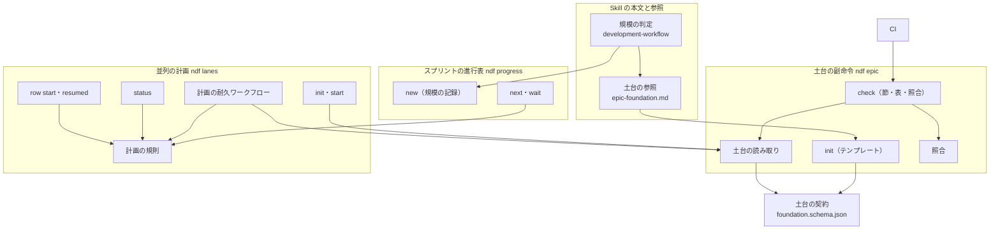
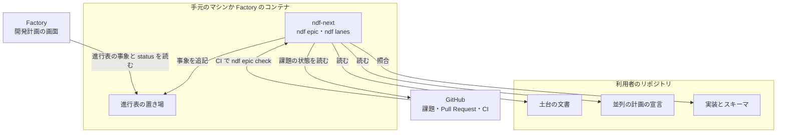
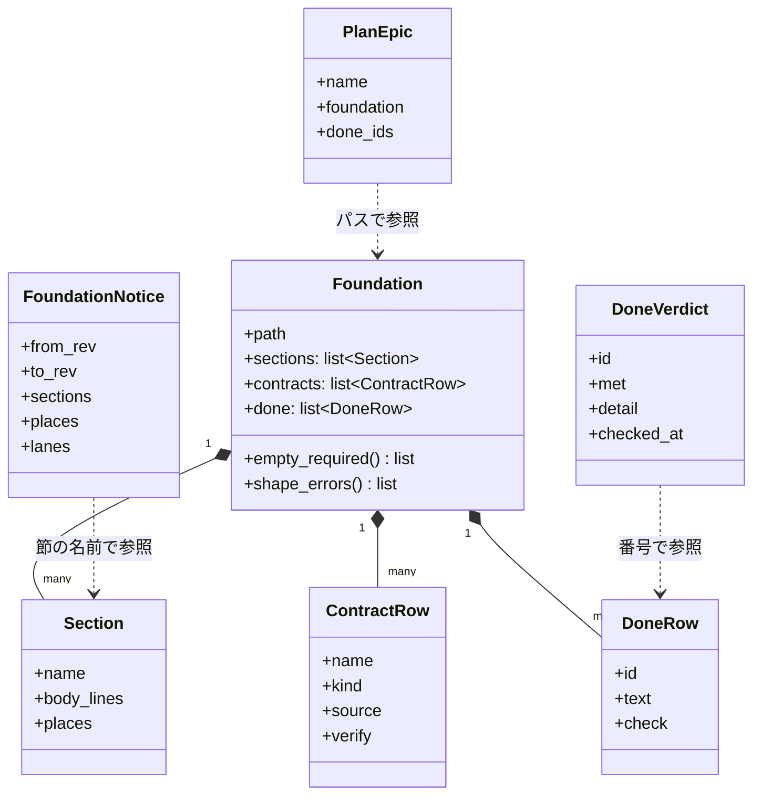
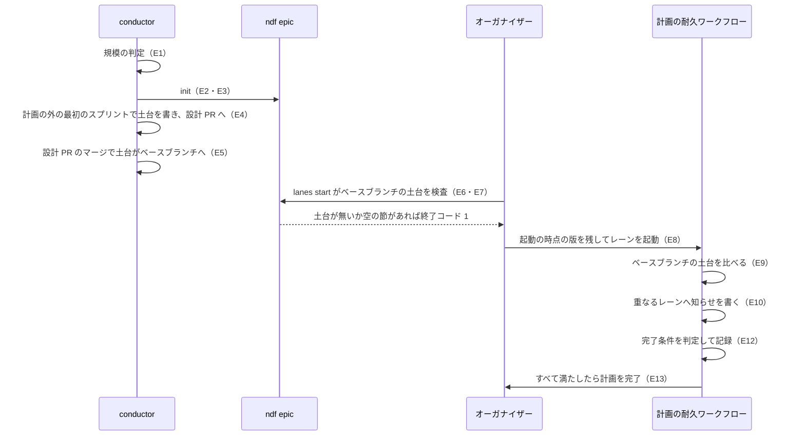
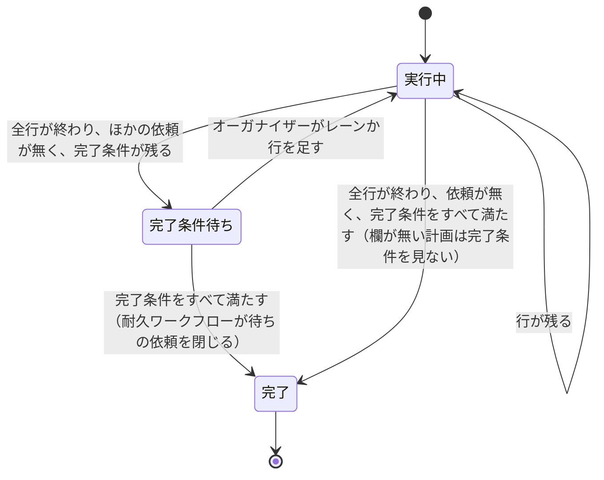

# エピック: 全レーンが読む土台を先に置き、起動の前の検査と CI で守らせる（#3600）

## 目的

- **今どうなっているか**: NDF の工程はスプリントまでしか扱わない。複数のスプリントやレーンにまたがる作業でも、全体の設計・入出力の契約・データ構造・設定を先にまとめる手順と置き場が無い。ndf-next 11.0（#1142）では、横断の仕様を走りながら後から書いた。その結果、閉じた子への追補が 10 単位、マージ済みの不具合が 12 件、着手の停止が 2 回起きた
- **誰に効くか**: エピックを並列の計画で進めるオーガナイザーと、各レーンの conductor・worker。Factory で開発計画を見る利用者
- **変えると何が成り立つか**: エピックの全レーンが同じ 1 つの土台を先に読む。土台の必須の節が空のままではレーンが起動しない。土台の契約と実装の食い違いは CI が落とす。並列の計画は、全レーンが止まったときではなく、エピックの完了条件を満たしたときに終わる

## 適用範囲

- **働く範囲**: NDF を使うすべてのリポジトリ。実装の置き場は 11.x の ndf-next（`plugins/ndf-next/`）で、今の `plugins/ndf/` には足さない
- **プロジェクトごとに違うもの**: 土台の置き場と、照合に使うコマンド・ファイルの位置。土台の文書（パス）と並列の計画（`plan.json` の欄）で受ける。NDF の側に既定の置き場を持たせない
- **当たるモード**: エピックに当たる依頼はどのモードでも当たる。土台を載せる最初のスプリントは、判定したモードと進め方にかかわらず、モード `standard`・進め方 `normal` で進める。`ndf progress new` がこの組み合わせ以外を断る（決定 2）
- **最初のスプリントの位置**: 最初のスプリントは並列の計画の外で、単独のスプリントとして走る。並列の計画は、その設計 PR がマージされ、土台がベースブランチに入った後（E5 の後）にだけ起動できる（決定 18）

## あるべき姿の根拠

| 根拠 | 種類 | 何を示すか |
| --- | --- | --- |
| STD1（arc42 の横断の概念） | 外部の一次情報 | 複数の構成要素にまたがる概念を 1 か所にまとめ、必要な話題だけを選ぶ |
| STD3（Google の design doc） | 外部の一次情報 | 目標と非目標・横断の関心事を先に書き、書く価値の無い小さな作業には書かない |
| STD4（KEP の implementable） | 外部の一次情報 | 設計の詳細・テストの計画・段階の基準がそろうまで実装可能にしない |
| STD5（ADR） | 外部の一次情報 | 決定を 1 件ずつ残し、覆したものは消さずに置き換えの印を付ける |
| PRD3（Böckeler の SDD の比較） | 外部の一次情報 | 小さな作業に仕様の工程は重く、エージェントは仕様の文を守り切らない |
| #1142 の時系列（要求の「目的」） | 実測 | 契約・規約の文書が子の実装の後から生まれ、追補 10・不具合 12・停止 2 回が起きた |
| 利用者の決定（2026-11-15） | 利用者の指示の原文 | 呼び名はエピック、新しい Skill と承認ゲートを足さない、Factory の画面への影響の節を置く |

要求と受け入れ条件は #3600 の本文にある（コピーは [issue-3600-requirements.md](issue-3600-requirements.md) ）。この文書は「どう作るか」だけを扱う。決定の記録は [issue-3600-design-decisions.md](issue-3600-design-decisions.md) にある。

## ドメインモデル

### コンテキスト

| コンテキスト | 何の語が 1 つの意味に決まるか |
| --- | --- |
| NDF の開発ワークフロー（`ndf-workflow`） | エピック・エピックの土台・エピックの完了条件・並列の計画・レーン・規模の判定 |
| Neural Development Factory（`ndf-factory`） | 開発計画の画面・レーンの状況・承認待ちの一覧 |

関係は**公開された言語**とする。公開された言語は、NDF の契約が形を持つ次の 3 つである。Factory はこの 3 つだけを通して NDF とやり取りし、NDF の集約の中身を直接書かない。

| 公開された言語 | Factory の使い方 |
| --- | --- |
| 計画の宣言のスキーマ（`parallel-plan.schema.json`。`epic` の欄を含む） | 開発計画を作るときに、スキーマに沿った宣言を渡して `ndf lanes init` を打つ。計画を書くのは `ndf lanes init` であり、Factory ではない |
| 副命令の結果 JSON（`result.schema.json` の形） | `ndf lanes init`・`start`・`status` の結果を読む。起動の前の検査の指摘は `ndf lanes init`・`start` の結果の `items` に載る |
| 計画とレーンの進行表の事象（`progress.json`） | 進み具合・知らせ・完了を読む |

土台と完了条件の形は NDF の契約（スキーマ）が持ち、Factory はその形に合わせて読む。

### 集約

| 集約 | 持ち主（書き換えてよいもの） | 根 | エンティティ | 値オブジェクト |
| --- | --- | --- | --- | --- |
| エピックの土台 | 土台を書き換える Pull Request（設計 PR か実装 PR。マージで確定する） | 土台の文書 1 本 | 節・契約の行・完了条件の行 | 節の名前・契約の照合の指定・完了条件の確かめ方・触る場所 |
| 並列の計画（既存） | オーガナイザー（宣言・起動・レーンと依頼の変更）。計画の耐久ワークフローは、既存の契約（`progress.json` の書き手 `durable`・`workflow`）が許す事象だけをオーガナイザーの代わりに書く | 計画の進行表 | レーン・依頼・土台の知らせ | エピックの欄（名前・土台のパス・この計画の完了条件の番号）・完了条件の判定の結果・起動の時点の土台の版 |
| レーンの進行表（既存） | レーンの conductor（`row start`・`row resumed`・`ndf progress next`・`wait` を打った者） | レーンの進行表 | 知らせを読んだ印 | 読んだ最後の知らせの、計画の進行表での事象の番号 |

計画の進行表の書き手は、既存のオーガナイザーと耐久ワークフローの 2 つから増やさない。レーンが知らせを読んだ印（`notice_read`）は、レーンの conductor が持つレーンの進行表の集約に書く（決定 13）。知らせ（計画の集約）と読んだ印（レーンの集約）は、それぞれの持ち主だけが書く。

**エピックそのものは集約にしない。** エピックは土台の文書 1 本と、それを指す 1 つ以上の並列の計画で表す。状態はそれぞれの持ち主が持ち、エピックの側に写さない（決定 4）。

並列の計画は土台を **パスで参照する**（ほかの集約は ID で参照する規則）。土台の中身を計画の進行表へ写さない。

### 不変条件

| # | 集約 | 条件 | 破れたときの扱い |
| --- | --- | --- | --- |
| I1 | エピックの土台 | 必須の節がすべてあり、どれも空でない | 起動の前の検査が空の節の名前を出し、終了コード 1 で落ちる。レーンを起動しない |
| I2 | エピックの土台 | 契約の行と完了条件の行は、決められた列の形を持つ | 検査が行の番号と欄の名前を出して落ちる |
| I3 | エピックの土台 | 照合の指定を持つ契約の行は、実装と食い違わない | CI の検査が契約の名前と食い違いの中身を出して落ちる |
| I4 | 並列の計画 | エピックの欄の完了条件の番号は 1 つ以上あり、ベースブランチの土台の完了条件の表にある | `ndf lanes init`・`start` が無い番号を出して落ちる（指摘の種類 `unknown-done`） |
| I5 | 並列の計画 | エピックの欄を持つ計画は、全レーンの行が終わり、この計画の完了条件をすべて満たし、完了条件待ちの依頼のほかに答えていない依頼が無いときだけ完了になる | 完了にせず、残りの完了条件を `status` に出す。完了条件待ちの依頼の開き方と閉じ方は「計画の終わりの判定」に従う |
| I6 | 並列の計画 | エピックの欄を持たない計画は、今と同じ検査と終わりの判定で動く | — （欄の有無で分岐し、欄が無ければ新しい規則を当てない） |
| I7 | 並列の計画 | 土台の変更の知らせは、変更の触る場所と重なる場所を触るレーンにだけ届く | 重ならないレーンへは書かない |
| I8 | 並列の計画とレーンの進行表（集約をまたぐ読み出しの条件） | レーン宛ての土台の知らせのうち、計画の進行表の `foundation_noticed` の事象の番号が、そのレーンの進行表の最後の `notice_read` の番号より大きいものが未読である。未読は記録として持たず、2 つの番号を比べて出す | 再開のときにまとめて渡す |
| I9 | 並列の計画 | 起動の前の検査と耐久ワークフローは、どちらもベースブランチの土台だけを読む。手元の worktree の土台は読まない | ベースブランチに土台が無ければ、`ndf lanes init`・`start` が落ちる（指摘の種類 `missing-foundation`） |

### ドメインイベント

| # | イベント | 発生元 | 受け手 |
| --- | --- | --- | --- |
| E1 | 依頼の規模を判定した | conductor（`development-workflow` の判定） | 判定結果の出力と、`ndf progress new` が書くスプリントの進行表の作成の事象（`created` の文脈の `scale`） |
| E2 | エピックのエントリポイントへ回した | conductor | 設計の工程（土台の参照を読む） |
| E3 | エピックの土台のテンプレートを作った | `ndf epic init` | 設計者（AI） |
| E4 | 土台の必須の節を書いた | 設計者（AI） | 最初のスプリントの設計 PR |
| E5 | 土台が設計承認ゲートで承認された | 設計 PR のマージ（土台がベースブランチに入る） | オーガナイザー（計画を作れる。E5 の前は起動の前の検査が `missing-foundation` で落ちる） |
| E6 | 並列の計画にエピックの欄を書いた | オーガナイザー | 起動の前の検査 |
| E7 | レーンの起動の前に土台を検査した | `ndf lanes init`・`start`（ベースブランチの土台を読み、起動の時点の版を `plan_started` に残す） | オーガナイザー（落ちたら直す） |
| E8 | レーンを起動した | 計画の耐久ワークフロー | レーンの conductor |
| E9 | 土台を変更した | 土台を書き換える Pull Request のマージ | 計画の耐久ワークフロー（ベースブランチの土台を見張る） |
| E10 | 触る場所の重なるレーンへ変更を知らせた | 計画の耐久ワークフロー | 重なるレーンの conductor（実行中なら次の `ndf progress next`・`wait` の結果、止まっていれば `row resumed`、未着手なら `row start` の結果で受ける） |
| E11 | 土台の契約の表と実装を照合した | CI（`ndf epic check`） | Pull Request の作成者（落ちたら直す） |
| E12 | エピックの完了条件の進み具合を出した | 計画の耐久ワークフロー（判定を記録）と `ndf lanes status`（記録を読む） | オーガナイザー・Factory の開発計画の詳細 |
| E13 | 完了条件がすべて満たされ、並列の計画を終えた | 計画の耐久ワークフロー（完了条件待ちの依頼が開いていれば、同じ読み直しで閉じてから完了にする） | オーガナイザー・Factory |

### 用語

| 用語 | 意味 | 用語集への反映 |
| --- | --- | --- |
| エピック | 複数のスプリント・レーン・版にまたがる作業のまとまり。並列の計画 1 つか、続く複数の並列の計画で進める | 追加（反映済み） |
| エピックの土台 | エピックの全レーンが設計と実装の前に読む、1 か所に置く文書。必須の節を持つ | 追加（反映済み） |
| エピックの完了条件 | エピックが終わったと判定する、観測できる条件の一覧。土台の表に定義を置き、並列の計画は番号で指す | 追加（反映済み） |
| プロジェクト | 主リポジトリ 1 つとサブリポジトリの集まり | 意味の変更（反映済み） |
| 規模の判定 | 依頼をスプリント 1 つで進めるか、エピックとして進めるかを決める判定。モード判定の手前で行う | 追加（反映済み） |
| 土台の知らせ | 土台の変更を、触る場所の重なるレーンへ計画の進行表の事象として渡すもの | 追加（反映済み） |
| 完了条件待ち | エピックの欄を持つ計画で、全レーンの行が終わり、ほかの依頼が無く、完了条件が残っている状態。Factory に計画の状態として出す。計画の状態の値として持たず、行と事象から出す | 追加（反映済み） |
| 完了条件待ちの依頼 | 完了条件待ちに入ったときに耐久ワークフローが開き、完了条件をすべて満たしたときに耐久ワークフローが閉じる依頼。完了をオーガナイザーへ知らせるためのもので、完了の判定では答えていない依頼に数えない | 追加（反映済み） |

この文書の「土台」は常に「エピックの土台」を指す。「計画」は常に「並列の計画」を指し、実装計画とは呼び分ける。

## 外部の調査

| 種類 | 調べるか | 理由 |
| --- | --- | --- |
| 標準・仕様 | 調べる | 全体の設計と横断の概念の置き場・決定の残し方・実装可能と判定する条件に、広く使われる型がある |
| 主要な製品 | 調べる | AI のコーディングツールが、プロジェクト全体の文脈と機能ごとの仕様をどう分けているかを比べる |
| ライブラリとサービス | 調べる | 仕様駆動の既存のツールをそのまま使えるかと、検査に使う解析のライブラリを決める |

### 標準・仕様

| # | 標準・仕様 | 何を定めているか | 設計への反映 | 出典 |
| --- | --- | --- | --- | --- |
| STD1 | arc42 の 8 節「横断の概念」 | 複数の構成要素にまたがる概念を 1 か所にまとめる。「Pick only the most-needed topics」 | 土台の必須の節を 9 つに絞り、ほかは該当時にする | https://docs.arc42.org/section-8/ （2026-11-15） |
| STD2 | arc42 の 12 節「用語集」 | 関係者の語をそろえ、同義語と同音異義語を避ける | 土台の必須の節に「用語」を置き、プロジェクトの用語集と突き合わせる | https://docs.arc42.org/section-12/ （2026-11-15） |
| STD3 | Google の design doc | 目標と非目標・他の案・横断の関心事。3 つ以上の問いに当たるときだけ書く | 必須の節「目標と非目標」。規模でエントリポイントを分ける | https://www.industrialempathy.com/posts/design-docs-at-google/ （2026-11-15） |
| STD4 | Kubernetes の KEP のテンプレート | 設計の詳細・テストの計画・段階の基準・本番の準備がそろうまで implementable にしない | 必須の節がそろうまでレーンを起動しない | https://github.com/kubernetes/enhancements/blob/master/keps/NNNN-kep-template/README.md （2026-11-15） |
| STD5 | ADR（Nygard） | 決定を連番で 1 件ずつ残し、覆したものを superseded として残す | 土台の決定は既存の「決定の記録」の形で書き、覆したら置き換えの印を付ける | https://cognitect.com/blog/2011/11/15/documenting-architecture-decisions （2026-11-15） |
| STD6 | Twelve-Factor の III. Config | デプロイごとに変わるものを設定とし、コードから分ける | 必須の節「設定と環境変数」と、その照合の指定 | https://12factor.net/config （2026-11-15） |
| STD7 | C4 model | Context・Container・Component・Code の 4 つの階層。Container 図は主な技術の選択と通信を示す | 必須の節「境界と責務」に、レーンの分け方の根拠として構成要素の図を置く | https://c4model.com/ （2026-11-15） |

### 主要な製品

| # | 製品 | どう解いているか | 設計への反映 | 出典 |
| --- | --- | --- | --- | --- |
| PRD1 | Kiro の steering | プロジェクト全体の文脈（product・tech・structure）を steering に、機能ごとの要求を spec に分ける。読み込みは always・fileMatch・manual・auto | 土台（全体）と課題ごとの設計（機能ごと）の 2 層に分ける | https://kiro.dev/docs/steering/ （2026-11-15） |
| PRD2 | GitHub Spec Kit | constitution をプロジェクトに 1 回、specify・plan・tasks を機能ごとに回す | 全体を先に 1 回、機能ごとを繰り返す形は同じ。NDF は工程を既に持つためツールは取り込まない（決定 3） | https://github.com/github/spec-kit （2026-11-15） |
| PRD3 | Böckeler による SDD のツールの比較 | 小さなバグの修正に仕様の工程は重い。エージェントは指示を守り切らない。Markdown のレビューの負担が大きい | 規模でエントリポイントを分ける。守らせるのはスクリプトと CI にする | https://martinfowler.com/articles/exploring-gen-ai/sdd-3-tools.html （2026-11-15） |

### ライブラリとサービス

| # | 候補 | 版 | ライセンス | 最後のリリースの日付 | 終了のアナウンス | 要件を満たすか | 出典 |
| --- | --- | --- | --- | --- | --- | --- | --- |
| LIB1 | GitHub Spec Kit（CLI と slash コマンド） | v1.4.0 | MIT | 2026-11-10 | 無し | 満たさない。並列の計画・レーン・承認ゲート・CI の照合を持たず、NDF の工程と二重になる | `gh api repos/github/spec-kit/releases/latest`（2026-11-15） |
| LIB2 | jsonschema（ndf-next が依存済み） | 4.26.0 | MIT | 2026-01-07 | 無し | 満たす。土台の契約の行が指すスキーマで、実物のファイルを検証する | `gh api repos/python-jsonschema/jsonschema/releases/latest`（2026-11-15） |
| LIB3 | markdown-it-py（ndf-next が依存済み） | 4.2.0（最新は 4.3.0） | MIT | 2026-11-10 | 無し | 満たす。土台の見出しと表を解析する（ndf-next の Markdown のアダプターが使う） | `gh api repos/executablebooks/markdown-it-py/releases/latest`（2026-11-15） |

### 確かめられなかったこと

| 対象 | 試した手段 | 結果と理由 |
| --- | --- | --- |
| Spec Kit の plan が data-model・contracts を作るか | https://github.com/github/spec-kit の README | README に記載が無い。PRD3 の記事の例には data-model.md が並ぶが、一次情報で確かめていない |
| Shape Up・SAFe・LeSS・Walking Skeleton の原文 | 試していない | 要求の「含まない」でウォーキングスケルトンの機械の検査を外したため、設計の判断に使わない |

調べた量: 候補 13 件・取得の試み 17 回。

## 機能一覧

| # | 機能 | 誰が使うか |
| --- | --- | --- |
| F1 | 依頼の規模を判定し、エピックならエピックのエントリポイント（土台の参照）へ回す | conductor |
| F2 | 土台のテンプレートを作る | 設計者（AI） |
| F3 | 土台の必須の節と表の形を検査する | オーガナイザー・CI |
| F4 | 土台の契約の表と実装を照合する | CI |
| F5 | 並列の計画にエピックの欄（名前・土台のパス・完了条件の番号）を書き、起動の前に土台を検査する | オーガナイザー |
| F6 | 完了条件を判定して記録し、`status` に進み具合を出し、すべて満たしたときに計画を終える | 計画の耐久ワークフロー・オーガナイザー |
| F7 | 土台の変更を、触る場所の重なるレーンへ知らせる | 計画の耐久ワークフロー・レーンの conductor |
| F8 | Factory の開発計画の画面へエピックを出すための申し送り | Factory の開発者 |

## 構成要素

### 要素と責務

| 要素 | 責務 |
| --- | --- |
| 規模の判定（`development-workflow` の本文） | 依頼をスプリントかエピックに分け、判定結果の出力に `規模:` の行を出す。エピックなら土台の参照へ回す。エピックの最初のスプリントはモード `standard`・進め方 `normal` で進める規則の 1 行を持つ |
| スプリントの進行表の作成（`ndf progress new`、変更） | 引数 `--scale <sprint\|epic-first\|epic>` と `--scale-reason <理由>` を受け、作成の事象 `created` の文脈に `scale`（値と理由）を残す。`epic-first` でモードが `standard` でないか進め方が `normal` でなければ、進行表を作らずに終了コード 1 で断る |
| 文脈の契約（`contracts/workflow/context.schema.json`、変更） | 文脈の鍵 `scale`（`value`・`reason`）を任意の鍵として足す |
| 課題の進行の描画（`ndf.progress.run` の課題の `## 進行` を作る処理、変更） | 文脈に `scale` があれば、`モード:` の次の行に `規模:` の行を出す |
| 工程の進行の読み出し（`ndf progress next`・`wait`、変更） | 実行中のレーンのスプリントなら、そのレーンの未読の土台の知らせを結果の `notices` に載せ、レーンの進行表に `notice_read` を書く |
| 土台の参照（`design/references/epic-foundation.md`、新設） | 土台の書き方・必須の節・規模の目安。#1142 を例にする。エピックのエントリポイントに入ったときだけ読む |
| 土台の契約（`contracts/epic/foundation.schema.json`、新設） | 必須の節と該当時の節の名前、契約の行と完了条件の行の列の形。テンプレート・検査・参照の唯一の正本 |
| 土台の読み取り（`ndf.progress.epic.foundation` と判断の `foundation_decide`、新設） | 土台の Markdown を読み、節・契約の行・完了条件の行を値として返す。判断の側は純粋な処理で、終了コードを持たない。並列の計画（`ndf.progress`）から読むため、層は `ndf.progress` に置く |
| 土台の副命令（`ndf epic init`・`ndf epic check`、新設） | テンプレートの生成と、節・表の形・照合の検査。結果 JSON と終了コードを返す |
| 照合（`ndf.progress.epic.verify`、新設） | 契約の行ごとの照合の指定を実行し、食い違いを返す |
| 並列の計画の宣言（`parallel-plan.schema.json`、変更） | 任意の欄 `epic`（名前・土台のパス・完了条件の番号）を足す |
| 計画の作成と起動（`ndf lanes init`・`start`、変更） | 欄があれば、ベースブランチの土台を読み、節と表の形を検査し、計画の完了条件の番号を土台と照らす。`start` は起動の時点の土台の版を `plan_started` の値に残す |
| 計画の耐久ワークフロー（`ndf.progress.plan.run`・`run_decide`、変更。エピックの手は `ndf.progress.plan.epic` に新設） | 完了条件の判定を記録し、完了の条件に完了条件を足す。完了条件待ちの依頼を開き、満たしたら閉じる。ベースブランチの土台の変更を見つけて知らせを書く |
| 計画の規則（`ndf.progress.lane.rules`、変更） | 完了の判定（I16）に完了条件を足す。知らせの宛先を触る場所の重なり（既存の `touch_hit`）で選ぶ |
| 計画の状態（`ndf lanes status`、変更） | 完了条件ごとの満たした・残りと、満たした件数 / 全件数を出す |
| レーンの進行表の読み出し（`ndf lanes row start`・`resumed`、変更） | 未読の土台の知らせを出力に載せ、レーンの進行表に読んだ印を書く |
| 進行表の事象の表（`contracts/workflow/progress.json`、変更） | 計画の事象 `done_checked`・`foundation_noticed` と、レーンの事象 `notice_read` を足す。`plan_started` の値に任意の `foundation_rev` を足す |
| CI（`.github/workflows/ndf-next-checks.yml`、変更） | このリポジトリの土台があれば `ndf epic check` を打つ。利用者のリポジトリへは土台の必須の節「テストと検証の基盤」で CI の手順を書かせる |
| 用語集（`docs/glossary/glossary.json`・`docs/glossary.md`、変更） | エピック・エピックの土台・エピックの完了条件・規模の判定・土台の知らせを足し、プロジェクトの意味を直す（この設計 PR で反映済み） |

### 要素の依存

### 配置

## 構造

`Foundation`・`Section`・`ContractRow`・`DoneRow` は土台の読み取りが返す不変の値である。`PlanEpic` は計画の宣言の欄、`DoneVerdict` と `FoundationNotice` は計画の進行表の事象の値である。レーンが読んだ印はレーンの進行表の事象 `notice_read` の値で、知らせの事象の番号だけを持つ。

## データ構造

**新しい表は作らない。** 足すものは次のとおりである。

| 置き場 | 足すもの |
| --- | --- |
| 計画の進行表（追記だけの事象の列） | 事象の種類 2 つ。既存の事象 `plan_started` に任意の値 1 つ |
| レーンの進行表 | 事象の種類 1 つ |
| スプリントの文脈 | 任意の鍵 1 つ |
| 計画の宣言 | 任意の欄 1 つ |

### 計画の宣言の欄 `epic`（任意）

| 欄 | 型 | 空の扱い | 意味 |
| --- | --- | --- | --- |
| `name` | 文字列（計画名と同じ形） | 必須 | エピックの名前。続く複数の計画が同じ名前を持つ |
| `foundation` | 文字列（リポジトリの根からの相対パス） | 必須 | 土台の文書 |
| `done` | 文字列の配列（`D<数>`、1 件以上） | 必須（省けない） | この計画で満たす完了条件の番号。計画 1 つでエピックを終えるなら、土台の完了条件の番号をすべて並べる |

`done` に既定を持たせない。省いたときに「すべて」と読むと、複数の計画で進めるエピックの最初の計画が、後の計画で満たす条件を待ち続けて終わらない（決定 4）。

### 計画の進行表へ足す事象と値

| 事象 | 書き手 | 値 | いつ書くか |
| --- | --- | --- | --- |
| `plan_started`（既存。値を足す） | オーガナイザー（`ndf lanes start`） | 任意の `foundation_rev`（ベースブランチの土台の blob の識別子） | 計画を起動するとき。エピックの欄を持つ計画だけ書く |
| `done_checked` | 計画の耐久ワークフロー | `id`・`met`・`detail` | 完了条件の判定の結果が前の記録から変わったとき（変わらなければ書かない） |
| `foundation_noticed` | 計画の耐久ワークフロー | `from_rev`・`to_rev`・`sections`・`places`・`lanes` | ベースブランチの土台の blob の識別子が、比べる元の版から変わったとき |

**比べる元の版は最新の記録から引く。** 最後の `foundation_noticed` の `to_rev` を使い、無ければ最初の `plan_started` の `foundation_rev` を使う。区切りで止めた計画を起動し直しても、比べる元は起動し直した時点へ進めない（止めていた間の変更を知らせるため）。耐久ワークフローが再開したときも、同じ規則で比べる元が決まる。

### レーンの進行表へ足す事象

| 事象 | 書き手 | 値 | いつ書くか |
| --- | --- | --- | --- |
| `notice_read` | レーンの conductor（`row start`・`row resumed`・`ndf progress next`・`wait` を打った者） | `seq`（読んだ最後の知らせの、計画の進行表での事象の番号） | 上の副命令が未読の知らせを結果に載せたとき |

**今の値は最新の記録から引く。** 完了条件ごとの今の値は、その番号の最後の `done_checked` である。レーンの未読の知らせは、そのレーン宛ての `foundation_noticed` のうち、そのレーンの進行表の最後の `notice_read` の番号より後のものである。

### スプリントの文脈へ足す鍵

| 鍵 | 書き手 | 値 | いつ書くか |
| --- | --- | --- | --- |
| `scale`（任意） | `ndf progress new`（作成の事象 `created`） | `value`（`sprint`・`epic-first`・`epic`）・`reason` | `--scale` を受けたとき。課題の `## 進行` の `規模:` の行はこの値から描く |

### 土台の文書の形

| 節 | 必須か | 機械が読む形 |
| --- | --- | --- |
| 目標と非目標 | 必須 | 本文 |
| 完了条件 | 必須 | 表 `\| # \| 条件 \| 確かめ方 \|`。`#` は `D<数>`、確かめ方は `issues: #<番号> ...`（すべて閉じたら満たす）か `command: <コマンド>`（終了コード 0 で満たす） |
| 用語 | 必須 | 本文か表 |
| 境界と責務 | 必須 | 本文と構成要素の図。レーンの分け方の根拠 |
| データ構造と状態の置き場 | 必須 | 本文か表 |
| 入出力の契約 | 必須 | 表 `\| 名前 \| 種類 \| 正本 \| 照合 \|` |
| 設定と環境変数 | 必須 | 同じ表の形 |
| テストと検証の基盤 | 必須 | 本文。`ndf epic check` を打つ CI の手順を名指す |
| 未決の問い | 必須 | 本文。無ければ「無し」と書く |
| 横断の関心事 | 該当時 | 本文 |
| 移行 | 該当時 | 本文 |
| 決定の記録 | 該当時 | `### 決定 N: …`。覆した決定は見出しに `（置き換え: 決定 M）` を足して残す |

- **空の節とは、見出しの下に、HTML のコメントと空行のほかの行が無い節である。** テンプレートの書き方の手引きはコメントで置くため、埋めずに残すと空と判定される
- 節は任意の行 `触る場所: <パス>...` を持てる。表の行は、正本と照合の指定のパスが触る場所になる。知らせの宛先を決めるために使う（F7）
- 契約の行の照合の指定は、次の 4 つである

| 照合の指定 | 通る条件 |
| --- | --- |
| `exists: <glob>` | 名前が glob に当たるファイルのどれかに文字どおり現れる |
| `schema: <glob>` | glob に当たるファイルが正本のスキーマに通る |
| `generated: <コマンド>` | コマンドの出力が正本と 1 字も違わない（#3518 の生成と照合の形） |
| `—` | まだ照合しない |

### CRUD

| 機能 | 土台の文書 | 計画の宣言 | 計画の進行表 | レーンの進行表 | スプリントの進行表 |
| --- | --- | --- | --- | --- | --- |
| F1 規模の判定の記録 | — | — | — | — | 作る（既存。文脈に `scale`） |
| F2 テンプレートを作る | 作る | — | — | — | — |
| F3 節と表の検査 | 読む | — | — | — | — |
| F4 照合 | 読む | — | — | — | — |
| F5 起動の前の検査 | 読む（ベースブランチの版） | 読む | 作る（既存）・`plan_started` に版を足す | — | — |
| F6 完了条件の判定 | 読む（ベースブランチの版） | 読む | 事象を足す（`done_checked`・依頼の開閉）・読む | — | — |
| F7 知らせ | 読む（ベースブランチの 2 つの版） | — | 事象を足す（`foundation_noticed`）・読む | 事象を足す（`notice_read`）・読む | — |

## 入出力の契約

### 副命令 `ndf epic`

| 副命令 | 引数 | 成功（終了コード 0） | 失敗 |
| --- | --- | --- | --- |
| `init <名前> --path <パス>` | 名前・置き場 | テンプレートを書き、パスを `items` に返す | 同名のファイルがあれば上書きせず、終了コード 1・`cause.kind` は `refused` |
| `check <パス>... [--shape-only]` | 土台のパス。省くと追跡しているファイルのうち先頭に印 `<!-- ndf: epic-foundation -->` を持つ Markdown のすべて | 指摘 0 件 | 指摘を 1 件 1 行で `items` に（`rule` は `empty-section`・`shape`・`contract-mismatch`）、終了コード 1・`cause.kind` は `check_failed`。読めないファイルは終了コード 2・`config_broken` |

`--shape-only` は節と表の形だけを見て、照合を行わない。実装が無い時点で照合を当てると、起動できないためである。`ndf epic check` は土台の文書だけを読み、計画の宣言を読まない（CI は計画を読まない。決定 9）。計画の完了条件の番号の照らし合わせは `ndf lanes init`・`start` の責務である。結果 JSON の形は既存の結果の契約（`result.schema.json`）に従う。

### 既存の副命令の変更

| 副命令 | 変更 |
| --- | --- |
| `ndf lanes init`・`start` | 計画の宣言に `epic` があれば、ベースブランチの土台を読み、`ndf epic check --shape-only` と同じ検査を当て、計画の完了条件の番号が土台にあるかを見る。指摘は `rule` が `missing-foundation`（ベースブランチに土台が無い）・`unknown-done`（土台に無い番号）と、土台の検査の指摘（`empty-section`・`shape`）である。指摘があれば計画の進行表を 1 つも書かず、指摘を `items` に出して終了コード 1。`start` は検査が通ったとき、読んだ土台の blob の識別子を `plan_started` の `foundation_rev` に書く |
| `ndf lanes status` | `epic` を持つ計画は、`items` に完了条件ごとの行（`kind: done`・`id`・`met`・`detail`・`checked_at`）、`metrics.epic_done` に `{met, total}` を足す。判定の記録が無い条件は `met: null`（未判定） |
| `ndf lanes row start`・`row resumed` | 出力に `notices`（未読の土台の知らせ。節・触る場所・前と後の版）を足す |
| `ndf progress next`・`wait` | 進行表のスプリントがレーンの行として実行中なら、結果に同じ形の `notices` を足す。実行中のレーンは、工程の境（`next`）と待ち（`wait`）のたびに知らせを受ける |
| `ndf progress new` | `--scale <sprint\|epic-first\|epic>` と `--scale-reason <理由>` を足す。どちらも任意で、省いた起動は今と同じに動く。`epic-first` でモードが `standard` でないか進め方が `normal` でなければ、進行表を作らず終了コード 1・`cause.kind` は `refused` |

`notices` を載せた副命令は、同じトランザクションでレーンの進行表に `notice_read` を書く。載せる知らせが無ければ書かない。

### 判定結果の出力（`development-workflow`）

`規模:` の行を `mode:` の前に足す。値は次の 3 つのどれかである。

| `規模:` の値 | `ndf progress new` の `--scale` |
| --- | --- |
| `スプリント（<理由>）` | `sprint` |
| `エピックの最初（<理由>）` | `epic-first` |
| `エピック（<理由>）` | `epic` |

`エピックの最初` は、土台がまだベースブランチに無く、このスプリントの設計 PR に載せるときである。手がかりが無いときは `スプリント（規模の手がかりが無い）` と出す。`次のコマンド:` の行の `ndf progress new` に `--scale` と `--scale-reason` を添え、作成の事象の文脈に残す。課題の `## 進行` の `モード:` の次の行にも出る。

## 処理の流れ

CI の照合（E11）は Pull Request ごとに独立して流れ、計画の流れとは交わらない。

図は担い手の単位で描くため、次の構成要素を図に含めない。

| 図に含めない構成要素 | 図の中での扱い |
| --- | --- |
| 土台の契約・土台の読み取り・照合 | `ndf epic` の中 |
| 計画の宣言・計画の規則・`status`・`row start`・`resumed`・進行表の事象の表 | オーガナイザーと耐久ワークフローの中 |
| `ndf progress new`・`next`・`wait`・文脈の契約・課題の進行の描画 | conductor のスプリントの中 |
| CI と用語集 | 計画の流れの外 |
| 土台の参照 | 規模の判定の後に conductor が読む |

### 計画の終わりの判定

「完了条件待ち」は計画の状態の値として持たない（行と事象から出す）。完了条件待ちの依頼は、既存の止まりの知らせと同じく、耐久ワークフローが開き、耐久ワークフローが閉じる。

| 時点 | 耐久ワークフローがすること |
| --- | --- |
| 完了条件待ちに入った | 依頼を 1 件開く（`request_opened`。鍵は残りの完了条件の番号の並び。理由に同じ番号を書く） |
| 完了条件待ちの間 | 判定を上限の宣言の間隔（`limits.json` に 1 行足す）で打ち直す。残りの番号の並びが変わったら、開いている依頼を閉じ、新しい並びの鍵で 1 件開き直す |
| 完了条件をすべて満たした | 開いている完了条件待ちの依頼を閉じ（`request_closed`。理由は「完了条件をすべて満たした」）、同じ読み直しで計画を完了にする |
| オーガナイザーが依頼を閉じた | 同じ鍵（同じ残りの番号の並び）では開き直さない。判定は打ち直し続け、満たせば完了にする。残りの並びが変わったときだけ、新しい鍵で開く |
| オーガナイザーがレーンか行を足した | 実行中へ戻る。開いている依頼は閉じる。足した行が終わってまだ条件が残れば、まだ開いていない鍵でだけ開く |

完了の判定は、完了条件待ちの依頼を「答えていない依頼」に数えない。数えると、条件がすべて満たされても人が依頼を閉じるまで完了しない。この依頼は、完了をオーガナイザーへ知らせるためのもので、答えを待つものではない。

### 土台の知らせの宛先

1. ベースブランチの土台の blob の識別子を、比べる元の版（「計画の進行表へ足す事象と値」）と比べる。違えば 2 つの版を読み、内容の違う節の名前を集める
2. 違う節の触る場所を集める。表の節は違う行の正本と照合のパス、表の無い節は `触る場所:` の行、どちらも無い節は `**`（すべて）とする
3. 計画のレーンのうち、終わっていないレーンで、触る場所のどれかが既存の `touch_hit` で重なるものを宛先にする

## 非機能の実現方式

| 大項目 | 実現方式 |
| --- | --- |
| 性能・拡張性 | Skill の本文の増分は `development-workflow` の 5 行（判定・行き先・手がかりが無いとき・最初のスプリントのモードと進め方・判定結果の出力の例への `規模:`）と `design` の 1 行（計 6 行）。土台の参照は判定がエピックのときだけ読む。耐久ワークフローの土台の比べは、ベースブランチの土台の blob の識別子が変わったときだけ中身を読む |
| 運用・保守性 | 節の名前と表の列は土台の契約 1 か所に置き、テンプレート・検査・参照の表は契約から作る（参照の表は `ndf check --write-spec` の生成の仕組みで描く） |
| 移行性 | `epic` は任意の欄で、無い計画は今の検査と終わりの判定を通る（I6）。事象の種類を足し、既存の事象 `plan_started` とスプリントの文脈には任意の値を足すだけで、既存の値の形は変えない。`--scale` を省いた `ndf progress new` は今と同じに動く |

## 決定の記録

決定の記録は [issue-3600-design-decisions.md](issue-3600-design-decisions.md) にある。

## テスト設計

| 受け入れ条件・不変条件 | どの振る舞いで縛るか | どう壊したら落ちるべきか |
| --- | --- | --- |
| 受け入れ条件 1 | 3 レーン規模の依頼を `claude -p` で渡すと、判定結果に `規模: エピック` が出て、土台の参照を読み `ndf epic init` を打つ。1 スプリントで 1 レーンの依頼は `規模: スプリント` で、`init` を打たない。足す前と後の出力を PR のコメントに残す | 規模の判定の行を本文から消すと、3 レーンの依頼が `init` を打たない |
| 受け入れ条件 2・I1 | 必須の節が 1 つ空の土台を指す計画で `ndf lanes start` が終了コード 1 になり、空の節の名前を出し、計画の進行表を書かない。埋めると同じ計画が起動する | 空の判定がコメントの行を中身と数えると、テンプレートのままの土台が通る |
| 受け入れ条件 3・I3 | 照合の指定 `schema:` の行で、スキーマに通らないファイルを置くと `ndf epic check` が契約の名前を出して終了コード 1。直すと 0。`exists:`・`generated:` も同じ | 照合の結果を捨てると、食い違いのある Pull Request が通る |
| 受け入れ条件 4・I5 | エピックの欄を持つ計画で全行を終えても、完了条件が 1 つ残れば完了にならず、依頼が 1 件開く。残りを満たすと、人が依頼を閉じなくても、耐久ワークフローが依頼を閉じて完了になる。オーガナイザーが依頼を閉じた後、同じ残りの番号では依頼が開き直さない | 完了条件待ちの依頼を答えていない依頼に数えると、満たしても完了にならない。閉じた鍵を覚えないと、閉じては開くを繰り返す |
| 受け入れ条件 5 | `status` の `items` に完了条件ごとの行、`metrics.epic_done` に満たした件数と全件数が出る。記録の無い条件は `met: null` | 件数を行の数から数えずに定数で出すと、条件を足したときに合わない |
| 受け入れ条件 6・I7 | 土台の契約の行を 1 つ変えたベースブランチで、その行の正本のパスと重なるレーンにだけ `foundation_noticed` が向き、重ならないレーンには向かない | 宛先を全レーンにすると、重ならないレーンにも届く |
| I8 | 止まっているレーンの `row resumed` の出力に未読の知らせが出て、レーンの進行表に `notice_read` が書かれ、次の `row resumed` には出ない | 読んだ印を書かないと、同じ知らせが毎回出る |
| 受け入れ条件 6（実行中のレーン） | 実行中のレーンのスプリントで、知らせが書かれた後の `ndf progress next`（と `wait`）の結果に `notices` が出て、次の `next` には出ない | `next`・`wait` が知らせを読まないと、実行中のレーンは止まるまで知らせを受けない |
| 起動の時点の版 | `ndf lanes start` が `plan_started` に `foundation_rev` を書き、その後にベースブランチの土台を変えると、耐久ワークフローを再開しても `foundation_noticed` の `from_rev` が起動の時点の版になる | 比べる元を記録から引かないと、再開の後の最初の比べで変更を見落とす |
| I9 | 手元の worktree にだけ土台があり、ベースブランチに無いとき、`ndf lanes start` が `missing-foundation` で落ちる | 手元の土台を読むと、マージ前の土台で計画が起動する |
| 受け入れ条件 7 | 規模の手がかりの無い依頼で、判定結果が `規模: スプリント（規模の手がかりが無い）` になる。`ndf progress new --scale sprint --scale-reason <理由>` の作成の事象の文脈に `scale` が残り、課題の `## 進行` に `規模:` の行が出る | 文脈に `scale` を書かないと、課題の進行に規模の行が出ない |
| 最初のスプリントのモードと進め方 | `ndf progress new --scale epic-first` に `--mode light` か `--pace auto` を渡すと、進行表を作らずに終了コード 1 で断る | 断らないと、土台を人が設計承認ゲートで見ないまま進む |
| 受け入れ条件 8・I6 | `epic` の無い既存の計画の宣言が、今と同じ検査を通り、全行が終われば完了になる | 欄の無い計画にも完了条件の判定を当てると、完了しなくなる |
| 受け入れ条件 9 | 承認ゲートの表と配る Skill の表の件数が変わらない（`plugins/ndf-next/manifests/skills.json` の `skills` の件数） | Skill を足すと件数が増える |
| 受け入れ条件 10 | 用語集にエピックがあり、プロジェクトの意味が主リポジトリとサブリポジトリの集まりだけ（`glossary.py check` が通る） | プロジェクトの行に別の意味を足すと用語の検査が落ちる |
| 受け入れ条件 11 | `SKILL.md` の行数の差分の合計が 10 以下（見込みは 6 行）で、各 `SKILL.md` が 500 行以下 | 判定の基準を本文へ書き写すと増分が 10 を超える |
| 受け入れ条件 12 | この文書の「Neural Development Factory の画面構成への影響」の表を設計レビューで見る（機械の検査はしない） | — |
| I2 | 完了条件の行の確かめ方が `issues:`・`command:` のどちらでもないと、`check --shape-only` が行の番号と欄の名前を出して落ちる | 形の検査を飛ばすと、起動の後の判定で読めない |
| I4 | 計画の `done` に土台に無い番号を書くと、`lanes start` が `unknown-done` で落ちる。`done` を省いた宣言はスキーマの検査で落ちる | 番号の照らし合わせを飛ばすと、満たせない条件で計画が終わらない |

## 設計の結果

| 課題 | 扱い | 取り込み先 | 触るファイル |
| --- | --- | --- | --- |
| #3600 | 実装する | — | `plugins/ndf-next/skills/development-workflow/SKILL.md`、`plugins/ndf-next/skills/design/SKILL.md`、`plugins/ndf-next/skills/design/references/epic-foundation.md`、`plugins/ndf-next/skills/issue-plan-strategy/references/parallel-plan.md`、`plugins/ndf-next/contracts/epic/foundation.schema.json`、`plugins/ndf-next/contracts/workflow/parallel-plan.schema.json`、`plugins/ndf-next/contracts/workflow/progress.json`、`plugins/ndf-next/contracts/workflow/context.schema.json`、`plugins/ndf-next/contracts/limits.json`、`plugins/ndf-next/src/ndf/cli.py`、`plugins/ndf-next/src/ndf/adapters/markdown.py`、`plugins/ndf-next/src/ndf/progress/epic/__init__.py`、`plugins/ndf-next/src/ndf/progress/epic/foundation.py`、`plugins/ndf-next/src/ndf/progress/epic/foundation_decide.py`、`plugins/ndf-next/src/ndf/progress/epic/verify.py`、`plugins/ndf-next/src/ndf/progress/epic/cli.py`、`plugins/ndf-next/src/ndf/progress/plan/__init__.py`、`plugins/ndf-next/src/ndf/progress/plan/cli.py`、`plugins/ndf-next/src/ndf/progress/plan/epic.py`、`plugins/ndf-next/src/ndf/progress/plan/run.py`、`plugins/ndf-next/src/ndf/progress/plan/run_decide.py`、`plugins/ndf-next/src/ndf/progress/lane/__init__.py`、`plugins/ndf-next/src/ndf/progress/lane/fold.py`、`plugins/ndf-next/src/ndf/progress/lane/rules.py`、`plugins/ndf-next/src/ndf/progress/lane/types.py`、`plugins/ndf-next/src/ndf/progress/command.py`、`plugins/ndf-next/src/ndf/progress/run.py`、`plugins/ndf-next/docs/contracts/commands.md`、`.github/workflows/ndf-next-checks.yml`、`docs/glossary/glossary.json`、`docs/glossary.md`、`plugins/ndf-next/tests/adapters/test_markdown.py`、`plugins/ndf-next/tests/progress/test_epic_foundation.py`、`plugins/ndf-next/tests/progress/test_epic_verify.py`、`plugins/ndf-next/tests/progress/test_epic_cli.py`、`plugins/ndf-next/tests/progress/test_plan_epic.py`、`plugins/ndf-next/tests/progress/test_command.py`、`plugins/ndf-next/tests/progress/test_run.py` |

触るファイルは 11.0 の構造（2026-11-15 の `plugins/ndf-next/`）に対するものである。ファイルと関数の粒度は詳細設計（[issue-3600-design-detail.md](issue-3600-design-detail.md) ）が決める。

## 人へ残す判断

無し

## 未確認のまま残ること

| 項目 | 内容 |
| --- | --- |
| 11.0 の構造の確定 | 詳細設計のファイル配置・関数の責務は 2026-11-15 の `plugins/ndf-next/` に対して書いた。11.0（#1142）が閉じるまでに置き場や関数の名前が変わりうる。11.x の着手の前に、詳細設計の「ファイル配置」の表のパスがあるかを確かめ、違えば詳細設計を直す |
| 規模の判定の効き目 | 本文の 4 行で、3 レーン規模の依頼が実際にエピックへ回るか。実装の PR で `claude -p` の比べ（受け入れ条件 1）を流して分かる |
| 照合の指定 3 つで足りるか | `exists:`・`schema:`・`generated:` で利用者のリポジトリの契約を覆えるか。11.x の最初のエピックで土台を書いたときに、照合できない契約の行（`—` のまま残る行）の数で分かる |
| 実行中のレーンへの知らせが届く時点 | 実行中のレーンは次の `ndf progress next`（工程の境）か `wait`（待ち）で知らせを読む。その間に古い土台で作った差分がどれだけ出るかは、11.x のエピックの試走で分かる |
| Factory の開発計画の画面が事象を読めるか | Factory が計画の進行表の事象を受け取る経路（進捗の受け口）に、計画の事象が今届いているか。Factory の開発計画の設計で分かる |
| 確かめ方のコマンドが worktree を書き換える | `command:` はメインディレクトリで動く。書き込むコマンドを書かれると、メインディレクトリの作業と食い違う。参照に「読み取りだけのコマンドを書く」と書くが、機械で縛らない |
| メインディレクトリがベースブランチに追従しているか | `command:` の結果はメインディレクトリのチェックアウトの版に依る。ベースの版と違う版で判定しうる。`follow_branch` の宣言の無いリポジトリでどれだけずれるかは、11.x の最初のエピックの試走で分かる |
| 11.0 の関数の名前の変更 | `plan_payload`・`snapshot_of`・`_after_observe` などの既存の関数は、11.0 が閉じるまでに名前や分け方が変わりうる。着手の前に詳細設計の「クラスと関数の構造」の表の名前があるかを確かめる |

## Neural Development Factory の画面構成への影響

Factory の課題は起票しない（前提 7）。以下は Factory の設計への申し送りである。読んだ文書は nd-factory の次の 2 つで、どちらも 2026-11-15 に読んだ。

- `docs/ndf-factory-model.md`
- `docs/specifications/ndf-factory-screen-map.md`

| Factory のオブジェクト・画面 | 足すもの | 変えるもの | 変えないもの |
| --- | --- | --- | --- |
| プロジェクト（予定。モデルの未決 3） | エピックはプロジェクトに属する。土台は主リポジトリに置く | — | 「プロジェクト」の意味（主リポジトリとサブリポジトリの集まり。NDF の用語集と同じ） |
| 開発計画（モデルの未決 6 の「計画」） | 計画のエピックの欄（名前・土台のパス・完了条件の番号）を受け取って保持する | — | 計画とレーンの組の持ち方 |
| 開発計画の一覧 | 行にエピックの名前と、完了条件の満たした件数 / 全件数 | — | 並びと絞り込み |
| 開発計画の詳細 | 土台へのリンク（主リポジトリの既定ブランチのファイル）、完了条件の表（番号・条件・満たした・残り・未判定・判定の日時）、数のタイルに「完了条件」 | 「完了」の意味。エピックの欄を持つ計画は、全レーンが終わっても完了条件が残れば完了と出さず「完了条件待ち」と出す | レーンの節と組み換えの記録 |
| 開発計画を作る | 任意の入力: エピックの名前・土台のパス・完了条件の番号（1 件以上）。入力は計画の宣言の `epic` の欄として `ndf lanes init` へ渡す。`ndf lanes init`・`start` の結果の `items`（土台が無い・空の節・土台に無い番号）を「始める」が通らなかった理由として出す | — | 課題の選び方と割り振りの案 |
| レーンの状況 | レーンの行に未読の土台の知らせの数 | — | 木の並び |
| 承認待ちの一覧・承認の詳細 | 知らせの欄に「土台が変わった」（どの節か・どのレーンへ届いたか）。完了条件待ちで開いた依頼は判断の種類として出る | — | 承認ゲートの種類と数（設計・リリース・判断の 3 種類のまま） |
| スプリントの詳細 | 規模の判定の行（スプリントかエピックか・理由） | — | 工程の行 |
| オーガナイザーの会話 | 完了条件待ちと土台の知らせを会話の項目として出す | — | 承認の確定を承認の詳細だけで受けること |
| 用語集（nd-factory） | エピック・エピックの土台・エピックの完了条件 | — | 「開発計画」の語（NDF の「並列の計画」に当たる） |

**Factory が NDF とやり取りするのは、「コンテキスト」の節の公開された言語 3 つ（計画の宣言のスキーマ・副命令の結果 JSON・進行表の事象）だけである。** 読む事象は、計画の進行表の `done_checked`・`foundation_noticed` と、レーンの進行表の `notice_read` である。計画を作るときは、宣言を `ndf lanes init` へ渡す。新しい API を NDF の側に足さない。
