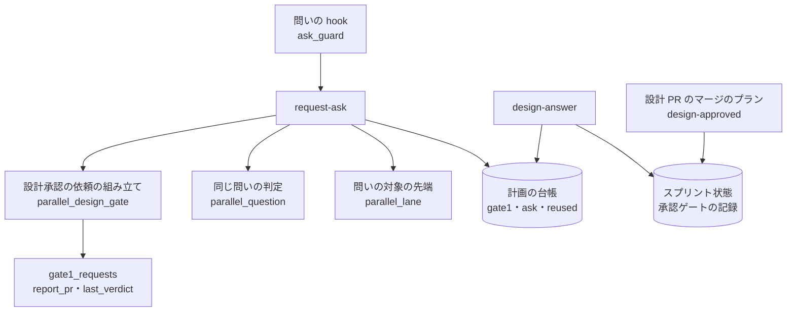
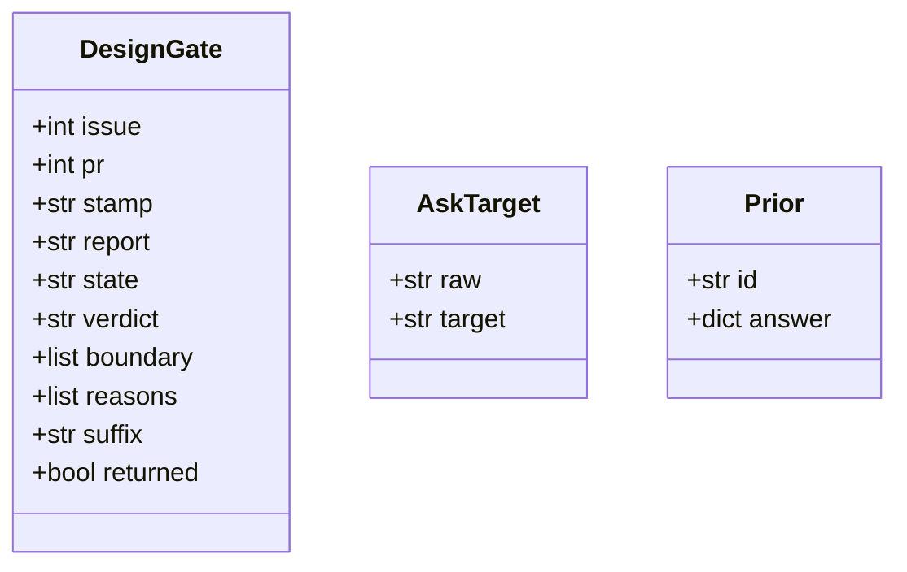
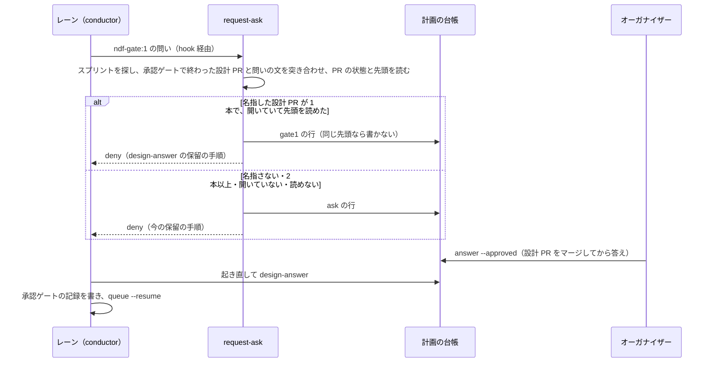
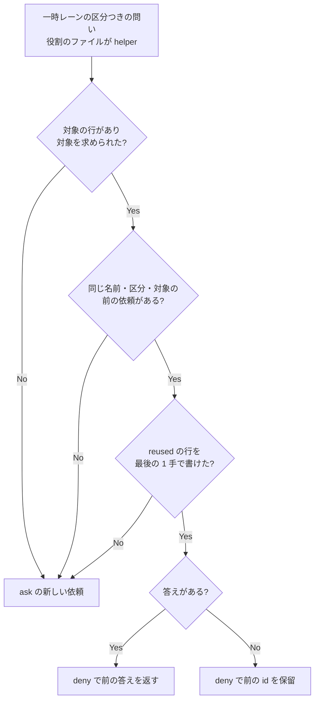

# 並列の計画: 1 スプリントのレーンの設計承認を設計承認の依頼で送り、起き直した一時レーンが同じ問いの答えを使う（#3603）

## 目的

- **今どうなっているか**: 1 スプリントのレーンの設計承認の問いは `kind: ask` の依頼として届き、`answer --approved` が設計 PR をマージしない（並列の計画 p6 で 43 行、`kind: gate1` は 0 行）。起き直した一時レーンは、答えのある `-D` の削除の問いを新しい id で送り直す
- **誰に効くか**: 並列の計画のオーガナイザーと、計画の問いに答える利用者
- **変えると何が成り立つか**: 設計承認は開発ループのレーンと同じ依頼で届き、承認の答えが設計 PR をマージし、MVV 判定と古い依頼の整理が掛かる。同じ一時レーンの同じ問いは 1 回だけ人へ届く

## 適用範囲

- **働く範囲**: 今の NDF（`plugins/ndf/`）の並列の計画。利用先のリポジトリでも、並列の計画を使うときに働く。計画の外の設計承認ゲートと、ndf-next（`plugins/ndf-next/`）は変えない
- **プロジェクトごとに違うもの**: 無し（並列の計画の内部の決まりで、宣言にも引数にも出さない。hook の上限の秒は今どおり `contracts/limits.json` の `hook.ask-forward`）
- **当たるモード**: `standard`

## あるべき姿の根拠

| 根拠 | 種類 | 何を示すか |
| --- | --- | --- |
| STD1（Claude Code の hook の仕様） | 外部の一次情報 | `PreToolUse` の `deny` の理由は AI へ見える。`AskUserQuestion` の入力は `questions`（`question`・`header`・`options`・`multiSelect`）を持ち、対象を載せる欄を持たない |
| STD2（Idempotency-Key の標準案） | 外部の一次情報 | 同じキーの再送は、処理済みなら最初の結果に沿った応答を返す。同じキーを別の中身で使ってはならない |
| 計画 p6 の台帳の件数（2026-11-15 17:58、要求の「事象」） | 実測 | 区分 `ndf-gate:1` の依頼 43 行がすべて `kind: ask`、`kind: gate1` は 0 行 |
| 課題の本文の「期待する結果」 | 利用者の指示の原文（起票者の文） | 1 スプリントのレーンの設計承認を `gate1` で届ける・同じ問いを新しい id で送り直さない |

要求と受け入れ条件は #3603 の本文にある（コピーは [issue-3603-requirements.md](issue-3603-requirements.md) ）。この文書は「どう作るか」だけを扱う。
決定の記録は [issue-3603-design-decisions.md](issue-3603-design-decisions.md) に分けた。

## ドメインモデル

### コンテキスト

| コンテキスト | 何の語が 1 つの意味に決まるか |
| --- | --- |
| NDF の工程（`ndf-workflow`） | 依頼・設計承認の依頼・区分つきの問い・問いの対象・同じ問い・答えの引き継ぎ・1 スプリントのレーン・一時レーン・計画の台帳・設計承認ゲート |

変更は 1 つのコンテキストに収まる。関係の宣言は要らない。

### 集約

| 集約 | 持ち主（書き換えてよいもの） | 根 | エンティティ | 値オブジェクト |
| --- | --- | --- | --- | --- |
| 計画の台帳 | 送り手の CLI。設計承認の依頼（`gate1` の行）は `request_gate1` を呼ぶ 2 つの送り手が書く（1 スプリントのレーンは `parallel.py request-ask`、開発ループのレーンは今どおり `lane_gate1`）。`ask` の依頼と `reused` の行は `parallel.py request-ask`、答えの行は `parallel.py answer` が書く | 計画 | 依頼の行・答えの行・`reused` の行 | 依頼の id・問いの対象・先頭のコミットの SHA（`stamp`） |
| スプリント状態 | `sprint-state.py gate`（設計承認ゲートの記録を足す。この変更では新しい副命令 `design-answer` が呼ぶ） | スプリント | 承認ゲートの記録 | 承認ゲートの名前・`pr`・`by`・`outcome` |

設計承認の依頼を組む材料（スプリントの目録・設計のプランの報告・MVV 判定の記録）は読むだけで、書き換えない。

### 不変条件

| # | 集約 | 条件 | 破れたときの扱い |
| --- | --- | --- | --- |
| I1 | 計画の台帳 | 1 スプリントのレーン（計画の宣言のレーンで、入力の種類が `sprint` のもの）の区分 `ndf-gate:1` の問いを設計承認の依頼にするのは、問いの文が、そのレーンのスプリントで承認ゲートで終わった設計のプランの設計 PR をちょうど 1 本だけ名指し、その PR が開いていて先頭のコミットを読めたときだけである。どれかを欠けば今どおり `kind: ask` で送る。2 本以上を名指す問いも、承認を当てる設計 PR が 1 本に決まらないため `ask` で送る | 設計 PR を特定できない問いへ設計 PR の承認を当てない（受け入れ条件 9）。1 つの問いから設計承認の依頼を 2 件以上作らない |
| I2 | 計画の台帳 | 設計承認の依頼の id は `<レーン>-g<設計 PR>-<先頭の SHA の 12 桁>` で、送り手の種類によらない。I4 の問い直しを除き、同じ先頭の打ち直しは同じ id になり、台帳の行が増えない（I4 の問い直しは、この id に接尾辞 `-r<連番>` を付けた別の id になる） | 依頼を送らずに既存の id を返す（受け入れ条件 8） |
| I3 | 計画の台帳 | 開発ループのレーンの設計承認の依頼は、今の `lane_gate1` の経路と中身のまま組む | 開発ループのレーンは `request-ask` の新しい分岐を通らない（受け入れ条件 10） |
| I4 | 計画の台帳 | MVV 判定で承認した設計承認の依頼の設計 PR が開いたまま同じ先頭で問い直されたら、印 `returned` と接尾辞を付けた新しい依頼にする | 同じ id で答え済みとして返し続けない。MVV 判定の対象から外して人へ届ける |
| I5 | 計画の台帳 | 同じ問いの判定は、送り手が一時レーン（`request-ask` の作業ディレクトリ `NDF_RELAY_DIR` の役割のファイルが `helper` で、その計画名が今の計画）のときだけ行う。1 スプリントのレーンと開発ループのレーンの問いは、対象の行があっても前の依頼と比べない。前の答えを使うのは、同じ一時レーンの名前・同じ区分・同じ問いの対象（ブランチなら先端の 40 桁まで）の依頼に答えがあるときだけである | 新しい依頼を送る（受け入れ条件 14・16。前提 4） |
| I6 | 計画の台帳 | 問いの対象が無い問いと、先端を求められないブランチ名の問いは、前の依頼と比べない | 新しい依頼を送る（受け入れ条件 18） |
| I7 | 計画の台帳 | 同じ問いの前の依頼に答えが無ければ、その id を返し、新しい依頼の行を書かない | 前の id で保留の手順を返す（受け入れ条件 15） |
| I8 | 計画の台帳 | 前の答えを使ったときと、答え待ちの依頼を引き継いだときは、`reused` の行が 1 行残る | 行を書けなければ答えを使わずに新しい依頼を送る（後から追えない引き継ぎを作らない） |
| I9 | スプリント状態 | 設計 PR がすでにマージされていて、スプリント状態にその PR（`--pr P`）の設計承認ゲートの MVV 判定の承認の記録（`by: mvv`・`outcome: approved`。`design-answer` が書く）があれば、設計 PR のマージのプランの承認の確かめは通る。承認ラベルと利用者の承認の記録の扱いは今と同じ | 承認ゲートで止めない（受け入れ条件 3）。開いている設計 PR は MVV 判定の記録だけでは通さない |
| I10 | 計画の台帳 | 送れない（計画が動いていない・送り手でない・上限を越えた・hook の上限の秒を過ぎた）ときは、どの分岐でも今どおり問いを通す。台帳へ行を書くのは `request-ask` の最後の 1 手で、書く前に hook の残りの秒が尽きていれば書かずに送れないとして返す。書いた後に hook が上限の秒を過ぎたときは、問いを通さずに保留の側へ倒す（hook が判定の記録の id で台帳の行を探し、あればその行の分岐の出力を返す） | 書く前なら hook は何も返さない（受け入れ条件 11・12）。書いた後なら、台帳の行と hook の出力が食い違わない |

### ドメインイベント

| # | イベント | 発生元 | 受け手 |
| --- | --- | --- | --- |
| E1 | 1 スプリントのレーンが設計 PR を出し、設計承認ゲートに当たった | 設計のプラン（`supervise.py`） | レーンの conductor |
| E2 | レーンが設計承認の依頼（`kind: gate1`）を送った | `parallel.py request-ask`（hook が呼ぶ） | 計画の台帳・耐久ワークフロー |
| E3 | レーンが作業を保留して止まった | レーンの conductor（hook の保留の手順） | 耐久ワークフロー（引継ぎ文書の依頼の id で起こす） |
| E4 | オーガナイザーが依頼を一覧で受け取った（MVV 判定の印と古い依頼の整理の印つき） | `parallel.py wait` | オーガナイザー |
| E5 | オーガナイザーが承認を送り、設計 PR がマージされた | `parallel.py answer --approved` | 計画の台帳・耐久ワークフロー |
| E6 | レーンが起き直し、答えを読んで実装へ進んだ | `parallel.py design-answer`（レーンの conductor が打つ） | スプリント状態・設計 PR のマージのプラン |
| E7 | 一時レーンが対象つきの区分つきの問いを送った | `parallel.py request-ask` | 計画の台帳 |
| E8 | オーガナイザーが E7 の問いに答えた | `parallel.py answer` | 計画の台帳 |
| E9 | 同じ名前の一時レーンが起き直し、同じ問いに当たった | 耐久ワークフローの再起動 | `parallel.py request-ask`（hook が呼ぶ） |
| E10 | 一時レーンが前の答えを使った／答え待ちの依頼を引き継いだ／新しい依頼を送った | `parallel.py request-ask` | 一時レーン（hook の拒否の理由）・計画の台帳（`reused` の行） |

### 用語

| 用語 | 意味 | 用語集への反映 |
| --- | --- | --- |
| 問いの対象 | 区分つきの問いが操作する対象を表す 1 つの文字列（`<ブランチ名>@<先端のコミットの 40 桁>` か `#<課題か PR の番号>`）。問いの文の対象の行から読み、先端は `request-ask` が問いを受けた時点に求める | 意味の変更（届け方を対象の行に決めた） |
| 対象の行 | 区分つきの問いの文の中に置く `対象: <ブランチ名>` か `対象: #<番号>` の 1 行。`request-ask` が問いの対象を読む唯一の場所 | 追加 |
| 設計承認の依頼 | 並列の計画のレーン（開発ループのレーンと 1 スプリントのレーン）が設計承認ゲートでオーガナイザーへ送る、設計 PR の承認の依頼 | 意味の変更（送り手に 1 スプリントのレーンを明記） |
| 区分つきの問い | `metadata.source` に区分を持つ `AskUserQuestion`。並列の計画のレーンと一時レーンが出すと、問いの hook が `request-ask` でオーガナイザーへ送り、計画の台帳の `kind: ask` の行になる。1 スプリントのレーンの区分 `ndf-gate:1` の問いが設計 PR を 1 本だけ名指すとき（I1）は `kind: gate1` の行になる | 意味の変更（`gate1` の行になる場合を足す） |
| 同じ問い | 一時レーンの区分つきの問いのうち、同じ一時レーンの名前・同じ区分・同じ問いの対象（ブランチなら先端の 40 桁まで）を持つもの。言い回しの違いは数えない。問いの対象が空の問いは、どの問いとも同じ問いにならない | 意味の変更（問いの対象が空の問いを比べないことを足す） |
| 答えの引き継ぎ | 起き直した一時レーンの同じ問いへ、前の起動の依頼の答えを当てるか、答え待ちの依頼の id を返すこと。新しい依頼の行を書かず、計画の台帳に `reused` の行で残る | 意味の変更（答え待ちの依頼の id を返す場合を足す） |

## 外部の調査

| 種類 | 調べるか | 理由 |
| --- | --- | --- |
| 標準・仕様 | 調べる | 問いの入力が hook へ何を届け、hook の拒否の理由が AI へ何を伝えるかは Claude Code の仕様が決める。同じ問いの再送の扱いには冪等キーの標準案がある |
| 主要な製品 | 調べない | 対象は NDF の計画の台帳と承認ゲートの内部の取り決めで、同じ形の機能を持つ製品の資料を比べても形が決まらない。再送の扱いは STD2 が持つ |
| ライブラリとサービス | 調べない | 耐久ワークフローの基盤（`durable`）と計画の台帳はすでにあり、この変更は依存を足さない |

### 標準・仕様

| # | 標準・仕様 | 何を定めているか | 設計への反映 | 出典 |
| --- | --- | --- | --- | --- |
| STD1 | Claude Code の hook の仕様（`PreToolUse`） | `permissionDecision` は `allow`・`deny`・`ask`・`defer`。`deny` の理由は AI へ見える。`updatedInput` は入力を丸ごと置き換え、`AskUserQuestion` には `answers` を入れて自動で答えられる。`AskUserQuestion` の入力は `questions`（`question`・`header`（短い語）・`options`・`multiSelect`）で、`metadata` の記載は無い | 問いの対象を問いの文の対象の行で届ける（決定 7）。前の答えは `deny` の理由で返し、`updatedInput` の自動の答えは採らない（決定 8） | https://code.claude.com/docs/en/hooks （ https://docs.claude.com/en/docs/claude-code/hooks から 301 で移る。2026-11-15） |
| STD2 | Idempotency-Key HTTP ヘッダーの標準案（draft-ietf-httpapi-idempotency-key-header-08、2026-10-22） | 同じキーと同じ中身の再送は、完了していれば利用者の意図どおり完了した結果に沿った応答を返す（SHOULD）。処理中なら 409。キーを別の中身で使ってはならない（MUST NOT）。別の中身なら 422 | 同じ問いの鍵を（一時レーンの名前・区分・問いの対象）にし、答え済みなら最初の答えを返す（決定 8）。設計承認の依頼の id に先頭の SHA を入れ、先頭が動けば別の鍵にする（I2） | https://datatracker.ietf.org/doc/draft-ietf-httpapi-idempotency-key-header/ （2026-11-15） |

### 確かめられなかったこと

| 対象 | 試した手段 | 結果と理由 |
| --- | --- | --- |
| `AskUserQuestion` の `header` の長さの上限 | STD1 の本文 | 本文は「短い」とだけ書き、上限の値を持たない。この設計は `header` を使わない |
| `AskUserQuestion` の `metadata` のスキーマ（`source` だけ・`additionalProperties: false`） | STD1 の本文 | 本文に記載が無い。#3608 の本文の、Claude Code のセッションの Tool のスキーマで確かめた記録を前提にする |

調べた量: 候補 2 件・取得の試み 2 回。

## 機能一覧

| # | 機能 | 誰が使うか |
| --- | --- | --- |
| F1 | 1 スプリントのレーンの区分 `ndf-gate:1` の問いが設計 PR を名指すとき、設計承認の依頼として送る | 1 スプリントのレーン（hook 経由） |
| F2 | MVV 判定で承認した後に開いたまま問い直された設計 PR を、印 `returned` の新しい依頼にする | 1 スプリントのレーン（hook 経由） |
| F3 | 設計承認の依頼の答えを読み、利用者が答えたときと同じスプリント状態の記録を書き、続きを返す | 1 スプリントのレーンの conductor |
| F4 | マージ済みの設計 PR で、設計 PR のマージのプランの承認の確かめを通す | 1 スプリントのレーンのキュー |
| F5 | 区分つきの問いの対象の行から問いの対象を読み、依頼の行の `target` に残す | 一時レーン（hook 経由） |
| F6 | 一時レーンの同じ問いに前の答えがあれば使い、答え待ちなら id を引き継ぐ | 一時レーン（hook 経由） |
| F7 | `parallel.py helper` の `asked` に、対象を持つ `ask` の答えの中身を載せる | 一時レーン |
| F8 | 手順書を振る舞いに合わせる | レーン・一時レーン・オーガナイザー |

## 構成要素

| 要素 | 責務 |
| --- | --- |
| `parallel.py request-ask`（変える） | 送り手を確かめた後、問いを 3 つの分岐（設計承認の依頼・同じ問い・`ask` の依頼）へ「送り分けの順序」（処理の流れ）の順で振り分け、台帳への書き込みを最後の 1 手にして、送った id と分岐の結果を返す |
| 設計承認の依頼の組み立て（新設 `lib/parallel_design_gate.py`） | 1 スプリントのレーンのスプリントを探し、承認ゲートで終わった設計のプランの設計 PR のうち問いの文が名指すものを選び、PR の状態と先頭の SHA・MVV 判定の記録を読み、依頼の中身を返す。答え済みの承認の後の問い直しなら接尾辞と印 `returned` を付ける |
| 同じ問いの判定（`lib/parallel_question.py` に足す） | 問いの文の対象の行の読み取り、台帳の行から同じ問いの前の依頼と答えを引く純粋な関数。`asked_of` に `ask` の答えの中身を載せる |
| 問いの対象の先端の解決（`lib/parallel_lane.py` に足す） | ブランチ名から先端の 40 桁を作業ディレクトリの git で求める。求められなければ空 |
| `request_ask`（`lib/parallel_lane.py`、変える） | `ask` の依頼に `target` を載せる |
| `reused` の行（`lib/parallel_ledger.py` と `contracts/forms/parallel-ledger.json`、変える） | 台帳の行の種類に `reused` を足す。耐久ワークフローの状態へ反映しない行に入れる |
| 問いの hook（`hook_lib/ask_guard.py`、変える） | `request-ask` の結果の分岐ごとに拒否の理由を組む（設計承認の依頼の保留・前の答えの返却・引き継いだ id の保留・今の `ask` の保留）。上限の秒を過ぎたときは、判定の記録の id を持つ台帳の行を 1 回だけ探し、あればその行から同じ拒否の理由を組む |
| `parallel.py design-answer`（新設。`lib/parallel_args.py` に引数） | 設計承認の依頼の答えを読み、スプリント状態へ承認ゲートの記録を書き、続きの 1 行と結果を返す |
| 設計 PR のマージのプランの承認の確かめ（`supervise_lib/design_merge.py` の `cmd_design_approved`、変える） | 承認ラベルも利用者の承認の記録も無いとき、設計 PR がマージ済みで、その PR の設計承認ゲートの MVV 判定の承認の記録があれば通す（I9） |
| 設計承認の依頼の部品（`lib/gate1_requests.py`、変える） | 設計のプランの報告の PR の番号の読み取り（`report_pr`）と MVV 判定の記録の読み取り（`last_verdict`）を `sprint_loop_gate.py` から移し、両方の送り手が同じ関数を使う |
| 手順書（`asking.md`・`parallel.md`、変える） | 1 スプリントのレーンの設計承認の問いの書き方（設計 PR の URL を問いの文に入れる）、`design-answer` の打ち方、対象の行の書き方、前の答えを使う条件 |



図に載せない要素: 手順書（振る舞いを持たない）、`parallel.py helper` の `asked`（同じ問いの判定の関数を読むだけ）、`request_ask` の `target`（`request-ask` から台帳への辺に含める）、`reused` の行の種類（台帳のノードに含める）、`design-answer` の引数（`parallel_args.py`）。

## 構造



| 型 | 置き場 | 持つもの |
| --- | --- | --- |
| `DesignGate` | `parallel_design_gate.py` | 設計承認の依頼の中身。`request_gate1` へそのまま渡す |
| `AskTarget` | `parallel_question.py` | 対象の行の値（`raw`）と、先端を足した問いの対象（`target`。求められなければ空） |
| `Prior` | `parallel_question.py` | 同じ問いの前の依頼の id と答え（無ければ `None`） |

3 つの型の間に辺は無い。設計承認の依頼は問いの対象を持たず、同じ問いの判定は設計承認の依頼を扱わない。

## データ構造

計画の台帳（`ledger.jsonl`）の行を変える。スキーマの移行は無い。行の形の正本は `contracts/forms/parallel-ledger.json` で、同じ変更で直す。

| 行 | 変わるところ | 中身 |
| --- | --- | --- |
| `gate1` | 送り手に 1 スプリントのレーンが加わる。1 スプリントのレーンの行に `ledger_id` が加わる。ほかの項目は今と同じ | `id`・`lane`・`issue`・`pr`・`report`・`sprint_state`・`stamp`・`verdict`・`reasons`・`boundary`・`at`。1 スプリントのレーンの行は `ledger_id`（問いの判定の記録の id。hook が上限の秒を過ぎたときに行を探す鍵）も持つ。問い直しでは `returned: true` と id の接尾辞 `-r<連番>` |
| `ask` | `target` に値が入る | `<ブランチ名>@<40 桁>` か `#<番号>`。対象の行が無い・先端を求められないときは `null` |
| `reused`（新設） | 答えの引き継ぎの記録。耐久ワークフローの状態へ反映しない | `id`（前の依頼の id）・`lane`・`source`・`target`・`ledger_id`（今の判定の記録の id）・`answered`（答えを使ったか、答え待ちの引き継ぎか）・`at` |

スプリント状態の承認ゲートの記録は形を変えない。`design-answer` は `sprint-state.py gate` が書く今の形（`設計承認ゲート`・`--pr`・`--by`・`--outcome`）で書く。

## 入出力の契約

### 問いの文の対象の行（一時レーン）

区分つきの問いの対象は、最初の問い（`questions[0].question`）の中の 1 行で書く。

```text
後片付けで sprint/lr-t2 を git branch -D で消してよいか。
対象: sprint/lr-t2
```

| 規則 | 内容 |
| --- | --- |
| 形 | 行頭から `対象: ` の後に、ブランチ名か `#<番号>` を 1 つ。前後の空白は読み捨てる |
| 複数あるとき | 最後の行を使う |
| ブランチ名 | `git check-ref-format --branch` を通り、`git rev-parse --verify refs/heads/<名>^{commit}` が問いの作業ディレクトリで 40 桁を返すときだけ `<名>@<40 桁>` にする。ほかは問いの対象を空にする |
| `#<番号>` | そのまま問いの対象にする（先端を持たない） |

### 1 スプリントのレーンの設計承認の問い

問いの文（`questions[0].question` と選択肢の `label`・`description`）に、設計 PR の URL（`.../pull/<番号>`）か `#<番号>` を書く。1 つの問いで名指す設計 PR は 1 本にする。`request-ask` はその番号を、レーンのスプリントで承認ゲートで終わった設計のプランの設計 PR と突き合わせる。一致が 1 本なら設計承認の依頼にし、0 本か 2 本以上なら `ask` の依頼にする（I1）。設計 PR が 2 本あるスプリントでは、conductor は設計 PR ごとに問いを分けて出す（手順書に書く）。

### `parallel.py request-ask <計画> --lane <名>` の結果

入力（標準入力の `tool_input`・`cwd`・`ledger_id`）に `deadline_at`（hook の上限の秒が尽きる時刻。UNIX 時刻の秒）を足す。`request-ask` は台帳へ書く直前にこの時刻を過ぎていれば、書かずに `stopped`・2 で返す（hook は問いを通す）。`deadline_at` が無い呼び出しは今と同じく時刻を見ない。終了コードは今と同じ。`metrics` に次を足す。

| 項目 | 値 |
| --- | --- |
| `kind` | `gate1` / `ask` / `reused` |
| `id` | 保留する依頼の id（1 つの問いにつき 1 つ） |
| `answer` | `reused` で前の依頼に答えがあるとき、その `result`・`choice`。答え待ちの引き継ぎなら無い |
| `target` | `ask`・`reused` の問いの対象（空なら `null`） |

### `parallel.py design-answer <計画> <依頼> --state <スプリント状態>`（新設）

| 答え | 書くもの | 状態と終了コード | `metrics.next` |
| --- | --- | --- | --- |
| `approved` | スプリント状態へ `設計承認ゲート` の記録（`--pr <P> --by <答えの by> --outcome approved`） | `ok`・0 | `supervise.py queue --resume` の 1 行（続くステージ） |
| `revise` | 指摘をプランの状態ディレクトリの `work/design-revise-<P>.md` へ書く | `gate`・10 | 利用者が設計承認ゲートで直しを選んだときと同じ工程（`approval-request.md` の「利用者が承認ゲートで答えたら」の表） |
| `rejected` | スプリント状態へ `--outcome rejected` の記録 | `gate`・10 | 課題を進めない（同じ表の差し戻し） |
| まだ無い | 書かない | `stopped`・3 | 無し（耐久ワークフローが答えの後に起こす） |
| 設計承認の依頼でない・ほかの答え | 書かない | `stopped`・1 | 無し |
| 台帳・スプリント状態を読めない・書けない | 書かない | `stopped`・2 | 無し |

`metrics` に `result`・`by`・`merge`（答えに載ったマージの結果）・`pr` を載せる。同じ依頼で 2 回打っても、承認ゲートの記録は 1 件にする（同じ `pr`・`by`・`outcome` の記録があれば書かない）。

### 問いの hook の出力

| `request-ask` の結果 | hook の出力 |
| --- | --- |
| `gate1` | `deny`。理由は保留の手順で、引継ぎ文書の「次にやること」へ `parallel.py design-answer <計画> <id> --state <スプリント状態>` と依頼の id を書いて止まる 1 行を載せる |
| `reused` で答えがある | `deny`。理由に前の依頼の id と答え（`choice` か `result`）を載せ、その答えで操作を進めるよう示す |
| `reused` で答え待ち | `deny`。今の `ask` と同じ保留の手順を、前の依頼の id で返す |
| `ask` | 今と同じ |
| 送れない | 今と同じ（何も返さず問いを通す） |
| 上限の秒を過ぎた | 判定の記録の id（`ledger_id`）を持つ `gate1`・`ask`・`reused` の行を台帳から 1 回だけ探す。あれば、その行の種類の行の出力（上の 3 行）を返す。無ければ何も返さず問いを通す |

## 処理の流れ

### 送り分けの順序

`request-ask` は、送り手を確かめた後（送り手でなければ今どおり 4）、次の順で最初に当たった分岐へ送る。読む処理（スプリント・`gh pr view`・`git rev-parse`・台帳）をすべて済ませてから、最後に台帳へ 1 行だけ書く。

| 順 | 分岐 | 入る条件 |
| --- | --- | --- |
| 1 | 設計承認の依頼 | 送り手が 1 スプリントのレーンで、区分が `ndf-gate:1` で、I1 を満たす |
| 2 | 同じ問い | 送り手が一時レーンで（I5）、問いの対象を求められ（I6）、同じ問いの前の依頼がある |
| 3 | `ask` の依頼 | 上の 2 つに当たらない問いのすべて（開発ループのレーンの区分つきの問いを含む） |

1 スプリントのレーンの問いは分岐 2 に入らない。一時レーンの問いは分岐 1 に入らない。開発ループのレーンの設計承認の依頼は、この順序を通らずに今どおり `lane_gate1` が送る（I3）。

### 設計承認の依頼（受け入れ条件 1〜9）



### 同じ問い（受け入れ条件 13〜18）



前の依頼は、台帳の最初の `opened` の行より後の行から引き、同じ鍵の依頼が複数あれば最も新しいものを使う。

## 非機能の実現方式

| 大項目 | 条件 | 実現方式 |
| --- | --- | --- |
| 性能・拡張性 | hook の上限の秒（8 秒）の中に収める。過ぎたときに台帳の行と hook の出力が食い違わない | 設計承認の依頼の組み立ては、問いの文が名指す 1 本の設計 PR だけに `gh pr view` を 1 回打つ。`request-ask` の子プロセスには hook の残りの秒を上限として渡し（今の形）、尽きる時刻を `deadline_at` で渡す。台帳へ書くのは最後の 1 手で、書く前に時刻を過ぎていれば書かない。書いた後に上限を過ぎたときは、hook が判定の記録の id で台帳を 1 回読み、保留の側へ倒す（I10）。同じ問いの判定は台帳を 1 回読む |
| セキュリティ | 戻せない操作の前の答えを、対象の違う・分からない・別の一時レーンの問いへ当てない。設計 PR の承認を、設計 PR を特定できない問いへ当てない | I1・I5・I6 を純粋な関数の単体テストで縛る。先端は一時レーンに書き写させず `request-ask` が求める |
| 運用・保守性 | 前の答えを使ったとき・引き継いだときに記録が残る | `reused` の行（I8）。書けなければ引き継がない |

## 決定の記録

決定の記録は [issue-3603-design-decisions.md](issue-3603-design-decisions.md) にある。

## テスト設計

| 受け入れ条件・不変条件 | どの振る舞いで縛るか | どう壊したら落ちるべきか |
| --- | --- | --- |
| 1・I1 | 1 スプリントのレーンの `ndf-gate:1` の問いが、承認ゲートで終わった設計のプランの設計 PR P を名指すと、`request-ask` が `gate1` の行（`issue`・`pr`・`stamp`）を 1 行書き、`ask` の行を書かない | 問いの区分だけで `gate1` にする・`ask` も書く・`stamp` を作業ディレクトリの先頭にする |
| 2・4 | 1 スプリントのレーンが送った `gate1` へ `answer --approved` を打つと、マージを試みて `metrics.merge` を返す。マージできなくても答えは送られる | `merge_design` が送り手の種類で分岐する |
| 3・I9 | `design-answer` が承認の答えでスプリント状態へ承認ゲートの記録を書く。マージ済みの設計 PR P と、P の `by: mvv` の承認の記録で `design-approved` が 0 を返す。開いている P と `by: mvv` の記録だけ、またはマージ済みの P で記録が無いときは今どおり 10 を返す | 記録を書かない・マージ済みでも承認の記録を求めて 10 を返す・開いている PR を `by: mvv` の記録だけで通す・記録の無いマージ済みの PR を通す |
| 5 | `revise` で指摘ファイルを書いて 10、`rejected` で差し戻しの記録を書いて 10 を返し、どちらも設計 PR をマージしない | `revise` で承認の記録を書く |
| 6 | 1 スプリントのレーンの `gate1` の行（判定が決まらない・境界が空・`sprint_state` がある）で `mvv.eligible` が真、境界がある行で偽と「レッドラインに当たる」 | `sprint_state` を載せない・`verdict` を載せない |
| 7・8・I2 | 同じレーン・同じ P の先頭の違う 2 行で古い方に `resend`、新しい方へ答えた後に `settled`。同じ先頭の打ち直しは同じ id で行が増えない | id に判定の記録の id を入れる |
| I4 | MVV 判定で承認済みの同じ id の依頼があり、P が開いたままなら、接尾辞と `returned: true` の新しい `gate1` を書く | 同じ id を答え済みとして返す |
| 9・I1 | P を名指さない `ndf-gate:1` の問い・承認ゲートで終わった設計 PR を 2 本名指す問い・名指した P がマージ済み・先頭を読めないときは `ask` の行を 1 行だけ書き、`gate1` の行を書かない | 承認ゲートで終わった設計 PR があれば問いの文を見ずに `gate1` にする・2 本を名指す問いで `gate1` を書く |
| 10・I3 | 開発ループのレーンの `lane_gate1` の依頼の id と中身が今と同じ | `report_pr`・`last_verdict` の移動で引数か戻り値が変わる |
| 11・12・I10 | レーンでない・送り手でない・上限の秒を過ぎたとき hook が問いを通す。`deadline_at` を過ぎた `request-ask` は台帳へ書かない。台帳に判定の記録の id の行があるまま上限を過ぎたとき、hook はその行の分岐の `deny` を返す | 新しい分岐の例外を hook が飲まない・時刻を過ぎても書く・書いた後の上限の超過で問いを通す |
| I5 | 1 スプリントのレーンと開発ループのレーンの対象の行つきの問いは、同じ区分・対象の答え済みの依頼があっても `ask` の新しい依頼になる。一時レーンの問いは、設計 PR を名指しても `gate1` にならない | 送り手の種類を見ずに同じ問いを比べる・一時レーンで設計承認の依頼を組む |
| 13・I5 | 同じ一時レーンの名前・区分・対象の答え済みの依頼があれば、新しい依頼の行を書かず、`reused` の行を書き、hook が答えを載せた `deny` を返す | 区分か名前を比べない・答えを載せない |
| 14・I5 | 先端が動いた同じブランチ名の問いは新しい依頼になる | 問いの対象をブランチ名だけで比べる |
| 15・I7 | 答え待ちの同じ問いは前の id を返し、新しい依頼の行を書かない | 答え待ちでも新しい依頼を送る |
| 16・I5 | 別の名前の一時レーンの答え済みの依頼は使わない | 計画の中の全レーンから引く |
| 17 | 対象の行 `対象: sprint/lr-t2` の問いの `ask` の行の `target` が `sprint/lr-t2@<40 桁>` になる | 先端を足さない・`questions[0]` 以外から読む |
| 18・I6 | 対象の行が無い・先端を求められない問いは比べずに新しい依頼になる | 空の対象どうしを同じ問いとして比べる |
| I8 | `reused` の行を書けないときは新しい依頼を送る | 書けないまま答えを返す |
| 19 | `instructions-check.py` と参照切れの検査を通す（`.md` の文言は照合しない） | — |

## 設計の結果

| 課題 | 扱い | 取り込み先 | 触るファイル |
| --- | --- | --- | --- |
| #3603 | 実装する | — | `plugins/ndf/scripts/parallel.py`、`plugins/ndf/scripts/lib/parallel_args.py`、`plugins/ndf/scripts/lib/parallel_design_gate.py`（新設）、`plugins/ndf/scripts/lib/parallel_question.py`、`plugins/ndf/scripts/lib/parallel_lane.py`、`plugins/ndf/scripts/lib/parallel_ledger.py`、`plugins/ndf/scripts/lib/gate1_requests.py`、`plugins/ndf/scripts/lib/sprint_loop_gate.py`、`plugins/ndf/scripts/hook_lib/ask_guard.py`、`plugins/ndf/scripts/supervise_lib/design_merge.py`、`plugins/ndf/scripts/lib/README.md`、`plugins/ndf/contracts/forms/parallel-ledger.json`、`plugins/ndf/skills/development-workflow/references/asking.md`、`plugins/ndf/skills/development-workflow/references/parallel.md`、`docs/glossary/glossary.json`、`docs/glossary.md`、`plugins/ndf/scripts/tests/test_parallel_design_gate.py`（新設）、`plugins/ndf/scripts/tests/test_parallel_question.py`（新設）、`plugins/ndf/scripts/tests/test_parallel_lane.py`、`plugins/ndf/scripts/tests/test_ask_guard.py`、`plugins/ndf/scripts/tests/test_parallel_answer.py`、`plugins/ndf/scripts/tests/test_parallel_ledger.py`、`plugins/ndf/scripts/tests/test_gate1_requests.py`、`plugins/ndf/scripts/tests/test_supervise_sprint_chain.py` |
| #3608 | 取り込む | #3603 | — |

## 人へ残す判断

無し

## 未確認のまま残ること

| 項目 | 内容 |
| --- | --- |
| 1 スプリントのレーンの conductor が設計承認の問いの文に設計 PR の URL を書くか | 手順書（`asking.md`・`approval-request.md`）が求めている形だが、レーンが出した過去の問いの文に URL があったかは台帳の 43 行を読み直していない。書かなかった問いは今どおり `ask` になる（I1）。リリース後テストで、台帳に `gate1` の行が増えることで分かる |
| `request-ask` の設計承認の依頼の分岐が hook の上限の 8 秒に収まるか | `gh pr view` 1 回の秒は実測していない。台帳へ書く前に過ぎたときは問いを通し、書いた後に過ぎたときは保留の側へ倒す（I10）。リリース後テストで、hook の判定の記録と台帳の行の時刻で分かる |
| 計画の外の設計 PR のマージのプランへの影響（I9） | 計画の外で設計承認ゲートの `by: mvv` の記録を書く経路として、`pace: fast` と `auto` の設計（`supervise_lib/sprint_waves.py`）を読んだ。この経路は承認ラベルを付けてからマージするため、今も承認ラベルで通り、I9 の条件に来ない。ほかに `by: mvv` の設計承認ゲートの記録を書く経路があるかは、全件を洗い出していない |
