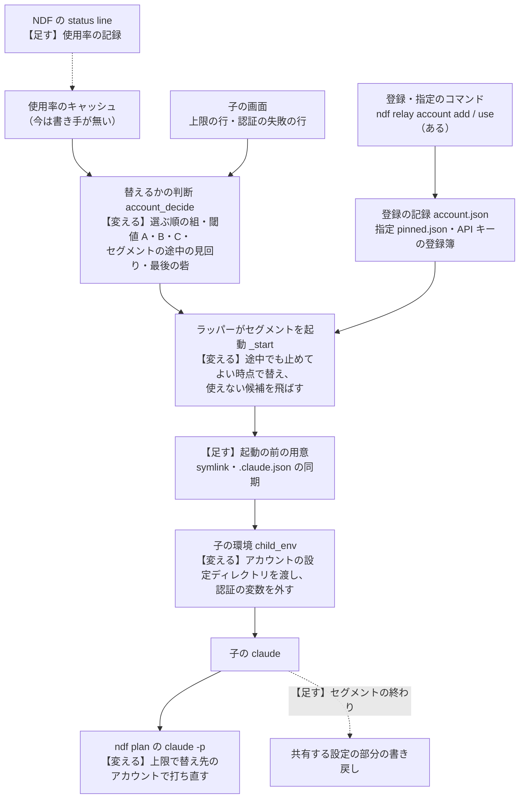
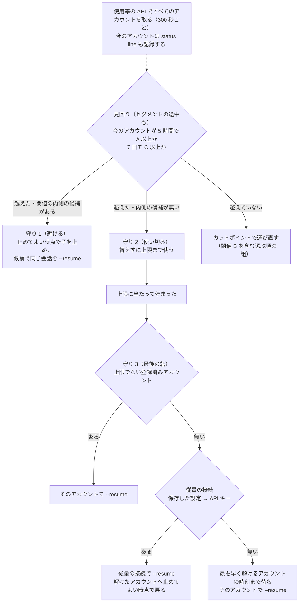
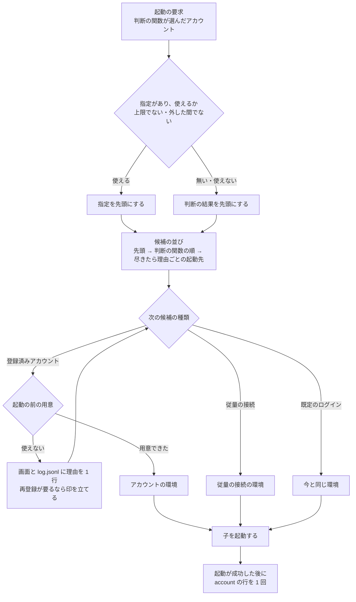
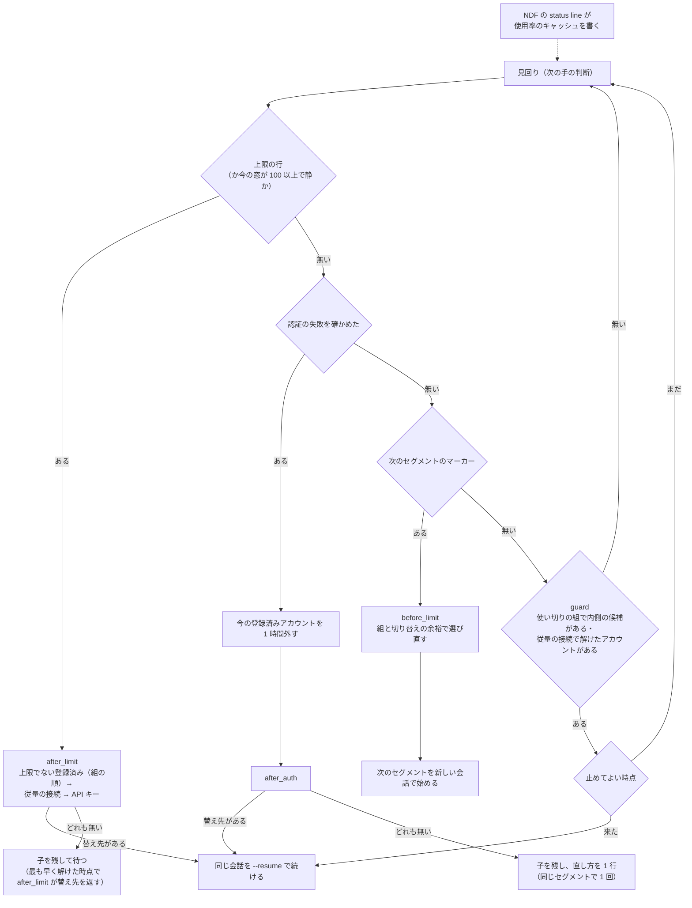
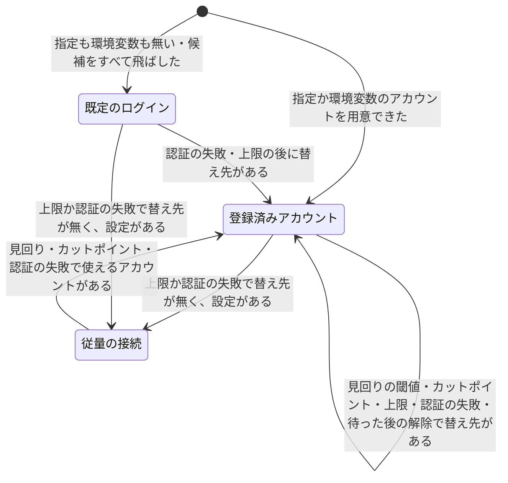

# 中継のアカウントの切り替え: 利用上限でセッションを停めず、避けられないときは使い切ってから別のアカウントか従量の接続で同じ会話へ自動で戻す（#3604 #3864）

11 系の中継は、登録したアカウントを選んでも子の claude を元のログインで起動し、使用率も記録しないため、利用上限に当たったセッションは人が起動し直すまで停まる（要求は下の 2 本の要求仕様にある）。この設計は「上限で停めない」を最優先に置き、アカウントの設定ディレクトリで子を起動して status line の使用率を記録し、ラッパーがセグメントの途中も含めて閾値の手前で同じ会話を別のアカウントへ移す。替え先が無ければ今のアカウントを使い切り、停まった後は人の入力無しで、別のアカウント・従量の接続（Bedrock・API キー）・最も早く解けるアカウントのどれかで同じ会話を続ける。起動の回数には 1 日の上限を置かず、暴走止めは 10 系と同じ再起動ループの検出（短いセグメントが 3 つ続く）だけに戻す。利用者のたたき台との比べは「上限で停まらないための案の比べ方」に、採らなかった案は「決定の記録」に、外部の調査は末尾の付録に、関数ごとの仕様は[詳細設計書](./issue-3604-3864-design-detail.md)にある。

## 今の姿

何が起きたか・目的・受け入れ条件は、次の 2 本の要求仕様にある。

- [issue-3604-requirements.md](./issue-3604-requirements.md) （正は #3604 の本文）
- [issue-3864-requirements.md](./issue-3864-requirements.md) （正は #3864 の本文）

この文書は「どう解くか」と「なぜその解き方か」だけを書く。

この文書の語は次のとおりである。

| 語 | 意味 |
| --- | --- |
| **セグメント** | ラッパーが起動する子の claude の 1 回分 |
| **カットポイント** | 子が次のセグメントのマーカーを書いて区切った時点 |
| **従量の接続** | 利用上限の無い、使った分だけ費用の掛かる接続（Bedrock・Anthropic API の API キー） |
| **窓** | 利用上限の単位（5 時間と 7 日） |
| **閾値 A** | 5 時間の窓の閾値（既定 85%） |
| **閾値 B** | 7 日の窓の好みの閾値（既定 70%） |
| **閾値 C** | 7 日の窓の閾値（既定 90%） |
| **守り 1・2・3** | この設計の 3 つの振る舞い。守り 1（避ける）は閾値の手前で別のアカウントへ移る、守り 2（使い切る）は移る先が無ければ今のアカウントを上限まで使う、守り 3（最後の砦）は上限で停まった後に人の入力無しで同じ会話へ戻す（「解き方の全体像」） |
| **ラッパー** | 子の claude を起動し、端末と記録を見回って区切り・切り替えを行う NDF のプロセス（`ndf-relay`）。オーガナイザーの `ndf-claude` と、レーンの `ndf relay spawn` がこれで動く |
| **オーガナイザー** | 利用者が対話する最上位の claude（`ndf-claude` で起動する） |
| **レーン・レーンの conductor** | オーガナイザーが並べて進める作業の 1 本がレーンで、その作業を進める claude がレーンの conductor（`ndf relay spawn` で起動する） |
| **見回り** | ラッパーが子の画面・会話の記録・使用率の控えを確かめる 1 回分。間隔は `relay.tick`（0.5 秒） |
| **静かな時間** | 子の出力が止まってから区切り・切り替えへ進むまでの秒。`relay.quiet`（5 秒） |
| **`/ndf:restart`** | 子のモデルが打つ、今の会話を区切って新しい会話で続ける NDF のコマンド。次の起動の指示を `ndf-next` のブロック（区切りの指示を書く決まった書式）で出す |
| **登録の世代** | アカウントを登録・再登録するたびに `account.json` へ書く乱数。使用率・外した間・上限の観測は世代ごとに持ち、再登録の前の記録を新しい登録に効かせない |
| **使用の届け** | 登録済みアカウントの設定ディレクトリを使うプロセスが生きている間、その名前の再登録・削除を止める記録（`<保存先>/.leases/<名前>/`） |
| **上限の観測** | 子の画面に上限の行を見たアカウントを、解けるまで候補から除く記録（`limited.json`） |
| **認証の上書き** | 環境変数を外しても、設定ファイル・起動引数から入り、登録先のログインより上に来る認証の源・接続先（決定 1） |
| **状態の保存先** | NDF の状態を置くディレクトリ。`NDF_STATE_HOME` → `$XDG_STATE_HOME/ndf` → `~/.local/state/ndf` の順に決まる |
| **判断の符号** | `wait_reset`: 子を残したまま、最も早く解けるアカウントの時刻まで待ち、解けたら人の入力無しで同じ会話を続ける。`stalled`: 子を残し、直し方を 1 行出して人の操作を待つ（会話は止まったまま）。`stop`: ラッパーが子を終えて止まり、人が起動し直すまで何もしない（この設計では上限で `stop` にしない） |

中継のアカウントの切り替えの経路は次のとおりである。【足す】【変える】が付いた箇所をこの設計で直す。



設計に要る今の構造（照合の根拠は要求仕様の「事象」）:

- 登録・一覧・指定・削除のコマンドと、保存先の形（`<共有の設定ディレクトリ>/ndf/accounts/<名前>/`）は 10 系と同じで 11 系にある。登録の排他（`<保存先>/.locks/<名前>.lock`）も同じ
- 替えるかの判断は 2 つの純粋な関数（`account_decide.before_limit`・`after_limit`）にある。どちらも使用率の行がある名前だけを候補にする
- 子の環境（`session_env.child_env`）は、子の環境の表（`contracts/domains/env.json`）の `child` の列（`drop`・`set`）だけで作る。アカウントの名前を入れるだけで、設定ディレクトリは親のまま渡る
- ラッパーが会話の記録の大きさを読む場所（`observe.transcript_path`）は、ラッパー自身の `CLAUDE_CONFIG_DIR` の `projects` である。子の会話の記録が共有の設定ディレクトリに無いと、文脈の量の切り替えも働かない
- `ndf plan` の worker の `claude -p` は、子の環境をそのまま継ぐ（`adapters/claude.py` の `call_claude`）
- 上限の扱いは、子の画面の上限の行を見てから替え先を探すだけで、見回りは使用率を読まない。替え先が無ければ、同じアカウントのリセットだけを待つ（`after_limit` の `wait_reset`）。上限で替えた起動は 1 日の起動の上限（`relay.max-starts`、20 回）に数え、当たれば `stop` で止まる
- 1 日の起動の上限は、10 系では #2505 で撤廃していた。暴走止めは再起動ループの検出だけで、3 つ続けて起動から 120 秒未満で次のセグメントへ切り替えたら止めた（`NDF_RELAY_SPIN`。[ndf-relay-segment-restart.md](../docs/specifications/ndf-relay-segment-restart.md)・[ndf-development-loop-limits.md](../docs/specifications/ndf-development-loop-limits.md)）。11 系への作り直しで上限が戻り（`switch_decide._restart_or_stop`・`_limit_or_auth`、リレーハブの `hub_decide.restart`）、検出が落ちた
- `ndf plan` の `claude -p` が上限に当たると、計画の打ち直しの待ち（最長 `supervise.limit-wait-max` の 3 時間）へ進む
- 子はどれも名前つきのラッパーの下で動く（オーガナイザーは `ndf-claude`、レーンの conductor は `ndf relay spawn`）。ラッパーは子ごとに画面と記録を見回っている

**まとめた理由（共通の原因）**: 11 系への作り直しで、中継のアカウントの切り替えのうち「登録のコマンド」と「替えるかの判断の純粋な関数」だけを移した。判断へ入る観測（使用率・認証の状態）は移さなかった。判断から出る起動（アカウントの設定ディレクトリで子を起動する）も移さなかった。

| 課題 | 欠けているもの |
| --- | --- |
| #3604 | 判断から出る側（起動） |
| #3864 | 判断へ入る側（観測）と、欠けたままの手順書 |

どちらを直しても、もう片方が無ければ切り替えは一度も働かない。

## 文脈と制約

- **利用上限で停まったセッションは、人が起動し直すまで何もできない。停めないことを最優先にする**（2026-11-21 の設計承認ゲートの差し戻しでの利用者の指示）。停まることが避けられない状況では、そのアカウントを使い切る。停まった後は、人の入力無しで別のアカウントか従量の接続（API キー・Bedrock）で続ける。費用（Value 2）と仕組みの小ささは、この目的の下で比べる
- **判断は純粋な関数に置き、ラッパーは端末・時計・ファイルを読んで手を打つだけにする**（`wrapper.py` と `switch_decide.py` の冒頭の説明）。替え先の選び方は `account_decide` に、ファイルの読み書きは `accounts`・`account_dir`・`account_registry` に置く
- **子の環境の渡し方の正は子の環境の表である**（`session_env.py` の冒頭）。名前をコードに散らさず、表の `child` の列に値を足す（決定 1）
- **トークンを NDF が持たない。** 認証ファイルは claude 自身が読み、更新する。NDF は中身の有無と本人だけを確かめ、値を画面と記録に出さない（#3604 受け入れ条件 12）
- **使用率は、10 系と同じく使用率の API（`GET /api/oauth/usage`）ですべての登録済みアカウントから取る**（2026-11-22 に利用者が決めた。原文「公式に無くても使えるものは使う。仕様が変わったらまたそこから考える」）。公開の文書にある契約は status line へ渡る入力の `rate_limits` だけで（STD5）、届くのは動いている子のアカウントの値だけである。使用率の API は公開の文書に無い（PRD5）が、10 系は 2026-09 から 11 系への入れ替えまでこの端点で運用し、動いていないアカウントの使用率とリセットの時刻も取っていた（決定 4）。`rate_limits` は、端点が取れないときと形が変わったときの代わりに使う
- **macOS は対象外。** claude が認証を Keychain に置くため、登録の時点で止まる（今と同じ）
- **アカウントを替えると、プロンプトのキャッシュは効かない前提で設計する**（キャッシュは組織ごとに分かれると読む。「未確認のまま残ること」）。長い会話を別のアカウントで `--resume` すると、新しいアカウントで文脈の全体を読み直す。その分の使用率を一度に使うので、替える回数を減らすことも目的に効く
- **範囲外**: `ndf plan` を API キーの規則（近い上限の規則・月の額・使用額の帳簿）で動かす経路（#3991）。API キーを上限の後の復帰先にすることだけを、この設計に取り込む（決定 12）。閾値の値と 5 時間の制限の無いプランの扱い（#2588）は、閾値 A・B・C（決定 5）が置き換える。5 時間の窓の無いプランは閾値 A に掛からない
- プロジェクトの MVV（バージョン 10。`.ndf/mvv.md`）の Value を基準にする。Value 1（人の判断を、読み切れる量の大事な所だけにする）・Value 2（安く使える）・Value 3（同じ手順は毎回同じ結果になる）・Value 7（不具合が根本原因から直される）・Value 11（重複と冗長が無い）・Value 12（調べて分析した、実績のある最新のやり方で作られる）・Value 14（判断の理由が残り、語がそろっている）
- レッドラインは NDF の共通原則（`issues/ndf-common-principles.md`）の「必ず人の承認が要る操作」で、この設計に当たるのは C1（秘密（トークン・鍵・認証情報）に触れる）と C2（認証・認可を変える）である
- #3991 の 3 つの語: 近い上限の規則は、7 日の使用率が閾値を越えたら `ndf plan` の worker を API キーで起動する 10 系の規則。月の額は、API キーごとに利用者が決めた 1 か月の使用額の上限。使用額の帳簿は、その上限と比べるために worker の使用額を積む記録である。どれもこの設計では作らない

## 解き方の全体像



1. 登録済みアカウントで起動する子は、アカウントの設定ディレクトリを `CLAUDE_CONFIG_DIR` に受け取り、認証の変数を持たずに起動する。会話の記録・設定・プラグインは共有の設定ディレクトリへの symlink なので、アカウントを替えても同じ会話を `--resume` で続けられる。使えないアカウントは起動の前に飛ばす（決定 1〜3）
2. 守り 1（避ける）: ラッパーが使用率の API ですべての登録済みアカウントの使用率を取り（動いていないアカウントを含む）、今のアカウントは NDF の status line も記録する。取れないときと形が変わったときは status line の記録で代える。ラッパーは見回りのたびに今のアカウントの窓を読む。5 時間が閾値 A 以上か 7 日が閾値 C 以上になり、閾値の内側の候補があれば、セグメントの途中でも止めてよい時点で子を止める。続けて、候補で同じ会話を続ける。カットポイントでは閾値 B も使って選び直す。同じ組の候補は 7 日の窓のリセットが早いものを先に使い、今のアカウントが最良の候補と同じ組にあれば替えない（決定 4・5・11）
3. 守り 2（使い切る）: 閾値の内側の候補が無ければ替えず、今のアカウントを上限まで使う。替えても上限が近い先へ移るだけで、文脈の読み直しの費用を払うためである
4. 守り 3（最後の砦）: 上限で停まったら、人の入力無しで同じ会話へ戻す。戻す先は、上限でない登録済みアカウント → 従量の接続（保存した設定 → API キー）→ 最も早く上限が解けるアカウントの時刻、の順である。規則はラッパーに置くので、ラッパーの下のすべての子（オーガナイザー・レーンの conductor）に効く。子が呼ぶ `ndf plan` の `claude -p` も、上限に当たったら替え先のアカウントで打ち直す（決定 6・8・9・12）
5. 暴走止め: 1 日の起動の上限（`relay.max-starts`）を消し、再起動ループの検出を戻す。起動から 120 秒未満で次のセグメントへ移ったセグメントが 3 つ続いたら、次のセグメントを起動しない。アカウントを替えた起動は、その続きで初めて使う起動先なら数えない（決定 13）
6. 手順書は 11 系にある振る舞いだけを書き、10 系だけの語を用語集から消す（決定 10）

## 上限で停まらないための案の比べ方

比べた 2 つの出発点を先に示す。

- **差し戻し前の設計**: 2026-11-21 の設計承認ゲートで差し戻された前の版のこの設計（PR #3994 の前のコミット）。カットポイントでだけ使用率 90%（`relay.usage-guard`）を見て最も空いたアカウントへ替え、上限で停まった後に替え先を探し、無ければ従量の接続か同じアカウントのリセットを待つ。替えた起動は 1 日の起動の上限（20 回）に数えた
- **差し戻しの指示**: 同じゲートで利用者が出した指示。「利用上限で停まったセッションは人が起動し直すまで何もできない。停めないことを最優先にする。避けられなければ使い切り、停まった後は人の入力無しで別のアカウントか API・Bedrock で自動で復帰する」
- **2 回目の差し戻しの指示**（2026-11-22 の設計承認ゲート）: 1 日の起動の上限（`relay.max-starts`、20 回）と、前の版の設計が足した替えた回数の上限（`relay.max-switches`、1 日 48 回）を撤廃する。暴走止めは「短い間隔で何回」で止める再起動ループの検出だけにする
- **利用者のたたき台の要点**（同じ指示に添えられた案）:
  1. 閾値を 3 つ持つ。A は 5 時間の窓 85%、B は 7 日の窓 70%（好み）、C は 7 日の窓 90%
  2. 選ぶ順は、A・B の内側 → B 越え・C の内側 → C 以上の順の組で、同じ組では直近まで使っていたものを先にする
  3. 5 時間が A を越えたら `/ndf:restart` でセッションを再起動して別のアカウントへ移る
  4. 全員が C 以上なら残量の少ないものから使い切る
  5. 使い切って停まったら、オーガナイザーを別のアカウントで `--resume` し、全アカウントのリセットを監視して戻す

停まる場面を 6 つに分け、たたき台・オーガナイザーが挙げた候補・差し戻し前の設計・ほかに考えた案を比べた。

| 場面 | 停まるとき |
| --- | --- |
| 5 時間の窓 | 今のアカウントの 5 時間の使用率が 100% に届く（解けるまで最長 5 時間） |
| 7 日の窓 | 今のアカウントの 7 日の使用率が 100% に届く（解けるまで最長 7 日） |
| セグメントの途中 | カットポイントが来ない長いセグメントの途中で上限に届く |
| カットポイント | 上限の手前のアカウントのまま、次のセグメントを始める |
| 全部が尽きたとき | 登録済みアカウントがすべて上限 |
| ラッパーの下の子と worker | オーガナイザー・レーンの conductor・`ndf plan` の `claude -p` のどれかが上限で待つ |

| 案 | 5 時間の窓 | 7 日の窓 | セグメントの途中 | カットポイント | 全部が尽きたとき | 子と worker | 捨てる残量 | 費用 | 複雑さ・確かめられない前提 | 結論 |
| --- | --- | --- | --- | --- | --- | --- | --- | --- | --- | --- |
| 差し戻し前の設計（カットポイントで 90%・上限の後に替える） | 停まってから替える | 停まってから替える | 塞げない（見るのはカットポイントだけ） | 塞ぐ | 従量の接続か、同じアカウントのリセットだけを待つ（ほかが先に解けても待つ） | 子は全部。worker は最長 3 時間待つ | 90% で替えるので 10% を残しうる | 従量の接続は次のカットポイントまで続く | 小 | 採らない（途中で停まる） |
| たたき台（A・B・C の組・`/ndf:restart`・直近まで使っていたもの・使い切り・オーガナイザーの監視） | 塞ぐ（A で `/ndf:restart`）。ただし応答の途中・停まった子では働かない | 選ぶ時点だけ見る。途中で C を越えても替えない | `/ndf:restart` はモデルが応答して `ndf-next` を出すときだけ働き、新しい会話で文脈を捨てる | 塞ぐ | 使い切り → オーガナイザーを別アカウントで `--resume` → リセットを監視 | オーガナイザーだけ。レーンの conductor と worker は停まったまま | 直近まで使っていたものを先にするので、リセットの近いアカウントの残量が消えうる | 小（従量の接続を使わない） | 中。`/ndf:restart` の働きがモデルの応答に依る | 骨組みを採り、下の 7 点を良くした |
| **採る案（3 つの守り）** | 塞ぐ（途中も A を見る） | 塞ぐ（途中も C を見る） | 塞ぐ（ラッパーが止めてよい時点で止めて `--resume`。文脈を保つ） | 塞ぐ（B も使って選び直す） | 使い切り → 上限でないアカウント → 従量の接続（保存した設定 → API キー）→ 最も早く解けるアカウント | ラッパーの下の子すべて。worker は上限で替えて打ち直す | 同じ組では 7 日のリセットの早い順。使い切りの組で残さない | 従量の接続は使える登録済みアカウントが無い間だけで（上限・認証の失敗）、解けたら途中でも戻る。費用の上限は置かない。替えるたびに文脈の読み直し（切り替えの余裕で回数を抑える） | 中〜大。止めてよい時点の判定・API キーの渡し方・キャッシュの範囲は実装の PR で確かめる | 採る |
| 直近の消費の速さから替える時点を決める（オーガナイザーの候補） | 塞ぐ | 塞ぐ | 塞ぐ（速いアカウントを早めに替える） | 塞ぐ | 採る案と同じ | 採る案と同じ | 採る案と同じ | 採る案と同じ | 大。使用率は応答ごとに届き、同じアカウントの複数のレーンの消費が混ざる。次に止めてよい時点までの時間も分からない | 採らない（決定 11） |
| 上限の後に替えるだけ（守り 1 を持たない） | 毎回停まってから戻る | 毎回停まってから戻る | 停まってから戻る | 替えない | 採る案と同じ | 採る案と同じ | 無い（全部を使い切る） | 替える回数が最も少ない | 小 | 採らない（停まるたびに応答の途中の作業と Tool の実行が切れる。最優先の目的に反する） |
| 閾値を越えたら従量の接続へ先に移る | 塞ぐ | 塞ぐ | 塞ぐ | 塞ぐ | 従量の接続のまま | 子すべて | 登録済みアカウントの残量を大きく捨てる | 大（利用料） | 小 | 採らない（Value 2。残量があるのに利用料を払う） |

たたき台から変えたところ（承認する人が一目で見るための表）:

| # | たたき台 | この設計 | 理由 |
| --- | --- | --- | --- |
| 1 | 5 時間の閾値 A を越えたら `/ndf:restart` でセッションを再起動する | ラッパーが止めてよい時点で子を止め、同じ会話を別のアカウントで `--resume` する（決定 11） | `/ndf:restart` はモデルが応答して `ndf-next` のブロックを出す必要があり、上限の直前・応答の途中・停まった子では働かない。新しい会話になり文脈を捨てる |
| 2 | 7 日の閾値 B・C は選ぶ時点だけ | 見回りで 5 時間（A）と 7 日（C）の両方を見る。B はカットポイントだけ（決定 5・11） | 長いセグメントの途中で 7 日の窓が尽きる場面を塞ぐ。B のために会話の途中で替えると、文脈の読み直しの費用に見合わない |
| 3 | 同じ組では直近まで使っていたもの | 今のアカウントが最良の候補と同じ組にあれば替えない（切り替えの余裕）。替える先は 7 日の窓のリセットが早いもの（決定 5） | 替える回数を抑える利点は残し、リセットの早い窓の残量を先に使う（使わないとリセットで消える） |
| 4 | 全員が C 以上なら残量の少ないものを使い切る | 使い切りの組でもリセットの早いもの、同じなら残量の少ないもの（決定 5） | 捨てる残量が最も小さくなる順。上限で停まった後は守り 3 が次の候補へ移す |
| 5 | 最後の砦はオーガナイザーを監視する | ラッパーの下のすべての子と、`ndf plan` の `claude -p`（決定 8・9） | レーンの conductor と worker も停まると何もできない。見回りは子ごとのラッパーが既に持つので、規則を 1 か所に置けば全部に効く |
| 6 | 使えるものが無ければ全アカウントのリセットを監視する | 従量の接続（保存した設定 → API キー）を先に使い、それも無ければ最も早く解けるアカウントの時刻まで待つ（決定 8・12） | 利用者の追加指示（API・Bedrock での復帰）。待つ間も使用率の API で全アカウントを取り直し、解けたことを取得の値で確かめてから戻す（決定 4） |
| 7 | 閾値は既定の値 | `contracts/limits.json` の値（決定 5） | リリースの後の記録で直せるよう 1 か所に置く |

暴走止め（起動を繰り返して進まない状態を止める仕組み）の比べ（2 回目の差し戻し。決定 13）:

| 案 | 上限で停めない目的に反するか | 暴走を止めるか | 結論 |
| --- | --- | --- | --- |
| 1 日の起動の上限（今の 11 系。`relay.max-starts` 20 回） | 反する。レーンが多く長く動くと、壊れていなくても 20 回に当たって `stop` で停まる。10 系では 1 日に 4 回止まった（#2505） | 止める（ただし 1 日の終わりまで） | 採らない |
| 替えた回数の上限（前の版。`relay.max-switches` 1 日 48 回） | 反する。当たった後は守り 1 をやめて使い切るので、上限に当たって停まる回数が増える | 替えの繰り返しだけを止める | 採らない |
| 再起動ループの検出で、アカウントを替えた起動もすべて数える | 反する。3 つのアカウントが続けて上限の手前なら、正しく替えているだけで 120 秒未満のセグメントが 3 つ続き、止まる | 止める | 採らない |
| 再起動ループの検出で、アカウントを替えた起動を一切数えない | 反しない | 替え先の除外（上限の観測・外した間・試して失敗した接続先）が書けないと、同じ起動先の間を回り続けうる | 採らない |
| **採る案**: 再起動ループの検出。アカウントを替えた起動は、短いセグメントの続きで初めて使う起動先なら数えず、続きも切らない。既に使った起動先へ戻る替えは数える | 反しない。正しい替えは毎回別の起動先へ移るので数えない | 落ちて起動し直す・区切ってすぐ区切る・同じ起動先の間を回る、のどれも 3 つで止める | 採る |

残る穴（採る案でも停まりうる場面）:

| 場面 | 停まるか | 扱い |
| --- | --- | --- |
| 止めてよい時点が来ないまま上限に届く（長い 1 回の応答・長い Tool の実行） | 停まる | 守り 3 で戻る。停まった応答の途中の作業は、会話の記録に残った所までになる |
| 1 回のモデルの呼び出しで使用率が閾値の手前から上限まで動く | 停まる | 同上。閾値 A・C を `limits.json` で下げる |
| 既定のログインの子（環境変数も指定も無く起動した最初のセグメント） | 守り 1 が効かない（使用率を記録しない） | 守り 3 で登録済みアカウントへ替わり、以後は守り 1 も効く。`ndf relay account use` で指定すれば最初から効く |
| 使用率の API も status line の `rate_limits` も 5 時間・7 日の窓を返さない席（Team・Enterprise の席など。「未確認のまま残ること」） | 守り 1 が効かない（使用率が分からない） | 守り 3 だけが効く。使用率の API の形が変わったときは、status line を使う利用者の今のアカウントだけが `rate_limits` で守られる |
| 画面の上限の行の文言が変わる | 守り 3 の引き金を見落とす | 使用率のキャッシュで今のアカウントの窓が 100 以上で、子が静かな時間止まっていれば上限として扱う（決定 8） |
| 登録済みアカウントがすべて上限で、従量の接続も API キーも無い | 停まる（避けられない） | 最も早く解けるアカウントの時刻まで待ち、人の入力無しで戻る |
| 再起動ループの検出に当たる（起動から 120 秒未満で次のセグメントへ移ったセグメントが 3 つ続く。決定 13） | 子が動いていれば停まらない（ただし上限に当たると、そのセグメントが起動から 120 秒に達するまで守り 3 を待つ）。子が終わっていれば停まる | 次のセグメントを起動せず、画面に理由の 1 行を出す。子が動いていれば今の会話のまま中継を続け、そのセグメントが起動から 120 秒に達するまで区切り・替えでも起動しない。120 秒に達したら保持を解き、上限の後の替えを含めて通常どおり続ける。API キーの子で設定の変更が当たったときだけは、止めてよい時点で子を止めて `spin` で終わる。子が終わっていれば `spin` で終わり、利用者は原因を直してから `ndf relay` で起動し直す。アカウントを替えた起動は初めての起動先なら数えないので、正しい替えの続きでは当たらない |
| 上限か認証の失敗の後に、替え先も今のアカウントも用意できない（替え先と今のアカウントの起動の前の用意（`prepare`。symlink・同期・使用の届けを書く関数）がどちらも落ちる。キーの子（登録簿の API キーの子と、API キーの宣言の従量の接続の子）で、動いている間に宛先・ヘッダー・資格情報が足されるか変わるか消えるか、使い方が `off` になり、替え先が無いときと、キーの子が認証に失敗して替え先が尽きたときも含む。`account_unavailable`） | 停まる（ラッパーが会話を送らずに終わる） | 画面に理由の 1 行と「直してから ndf relay で続ける」を出し、`log.jsonl` の `end` の行に理由の符号を残す。利用者は理由の文の操作（再登録・リンクや設定の修正）をしてからラッパーを起動し直し、同じ会話を `--resume` で続ける。別の認証で会話を送らないことを停めないことより先にする（詳細設計の「子を止める前の替え先の確定」） |
| 認証の失敗の後に替え先が無い（登録済みアカウントはすべて外した間か使えず、従量の接続と API キーも無いか試して失敗した。今がキーの子なら子を残さず、上の行の `account_unavailable` で終える。Claude Code が helper を呼び直し続けるため。`stalled`） | 停まる（子を残して人を待つ） | 子は残したまま、ログインの形ごとの直し方と、この続きで失敗した接続先を 1 行で出す（同じセグメントで 1 回）。利用者は子の中で `/login` を打つか、子を `/exit` してから `ndf relay account add <名前>`・`ndf relay account check metered`・`ndf relay account add-api-key <名前>` で直す。外した間（1 時間）が明けた登録済みアカウントは次の見回りの判断で替え先に戻る（決定 6） |
| ラッパーの外で動く claude（`claude` を直に打つ） | 守られない | 範囲外 |

## 人へ残す判断

承認で決めることと、設計者の推奨を次に示す。材料は直前の「上限で停まらないための案の比べ方」と、下の「決定の記録」の各決定にある。

**利用者が決めたこと**（問いとして載せない）: 2026-11-22、利用者は「公式に無くても使えるものは使う。仕様が変わったらまたそこから考える」と決めた。使用率は 10 系と同じく使用率の API（`api/oauth/usage`）ですべてのアカウントから取り、トークンの更新は 10 系の `.oauth_refresh.lock` の排他の形を移し、status line の `rate_limits` は端点が取れないときと形が変わったときの代わりに使う（決定 4）。トークンを外へ送る処理と更新する処理は、下のレッドラインの表に行がある。

| # | 決めること | 分かったこと | 推奨と理由 |
| --- | --- | --- | --- |
| 1 | 3 つの守り（避ける・使い切る・最後の砦）と、たたき台から変えた 7 点を採るか | たたき台の `/ndf:restart` はモデルの応答に依り、停まった子では働かない。最後の砦をオーガナイザーだけにするとレーンの conductor と worker が停まったまま残る | 採る。セグメントの途中・7 日の窓・レーンと worker の場面を塞ぎ、残る穴は「残る穴」の表の 10 個だけになる。うち人の操作が要るのは、用意できずに会話を送らずに終わる場面（`account_unavailable`）と、認証の失敗で替え先が無く子を残して待つ場面（`stalled`）と、子が終わった後か、API キーの子で設定の変更と重なった後に再起動ループの検出に当たる場面（`spin`）の 3 つで、どれも理由か直し方を 1 行で出す。1 日の回数の上限は持たない（決定 13） |
| 2 | 従量の接続（Bedrock・環境変数の宣言）と API キーの設定があることを、人に問わずに自動で退避してよい許可として扱うか。費用に上限を置かないことを含む（C2） | 設定は supervise.py の退避のために置かれたもので、中継の自動退避の許可として明示されていない。利用者は 2026-11-21 に「API・Bedrock で自動で復帰できるように」と指示した。退避が発動するのは 2 つの場面である。(a) 上限で停まり、上限でない登録済みアカウントが無い。(b) 認証の失敗（起動の後の設定の変更の検出を含む）で、使える登録済みアカウントが無い。戻り先が現れない間は退避が続く。全登録アカウントが 7 日の窓で上限なら最長 7 日近く、認証の失敗なら利用者が直すまで続きうる。替えた回数にも 1 日の起動の回数にも上限は無い（決定 13） | 扱う。時間・金額の上限は置かない（停めないことを優先する。上限を置くと、その時点で停まる）。定期の知らせも置かない。知らせは、退避のたびと戻るたびの画面と `log.jsonl` の 1 行だけである。費用を抑えたい利用者は、従量の接続の設定を置かず、API キーの使い方を「使わない」（既定）にする。上限の間は、登録済みアカウントが解けたら途中でも戻る |
| 3 | API キーを復帰先に取り込むか（#3991 の一部。C1・C2） | 登録簿と確かめのコマンドは 11 系にあり、子の起動に使う経路だけが無い。対話の claude にキーを渡す形（環境変数か `apiKeyHelper`）は未確認。10 系で使い方を `always`・`near-limit` にした利用者は、追加の操作なしに対話の子の復帰先として課金され始める | 取り込む（決定 12）。#3991 には `ndf plan` の近い上限の規則だけが残る。リリースの時点で `CHANGELOG.md` と手順書に、既存の設定でいつ課金が始まるかと `off` で止められることを書く（決定 12 の「リリースの時点の知らせ」）。実装の PR で問いの画面が出ないことを確かめ、出れば実装を止めて設計へ戻す |
| 4 | `ndf plan` の `claude -p` を、上限に当たったときだけ別のアカウントで打ち直すか（C2） | 今は替え先があっても最長 3 時間待つ。要求仕様 #3864 の「含まない」に「`ndf plan` の上限での別のアカウントでのやり直し」がある | 打ち直す（決定 9）。要求仕様の「含まない」の行を直す |
| 5 | 要求仕様を設計に合わせて直すか | 設計が要求仕様の次の条件と意味を変える（下の表） | 直す。設計の承認の後に、課題の本文と要求仕様のコピーを下の表の「直した後」の形へ直し、テスト設計の該当の行をその形で縛る |
| 6 | 閾値の既定値（A 85%・B 70%・C 90%） | 実測の根拠は無い（利用者のたたき台の値） | たたき台の値で始め、リリースの後に `log.jsonl` の `account` の行の理由と使用率で見直す（`limits.json` の値なので直すのは 1 か所） |
| 7 | キーの子（登録簿の API キーの子と、API キーの宣言の従量の接続の子）が 401 を受けたときと helper が失敗したときを、`stalled`（子を残して待つ）から `account_unavailable`（子を止めて会話を送らずに終える）へ替えるか（決定 6・12。C2） | 子を残すと Claude Code が helper を呼び直し続け、止まる時点が無い（無効なキーで 120 秒に 9 回の計測がある。「未確認のまま残ること」）。登録済みアカウントとクラウド事業者の従量の接続は helper を使わない | 替える。止まる時点の無い呼び直しに費用と CLI の起動を使わない（Value 2）。利用者の操作は直してから `ndf relay` で起動し直す 1 回で、`stalled` で `/exit` してから直すのと同じ回数である。登録済みアカウントとクラウド事業者の接続は今どおり `stalled` で残す |
| 8 | 起動の後の設定の変更で、キーの子を検出した見回りで止める範囲を、宛先・ヘッダー・資格情報の追加から、既存の値の変更・削除と `apiKeyHelper` の置き換えまで広げるか（決定 1・12。C1・C2） | 追加だけに限ると、宣言した `ANTHROPIC_BASE_URL` の別の URL への置き換えや、管理の設定による `apiKeyHelper` の置き換えで、止めてよい時点を待つ間に、道具の結果を使う次の要求が変更後の宛先と資格情報で送られる。待つのが安全なのは、キーが変更前の宛先にしか送られない登録簿のキーの削除と `off` だけである | 広げる。許していない宛先へ送らないことを停めないことより先にする決定 12 の決まりと同じ扱いになる。代償は、設定を書き換えた利用者のキーの子が道具の実行の途中で止まり、`--resume` で続くこと |
| 9 | 環境変数で宣言した API キー（`NDF_SUPERVISE_CLAUDE_FALLBACK` の `ANTHROPIC_API_KEY`）を、環境でなく `apiKeyHelper` で渡すか（決定 8・12。C1） | 環境のキーでは対話の claude が使うかを問い、未承認のキーでは切り替えた子が回答待ちで止まる（確かめ 4）。`apiKeyHelper` では問わない | 渡す。ワークフローの途中で利用者に操作を求めない（Value 1）。helper は起動の前に検証したキーの指紋に合うキーだけを出す。代償: API キーの宣言には接続先の変数だけを書け、提供元の選択・ほかの認証の値・資格情報の選択・`ANTHROPIC_CUSTOM_HEADERS` を混ぜた宣言は、理由の 1 行を出して設定なしとして扱う（ヘッダーの要るゲートウェイは API キーの経路で使えない） |
| 10 | helper がキーを渡す回数の上限（1 つの起動につき 60 秒に 3 回）・記録のファイル（中継の保存先の `key-helper.jsonl`）・指紋（SHA-256）を置くか（C1） | 401 の打ち直しは会話の記録の最後の `assistant` が書かれるまで約 256 秒続き、画面と記録だけでは検出が遅れる。記録先を子の環境変数から決めると、設定の `env` で書き換えられる | 置く。4 回目の呼び出しから helper が断り、その行を読んだ見回りから 5.5 秒以内に子が止まる。記録先は起動引数で渡し、symlink をたどらない。記録にキーの値も指紋も書かない。代償: helper の起動ごとに錠とファイルの 1 行が増え、拒んでから止まるまでの CLI の起動の回数は U11a の PR の実測で受け入れる（超えれば設計へ戻す） |
| 11 | `ndf plan` の `claude -p` の子の環境から、中継の保存先と起動 ID の変数（`NDF_RELAY_DIR`・`NDF_RELAY_LAUNCH`）を外すか | helper の記録先は起動引数だけで決まり、`ndf plan` は載せないので、内側の helper は外側の記録・払い出しの枠・子の停止に影響しない。外すと内側の `claude -p` の hook の振る舞いが変わるが、hook が何を書くかは確かめていない | 外さない（この設計では変えない）。指摘の懸念は起動引数で閉じ、確かめていない振る舞いを変える変更を足さない（Value 3）。hook の扱いは「未確認のまま残ること」に置き、確かめた結果で別の課題にする |
| 12 | 実装の単位の U11a（Task 16）と U11b（Task 17）の割り当て | Task 16 のテストが使う停止の経路（`_stop_revoked`・`_end_point`・`_revoked_pick`・`must_end`）が Task 17 にあり、Task 16 だけでは通らない | 停止の共通の経路・helper の記録と上限・`relay.key-helper`・`relay.end-wait` を U11a へ移し、U11b は登録簿のキーの候補と検出だけにする。U11a は見込み約 550 行で、600 行を越えたら停止の経路を先の PR に分ける |
| 13 | 認証の失敗の判定を、会話の行の最後の `assistant` の記録だけで決め、画面の引き金に実測の失敗の文頭（`Failed to authenticate`・`Invalid API key`）を足すか（決定 6） | 確かめ 2 の後に加えた打ち直しの `system` の記録の 401 は、最後の記録と同じ要求と結ぶ欄が記録に無い。実測の 3 つの失敗は、どれも最後の記録が `authentication_failed` を持つ。今の引き金の文言は実測の本文に一致しない | 採る。403 を替えない側に置く既存の決まりと食い違わない（打ち直しが 401 で最後が 403 なら替えない）。引き金が出るかは U10 の PR がコードを書く前に端末の出力で確かめ、一致しなければ設計へ戻す |

判断 5 で直す要求仕様の条件:

| 要求仕様の条件 | 今の文 | 直した後 | 変える決定 |
| --- | --- | --- | --- |
| #3864 の 4 | `relay.usage-guard` の 90% 以上でカットポイントに替える | 閾値 A（5 時間 85%）・C（7 日 90%）以上で、カットポイントでも見回りでも替える。カットポイントでは閾値 B と選ぶ順の組も使う | 決定 5・11 |
| #3864 の 5 | 使用率の分かる上限でないアカウントを先に選ぶ | 選ぶ順の組の順（余裕の組 → 使用率の分からないもの → B 越えの組 → 使い切りの組）で選ぶ。使用率の分かる B 越え・使い切りの組より、分からないものが先 | 決定 5 |
| #3864 の 6 | 401 で `work1` を 1 時間外す | 加えて、`ndf relay account use work1` と再登録で外した間を解く | 決定 6・7 |
| #3864 の 8 | 指定が使えれば指定で起動する | 指定が使い切りの組に入り、閾値の内側の候補がほかにあれば、指定より停めないことを先にする（カットポイント・見回り・上限・認証の失敗の後のどれも同じ規則） | 決定 7 |
| #3864 の 9 | 次のカットポイントで使えるアカウントへ戻る | 上限でない登録済みアカウントが現れたら、カットポイントを待たずに止めてよい時点で戻る | 決定 8・11 |
| #3864 の 10 | リセットの後に同じアカウントで続ける | 最も早く解けたアカウント（同じアカウントを含む）で続ける | 決定 8 |
| #3864 の 12・14 | 4 つの組・切り替えの余裕を 11 系に無い振る舞いとして手順書から消す・正として指さない | 10 系の 4 つの組・閾値 T・10 系の切り替えの余裕を消す。11 系の選ぶ順の組・切り替えの余裕（決定 5 の定義）は手順書が正として書く | 決定 5・10 |
| #3864 の「含まない」 | 閾値の値と 5 時間の制限の無いプランの優先（#2588）・`ndf plan` の上限での別のアカウントでのやり直し・API キーでの起動 | 3 行を外す。#2588 には閾値の値の見直しだけ、#3991 には `ndf plan` の近い上限の規則だけを残す | 決定 5・9・12 |
| #3604 の 3 | 指定が無く既定のログインで起動する子の環境は今と同じ | 指定も環境変数も無い子は今と同じ。指定か環境変数に名前があるのに用意に落ちて既定のログインへ移った子は、`NDF_CLAUDE_ACCOUNT` を外す（今は名前が残り、実際の認証と食い違う） | 決定 1・7 |
| #3604 の 8・9 | 再登録の印はリフレッシュトークンが空と本人の食い違いの 2 つ | 旧形式の `.config.json` が残っているときも起動を飛ばし、印を立てる（直す操作が再登録だから） | 決定 3 |
| #3864 の前提 1・前提 2・S5 | 使用率は status line の `rate_limits` から記録する（取得の API を呼ばない）。status line の無い利用者と `claude -p` では記録されない | 使用率は使用率の API ですべての登録済みアカウントから取り、`rate_limits` は取れないときと形が変わったときの代わりに使う。status line の無い利用者と `claude -p` の worker のアカウントも、使用率の API で取れる（2026-11-22 の利用者の決定） | 決定 4 |
| #3864 の 13 | 手順書が、11 系にあって今は書いていない振る舞い（`ndf relay account show`・1 日の起動の上限で止まる処理・使用率の記録の前提）を書く | 「1 日の起動の上限で止まる処理」を「再起動ループの検出で止まる処理（1 日の起動の上限は持たない）」に替える | 決定 13 |
| #3604 の 11 | worker の `claude -p` は子と同じアカウントで動き、選び直さない | 子と同じアカウントで動く。例外として、利用上限に当たったときだけ替え先のアカウントで 1 回打ち直す | 決定 9 |

レッドラインに当たる判断:

| 判断 | 当たるレッドライン | なぜ当たるか |
| --- | --- | --- |
| 登録済みアカウントの子を、そのアカウントの認証ファイルで起動し、親の環境の認証の 13 変数を外す。実効の `ANTHROPIC_BASE_URL` が既定でないか `ANTHROPIC_CUSTOM_HEADERS` が空でなければ、その登録済みアカウントでは起動しない（決定 1） | C2 | 子の claude がどの認証で動くかが変わる。ヘッダーを置く利用者は登録済みアカウントへ切り替わらない |
| 起動の前にアカウントの認証ファイルを開き、トークンが空でないかを確かめる（決定 3） | C1 | 秘密のファイルを読む処理を足す（値は外へ出さない） |
| 上限の手前（セグメントの途中を含む）・上限・認証の失敗を契機に、同じ会話（`--resume`）を人に問わずに別の登録済みアカウントへ送り、替え先が無ければ従量の接続か API キー（有料の提供先）へ送る（決定 5・6・8・11・12） | C2 | 会話の中身が、利用者が今使っていたものと別のアカウント・別の提供元と課金先へ送られる |
| 既にある従量の接続の設定（環境変数 `NDF_SUPERVISE_CLAUDE_FALLBACK` か保存した `metered.json`）と、使い方の設定が「使わない」でない API キーを、自動で退避してよいという許可として扱う（決定 8・12） | C2 | 設定は supervise.py と 10 系の worker のために置かれたもので、中継の自動退避の許可として明示されていない。利用料が掛かる |
| 登録簿の API キーの値を `api-key-helper` で読み、`apiKeyHelper` として子の claude へ渡す（決定 12） | C1 | 秘密の値を読んで別のプロセスへ渡す処理を足す（値は画面・記録・環境に出さない） |
| `ndf plan` の `claude -p` を、子と別の登録済みアカウントの認証で打ち直す（決定 9） | C2 | worker がどの認証で動くかが、子の環境から変わる |
| 登録済みアカウント・従量の接続・API キーの子が動いている間に、利用者が設定ファイルへ認証・接続先の項目を足すと、検出して子を止めるまで（見回りの間隔と回答待ちの間）の要求が変更後の資格情報と接続先で送られ、その間の使用率が別の本人の値でその名前に記録されうる。API キーの子では、利用者・プロジェクト・ローカルの設定の宛先・認証の項目の変更を `ConfigChange` の hook（失敗・打ち切りでも反映させない `onFailure: "block"`）で反映の前に拒み、起動の前の照合の後に入った変更は最初のキーの払い出しで当てるので、その間に登録簿のキーと会話が変更後の宛先へ送られうるのは、hook で拒めない管理の設定の変更だけである（管理者の変更で、脅威の外）。登録済みアカウントとクラウド事業者の従量の接続の子は、Claude Code が保存のたびに反映するので、見回りより先に反映される分は防げない（決定 1・12。詳細設計の別冊の「反映の前に拒む」） | C1・C2 | 子の認証が利用者の操作で途中から変わり、キーの子のほかは実行中に固定する手段が無い（キーの子は反映の前に拒む）。キーの子は替え先が無くても残さず、登録簿のキーの削除と `off` のときは止めてよい時点で、それ以外の送信先や認証を変え得る変更（追加・変更・削除・`apiKeyHelper` の置き換え）は検出した見回りで止めて、会話を送らずに終える（`account_unavailable`） |
| `.claude.json` の `projects`・`mcpServers` を葉ごとに共有側と各アカウントへ伝え、あるアカウントの子で与えたプロジェクトの信頼・Tool と MCP の許可・MCP の設定（認証のヘッダーを含みうる）を、ほかのアカウントの子と同期の控え（0600）へ写す（決定 2） | C1・C2 | 許可と秘密になりうる値が、アカウントをまたいで伝わり、控えに複製される |
| 登録済みアカウントの認証ファイルのアクセストークンを読み、使用率の API（`api/oauth/usage`。公開の文書に無い端点）へ送って、動いていないアカウントを含むすべてのアカウントの使用率を取る（決定 4。2026-11-22 に利用者が決めた） | C1 | 秘密の値を読んで外の宛先へ送る処理を足す（値は画面・記録・環境に出さない。転送先へは送らない） |
| 使用の届けの無い登録済みアカウントのトークンを、claude と同じ更新の排他の中で NDF が更新し、認証ファイルの `claudeAiOauth` を書き換える（決定 4。2026-11-22 に利用者が決めた） | C1・C2 | 秘密を書き換え、claude が次に読む認証の状態を NDF が変える。更新の失敗はそのアカウントの再登録を要しうる |
| 環境変数で宣言した従量の接続の API キーを、起動の前に検証してその SHA-256 の指紋を起動引数へ載せ、`api-key-helper metered <指紋>` が子の環境の宣言から指紋の合うキーだけを `apiKeyHelper` として出す（決定 12） | C1 | 秘密の値を読んで別のプロセスへ渡す処理を足す（値は環境・起動引数・画面・記録に出さない。指紋から値は戻せない） |
| helper の払い出しを、中継の保存先の記録（`key-helper.jsonl`、0600）に起動ごとの ID で 1 行ずつ書き、60 秒に 3 回と拒否の印で縛る（決定 12） | C1 | 秘密を渡すかどうかを、新しいファイルの記録で決める（記録にキーの値と指紋を書かない） |
| キーの子の 401 と helper の失敗で、替え先が無くても子を止めて会話を送らずに終える（`stalled` にしない。決定 6・12） | C2 | 認証の失敗のときの子の扱いを、キーの子だけ登録済みアカウントと違えて変える |

判断 7〜13 で変わる決定とレッドラインの行:

| 変わる所 | 変わる中身 | 判断 |
| --- | --- | --- |
| 決定 1（起動の後の変更の検出） | キーの子は、登録簿のキーの削除・`off` のほかの送信先や認証を変え得る不一致（追加・変更・削除・`apiKeyHelper` の置き換え）を検出した見回りで止める。API キーの宣言の従量の子も同じに扱う | 8 |
| 決定 6（認証の失敗） | 判定は会話の行の最後の `assistant` の記録だけで決める。引き金に実測の失敗の文頭を足す。キーの子は替え先が尽きても `stalled` にせず `account_unavailable` で終える | 7・13 |
| 決定 12（API キー） | 環境変数の宣言の API キーも `apiKeyHelper` で渡す。helper の指紋・記録・払い出しの上限を置く。キーの子の停止の範囲を広げる | 7〜10 |
| レッドライン C1 | 行を足す: 宣言のキーの指紋と helper での受け渡し、helper の払い出しの記録 | 9・10 |
| レッドライン C2 | 行を直す: 動いている間の設定の変更で止める時点。行を足す: キーの子の認証の失敗で子を止めて終える | 7・8 |

## #4018 の cross-review の設計の指摘

U1 の PR #4018 の cross-review で出た指摘のうち、U10・U11a・U11b・U12 の設計に当たるものの扱いである。r1-1・r1-5・r2-5・r3-2 は U1 の範囲の指摘で、U1 の PR が扱う（API キーの宣言の組み合わせを拒む r3-2 の規則は、r2-3・r4-1 と同じ `metered_kind` に置いた）。詳細設計書の別冊は [詳細設計書の別冊](./issue-3604-3864-design-detail-keys.md) である。

| 指摘 | 採るか | 理由 | 変わる行 |
| --- | --- | --- | --- |
| r1-2 画面の引き金が実測の失敗の文に当たらない | 採る | 引き金が出なければ記録の照合へ進まない | 決定 6・判断 13・詳細設計書の「認証の失敗の確かめ」の「引き金の文言」・`_auth_pick` のテストの行・テスト設計の #3864 の 6・未確認の「403 と 401」 |
| r1-3 打ち直しの 401 と最後の 403 のどちらを採るか | 採る（最後の `assistant` の記録だけ） | 打ち直しと最後の記録を結ぶ欄が無い。最後の記録が要求の結末 | 決定 6・判断 13・`CREDENTIAL_FAILURE` の表と判定の順・テスト設計の #3864 の 6 |
| r1-4 環境変数の宣言の API キーで問いの画面が出る | 採る | 確かめ 4 で環境のキーは問いを出した | 決定 12・判断 9・子の環境の表・別冊の「環境変数の宣言の API キー」・テスト設計の決定 12 |
| r2-1 helper が設定の後の宣言を読み直す | 採る（指紋と照合の行） | 検証したキーと違うキーで送らない | 別冊の helper の行・詳細設計書の「従量の実効値の照合」の 2 行 |
| r2-2 API キーの宣言で親だけの宛先とヘッダーが期待値に入る | 採る | 宣言にないゲートウェイへキーと会話を送らない | `metered_env`・「従量の実効値の照合」の期待値・別冊の表 |
| r2-3 提供元と API キーの混在の扱いが分かれる | 採る | 提供元の確定を `metered_kind` の 1 つにする | 詳細設計書の検証の表・別冊の「宣言の提供元の確定」・地図 |
| r2-4 helper の追加のコストの記録 | 採る（計測は U11a の PR でやり直す） | 回数の計測は手順が残っておらず未確認 | 別冊の「helper の呼び出しの回数と所要時間」・未確認の「helper の呼び出しの回数」 |
| r3-1 API キーの宣言の従量の子が設定の変更で `stalled` に残る | 採る | 指紋はキーの差し替えしか止めない | 決定 12・判断 8・詳細設計書の「起動の後の設定の変更」・別冊の「設定の変更でキーの子を止める範囲」 |
| r3-3 `build` の責務の表に従量の子の helper が無い | 採る | 照合と起動で helper の有無を違えない | 詳細設計書の `build` の行・「`--settings` の合成と引用」 |
| r3-4 401 の間の helper の起動回数 | 採る | 正常時と失敗時を分け、失敗時は上限と実測で縛る | 別冊の「CLI の起動の回数」・判断 10 |
| r4-1 API キーの宣言でヘッダーを書けと案内しながら拒む | 採る（接続先の変数だけ） | ヘッダーで別の資格情報を送れる | 別冊の「API キーの経路で使えるゲートウェイの設定」・提供元ごとの照合する変数のヘッダーの行・判断 9 |
| r4-2 401 と helper の失敗の停止条件と上限 | 採る | 替え先が無くても子を残さない終点を持つ | 判断 7・決定 6・残る穴の 2 行・別冊の「キーの子の認証の失敗の停止」 |
| r4-3 即時の停止が追加だけに限られる | 採る | 置き換えでも次の要求が変更後の宛先へ出る | 判断 8・決定 12・決定 13・テスト設計の決定 12 |
| r5-1 検出が停止の判定より後にある | 採る | 検出の見回りで止め、止めた後にだけ候補を読む | 詳細設計書の `_loop`・`_key_auth`・`_state` の行・別冊の「検出の順」「同時の当たり」 |
| r5-2 払い出しの照合と記録が排他でない | 採る | 同時の起動で 3 回を超えない | 別冊の「helper の書き方」「払い出しの上限」・判断 10 |
| r5-3 払い出しと CLI の起動を分けていない | 採る | 起動の回数は実測で受け入れる | 別冊の「CLI の起動の回数」 |
| r5-4 記録先が設定で書き換えられる | 採る | 記録先を起動引数で渡し、symlink をたどらない | 別冊の「helper の記録」・判断 10 |
| r5-5 `ndf plan` の helper が外側の記録を使う | 採る（起動引数で閉じる。変数は外さない） | `ndf plan` は記録先を載せないので外側に触れない。hook の振る舞いを変える変更は足さない | 別冊の「入れ子の `ndf plan`」・判断 11・未確認の「入れ子の `ndf plan` の hook」 |
| r5-6 宛先の追加と `off` のテストの期待値が同じ | 採る | 即時の停止と待つ停止を分けて見る | 詳細設計書の「起動の後の変更」のテストの行・別冊の「設定の変更」のテストの行 |
| r5-7 Task 16 のテストが Task 17 の部品に依る | 採る | 停止の共通の経路を U11a へ移す | 判断 12・実装計画の Task 16・17 と割り当ての表 |
| r5-8 `_auth_pick` の戻り値と止め方が 2 通りに読める | 採る | キーの子では None を返し、止めるのは `_stop_revoked` だけ | 詳細設計書の `_auth_pick`・`_state` の行・別冊の `_auth_pick` と「止め方」の行 |
| r5-9 U11a が U11b の部品に依る | 採る（r5-7 と同じ直し） | 同上 | 判断 12・実装計画 |

## ドメインモデル

### コンテキスト

| コンテキスト | 何の語が 1 つの意味に決まるか |
| --- | --- |
| NDF のラッパー（`ndf-relay`） | ラッパーがセグメントを起動し、アカウントを替えるときの語（登録済みアカウント・アカウントの設定ディレクトリ・使用率・従量の接続） |

### 集約

| 集約 | オーナー（書き換えてよいもの） | 根 | エンティティ | 値オブジェクト |
| --- | --- | --- | --- | --- |
| 登録済みアカウント | 登録の保存先（`account_registry`）。ラッパーは再登録が要る印だけを、この経路で立てる | 登録の記録（`account.json`） | — | 本人（メールアドレス・組織）・再登録が要る |
| アカウントの設定ディレクトリ | 起動の前の用意（`account_dir`）。認証ファイルと `.claude.json` の本人の項目は claude 自身が書く | アカウントの設定ディレクトリ | 共有の項目への symlink・アカウント固有の項目 | 共有する設定の部分・同期のバックアップ |
| 使用率のキャッシュ | ラッパーの使用率の取得と NDF の status line（書く）。一覧のコマンドは読むだけ | アカウントごとのファイル | — | 窓（使用率・リセットの時刻） |
| 認証の失敗で外した間 | ラッパー（`accounts` の経路） | 外した間の記録（`held.json`） | — | 外す終わりの時刻 |
| セグメントの起動先 | ラッパー（`wrapper`） | 今のセグメント（`Section`） | — | 起動先（登録済みアカウント・従量の接続・既定のログイン）・短いセグメントの続き（短いセグメントの数と、続きの中で起動した起動先） |

### 不変条件

| # | 集約 | 条件 | 破れたときの扱い |
| --- | --- | --- | --- |
| I1 | アカウントの設定ディレクトリ | symlink の参照先は共有の設定ディレクトリの直下の項目だけで、共有側の認証ファイル（`.credentials.json`）を読み書きしない | アカウント固有の項目の一覧で認証ファイルを symlink の対象から外す。外れた形はテストで落とす |
| I2 | アカウントの設定ディレクトリ | アカウント側の実体の項目を上書き・移動・削除しない | 同じ名前の実体があれば symlink を張らずに飛ばす |
| I3 | アカウントの設定ディレクトリ | 登録済みアカウントで起動する子の `projects` は、共有の設定ディレクトリの `projects` と同じ実体である | 起動せず、次の候補へ移る（決定 3） |
| I4 | 登録済みアカウント | 登録済みアカウントと従量の接続で起動する子の環境に、認証の 13 変数（`account-drop`）が無い。登録済みアカウントの子は、実効の設定（管理・利用者・プロジェクトの設定とプロファイル）にも登録先の OAuth より上の認証の源が無い | 子の環境の表の `account-drop` の行から外す。設定に上書きがあれば、その候補で起動しない（決定 1） |
| I5 | 登録済みアカウント | トークン・キーの値を画面・記録・結果に出さない | 理由は決まった文と項目の名前だけで出す |
| I6 | 使用率のキャッシュ | 1 つのアカウントの記録は、ほかのアカウントの記録を変えない | アカウントごとのファイルへ置き換えで書く（決定 4） |
| I7 | 使用率のキャッシュ | 記録の失敗（書けない・読めない）は、status line の表示と子の応答を止めない | 書けなければ何もしない。読めないファイルは使用率の分からないアカウントとして読む |
| I8 | 認証の失敗で外した間 | 外した間のアカウントは、替え先にも指定にも使われない。再登録か `account use` で外した間は解ける | 候補の一覧から除いて判断の関数へ渡す（決定 6・7）。登録・指定のコマンドが名前を消す |
| I9 | 登録済みアカウント | 従量の接続で起動する子の `CLAUDE_CONFIG_DIR` は共有の設定ディレクトリである | 共有の設定ディレクトリの値へ戻す（決定 1・8） |
| I10 | 登録済みアカウント | 子が動いている間、その名前の登録を替えず消さない。外した間・上限の観測・使用率の記録は、今の登録の世代のものだけが判断に効く | 登録・削除のコマンドが使用の届けを見て止める。世代の違う記録を読む側が捨てる（決定 6） |
| I11 | 使用率のキャッシュ | 上限の行を見たアカウントは、観測で特定した窓が新しい窓（`resets_at` が観測の `window_resets_at` より後で 100 未満）に入れ替わるか、解除の時刻 `until` を過ぎるまで、指定・替え先・同じアカウントへの復帰のどれにも選ばれない | 上限の観測（`limited.json`）を使用率の読みに重ねる（決定 8） |
| I12 | セグメントの起動先 | 今のアカウントが使い切りの組に入り、閾値の内側の候補があれば、次の止めてよい時点で替える。閾値の内側の候補が無ければ替えない | 見回りの判断（`guard`）が替えるか替えないかを返す（決定 5・11） |
| I13 | セグメントの起動先 | 守り 1 と従量の接続からの戻りのために、止めてよい時点の外で子を止めない | 止めてよい時点の確かめ（`observe.turn_done`・最後の入力の時刻・静かな時間・質問）が通るまで待つ（決定 11） |
| I14 | セグメントの起動先 | 上限で停まった子は、上限でないアカウント・従量の接続・最も早く解けるアカウントのどれかで、人の入力無しに同じ会話を続ける | 上限の後の判断（`after_limit`）は同じ順で替え先を返し、どれも無いときだけ `wait_reset` を返して、待つ間も判断の入力を読み直す（決定 8） |
| I16 | 登録済みアカウント | NDF がトークンを更新するのは、使用の届けが無く、claude と同じ更新の排他（`.oauth_refresh.lock`）を待たずに取れたアカウントだけである。1 つのアカウントの使用率の取得を試すのは、同じ登録簿と世代なら状態の保存先とプロセスをまたいで `relay.usage-fetch` の秒に 1 回と、最後に試した後に過ぎたリセットの時刻 1 つにつき 1 回までである。1 回の試行が送る HTTP の要求は、使用率の GET が多くても 2 回（401 の後に更新が `ok`・`fresh` を返したときだけ、1 度だけ打ち直す。それ以外の GET は 1 回）、更新の POST が多くても 1 回である | 届けがあるか排他を取れなければ更新せず、今の値が期限内ならそれを使う。間隔の中はキャッシュを読む。試した時刻と取得の結果は登録簿の側の 1 つの取得の記録に書き（呼ぶ前に時刻を書く）、取得の排他（登録簿と名前で決まる錠）の中で読み直す（決定 4） |
| I15 | セグメントの起動先 | 次のセグメントを起動するかは、停止シグナルファイルと再起動ループの検出だけで決まる。1 日の起動の回数・替えた回数では止めない。短いセグメントの続きで初めて使う起動先への替えは、検出に数えない | 次の手の判断（`switch_decide`）が起動の回数を入力に持たない。検出に当たれば `spin` で次のセグメントを起動しない（決定 13） |

### ドメインイベント

要求の番号が #3604 と #3864 で重なるため、通し番号に振り直した。E11〜E14 は差し戻しの指示で足したもので、要求の番号を持たない。

| # | イベント | 発生元 | 受け手 | 要求の番号 |
| --- | --- | --- | --- | --- |
| E1 | 起動するアカウントを決めた | ラッパー（指定の読み直しと判断の関数） | 起動の前の用意 | #3604 E1 |
| E2 | アカウントの設定ディレクトリを用意した | 起動の前の用意 | 子の環境 | #3604 E2 |
| E3 | アカウントの環境で子を起動した | ラッパー | 子の claude・status line | #3604 E3 |
| E4 | 共有する設定の部分を共有側へ書き戻した | 起動の前の用意（セグメントの終わりとラッパーの終わり） | 次の起動の前の用意・ラッパーを通さない claude | #3604 E4 |
| E5 | 子の使用率を記録した | NDF の status line | ラッパー・一覧のコマンド | #3864 E1 |
| E6 | カットポイントで替え先を決めた | 替えるかの判断（`before_limit`） | ラッパー（E1 へ） | #3864 E2 |
| E7 | 利用上限を見て替え先を決めた | 替えるかの判断（`after_limit`） | ラッパー（E1 へ） | #3864 E3 |
| E8 | 認証の失敗を見て、そのアカウントを外して替え先を決めた | 替えるかの判断（`after_auth`） | ラッパー（E1 へ）・外した間の記録 | #3864 E4 |
| E9 | 指定を読み直した | ラッパー | E1 | #3864 E5 |
| E10 | 従量の接続からアカウントへ戻した | 替えるかの判断（`before_limit`・`guard`） | ラッパー（E1 へ） | #3864 E6 |
| E11 | 見回りで閾値を越え、替え先を決めた | 替えるかの判断（`guard`） | ラッパー（止めてよい時点の後に E1 へ） | — |
| E12 | 上限が解けるまで待ち、最も早く解けたアカウントで続けた | 替えるかの判断（`after_limit`） | ラッパー（E1 へ） | — |
| E13 | `ndf plan` の `claude -p` が上限に当たり、替え先のアカウントで打ち直した | `ndf plan` の呼び出し（`call_claude`） | 上限の観測・起動の前の用意 | — |
| E14 | 再起動ループを検出し、次のセグメントを起動しなかった | ラッパー（次の手の判断） | 画面・`log.jsonl` | — |
| E15 | 使用率の API でアカウントの使用率を取った（形が変わっていれば知らせた） | ラッパー（使用率と外した間の記録） | 使用率のキャッシュ・画面・`log.jsonl` | — |

## 構成要素

| 要素 | 責務 |
| --- | --- |
| 起動の前の用意（`account_dir.py`。新設） | 使えないアカウントの判定・共有の項目への symlink・`.claude.json` の共有する設定の部分の同期と書き戻し。アカウントの排他の中で動く |
| 子の環境（`session_env.py`。変更） | 子の環境の表の `account-set`・`account-drop` の行から、登録済みアカウントの子・従量の接続の子・API キーの子の環境を作る |
| 使用率と外した間の記録（`accounts.py`。変更） | 使用率のキャッシュをアカウントごとのファイルから窓ごとに読み、リセットの時刻を過ぎた窓を 0% にする。取得の間隔を過ぎたアカウントを使用率の API で取り直してキャッシュへ合わせる。認証の失敗で外した間と上限の観測を読み書きする |
| 使用率の API（`adapters/claude_usage.py`。新設） | 10 系の `claude_usage.py` の `get_usage`・`parse_usage`・`refresh_oauth` を移す。使用率の API を 1 回呼んで形を確かめ、トークンを更新する宛先を 1 回呼ぶ。HTTP は `adapters/http.py` が行う |
| 替えるかの判断（`account_decide.py`。変更） | 候補の一覧と閾値を引数で受け、選ぶ順の組で並べ、カットポイント・見回り・上限の後・認証の失敗の後の替え先を決める純粋な関数 |
| 次の手の判断（`switch_decide.py`。変更） | 見回りの替え先・認証の失敗の替え先を受けて、止めてよい時点で同じ会話を続ける手か、子を残す手を返す。1 日の起動の上限を外し、再起動ループの検出で次のセグメントを起動しない手を返す |
| リレーハブの判断（`hub_decide.py`・`hub.py`・`registry.py`。変更） | `restart` の可否から 1 日の起動の回数を外し、名前つきのラッパーの数だけで決める。登録簿の `starts` を消す |
| 子の画面と記録の観測（`observe.py`。変更） | 会話の記録の最後が結果を待つ Tool の呼び出しかを読む（止めてよい時点の確かめ） |
| ラッパー（`wrapper.py`。変更） | 指定の読み直し・候補を順に試す起動・見回りの替え・最も早く解けるアカウントの待ち・再登録が要るアカウントの知らせ・セグメントの終わりの書き戻し |
| 登録の保存先（`account_registry.py`。変更） | 共有の設定ディレクトリの求め方を 1 か所にし、再登録が要る印を立て、復帰先に使える API キーの名前を返す |
| NDF の status line（`statusline.sh`。変更） | 入力の `rate_limits` を、今のアカウントの使用率のキャッシュへ書く |
| 一覧と API キーのコマンド（`cli_account.py`。変更） | 今の時刻を渡して使用率を読む。API キーの値を `apiKeyHelper` として出すサブコマンドを足す |
| `ndf plan` の呼び出し（`adapters/claude.py`。変更） | 認証の上書きを確かめる。上限に当たったら替え先のアカウントで 1 回打ち直す |
| 契約（`env.json`・`ndf-files.json`・`limits.json`。変更） | 子の環境の渡し方・使用率のキャッシュと外した間と上限の観測の置き場・閾値 A・B・C と秒・再起動ループの検出の数と秒（`NDF_RELAY_MAX_STARTS` を消し、`NDF_RELAY_SPIN` を足す） |
| 手順書（`relay-accounts.md`。変更） | 11 系の振る舞いだけを書く（決定 10） |

## 入出力のコントラクト

### 子の環境の変数

子の環境の表の `child` の列に、`account-set` と `account-drop` を足す。列の説明（`columns.child.summary`）は次の文にする。

```text
中継が起動する子のセッションへの渡し方。drop は渡さない、set は NDF が値を入れる、account-set は登録済みアカウントの子で NDF が値を入れる、account-drop は登録済みアカウントと従量の接続の子で渡さない。無ければそのまま渡す
```


| 変数 | 表の `child` | 既定のログインの子 | 登録済みアカウントの子 | 従量の接続の子 | API キーの子 |
| --- | --- | --- | --- | --- | --- |
| `NDF_CLAUDE_ACCOUNT` | `set`（今と同じ） | 無し | `<名前>` | `metered` | `key:<キーの名前>` |
| `CLAUDE_CONFIG_DIR` | `account-set` | 親の値のまま | `<アカウントの保存先>/<名前>` の絶対パス | 共有の設定ディレクトリ（親が登録済みアカウントの子なら `NDF_SHARED_CONFIG_DIR` から戻し、空なら外す） | 従量の接続の子と同じ |
| `NDF_SHARED_CONFIG_DIR` | `account-set` | 親の値のまま | 親にあれば親の値、無ければ子へ渡す前の `CLAUDE_CONFIG_DIR`（無ければ空文字） | 外す | 外す |
| `CLAUDE_CODE_PLUGIN_CACHE_DIR` | `account-set`（行を足す） | 親の値のまま | 親にあればその値、無ければ `<共有の設定ディレクトリ>/plugins` | 親の値のまま | 親の値のまま |
| `NDF_ACCOUNT_USAGE_FILE` | `account-set`（行を足す） | 親の値のまま | `<状態の保存先>/relay/accounts/usage/<名前>/<登録の世代>.json` の絶対パス（ラッパーが契約から解く） | 外す | 外す |
| `CLAUDE_CODE_OAUTH_TOKEN`・`CLAUDE_CODE_OAUTH_SCOPES`・`ANTHROPIC_API_KEY`・`ANTHROPIC_AUTH_TOKEN`・`CLAUDE_CODE_USE_BEDROCK`・`CLAUDE_CODE_USE_VERTEX`・`CLAUDE_CODE_USE_FOUNDRY`・`CLAUDE_CODE_USE_ANTHROPIC_AWS`・`CLAUDE_CODE_USE_ANTHROPIC_GOOGLE_CLOUD`・`CLAUDE_CODE_USE_MANTLE`・`ANTHROPIC_PROFILE`・`ANTHROPIC_FEDERATION_RULE_ID`・`ANTHROPIC_ORGANIZATION_ID`（認証の 13 変数。提供元の選択の 6 つは `provider` の印も持つ。STD7） | `account-drop`（`ANTHROPIC_API_KEY` のほかは行を足す） | 親の値のまま | 外す | 外してから従量の接続の設定を重ね、最後にラッパーが確定する変数（`NDF_CLAUDE_ACCOUNT`・`CLAUDE_CONFIG_DIR` ほか）を入れ直す。宣言の `ANTHROPIC_API_KEY` は環境へ入れず、API キーの子と同じく起動引数の `apiKeyHelper` で渡す（環境のキーは対話の claude が使うかを問い、切り替えた子が回答待ちで止まる） | 外す（キーは下の起動引数で渡す） |
| `AWS_ACCESS_KEY_ID`・`AWS_SECRET_ACCESS_KEY`・`AWS_SESSION_TOKEN`・`AWS_BEARER_TOKEN_BEDROCK`ほか提供元の秘密の変数 | 表に足さない（`account_registry.SECRET_ENV`。保存の時点で拒む変数と同じ定義。詳細設計書の「提供元ごとの照合する変数」） | 親の値のまま | 親の値のまま | 保存した設定（`metered.json`）のときだけ外す | 外す |

API キーの子の起動引数には、次の `--settings` を足す（決定 12）。helper の文字列は `shlex.join` で引用し、子の起動引数に既に `--settings` があれば 1 つの JSON に合成する（詳細設計の「`--settings` の合成と引用」）。

```text
--settings '{"apiKeyHelper": "<ndf の絶対パスを引用したもの> relay account api-key-helper <キーの名前>"}'
```

`api-key-helper` は、登録簿（`api-keys.json`、0600）からそのキーの値を標準出力へ 1 行出すだけのサブコマンドである。使い方が `off` なら何も出さない。値を環境変数・起動引数・画面・記録に出さない。

起動の前に、最終の環境・起動引数・作業ディレクトリで実効値を求め、この helper が実際に採られること（管理の設定の helper が勝たない）・提供元の変数と上位の資格情報が入らないこと・接続先が既定の宛先（`https://api.anthropic.com`）のままで、要求に足すヘッダー（`ANTHROPIC_CUSTOM_HEADERS`）が無いことを確かめる。登録簿のキーは宛先を持たないので、親から継いだゲートウェイの宛先へは送らない。元の `--settings` がファイルなら、合成した設定を 0600 の一時ファイルに書いてそのパスを渡し、子の終わりに消す（設定の中身を起動引数に載せない）。外れればそのキーを候補から外す。従量の接続の子も同じ関数で確かめ、ラッパーと `ndf plan`（`key:`・`metered` の親からの通常の起動と打ち直し）が同じ手順を使う（詳細設計の「起動の前の実効値の確かめ」）。

### 使用率のキャッシュ

置き場は `<状態の保存先>/relay/accounts/usage/<名前>/<登録の世代>.json` で、アカウントの登録 1 回ごとに 1 ファイルである。ファイルの表の `relay-usage` の行は、`path` を `usage/<名前>/<世代>.json` に、書き手を NDF の status line にする。ラッパーがこのパスを解いて子の `NDF_ACCOUNT_USAGE_FILE` で渡し、status line はそこへ書くだけである。要求の「`usage.json` の `work1` の行」は、この設計では `usage/work1/` の今の世代のファイル 1 つに当たる。

```json
{"windows": {"five_hour": {"percent": 42.0, "resets_at": 1795000000}, "seven_day": {"percent": 18.0, "resets_at": 1795400000}, "seven_day_scoped": {"claude-opus-4": {"percent": 31.0, "resets_at": 1795400000}}}, "recorded_at": 1794990000}
```

取得の記録はアカウントの登録簿の側の `<登録簿>/.usage-fetch/<名前>/<登録の世代>.json`（ファイルの表の `relay-usage-fetch`）で、書き手は使用率の取得だけである。登録簿と世代で 1 つに決まるので、状態の保存先の違うラッパーも同じ記録で試した時刻を数え、同じ取得の結果を読む。

```json
{"at": 1794990000, "error": null, "spend_limit_reached": false, "windows": {"five_hour": {"percent": 42.0, "resets_at": 1795000000}}}
```

- 窓の書き手は 2 つで、書く先が違い、読む側（`usages`）が同じ窓ごとの規則で合わせて読む。(1) ラッパーの使用率の取得（決定 4）: 取得の記録の `windows` へ、取得の排他の中で前の窓と合わせて書く。成功した応答の `five_hour`・`seven_day` の `utilization` と `resets_at`（ISO の時刻を Unix 秒にする。有効な時刻でなければその項目を `shape` とし、窓を変えない）と、`limits[]` の `kind: weekly_scoped`（モデル別の週の枠）をモデルの識別ごとに（`seven_day_scoped` の下の `<識別>`）書く。失敗のときは窓を変えない。(2) NDF の status line: 状態の保存先のキャッシュへ、`<ファイル>.lock` の錠の中で、入力の `rate_limits` の 2 つの窓を書く（モデル別の枠と取得の記録に触れない）。入力に無い窓は、どちらの書き手も前の値を残す
- 取得の記録の書き手はラッパーの使用率の取得だけで、取得の排他の中で書く。呼ぶ前に `at` へ取得を試みた時刻を書き（書けなければ呼ばない）、失敗なら `error` に理由の符号（`network`・`http-<状態>`・`token`・`scope`・`shape`・`not_account_local`）を書く。`spend_limit_reached` は成功した応答が真偽を持つときだけ置き換え、応答に無い・崩れていた・失敗のときは前の値を残す
- 7 日の使用率は `seven_day` と、モデル別の枠のうちリセットを過ぎていないものの最大の、大きいほうで読む（10 系の `Usage.weekly_score` と同じ。枠ごとに合わせてから最大を求め、別のモデルの枠どうしを `resets_at` で比べない）。取得の記録の `spend_limit_reached` が真のアカウントは上限として読み、解ける時刻を持たない（成功した取得が明示の偽を返せば解く。最も早く解けるアカウントの時刻の候補にしない）

- `windows` は、入力の `rate_limits` にある `five_hour`・`seven_day` の窓だけを持つ（5 時間の上限の無いプランは `five_hour` を持たない）。`spend_limit`（Claude apps gateway の支出の上限）は、利用上限の窓として読まない。有効な窓が 1 つも無い入力では書かない（空の記録を作らない）。読む側は、窓を 1 つも持たない記録（未観測）を使用率の分からないアカウントとして読み、0% として読まない。窓を持つ記録は、窓がリセットの時刻を過ぎていても観測済みとして読み、過ぎた窓を 0% にする（下の行）
- 同じアカウントの 2 つの status line が前後して書いても、窓ごとに「`resets_at` の新しいほう、同じなら使用率の大きいほう」を残す（詳細設計の「書き込みの規則」）
- 読む側は窓ごとに、`resets_at` を過ぎていない窓の `percent`（過ぎた窓は 0%）と、7 日の窓の `resets_at`（過ぎていれば None）を返す。最後に記録した窓がすべて切れたアカウントは 0% の余裕の組に入る（受け入れ条件 #3864 の 3）。上限に当たっているかは、過ぎていない窓のどれかが 100 以上か。読んだ結果の形は、今の `Usage`（名前・使用率・上限に当たっているか）に、5 時間と 7 日の使用率（窓が無ければ None）と 7 日のリセットの時刻を足す。選ぶ順の組（決定 5）は窓ごとの値で決め、使用率（一覧の表示）は窓の最大のまま
- 今の 1 つのファイル（`usage.json`）は書き手が無いので、読まず、移さない

上限の行を見たアカウントの解除の根拠は、使用率のキャッシュとは別の上限の観測が持つ。置き場は `<状態の保存先>/relay/accounts/limited.json` で、形は次のとおりである。

```json
{"work1": {"9f2c…": {"seen_at": 1794990000, "until": 1795000000, "window": "five_hour", "window_resets_at": 1795000000}}}
```

名前の下のキーは登録の世代で、書き手は自分の世代の項目だけを書く（旧い世代のラッパーが遅れて書いても新しい世代の観測を消さない）。`until` は解除の推定の時刻で、次の順に決める（詳細設計の「上限の観測」）。`window` と `window_resets_at` は、上限の窓を特定できたときの窓の名前と、見た時刻のキャッシュでのその窓の `resets_at`（窓を識別する値）で、特定できなければ null である。

1. 上限の行のリセットの時刻
2. 行の窓の語・使用率が 100 以上の窓の `resets_at`
3. どれも無ければ、5 時間の窓の `resets_at` か、見た時刻 + `relay.limit-unknown`（18000 秒）。推定なので窓は null

`until` を過ぎるか、`window` の窓が `window_resets_at` より後の新しい窓に入れ替わって 100 未満なら解ける。窓が null の観測は `until` だけで解ける。同じ窓の値の変化・書き込みの時刻・別の名前の窓の入れ替わりでは解かない。読む側はこれを使用率の読みに重ね、指定・替え先・同じアカウントへの復帰・リセット待ちのすべてで同じ結果を使う


### 認証の失敗で外した間の記録

置き場は `<状態の保存先>/relay/accounts/held.json`（ファイルの表に `relay-auth-held` の行を足す。書き手は中継のラッパー）。外す秒数は上限の値 `relay.auth-hold`（`seconds: 3600`）。

```json
{"work1": {"9f2c…": {"until": 1794993600}}}
```

名前の下のキーは外したときの登録の世代（`account.json` の `generation`）、`until` は外す終わりの Unix 秒である。書き手は自分の世代の項目だけを書く。終わりを過ぎた項目と、世代が今の登録と違う項目は、読む側が無いものとして扱い、次に書くときに消す。再登録（`account add`）と削除の成功、`account use <名前>` は、その名前を消す


### 上限の値

`contracts/limits.json` に足し、`relay.usage-guard` と `relay.max-starts` は消す（決定 5・13）。10 系の名前のまま参照の無い `claude-accounts.expiry-margin`・`claude-usage.http`・`claude-usage.oauth-refresh` も、下の `relay.*` の 3 行へ置き換えて消す（決定 4）。

| 名前 | 値 | 何に使うか |
| --- | --- | --- |
| `relay.five-hour-guard` | `count: 85` | 閾値 A。5 時間の窓の使用率がこれ以上のアカウントを使い切りの組に入れ、見回りで替える |
| `relay.weekly-prefer` | `count: 70` | 閾値 B。7 日の窓の使用率がこれより下のアカウントを余裕の組に入れる。カットポイントと替え先の選び方だけに効く |
| `relay.weekly-guard` | `count: 90` | 閾値 C。7 日の窓の使用率がこれ以上のアカウントを使い切りの組に入れ、見回りで替える |
| `relay.spin` | `count: 3`・`seconds: 120` | 再起動ループの検出。起動から `seconds` 未満で次のセグメントへ移ったセグメントが `count` 続いたら、次のセグメントを起動しない。秒は環境変数 `NDF_RELAY_SPIN` で替え、0 で検出を切る（10 系と同じ値と変数。決定 13） |
| `relay.auth-hold` | `seconds: 3600` | 認証の失敗で外す秒 |
| `relay.usage-fetch` | `seconds: 300` | 1 つのアカウントの使用率の API を呼ぶ間隔の下限（10 系の `NDF_ACCOUNT_CHECK_INTERVAL` の既定と同じ。数えるのは取得の記録の `at` で、プロセスをまたぐ。間隔の中では、最後に試した後に過ぎたリセット 1 つにつき 1 回だけ取り直す） |
| `relay.usage-http` | `seconds: 10` | 使用率の API の 1 回の要求の上限（10 系の `claude-usage.http`） |
| `relay.oauth-refresh` | `seconds: 3` | トークンを更新する宛先を、更新の排他の中で待つ上限（10 系の `claude-accounts.refresh`） |
| `relay.token-margin` | `seconds: 60` | 残りがこの秒以下のアクセストークンを期限切れとみなす（10 系の `claude-accounts.expiry-margin`） |
| `relay.limit-unknown` | `seconds: 18000` | 上限の行を見たアカウントの記録に有効な窓が無いとき、上限として扱う秒（5 時間の窓の長さ） |
| `relay.end-wait` | `seconds: 60` | API キーの子でキーの削除・使い方の `off` を検出してから、止められる時点が分からなくても子を止めるまでの秒（決定 12） |

## 処理の流れ

セグメントを 1 つ起動するまで（最初・カットポイント・上限の後・認証の失敗の後のどれも同じ）:



子が動いている間の見回りで、替え先を決める分岐:



止めてよい時点は、次の 4 つがそろった時点である。見回りは `relay.tick`（0.5 秒）ごとに確かめる。確かめられない（記録が読めない）ときは止めない。

- 子の出力が静かな時間（`relay.quiet`、5 秒）止まっている
- 回答待ちの質問が無い
- 子の会話の記録の最後が、終わった応答（`stop_reason` が `end_turn` の `assistant` の記録）である。結果を待つ Tool の呼び出し（`tool_use` に対応する `tool_result` が無い）・`tool_result` や利用者の入力の後で次の推論を待つ間は、これに当たらない
- その応答の終わりが、ラッパーが子へ最後に入力を送った時刻より後である（入力を送った後、モデルが 5 秒以上出力を始めない間に止めない）


子のアカウントの種類の遷移（描かない遷移は起こらない。従量の接続は API キーを含む）:



図に含めない要素: 契約（子の環境の表・ファイルの表・上限の値）と手順書は振る舞いの流れを持たない。一覧のコマンドは使用率のキャッシュを読むだけである。

セグメントの終わり（子が終わった後・次の子を起動する前）とラッパーの終わりに、共有する設定の部分を書き戻す。書き戻すのは、終わった子のアカウントが登録済みアカウントのときである。書けなければ理由を 1 行出し、次の起動の前の同期でそろえる。

## 決定の記録

### 決定 1: 選んだアカウントの認証で子を動かし会話の記録を 1 か所に保つため、子へアカウントの設定ディレクトリを渡し、認証の変数を外す

- **質問**: 登録済みアカウントの認証を、子の claude へどの形で渡すか
- **選んだ案**:
  - `CLAUDE_CONFIG_DIR` にアカウントの設定ディレクトリを入れる。`NDF_SHARED_CONFIG_DIR` には子へ渡す前の `CLAUDE_CONFIG_DIR` を入れ、入れ子の起動では親の値を引き継ぐ。`CLAUDE_CODE_PLUGIN_CACHE_DIR` には共有側の `plugins` を入れる
  - 認証の優先順位でログインより上に来る 13 変数を外す（STD2。Claude Code の認証の優先順位の公式の文書）。13 変数は、提供元の選択の 6 つを含む 10 の認証の変数と、プロファイルの 3 変数である。プロファイルの 3 変数は `ANTHROPIC_PROFILE`・`ANTHROPIC_FEDERATION_RULE_ID`・`ANTHROPIC_ORGANIZATION_ID` である
  - 変数を外しても、設定ファイル・起動引数から入る上書きがあれば、その登録済みアカウントでは起動せずに次の候補へ進む（設定の源と優先順位は STD6・STD8）。読む源は、実際の `argv` の `--setting-sources` に従う。上書きは次の 4 つである
    - 管理の設定のファイルと、サーバーからの配布の控え
    - `--settings`
    - 利用者・プロジェクトの設定の `apiKeyHelper` と、`env` の認証の変数
    - `oidc_federation` の有効なプロファイル
  - 判定は、Claude Code が採用する実効値とその出所で行う（STD8）。上位の源の空文字の打ち消しと、管理の設定の選び方に従う。選び方は、`env` は変数ごと、`apiKeyHelper` は選ばれた源だけである
  - 実効の `ANTHROPIC_BASE_URL` が既定でなければ、同じく起動しない。会話の送り先が変わるためである
  - 実効の `ANTHROPIC_CUSTOM_HEADERS` が空でなければ、同じく起動しない。Claude Code はこの変数の行を要求のヘッダーとして足すので、`Authorization` などで認証を、ゲートウェイの振り分けのヘッダーで宛先を替えうる。ヘッダーの名前で安全なものを選り分けない（認証と無関係なトレース用のヘッダーでも当たる）
  - 起動の後に設定ファイルで認証・接続先が変わったときは、見回りで検出し、次の区切りで替える。実行中に固定する渡し方が無いためである。検出は、見回り（`relay.tick`、0.5 秒）ごとに、起動のときに読んだ源のファイル（管理の設定・利用者とプロジェクトの設定・`--settings` のファイル・プロファイル）を `os.stat` で比べ、印が変わった回だけ実効値を求め直す（ファイルを開くのは変わった回だけ。詳細設計の「起動の後の設定の変更」）
  - `ndf plan` の `claude -p` も、登録済みアカウントで動くときは worker の作業ディレクトリで同じ確かめを行い、当たれば起動しない。別の認証で要求を送り、使用率を指定の名で誤記録しないためである。従量の接続で動くときは、同じ従量の接続の設定を期待値として、worker の最終の環境・起動引数・作業ディレクトリで照合する（決定 8 の従量の実効値の照合）
  - 従量の接続の子は、共有の設定ディレクトリへ戻して 13 変数を外す。続けて、検証を通った従量の接続の設定を重ね、ラッパーが確定する変数を最後に入れ直す
  - 保存した設定のときは、提供元の秘密の変数も外す。AWS のキー・`AWS_BEARER_TOKEN_BEDROCK` ほかで、保存の時点で拒む変数と同じ定義である。設定ファイルから入る提供元・資格情報・アカウントの選択・接続先の変数は、宣言と照合する
  - 渡し方は、子の環境の表の `child` の列の `account-set`・`account-drop` が持つ。表が渡し方の正である今の作りを保つ
  - 既定のログインの子は 2 通りに分ける。指定も環境変数も無い子は今と同じである。指定か環境変数に名前があるのに、その用意に落ちて既定のログインへ移った子は、今と変える。今の `child_env(account=None)` は `accounts.chosen` の名前を `NDF_CLAUDE_ACCOUNT` に入れるが、この子では外す（起動先を確定した結果だけを渡す。詳細設計の `child_env` の `decided`）。子の変数を実際の認証と一致させ、status line と `ndf plan` が別の名前で使用率と上限を記録しないためである（「人へ残す判断」の 5 で #3604 の条件 3 を直す）
- 採らなかった案: トークンを環境変数（`CLAUDE_CODE_OAUTH_TOKEN`）で渡す。PRD2（アカウントを切り替える既存の製品 claude-switch）の型である。このトークンはモデルへの要求だけに使え、コネクタと Remote Control が使えない。更新も NDF が持つことになる（STD2）
- 採らなかった案: `CLAUDE_CONFIG_DIR` だけを替える。会話の記録がアカウントごとに分かれ、`--resume` が前の会話を見つけられない（STD3）
- **代償**: 子の環境の表に `child` の値が 2 つ増え、行が 10 増える。共有の `settings.json` に `apiKeyHelper` を置いている利用者は、登録済みアカウントで起動できない（理由の 1 行で知らせる）。親の環境か設定ファイルに `ANTHROPIC_CUSTOM_HEADERS` を置いている利用者も、ヘッダーの中身に依らず登録済みアカウントで起動できず、すべての候補を飛ばして既定のログインへ移る（同じく 1 行で知らせる。トレース用のヘッダーなど認証と無関係な値でも同じ）。親の環境で従量の接続や API キーを使っている利用者も、登録済みアカウントの子ではそれらが外れる
- 作り方: 標準に倣う
- 比べた候補: STD1・STD2・STD3・STD6・STD8・PRD1・PRD2
- 根拠: Value 12 / Value 7（MVV バージョン 10）。STD1 は複数のアカウントを設定ディレクトリで分ける形を公式の手順として載せる

### 決定 2: アカウントを替えても会話・設定・プラグインが続くよう、起動の前にアカウントの設定ディレクトリから共有の項目へ symlink を張り、`.claude.json` の共有する部分を 3 者で同期する

- **質問**: アカウントの設定ディレクトリと共有の設定ディレクトリで、何をどう共有するか
- **選んだ案**:
  - 10 系の作り（`claude_account_dir.py`）を新しい部品 `account_dir.py` に移す
  - 共有の設定ディレクトリの直下の、アカウント固有でない項目すべてへ symlink を張る（固定の一覧にしない）。共有側に `projects`（0700）と `settings.json`（`{}`）が無ければ先に作る。参照先の違う symlink は付け替え、実体は飛ばす
  - `.claude.json` の `projects`・`mcpServers` は、共有・アカウント・同期のバックアップの 3 者で葉ごとに突き合わせる。片側だけ変わった値を採り、両側で変わったら共有側を採る。最初の同期・バックアップが無い・`userID` が違うときは共有側にそろえる
  - 排他は 2 つ取る。Claude Code 本体と同じ `<実パス>.lock` のディレクトリと、NDF の登録の排他である
  - 書き戻しは、セグメントの終わりとラッパーの終わりに 1 回ずつ行う。アカウント側にだけある実体（`local_only`）は名前だけを `log.jsonl` に残し、消さない
  - 設定ファイルは Claude Code と同じ解決（旧形式の `.config.json` が先）を、本人の確かめと同期で共通に使う
  - 読み書きの前に 2 つを確かめ、外れれば飛ばす。1 つは、設定ディレクトリ・認証ファイル・設定ファイル・バックアップの実体がそのアカウントの設定ディレクトリにあること。もう 1 つは、共有側の設定ファイルが保存先の下に無いことである
  - 置き換えはアカウント側 → 共有側 → バックアップの順である。途中で止まっても、次の同期の 3 者の突き合わせがそろえる
  - `projects` の葉が持つプロジェクトの信頼と Tool・MCP の許可も、共有側と他のアカウントへ伝わる（「人へ残す判断」）
- 採らなかった案: コピーで共有する。PRD4 の型である。会話の記録が 2 か所に分かれ、片方だけが更新される
- 採らなかった案: 選んだ項目だけを共有する。PRD3 の型である。新しく増えた項目（skills など）が、アカウントを替えると見えなくなる
- **代償**: Claude Code 本体の排他の形（`<実パス>.lock` のディレクトリ、10 秒を超えたものは残骸）を自前で持ち、本体の形が変わると追随が要る。symlink 共有をやめた製品がある（PRD2 の claude-switch。理由は symlink 切れと skill の消失）。11 系に当たるかは「未確認のまま残ること」に置く。10 系はこの形で 2026-10 まで運用していた
- 作り方: 自前で作る・標準に倣う
- 比べた候補: PRD1・PRD2・PRD3・PRD4・LIB3・STD3。本体と同じ形の排他は、既存のライブラリに無い。LIB3 の filelock は NDF の登録の排他に使い、本体の排他の形には合わない
- 根拠: Value 12 / Value 3（MVV バージョン 10）

### 決定 3: 使えないアカウントで子が止まらないよう、起動の前に確かめて飛ばし、次の候補で起動する

- **質問**: 認証ファイルや会話の記録の共有が成り立たないアカウントを、いつ・どう扱うか
- **選んだ案**:
  - 起動の前の用意で、使えないアカウントかを確かめる。見るのは次の項目である
    - 認証ファイルが無い・読めない・アクセストークンが空・リフレッシュトークンが空
    - アカウント側の `.claude.json` の本人（`oauthAccount` のメールアドレスと組織）が登録と違う
    - アカウント側の `.claude.json` が JSON として読めない、アカウント側の `projects` の実パスが共有側の `projects` でない
    - 認証ファイルや設定ファイルが共有側・別のアカウントを指している
    - 旧形式の `.config.json` が残っている
    - 実効の設定に認証の上書きがある
  - 当たれば起動せず、理由を画面に 1 行・`log.jsonl` に 1 行出す。続けて、次の候補（指定 → 判断の関数の候補 → 無ければ既定のログイン）で起動する
  - リフレッシュトークンが空・本人の食い違い・旧形式の設定ファイルのときは、`account.json` の `needs_relogin` を真にする（書く関数を `account_registry` に足す）
  - ラッパーは起動するたびに、再登録が要るアカウントを 1 つにつき 1 行知らせる
- 採らなかった案: 起動の前に NDF がトークンを更新し、使えないアカウントを使えるようにする。claude は起動した後に自分で更新するので要らない。NDF がトークンを更新するのは、動いていないアカウントの使用率を取るときだけである（決定 4）
- 採らなかった案: 確かめずに起動し、画面の認証の失敗の行で気づく。会話の記録を共有できないアカウントでは、起動した時点で会話が分かれる
- **代償**: 起動の前に認証ファイルを読む。値は外へ出さないが、秘密のファイルを開く処理が増える（「人へ残す判断」）
- 根拠: Value 1 / Value 7（MVV バージョン 10）

### 決定 4: 動いていないアカウントの使用率とリセットも判断に使うため、10 系と同じく使用率の API ですべての登録済みアカウントから取り、status line の `rate_limits` を代わりに使う

**利用者が決めたこと**（2026-11-22。原文「公式に無くても使えるものは使う。仕様が変わったらまたそこから考える」）: 使用率は 10 系と同じく `api/oauth/usage` ですべてのアカウント（動いていないアカウントを含む）から取る。トークンの更新は 10 系の `.oauth_refresh.lock` の排他の形を移す。status line の `rate_limits` は、端点が取れないときと形が変わったとき（`error: shape`）の代わりに使う。

- **質問**: 使用率をどこから取り、どこへ書くか
- **選んだ案**:
  - **取得**: ラッパーは見回りで判断の入力を読む前に、最後に試してから取得の間隔（`relay.usage-fetch`、300 秒）を過ぎたか、最後に試した後に記録のどれかの窓のリセットの時刻（か上限の観測の `until`）を過ぎた登録済みアカウントを、使用率の API で取り直す。今のアカウントも、動いていないアカウントも取る。取るのはラッパーの別のスレッドで 1 本ずつで、見回りと端末の中継を止めない。1 つのアカウントの取得を試すのは、同じ登録簿と世代なら状態の保存先とプロセスをまたいで間隔に 1 回と、リセット 1 つにつき 1 回までである（1 回の試行の要求の数は「呼び方」と「トークンの更新」にある）。試した時刻は呼ぶ前に取得の記録（登録簿の側の `.usage-fetch/<名前>/<世代>.json`）の `at` に書き、取得の結果の窓も同じ記録に書く。状態の保存先の違うラッパーは、この記録の窓を自分の保存先のキャッシュと合わせて読むので、別の保存先が取った結果を取り直さずに使う、アカウントごとの取得の排他の中で読み直してから呼ぶ（10 系の `_held_fresh` と同じ数え方に、プロセス横断の読み直しを足す）。同じラッパーの判定と別のラッパーの判定は同じ 1 つの規則（詳細設計の `due`）である。取得の排他は起動と切り替えが使う登録の排他と別で、登録の排他は世代・届け・実体の確かめと認証ファイルの読み書きの間だけ持ち、HTTP の往復の間は持たない。取得の排他は名前ごとの `flock` で、錠のファイルは状態の保存先でなくアカウントの登録簿の側に置き、登録簿と名前だけで決まる（`NDF_STATE_HOME` の違うラッパーと登録・削除のコマンドも同じ錠を引く）。持ち主が生きている間は奪えず、死ねば OS が解く（秒数で残骸と決めない）。登録・削除のコマンドは同じ排他を待って取ってから世代を変えるので、取得が世代を確かめてから資格情報を使う要求を終えるまで、世代は変わらない。キューへ入れた後に再登録・削除されたアカウントは、登録の排他の中で世代を照らして、資格情報を読まずにやめる。認証ファイルと設定ディレクトリは、読む・送る・書く前に起動と同じ実体の確かめ（`check_local`）を通す
  - **呼び方**（10 系の `get_usage`）: `GET https://api.anthropic.com/api/oauth/usage` を、アカウントの認証ファイルのアクセストークン（`Authorization: Bearer`）と `anthropic-beta: oauth-2025-04-20` で呼ぶ。1 回の試行で GET は 1 回で、例外は 401 の後に更新が新しいか読み直した別のトークンを返したときの 1 度だけの打ち直しである（多くても 2 回）。上限は `relay.usage-http`（10 秒）で、転送先へはトークンを送らない。スコープと期限の条件は、最初の GET でも打ち直しでも、実際に送るトークン（更新の応答の `scope` で替わった `scopes`・読み直した別のトークンの `scopes` と `expiresAt`）に当てる。`user:profile` が無いと分かっているトークンは送らない（`scope`）。期限は送る直前の時計で判定し、過ぎたトークンは送らない（`token`）
  - **応答の読み**（10 系の `parse_usage`）: `five_hour`・`seven_day` は `{utilization, resets_at}` で、どちらも無いか形が違えば `error: shape` とする。`limits[]` の `kind: weekly_scoped` と `extra_usage.spend_limit_reached` も読み、崩れていればその項目だけを読めなかったとする。キャッシュへの書き方と読み方は「入出力のコントラクト」の「使用率のキャッシュ」にある
  - **トークンの更新**（10 系の `claude_accounts._refresh` と `claude_usage.refresh_oauth`）: アクセストークンの残りが `relay.token-margin`（60 秒）以下か、使用率の API が 401 を返したときだけ更新する。更新するのは、そのアカウントに使用の届けが無く（動いている claude が無い）、claude と同じ更新の排他（アカウントの設定ディレクトリの中の `.oauth_refresh.lock` のディレクトリ）を待たずに取れたときだけである。排他の中で認証ファイルを読み直し、別の期限内のトークンに替わっていれば宛先を呼ばずにそれを使う。宛先（`https://platform.claude.com/v1/oauth/token`）へ Claude Code と同じ形（`grant_type`・`refresh_token`・`client_id`・`scope`）で送り、`claudeAiOauth` の項目だけを書き換える。400・401・403 は取り消しとして `needs_relogin` を立て（決定 3）、429・5xx・通信の失敗と、アクセストークンが空・期限が有限の正の数でない・リフレッシュトークンが空か文字列でない 200 は一時的な失敗として認証ファイルを書かずに今の値を使い、次の間隔で試す（期限間近の更新に失敗したときは、元のアクセストークンが期限内ならそれで使用率の API を呼び、期限を過ぎていれば呼ばずに `token` とする。1 回の取得で更新は多くても 1 回で、更新の後の 401 では更新し直さない）。応答を書き戻す前に、POST に使った資格情報（`accessToken`・`refreshToken`）が認証ファイルで今も同じかを照らし、利用者の再ログインなどで替わっていれば、成功の応答も取り消しの応答も適用しない（新しいログインを古いログインの応答で上書きせず、`needs_relogin` も立てない）。成功の応答（リフレッシュトークンが入れ替わった後）は、登録の排他の一時的な競合で捨てず、取得の排他と `.oauth_refresh.lock` を持ったまま書き戻す。ラッパーの通常の終了は、始まった更新が認証ファイル（か保留のファイル）を書いて排他を放すまで待ち、新しい取得と更新は始めない。GET は送る直前に停止と同じ排他で確かめ、停止が先なら送らない。送り始めた GET は、その往復が終わるまで終了が待つ。要求の上限（`relay.usage-http`・`relay.oauth-refresh`）は 1 回の往復全体の期限で、接続・送信・受信のどの待ちも期限までの残りに縮めるので、待ちはこの秒を超えない。期限に達した更新は通信の失敗と同じく認証ファイルを書かない（宛先がリフレッシュトークンを入れ替えた後なら、次の更新が取り消しを受けて `needs_relogin` を立てる）。認証ファイルは登録の排他の中でだけ書き、照合から置き換えまでに待ちを挟まない。登録の排他を取れないときの成功の応答は、認証ファイルの実体を変えずに保留のファイルへ書き、次に登録の排他を取って認証ファイルを使う手順（起動の用意・取得）が当ててから確かめる。動いているアカウントのトークンは claude が更新するので、NDF は更新しない
  - **代わりの経路**: 取得が失敗した（`network`・`http-<状態>`・`token`・`scope`・`shape`）ときは窓を変えず、NDF の status line が `rate_limits` から書いた記録を使う。status line は、`NDF_CLAUDE_ACCOUNT` のある子で、入力の `rate_limits.five_hour`・`rate_limits.seven_day` の `used_percentage`・`resets_at` を同じキャッシュへ書く。有効な窓が 1 つも無ければ書かない。書き先は、ラッパーが契約から解いて `NDF_ACCOUNT_USAGE_FILE` で渡す（シェルに保存先の規則を 2 つ目として持たない）
  - **形の変化に気づく所**: 応答が `error: shape` になったら、ラッパーは画面に「使用率の API の応答の形が変わった。status line の記録で続ける」の 1 行を、`log.jsonl` に `usage_shape` の行（アカウントの名前と、読めなかった項目の名前。値と本文は出さない）を出す。1 つのラッパーで 1 回だけ出し、形が戻って取れたら次の変化でまた出す。利用者が「仕様が変わったら考え直す」ための入口はこの 1 行と記録である
  - **書き込み**: 2 つの書き手（使用率の取得は取得の排他の中で登録簿の側の取得の記録へ、status line は `<ファイル>.lock` の錠の中で状態の保存先のキャッシュへ）は、前の中身と窓ごとに合わせる（`resets_at` の新しいほう、同じなら使用率の大きいほう）。読む側も 2 つの窓を同じ規則で合わせる。一時ファイルから置き換え、合わせた中身が前と同じなら書かない。status line は、錠が取れない・jq が無い・書けないときは何もせず表示を続ける
  - 読む側は窓ごとに、`resets_at` を過ぎていれば 0% とし、5 時間と 7 日の窓を分けて返す（選ぶ順の組が窓ごとの閾値を使う）。上限は、過ぎていない窓のどれかが 100 以上か、`spend_limit_reached` が真
  - アカウントごとのファイルにするのは、2 つのレーンが別のアカウントで同時に書いても互いを消さないためである。アカウントをまたぐ排他を持たない
  - 今のアカウントでは、status line の記録が使用率の API より早く届く。(a) status line は会話の更新のたびに呼ばれ（300 ms で間引く）、(b) `rate_limits` の値はモデルの呼び出しごとに新しくなり、値が前と同じ回は書かない。(c) ラッパーは見回り（`relay.tick`、0.5 秒）ごとに印を `stat` で比べ、変わったときだけ読む。そのため、閾値を越えた今のアカウントの使用率は、越えたモデルの呼び出しの後 0.5 秒以内に見回りへ届く（STD5）
- 採らなかった案: status line の `rate_limits` だけで取る。差し戻し前とこの版の前の設計である。動いている子のアカウントの値しか届かず、替え先の値が古いか「分からない」になる。最後の砦で、最も早く解けるアカウントが解けたことを確かめられない。たたき台の「全アカウントの使用量を監視し、リセットを確かめてから立ち上げる」を満たせない
- 採らなかった案: 使用率の API を呼ぶが、トークンを更新しない。動いていないアカウントのアクセストークンが期限を過ぎると、そのアカウントの値が取れなくなる。10 系は claude と同じ更新の排他で、動いていないアカウントだけを更新して解いていた
- 採らなかった案: 使用率の監視の Tool（claude-monitor・ccusage）を使う（LIB1・LIB2）。アカウントの切り替えも記録の書き先も持たない。上限に対する使用率の取り方は、この調査で確かめられなかった
- 採らなかった案: 1 つのファイル（`usage.json`）を排他の中で書き換える。status line は会話の更新ごと（最短 300 ms の間隔）に動き、すべてのレーンが 1 つの排他を待つ。今は書き手が無いので、形を替えても互換の問題が無い
- **危険**: 10 系の排他で解いた点と、残る点を分ける
  - 解いた点: claude 本体とトークンの更新を取り合う（同じ `.oauth_refresh.lock` を待たずに取り、取れなければ更新しない。排他の中で読み直す）。動いているアカウントのトークンを NDF が書き換える（使用の届けのあるアカウントは更新しない。10 系はこのプロセスの `NDF_CLAUDE_ACCOUNT` だけを見ていたが、11 系は使用の届けで全プロセスを見る）。呼びすぎ（取得の試行は 1 アカウント 300 秒に 1 回と、リセット 1 つにつき 1 回まで。同じ状態の保存先のプロセスをまたぎ、取得の排他の中で読み直す。1 回の試行の GET は多くても 2 回、更新の POST は多くても 1 回）
  - 残る点: 端点と応答の形が予告なく変わる（`error: shape` で status line の記録へ倒し、1 行で知らせる）。claude 本体の更新の排他の形（`.oauth_refresh.lock`）と更新の宛先・要求の形が変わると追随が要る（「未確認のまま残ること」）。更新の要求の失敗で、10 系で起きた refreshToken の消失（`ndf-relay-auth-failure.md`）に似た状態が起きうる（取り消しは `needs_relogin` で知らせる）
- **代償**: 秘密（アクセストークン・リフレッシュトークン）を読んで外の宛先へ送り、認証ファイルを書き換える処理が増える（C1・C2。「人へ残す判断」のレッドラインの表）。`claude -p` は status line を動かさないが、使用率の API が値を取るので記録は欠けない。この記録は使用率の正本のコピーで、正本は使用率の API の値である
- 作り方: 既存の実装（10 系）を移す
- 比べた候補: STD4・STD5・STD10・PRD5・LIB1・LIB2・10 系の実装（`git show 976513356^:plugins/ndf/scripts/lib/claude_usage.py` の `get_usage`（`(状態, Usage)` を返す）・`parse_usage`（`Usage`。形が違えば `error: shape`）・`refresh_oauth`（`("ok", 新しい claudeAiOauth)`・`("rejected", None)`・`("error", None)`）と、同じコミットの `claude_accounts.py` の `usage`・`_fetch`・`_refresh`・`_refresh_lock`・`_held_fresh`）
- 根拠: Value 12 / Value 1（MVV バージョン 10）。利用者の決定（2026-11-22）。10 系の運用（#1389・#1576。2026-09-28 に応答の形を実測）

### 決定 5: 停まる前に余裕のあるアカウントへ移り、替える回数と捨てる残量を減らすため、選ぶ順の組・切り替えの余裕・リセットの早い順で替え先を選ぶ

- **質問**: どのアカウントを起動先・替え先に選ぶか。閾値をいくつ持ち、同じ条件の候補が複数あるとき何で決めるか
- **選んだ案**:
  - 閾値を 3 つ `contracts/limits.json` に置く。A は `relay.five-hour-guard` の 85、B は `relay.weekly-prefer` の 70、C は `relay.weekly-guard` の 90 である。`relay.usage-guard` は消す
  - 上限でない登録済みアカウントを、次の 4 つの選ぶ順の組に分ける
    - (1) 余裕の組: 5 時間が A より下（5 時間の窓の無いプランは満たす）で、7 日が B より下
    - (2) 使用率の分からないもの
    - (3) B 越えの組: 5 時間が A より下で、7 日が B 以上 C より下
    - (4) 使い切りの組: 5 時間が A 以上か、7 日が C 以上
  - 上限のもの（上限の観測を含む）は、どの組にも入れない。並びは、組の番号 → 7 日の窓のリセットの早い順 → 7 日の使用率の大きい順 → 名前の順である
  - (1)〜(3) を閾値の内側と呼ぶ。今のアカウントが最良の候補と同じ組にあれば替えない（切り替えの余裕）
  - 使用率の分からないものを (2) に置くのは、NDF が最近そのアカウントで子を動かしていないためである。最初の応答で使用率が分かり、外れていれば次の見回りで並べ直せる
  - 使えないアカウント（決定 3）と、認証の失敗で外した間のアカウント（決定 6）は候補から除く
  - 上限の後の替え先は (1)〜(4) のすべてで、使い切りの組も入れる（決定 8）
  - 判断は純粋な関数のまま、候補の一覧と閾値を引数で受ける
- 採らなかった案: 閾値 1 つ（90%）で最も空いたものへ替える。差し戻し前の設計である。5 時間と 7 日の窓を区別せず、7 日の窓のリセットの近いアカウントの残量を捨てる
- 採らなかった案: 同じ組では直近まで使っていたものを先にする。たたき台の形である。替える回数を抑える利点は、切り替えの余裕で残る。替える先を選ぶときは、リセットの早い窓の残量を先に使わないとリセットで消える
- 採らなかった案: 使い切りの組では残量の少ないものを先にする。たたき台の形である。リセットの遅いものを先に使い切ると、リセットの早いものの残量がリセットで消える。残量の少なさは、リセットの時刻が同じときの比べに使う
- 採らなかった案: 使用率の分からないものを最後に置く。差し戻し前の設計である。最近使っていないアカウントを、閾値を越えたアカウントより後に回して残量を捨てる
- **代償**: 閾値 3 つの値に実測の根拠は無い（利用者のたたき台の値）。リリースの後の記録で `limits.json` を直す。使用率の分からないアカウントへ替えた先が実は閾値を越えていれば、次の見回りで替え直し、替える回数が 1 回増える。同じアカウントで動く複数のレーンは、同じ替え先へ一斉に移る
- 根拠: Value 1 / Value 2 / Value 3（MVV バージョン 10）

### 決定 6: 認証の失敗でレーンが止まらないよう、そのアカウントを 1 時間外して別のアカウントで同じ会話を続ける

- **質問**: 子の画面に認証の失敗の行が出たとき、どうするか
- **選んだ案**:
  - 画面の認証の失敗の行は、引き金だけにする。引き金の文言には、実測の失敗の本文の文頭 `Failed to authenticate`・`Invalid API key` を含める。次の 3 つがそろったときだけ、認証の失敗と確かめる（利用者の入力・モデルの応答・古い表示で動かない）
    - 子の会話の記録の会話の行（`assistant`・`user`）の最後が、claude の書いた API の失敗の記録（`isApiErrorMessage` が真の `assistant` の記録）で、資格情報の失敗を示す（その最後の記録の `error` が `authentication_failed` か、そうでなく `apiErrorStatus` が 401。打ち直しの `system` の記録は読まない。詳細設計の `CREDENTIAL_FAILURE`）。ファイルの最後の行ではない（失敗の記録の後に `last-prompt`・`cost-state` などの会話でない行が続く）
    - その記録が、セグメントの起動より後である
    - その後に利用者の記録が無い
  - 確かめたら、今のアカウント（登録済み）を 3600 秒、替え先と指定の候補から外す。登録の世代と共に `held.json` に記録する（秒数は `contracts/limits.json`）
  - 再登録（`ndf relay account add <名前>`）の成功と `ndf relay account use <名前>` は、その名前を `held.json` から消す。直した後に 1 時間待たせない。世代の違う記録は効かない
  - 替え先は、上限の後と同じ順である（決定 8 の (1)(2)。今のアカウントを除く）。既定のログインの認証の失敗も、登録済みアカウントへ替える。替えたら、同じ会話を `--resume` で続ける
  - 従量の接続と API キーの認証の失敗は外した間に記録しない。代わりに、続けて復帰する間は試して失敗した接続先を候補から除き、替えた先で応答が 1 つ返ったら除くのをやめる。失効したキーが 2 本あっても、交互に起動し続けない（詳細設計の「試して失敗した接続先の規則」）
  - それも無ければ子を残し（今の `stalled`）、ログインの形に合う直し方を 1 行出す。ただし今がキーの子（`key:<名前>` と、API キーの宣言の従量の接続）なら子を残さず、子を止めて直し方の 1 行を添えた `account_unavailable` で終える（詳細設計書の別冊 [issue-3604-3864-design-detail-keys.md](./issue-3604-3864-design-detail-keys.md)の「キーの子の認証の失敗の停止」）。この続きで失敗した接続先があれば、名前と直し方をすべて並べる。同じセグメントで 2 回出さない。直し方は次のとおりである
    - 既定のログイン: claude の中で `/login`
    - 登録済みアカウント: この子を `/exit` で終えてから `ndf relay account add <名前>`。子が動いている間は、その名前の登録・削除のコマンドが止まる
    - 従量の接続: `ndf relay account check metered`
    - API キー: `ndf relay account add-api-key <キーの名前>` で登録し直す
  - 判断は `account_decide` に足す純粋な関数（`after_auth`）が、記録の読み書きは `accounts` が持つ
- 採らなかった案: 今どおり子を残して利用者を待つ。2 つ以上のアカウントがあっても、利用者が端末を見るまでレーンが止まる
- **代償**: 一時的な認証の失敗でも 1 時間そのアカウントを使わない。外した間は状態の保存先に残り、同じマシンのほかのレーンにも効く
- 根拠: Value 1（MVV バージョン 10）

### 決定 7: 動いているラッパーにも指定が効くよう、セグメントを起動するたびに指定を読み直す

- **質問**: `ndf relay account use` の指定を、どの時点で読むか
- **選んだ案**:
  - セグメントを起動するたびに `pinned.json` を読む。起動するのは、カットポイント・見回りの替え・上限の後・認証の失敗の後である
  - 次の 2 つを満たす指定は、判断の関数の結果より先に使う
    - そのアカウントが使える（決定 3 の確かめに通る・上限でない・決定 6 で外した間でない）
    - 閾値の内側にあるか、閾値の内側の候補がほかに無い
  - 指定が使い切りの組に入り、閾値の内側の候補があれば、停めないことを指定より先にする
  - 環境変数 `NDF_CLAUDE_ACCOUNT` は、今どおり最初のセグメントだけで先に効く
  - 最初のセグメントは、環境変数の名前 → 指定の名前の順に、使えるものを試す。どちらも無いか使えなければ、既定のログインで起動する。登録済みアカウントは列挙しない。登録だけして普段は既定のログインを使う利用者の認証を替えないためである
  - 起動先を確定した結果だけを、子の環境の `NDF_CLAUDE_ACCOUNT`・セグメントの記録・`account` の行に使う。飛ばした名前を子へ戻さない
- 採らなかった案: 今どおり、最初のセグメントと今のアカウントが無いときだけ読む。動いているラッパーでは、指定が次のセグメントに効かない
- **代償**: 指定したアカウントでも、閾値を越えてほかに閾値の内側の候補があれば替わる。既定のログインで起動した最初のセグメントは、上限か認証の失敗で替わるまで守り 1 が効かない（「残る穴」）
- 根拠: Value 3（MVV バージョン 10）

### 決定 8: 上限で停まった子が人の入力無しで続くよう、上限でないアカウント → 従量の接続 → 最も早く解けるアカウントの順に同じ会話へ戻す（最後の砦）

- **質問**: 上限で停まった（守り 1・2 で避けられなかった）とき、どこで続けるか
- **選んだ案**:
  - 次のどちらかのとき、上限の観測（`limited.json`）を書き、替え先を順に選ぶ
    - 子の画面に上限の行が出た
    - 使用率のキャッシュで今のアカウントの窓が 100 以上で、子が静かな時間止まっている
  - 替え先の順は次のとおりで、どれも同じ会話を `--resume` で続ける
    - (1) 上限でない登録済みアカウント（決定 5 の 4 つの組の順。使い切りの組も入れる）
    - (2) 従量の接続: 保存した設定か環境変数の宣言（`metered`）→ 登録簿の API キー（決定 12）。今が従量の接続なら、その種類は除く
    - (3) どれも無ければ子を残し、登録済みアカウントのうち最も早く上限が解ける時刻まで待つ
  - 待つ間も、使用率の API で全アカウントを取得の間隔（300 秒）ごとと、キャッシュのリセットの時刻・上限の観測の `until` を過ぎた時点で取り直す（決定 4）。取り直した値で上限でないと確かめたアカウント（今のアカウントに限らない）を返す。取れないときは、キャッシュの `resets_at` と `until` を過ぎた時点で解けたとして返す
  - 従量の接続で動く子は、上限でない登録済みアカウントが現れたら、カットポイントを待たずに止めてよい時点で戻す（決定 11）
  - この規則はラッパーに置くので、ラッパーの下のすべての子（オーガナイザー・レーンの conductor）に効く
  - 従量の接続の設定が次のどれかに当たれば、設定なしとして扱い、ラッパーの起動で 1 行出す
    - 読めない・構文が壊れている・空
    - ラッパーが確定する変数（`CLAUDE_CONFIG_DIR`・`NDF_` で始まる変数）を持つ
    - 提供元を 1 つに選べない
  - 従量の接続へ替えるたびに、画面と `log.jsonl` に 1 行を出す
- 採らなかった案: 最後の砦をオーガナイザーだけに掛ける。たたき台の形である。レーンの conductor が停まったまま残る。見回りは子ごとのラッパーが既に持つので、規則を 1 か所に置けば全部に効く
- 採らなかった案: 同じアカウントのリセットだけを待つ。差し戻し前の設計である。ほかのアカウントが先に解けても待ち続ける
- 採らなかった案: 従量の接続から戻るのをカットポイントだけにする。差し戻し前の設計である。解けたアカウントがあっても、次のカットポイントまで利用料を払う
- 採らなかった案: 従量の接続を使わずにリセットを待つ。利用者の追加指示（API・Bedrock での復帰）に反する。設定を置いた利用者は、待たずに続けることを設定で示している
- **代償**: 従量の接続の間は利用料が掛かる。掛かるのは、上限の後に上限でない登録済みアカウントが無い間と、認証の失敗の後に使える登録済みアカウントが無い間（決定 6）で、時間・金額の上限は置かない（「人へ残す判断」の 2）。停まった応答の途中の作業は、会話の記録に残った所までになる。使用率 100 以上で静かな子を上限と読むので、上限を超えて使える追加の利用を買った利用者では早く替わりうる（「未確認のまま残ること」）
- 根拠: Value 1 / Value 3 / Value 2（MVV バージョン 10）

### 決定 9: 計画の worker が上限で何時間も待たないよう、`ndf plan` の `claude -p` が上限に当たったら替え先のアカウントで打ち直す

- **質問**: `ndf plan` の worker の `claude -p` が上限に当たったとき、どうするか
- **選んだ案**:
  - 起動の環境は子から継ぐ（今と同じ）。決定 1 の後は、子と同じアカウントで動く
  - `call_claude` の結果が利用上限で、環境の `NDF_CLAUDE_ACCOUNT` が登録済みアカウントなら、次の順に進む
    - そのアカウントの上限の観測を書く（ほかの子のラッパーも避ける）
    - 決定 8 の (1)(2) の順で替え先を選び、用意する（`account_dir.prepare`）
    - 同じ呼び出しを 1 回だけ打ち直す
  - 替え先が無いか、打ち直しも上限なら、今どおり計画の打ち直しの待ち（`supervise.limit-wait-max`）へ進む
  - 呼び出しごとの選び直しと、認証の失敗での打ち直しは作らない。子のアカウントは替えない（子は次の上限か見回りで替わる）
  - 登録済みアカウントで動くときの認証の上書きの確かめ（決定 1）は、今の設計のまま
- 採らなかった案: 今どおり上限が解けるまで待つ。差し戻し前の設計である。替え先があっても、worker が最長 3 時間停まる
- 採らなかった案: 呼び出しごとに選び直す。10 系の形である。`claude -p` は status line を動かさないので（要求の前提 2）、呼ぶたびに選ぶ入力が無い。上限に当たったときだけ選べば、上限の観測とほかの子が記録した使用率が入力になる
- **代償**: worker と子が別のアカウントで動く間がある。打ち直しは初めからで、上限で切れた worker の作業は作業場所に残ったまま打ち直しが受け取る（今の計画の打ち直しと同じ）。要求仕様の「含まない」を変える（「人へ残す判断」）
- 根拠: Value 1 / Value 3（MVV バージョン 10）

### 決定 10: 手順書を読んだ人と AI が 11 系の振る舞いを正しく読めるよう、手順書を 11 系の振る舞いだけにし、10 系だけの語を用語集から消す

- **質問**: 11 系に無い振る舞いを書いた手順書と用語集を、どう直すか
- **選んだ案**:
  - `relay-accounts.md` から、10 系の 4 つの選ぶ順の組・閾値 T・10 系の切り替えの余裕を消す。`NDF_ACCOUNT_SWITCH_AT` の行・`NDF_ACCOUNT_CHECK_INTERVAL`・`StopFailure` の `limit.json` も消す。バックグラウンドの作業を待つ振る舞い・最初の入力の選び方・`ndf plan` の呼び出しごとの選び直しの列・API キーの近い上限の規則も消す
  - 決定 1〜9・11〜13 の振る舞いを書く。あわせて、次の項目を書く
    - 閾値 A・B・C（`relay.five-hour-guard`・`relay.weekly-prefer`・`relay.weekly-guard`）と、11 系の選ぶ順の組
    - 3 つの守り・使用率の記録の前提（使用率の API・取得の間隔・トークンの更新の条件・status line の代わりの経路・形の変化の 1 行）・`ndf relay account show`
    - 再起動ループの検出（1 日の起動の上限は持たない。決定 13）・API キーを復帰先にする条件
  - 手順書が指す 3 本の確定仕様は、10 系の記録として残す。3 本は `ndf-relay-launch-target.md`・`ndf-relay-api-keys.md`・`ndf-relay-auth-failure.md` である。手順書からは 11 系の正として指さない
  - 用語集は 10 系だけの語を消し、`選ぶ順の組`・`切り替えの余裕`・`使用率` ほかの意味を 11 系へ直し、語を足す（「用語」）
  - 用語集はこの設計の PR で、手順書は実装の PR で直す
- 採らなかった案: 10 系の記述を残して「11 系に無い」と印を付ける。手順書に書いてあることがコードに無い状態が続き、受け入れ条件 12 を満たさない
- 採らなかった案: 確定仕様を 11 系の振る舞いに書き直す。確定仕様はリリースしたときの判断の記録で、11 系の振る舞いは実装の後の確定仕様化が新しく書く
- **代償**: 10 系の確定仕様は残るので、11 系の振る舞いを知りたい人は手順書から読む必要がある
- 根拠: Value 14 / Value 11（MVV バージョン 10）

### 決定 11: カットポイントを待たずに停まる前へ手を打つため、見回りのたびに閾値 A・C を見て、止めてよい時点で子を止めて同じ会話を別のアカウントで続ける

- **質問**: セグメントの途中で上限に近づいたとき、いつ・どう替えるか
- **選んだ案**:
  - ラッパーの見回りで、今のアカウントの使用率を読む（使用率のキャッシュ。ファイルの印が変わったときだけ読む）
  - 今のアカウントが使い切りの組に入り（5 時間が A 以上か 7 日が C 以上）、閾値の内側の候補があれば、止めてよい時点を待って子を止める。続けて、候補で同じ会話を `--resume` で続ける
  - 送る 1 行は「利用上限の手前でアカウントを替えた。中断したところから続ける」である
  - 止めてよい時点は、子の出力が静かな時間（5 秒）止まり、回答待ちの質問が無く、会話の記録の最後が終わった応答で、その応答がラッパーの最後の入力より後の時点である（詳しくは「処理の流れ」）。来るまで子を止めない
  - 閾値 B は見回りでは見ない。会話の途中で替えると文脈の読み直しの費用を払うため、カットポイントで選び直す
  - 従量の接続で動く子は、上限でない登録済みアカウントが現れたら、同じ時点で戻す（利用料を止める）
  - 替える回数に上限を置かない。替えた元は使い切りの組に入るか（守り 1）、上限の観測・外した間・試して失敗した接続先で除かれる（守り 3）ので、窓がリセットされるまで同じ元へは戻らない。替え直しが続くのは閾値の内側の候補がある間だけで、尽きれば守り 2 で使い切る。暴走止めは再起動ループの検出が持つ（決定 13）
- 採らなかった案: `/ndf:restart` でセグメントを切る。たたき台の形である。モデルが応答して `ndf-next` のブロックを出す必要があり、応答の途中・上限の直前・停まった子では働かない。新しい会話になり文脈を捨てる
- 採らなかった案: 子の端末へ `/exit` などを書いて止める。子の端末へ書くのは、利用者の入力を渡すときだけと決めている（#3814）。ラッパーが子を止めて `--resume` する今の手で足りる
- 採らなかった案: 直近の消費の速さから替える時点を決める。オーガナイザーの候補である。使用率は応答ごとに届き、同じアカウントの複数のレーンの消費が 1 つの記録に混ざる。次に止めてよい時点までの時間も分からない。見回りは、モデルの呼び出しごとに更新された使用率を 0.5 秒以内に読む（決定 4 の (a)〜(c)）。そのため、固定の閾値で塞げないのは 2 つの場面だけで、どちらも守り 3 が拾う。1 つは、1 回のモデルの呼び出しで閾値の手前から上限まで動く場面である。もう 1 つは、閾値を越えてから止めてよい時点（応答の終わり）が来るまでに、同じ応答の続きのモデルの呼び出しで上限へ届く場面である
- 採らなかった案: 替えた回数に 1 日の上限（48 回）を置き、当たったら守り 1 をやめる。前の版の設計である。当たった後は上限に当たって停まる回数が増え、停めない目的に反する（2 回目の差し戻しで撤廃）
- **代償**: 止めた時点でバックグラウンドで動いていた処理は子とともに終わる（今のカットポイントの切り替えと同じ）。替えるたびに、新しいアカウントで会話の文脈を読み直し、その分の使用率を一度に使う。止めてよい時点の判定は会話の記録の形に依る（「未確認のまま残ること」）
- 根拠: Value 1 / Value 3（MVV バージョン 10）

### 決定 12: 登録済みアカウントが尽きても API キーで続けられるよう、API キーの登録簿のキーを上限の後の復帰先に加える

- **質問**: 利用者が復帰先に挙げた API キーを、この設計に入れるか（差し戻し前は範囲外の #3991）
- **選んだ案**:
  - 復帰先としてだけ取り込む
  - 登録簿（`api-keys.json`）の使い方の設定が「使わない」（`off`。既定）でなければ、登録したキーを名前の順に候補にする。候補の位置は、保存した従量の接続の後である（決定 8 の (2)）
  - 子は共有の設定ディレクトリで起動し、認証の 13 変数と提供元の秘密の変数を外す
  - キーは、起動引数の `--settings` に渡す `apiKeyHelper` で渡す。値は `ndf relay account api-key-helper <キーの名前>` が標準出力へ出す。値を環境変数・起動引数・画面・記録に出さない
  - 子のアカウントの名前は `key:<キーの名前>` で、status line は使用率を書かない
  - 動いている間も、見回りが起動のときに読んだ源のファイルと `api-keys.json` の印を比べる（決定 1 の起動の後の変更の検出）。送信先や認証を変え得る不一致（宛先・ヘッダー・資格情報・提供元の選択・`apiKeyHelper` の追加に加え、既存の値の変更・削除。宣言した `ANTHROPIC_BASE_URL` の別の URL への置き換えや、管理の設定による `apiKeyHelper` の置き換えを含む）は、検出した見回りで子を止める（道具の実行の途中でも待たない。結果を使う次の要求が変更後の宛先や資格情報で会話とキーを送るため）。そのキーが消えるか使い方が `off` になれば、止めてよい時点か `relay.end-wait`（60 秒）の早い方で子を止める（`relay.end-wait` を当てるのはこの 2 つだけ）。どちらも子を止めて終わりを確かめてから替え先を選ぶ。替え先が無くても子を残さず、会話を送らずに終える（`account_unavailable`）。登録簿のキーと会話を、許していない宛先へ送り続けないためである
  - 従量の接続の環境変数の宣言（`NDF_SUPERVISE_CLAUDE_FALLBACK`）の `ANTHROPIC_API_KEY` も環境で渡さず、`api-key-helper metered <指紋>` の `apiKeyHelper` で渡す。指紋は起動の前に検証した宣言のキーの SHA-256 で、helper は指紋の合うキーだけを出す。API キーの宣言に書けるのは接続先の変数だけで、提供元の選択・ほかの認証の値・資格情報の選択・`ANTHROPIC_CUSTOM_HEADERS` との併用は宣言の検証で外す。この子も、上の動いている間の検出と下の認証の失敗の停止で、登録簿の API キーの子と同じに扱う（詳細設計書の別冊 [issue-3604-3864-design-detail-keys.md](./issue-3604-3864-design-detail-keys.md)）
  - 登録簿の API キーの子と API キーの宣言の従量の子（キーの子）が 401 を受けたときと helper が終了コード 1 を返したときは、検出した見回りで子を止め、替え先が無ければ `account_unavailable` で終える（`stalled` で残さない）。helper がキーを出すのは 1 つの起動につき 60 秒に 3 回までで、一度拒んだ後と 401 を確かめた後は出さない（`relay.key-helper`）
  - `off` は、動いている子には次の見回り（0.5 秒ごと）で効き、止めてよい時点で子が替わる。`api-key-helper` も `off` の後は値を出さない。子を手で終える操作は要らない
  - `ndf plan` の近い上限の規則・月の額・使用額の帳簿は #3991 に残す
- 採らなかった案: 範囲外のままにする。API キーしか持たない利用者は、登録済みアカウントが尽きると待つ。環境変数の宣言で `ANTHROPIC_API_KEY` を渡す道はあるが、値をシェルの設定に平文で置くことになる
- 採らなかった案: #3991 を全部取り込む。近い上限の規則・月の額・使用額の帳簿は、停まらないことに要らない
- 採らなかった案: キーを環境変数 `ANTHROPIC_API_KEY` で子へ渡す。対話の claude は、環境のキーを使うかを問う画面を出しうる（未確認）。問いで子が止まれば、停まらない目的に反する。値が子のプロセスの環境に残る
- **代償**: 登録簿のコマンドを #3991 で消せなくなる（復帰先が使う）。キーの値を読んで渡す処理が増える（C1）。使い方の設定の「使わない」以外の値（`always`・`near-limit`）は、10 系の worker の規則の名前のまま「復帰先に使う」の意味を兼ねる。10 系でこの値を設定していた利用者は、追加の操作なしに、11 系のこの版から上限・認証の失敗の後の復帰先としてキーが使われ、利用料が掛かり始める。API キーの子が動いている間に設定ファイルへ宛先かヘッダーを足すと、替え先が無ければ子が会話を送らずに終わり、利用者が直してからラッパーを起動し直す
- **リリースの時点の知らせ**: 実装の PR が次の 2 つを成果物に含める。(1) `CHANGELOG.md` のその版の「利用者向けの変化」に 1 行: 「API キーの使い方を `always`・`near-limit` にしているとき、登録済みアカウントがすべて上限か認証の失敗で使えない間、中継の子が登録簿の API キーで同じ会話を続ける（利用料が掛かる）。使わないなら `ndf relay account api-key-use off`（動いている子にも効き、止めてよい時点で替わる）」。(2) 手順書 `relay-accounts.md` の API キーの節に同じ内容（いつ課金が始まるか・`ndf relay account api-key-use off` で止める操作・動いている子には止めてよい時点で効き、替え先が無ければ会話を送らずに終わること）
- 作り方: 標準に倣う
- 比べた候補: STD2・STD6
- 根拠: Value 1 / Value 2（MVV バージョン 10）。STD2（`apiKeyHelper` は認証の源の 1 つ）・STD6（`--settings` は起動引数の設定の源）

### 決定 13: 回数の上限で停まらないよう、1 日の起動の上限を消し、暴走止めを再起動ループの検出だけに戻す

- **質問**: 起動を繰り返して進まない状態（暴走）を何で止めるか。アカウントを替えた起動をそれに数えるか
- **選んだ案**:
  - 1 日の起動の上限（`relay.max-starts`・`NDF_RELAY_MAX_STARTS`）を消す。ラッパーの次の手の判断（`switch_decide`）とリレーハブの `restart` の判断（`hub_decide`）は起動の回数を入力に持たず、登録簿の `starts` も消す。`NDF_RELAY_MAX_STARTS` は読まず、設定されていても誤りにしない（10 系の #2505 と同じ）
  - 再起動ループの検出を 10 系の形で戻す。セグメントは、子を 1 回起動してから、ラッパーが次のセグメントを起動する手（区切り・落ちた後の起動し直し・引継ぎ・アカウントを替える手）を決めた時点までである。その長さが `relay.spin` の `seconds`（120）未満のセグメントを短いセグメントと呼ぶ
  - ラッパーは短いセグメントの続き（短いセグメントの数と、続きの中で起動した起動先）をメモリに持つ。次のセグメントを起動する前に、終わったセグメントで続きを次のとおり進める
    - 短くなければ、続きを空にする（数を 0 にし、起動先を終わったセグメントの起動先と次のセグメントの起動先の 2 つにする）。例: `work1` を 300 秒動かし、上限で `work2` へ替えた直後は、数が 0・起動先が `{work1, work2}`。`work2` が 60 秒で上限になり `work1` へ戻る替えは、`work1` が起動先にあるので数を 1 足す。長いセグメントの後に元の起動先へ戻る短い替えも、これで数える
    - 短く、アカウントを替える手（見回り・上限の後・認証の失敗の後・設定の変更・従量の接続からの戻り）で、替え先が続きの中でまだ起動していない起動先なら、数を足さず続きも切らない。替え先を続きの起動先に足す
    - それ以外の短いセグメント（区切り・起動し直し・引継ぎ・続きの中で既に起動した起動先への替え）は、数を 1 足す。このときも次のセグメントの起動先を続きの起動先に足す（区切りや引継ぎで起動先が変わった後、その起動先へ戻る替えを数えるため）。例: 短い区切りで `work1` から `work2` に移ると起動先は `{work1, work2}` になり、その後 121 秒の `work2` から `work3` に移ると、旧い起動先を捨てて数が 0・起動先が `{work2, work3}` になる
  - 数が `relay.spin` の `count`（3）に達したら、次のセグメントを起動しない（`spin`）。子が動いていれば止めずに中継を続け、そのセグメントの間は以後の区切り・替えでも起動しない（保持）。画面に理由の 1 行を、`log.jsonl` に `stop` の行（理由 `spin`）を出す。子が終わっていれば `end` の行（理由 `spin`）を書いて、子の終了コードで終わる
  - 保持は、検出に当たったセグメントが起動から `relay.spin` の `seconds`（120 秒）に達したら解く。そのセグメントはもう短いセグメントにならず、次の起動で続きが空になるためである。解いた後は、上限の後・認証の失敗の後・見回りの替え・区切りが通常どおり働く。上限の画面のまま残った子も、守り 3 が最長 120 秒の後に替える（「上限で停めない」を保持より先にする）
  - 当たるかは、判断の関数の替え先ではなく、実際に起動する起動先ごとに決める。子を止める前は、指定の適用と起動の確かめの後の起動順から当たる起動先を除いてから判断し、子を止めた後に替え先の用意が落ちて次の候補か今の起動先へ移るときも、移る先ごとに同じ規則で当てる。どれも当たれば起動せずに `spin` で終わる
  - キーの子で、動いている間にキーが消えたか使い方が `off` になったか、宛先・ヘッダー・資格情報が足されたか変わったか消えたとき（決定 12）は、替えの手が `spin` に替わっても子を残さない。検出した時点から子へ入力を送らず、上限・認証の失敗の判断より先に子を止める。キーの削除・`off` のほかの当たり（宛先・ヘッダー・資格情報・提供元の選択・`apiKeyHelper` の追加・既存の値の変更・削除）は、その時点で子を止める（道具の実行の結果を使う次の要求は利用者の入力なしに出るため、止められる時点を待たない）。キーの削除・`off` のときは、止められる時点（応答の終わり・要求が失敗して入力待ちに戻った・答えの届かない質問が残った・子が終わった）か、検出から `relay.end-wait`（60 秒）の早い方で子を止める。許可待ちと、応答を中断した後の入力待ちは、進行中の道具・応答と見分けられないので止められる時点にせず、`relay.end-wait` で止める。どの場合も、旧子の起動 ID を外して子を止め、終わりを確かめてから替え先を選び直す（終わらなければ後継を起動しない）。止めたキーへは戻さない。替え先があり検出に当たらなければ替え先で続け、当たれば後継を起動せずに `spin` で、替え先が無ければ `account_unavailable` で終わる。どの場合も止める条件は同じである（許していない宛先へ送り続けないことを、検出より先にする。詳細設計の「API キーの子の停止」）
  - 秒の値（`NDF_RELAY_SPIN`）の誤りは、リレーハブの `ndf relay restart` が対象を止める前に、後継へ渡す環境で確かめて断る（止めた後に後継が起動できなくなるのを防ぐ）
  - 起動先は、登録済みアカウントの名前・`metered`・`key:<キーの名前>`・既定のログインで見分ける。1 つ目のセグメントも数える。待つ手（`wait_reset`・`stalled`）はセグメントを終えない（待った時間もセグメントの長さに入る）
  - 秒は環境変数 `NDF_RELAY_SPIN` で替え、0 で検出を切る。続きはラッパーのプロセスごとで、リレーハブの `restart` で起動し直したラッパーは空から始める
- 採らなかった案: 1 日の起動の上限を残す（今の 11 系）。レーンの数と時間に比例して起動が増え、壊れていなくても 20 回で `stop` になる。10 系で 1 日に 4 回止まり、#2505 で撤廃した。利用者が 2 回目の差し戻しで撤廃を指示した
- 採らなかった案: 替えた回数に 1 日の上限（48 回）を置く。前の版の設計である（決定 11 の採らなかった案）
- 採らなかった案: アカウントを替えた起動もすべて検出に数える。上限の手前のアカウントが 3 つ続くと、正しく替えているだけで 120 秒未満のセグメントが 3 つ続いて止まる。停めない目的に反する
- 採らなかった案: アカウントを替えた起動を一切数えない。替えが同じ起動先へ戻らないことは、替え先の除外（上限の観測・外した間・試して失敗した接続先。決定 6・8）の記録が書けることに依る。書けないと、同じ起動先の間を短いセグメントで回り続けうる。初めての起動先だけを数えないので、正しい替えは止めず、回り続ける替えは 3 つで止まる
- **代償**: 120 秒以上かかる空回りは検出を抜ける（10 系と同じ穴。[ndf-development-loop-limits.md](../docs/specifications/ndf-development-loop-limits.md) の「再起動ループの検出を抜ける暴走」）。`NDF_RELAY_SPIN=0` の環境も同じである
- 作り方: 標準に倣う（systemd の `StartLimitIntervalSec`・`StartLimitBurst` の「短い時間に何回」の形）
- 根拠: Value 1 / Value 3（MVV バージョン 10）。10 系の決定（#2505。[ndf-relay-segment-restart.md](../docs/specifications/ndf-relay-segment-restart.md)）

## 影響と危険

- **働く範囲**: 利用先のリポジトリでも働く。NDF のラッパー（`ndf-claude`）で claude を動かし、2 つ以上のアカウントか従量の接続を登録した利用者に効く。登録が 1 つ以下で従量の接続の設定も無い利用者の振る舞いは変わらない（#3864 受け入れ条件 11）
- **プロジェクトごとに違うもの**: 無い。アカウントの登録・従量の接続の設定・API キーは、利用者のマシンの保存先が持つ。閾値は `limits.json` の値である。リポジトリの設定（`.ndf/`）も引数も増えない
- **当たるモード**: すべてのモード（中継の上で動く作業すべて）
- **壊れうる箇所**:
  - 文脈の量の切り替えは、ラッパーが共有の設定ディレクトリの会話の記録を読む。symlink が張れないアカウントでは記録の大きさを読めなくなるので、`projects` の共有を起動の条件にする（決定 3）
  - 子の環境の表に `child` の値を足しても、表を読むほかの経路は今の `drop`・`set` だけを見るので変わらない。ほかの経路は、中継が打つ `claude plugin` のコマンドの `tool_env` と、リレーハブの `spawn_env` である。新しい 2 つの値はラッパーがセグメントを起動するときだけ使う
  - status line の本体（`~/.claude/ndf-statusline.sh`）は、新しいバイト列へ置き直されるまで古いままである。置き直すのは SessionStart の `ndf statusline ensure` である。その間は使用率が記録されない
  - 見回りで替えるたびに、子とともにバックグラウンドの処理が終わる（カットポイントと同じ）。会話の記録に残った待ちは、`--resume` した先のセッションが受け取る
  - 同じアカウントで動く複数のレーンは、同じ替え先へ一斉に移る。替え先の使用率が速く増え、次の見回りで替え直すことがある（替えた元は使い切りの組に入って候補から外れるので、替え直しは閾値の内側の候補の数を超えて続かない。決定 11）
  - 1 日の起動の上限を消すので、リレーハブの登録簿の `starts`・`NDF_RELAY_MAX_STARTS`・手順書 `relay.md` の上限の表の行と止まる理由の行が変わる。上限で止まっていた起動は、再起動ループの検出に当たらない限り続く（決定 13）
- **同じファイルを触る別の変更**: #3991（API キーの経路）と #2588（閾値と選ぶ順）は、`account_decide.py`・`relay-accounts.md` を触る。この設計が閾値 A・B・C と選ぶ順の組を決め、API キーを復帰先に使う。そのため、#2588 は閾値の値の見直しだけ、#3991 は `ndf plan` の近い上限の規則だけが残る

### 代表のリポジトリでの振る舞い

| 代表のリポジトリ | 設定の要点 | 直した後に起きること | この種類で扱えなくなること |
| --- | --- | --- | --- |
| Web サービス | 中継の上で設計・実装・リリースのレーンを並べる | 上限の手前で別のアカウントへ同じ会話が移り、避けられなければ使い切った後に別のアカウントか従量の接続で続く。設計・設計の検査・cross-review・MVV 判定の振る舞いは変わらない | 無し |
| モバイルアプリ | 同じ | 同じ | 無し |
| 業務文書だけ | テストのツールと CI を持たない。中継の上で文書の工程を進める | 同じ。アカウントの切り替えはリポジトリの種類に依らない | 無し |

### ai-plugins だけの事情

- 無し（アカウントの登録・従量の接続の設定・使用率のキャッシュは利用者のマシンの保存先が持ち、ai-plugins の運用の値を使わない）

## 用語

| 用語 | 意味 | 用語集への反映 |
| --- | --- | --- |
| 使用率のキャッシュ | 登録済みアカウントごとの使用率・リセットの時刻・記録の時刻を持つファイル（状態の保存先の `relay/accounts/usage/<名前>/<登録の世代>.json`）。ラッパーの使用率の取得（使用率の API）と NDF の status line（`rate_limits`）が書き、ラッパーと一覧のコマンドが読む | 追加（`ndf-relay`） |
| 使用率の記録 | ラッパーが使用率の API の応答から、NDF の status line が受け取った入力の `rate_limits` から、登録済みアカウントの使用率のキャッシュを書き換えること | 追加（`ndf-relay`） |
| 起動の前の用意 | 登録済みアカウントで子を起動する前に、そのアカウントが使えるかを確かめ、アカウントの設定ディレクトリの symlink を張り、共有する設定の部分を同期すること（決定 2・3） | 追加（`ndf-relay`） |
| 外した間 | 認証の失敗を見たアカウントを替え先と指定の候補から外す 1 時間（状態の保存先の `relay/accounts/held.json` が終わりの時刻を持つ。決定 6） | 追加（`ndf-relay`） |
| 選ぶ順の組 | 上限でない登録済みアカウントを使用率で分けた 4 つの組。余裕の組（5 時間が閾値 A より下で 7 日が閾値 B より下）・使用率の分からないもの・B 越えの組（7 日が B 以上 C より下）・使い切りの組（5 時間が A 以上か 7 日が C 以上）の順に選ぶ。同じ組では 7 日の窓のリセットの早いものが先 | 意味の変更（`ndf-relay`。10 系の 4 つの組を置き換える） |
| 切り替えの余裕 | 今のアカウントが最良の候補と同じ選ぶ順の組にあれば替えない、という切り替えを抑える条件 | 意味の変更（`ndf-relay`。11 系の組に合わせる） |
| 止めてよい時点 | ラッパーがセグメントの途中で子を止めてアカウントを替えてよい時点。子の出力が静かな時間止まり、回答待ちの質問が無く、会話の記録の最後が終わった応答で、その後にラッパーが入力を送っていない | 追加（`ndf-relay`） |
| 最後の砦 | 上限で停まった子を、上限でない登録済みアカウント・従量の接続（保存した設定・API キー）・最も早く上限が解けるアカウントの順に、人の入力無しで同じ会話へ戻すラッパーの振る舞い | 追加（`ndf-relay`） |
| 使用率 | 登録済みアカウントの 5 時間と 7 日の利用上限に対する使用の割合（%）。使用率の API（api/oauth/usage）の値を主に、取れないときは Claude Code が status line へ渡す rate_limits の値を使い、リセットの時刻を過ぎていない窓ごとに判断に使う（7 日はモデル別の週の枠の大きいほうを含む。一覧は窓の大きいほうを出す） | 意味の変更（`ndf-relay`） |
| アカウントの切り替え | ラッパーが子の claude を、別の登録済みアカウントか従量の接続の認証で起動し直すこと（見回りの閾値・カットポイント・利用上限・認証の失敗の後）。動いているプロセスの認証は替えない。ndf plan の worker（claude -p）は、利用上限に当たったときだけ替え先のアカウントで打ち直す | 意味の変更（`ndf-relay`） |
| 登録済み API キー | 利用者が預けた Anthropic の API キー。名前と、結び付いた登録済みアカウントを持つ。11 系は、API キーの使い方の設定が「使わない」でなければ、上限の後の復帰先として子の起動に使う | 意味の変更（`ndf-relay`） |
| API キーの使い方の設定 | 登録済み API キーを使うかを決める 1 つの設定。値は「使わない」「常に使う」「上限に近いとき使う」で、既定は「使わない」。11 系は「使わない」でなければ上限の後の復帰先にキーを使う（10 系はこの値で worker の起動を選んだ） | 意味の変更（`ndf-relay`） |
| 再起動ループ | 起動から短い時間（既定 120 秒）で次のセグメントへ移ったセグメントが 3 つ続き、進まずに起動だけが重なる状態。ラッパーは次のセグメントを起動しない。続きの中で初めて使う起動先へアカウントを替えたセグメントは数えない（決定 13） | 意味の変更（`ndf-relay`。10 系のシグナルファイルの区切りだけから、11 系の起動の手すべてへ広げる） |
| `閾値 T` | 10 系の API キーへ逃がすかを決めた週の使用率の閾値 | 廃止（項目を消す） |
| `観測のスナップショット` | 10 系の起動先の決定の入力 | 廃止（項目を消す） |
| `5 時間のクォータの無いアカウント` | 10 系の一覧の 5 時間の列が「-」になるアカウント | 廃止（項目を消す） |

廃止の 3 語は 11 系に同じ概念が無く、生きた語の旧称でもない。そのため `deprecated` へ移さず項目を消す（用語集の形式の `deprecated` は生きた語の旧称を持つ）。`選ぶ順の組` と `切り替えの余裕` は 11 系に同じ働きの概念があるので、消さずに意味を変える。

## テスト設計

| 受け入れ条件・不変条件 | どの振る舞いで縛るか | どう壊したら落ちるべきか |
| --- | --- | --- |
| #3604 の 1 | 指定 `work2` で次のセグメントを起動すると、子の環境の `CLAUDE_CONFIG_DIR` が `<保存先>/work2` の絶対パス、`NDF_CLAUDE_ACCOUNT` が `work2`、`NDF_SHARED_CONFIG_DIR` が親の `CLAUDE_CONFIG_DIR`（無ければ空文字）。親がアカウントの子なら親の `NDF_SHARED_CONFIG_DIR` を引き継ぐ | `CLAUDE_CONFIG_DIR` を入れない・相対パスにする・入れ子で `NDF_SHARED_CONFIG_DIR` を子の設定ディレクトリへ書き換えると落ちる |
| #3604 の 2・I4 | 親の環境に 13 変数があっても、登録済みアカウントの子と従量の接続の子の環境に無い。共有の `settings.json` に `apiKeyHelper`、`env` に `ANTHROPIC_API_KEY`・`ANTHROPIC_PROFILE`・`ANTHROPIC_CUSTOM_HEADERS` のどれかがあると、その登録済みアカウントで子を起動せず、`ndf plan` の `claude -p` も起動しない。親の環境の `ANTHROPIC_CUSTOM_HEADERS` でも同じで、理由の文にヘッダーの値が無い。`metered` の親から動く `ndf plan` の `claude -p` は、worker の作業ディレクトリの設定が宣言と別の接続先かヘッダーを足すと起動しない | 表の `account-drop` の行を 1 つ外す・従量の接続の子で外さない・設定ファイルの上書きを見ない・ヘッダーを見ない・`ndf plan` で見ない・`metered` の worker で照合しないと落ちる |
| #3604 の 3（判断 5 で直した形） | 指定も環境変数も無い既定のログインの子の環境が、今の `child_env` の出力と同じ（`CLAUDE_CONFIG_DIR` は親のまま、13 変数も残る）。環境変数か指定に `work1` があり、`work1` の用意に落ちて既定のログインへ移った子は、`NDF_CLAUDE_ACCOUNT` が無く、ほかの変数は今と同じ | 既定のログインの子にも `account-drop` を当てる・用意に落ちた子に `NDF_CLAUDE_ACCOUNT=work1` を残すと落ちる |
| #3604 の 4・I1 | 用意の後、アカウントの設定ディレクトリの直下に、共有側の直下の項目のうちアカウント固有の項目を除いたものへの symlink がある。共有側に `projects`・`settings.json` が無ければ作られる。共有側の `.credentials.json` への symlink が無い | 固定の一覧で張る（後から増えた項目が無い）・認証ファイルを symlink にする・参照先を共有の外にすると落ちる |
| #3604 の 5・I3 | `work1` の子が書いた会話の記録のパスと、`work2` の設定ディレクトリから辿った `projects/<キー>/<ID>.jsonl` の実パスが同じ | `projects` を symlink にせずアカウント側に実体を作ると落ちる |
| #3604 の 6 | 用意の後、アカウント側の `.claude.json` の `projects`・`mcpServers` が共有側と同じで、`oauthAccount` は前のまま | 同期で `.claude.json` を丸ごと置き換えると落ちる |
| #3604 の 7 | アカウント側だけで変えた葉は書き戻しで共有側へ移り、両側で同じ葉を変えたときは共有側の値が残る。セグメントの終わりとラッパーの終わりで書き戻しが 1 回ずつ呼ばれる | 2 者で突き合わせる（片側の変更が消える）・アカウント側を採る・書き戻しを呼ばないと落ちる |
| #3604 の 8 | 5 つの理由ごとに子を起動せず、画面に 1 行と `log.jsonl` に 1 行が出て、次の候補（無ければ既定のログイン）で起動する | 理由の確かめを 1 つ外す・飛ばした後に起動を止める・次の候補へ進まないと落ちる |
| #3604 の 9（判断 5 で直した形） | リフレッシュトークンが空・本人の食い違い・旧形式の `.config.json` の 3 つ（`RELOGIN_REASONS`）で `account.json` の `needs_relogin` が真になり、一覧の `state` が `再登録が要る`。ほかの理由（`no_credentials`・`account_unreadable`・`not_account_local`・`auth_overridden` ほか）では変わらない。ラッパーの起動で 1 つにつき 1 行の知らせ | 印を立てない・3 つのどれかで立てない・すべての理由で立てると落ちる |
| #3604 の 10・I2 | アカウント側にだけある実体の名前が `log.jsonl` に残り、実体は残る。同じ名前の実体がある項目へは symlink を張らない | 実体を消す・移す・上書きすると落ちる |
| #3604 の 11 | 子の環境に `CLAUDE_CONFIG_DIR` があるとき、`call_claude` が起動する `claude -p` の環境の `CLAUDE_CONFIG_DIR` が同じ値 | `call_claude` が環境を作り直してアカウントを選び直すと落ちる |
| #3604 の 12・I5 | 用意・書き戻し・飛ばす理由の画面と `log.jsonl` に、トークンとキーの値が現れない。共有側の `.credentials.json` の更新時刻と中身が変わらない | 理由の文に認証ファイルの中身を入れる・共有側の認証ファイルを読み書きすると落ちる |
| #3864 の 1 | `work1` の子の `NDF_ACCOUNT_USAGE_FILE` で status line に `rate_limits` を渡すと、`usage/work1/<世代>.json` に 2 つの窓の使用率とリセットの時刻が入り、ほかのファイルは変わらない。`spend_limit` だけ・窓の無い入力では書かない。同じファイルへ古い入力の処理が遅れて終わっても値が下がらない | 別のアカウントのファイルへ書く・窓を 1 つにまとめて書く・空の記録を作る・後から終わった古い入力で上書きすると落ちる |
| #3864 の 2・I6 | `work1` と `work2` の status line を同時に動かしても、2 つのファイルがどちらも残る | 1 つのファイルへ書き戻す形に戻すと落ちる |
| #3864 の 3 | リセットの時刻を過ぎた窓は 0% として読み、上限に当たっていないと読む | リセットの時刻を見ない・過ぎた窓を上限のまま読むと落ちる |
| 決定 4（取得） | 動いていない `work2` の使用率を、偽の宛先（`httpx.MockTransport`）の使用率の API の応答から取り、登録簿の側の取得の記録 `<アカウントの登録簿>/.usage-fetch/work2/<世代>.json` に窓と `at` が入り、状態の保存先の `usage/work2/` には何も書かれない。`NDF_STATE_HOME` の違う 2 つのラッパーが同じ登録簿を使うと、片方が取った後、もう片方は同じ記録から窓と `at` を読み、300 秒の中で宛先を呼ばず、`usages` で同じ窓を読む。`weekly_scoped` が 95 なら 7 日を 95 と読み、`spend_limit_reached` が真なら上限と読む。300 秒の中で 2 回目の判断は宛先を呼ばず、最後に試した後に窓のリセットの時刻を過ぎていれば間隔の中でも 1 回だけ呼ぶ（同じラッパーでも別のラッパーでも同じ。そのリセットで試した後は、取得が失敗しても・窓が書かれなくても呼ばない）。2 つのラッパーが同時に判定しても 1 回だけ呼ぶ。待つ間（`wait_reset`）に取り直した値が上限でなければ、そのアカウントで同じ会話を続ける | 動いていないアカウントを取らない・間隔を数えない・同じリセットで呼び続ける・モデル別の週の枠を見ない・待つ間に取り直さない・取得の記録を状態の保存先へ書く（状態の保存先の違うラッパーが取り直す）と落ちる |
| 決定 4（代わりの経路と形の変化） | 宛先が 500・通信の失敗・`five_hour` の形が違う応答のとき、窓を変えずに status line の記録で判断する。形が違えば画面に 1 行と `log.jsonl` に `usage_shape` が 1 回だけ出て、値と本文は出ない | 失敗の応答で窓を 0 や空にする・形の変化を知らせない・毎回知らせる・本文を出すと落ちる |
| 決定 4・I16（トークンの更新） | 期限切れの `work2` は、使用の届けが無く `.oauth_refresh.lock` を取れたときだけ更新し、`claudeAiOauth` だけが書き換わる。届けがある・排他が既にある・読み直したトークンが期限内のときは宛先を呼ばない。400 で `needs_relogin` が立ち、429 では立たない | 届けのあるアカウントを更新する・排他を待つか横取りする・ほかのキーを消す・一時的な失敗で再登録を求めると落ちる |
| #3864 の 4・決定 5 | `work1` の 5 時間が 92%（閾値 A 以上）・`work2` が 10% でカットポイントに来ると、次のセグメントが `work2` で起動し、`log.jsonl` に `account` の行が 1 行。今が余裕の組で、同じ組の候補の 7 日のリセットが早くても替えない（切り替えの余裕）。カットポイントで今が B 越えの組で余裕の組の候補があれば替える。同じ組の候補が 2 つなら 7 日のリセットの早いほう | 閾値を見ない・候補を渡さない・同じ組で替える・リセットの時刻を見ないと落ちる |
| #3864 の 5・決定 8 | 上限の行が出て `work2` の使用率が分からないと、`work2` で同じ会話を `--resume` で続ける。閾値の内側の候補があればそちらが先で、無ければ使い切りの組（7 日が 95% など）へも替える | 使用率の分からないアカウントを候補から外す・使い切りの組を上限の後の候補から外す・順を逆にすると落ちる |
| #3864 の 6・I8 | 認証の失敗の行が出て会話の記録の会話の行の最後が資格情報の失敗の API の失敗の記録（`error: authentication_failed`・`apiErrorStatus: null` の OAuth の形と、`apiErrorStatus: 401` の API キーの形の両方）なら、`work2` で同じ会話を続け、`held.json` の `work1` が今から 3600 秒後。外した間は替え先にも指定にも選ばれない。`account add work1`・`account use work1` の後は外れない。利用者の入力・モデルの応答に `API Error: 401` があるだけでは何も変わらない。最後の API の失敗の記録が `rate_limit`（429）・`billing_error`（400）なら外さない。打ち直しの `system` の記録に 401 があり、最後の `assistant` の記録が 403 の `permission_error` なら外さない。画面に実測の端末の出力（`Failed to authenticate: …`・`Invalid API key · Fix external API key`）だけが出る子でも、引き金から替え先の起動まで通る | 外した間を記録しない・候補から除かない・秒数を上限の値から読まない・再登録で消さない・画面の文字列だけで替えると落ちる |
| #3864 の 7 | 替え先も従量の接続の設定も無いとき、子を残して直し方を 1 行出し、ログインの形（既定・登録済み・従量の接続）ごとに文が違い、同じセグメントで 2 回出ない | 毎回の見回りで出す・ログインの形を見ないと落ちる |
| 決定 12（キーの子の認証の失敗） | 指紋の合わない宣言の API キーの従量の子と、模擬の API が 401 を返す `key:k1` の子が、それぞれ helper の `out: false` の行か 401 の確かめを読んだ見回りから 5.5 秒以内に止まり、替え先が無ければ直し方の 1 行と `account_unavailable` で終わる。helper がキーを出すのは同じ起動で 60 秒に 3 回までで、10 本同時に呼んでも 3 回を超えない。設定ファイルの `env` で `NDF_RELAY_DIR` を替えても、helper は起動引数の記録先にだけ書く | `stalled` で子を残す・払い出しの照合と記録を別々の錠で行う・記録先を環境変数から決める・認証の失敗の検出より先に候補を読むと落ちる |
| #3864 の 8 | 動いているラッパーで指定を `work2` にすると、次のセグメントが `work2` で起動する。`work2` が上限・外した間・再登録が要る間は判断の関数の結果で起動する。指定の `work2` が使える（上限でも外した間でもない）が使い切りの組（組 3。5 時間 86%）で、ほかの候補 `work3` が余裕の組（組 0。10%）なら、カットポイント・見回り・上限の後・認証の失敗の後のどれでも `work3` で起動する。`work2` もほかの候補もすべて組 3 なら `work2` で起動する。上限の行を見た直後の指定（古い 92% の記録）を上限の後に選び直さない。環境変数も指定も無い最初のセグメントは、登録があっても既定のログインで起動する | 指定を最初のセグメントだけで読む・使えない指定で起動する・使い切りの組の指定を閾値の内側の候補より先にする・上限の観測を指定に当てない・未選択で登録を列挙すると落ちる |
| I10 | `work1` の子が動いている間の `account add work1`・`account remove work1` が止まり、何も変わらない。再登録の後、旧い世代の外した間・使用率の記録が新しい登録に効かない | 届けを見ない・世代を比べないと落ちる |
| #3864 の 9・I9・決定 8 | すべての登録済みアカウントが上限で従量の接続の設定があると、従量の接続で同じ会話を続け、子の `CLAUDE_CONFIG_DIR` が共有の設定ディレクトリ、保存した設定なら AWS のキーの変数が無い。`work1` の上限が解けると、カットポイントを待たずに止めてよい時点で `work1` へ戻る。従量の接続の子で認証の失敗を確かめ、登録済みの候補があればそちらで同じ会話を続け、無ければ子を残して `ndf relay account check metered` の 1 行。従量の接続の設定が `CLAUDE_CONFIG_DIR`・`NDF_CLAUDE_ACCOUNT` を持つ・構文が壊れている・空・提供元を選べないときは設定なしとして扱う | アカウントの設定ディレクトリのまま起動する・AWS のキーを残す・戻らない・カットポイントまで戻らない・従量の接続の認証の失敗で候補を無視する・宣言の変数がラッパーの値を上書きすると落ちる |
| #3864 の 10・I14・決定 8 | 従量の接続も API キーも無いとき、子を残して待ち、`work2` の 5 時間の窓が `work1` より先に解けると、その時点で `work2` で同じ会話を続ける | 今のアカウントのリセットだけを待つ・待たずに既定のログインへ替えると落ちる |
| 決定 11・I12 | `work1` で動く子の 5 時間の使用率がセグメントの途中で 86% になり、`work2` が余裕の組なら、止めてよい時点で子を止めて `work2` で同じ会話を `--resume`。7 日が 91% でも同じ。7 日が 75%（B 越え・C より下）では途中で替えない。`work2` も使い切りの組なら替えずに使い切る | 見回りで使用率を読まない・閾値 C を見ない・B で途中に替える・内側の候補が無いのに替えると落ちる |
| 決定 11・I13 | 会話の記録の最後が結果を待つ `tool_use` の間、回答待ちの質問がある間、静かな時間の前は子を止めない。前の応答の記録が最後のまま、新しい入力の後にモデルが 5 秒以上出力を始めない間も止めない。記録が読めないときも止めない | 止めてよい時点を見ずに止めると落ちる |
| 決定 13・I15 | 1 日に 30 回、120 秒以上のセグメントで区切り・起動し直し・アカウントの替えを繰り返しても、次のセグメントを起動し続ける。リレーハブの `restart` は名前つきのラッパーの数だけで断る | 起動の回数を数えて `stop` を返す・ハブが回数で断ると落ちる |
| 決定 13・I15（検出） | 起動から 120 秒未満で区切ったセグメントが 3 つ続くと 3 つ目の後のセグメントを起動せず、子が動いていれば中継を続けて `stop`（`spin`）を 1 行書く。そのセグメントが起動から 120 秒に達すると保持が解け、その後の上限の行で替え先へ替わる。`NDF_RELAY_SPIN=abc ndf relay restart <名前>` は動いているレーンを止めずに断る。子が 0 以外ですぐ終わる起動し直しが 3 つ続くと `end`（`spin`）で終わる。2 つの短いセグメントの後に 120 秒以上のセグメントがあれば数え直す。`NDF_RELAY_SPIN=0` なら検出しない | 1 つ目のセグメントを数えない・長いセグメントで数え直さない・`NDF_RELAY_SPIN` を読まないと落ちる |
| 決定 13（替えの扱い） | `work1`→`work2`→`work3`→`metered` と、上限の行で 120 秒未満の替えが 3 つ続いても止まらない。上限の観測が書けず `work1`→`work2`→`work1`→`work2`→`work1` と続きの中で既に起動した起動先へ戻る短い替えは数え、戻る替えが 3 つで止まる。`work1` を 300 秒動かし上限で `work2` へ替えた直後の続きは数 0・起動先 `{work1, work2}` で、`work2` が 60 秒で上限になり `work1` へ戻る替えで数が 1。短い区切りで `work1` から `work2` へ移った後、121 秒の `work2` から `work3` へ移ると数 0・起動先 `{work2, work3}`。数が 2 で `work3` への替えを許した後に `work3` の用意が落ち、既出の `work1` へ移る起動は行わない | 初めての起動先への替えを数える・戻る替えを数えない・長いセグメントの後の起動先を次の起動先 1 つにする・用意が落ちた後の移り先を判定しないと落ちる |
| 決定 8 | 画面に上限の行が無くても、今の窓が 100 以上で静かな時間が過ぎれば上限として替える | 使用率の 100 を見ないと落ちる |
| 決定 12 | 登録済みアカウントがすべて上限で従量の接続の設定が無く、使い方の設定が `near-limit` の API キー `key-main` があると、`key:key-main` で同じ会話を続け、子の起動引数に `apiKeyHelper` の `--settings` があり、環境に `ANTHROPIC_API_KEY` が無い。`api-key-helper key-main` がキーの値だけを出す。使い方が `off` なら使わない。`key:key-main` の子が動いている間に `off` を打つと、替え先が無ければ止めてよい時点か `relay.end-wait` の早い方で子が止まり、`account_unavailable` で終わる。設定ファイルへ既定でない `ANTHROPIC_BASE_URL` を足すと、道具の実行の途中でも検出した見回りで子が止まり、替え先が無ければ `account_unavailable` で終わる。`ANTHROPIC_BASE_URL=https://gw-a.example.com` と `ANTHROPIC_API_KEY` を環境変数で宣言した従量の子は、起動引数に `api-key-helper metered <指紋>` の `apiKeyHelper` があり、環境に `ANTHROPIC_API_KEY` が無く、問いの画面を出さずに動く。この子で設定ファイルの `env` が宛先を `https://gw-b.example.com` へ置き換えたときと、管理の設定が `apiKeyHelper` を置き換えたときも、道具の実行の途中でも検出した見回りで子が止まる。`off` の後の `api-key-helper key-main` は何も出さない | キーを環境変数で渡す・`off` でも使う・動いている子の変更を見ない・宛先の追加や既存の宛先・helper の置き換えで止めてよい時点を待つ・替え先が無いとき子を残す・値を画面か `log.jsonl` に出すと落ちる |
| 決定 9・E13 | `work1` で動く `ndf plan` の `claude -p` が上限で終わると、`limited.json` に `work1` が書かれ、`work2` の設定ディレクトリで同じ呼び出しが 1 回打ち直される。替え先が無いか打ち直しも上限なら、今どおり利用上限の失敗を返す | 打ち直さない・2 回以上打ち直す・上限の観測を書かないと落ちる |
| #3864 の 11・I7 | 登録が 1 つ以下で従量の接続の設定も無いとき、起動・切り替えの手が今と同じ。使用率のキャッシュへ書けない・jq が無いとき、status line の出力が今と同じで終了コードが 0。壊れたファイルは使用率の分からないアカウントとして読む | 書けないときに status line が失敗を返す・壊れたファイルでラッパーが止まると落ちる |
| #3864 の 12 | レビューで、手順書の振る舞いの主張を 1 つずつコードの関数と照らす。`git grep -n -e five_hour_first -e near_limit -e limit.json -e NDF_ACCOUNT_CHECK_INTERVAL -- plugins/ndf/skills/development-workflow/references/relay-accounts.md` が 0 件 | 文言のテストは書かない（`AGENTS.md` の DON'T） |
| #3864 の 13（判断 5 で直した形） | レビューで、手順書に `ndf relay account show`・再起動ループの検出で止まる処理・使用率の記録の前提があり、1 日の起動の上限が無いことを見る | 同上 |
| #3864 の 14 | `ndf records glossary render --check` と `ndf records glossary meanings` が `ok`。手順書から 10 系の確定仕様へのリンクが無いことを `python3 scripts/check-markdown-links.py` の後にレビューで見る | 同上 |

## 設計の結果

関数ごとの仕様は詳細設計書（ [issue-3604-3864-design-detail.md](./issue-3604-3864-design-detail.md) ）にある。

| 課題 | 扱い | 統合先 | 触るファイル |
| --- | --- | --- | --- |
| #3604 | 実装する | — | `plugins/ndf/src/ndf/domains/relay/account_dir.py`（新設）、`plugins/ndf/src/ndf/domains/relay/session_env.py`、`plugins/ndf/src/ndf/domains/relay/account_registry.py`、`plugins/ndf/src/ndf/domains/relay/wrapper.py`、`plugins/ndf/contracts/domains/env.json`、`plugins/ndf/tests/domains/relay/test_account_dir.py`（新設）、`plugins/ndf/tests/domains/relay/test_relay_parts.py`、`plugins/ndf/tests/domains/relay/test_account_registry.py`、`plugins/ndf/tests/domains/relay/test_relay_wrapper.py`、`plugins/ndf/tests/adapters/test_claude_reply.py` |
| #3864 | 実装する | — | `CHANGELOG.md`（決定 12 の知らせ）、`plugins/ndf/src/ndf/domains/relay/accounts.py`、`plugins/ndf/src/ndf/domains/relay/account_decide.py`、`plugins/ndf/src/ndf/domains/relay/switch_decide.py`、`plugins/ndf/src/ndf/domains/relay/observe.py`、`plugins/ndf/src/ndf/domains/relay/wrapper.py`、`plugins/ndf/src/ndf/domains/relay/session_env.py`、`plugins/ndf/src/ndf/domains/relay/account_registry.py`、`plugins/ndf/src/ndf/domains/relay/cli_account.py`、`plugins/ndf/src/ndf/domains/relay/cli.py`・`hub.py`・`hub_decide.py`・`registry.py`・`plugins/ndf/contracts/schemas/io/relay.result.schema.json`（`hub ls` の `starts`。決定 13）、`plugins/ndf/src/ndf/adapters/claude.py`、`plugins/ndf/src/ndf/adapters/claude_usage.py`（新設。決定 4）、`plugins/ndf/src/ndf/adapters/http.py`（GET の要求を足す。決定 4）、`plugins/ndf/src/ndf/domains/statusline/statusline.sh`、`plugins/ndf/contracts/limits.json`、`plugins/ndf/contracts/domains/ndf-files.json`、`plugins/ndf/contracts/domains/env.json`・`plugins/ndf/docs/contracts/env.md`（`NDF_RELAY_MAX_STARTS` を消し `NDF_RELAY_SPIN` を足す）、`plugins/ndf/skills/development-workflow/references/relay-accounts.md`、`plugins/ndf/skills/development-workflow/references/relay.md`（上限の表と止まる理由）、`docs/glossary/glossary.json`、`docs/glossary/ndf-relay.md`、`docs/glossary.md`、`plugins/ndf/tests/domains/relay/test_relay_parts.py`、`plugins/ndf/tests/domains/relay/test_relay_decide.py`、`plugins/ndf/tests/domains/relay/test_relay_wrapper.py`、`plugins/ndf/tests/domains/relay/test_relay_wrapper_question.py`、`plugins/ndf/tests/domains/relay/test_account_registry.py`、`plugins/ndf/tests/domains/statusline/test_statusline_usage.py`（新設）、`plugins/ndf/tests/adapters/test_claude_usage.py`（新設）、`plugins/ndf/tests/adapters/test_claude_reply.py`、`plugins/ndf/tests/domains/relay/test_relay_hub.py`・`test_relay_cli.py`・`plugins/ndf/tests/domains/test_ndf_settings.py`・`plugins/ndf/tests/support/relay_children.py`・`plugins/ndf/tests/progress/test_plan_lane_question.py`（1 日の起動の上限の参照を外す） |

## 未確認のまま残ること

| 項目 | 内容 |
| --- | --- |
| symlink の共有で会話を再開できるか | 確かめた（2026-11-21、Claude Code 2.1.330）。登録済みアカウント `main` の設定ディレクトリで作った会話を、`projects` だけを共有側への symlink にした別の設定ディレクトリ（API キーの `apiKeyHelper` で起動）から対話の `claude --resume <ID>` で開くと、前の発言を覚えた応答が返り、記録は共有側の同じ 1 つのファイルへ書き足された。以下は確かめる前の記述: 別の設定ディレクトリから `projects` の symlink を辿って `claude --resume <ID>` が会話を見つけるかは、公式の文書に記述が無い（STD3）。10 系は 2026-10 まで同じ形で運用していたが、今の Claude Code のバージョンでは実測していない。実装の PR で手元の 2 つのアカウントで確かめ（見つけられなければ実装を止めて設計へ戻す。会話の記録の置き場を替える別の解き方が要るため）、リリースの後に #3604 の「リリース後の確認の計画」の条件 5 で確かめる |
| Team・Enterprise の席の使用率 | 公式の文書（STD5）は `rate_limits` を claude.ai の Pro・Max・Ultra と、支出の上限を設けた Claude apps gateway に限ると書き、gateway の `spend_limit` は 5 時間・7 日とは別の窓である。使用率の API が Team・Enterprise の席で窓を返すかも確かめていない。どちらも返さなければ、その席は使用率の分からないアカウントとして扱われる（決定 5。空の記録は作らず、0% と読まない）。返る場合があるかは、リリースの後に #3864 の「リリース後の確認の計画」の条件 1 で見る |
| 会話の記録の API の失敗の印 | 確かめた（2026-11-21、Claude Code 2.1.330）。API の失敗は、会話の行の最後に `isApiErrorMessage` が真の `assistant` の記録として書かれる。ただし形は想定と違い、判定の材料を直した（詳細設計の `CREDENTIAL_FAILURE`）。実測の形は次の行の表にある。以下は確かめる前の記述: 認証の失敗の確かめ（決定 6）は、claude が API の失敗を会話の記録に `isApiErrorMessage` が真の `assistant` の記録として書くことに依る。公式の文書に記録の形の記述は無い。実装の PR で手元の 401 の記録から確かめ、無ければ実装を止めて設計へ戻す |
| Claude apps gateway のログイン | gateway のセッションは認証の優先順位の外で全ての源より上に来る（STD2）が、保存の形が公開されていないので、認証の上書きの確かめ（決定 1）で見ない。gateway にサインインした利用者の登録済みアカウントの子は、gateway の認証で動きうる |
| symlink の共有をやめた製品の理由が 11 系に当たるか | PRD2 は symlink 切れと統合のときの skill の消失を理由に symlink の共有をやめた。どの操作で起きたかは README に書かれておらず、11 系の claude で起きるかは確かめていない。リリースの後の利用で、`local_only` と飛ばした項目の `log.jsonl` の行から見る |
| サーバーから配布される管理の設定の初回 | 管理の設定のサーバーからの配布は、そのアカウントで一度取るまで控え（`remote-settings.json`）が無く、起動の前には中身が分からない（STD6）。初回の起動では控えが無いことを上書きとせずに進め、取った後の次の起動から確かめる。初回に配布された `apiKeyHelper` で動く子がありうる |
| 403 と 401 の会話の記録の形・上限の行のリセットの時刻 | 401 の形は確かめた（2026-11-21、Claude Code 2.1.330）。最後の `assistant` の記録は、ログインの期限切れが `error: authentication_failed`・`apiErrorStatus: null`・本文「Failed to authenticate: this login reached its time limit and cannot be renewed. …」、アクセストークンの無効が `authentication_failed`・null・「Failed to authenticate: OAuth session expired and could not be refreshed」、不正な API キー（`apiKeyHelper`）が `authentication_failed`・401・「Invalid API key · Fix external API key」だった。`authentication_error` と 401 は、API キーの打ち直しの間の `type: system`・`subtype: api_error` の記録の `error.status`・`error.message` にだけ出た（10 回・約 256 秒）。比べた失敗は、7 日の上限が `rate_limit`・429、残高不足が `billing_error`・400 で、どちらも認証の失敗にしない。数字の 401 も `authentication_error` も OAuth の失敗の本文に出ないため、判定を最後の `assistant` の記録の `error`・`apiErrorStatus` へ替え（`authentication_failed` が先、次に 401。打ち直しの `system` の記録は同じ要求と結び付ける欄が無いので読まない）、失効の文の照合を消した。記録の本文「Failed to authenticate: …」「Invalid API key · Fix external API key」は今の画面の引き金の文言に一致しないので、引き金に `Failed to authenticate`・`Invalid API key` を足す。端末の出力にこの行が入力欄より後に出るかは未確認で、U10 の PR がコードを書く前に手元で取って確かめる（一致しなければ設計へ戻す）。403 の `permission_error` の記録とリセットの時刻の形は取れておらず、未確認のまま残る（403 は替えない側に置く）。以下は確かめる前の記述: 資格情報の失敗の判定（決定 6）は 401 と `authentication_error`・失効の文に限り、403 の `permission_error` で替えない。上限の観測の `until` は上限の行のリセットの時刻を先に使う。どちらの形も公式の文書に無く、実装の PR で手元の記録と画面から確かめる（形が違えば、403 は替えない側、リセットの時刻は使用率のキャッシュの規則へ倒れる） |
| 認証の失敗の行が一時的な失敗でも出るか | 画面の認証の失敗の行（`observe.AUTH_FAILED`）が、ネットワークの一時的な失敗で出るかは確かめていない。出るなら、使えるアカウントを 1 時間外す（決定 6 の代償）。リリースの後に `log.jsonl` の `account` の行で見る |
| 止めてよい時点の判定 | 確かめた（2026-11-21、Claude Code 2.1.330）。30 秒の Bash の実行の間、会話の行の最後は `assistant` の記録（`stop_reason: tool_use`）の `tool_use` のままで、終わると `user` の記録の `tool_result` が同じ `tool_use_id` で続き、その後に `end_turn` の応答が来た。画面は Tool の実行の間もスピナーの経過の秒数で書き換わり続け、静かにならない。そのため止めてよい時点の判定は、静かな時間だけでなく、会話の記録の `tool_use` の `id` と `tool_result` の `tool_use_id` の対応（結果を待つ呼び出しが無いこと）に依る。以下は確かめる前の記述: 会話の記録の Tool の呼び出し（`tool_use`）と結果（`tool_result`）の形は公式の文書に記述が無い。実装の PR で手元の会話の記録から確かめ、形が違えば止めてよい時点は静かな時間と質問だけで判定し、その旨を手順書に書く。長い Tool の実行の間に画面が静かになるかも確かめていない |
| 使用率の API と更新の宛先の今の形 | 応答の形は 10 系が 2026-09-28 に実測した。今の形・`anthropic-beta` の値・更新の宛先と要求の形・claude 本体の更新の排他（`.oauth_refresh.lock`）の形が今の Claude Code でも同じかは確かめていない。実装の PR で手元のアカウントで確かめ、違えば移す形を直す。リリースの後に変われば `usage_shape` の行で気づき、status line の記録へ倒れる |
| アカウントを替えたときのプロンプトのキャッシュ | キャッシュが組織ごとに分かれ、別のアカウントで `--resume` すると文脈を読み直すと読んだが、公式の文書で確かめていない。読み直しが使用率をどれだけ動かすかも測っていない。リリースの後に、替えた直後の使用率の増え方を使用率のキャッシュの記録で見る |
| API キーの渡し方 | 確かめた（2026-11-21、Claude Code 2.1.330）。`--settings` の `apiKeyHelper`（キーを出すだけのスクリプト）で対話の claude を起動すると問いの画面は出ず、画面に「API Usage Billing」と出た。環境の `ANTHROPIC_API_KEY` で起動すると「Detected a custom API key in your environment / Do you want to use this API key?」の問いが出た。そのため、従量の接続の環境変数の宣言の `ANTHROPIC_API_KEY` も環境で渡さず、同じ `apiKeyHelper`（`api-key-helper metered <指紋>`）で渡す。以下は確かめる前の記述: 対話の claude が環境の `ANTHROPIC_API_KEY` を使うかを問う画面を出すか、`--settings` の `apiKeyHelper` なら問わないかを確かめていない。実装の PR で手元のキーで確かめ、どちらでも問いが出れば実装を止めて設計へ戻す |
| helper の呼び出しの回数 | `apiKeyHelper` の helper を Claude Code が呼ぶ回数は、U1 の PR #4018 の修正担当が手元で数えた値（対話のセッションは起動の時点で 1 回と 5 分ごとに最大 1 回、`claude -p` は 1 回の応答で 1 回、無効なキーで 120 秒に 9 回）があるだけで、手順と出力が残っておらず未確認である。認証の失敗の間の呼び直しの最短の間隔は公開されていない。U11a の PR で測り直し、拒んでから子が止まるまでの helper の起動の回数が受け入れ条件（詳細設計書の別冊の「CLI の起動の回数」）を超えれば設計へ戻す |
| 入れ子の `ndf plan` の hook | relay の子の中で打った `ndf plan` の `claude -p` は、親の環境から `NDF_RELAY_DIR`・`NDF_RELAY_LAUNCH` を継ぐ。helper の記録は起動引数だけで決まるので外側の子に影響しないが、内側の `claude -p` の hook が外側の保存先へ何を書くかは確かめていない（この設計では変数を外さない。「人へ残す判断」の 11） |
| 閾値の値の妥当性 | 1 回の応答で使用率がどれだけ動くかを測っていない。閾値 A・C の手前 15%・10% で足りるかは、リリースの後に `log.jsonl` の `account` の行の理由と、守り 3 に落ちた回数で見る |
| 使用率 100 以上で静かな子を上限と読む誤り | 上限を超えて使える追加の利用を買った利用者では、使用率が 100 以上でも子が動き続けうる。静かな時間を条件にするので応答の途中では替えないが、動ける子を替えることがある。リリースの後の記録で見る |

## 外部の調査

| 種類 | 調べるか | 理由 |
| --- | --- | --- |
| 標準・仕様 | 調べる | Claude Code の設定ディレクトリ・認証の優先順位・会話の記録・status line の入力が、子へ渡す形と使用率の取り方を決める |
| 主要な製品 | 調べる | Claude Code の複数のアカウントを切り替える Tool が、設定・会話の記録・使用率をどう扱うかを比べる |
| ライブラリとサービス | 調べる | アカウントの切り替えと使用率の取得を既存のライブラリで得られるか、排他に既存のライブラリを使えるかを決める |

### 標準・仕様

| # | 標準・仕様 | 何を定めているか | 設計への反映 | 出典 |
| --- | --- | --- | --- | --- |
| STD1 | `CLAUDE_CONFIG_DIR` | 設定ディレクトリ（既定 `~/.claude`）を置き換え、設定・会話の記録・プラグイン・`.claude.json` がその下へ移る。複数のアカウントの並行利用を用途として載せる | 決定 1・2。子へアカウントの設定ディレクトリを渡し、共有側の `.claude.json` の場所を `CLAUDE_CONFIG_DIR` の有無で求める | https://code.claude.com/docs/en/env-vars.md ・ https://code.claude.com/docs/en/claude-directory.md （2026-11-21） |
| STD2 | 認証の優先順位と資格情報の置き場 | クラウド事業者の変数 > `ANTHROPIC_AUTH_TOKEN` > `ANTHROPIC_API_KEY` > `apiKeyHelper` > `CLAUDE_CODE_OAUTH_TOKEN` > プロファイル（`ANTHROPIC_PROFILE` で名指したもの・連携の変数・`oidc_federation` の有効なプロファイル） > `/login`。Claude apps gateway のセッションはこの並びの外で最も上。`apiKeyHelper` と `env` は設定ファイルからも入る。`CLAUDE_CODE_OAUTH_TOKEN` はモデルへの要求だけに使える。Linux の資格情報は `<設定ディレクトリ>/.credentials.json`。アカウントごとに設定ディレクトリを分ける手順を公式に載せる | 決定 1。ログインより上に来る 13 変数を外し、設定ファイルからの上書きがあれば起動しない。トークンを環境変数で渡さない | https://code.claude.com/docs/en/authentication.md （2026-11-21） |
| STD6 | 設定の源と優先順位 | 管理の設定（サーバーからの配布・MDM・`/etc/claude-code/managed-settings.json` と `managed-settings.d/`）> 起動引数の `--settings` > プロジェクトのローカル > プロジェクト > 利用者。`env` の項目もこの順で重なる。読めない管理の設定があると起動しないか、より厳しい値で動く。サーバーからの配布は控えを持ち、次の起動で使う | 決定 1。認証の上書きの確かめで、実際の起動引数と有効な管理の設定を見る | https://code.claude.com/docs/en/settings.md ・ https://code.claude.com/docs/en/managed-settings.md （2026-11-21） |
| STD7 | 環境変数 | 提供元の選択は `CLAUDE_CODE_USE_BEDROCK`・`CLAUDE_CODE_USE_VERTEX`・`CLAUDE_CODE_USE_FOUNDRY`・`CLAUDE_CODE_USE_ANTHROPIC_AWS`・`CLAUDE_CODE_USE_ANTHROPIC_GOOGLE_CLOUD`・`CLAUDE_CODE_USE_MANTLE`。真偽の変数は `1`・`true`・`yes`・`on` で有効、`0`・`false`・`no`・`off` で無効（大文字小文字を問わない）。設定の `env` に空文字を入れると提供元の選択では未設定として扱う | 決定 1・8。`account-drop` の提供元の変数と、従量の接続の検証の有効な値 | https://code.claude.com/docs/en/env-vars.md （2026-11-21） |
| STD3 | 会話の記録と `--resume` | 記録は `<設定ディレクトリ>/projects/<作業ディレクトリのキー>/<ID>.jsonl`。`--resume` は今のプロジェクトと他のプロジェクトの順に探し、複製があると見つからない。別の設定ディレクトリの記録を再開できるかの記述は無い | 決定 1・2。会話の記録を共有側の 1 か所に置く。再開できるかは「未確認のまま残ること」 | https://code.claude.com/docs/en/sessions.md （2026-11-21） |
| STD4 | 使用率を知るコマンド | `/usage`・`/status`・`claude auth status`。機械が読む形で出せるかは文書から分からない | 決定 4。判断の入力に使わない | https://code.claude.com/docs/en/commands.md （2026-11-21） |
| STD5 | status line の入力 | 標準入力の JSON に `rate_limits.five_hour`・`rate_limits.seven_day` の `used_percentage`（0〜100）と `resets_at`（Unix 秒）がある。`rate_limits` は Pro・Max・Ultra と支出の上限を設けた Claude apps gateway だけに、セッションの最初の応答の後に現れ、各窓は独立に欠けうる。`resets_at` を過ぎた窓は落とされる。gateway の `spend_limit` は別の窓 | 決定 4。使用率の記録の入力。有効な 5 時間・7 日の窓が無ければ記録しない | https://code.claude.com/docs/en/statusline.md （2026-11-21） |
| STD8 | 設定の `env` と管理の設定の組み合わせ | 設定の `env` は親の環境を上書きし、複数の設定ファイルでは最上位の値が当たる。空文字は提供元の選択では未設定として扱う。利用者・`--settings`・管理・プロジェクトの設定の `env` は、起動の後も保存で実効の `env` が変わるたびに実行中のセッションへ反映する。プロジェクトとローカルの `env` は `CLAUDE_CONFIG_DIR`・`CLAUDE_CODE_OAUTH_TOKEN` などを無視する。管理の源（サーバーからの配布 > MDM > ファイル）は既定で最上位の 1 つを選ぶが、`env` は変数ごとに全部の管理の源から上位を採り、`apiKeyHelper` は最上位の源からだけ読む | 決定 1・8。認証の上書きと従量の接続の照合を実効値と出所で行い、起動の後の変更を検出する | https://code.claude.com/docs/en/settings-reference.md#when-claude-code-applies-env-values ・ https://code.claude.com/docs/en/managed-settings.md#how-claude-code-combines-managed-sources （2026-11-21） |
| STD9 | Bedrock の資格情報 | 既定の AWS SDK の資格情報チェーン（`aws configure`・アクセスキーの変数・SSO のプロファイル）を使う。`AWS_BEARER_TOKEN_BEDROCK` があれば、ほかの AWS の資格情報があってもチェーンを解かずにその鍵で認証する。Mantle も同じ資格情報を使い、接続先は `ANTHROPIC_BEDROCK_MANTLE_BASE_URL` で替わる | 決定 8。従量の接続の照合に、提供元ごとの資格情報・アカウントの選択・接続先の変数を入れる | https://code.claude.com/docs/en/amazon-bedrock.md#2-configure-aws-credentials （2026-11-21） |
| STD10 | 利用上限 | Pro・Max は 5 時間と週の上限、Ultra は週の上限だけ。Team・Enterprise は席ごとの割り当て。上限の絶対量は公開されていない | 決定 4。5 時間の窓が無い記録を許す | https://support.claude.com/en/articles/11145838-using-claude-code-with-your-pro-or-max-plan ・ https://code.claude.com/docs/en/costs.md （2026-11-21） |

### 主要な製品

PRD1〜4 は README だけを読み、ソースコードは読んでいない。

| # | 製品 | どう解いているか | 設計への反映 | 出典 |
| --- | --- | --- | --- | --- |
| PRD1 | ccswap | アカウントごとの設定ディレクトリに `CLAUDE_CONFIG_DIR` を向ける。skills・commands・plugins・agents は既定のアカウントへの symlink で共有し、`.claude.json` と `projects/` はアカウントごと | 決定 1・2。symlink で共有する形は同じ。`projects/` も共有して会話を続ける点が違う | https://raw.githubusercontent.com/vvinhas/ccswap/main/README.md （2026-11-21） |
| PRD2 | claude-switch | v4 は `CLAUDE_CONFIG_DIR` を向ける。v3 の symlink 共有は、symlink 切れと統合のときの skill の消失を理由にやめ、共有の内容を各プロファイルへコピーした。トークンを環境変数で渡す型も持つ | 決定 1・2。トークンの環境変数は採らない。symlink をやめた理由は「未確認のまま残ること」 | https://raw.githubusercontent.com/hoangvu12/claude-switch/master/README.md （2026-11-21） |
| PRD3 | claude-account-switch | プロファイルごとの設定ディレクトリ。共有は利用者が選ぶ（初期は `settings.json` と `commands`）。サインイン・`.claude.json`・履歴・`projects`・プラグインはプロファイルごと | 決定 2。選んだものだけを共有する形は採らない | https://raw.githubusercontent.com/ftery0/claude-account-switch/main/README.md （2026-11-21） |
| PRD4 | claudewho | アカウントごとの設定ディレクトリ。既定の設定・skills・プラグイン・会話の履歴をコピーする | 決定 2。コピーの形は採らない | https://raw.githubusercontent.com/frisble/claudewho/main/README.md （2026-11-21） |
| PRD5 | cship（status line の表示の Tool） | 使用率を `https://api.anthropic.com/api/oauth/usage` から OAuth のトークンで取り、status line の入力からも読む。この端点は公式の文書に無い | 決定 4。10 系と同じく端点を呼び、status line の入力を代わりに使う（2026-11-22 の利用者の決定） | https://docs.rs/crate/cship/1.7.0/source/src/usage_limits.rs （2026-11-21） |

### ライブラリとサービス

| # | 候補 | バージョン | ライセンス | 最後のリリースの日付 | 終了のアナウンス | 要件を満たすか | 出典 |
| --- | --- | --- | --- | --- | --- | --- | --- |
| LIB1 | claude-monitor | 4.0.0 | MIT | 2026-06-27 | 無し（PyPI のメタデータの範囲） | 満たさない。アカウントの切り替えと記録の書き先を持たず、上限に対する使用率の取り方は確かめられなかった | https://pypi.org/pypi/claude-monitor/json （2026-11-21） |
| LIB2 | ccusage（PyPI） | 0.5.1 | MIT | 2026-11-17 | 無し（PyPI のメタデータの範囲） | 満たさない。説明は利用上限の監視で、このバージョンのソースは確かめていない | https://pypi.org/pypi/ccusage/json （2026-11-21） |
| LIB3 | filelock（既に依存） | 4.2.10（`uv.lock` の固定。最新は 4.2.12） | MIT | 2026-11-18（4.2.12） | 無し（リポジトリはアーカイブされていない。最後の push 2026-11-21） | NDF の登録の排他（`<保存先>/.locks/<名前>.lock`）は満たす。Claude Code 本体の `.claude.json` の排他（`<実パス>.lock` のディレクトリを作る形）には合わない | https://pypi.org/pypi/filelock/json ・ https://api.github.com/repos/tox-dev/filelock ・ `uv.lock` の `filelock` の項（2026-11-21） |

### 確かめられなかったこと

| 対象 | 試した手段 | 結果と理由 |
| --- | --- | --- |
| 別の設定ディレクトリの会話を再開できるか | https://code.claude.com/docs/en/sessions.md | 文書に記述が無い。実測していない |
| `/usage`・`/status` の機械が読む出力 | https://code.claude.com/docs/en/commands.md | 文書に出力の形の記述が無い。`claude -p "/usage"` は試していない |
| `api/oauth/usage` の公式の位置づけ | 公式の文書の検索 | 文書に記述が無い |
| PRD1〜4 のソースコード・ccsw・mcc・ccswitch | README の取得。ccsw は試していない。mcc は `master` の README が HTTP 404 | 上限 |
| 複数のアカウントの切り替えを扱う Python のライブラリ | 検索の語 "github claude code account switcher CLAUDE_CONFIG_DIR multiple accounts" | 結果は npm・Go・Rust・シェルの Tool で、Python のライブラリは出なかった。PyPI に検索の API は無い |

調べた量: 候補 14 件・取得の試み 32 回（上限 30 回を 2 回超えた。超えた 2 回は LIB3 の登録簿とリポジトリの取得）。

