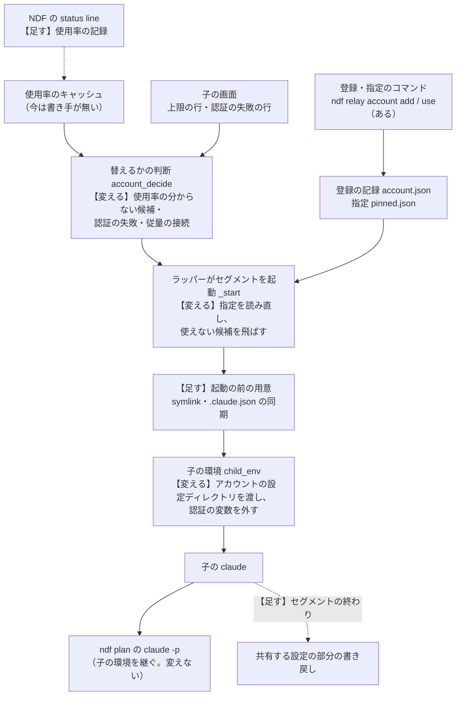
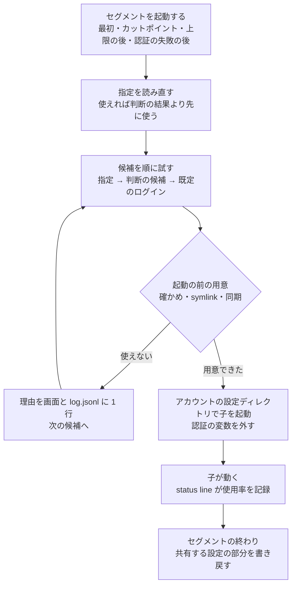
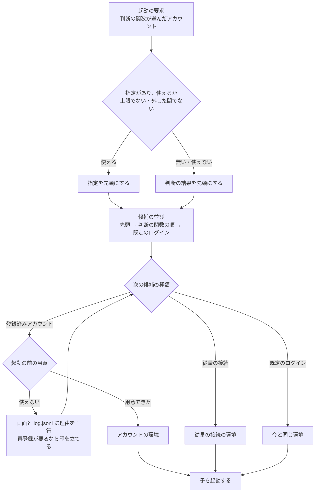
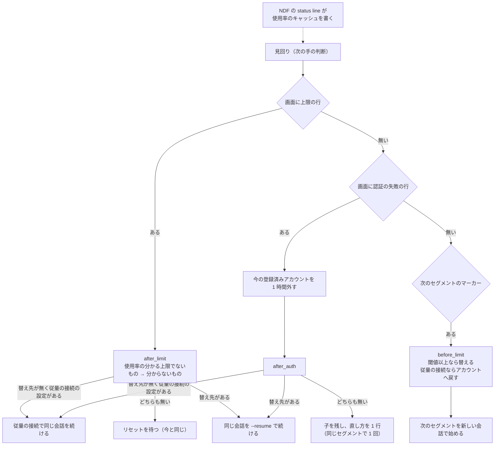
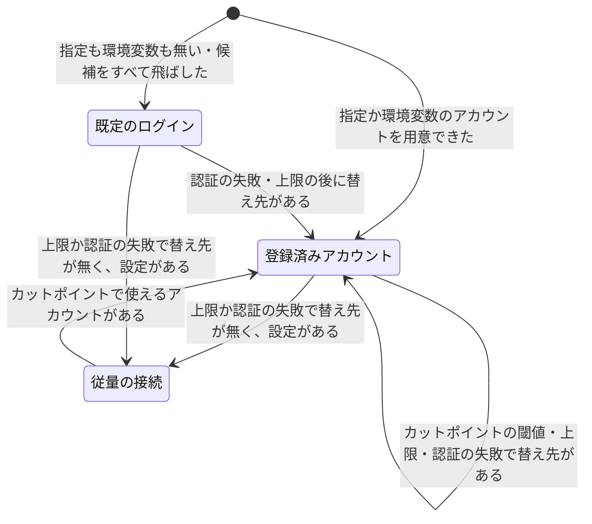

# 中継のアカウントの切り替え: 選んだアカウントの認証で子を起動し、上限と認証の失敗で別のアカウントへ替えて会話を続ける（#3604 #3864）

11 系の中継は、登録したアカウントを選んでも子の claude を元のログインで起動し、使用率を記録する手段も持たないため、利用上限や認証の失敗で別のアカウントへ替わらない（要求は下の 2 本の要求仕様にある）。この設計は、起動の前にアカウントの設定ディレクトリを用意してその設定ディレクトリで子を起動し、NDF の status line が使用率を記録し、ラッパーがカットポイント・利用上限・認証の失敗で替え先を選んで同じ会話を続ける形にする。手順書 `relay-accounts.md` は 11 系の振る舞いだけに書き直す。採らなかった案は「決定の記録」に、外部の調査は末尾の付録に、関数ごとの仕様は詳細設計書（[issue-3604-3864-design-detail.md](./issue-3604-3864-design-detail.md)）にある。

## 今の姿

何が起きたか・目的・受け入れ条件は要求仕様（[issue-3604-requirements.md](./issue-3604-requirements.md)、正は #3604 の本文。[issue-3864-requirements.md](./issue-3864-requirements.md)、正は #3864 の本文）にある。この文書は「どう解くか」と「なぜその解き方か」だけを書く。

この文書の語: **セグメント**はラッパーが起動する子の claude の 1 回分、**カットポイント**は子が次のセグメントのマーカーを書いて区切った時点、**従量の接続**は利用上限の無い使った分だけ費用の掛かる接続（Bedrock）、**窓**は利用上限の単位（5 時間と 7 日）である。

中継のアカウントの切り替えの経路は次のとおりである。【足す】【変える】が付いた箇所をこの設計で直す。



設計に要る今の構造（照合の根拠は要求仕様の「事象」）:

- 登録・一覧・指定・削除のコマンドと、保存先の形（`<共有の設定ディレクトリ>/ndf/accounts/<名前>/`）は 10 系と同じで 11 系にある。登録の排他（`<保存先>/.locks/<名前>.lock`）も同じ
- 替えるかの判断は 2 つの純粋な関数（`account_decide.before_limit`・`after_limit`）にある。どちらも使用率の行がある名前だけを候補にする
- 子の環境（`session_env.child_env`）は、子の環境の表（`contracts/domains/env.json`）の `child` の列（`drop`・`set`）だけで作る。アカウントの名前を入れるだけで、設定ディレクトリは親のまま渡る
- ラッパーが会話の記録の大きさを読む場所（`observe.transcript_path`）は、ラッパー自身の `CLAUDE_CONFIG_DIR` の `projects` である。子の会話の記録が共有の設定ディレクトリに無いと、文脈の量の切り替えも働かない
- `ndf plan` の worker の `claude -p` は、子の環境をそのまま継ぐ（`adapters/claude.py` の `call_claude`）

**まとめた理由（共通の原因）**: 11 系への作り直しで、中継のアカウントの切り替えのうち「登録のコマンド」と「替えるかの判断の純粋な関数」だけを移した。判断へ入る観測（使用率・認証の状態）と、判断から出る起動（アカウントの設定ディレクトリで子を起動する）は移さなかった。#3604 は出る側の欠け、#3864 は入る側の欠けと、欠けたままの手順書である。どちらを直しても、もう片方が無ければ切り替えは一度も働かない。

## 文脈と制約

- **判断は純粋な関数に置き、ラッパーは端末・時計・ファイルを読んで手を打つだけにする**（`wrapper.py` と `switch_decide.py` の冒頭の説明）。替え先の選び方は `account_decide` に、ファイルの読み書きは `accounts`・`account_dir`・`account_registry` に置く
- **子の環境の渡し方の正は子の環境の表である**（`session_env.py` の冒頭）。名前をコードに散らさず、表の `child` の列に値を足す（決定 1）
- **トークンを NDF が持たない。** 認証ファイルは claude 自身が読み、更新する。NDF は中身の有無と本人だけを確かめ、値を画面と記録に出さない（#3604 受け入れ条件 12）
- **使用率を取る公式の契約は、status line へ渡る入力の `rate_limits` だけである**（外部の調査 STD5）。使用率の API（`api/oauth/usage`）は公開の文書に無い（PRD5）
- **macOS は対象外。** claude が認証を Keychain に置くため、登録の時点で止まる（今と同じ）
- **範囲外**: 閾値の値（90%）と 5 時間の制限の無いプランを先に選ぶこと（#2588）、`ndf plan` を API キーで動かす経路（#3991）
- プロジェクトの MVV（バージョン 10）の Value を基準にする。Value 1（人の判断を大事な所だけにする）・Value 7（根本原因から直す）・Value 12（実績のある公式の手段を使う）

## 解き方の全体像



1. 登録済みアカウントで起動する子は、`CLAUDE_CONFIG_DIR` にアカウントの設定ディレクトリを受け取り、認証の変数を持たずに起動する。設定ディレクトリの直下は、アカウント固有の項目を除いて共有の設定ディレクトリへの symlink なので、会話の記録・設定・プラグインはアカウントを替えても同じ場所にある
2. 使えないアカウント（認証ファイルが無い・リフレッシュトークンが空・本人が違う・会話の記録を共有できない）は起動の前に飛ばし、理由を 1 行残して次の候補で起動する
3. NDF の status line が、子のアカウントの使用率をアカウントごとのファイルへ書く。ラッパーはそれを読み、カットポイントで閾値を超えたら替え、上限の行で替え、認証の失敗の行でそのアカウントを 1 時間外して替える。替え先が無ければ従量の接続で続け、次のカットポイントでアカウントへ戻る
4. `ndf plan` の `claude -p` は子の環境を継ぐので、子と同じアカウントで動く。`ndf plan` の側は変えない
5. 手順書は 11 系にある振る舞いだけを書き、10 系だけの語を用語集から消す

## ドメインモデル

### コンテキスト

| コンテキスト | 何の語が 1 つの意味に決まるか |
| --- | --- |
| NDF のラッパー（`ndf-relay`） | ラッパーがセグメントを起動し、アカウントを替えるときの語（登録済みアカウント・アカウントの設定ディレクトリ・使用率・従量の接続） |

### 集約

| 集約 | オーナー（書き換えてよいもの） | 根 | エンティティ | 値オブジェクト |
| --- | --- | --- | --- | --- |
| 登録済みアカウント | 登録の保存先（`account_registry`）。ラッパーは再登録が要る印だけを、この経路で立てる | 登録の記録（`account.json`） | — | 本人（メールアドレス・組織）・再登録が要る |
| アカウントの設定ディレクトリ | 起動の前の用意（`account_dir`）。認証ファイルと `.claude.json` の本人の項目は claude 自身が書く | アカウントの設定ディレクトリ | 共有の項目への symlink・アカウント固有の項目 | 共有する設定の部分・同期のバックアップ |
| 使用率のキャッシュ | NDF の status line（書く）。ラッパーと一覧のコマンドは読むだけ | アカウントごとのファイル | — | 窓（使用率・リセットの時刻） |
| 認証の失敗で外した間 | ラッパー（`accounts` の経路） | 外した間の記録（`held.json`） | — | 外す終わりの時刻 |

### 不変条件

| # | 集約 | 条件 | 破れたときの扱い |
| --- | --- | --- | --- |
| I1 | アカウントの設定ディレクトリ | symlink の参照先は共有の設定ディレクトリの直下の項目だけで、共有側の認証ファイル（`.credentials.json`）を読み書きしない | アカウント固有の項目の一覧で認証ファイルを symlink の対象から外す。外れた形はテストで落とす |
| I2 | アカウントの設定ディレクトリ | アカウント側の実体の項目を上書き・移動・削除しない | 同じ名前の実体があれば symlink を張らずに飛ばす |
| I3 | アカウントの設定ディレクトリ | 登録済みアカウントで起動する子の `projects` は、共有の設定ディレクトリの `projects` と同じ実体である | 起動せず、次の候補へ移る（決定 3） |
| I4 | 登録済みアカウント | 登録済みアカウントと従量の接続で起動する子の環境に、認証の 7 変数が無い | 子の環境の表の `account-drop` の行から外す（決定 1） |
| I5 | 登録済みアカウント | トークン・キーの値を画面・記録・結果に出さない | 理由は決まった文と項目の名前だけで出す |
| I6 | 使用率のキャッシュ | 1 つのアカウントの記録は、ほかのアカウントの記録を変えない | アカウントごとのファイルへ置き換えで書く（決定 4） |
| I7 | 使用率のキャッシュ | 記録の失敗（書けない・読めない）は、status line の表示と子の応答を止めない | 書けなければ何もしない。読めないファイルは使用率の分からないアカウントとして読む |
| I8 | 認証の失敗で外した間 | 外した間のアカウントは、替え先にも指定にも使われない | 候補の一覧から除いて判断の関数へ渡す（決定 6・7） |
| I9 | 登録済みアカウント | 従量の接続で起動する子の `CLAUDE_CONFIG_DIR` は共有の設定ディレクトリである | 共有の設定ディレクトリの値へ戻す（決定 1・8） |

### ドメインイベント

要求の番号が #3604 と #3864 で重なるため、通し番号に振り直した。

| # | イベント | 発生元 | 受け手 | 要求の番号 |
| --- | --- | --- | --- | --- |
| E1 | 起動するアカウントを決めた | ラッパー（指定の読み直しと判断の関数） | 起動の前の用意 | #3604 E1 |
| E2 | アカウントの設定ディレクトリを用意した | 起動の前の用意 | 子の環境 | #3604 E2 |
| E3 | アカウントの環境で子を起動した | ラッパー | 子の claude・status line | #3604 E3 |
| E4 | 共有する設定の部分を共有側へ書き戻した | 起動の前の用意（セグメントの終わりとラッパーの終わり） | 次の起動の前の用意・ラッパーを通さない claude | #3604 E4 |
| E5 | 子の使用率を記録した | NDF の status line | ラッパー・一覧のコマンド | #3864 E1 |
| E6 | カットポイントで替え先を決めた | 替えるかの判断（`before_limit`） | ラッパー（E1 へ） | #3864 E2 |
| E7 | 利用上限を見て替え先を決めた | 替えるかの判断（`after_limit`） | ラッパー（E1 へ） | #3864 E3 |
| E8 | 認証の失敗を見て、そのアカウントを外して替え先を決めた | 替えるかの判断（`after_auth`） | ラッパー（E1 へ）・外した間の記録 | #3864 E4 |
| E9 | 指定を読み直した | ラッパー | E1 | #3864 E5 |
| E10 | 従量の接続からアカウントへ戻した | 替えるかの判断（`before_limit`） | ラッパー（E1 へ） | #3864 E6 |

## 構成要素

| 要素 | 責務 |
| --- | --- |
| 起動の前の用意（`account_dir.py`。新設） | 使えないアカウントの判定・共有の項目への symlink・`.claude.json` の共有する設定の部分の同期と書き戻し。アカウントの排他の中で動く |
| 子の環境（`session_env.py`。変更） | 子の環境の表の `account-set`・`account-drop` の行から、登録済みアカウントの子と従量の接続の子の環境を作る |
| 使用率と外した間の記録（`accounts.py`。変更） | 使用率のキャッシュをアカウントごとのファイルから読み、リセットの時刻を過ぎた窓を 0% にする。認証の失敗で外した間を読み書きする |
| 替えるかの判断（`account_decide.py`。変更） | 候補の一覧を引数で受け、カットポイント・上限の後・認証の失敗の後の替え先を決める純粋な関数 |
| 次の手の判断（`switch_decide.py`。変更） | 認証の失敗の替え先を受けて、同じ会話を続ける手か、子を残す手を返す |
| ラッパー（`wrapper.py`。変更） | 指定の読み直し・候補を順に試す起動・再登録が要るアカウントの知らせ・セグメントの終わりの書き戻し |
| 登録の保存先（`account_registry.py`。変更） | 共有の設定ディレクトリの求め方を 1 か所にし、再登録が要る印を立てる |
| NDF の status line（`statusline.sh`。変更） | 入力の `rate_limits` を、今のアカウントの使用率のキャッシュへ書く |
| 一覧のコマンド（`cli_account.py`。変更） | 今の時刻を渡して使用率を読む |
| 契約（`env.json`・`ndf-files.json`・`limits.json`。変更） | 子の環境の渡し方・使用率のキャッシュと外した間の記録の置き場・外す秒数 |
| 手順書（`relay-accounts.md`。変更） | 11 系の振る舞いだけを書く（決定 10） |

## 入出力のコントラクト

### 子の環境の変数

子の環境の表の `child` の列に `account-set` と `account-drop` を足す。列の説明（`columns.child.summary`）は「中継が起動する子のセッションへの渡し方。drop は渡さない、set は NDF が値を入れる、account-set は登録済みアカウントの子で NDF が値を入れる、account-drop は登録済みアカウントと従量の接続の子で渡さない。無ければそのまま渡す」にする。

| 変数 | 表の `child` | 既定のログインの子 | 登録済みアカウントの子 | 従量の接続の子 |
| --- | --- | --- | --- | --- |
| `NDF_CLAUDE_ACCOUNT` | `set`（今と同じ） | 無し | `<名前>` | `metered` |
| `CLAUDE_CONFIG_DIR` | `account-set` | 親の値のまま | `<アカウントの保存先>/<名前>` の絶対パス | 共有の設定ディレクトリ（親が登録済みアカウントの子なら `NDF_SHARED_CONFIG_DIR` から戻し、空なら外す） |
| `NDF_SHARED_CONFIG_DIR` | `account-set` | 親の値のまま | 親にあれば親の値、無ければ子へ渡す前の `CLAUDE_CONFIG_DIR`（無ければ空文字） | 外す |
| `CLAUDE_CODE_PLUGIN_CACHE_DIR` | `account-set`（行を足す） | 親の値のまま | 親にあればその値、無ければ `<共有の設定ディレクトリ>/plugins` | 親の値のまま |
| `CLAUDE_CODE_OAUTH_TOKEN`・`CLAUDE_CODE_OAUTH_SCOPES`・`ANTHROPIC_API_KEY`・`ANTHROPIC_AUTH_TOKEN`・`CLAUDE_CODE_USE_BEDROCK`・`CLAUDE_CODE_USE_VERTEX`・`CLAUDE_CODE_USE_FOUNDRY` | `account-drop`（`ANTHROPIC_API_KEY` のほかは行を足す） | 親の値のまま | 外す | 外してから従量の接続の設定を重ねる |
| `AWS_ACCESS_KEY_ID`・`AWS_SECRET_ACCESS_KEY`・`AWS_SESSION_TOKEN` | 表に足さない（`account_registry.AWS_KEY_ENV`） | 親の値のまま | 親の値のまま | 保存した設定（`metered.json`）のときだけ外す |

### 使用率のキャッシュ

置き場は `<状態の保存先>/relay/accounts/usage/<名前>.json`（アカウントごとに 1 ファイル。ファイルの表の `relay-usage` の行の `path` を `usage/<名前>.json`、書き手を NDF の status line にする）。要求の「`usage.json` の `work1` の行」は、この設計ではファイル `usage/work1.json` 1 つに当たる。

```json
{"windows": {"five_hour": {"percent": 42.0, "resets_at": 1795000000}, "seven_day": {"percent": 18.0, "resets_at": 1795400000}}, "recorded_at": 1794990000}
```

- `windows` は入力の `rate_limits` にある窓だけを持つ（5 時間の上限の無いプランは `five_hour` を持たない）
- 読む側の使用率は、`resets_at` を過ぎていない窓の `percent` の最大（過ぎた窓は 0%）。上限に当たっているかは、過ぎていない窓のどれかが 100 以上か。読んだ結果の形（名前・使用率・上限に当たっているか）は今の `Usage` のまま
- 今の 1 つのファイル（`usage.json`）は書き手が無いので、読まず、移さない

### 認証の失敗で外した間の記録

置き場は `<状態の保存先>/relay/accounts/held.json`（ファイルの表に `relay-auth-held` の行を足す。書き手は中継のラッパー）。外す秒数は上限の値 `relay.auth-hold`（`seconds: 3600`）。

```json
{"work1": 1794993600}
```

値は外す終わりの Unix 秒。終わりを過ぎた名前は読む側が無いものとして扱い、次に書くときに消す。

## 処理の流れ

セグメントを 1 つ起動するまで（最初・カットポイント・上限の後・認証の失敗の後のどれも同じ）:



子が動いている間の見回りで、替え先を決める分岐:



子のアカウントの種類の遷移（描かない遷移は起こらない）:



図に含めない要素: 契約（子の環境の表・ファイルの表・上限の値）と手順書は振る舞いの流れを持たない。一覧のコマンドは使用率のキャッシュを読むだけである。

セグメントの終わり（子が終わった後・次の子を起動する前）とラッパーの終わりに、終わった子のアカウントが登録済みアカウントなら共有する設定の部分を書き戻す。書けなければ理由を 1 行出し、次の起動の前の同期でそろえる。

## 決定の記録

### 決定 1: 選んだアカウントの認証で子を動かし会話の記録を 1 か所に保つため、子へアカウントの設定ディレクトリを渡し、認証の変数を外す

- **質問**: 登録済みアカウントの認証を、子の claude へどの形で渡すか
- **選んだ案**: `CLAUDE_CONFIG_DIR` にアカウントの設定ディレクトリを入れる。`NDF_SHARED_CONFIG_DIR` には子へ渡す前の `CLAUDE_CONFIG_DIR` を入れ、入れ子の起動では親の値を引き継ぐ。`CLAUDE_CODE_PLUGIN_CACHE_DIR` には共有側の `plugins` を入れる。認証の優先順位でログインより上に来る 7 変数を外す（STD2）。従量の接続の子は共有の設定ディレクトリへ戻して 7 変数を外し、従量の接続の設定を重ねる。保存した設定のときは AWS のキーの 3 変数も外す。渡し方は子の環境の表の `child` の列の `account-set`・`account-drop` が持ち、表が渡し方の正である今の作りを保つ。既定のログインの子は今と同じ
- 採らなかった案: トークンを環境変数（`CLAUDE_CODE_OAUTH_TOKEN`）で渡す（PRD2 の型。このトークンはモデルへの要求だけに使え、コネクタと Remote Control が使えない。更新も NDF が持つことになる。STD2）
- 採らなかった案: `CLAUDE_CONFIG_DIR` だけを替える（会話の記録がアカウントごとに分かれ、`--resume` が前の会話を見つけられない。STD3）
- **代償**: 子の環境の表に `child` の値が 2 つ増え、行が 7 つ増える。親の環境で従量の接続や API キーを使っている利用者も、登録済みアカウントの子ではそれらが外れる
- 作り方: 標準に倣う
- 比べた候補: STD1・STD2・STD3・PRD1・PRD2
- 根拠: Value 12 / Value 7（MVV バージョン 10）。STD1 は複数のアカウントを設定ディレクトリで分ける形を公式の手順として載せる

### 決定 2: アカウントを替えても会話・設定・プラグインが続くよう、起動の前にアカウントの設定ディレクトリから共有の項目へ symlink を張り、`.claude.json` の共有する部分を 3 者で同期する

- **質問**: アカウントの設定ディレクトリと共有の設定ディレクトリで、何をどう共有するか
- **選んだ案**: 10 系の作り（`claude_account_dir.py`）を新しい部品 `account_dir.py` に移す。共有の設定ディレクトリの直下の、アカウント固有でない項目すべてへ symlink を張る（固定の一覧にしない）。共有側に `projects`（0700）と `settings.json`（`{}`）が無ければ先に作る。参照先の違う symlink は付け替え、実体は飛ばす。`.claude.json` の `projects`・`mcpServers` は、共有・アカウント・同期のバックアップの 3 者で葉ごとに突き合わせる。片側だけ変わった値を採り、両側で変わったら共有側を採る。最初の同期・バックアップが無い・`userID` が違うときは共有側にそろえる。排他は Claude Code 本体と同じ `<実パス>.lock` のディレクトリと、NDF の登録の排他の 2 つを取る。書き戻しはセグメントの終わりとラッパーの終わりに 1 回ずつ。アカウント側にだけある実体（`local_only`）は名前だけを `log.jsonl` に残し、消さない
- 採らなかった案: コピーで共有する（PRD4 の型。会話の記録が 2 か所に分かれ、片方だけが更新される）
- 採らなかった案: 選んだ項目だけを共有する（PRD3 の型。新しく増えた項目（skills など）が、アカウントを替えると見えなくなる）
- **代償**: Claude Code 本体の排他の形（`<実パス>.lock` のディレクトリ、10 秒を超えたものは残骸）を自前で持ち、本体の形が変わると追随が要る。symlink 共有をやめた製品がある（PRD2。理由は symlink 切れと skill の消失）。11 系に当たるかは「未確認のまま残ること」に置く。10 系はこの形で 2026-10 まで運用していた
- 作り方: 自前で作る・標準に倣う
- 比べた候補: PRD1・PRD2・PRD3・PRD4・LIB3・STD3（本体と同じ形の排他は既存のライブラリに無い。LIB3 の filelock は NDF の登録の排他に使い、本体の排他の形には合わない）
- 根拠: Value 12 / Value 3（MVV バージョン 10）

### 決定 3: 使えないアカウントで子が止まらないよう、起動の前に確かめて飛ばし、次の候補で起動する

- **質問**: 認証ファイルや会話の記録の共有が成り立たないアカウントを、いつ・どう扱うか
- **選んだ案**: 起動の前の用意で、使えないアカウントかを確かめる。認証ファイルが無い・読めない・アクセストークンが空か、リフレッシュトークンが空かを見る。アカウント側の `.claude.json` の本人（`oauthAccount` のメールアドレスと組織）が登録と違うかを見る。アカウント側の `.claude.json` が JSON として読めないか、アカウント側の `projects` の実パスが共有側の `projects` でないかを見る。当たれば起動せず、理由を画面に 1 行・`log.jsonl` に 1 行出して、次の候補（指定 → 判断の関数の候補 → 無ければ既定のログイン）で起動する。リフレッシュトークンが空と本人の食い違いのときは `account.json` の `needs_relogin` を真にする（書く関数を `account_registry` に足す）。ラッパーは起動するたびに、再登録が要るアカウントを 1 つにつき 1 行知らせる
- 採らなかった案: NDF がトークンを更新して使えるようにする（10 系の作り。トークンの更新を NDF が持ち、claude 自身の更新と排他を取り合う。claude は起動した後に自分で更新する）
- 採らなかった案: 確かめずに起動し、画面の認証の失敗の行で気づく（会話の記録を共有できないアカウントでは、起動した時点で会話が分かれる）
- **代償**: 起動の前に認証ファイルを読む。値は外へ出さないが、秘密のファイルを開く処理が増える（「人へ残す判断」）
- 根拠: Value 1 / Value 7（MVV バージョン 10）

### 決定 4: 判断の入力を公式の契約から取るため、NDF の status line が `rate_limits` をアカウントごとのファイルへ記録する

- **質問**: 使用率をどこから取り、どこへ書くか
- **選んだ案**: NDF の status line が、`NDF_CLAUDE_ACCOUNT` のある子で、入力の `rate_limits` の 2 つの窓を書く。窓は `rate_limits.five_hour`・`rate_limits.seven_day` で、書く値は `used_percentage`・`resets_at` である。書き先は `<状態の保存先>/relay/accounts/usage/<名前>.json` である。一時ファイルから `mv` で置き換え、中身が前と同じなら書かない。jq が無い・書けないときは何もせず表示を続ける。読む側は窓ごとに `resets_at` を過ぎていれば 0% とし、使用率は窓の最大、上限は過ぎていない窓のどれかが 100 以上。アカウントごとのファイルにするのは、2 つのレーンが別のアカウントで同時に書いても互いを消さないためで、排他を持たない
- 採らなかった案: 中継が非公開の `api/oauth/usage` を呼ぶ（10 系の作り。PRD5。公開の文書に無く、形が変わりうる。止まっているアカウントのトークンの期限切れで、NDF が更新を持つことになる）
- 採らなかった案: 使用率の監視の Tool（claude-monitor・ccusage）を使う（LIB1・LIB2。アカウントの切り替えも記録の書き先も持たず、上限に対する使用率の取り方はこの調査で確かめられなかった）
- 採らなかった案: 1 つのファイル（`usage.json`）を排他の中で書き換える（status line は数秒ごとに動き、レーンの数だけ排他を待つ。今は書き手が無いので、形を替えても互換の問題が無い）
- **代償**: NDF の status line を使わない利用者と `claude -p` では記録されない（要求の前提 1・2）。記録はアカウントが動いている間だけ新しくなり、動いていないアカウントの値はリセットの時刻を過ぎると 0% として読む。この記録は使用率の正本のコピーではなく、ラッパーが読める唯一の経路で受けた値である
- 作り方: 標準に倣う
- 比べた候補: STD4・STD5・PRD5・LIB1・LIB2
- 根拠: Value 12 / Value 2（MVV バージョン 10）。STD5

### 決定 5: 使用率の記録が無いアカウントでも上限の後に止まらないよう、使用率の分からない登録済みアカウントを替え先の候補に入れる

- **質問**: 上限の後の替え先に、使用率の記録が無いアカウントを入れるか
- **選んだ案**: `after_limit` の候補に、使用率の分からない登録済みアカウントを足す。順は、使用率の分かる上限でないもの（使用率の小さい順・同じなら名前順）→ 分からないもの（名前順）。使えないアカウント（決定 3）と認証の失敗で外した間のアカウント（決定 6）は候補から除く。純粋な関数のまま、候補の一覧を引数で受ける
- 採らなかった案: 使用率の分かるアカウントだけを候補にする（今の形。status line の無い利用者や、まだ一度も動いていないアカウントでは、替え先が無いまま上限のリセットを待つ）
- **代償**: 使用率の分からないアカウントへ替えた先が、すぐに上限に当たることがある。そのときは次の上限の行で同じ判断をもう一度行い、1 日の起動の上限で止まる
- 根拠: Value 1 / Value 5（MVV バージョン 10）

### 決定 6: 認証の失敗でレーンが止まらないよう、そのアカウントを 1 時間外して別のアカウントで同じ会話を続ける

- **質問**: 子の画面に認証の失敗の行が出たとき、どうするか
- **選んだ案**: 今のアカウント（登録済み）を 3600 秒、替え先と指定の候補から外し、`held.json` に記録する（秒数は `contracts/limits.json`）。替え先は決定 5 と同じ順（今のアカウントを除く）。既定のログインの認証の失敗も、登録済みアカウントへ替える。替えたら同じ会話を `--resume` で続ける（上限の後と同じ手）。替え先が無く、従量の接続の設定があり、今が従量の接続でなければ従量の接続へ替える（決定 8）。それも無ければ子を残し（今の `stalled`）、ログインの形に合う直し方を 1 行出す（既定のログイン: claude の中で `/login`。登録済みアカウント: `ndf relay account add <名前>`。従量の接続: `ndf relay account check metered`）。同じセグメントで 2 回出さない。判断は `account_decide` に足す純粋な関数（`after_auth`）、記録の読み書きは `accounts` が持つ
- 採らなかった案: 今どおり子を残して利用者を待つ（2 つ以上のアカウントがあっても、利用者が端末を見るまでレーンが止まる）
- **代償**: 一時的な認証の失敗でも 1 時間そのアカウントを使わない。外した間は状態の保存先に残り、同じマシンのほかのレーンにも効く
- 根拠: Value 1（MVV バージョン 10）

### 決定 7: 動いているラッパーにも指定が効くよう、セグメントを起動するたびに指定を読み直す

- **質問**: `ndf relay account use` の指定を、どの時点で読むか
- **選んだ案**: セグメントを起動するたび（カットポイント・上限の後・認証の失敗の後）に `pinned.json` を読む。指定があり、そのアカウントが使える（決定 3 の確かめに通る・上限でない・決定 6 で外した間でない）なら、判断の関数の結果より先にそれを使う。使えない間は判断の関数の結果で起動する。環境変数 `NDF_CLAUDE_ACCOUNT` は今どおり最初のセグメントだけで先に効く
- 採らなかった案: 今どおり、最初のセグメントと今のアカウントが無いときだけ読む（動いているラッパーでは、指定が次のセグメントに効かない）
- **代償**: 指定したアカウントの使用率が閾値を超えていても、上限でない間はカットポイントで指定へ戻る
- 根拠: Value 3（MVV バージョン 10）

### 決定 8: 登録済みアカウントがすべて使えないときも続くよう、従量の接続へ退避し、カットポイントでアカウントへ戻す

- **質問**: 上限の後・認証の失敗の後に替え先のアカウントが無いとき、どうするか
- **選んだ案**: 従量の接続の設定（`account_registry.fallback_env`）があり、今が従量の接続でなければ、アカウントの名前 `metered` で同じ会話を続ける。従量の接続で動く子のカットポイントで、使えるアカウント（指定が先）があればそちらへ戻す。設定が読めなければ設定なしとして扱い、ラッパーの起動で 1 行出す。従量の接続の認証の失敗では替えない（決定 6 の直し方の 1 行）
- 採らなかった案: 従量の接続へ移らず、リセットを待つ（すべてのアカウントが上限のとき、リセットまでレーンが止まる。従量の接続の設定がある利用者は、待たずに続けることを設定で示している）
- **代償**: 従量の接続の間は利用料が掛かる。戻すのはカットポイントだけなので、上限が解けても次のカットポイントまでは従量の接続のまま
- 根拠: Value 5 / Value 1（MVV バージョン 10）

### 決定 9: `ndf plan` の側に要らない仕組みを作らないため、`ndf plan` は子の環境を継ぐだけにする

- **質問**: `ndf plan` の worker の `claude -p` のアカウントを、`ndf plan` が選ぶか
- **選んだ案**: `ndf plan` の `claude -p` は子の環境を継ぐ（`adapters/claude.py` の `call_claude`）。そのため決定 1 の後は子と同じアカウントで動く。`ndf plan` の側は変えない。呼び出しごとの選び直し・上限と認証の失敗での別のアカウントでのやり直し・API キーでの起動は作らない（API キーの経路は #3991）
- 採らなかった案: 呼び出しごとに選び直し、上限と認証の失敗で別のアカウントでやり直す（10 系の形。`claude -p` は status line を動かさないので使用率が記録されず（要求の前提 2）、選び直す入力が無い）
- **代償**: `ndf plan` の呼び出しが上限に当たると、今どおり上限が解けるまで待つ（`supervise.limit-wait-max`）。子のアカウントはカットポイントで替わる
- 根拠: Value 9（MVV バージョン 10）

### 決定 10: 手順書を読んだ人と AI が 11 系の振る舞いを正しく読めるよう、手順書を 11 系の振る舞いだけにし、10 系だけの語を用語集から消す

- **質問**: 11 系に無い振る舞いを書いた手順書と用語集を、どう直すか
- **選んだ案**: `relay-accounts.md` から、4 つの選ぶ順の組・閾値 T・切り替えの余裕を消す。`NDF_ACCOUNT_SWITCH_AT` の行・`NDF_ACCOUNT_CHECK_INTERVAL`・`StopFailure` の `limit.json` も消す。バックグラウンドの作業を待つ振る舞い・最初の入力の選び方・`ndf plan` の選び直しとやり直しの列・API キーでの起動の規則も消す。決定 1〜8 の振る舞い・閾値は `relay.usage-guard`・使用率の記録の前提・`ndf relay account show`・1 日の起動の上限で止まる処理を書く。API キーは登録と確かめだけがあり、`ndf plan` は使わないことも書く。手順書が指す 3 本の確定仕様は、10 系の記録として残す。3 本は `ndf-relay-launch-target.md`・`ndf-relay-api-keys.md`・`ndf-relay-auth-failure.md` である。手順書からは 11 系の正として指さない。用語集は 10 系だけの語を消し、`使用率` の意味を直し、2 語を足す（「用語」）。用語集はこの設計の PR で、手順書は実装の PR で直す
- 採らなかった案: 10 系の記述を残して「11 系に無い」と印を付ける（手順書に書いてあることがコードに無い状態が続き、受け入れ条件 12 を満たさない）
- 採らなかった案: 確定仕様を 11 系の振る舞いに書き直す（確定仕様はリリースしたときの判断の記録で、11 系の振る舞いは実装の後の確定仕様化が新しく書く）
- **代償**: 10 系の確定仕様は残るので、11 系の振る舞いを知りたい人は手順書から読む必要がある
- 根拠: Value 14 / Value 11（MVV バージョン 10）

## 影響と危険

- **働く範囲**: 利用先のリポジトリでも働く。NDF のラッパー（`ndf-claude`）で claude を動かし、2 つ以上のアカウントか従量の接続を登録した利用者に効く。登録が 1 つ以下で従量の接続の設定も無い利用者の振る舞いは変わらない（#3864 受け入れ条件 11）
- **プロジェクトごとに違うもの**: 無い。アカウントの登録と従量の接続の設定は利用者のマシンの保存先が持ち、リポジトリの設定（`.ndf/`）も引数も増えない
- **当たるモード**: すべてのモード（中継の上で動く作業すべて）
- **壊れうる箇所**:
  - 文脈の量の切り替えは、ラッパーが共有の設定ディレクトリの会話の記録を読む。symlink が張れないアカウントでは記録の大きさを読めなくなるので、`projects` の共有を起動の条件にする（決定 3）
  - 子の環境の表に `child` の値を足しても、表を読むほかの経路は今の `drop`・`set` だけを見るので変わらない。ほかの経路は、中継が打つ `claude plugin` のコマンドの `tool_env` と、リレーハブの `spawn_env` である。新しい 2 つの値はラッパーがセグメントを起動するときだけ使う
  - status line の本体（`~/.claude/ndf-statusline.sh`）は、新しいバイト列へ置き直されるまで古いままである。置き直すのは SessionStart の `ndf statusline ensure` である。その間は使用率が記録されない
- **同じファイルを触る別の変更**: #3991（API キーの経路）と #2588（閾値と選ぶ順）は `account_decide.py`・`relay-accounts.md` を触る。この設計は閾値の値と API キーの選び方を変えないので、後から入る変更が候補の一覧の引数に合わせる

### 代表のリポジトリでの振る舞い

| 代表のリポジトリ | 設定の要点 | 直した後に起きること | この種類で扱えなくなること |
| --- | --- | --- | --- |
| Web サービス | 中継の上で設計・実装・リリースのレーンを並べる | 上限・認証の失敗で止まったレーンが、別のアカウントか従量の接続で同じ会話を続ける。設計・設計の検査・cross-review・MVV 判定の振る舞いは変わらない | 無し |
| モバイルアプリ | 同じ | 同じ | 無し |
| 業務文書だけ | テストのツールと CI を持たない。中継の上で文書の工程を進める | 同じ。アカウントの切り替えはリポジトリの種類に依らない | 無し |

### ai-plugins だけの事情

- 無し（アカウントの登録・従量の接続の設定・使用率のキャッシュは利用者のマシンの保存先が持ち、ai-plugins の運用の値を使わない）

## 用語

| 用語 | 意味 | 用語集への反映 |
| --- | --- | --- |
| 使用率のキャッシュ | 登録済みアカウントごとの使用率・リセットの時刻・記録の時刻を持つファイル（状態の保存先の `relay/accounts/usage/<名前>.json`）。NDF の status line が書き、ラッパーと一覧のコマンドが読む | 追加（`ndf-relay`） |
| 使用率の記録 | NDF の status line が、受け取った入力の `rate_limits` から、今の登録済みアカウントの使用率のキャッシュを書き換えること | 追加（`ndf-relay`） |
| 起動の前の用意 | 登録済みアカウントで子を起動する前に、そのアカウントが使えるかを確かめ、アカウントの設定ディレクトリの symlink を張り、共有する設定の部分を同期すること（決定 2・3） | 追加（`ndf-relay`） |
| 外した間 | 認証の失敗を見たアカウントを替え先と指定の候補から外す 1 時間（状態の保存先の `relay/accounts/held.json` が終わりの時刻を持つ。決定 6） | 追加（`ndf-relay`） |
| 使用率 | 登録済みアカウントの 5 時間と 7 日の利用上限に対する使用の割合（%）。Claude Code が status line へ渡す `rate_limits` の値で、リセットの時刻を過ぎていない窓の大きいほうを判断に使う | 意味の変更（`ndf-relay`） |
| `選ぶ順の組` | 10 系の起動先の決定がアカウントを分けた 4 つの組 | 廃止（項目を消す） |
| `閾値 T` | 10 系の API キーへ逃がすかを決めた週の使用率の閾値 | 廃止（項目を消す） |
| `切り替えの余裕` | 10 系の、同じ組なら替えない条件 | 廃止（項目を消す） |
| `観測のスナップショット` | 10 系の起動先の決定の入力 | 廃止（項目を消す） |
| `5 時間のクォータの無いアカウント` | 10 系の一覧の 5 時間の列が「-」になるアカウント | 廃止（項目を消す） |

廃止の 5 語は 11 系に同じ概念が無く、生きた語の旧称でもない。そのため `deprecated` へ移さず項目を消す（用語集の形式の `deprecated` は生きた語の旧称を持つ）。

## テスト設計

| 受け入れ条件・不変条件 | どの振る舞いで縛るか | どう壊したら落ちるべきか |
| --- | --- | --- |
| #3604 の 1 | 指定 `work2` で次のセグメントを起動すると、子の環境の `CLAUDE_CONFIG_DIR` が `<保存先>/work2` の絶対パス、`NDF_CLAUDE_ACCOUNT` が `work2`、`NDF_SHARED_CONFIG_DIR` が親の `CLAUDE_CONFIG_DIR`（無ければ空文字）。親がアカウントの子なら親の `NDF_SHARED_CONFIG_DIR` を引き継ぐ | `CLAUDE_CONFIG_DIR` を入れない・相対パスにする・入れ子で `NDF_SHARED_CONFIG_DIR` を子の設定ディレクトリへ書き換えると落ちる |
| #3604 の 2・I4 | 親の環境に 7 変数があっても、登録済みアカウントの子と従量の接続の子の環境に無い | 表の `account-drop` の行を 1 つ外す・従量の接続の子で外さないと落ちる |
| #3604 の 3 | アカウントの無い子の環境が、今の `child_env` の出力と同じ（`CLAUDE_CONFIG_DIR` は親のまま、7 変数も残る） | 既定のログインの子にも `account-drop` を当てると落ちる |
| #3604 の 4・I1 | 用意の後、アカウントの設定ディレクトリの直下に、共有側の直下の項目のうちアカウント固有の項目を除いたものへの symlink がある。共有側に `projects`・`settings.json` が無ければ作られる。共有側の `.credentials.json` への symlink が無い | 固定の一覧で張る（後から増えた項目が無い）・認証ファイルを symlink にする・参照先を共有の外にすると落ちる |
| #3604 の 5・I3 | `work1` の子が書いた会話の記録のパスと、`work2` の設定ディレクトリから辿った `projects/<キー>/<ID>.jsonl` の実パスが同じ | `projects` を symlink にせずアカウント側に実体を作ると落ちる |
| #3604 の 6 | 用意の後、アカウント側の `.claude.json` の `projects`・`mcpServers` が共有側と同じで、`oauthAccount` は前のまま | 同期で `.claude.json` を丸ごと置き換えると落ちる |
| #3604 の 7 | アカウント側だけで変えた葉は書き戻しで共有側へ移り、両側で同じ葉を変えたときは共有側の値が残る。セグメントの終わりとラッパーの終わりで書き戻しが 1 回ずつ呼ばれる | 2 者で突き合わせる（片側の変更が消える）・アカウント側を採る・書き戻しを呼ばないと落ちる |
| #3604 の 8 | 5 つの理由ごとに子を起動せず、画面に 1 行と `log.jsonl` に 1 行が出て、次の候補（無ければ既定のログイン）で起動する | 理由の確かめを 1 つ外す・飛ばした後に起動を止める・次の候補へ進まないと落ちる |
| #3604 の 9 | リフレッシュトークンが空と本人の食い違いで `account.json` の `needs_relogin` が真になり、一覧の `state` が `再登録が要る`。ほかの理由では変わらない。ラッパーの起動で 1 つにつき 1 行の知らせ | 印を立てない・すべての理由で立てると落ちる |
| #3604 の 10・I2 | アカウント側にだけある実体の名前が `log.jsonl` に残り、実体は残る。同じ名前の実体がある項目へは symlink を張らない | 実体を消す・移す・上書きすると落ちる |
| #3604 の 11 | 子の環境に `CLAUDE_CONFIG_DIR` があるとき、`call_claude` が起動する `claude -p` の環境の `CLAUDE_CONFIG_DIR` が同じ値 | `call_claude` が環境を作り直してアカウントを選び直すと落ちる |
| #3604 の 12・I5 | 用意・書き戻し・飛ばす理由の画面と `log.jsonl` に、トークンとキーの値が現れない。共有側の `.credentials.json` の更新時刻と中身が変わらない | 理由の文に認証ファイルの中身を入れる・共有側の認証ファイルを読み書きすると落ちる |
| #3864 の 1 | `NDF_CLAUDE_ACCOUNT=work1` で status line に `rate_limits` を渡すと、`usage/work1.json` に 2 つの窓の使用率とリセットの時刻が入り、ほかのファイルは変わらない | 別のアカウントのファイルへ書く・窓を 1 つにまとめて書くと落ちる |
| #3864 の 2・I6 | `work1` と `work2` の status line を同時に動かしても、2 つのファイルがどちらも残る | 1 つのファイルへ書き戻す形に戻すと落ちる |
| #3864 の 3 | リセットの時刻を過ぎた窓は 0% として読み、上限に当たっていないと読む | リセットの時刻を見ない・過ぎた窓を上限のまま読むと落ちる |
| #3864 の 4 | `work1` が 92%・`work2` が 10% でカットポイントに来ると、次のセグメントが `work2` で起動し、`log.jsonl` に `account` の行が 1 行 | 閾値を見ない・候補を渡さないと落ちる |
| #3864 の 5 | 上限の行が出て `work2` の使用率が分からないと、`work2` で同じ会話を `--resume` で続ける。使用率の分かる上限でないアカウントがあればそちらが先 | 使用率の分からないアカウントを候補から外す・順を逆にすると落ちる |
| #3864 の 6・I8 | 認証の失敗の行が出ると、`work2` で同じ会話を続け、`held.json` の `work1` が今から 3600 秒後。外した間は替え先にも指定にも選ばれない | 外した間を記録しない・候補から除かない・秒数を上限の値から読まないと落ちる |
| #3864 の 7 | 替え先も従量の接続の設定も無いとき、子を残して直し方を 1 行出し、ログインの形（既定・登録済み・従量の接続）ごとに文が違い、同じセグメントで 2 回出ない | 毎回の見回りで出す・ログインの形を見ないと落ちる |
| #3864 の 8 | 動いているラッパーで指定を `work2` にすると、次のセグメントが `work2` で起動する。`work2` が上限・外した間・再登録が要る間は判断の関数の結果で起動する | 指定を最初のセグメントだけで読む・使えない指定で起動すると落ちる |
| #3864 の 9・I9 | すべての登録済みアカウントが上限で従量の接続の設定があると、従量の接続で同じ会話を続け、子の `CLAUDE_CONFIG_DIR` が共有の設定ディレクトリ、保存した設定なら AWS のキーの変数が無い。次のカットポイントで使えるアカウントへ戻る | アカウントの設定ディレクトリのまま起動する・AWS のキーを残す・戻らないと落ちる |
| #3864 の 10 | 従量の接続の設定も無いとき、今と同じくリセットを待ち、リセットの後に同じアカウントで続ける | 待たずに既定のログインへ替えると落ちる |
| #3864 の 11・I7 | 登録が 1 つ以下で従量の接続の設定も無いとき、起動・切り替えの手が今と同じ。使用率のキャッシュへ書けない・jq が無いとき、status line の出力が今と同じで終了コードが 0。壊れたファイルは使用率の分からないアカウントとして読む | 書けないときに status line が失敗を返す・壊れたファイルでラッパーが止まると落ちる |
| #3864 の 12 | レビューで、手順書の振る舞いの主張を 1 つずつコードの関数と照らす。`git grep -n -e five_hour_first -e near_limit -e limit.json -e NDF_ACCOUNT_CHECK_INTERVAL -- plugins/ndf/skills/development-workflow/references/relay-accounts.md` が 0 件 | 文言のテストは書かない（`AGENTS.md` の DON'T） |
| #3864 の 13 | レビューで、手順書に `ndf relay account show`・1 日の起動の上限で止まる処理・使用率の記録の前提があることを見る | 同上 |
| #3864 の 14 | `ndf records glossary render --check` と `ndf records glossary meanings` が `ok`。手順書から 10 系の確定仕様へのリンクが無いことを `python3 scripts/check-markdown-links.py` の後にレビューで見る | 同上 |

## 設計の結果

関数ごとの仕様は詳細設計書（[issue-3604-3864-design-detail.md](./issue-3604-3864-design-detail.md)）にある。

| 課題 | 扱い | 統合先 | 触るファイル |
| --- | --- | --- | --- |
| #3604 | 実装する | — | `plugins/ndf/src/ndf/domains/relay/account_dir.py`（新設）、`plugins/ndf/src/ndf/domains/relay/session_env.py`、`plugins/ndf/src/ndf/domains/relay/account_registry.py`、`plugins/ndf/src/ndf/domains/relay/wrapper.py`、`plugins/ndf/contracts/domains/env.json`、`plugins/ndf/tests/domains/relay/test_account_dir.py`（新設）、`plugins/ndf/tests/domains/relay/test_relay_parts.py`、`plugins/ndf/tests/domains/relay/test_account_registry.py`、`plugins/ndf/tests/domains/relay/test_relay_wrapper.py`、`plugins/ndf/tests/adapters/test_claude_reply.py` |
| #3864 | 実装する | — | `plugins/ndf/src/ndf/domains/relay/accounts.py`、`plugins/ndf/src/ndf/domains/relay/account_decide.py`、`plugins/ndf/src/ndf/domains/relay/switch_decide.py`、`plugins/ndf/src/ndf/domains/relay/wrapper.py`、`plugins/ndf/src/ndf/domains/relay/cli_account.py`、`plugins/ndf/src/ndf/domains/statusline/statusline.sh`、`plugins/ndf/contracts/limits.json`、`plugins/ndf/contracts/domains/ndf-files.json`、`plugins/ndf/skills/development-workflow/references/relay-accounts.md`、`docs/glossary/glossary.json`、`docs/glossary/ndf-relay.md`、`docs/glossary.md`、`plugins/ndf/tests/domains/relay/test_relay_parts.py`、`plugins/ndf/tests/domains/relay/test_relay_decide.py`、`plugins/ndf/tests/domains/relay/test_relay_wrapper.py`、`plugins/ndf/tests/domains/relay/test_relay_wrapper_question.py`、`plugins/ndf/tests/domains/statusline/test_statusline_usage.py`（新設） |

## 人へ残す判断

| 判断 | 当たるレッドライン | なぜ当たるか |
| --- | --- | --- |
| 登録済みアカウントの子を、そのアカウントの認証ファイルで起動し、親の環境の認証の 7 変数を外す（決定 1） | C2 | 子の claude がどの認証で動くかが変わる |
| 起動の前にアカウントの認証ファイルを開き、トークンが空でないかを確かめる（決定 3） | C1 | 秘密のファイルを読む処理を足す（値は外へ出さない） |

## 未確認のまま残ること

| 項目 | 内容 |
| --- | --- |
| symlink の共有で会話を再開できるか | 別の設定ディレクトリから `projects` の symlink を辿って `claude --resume <ID>` が会話を見つけるかは、公式の文書に記述が無い（STD3）。10 系は 2026-10 まで同じ形で運用していたが、今の Claude Code のバージョンでは実測していない。実装の PR で手元の 2 つのアカウントで確かめ（見つけられなければ実装を止めて設計へ戻す。会話の記録の置き場を替える別の解き方が要るため）、リリースの後に #3604 の「リリース後の確認の計画」の条件 5 で確かめる |
| status line の `rate_limits` が Team・Enterprise で返るか | 公式の文書（STD5）は入力の項目を載せるが、プランごとの有無は書いていない。Team・Enterprise の席で返らなければ、そのアカウントは使用率の分からないアカウントとして扱われる（決定 5）。リリースの後に #3864 の「リリース後の確認の計画」の条件 1 で確かめる |
| symlink の共有をやめた製品の理由が 11 系に当たるか | PRD2 は symlink 切れと統合のときの skill の消失を理由に symlink の共有をやめた。どの操作で起きたかは README に書かれておらず、11 系の claude で起きるかは確かめていない。リリースの後の利用で、`local_only` と飛ばした項目の `log.jsonl` の行から見る |
| 認証の失敗の行が一時的な失敗でも出るか | 画面の認証の失敗の行（`observe.AUTH_FAILED`）が、ネットワークの一時的な失敗で出るかは確かめていない。出るなら、使えるアカウントを 1 時間外す（決定 6 の代償）。リリースの後に `log.jsonl` の `account` の行で見る |

## 外部の調査

| 種類 | 調べるか | 理由 |
| --- | --- | --- |
| 標準・仕様 | 調べる | Claude Code の設定ディレクトリ・認証の優先順位・会話の記録・status line の入力が、子へ渡す形と使用率の取り方を決める |
| 主要な製品 | 調べる | Claude Code の複数のアカウントを切り替える Tool が、設定・会話の記録・使用率をどう扱うかを比べる |
| ライブラリとサービス | 調べる | アカウントの切り替えと使用率の取得を既存のライブラリで得られるか、排他に既存のライブラリを使えるかを決める |

### 標準・仕様

| # | 標準・仕様 | 何を定めているか | 設計への反映 | 出典 |
| --- | --- | --- | --- | --- |
| STD1 | `CLAUDE_CONFIG_DIR` | 設定ディレクトリ（既定 `~/.claude`）を置き換え、設定・会話の記録・プラグイン・`.claude.json` がその下へ移る。複数のアカウントの並行利用を用途として載せる | 決定 1・2。子へアカウントの設定ディレクトリを渡し、共有側の `.claude.json` の場所を `CLAUDE_CONFIG_DIR` の有無で求める | https://code.claude.com/docs/en/env-vars.md ・ https://code.claude.com/docs/en/claude-directory.md （2026-11-21） |
| STD2 | 認証の優先順位と資格情報の置き場 | クラウド事業者の変数 > `ANTHROPIC_AUTH_TOKEN` > `ANTHROPIC_API_KEY` > `apiKeyHelper` > `CLAUDE_CODE_OAUTH_TOKEN` > プロファイル > `/login`。`CLAUDE_CODE_OAUTH_TOKEN` はモデルへの要求だけに使える。Linux の資格情報は `<設定ディレクトリ>/.credentials.json`。アカウントごとに設定ディレクトリを分ける手順を公式に載せる | 決定 1。ログインより上に来る 7 変数を外す。トークンを環境変数で渡さない | https://code.claude.com/docs/en/authentication.md （2026-11-21） |
| STD3 | 会話の記録と `--resume` | 記録は `<設定ディレクトリ>/projects/<作業ディレクトリのキー>/<ID>.jsonl`。`--resume` は今のプロジェクトと他のプロジェクトの順に探し、複製があると見つからない。別の設定ディレクトリの記録を再開できるかの記述は無い | 決定 1・2。会話の記録を共有側の 1 か所に置く。再開できるかは「未確認のまま残ること」 | https://code.claude.com/docs/en/sessions.md （2026-11-21） |
| STD4 | 使用率を知るコマンド | `/usage`・`/status`・`claude auth status`。機械が読む形で出せるかは文書から分からない | 決定 4。判断の入力に使わない | https://code.claude.com/docs/en/commands.md （2026-11-21） |
| STD5 | status line の入力 | 標準入力の JSON に `rate_limits.five_hour`・`rate_limits.seven_day` の `used_percentage`（0〜100）と `resets_at`（Unix 秒）がある | 決定 4。使用率の記録の入力 | https://code.claude.com/docs/en/statusline.md （2026-11-21） |
| STD6 | 利用上限 | Pro・Max は 5 時間と週の上限、Ultra は週の上限だけ。Team・Enterprise は席ごとの割り当て。上限の絶対量は公開されていない | 決定 4。5 時間の窓が無い記録を許す | https://support.claude.com/en/articles/11145838-using-claude-code-with-your-pro-or-max-plan ・ https://code.claude.com/docs/en/costs.md （2026-11-21） |

### 主要な製品

PRD1〜4 は README だけを読み、ソースコードは読んでいない。

| # | 製品 | どう解いているか | 設計への反映 | 出典 |
| --- | --- | --- | --- | --- |
| PRD1 | ccswap | アカウントごとの設定ディレクトリに `CLAUDE_CONFIG_DIR` を向ける。skills・commands・plugins・agents は既定のアカウントへの symlink で共有し、`.claude.json` と `projects/` はアカウントごと | 決定 1・2。symlink で共有する形は同じ。`projects/` も共有して会話を続ける点が違う | https://raw.githubusercontent.com/vvinhas/ccswap/main/README.md （2026-11-21） |
| PRD2 | claude-switch | v4 は `CLAUDE_CONFIG_DIR` を向ける。v3 の symlink 共有は、symlink 切れと統合のときの skill の消失を理由にやめ、共有の内容を各プロファイルへコピーした。トークンを環境変数で渡す型も持つ | 決定 1・2。トークンの環境変数は採らない。symlink をやめた理由は「未確認のまま残ること」 | https://raw.githubusercontent.com/hoangvu12/claude-switch/master/README.md （2026-11-21） |
| PRD3 | claude-account-switch | プロファイルごとの設定ディレクトリ。共有は利用者が選ぶ（初期は `settings.json` と `commands`）。サインイン・`.claude.json`・履歴・`projects`・プラグインはプロファイルごと | 決定 2。選んだものだけを共有する形は採らない | https://raw.githubusercontent.com/ftery0/claude-account-switch/main/README.md （2026-11-21） |
| PRD4 | claudewho | アカウントごとの設定ディレクトリ。既定の設定・skills・プラグイン・会話の履歴をコピーする | 決定 2。コピーの形は採らない | https://raw.githubusercontent.com/frisble/claudewho/main/README.md （2026-11-21） |
| PRD5 | cship（status line の表示の Tool） | 使用率を `https://api.anthropic.com/api/oauth/usage` から OAuth のトークンで取り、status line の入力からも読む。この端点は公式の文書に無い | 決定 4。端点は呼ばず、status line の入力から取る | https://docs.rs/crate/cship/1.7.0/source/src/usage_limits.rs （2026-11-21） |

### ライブラリとサービス

| # | 候補 | バージョン | ライセンス | 最後のリリースの日付 | 終了のアナウンス | 要件を満たすか | 出典 |
| --- | --- | --- | --- | --- | --- | --- | --- |
| LIB1 | claude-monitor | 4.0.0 | MIT | 2026-06-27 | 無し（PyPI のメタデータの範囲） | 満たさない。アカウントの切り替えと記録の書き先を持たず、上限に対する使用率の取り方は確かめられなかった | https://pypi.org/pypi/claude-monitor/json （2026-11-21） |
| LIB2 | ccusage（PyPI） | 0.5.1 | MIT | 2026-11-17 | 無し（PyPI のメタデータの範囲） | 満たさない。説明は利用上限の監視で、このバージョンのソースは確かめていない | https://pypi.org/pypi/ccusage/json （2026-11-21） |
| LIB3 | filelock（既に依存） | 4.2.10（`uv.lock` の固定。最新は 4.2.12） | MIT | 2026-11-18（4.2.12） | 無し（リポジトリはアーカイブされていない。最後の push 2026-11-21） | NDF の登録の排他（`<保存先>/.locks/<名前>.lock`）は満たす。Claude Code 本体の `.claude.json` の排他（`<実パス>.lock` のディレクトリを作る形）には合わない | https://pypi.org/pypi/filelock/json ・ https://api.github.com/repos/tox-dev/filelock ・ `uv.lock` の `filelock` の項（2026-11-21） |

### 確かめられなかったこと

| 対象 | 試した手段 | 結果と理由 |
| --- | --- | --- |
| 別の設定ディレクトリの会話を再開できるか | https://code.claude.com/docs/en/sessions.md | 文書に記述が無い。実測していない |
| `/usage`・`/status` の機械が読む出力 | https://code.claude.com/docs/en/commands.md | 文書に出力の形の記述が無い。`claude -p "/usage"` は試していない |
| `api/oauth/usage` の公式の位置づけ | 公式の文書の検索 | 文書に記述が無い |
| PRD1〜4 のソースコード・ccsw・mcc・ccswitch | README の取得。ccsw は試していない。mcc は `master` の README が HTTP 404 | 上限 |
| 複数のアカウントの切り替えを扱う Python のライブラリ | 検索の語 "github claude code account switcher CLAUDE_CONFIG_DIR multiple accounts" | 結果は npm・Go・Rust・シェルの Tool で、Python のライブラリは出なかった。PyPI に検索の API は無い |

調べた量: 候補 14 件・取得の試み 32 回（上限 30 回を 2 回超えた。超えた 2 回は LIB3 の登録簿とリポジトリの取得）。
