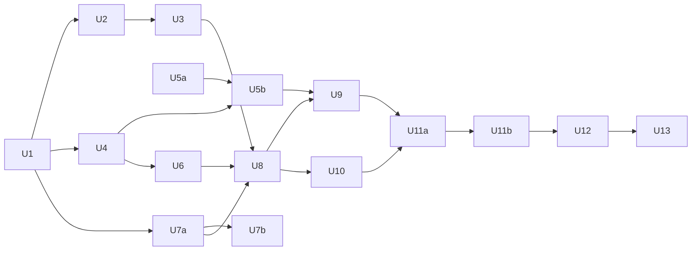

# #3604 #3864: 中継のアカウントの切り替え（アカウントの設定ディレクトリでの起動と、利用上限で停めない切り替え）の実装計画

## 関連リンク

- 要求仕様: [issue-3604-requirements.md](./issue-3604-requirements.md)（正は #3604 の本文）・[issue-3864-requirements.md](./issue-3864-requirements.md)（正は #3864 の本文）。受け入れ条件は `3604:<番号>`・`3864:<番号>` で指す。設計の承認（判断 5）で直した形を使う
- 設計書: [issue-3604-3864-design.md](./issue-3604-3864-design.md)、詳細設計書: [issue-3604-3864-design-detail.md](./issue-3604-3864-design-detail.md)。決定・不変条件・テスト設計の行は設計書の番号（決定 1〜13・I1〜I16）で指す
- モード: `standard`（スプリント sprint:2cea9b46d998:p12-lracct-r3-cd80c7401294 の判定。触るファイルが 40 を超え、レッドライン C1・C2 に当たる判断を設計承認ゲートで承認済み）
- 設計の状態: 設計 PR #3994 は 2026-11-22 の 3 回目の設計承認ゲートで承認され、main にマージ済み（e24e7a5dc）。設計書の「人へ残す判断」の 1〜6 は推奨どおり。cross-review は 15 ラウンドで止めた。残った実装の細部の指摘は単位の PR のレビューとテストで扱い、設計の判断が変わる指摘が出たら設計へ戻す

## 修正対象

詳細設計書の「地図」の表と、構成要素ごとの節の「関数の仕様」から引き写す。関数の名前と新設・変更・削除の区別は地図の行が正で、ここでは単位を割り当てるためにファイルごとにまとめる。パスは `plugins/ndf/` からの相対（最後の 2 行はリポジトリの根から）。

| ファイル | 変える中身（詳細設計書の節） | 単位 |
| --- | --- | --- |
| `src/ndf/domains/relay/account_dir.py`（新設） | 起動の前の用意（「起動の前の用意（`account_dir.py`）」）。確かめ・認証の上書き・symlink は U2、同期・書き戻し・使用の届けは U3 | U2・U3 |
| `src/ndf/domains/relay/account_choice.py`（新設） | 起動できる候補・替え先の環境（「共有の替え先（`account_choice.py`）」）。`candidates`・`build`・`verify`・`target_env` は U8（`build` の従量の接続の API キーの helper は U11a）、`fallbacks` は U11a・U11b、`retry_env` は U12 | U8・U11a・U11b・U12 |
| `src/ndf/domains/relay/session_env.py` | `account_env`・`metered_env`・`key_env`・`METERED_FIXED`（新設）、`child_env`（`decided` を足す）（「子の環境」） | U1 |
| `src/ndf/domains/relay/account_registry.py`・`account_metered.py` | `shared_config_dir`・`generation`・`provider_on`・`metered_kind`・`PROVIDER_ENV`・`METERED_CHECKED`・`check_decl`・`SECRET_ENV`・`store_dir` は U1、`mark_relogin` は U2、`recovery_keys`・`key_generation`・`key_value` は U11b（「登録の保存先」・「子の環境」） | U1・U2・U11b |
| `src/ndf/domains/relay/accounts.py` | キャッシュ・外した間・上限の観測・`forget` は U4、取得の記録・取得の排他・トークンの更新は U5b（「使用率と外した間の記録」） | U4・U5b |
| `src/ndf/adapters/claude_usage.py`（新設）・`src/ndf/adapters/http.py` | 使用率の API とトークンの更新の宛先、`request_json`（「使用率の API」） | U5a |
| `src/ndf/domains/relay/account_decide.py` | `Guards`・`group`・`order`・`guard`・`after_auth`（新設）、`Usage`・`before_limit`・`after_limit`（変更）（「替えるかの判断」） | U6 |
| `src/ndf/domains/relay/observe.py` | `tool_pending`・`turn_done`（新設）（「子の画面と記録の観測」） | U6 |
| `src/ndf/domains/relay/switch_decide.py` | `Spin`・`Streak`・`target_key`・`advance`・`hit`・`_spun`・`SPIN_REASON`・`SectionState.spin`・`spin_seen`・`spin_held` と `starts_today`・`max_starts` の削除は U7a。`guard_pick`・`safe`・`GUARD_RESUME_PROMPT` は U9、`auth_pick`・`AUTH_RESUME_PROMPT` は U10、`must_end`・`end_ready`・`drift_pick`・`_revoked` は U11a（キーの子の停止の共通の経路。U11b は使うだけ）（「次の手の判断」） | U7a・U9・U10・U11a |
| `src/ndf/domains/relay/wrapper.py` | 起動の回数の記録を消し再起動ループの検出を足すのは U7a。候補を試す起動・指定の読み直し・書き戻し・知らせは U8、見回りの替え・上限の後・取得のスレッドは U9、認証の失敗は U10、従量の接続とキーの子の停止の共通の経路（`Section.must_end`・`end_now`・`must_end_at`・`_key_auth`・`_end_point`・`_stop_revoked`・`LAUNCH_STUCK`・`_revoked_pick`・`_on_revoked`）は U11a、`_drift` のキーの子の分岐（登録簿のキーの削除・登録し直し・`off`・宛先の変更の検出）は U11b（「ラッパー」） | U7a・U8・U9・U10・U11a・U11b |
| `src/ndf/domains/relay/account_sync.py`・`account_files.py`（新設。計画に無かった） | `account_dir.py` から行数の上限で分けた同期の本体と、認証ファイル・保留の更新 | U3 |
| `src/ndf/domains/relay/launch_inputs.py`・`launch_target.py`・`wrapper_launch.py`・`wrapper_guard.py`・`wrapper_fetch.py`・`wrapper_auth.py`・`wrapper_stop.py`（新設。計画に無かった） | `wrapper.py` から行数の上限で分けた判断の入力・起動先の型と関所・基底クラス | U8・U9・U10・U11a |
| `src/ndf/domains/relay/key_helper.py`（新設。計画に無かった） | helper の記録・排他・払い出しの上限・拒否と失敗の印・固定のファイル・`gate_view` | U11a |
| `src/ndf/domains/relay/plan_claude.py`・`src/ndf/__main__.py`・`src/ndf/checks/children.json`（計画に無かった） | `ndf plan` の確かめの本体と、エントリポイントからの差し込み、子の表の X9 | U12 |
| `contracts/causes.json`（計画に無かった） | 停止の理由 `spin`・`account_unavailable` の行 | U8 |
| `src/ndf/domains/relay/cli.py` | ラッパーの設定の組み立てから `NDF_RELAY_MAX_STARTS` を外し `relay.spin`・`hub.spin_of` を渡す（「次の手の判断」の「リレーハブ・設定の読み・契約・手順書」） | U7a |
| `src/ndf/domains/relay/hub_decide.py`・`hub.py`・`registry.py` | `restart` の可否から起動の回数を外す。`registry.Starts` を消し、`hub.spin_of` を足す（同上） | U7b |
| `src/ndf/domains/relay/cli_account.py` | 使用の届けを見る登録・削除は U3、`_acc_list` の呼び方・`use` の `unhold`・登録と削除の `forget` は U4、`_acc_key_helper`（`api-key-helper`）の `metered` の分岐と `_acc_config_gate`（`config-gate`。キーの子の設定の変更を反映の前に拒む hook）は U11a、登録簿のキーの分岐（`--generation` の照合）は U11b（「一覧と API キーのコマンド」） | U3・U4・U11a・U11b |
| `src/ndf/adapters/claude.py` | `call_claude` と中継の確かめの口（`RelayChecks`・`set_relay_checks`・`AccountRun`・`AccountRefused`）・`launch_form`・`KEY_FORMS`（空）・`_accounted`・`_prefaced`。中継の部品を読まない（詳細設計書の地図の「依存の向き」。U12 で直した） | U12 |
| `src/ndf/domains/statusline/statusline.sh` | `record_usage`（新設）（「NDF の status line」） | U4 |
| `contracts/domains/env.json`・`docs/contracts/env.md` | `child` の列の `account-set`・`account-drop`・`provider` の列と 13 行は U1。`NDF_RELAY_SPIN` の行を足し `NDF_RELAY_MAX_STARTS` の行を消すのは U7a。`env.md` は `ndf check --write-spec` で生成し直し、手で直さない | U1・U7a |
| `contracts/limits.json` | 値を使う単位で足す・消す（下の「上限の値の割り当て」） | U4〜U11b |
| `contracts/domains/ndf-files.json`・`contracts/domains/locations.json` | `relay-usage`・`relay-auth-held`・`relay-limit-seen` は U4、`relay-usage-fetch`・`relay-account-store` は U5b | U4・U5b |
| `contracts/schemas/io/relay.result.schema.json` | `hub ls` の `starts` を消す | U7b |
| `skills/development-workflow/references/relay.md` | 上限の表と止まる理由を再起動ループの検出に替える | U7b |
| `skills/development-workflow/references/relay-accounts.md` | 11 系の振る舞いだけに書き直す（「手順書（`relay-accounts.md`）」） | U13 |
| `CHANGELOG.md` | 直さなかった。決定 12 の「リリースの時点の知らせ」は U11b の PR #4114 の本文の「利用者向けの変化」に書き、リリースの手順が版のセクションを組む（conductor の決定） | （U11b） |
| `tests/`（地図の `tests/` の行） | 各単位の「単体テストの観点」と設計書の「テスト設計」の行 | 各単位 |
| `docs/glossary/glossary.json`・`docs/glossary/ndf-relay.md`・`docs/glossary.md` | 設計の PR で反映済み。実装で語を直すときだけ触る | U13 |

上限の値の割り当て（`contracts/limits.json`。使う側と同じ単位で足し、使わない値を先に置かない）:

| 単位 | 足す・消す値 |
| --- | --- |
| U4 | `relay.auth-hold`・`relay.limit-unknown` を足す |
| U5b | `relay.usage-fetch`・`relay.usage-http`・`relay.oauth-refresh`・`relay.token-margin` を足す |
| U6 | `relay.five-hour-guard`・`relay.weekly-prefer`・`relay.weekly-guard` を足し、`relay.usage-guard` を消す |
| U7a | `relay.spin` を足し、`relay.max-starts` を消す |
| U11a | `relay.key-helper`・`relay.end-wait` を足す |

## タスク分解

不具合の直しと機能の回復が混ざる変更なので、各単位の最初のタスクは、その単位が直す振る舞いの今は落ちるテスト（設計書の「テスト設計」の行）から始める。進め方はどのタスクも、失敗するテスト → 通す最小実装 → 整理（`tdd-cycle`）である。例外は Task 1（実測）と Task 20（手順書）で、理由はそれぞれのタスクに書く。

テストは手元で打たず、単位の PR の CI で走らせる（`.ndf/project.json` の `test.ci.only`。合否は `gh pr checks <PR>` で読む）。静的解析（`bash scripts/check-lint.sh`・`python3 scripts/check-ndf-contracts.py`・`python3 scripts/check-script-structure.py`）は手元で打ってよい。テストは偽の子（`tests/support/relay_children.py`）・一時ディレクトリの保存先・偽の宛先（`httpx.MockTransport`）で組み、実のネットワークと実のアカウントを使わない。`.md` の文言を照らすテストは書かない（`AGENTS.md` の DON'T）。

### Task 1: 実装を止める条件の 4 件を手元で確かめる（U1 の最初）

- **対象ファイル:** 無し（結果は U1 の PR の本文と、この計画の「リスクと対処」の行へ書く）
- **変更内容:** 設計書の「未確認のまま残ること」のうち、成り立たなければ実装を止めて設計へ戻す 4 件を、コードを書く前に今の Claude Code で確かめる。打ったコマンド・Claude Code の版・結果（成り立つ / 成り立たない）を残す。トークン・キーの値は残さない

  | # | 確かめること | 手順 | 成り立たないとき |
  | --- | --- | --- | --- |
  | 1 | symlink 越しの `--resume` | 一時の 2 つの設定ディレクトリを作り、どちらも `projects` を共有側の `projects` への symlink にし、それぞれでログインする。1 つ目の `CLAUDE_CONFIG_DIR` で短い会話を作り、2 つ目の `CLAUDE_CONFIG_DIR` で `claude --resume <会話の ID>` を打つ。会話が開け、記録が共有側の 1 つのファイルへ書き足されるかを見る | 実装を止めて設計へ戻す（会話の記録の置き場を替える別の解き方が要る。決定 1・2・I3） |
  | 2 | 会話の記録の API の失敗の印 | 資格情報が通らない状態（1 つ目の設定ディレクトリの写しのアクセストークンを壊すか、不正な API キー）で対話の claude に 1 回送り、会話の記録の最後が `isApiErrorMessage` が真の `assistant` の記録で、本文に 401 か `authentication_error` が出るかを見る。あわせて、403 の `permission_error` の記録の形が取れれば残す（取れなくても止めない） | 実装を止めて設計へ戻す（認証の失敗の確かめの根拠が無い。決定 6） |
  | 3 | 止めてよい時点の判定 | 手元の会話の記録で、Tool の呼び出し（`assistant` の `tool_use` の `id`）と結果（`user` の `tool_result` の `tool_use_id`）の形を確かめる。`sleep 30` を打つ Bash の実行の間に、記録の最後が結果を待つ `tool_use` のままか、画面の出力が静かになるかを見る | 形が違えば実装を止めて設計へ戻す（設計書は「静かな時間と質問だけで判定し、その旨を手順書に書く」を代わりに挙げるが、判定を弱めるのは設計の判断なので、ここでは決めない。決定 11・I13） |
  | 4 | API キーの問いの画面 | 登録した API キーで、対話の claude を `--settings` の `apiKeyHelper`（キーの値を出すだけのスクリプト）で起動し、キーを使うかを問う画面が出ないかを見る。比べのために環境の `ANTHROPIC_API_KEY` での起動も見る | `apiKeyHelper` でも問いが出れば実装を止めて設計へ戻す（決定 12） |

- **満たす受け入れ条件:** 無し（3604:5・3864:6・決定 11・決定 12 の前提）
- **進め方:** テスト駆動を当てない（外のプログラムの今の振る舞いの実測で、書くコードが無い）。手元に 2 つの登録済みアカウントか API キーが無く確かめられないときは、確かめた件と残った件を分けて conductor へ返す（`結果: 判断が要る`）。確かめの済まない件に当たる単位は始めない（「リスクと対処」の 2 行目）

### Task 2: 子の環境の表と登録の保存先の部品（U1）

- **対象ファイル:** `contracts/domains/env.json`・`docs/contracts/env.md`・`src/ndf/domains/relay/account_registry.py`・`account_metered.py`・`tests/domains/relay/test_account_registry.py`
- **変更内容:** 子の環境の表に `account-set`・`account-drop`・`provider` の列と 13 行を足す。`shared_config_dir`・`generation`・`provider_on`・`metered_kind`・`PROVIDER_ENV`・`METERED_CHECKED` を足し、`store_dir`・`check_decl`・`SECRET_ENV` を詳細設計書の「登録の保存先」と「子の環境」の「提供元の選択の変数と有効な値」「提供元ごとの照合する変数」のとおりに変える。`account_metered.py` の提供元の判定を `provider_on` へ寄せる
- **満たす受け入れ条件:** 3604:2（表の行）・I4
- **進め方:** 失敗するテスト → 通す最小実装 → 整理

### Task 3: 登録済みアカウント・従量の接続・API キーの子の環境（U1）

- **対象ファイル:** `src/ndf/domains/relay/session_env.py`・`tests/domains/relay/test_relay_parts.py`
- **変更内容:** `account_env`・`metered_env`・`key_env`・`METERED_FIXED` を足し、`child_env` に `decided` を足す（用意に落ちて既定のログインへ移った子は `NDF_CLAUDE_ACCOUNT` を外す）。用意の済んだ設定ディレクトリのパスを引数で受け、`account_dir` を読まない。`metered_env` は環境変数の宣言の `ANTHROPIC_API_KEY` を子の環境へ入れないが、U1 から U10 までは従量の接続の子を起動する呼び手が無い（今のラッパーは `NDF_SUPERVISE_CLAUDE_FALLBACK` で子を起動しない）ので、キーが落ちた子は起動されない。キーを渡す側（`build` の helper・`api-key-helper metered`）は、初めて従量の接続の子を起動する U11a で同時に入れる
- **満たす受け入れ条件:** 3604:2・3604:3・I4・I9
- **進め方:** 失敗するテスト（テスト設計の 3604:2・3604:3 の行）→ 通す最小実装 → 整理

### Task 4: 起動の前の確かめと symlink（U2）

- **対象ファイル:** `src/ndf/domains/relay/account_dir.py`（新設）・`account_registry.py`（`mark_relogin`）・`tests/domains/relay/test_account_dir.py`（新設）
- **変更内容:** `is_local`・`link_shared`・`planned_links`・`config_file`・`shared_config_file`・`effective_env`・`auth_overrides`・`check_local`・`check_config`・`check_account` と型 `Checked`・`Local`・`Links`。飛ばす理由と `RELOGIN_REASONS`（リフレッシュトークンが空・本人の食い違い・旧形式の `.config.json`）。詳細設計書の「実体の確かめ」「認証の上書き」「異常系の処理」
- **満たす受け入れ条件:** 3604:4・3604:5・3604:8・3604:9（印）・3604:10・3604:12・I1・I2・I3・I5
- **進め方:** 失敗するテスト → 通す最小実装 → 整理

### Task 5: `.claude.json` の同期・書き戻しと使用の届け（U3）

- **対象ファイル:** `src/ndf/domains/relay/account_dir.py`・`cli_account.py`（登録・削除が使用の届けを見る）・`tests/domains/relay/test_account_dir.py`・`test_relay_cli.py`
- **変更内容:** `sync_config`・`ready`・`prepare`・`acquire`・`gated`・`attach`・`release`・`settle`・`in_use` と型 `Prepared`・`Resolved`。3 者の突き合わせ（同期のバックアップ）・保留の更新の当て直し・`pin_dir` で固定したディレクトリの記述子からの相対の読み書き（詳細設計書の「書く手順と途中で止まった後」「並行と排他」「使用の届けの状態」）
- **満たす受け入れ条件:** 3604:6・3604:7（関数）・3604:12・I10
- **進め方:** 失敗するテスト → 通す最小実装 → 整理

### Task 6: 使用率のキャッシュ・外した間・上限の観測（U4）

- **対象ファイル:** `src/ndf/domains/relay/accounts.py`・`cli_account.py`（`_acc_list`・`use` の `unhold`・登録と削除の `forget`）・`contracts/domains/ndf-files.json`・`contracts/limits.json`・`tests/domains/relay/test_relay_parts.py`・`test_relay_cli.py`
- **変更内容:** `usage_dir`・`usage_path`・`write_usage`・`usages`（世代ごとのファイルを窓ごとに読み、リセットを過ぎた窓を 0% にする）・`held`・`hold`・`unhold`・`see_limit`・`limits_seen`・`limit_until`・`forget` を足し、`write_usages` を消す
- **満たす受け入れ条件:** 3864:2・3864:3・3864:6（外した間の解除）・3864:11（読めないファイル）・I6・I7・I8・I11
- **進め方:** 失敗するテスト → 通す最小実装 → 整理

### Task 7: status line の使用率の記録（U4）

- **対象ファイル:** `src/ndf/domains/statusline/statusline.sh`・`tests/domains/statusline/test_statusline_usage.py`（新設）
- **変更内容:** `record_usage` を足す。子の環境の `NDF_ACCOUNT_USAGE_FILE` へ、有効な 5 時間・7 日の窓だけを置き換えで書き、古い入力で値を下げない。書けない・jq が無いときは今の出力と終了コード 0
- **満たす受け入れ条件:** 3864:1・3864:2・3864:11（status line）・I7
- **進め方:** 失敗するテスト → 通す最小実装 → 整理

### Task 8: 使用率の API の宛先（U5a）

- **対象ファイル:** `src/ndf/adapters/claude_usage.py`（新設）・`src/ndf/adapters/http.py`・`tests/adapters/test_claude_usage.py`（新設）
- **変更内容:** 10 系の `get_usage`・`parse_usage`・`refresh_oauth` を移し、`_parse_scoped`・`_epoch`・定数を足す。`http.request_json` は状態の番号を返し転送を追わない。あわせて、設計書の「未確認のまま残ること」の「使用率の API と更新の宛先の今の形」を手元のアカウントで確かめ、形が違えば移す形を直して PR の本文に残す（止める条件ではない）
- **満たす受け入れ条件:** 決定 4（テスト設計の「決定 4（代わりの経路と形の変化）」の宛先の側）
- **進め方:** 失敗するテスト → 通す最小実装 → 整理

### Task 9: 取得の手順と排他・トークンの更新（U5b）

- **対象ファイル:** `src/ndf/domains/relay/accounts.py`・`contracts/domains/ndf-files.json`・`contracts/domains/locations.json`・`contracts/limits.json`・`tests/domains/relay/test_relay_parts.py`
- **変更内容:** `fetch_path`・`fetch_lock_path`・`fetch_lock`・`write_fetch`・`due`・`fetch_usage`・`_refresh`・`_refresh_lock`・`_read_auth`・`FetchGate`（詳細設計書の「取得の手順と排他」「書き込みの規則」）
- **満たす受け入れ条件:** 決定 4（取得）・決定 4・I16（トークンの更新）
- **進め方:** 失敗するテスト → 通す最小実装 → 整理

### Task 10: 選ぶ順の組と替えるかの判断（U6）

- **対象ファイル:** `src/ndf/domains/relay/account_decide.py`・`observe.py`・`wrapper.py`（`before_limit`・`after_limit` の呼び方だけ）・`contracts/limits.json`・`tests/domains/relay/test_relay_decide.py`
- **変更内容:** `Guards`・`group`・`order`・`guard`・`after_auth` を足し、`Usage`・`before_limit`・`after_limit` を変える。`observe.tool_pending`・`turn_done` を足す（Task 1 の 3 で確かめた形で）。ラッパーの呼び出しはシグネチャに合わせるだけで、見回りの配線は U9
- **満たす受け入れ条件:** 3864:4（カットポイント）・3864:5（判断）・I12（判断）
- **進め方:** 失敗するテスト → 通す最小実装 → 整理

### Task 11: 再起動ループの検出と次の手（U7a）

- **対象ファイル:** `src/ndf/domains/relay/switch_decide.py`・`wrapper.py`・`cli.py`・`contracts/domains/env.json`・`docs/contracts/env.md`・`contracts/limits.json`・`tests/domains/relay/test_relay_decide.py`・`test_relay_wrapper.py`・`tests/support/relay_children.py`・`tests/domains/test_ndf_settings.py`
- **変更内容:** `Spin`・`Streak`・`target_key`・`advance`・`hit`・`_spun`・`SPIN_REASON` を足し、`SectionState.starts_today`・`max_starts` と、ラッパーの `_count_start`・`_starts_today`・`_on_stop` を消す。`Section.started_at`・`ended_at`・`Wrapper.streak`・`spin_held`・`spin_told`・`Settings.spin`・`_on_spin` を足す（詳細設計書の「再起動ループの検出」）
- **満たす受け入れ条件:** 3864:13（止まる処理の振る舞い）・決定 13・I15
- **進め方:** 失敗するテスト（テスト設計の「決定 13・I15」「決定 13・I15（検出）」「決定 13（替えの扱い）」の行）→ 通す最小実装 → 整理

### Task 12: リレーハブと登録簿から 1 日の起動の回数を消す（U7b）

- **対象ファイル:** `src/ndf/domains/relay/hub_decide.py`・`hub.py`・`registry.py`・`contracts/schemas/io/relay.result.schema.json`・`skills/development-workflow/references/relay.md`・`tests/domains/relay/test_relay_hub.py`・`test_relay_cli.py`・`tests/progress/test_plan_lane_question.py`
- **変更内容:** `restart` の可否を名前つきのラッパーの数だけで決め、`Lanes.starts_today`・`max_starts`・`Context.max_starts`・`today`・`registry.Starts` を消す。`hub.spin_of` を足し、`restart`・`spawn` が後継へ渡す環境で先に確かめる。`relay.md` の上限の表と止まる理由を再起動ループの検出に替える
- **満たす受け入れ条件:** 3864:13（`relay.md` の側）・決定 13・I15
- **進め方:** 失敗するテスト → 通す最小実装 → 整理

### Task 13: 候補を試す起動・指定の読み直し・書き戻し（U8）

- **対象ファイル:** `src/ndf/domains/relay/account_choice.py`（新設。`candidates`・`build`・`verify`・`target_env`）・`wrapper.py`・`tests/domains/relay/test_relay_wrapper.py`
- **変更内容:** `Target`・`Choice`・`Inputs`・`UsageCache`・`LaunchCache`・`_inputs`・`_candidates`・`_pinned_or`・`_initial`・`_launch_target`・`_settle`・`_tell_at_start` を足し、`_start`・`_end`・`_write_state` を変える。起動の理由 `first`・`cut` の行（詳細設計書の「子を止める前の替え先の確定」の表）と、用意が落ちたときの `account_unavailable`
- **満たす受け入れ条件:** 3604:1・3604:3（用意に落ちた子）・3604:7（呼ぶ時点）・3604:8（次の候補）・3604:9（知らせ）・3864:8・3864:11（登録が 1 つ以下）
- **進め方:** 失敗するテスト → 通す最小実装 → 整理

### Task 14: 見回りの替え・止めてよい時点・上限の後の最後の砦（U9）

- **対象ファイル:** `src/ndf/domains/relay/wrapper.py`・`switch_decide.py`・`tests/domains/relay/test_relay_wrapper.py`・`test_relay_wrapper_question.py`・`test_relay_decide.py`
- **変更内容:** `_guard_pick`・`_safe_point`・`_queue_fetch`・`_fetch_worker`・`_drain_fetch` を足し、`_state`・`_limit_pick`・`_on_switch`・`_on_resume`・`_loop`・`_act` を変える。`SectionState.guard_pick`・`safe`・`GUARD_RESUME_PROMPT`。上限の後の替え先と `wait_reset` の待つ間の読み直し、使用率 100 以上で静かな子を上限として扱う。形の変化の 1 行（`usage_shape`）
- **満たす受け入れ条件:** 3864:4（見回り）・3864:5・3864:10・決定 8・決定 11・I12・I13・I14
- **進め方:** 失敗するテスト → 通す最小実装 → 整理

### Task 15: 認証の失敗と外した間（U10）

- **対象ファイル:** `src/ndf/domains/relay/wrapper.py`・`switch_decide.py`・`observe.py`（記録の読み）・`tests/domains/relay/test_relay_wrapper.py`・`test_relay_decide.py`
- **変更内容:** `_auth_pick` と「認証の失敗の確かめ」（画面の行は引き金だけ、会話の記録の最後の API の失敗の記録と `CREDENTIAL_FAILURE` で確かめる）。`SectionState.auth_pick`・`AUTH_RESUME_PROMPT`。替え先が無ければ直し方の 1 行（同じセグメントで 1 回）。Task 1 の 2 で取れた 403 の形をテストの入力に使う
- **満たす受け入れ条件:** 3864:6・3864:7・I8
- **進め方:** 失敗するテスト → 通す最小実装 → 整理

### Task 16: 従量の接続への退避と戻り（U11a）

- **対象ファイル:** `src/ndf/domains/relay/account_choice.py`（`fallbacks` の従量の接続・`build` の API キーの宣言の helper）・`wrapper.py`（`_fallbacks`・`_metered`・`_key_auth`・`_auth_pick` のキーの子の分岐、キーの子の停止の共通の経路の `Section.must_end`・`end_now`・`must_end_at`・`end_cause`・`_end_point`・`_stop_revoked`・`LAUNCH_STUCK`・`_revoked_pick`・`_on_revoked` と `_loop` の順）・`switch_decide.py`（`must_end`・`end_ready`・`drift_pick`・`_revoked`）・`cli_account.py`（`_acc_key_helper` の `metered` の分岐と `key-helper.jsonl` の記録・排他・回数の上限・拒否の印・失敗の印 `key-helper.fail`、`_acc_config_gate`）・`contracts/limits.json`（`relay.key-helper`・`relay.end-wait`）・`tests/domains/relay/test_relay_wrapper.py`・`test_relay_cli.py`・`test_relay_decide.py`
- **変更内容:** 上限・認証の失敗の後の `_fallbacks` で従量の接続を試し、子の `CLAUDE_CONFIG_DIR` を共有の設定ディレクトリにする。保存した設定の AWS のキーの変数を外す。従量の接続の設定の検証（詳細設計書の「従量の接続の設定の検証」「従量の実効値の照合」）。API キーの宣言（`metered_kind` が `API_KEY_KIND`）では、`build` が `--settings` に `api-key-helper metered <指紋>` の `apiKeyHelper` を足し、`_acc_key_helper` の `metered` の分岐が指紋の合うキーだけを出す（詳細設計書の別冊 `issue-3604-3864-design-detail-keys.md` の「環境変数の宣言の API キー」。キーを渡す側と `metered_env` がキーを外す側を同じ単位でそろえ、キーの無い子を起動しない）。上限でない登録済みアカウントが現れたら、見回りの `guard` で止めてよい時点に戻る。停止の共通の経路（`_key_auth` が検出して `must_end`・`end_now` を立て、`_loop` の (3) の `_stop_revoked` が旧子を止め、止めた後の `_revoked_pick` だけが替え先を読み、`switch_decide._revoked` が `account`・`spin`・`revoked` の手を返す）はこのタスクで入れ、Task 17 はこれを使うだけにする。API キーの宣言の子が 401 を受けたときと helper が終了コード 1 を返したときに、替え先が無くても `stalled` で子を残さず止めること、helper がキーを出すのが 60 秒に 3 回までで、確かめた見回りから 5.5 秒以内に子が止まり、`--resume` か `account_unavailable` で終わることをテストで確かめる（別冊の「キーの子の認証の失敗の停止」。helper の起動の回数の実測と受け入れ条件は同じ節の「CLI の起動の回数」）。helper が錠の取得や追記に失敗して記録に行を残さないときも、失敗の印で同じく止まることを確かめる。キーの子の `--settings` に `ConfigChange` の hook（`config-gate`）を足し、利用者・プロジェクト・ローカルの設定の変更を反映の前に拒んで `end_now` で止めることと、変更の直後に見回りより先に要求が出る順で変更後の宛先へ要求が届かないことを確かめる（別冊の「反映の前に拒む」。手元の Claude Code での確かめも同じ節）
- **満たす受け入れ条件:** 3864:9・I9・決定 8・決定 12 のうちキーの子の停止の経路（テスト設計の「決定 12」の行の、認証の失敗で止める場面）
- **進め方:** 失敗するテスト → 通す最小実装 → 整理

### Task 17: API キーの復帰先と子の停止（U11b）

- **対象ファイル:** `src/ndf/domains/relay/account_registry.py`（`recovery_keys`・`key_generation`・`key_value`）・`account_choice.py`（`fallbacks` の API キー）・`wrapper.py`（`_drift` のキーの子の分岐。停止は Task 16 の共通の経路を使う）・`cli_account.py`（`_acc_key_helper` の登録簿のキーの分岐。記録・排他・上限は Task 16 のものを使う）・`CHANGELOG.md`・`tests/domains/relay/test_relay_wrapper.py`・`test_relay_cli.py`
- **変更内容:** 従量の接続の後に、使い方が `off` でない API キーを `--settings` の `apiKeyHelper` で使う（Task 1 の 4 で確かめた形）。動いている間の `off`・キーの削除・同じ名前の登録し直し（helper の `--generation` と見回りの両方で世代の違いを拒む）と、宛先・ヘッダー・資格情報・`apiKeyHelper` の追加・既存の値の変更・削除（宣言した `ANTHROPIC_BASE_URL` の置き換えを含む。こちらは検出した見回りで待たずに）で子を止め、替え先が無ければ `account_unavailable` で終える（別冊の「設定の変更でキーの子を止める範囲」）。API キーの宣言の従量の接続の子（`metered_kind` が `API_KEY_KIND`）も、宣言との照合に外れたら同じ経路で止める（`stalled` で残さない）。`CHANGELOG.md` に決定 12 の知らせを書く
- **満たす受け入れ条件:** 決定 12（テスト設計の「決定 12」の行）
- **進め方:** 失敗するテスト → 通す最小実装 → 整理

### Task 18: `ndf plan` の `claude -p` の確かめと打ち直し（U12）

- **対象ファイル:** `src/ndf/adapters/claude.py`・`src/ndf/domains/relay/account_choice.py`（`retry_env`）・`tests/adapters/test_claude_reply.py`
- **変更内容:** 登録済みアカウントで動く `claude -p` の前に認証の上書きを確かめ、`metered` の worker の作業ディレクトリの設定を宣言と照らす。`key:`・`metered` の親からの起動は、読み直した設定の `Built.pin` が親の環境の `NDF_RELAY_PIN` と同じときだけ起動する（親の起動の後に `metered.json`・宣言・登録簿のキーが替わった場合に新しい接続で送らない）。Task 16・17 の helper・`config-gate`・`fallbacks` を使うので、その後に流し、単独のテストでは `key:`・`metered` の親の起動をこの PR の中で通す。上限で終わったら `see_limit` を書き、替え先のアカウントで 1 回だけ打ち直す
- **満たす受け入れ条件:** 3604:2（`ndf plan` の側）・3604:11・決定 9
- **進め方:** 失敗するテスト → 通す最小実装 → 整理

### Task 19: 用語集の確かめ（U13）

- **対象ファイル:** `docs/glossary/glossary.json`・`docs/glossary/ndf-relay.md`・`docs/glossary.md`
- **変更内容:** 設計の PR で反映した語が、実装で決まった名前（関数・ファイル・値）と食い違えば直す。食い違いが無ければ触らない
- **満たす受け入れ条件:** 3864:14
- **進め方:** テスト駆動を当てない（文書）。終わりの条件は `ndf records glossary render --check` と `ndf records glossary meanings` が `ok`

### Task 20: 手順書を 11 系の振る舞いだけにする（U13）

- **対象ファイル:** `skills/development-workflow/references/relay-accounts.md`
- **変更内容:** 詳細設計書の「手順書（`relay-accounts.md`）」のとおりに書き直す。U1〜U12 で入った振る舞いだけを書き、10 系だけの語と確定仕様へのリンクを消す。Task 1 の 3 の結果に応じた止めてよい時点の書き方
- **満たす受け入れ条件:** 3864:12・3864:13・3864:14
- **進め方:** テスト駆動を当てない（文書。文言のテストを書かない）。終わりの条件は、テスト設計の 3864:12 の `git grep` が 0 件、`python3 scripts/check-markdown-links.py` が通ること、レビューで手順書の主張を 1 つずつコードの関数と照らすこと

## レビューの単位

課題を分けて単位にする（2 つの課題を合わせた見込みが 1,000 行を大きく超えるため）。分け方は依存の向きで、どの単位も単独でテストが通り、終えた後も中継が動く。行数は `git diff --shortstat <ベース>...HEAD -- . ':(exclude)uv.lock' ':(exclude)plugins/ndf/docs/contracts/env.md'` で数える（`env.md` は `ndf check --write-spec` の生成物）。

| 単位 | 含むタスク | 満たす受け入れ条件 | 見込みの差分の行数 | 実際の行数 |
| --- | --- | --- | --- | --- |
| U1 確かめと子の環境 | Task 1・2・3 | 3604:2・3604:3 | 約 350 | 712（#4018。654 追加・58 削除） |
| U2 起動の前の確かめと symlink | Task 4 | 3604:4・3604:5・3604:8・3604:9・3604:10・3604:12 | 約 400 | 1,373（#4027。1,372 追加・1 削除） |
| U3 同期・書き戻し・使用の届け | Task 5 | 3604:6・3604:7・3604:12 | 約 400 | 2,356（#4048。2,317 追加・39 削除） |
| U4 使用率のキャッシュと status line の記録 | Task 6・7 | 3864:1・3864:2・3864:3・3864:6・3864:11 | 約 400 | 1,533（#4028。1,462 追加・71 削除） |
| U5a 使用率の API の宛先 | Task 8 | （決定 4） | 約 250 | 1,310（#4025。1,291 追加・19 削除） |
| U5b 取得の手順と排他・トークンの更新 | Task 9 | （決定 4・I16） | 約 400 | 1,560（前半 #4038 の 599 追加・27 削除と、後半 #4056 の 917 追加・17 削除） |
| U6 選ぶ順の組と替えるかの判断 | Task 10 | 3864:4・3864:5 | 約 350 | 692（#4039。590 追加・102 削除） |
| U7a 再起動ループの検出 | Task 11 | 3864:13 | 約 350 | 738（#4026。637 追加・101 削除） |
| U7b ハブと登録簿の起動の回数の撤廃 | Task 12 | 3864:13 | 約 300 | 219（#4031。119 追加・100 削除） |
| U8 候補を試す起動・指定の読み直し・書き戻し | Task 13 | 3604:1・3604:3・3604:7・3604:8・3604:9・3864:8・3864:11 | 約 450 | 1,744（#4057。1,634 追加・110 削除） |
| U9 見回りの替えと最後の砦 | Task 14 | 3864:4・3864:5・3864:10 | 約 450 | 1,247（#4065。1,103 追加・144 削除） |
| U10 認証の失敗と外した間 | Task 15 | 3864:6・3864:7 | 約 300 | 743（#4074。695 追加・48 削除） |
| U11a 従量の接続への退避と戻り・キーの子の停止の経路 | Task 16 | 3864:9 | 約 550 | 3,742（停止の経路の #4078 の 1,611 追加・93 削除と、退避と戻りの #4086 の 1,871 追加・167 削除） |
| U11b API キーの復帰先と設定の変更の検出 | Task 17 | （決定 12） | 約 250 | 1,501（#4114。1,348 追加・153 削除） |
| U12 `ndf plan` の `claude -p` | Task 18 | 3604:2・3604:11 | 約 250 | 1,411（#4131。1,380 追加・31 削除） |
| U13 手順書と用語集 | Task 19・20 | 3864:12・3864:13・3864:14 | 約 300 | 429（#4135。262 追加・167 削除。レビュー中の値） |

**実際の行数は、マージした PR のマージのコミットとその 1 つ目の親の差を、上と同じ除外で数えた値（追加と削除の和）である（2026-11-22）。** U1〜U12 の見込みの合計 約 5,450 行に対し、実際の合計は 20,881 行で、U7b のほかはどの単位も見込みを超えた。主な理由は、cross-review の直しのうち設計の範囲の中で残したもの、テストが差分の半分前後を占めること、行数の上限（1,000 行）でファイルを分けたことである（詳細設計書の「実装の中で決めたこと（U1〜U13）」）。U5b と U11a は 2 本に分けた。

U8・U9・U11a は 400 行を超える見込みで、超えたまま 600 行を越えたら、実装の途中で起動の理由（`first`・`cut` と `guard`・`limit`）か、U11a は従量の接続への退避とキーの子の停止の経路で分け直す（停止の経路を先の PR にし、その PR の中で停止と再開のテストを通す）。受け入れ条件の番号を持たない単位（U5a・U5b・U11b）は、設計の決定のテスト設計の行で縛る。単位の PR の acceptance には、その単位で初めてそろう条件だけを渡し、ほかの単位とまたがる条件（3604:3・3604:7・3604:12・3864:4・3864:5・3864:6・3864:11・3864:13）は後の単位の側で渡す。

### 順序と依存

| 順 | 単位 | 先に要る単位 | 理由 |
| --- | --- | --- | --- |
| 1 | U1 | 無し | 実装を止める条件の 4 件をコードより先に確かめる。子の環境の部品はほかのすべての単位が使う |
| 2 | U7a | U1 | `wrapper.py`・`switch_decide.py` の起動の回数を先に外し、U8 以降が上限の無い形の上へ積む |
| 3 | U2 | U1 | `account_dir` は `session_env` を読まないが、`account_registry` の `shared_config_dir`・`provider_on` を使う |
| 4 | U7b | U7a | ハブの `spin_of` は `switch_decide.Spin` を読む |
| 5 | U4 | U1 | `accounts` の世代は `account_registry.generation` を使う |
| 6 | U5a | 無し | 宛先は中継の部品を読まない（U2〜U4 と並べてよい） |
| 7 | U3 | U2 | 同期と使用の届けは確かめの関数の上に積む |
| 8 | U6 | U4 | `Usage` の形は `accounts.usages` が作る |
| 9 | U5b | U4・U5a | 取得の記録はキャッシュの読みと宛先の両方を使う |
| 10 | U8 | U3・U6・U7a | 起動は用意・判断・検出の 3 つを配線する |
| 11 | U9 | U8・U5b | 見回りは取得のスレッドと候補の控えを使う |
| 12 | U10 | U8 | 認証の失敗の替え先は `_launch_target` を使う |
| 13 | U11a | U9・U10 | 従量の接続からの戻りは見回りの `guard` を使い、キーの子の認証の失敗の検出は U10 の「認証の失敗の確かめ」を使う |
| 14 | U11b | U11a | API キーは従量の接続の後の候補で、止める経路は U11a が入れた共通の経路を使う |
| 15 | U12 | U8・U11a・U11b | `retry_env` は `account_choice` の替え先の環境を使う。`key:`・`metered` の親からの通常の起動は、U11a が入れる API キーの宣言の helper・`config-gate`・従量の接続の `fallbacks` と、U11b が入れる登録簿のキーの helper・`key_generation` を `target_env` で使うので、両方の後に流す（先に流すと U12 だけでは `key:`・`metered` の親の起動を確かめられない） |
| 16 | U13 | U12 | 手順書は入った振る舞いだけを書く（U12 は U11b の後なので、U11b までの振る舞いもそろう） |

並べてよいのは、触るファイルが重ならない組だけである（U2 と U4 と U5a、U7b と U3）。U12 は U11b の後に置くので、U10 と並べない。`wrapper.py` を触る U7a・U8・U9・U10・U11a・U11b は順に流す。

## リファクタリングの時機

| 時機 | 対象 | 理由 |
| --- | --- | --- |
| 実装の前（準備のリファクタリング） | しない | `wrapper.py` は 756 行で、20 タスク中 6 タスク（30%）が触り、覆うテストは `test_relay_wrapper.py` 50 件・`test_relay_wrapper_question.py` 15 件。判断は `account_decide`・`switch_decide`、用意は新設の `account_dir`・`account_choice` へ置く設計が承認済みで、`wrapper.py` に積むのは配線だけ。ほかの触るファイルは 500 行以下 |
| 実装の中 | 各タスクで行う | `tdd-cycle` のリファクタリングのステップ |
| スプリントの終わり（cross-refactoring） | `wrapper.py` の大きさと責務（U7a〜U11b が足す配線）、`account_choice.verify` と `adapters/claude.py` の認証の上書きの確かめの重なり、`accounts.py` のキャッシュと取得の分かれ目 | 6 つの単位が同じ `wrapper.py` を触り、`account_choice` と `adapters/claude.py` は同じ確かめを 2 か所から呼ぶ。`accounts.py` は 106 行から取得と更新を足して大きくなる |

## リスクと対処

| リスク | 対処 |
| --- | --- |
| Task 1 の 4 件のどれかが成り立たない | その単位で実装を止め、確かめた結果を添えて conductor へ返す（設計へ戻す）。U1 の Task 2・3 は 4 件の結果に依らないので、止めた時点の差分は捨てずに置く |
| Task 1 の結果（2026-11-21、Claude Code 2.1.330） | 1・3・4 は成り立った。2 は印（`isApiErrorMessage`）は成り立ったが、OAuth の失敗の記録に 401 と `authentication_error` が無く、conductor の判断で詳細設計の `CREDENTIAL_FAILURE` を記録の欄（`error: authentication_failed`・`apiErrorStatus: 401`・打ち直しの `system` の記録の `error.status: 401`）へ直して続けた。403 の `permission_error` の記録は取れていないので、Task 15 のテストの 403 の入力は設計の形（`apiErrorStatus: 403`・`error` が `authentication_failed` でない）で組む。結果は設計文書の「未確認のまま残ること」にある |
| Task 1 を確かめる手元のアカウント・API キーが無い | 確かめた件と残った件を分けて conductor へ返す。残った件に当たる単位（1 は U2、2 は U10、3 は U6・U9、4 は U11b）を、確かめが済むまで始めない |
| 実装の細部で設計の判断が変わる指摘が出る（cross-review を 15 ラウンドで止めた残り） | 単位の PR のレビューで扱い、決定・不変条件・受け入れ条件を変える指摘なら実装を止めて設計へ戻す |
| 見込みの行数が外れる | 実装の途中で単位を分け直し、この表を直す |
| レッドライン C1・C2 の処理（認証ファイル・トークン・API キー）の値が画面・記録・テストの出力に出る | 各単位のテストで画面と `log.jsonl` に値が無いことを見る（I5）。テストの偽の値は `scripts/repo-secrets-allow.json` へ足す |
| `limits.json` と `env.json` の値を、使う単位より先に置くと契約の検査が落ちる | 「上限の値の割り当て」のとおり、使う単位で足す |

## 切り戻し手順

- 単位ごとに PR を revert すれば戻る。保存先の形は 10 系と同じで、増えるのはアカウントの設定ディレクトリの symlink・同期のバックアップ・状態の保存先の使用率と外した間と上限の観測のファイルで、どれも古い版は読まない
- U7a・U7b を戻すと 1 日の起動の上限が戻る。U8 以降が上限の無い形を前提にするので、U7a を戻すときは U8 以降を先に戻す

## 完了の定義

- [ ] 受け入れ条件 3604:1〜12・3864:1〜14 をすべて満たし、条件ごとに設計書の「テスト設計」の行のテストと結果（単位の PR の CI）が対応している
- [ ] 決定 4・9・11・12・13 のテスト設計の行が、単位の PR の CI で通っている
- [ ] Task 1 の 4 件の結果が U1 の PR の本文にある
- [ ] `standard` の検証の段階（`quality-gates`）。単位ごとの cross-review の収束、スプリントの完了判定
