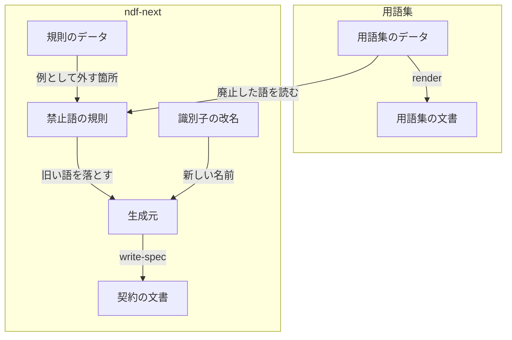
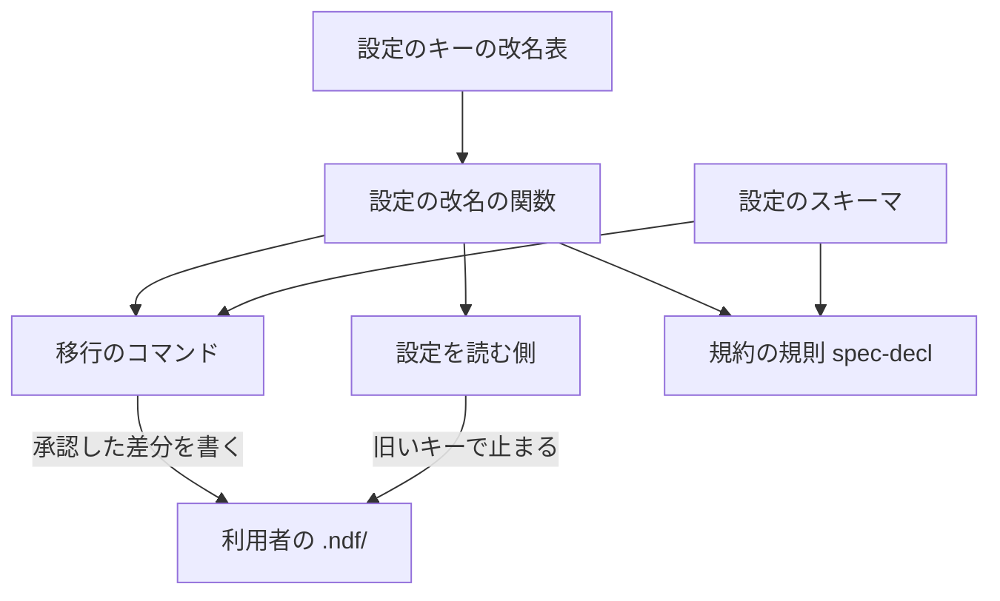
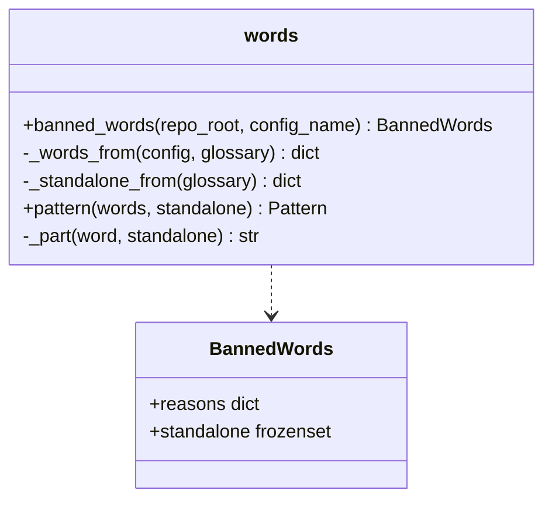
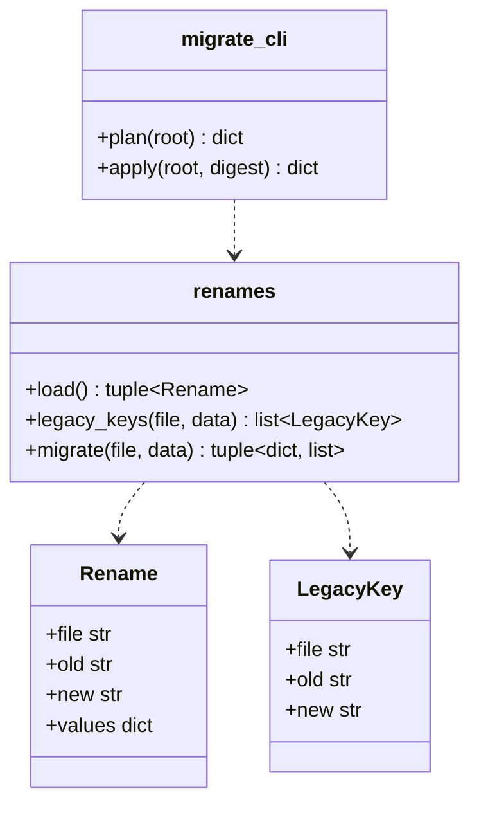
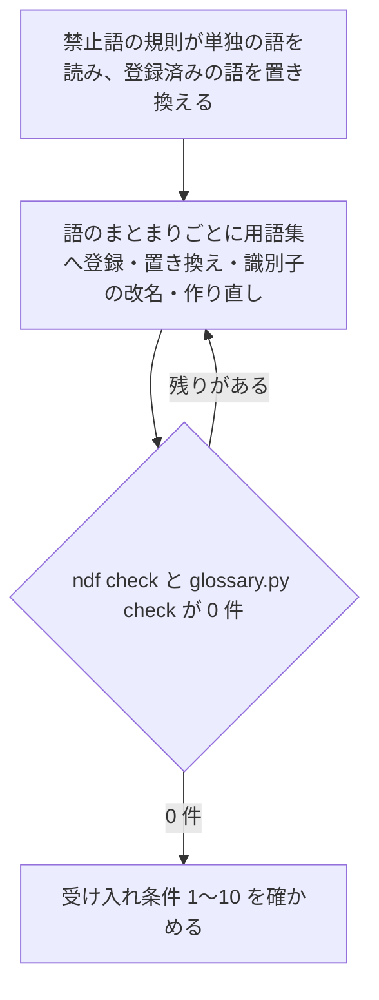
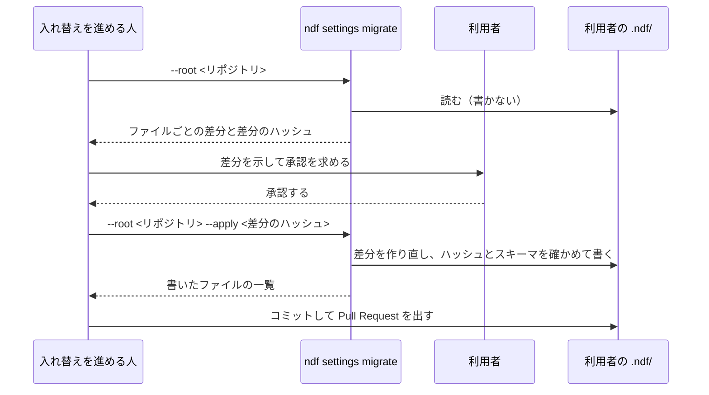

# ndf-next の用語: 直訳調の語を業界の語へ置き換え、1 語 1 意味にそろえる（#3613）

## 目的

- **今どうなっているか**: ndf-next（`plugins/ndf-next/`）では、直訳調の内部の呼び名 29 語（版・置き場・宣言・副命令・進行表など）が、1,061 ファイル中 828 ファイルに出る。出る先は Skill・契約の文書・出力・コードである。印・枠・区間などは 1 語が 2〜3 の意味を持つ
- **誰に効くか**: 11.0 から ndf-next を使う利用者と、ndf-next を直す開発者
- **変えると何が成り立つか**: 利用者が読む文書と出力が、説明なしで分かる業界の語で書かれ、1 語が 1 つの意味を指す。旧い語を書いた行は検査が落とすため、旧い語が戻らない。利用者が書く設定（`.ndf/`）のキーも、何を決めるかが名前から読める形になる

## 適用範囲

- **働く範囲**: このリポジトリの `plugins/ndf-next/` と用語集（`docs/glossary/glossary.json`・`docs/glossary.md`）。今の `plugins/ndf/` は変えない
- **プロジェクトごとに違うもの**: 利用先のリポジトリの `.ndf/worktree.json`・`.ndf/mvv.json` のキーが変わる。書き換えは 11.0 の入れ替え（#3304）のときに、移行のコマンドでリポジトリごとに行う（この課題では書き換えない）
- **当たるモード**: `standard`

## あるべき姿の根拠

| 根拠 | 種類 | 何を示すか |
| --- | --- | --- |
| 「土台とか印とか版とか、直訳すぎて分からない。エンジニア業界で利用されている用語に」（2026-11-15） | 利用者の指示の原文 | 置き換えの目的と、置き換え先を業界の語にすること |
| 「直訳用語は 11.0 できちんと直しておきましょう。後が大変そうだ。」（2026-11-16） | 利用者の指示の原文 | 11.0 の公開の前に終えること |
| 「案の名前で改名して出し直す」（2026-11-16 03:0x JST、設計 PR #3620 の設計承認ゲート） | 利用者の指示の原文 | 利用者の設定のキーと値を、要求の「決まったこと（2026-11-16 03:0x JST、利用者の差し戻し）」の表の名前へ改名すること |
| STD1（GitHub の Pull Request のレビュー） | 外部の一次情報 | 直しを求める判定の業界の呼び名が「変更を要求する」（API の `REQUEST_CHANGES`）であること |
| PRD1〜PRD4（DBOS・Temporal・Microsoft・AWS の文書） | 外部の一次情報 | 途中から再開できる処理の呼び名が Durable Execution・durable workflow で、日本語の訳語が製品ごとに揺れること |
| `git grep` の出現の回数（要求の「調べた結果」と、この文書の「対応表」の回数の列） | 実測 | 置き換えの量と、意味が複数ある語の所在 |

要求と受け入れ条件は #3613 の本文にある（コピーは [issue-3613-requirements.md](issue-3613-requirements.md) ）。この文書は「どう作るか」だけを扱う。

## ドメインモデル

### コンテキスト

| コンテキスト | 何の語が 1 つの意味に決まるか |
| --- | --- |
| 用語集（`project-glossary`） | 語の項目・廃止した語・単独で照合する廃止した語 |
| NDF の工程（`ndf-workflow` ほか、語の項目が属する既存のコンテキスト） | 置き換えた後の語（バージョン・設定・サブコマンドなど） |
| 利用者の設定（`.ndf/` の設定ファイル） | 設定のキーと値の名前（リリース方式・MVV の各版の確かめの記録） |

用語集が上流、ndf-next の禁止語の規則が下流で、関係は公開された言語である。共通の形式は用語集の JSON の形（`terms[].deprecated`・`terms[].deprecated_standalone`）である。この形を次の 2 つが別々に読む。

- 今の NDF の用語の検査（`plugins/ndf/scripts/glossary.py`）
- ndf-next の禁止語の規則（`plugins/ndf-next/src/ndf/checks/words.py`）

用語集を読むほかのコンテキストとの関係は次のとおりである。

| 下流 | 何を読むか | 関係 | 入れ替えまでの扱い |
| --- | --- | --- | --- |
| 今の NDF（`plugins/ndf/`） | 用語集の検査（`glossary.py`）と、Skill の文書が参照する語（語の項目 167 件の出典が `plugins/ndf/` の下。`grep -c '"source": "plugins/ndf/' docs/glossary/glossary.json` → 167） | 順応者。今の NDF は変えない（受け入れ条件 10） | 語の項目を新しい名前へ改めると、11.0 の入れ替えまで今の NDF の文書の語と用語集の語が食い違う。要求の前提 3 が受け入れたのは検査への影響だけで、この食い違いは決定 10 で許す |
| Factory のサービス（別のリポジトリ） | ndf-next の保存先の表（`contracts/domains/ndf-files.json`）で読み手が `service` の記録の ID とファイル名 | 公開された言語。ndf-next が上流 | サービスが読む ID とファイル名は改名しない（「データ構造」）。サービスの側の変更はこの設計の範囲に含めない |
| 利用者のリポジトリの `.ndf/` | ndf-next の設定のスキーマ（`contracts/schemas/ndf-settings/`）と、設定のキーの改名表 | 公開された言語。ndf-next が上流 | 入れ替えまで、今の NDF が旧いキーを読み書きする（要求の前提 7）。ndf-next は新しいキーだけを受け、旧いキーを見たら止まる。書き換えは入れ替えのときの移行のコマンドだけが行う |

### 集約

| 集約 | 持ち主（書き換えてよいもの） | 根 | エンティティ | 値オブジェクト |
| --- | --- | --- | --- | --- |
| 用語集 | 用語集のデータ（`docs/glossary/glossary.json`）。文書（`docs/glossary.md`）は `glossary.py render` が作る | 用語集 | 語の項目 | 廃止した語・単独で照合する廃止した語・意味 |
| 禁止語の規則 | ndf-next の禁止語の規則（`words.py`）と規則のデータ（`rules.json` の `words`） | 規則 | 例として許す箇所（`words.examples` の 1 ファイル） | 禁止する語とその理由 |
| 設定のキーの改名表 | 契約の表 `contracts/domains/ndf-settings-renames.json`（新設） | 改名表 | 改名の行（設定ファイル・旧いキーの位置・新しいキーの位置） | 値の対応（`whole` → `merge_base_branch` など） |
| 利用者の設定 | 利用者。利用者の代わりに書いてよいプログラムは、期間ごとに下の表の 1 つだけ | 設定ファイル（`.ndf/worktree.json`・`.ndf/mvv.json`） | MVV の版（`versions[]` の要素） | リリース方式・MVV 判定の結果 |

禁止語の規則は用語集を書き換えない。用語集は ID（語）でだけ参照される。改名表は、移行のコマンド・設定を読む側の止める検査・規約の規則（spec-decl）の 3 つが読む。どれも改名表を書き換えない。

利用者の設定を利用者の代わりに書いてよいプログラムは、期間ごとに 1 つに決める。利用者が手で書き換えることは、どの期間でも妨げない。

| 期間 | 書いてよいプログラム | 書くキー | ほかのプログラムの扱い |
| --- | --- | --- | --- |
| 11.0 の入れ替えまで | 今の NDF | 旧いキー（要求の前提 7） | ndf-next は `.ndf/` を読むだけで書かない。MVV の版を書く側を ndf-next に作っても、入れ替えまでは利用者の `.ndf/mvv.json` へ書かない |
| 入れ替えのとき | 移行のコマンド（`ndf settings migrate --apply`） | 旧いキーを新しいキーへ書き換える。利用者が承認した差分だけ（決定 12） | 今の NDF は入れ替えで外れ、ndf-next の書く側はまだ書かない |
| 入れ替えの後 | ndf-next の MVV の版を書く側（「未確認のまま残ること」の 9） | 新しいキーだけ | 移行のコマンドは差分が 0 件になり、書かない |

### 不変条件

| # | 集約 | 条件 | 破れたときの扱い |
| --- | --- | --- | --- |
| I1 | 用語集 | 旧い語の 1 つの意味に、置き換え先の語は 1 つだけある。置き換え先の語は、同じ用語集の別の意味の語と重ならない | 用語集の構造の検査（`glossary.py check` の `schema`・`duplicate`）が落とす |
| I2 | 用語集 | 廃止した語・単独で照合する廃止した語は、どのコンテキストの生きた語とも重ならず、語の項目と意味の欄に出ない（例として挙げる行を除く） | 構造の検査の `schema`・`deprecated_meaning` が落とす |
| I3 | 禁止語の規則 | 単独で照合する廃止した語は、前後が漢字の出現に当たらない（「開発版」「出版」「問い合わせ」に当たらない） | 禁止語の規則の単体テストが落とす |
| I4 | 禁止語の規則 | ndf-next のファイルに、対応表で置き換えると決めた語が `words.examples` の箇所の外に 0 件である | `ndf check` の `banned-word` が終了コード 1 で落とす |
| I9 | 設定のキーの改名表 | 改名表の新しいキーの位置は、どれも設定のスキーマ（列 `to_file` がある行は、そのファイルのスキーマ。「ブランチ戦略の節へ移す行」）にあり、旧いキーの位置はどれもスキーマに無い。1 つの旧いキーの位置に、新しいキーの位置は 1 つだけある。`old` と `new` が同じ行は無い | 改名表とスキーマを突き合わせる単体テストが落とす |
| I10 | 利用者の設定 | 移行のコマンドが書き換えるのは、利用者が承認した差分と今の差分が一致するときだけで、書き換えた結果は新しいスキーマに通る（受け入れ条件 12） | 移行のコマンドの単体テストが落とす |
| I11 | 利用者の設定 | 1 つの期間に利用者の代わりに書くプログラムは、上の期間の表の 1 つだけである。ndf-next は入れ替えまで利用者の `.ndf/` を書かない | ndf-next の `.ndf/` を書くコードの単体テストが、入れ替えの前の設定（旧いキーを持つ設定）へ書こうとすると止まることを確かめる。書く側を作るまでは、書くコードが無いことで満たす |

### 集約の外の制約

次の条件は、上の 4 つの集約のどれも書き換えないものに掛かる。この変更が守る制約として集約と分けて持ち、持ち主を列に書く。

| # | 持ち主 | 条件 | 破れたときの扱い |
| --- | --- | --- | --- |
| I5 | ndf-next の生成元と規約の生成（`ndf check --write-spec`） | 契約の文書（`docs/contracts/*.md`）は生成元から作り直した結果と一致する | `ndf check` の規約の規則（spec-docs）が落とす |
| I6 | ndf-next の設定を読む側（worktree の設定と MVV の設定を読むモジュール） | 旧いキーが残る設定を読むと、旧いキーの名前と新しい名前を示して止まり、既定の値へ倒さない（受け入れ条件 13） | 設定を読む側の単体テストが落とす |
| I7 | 今の NDF（`plugins/ndf/`） | 今の `plugins/ndf/` のファイルは 1 行も変わらない | 受け入れ条件 10 の差分の確認が落とす |
| I8 | ndf-next の保存先の表（`contracts/domains/ndf-files.json`）と Factory のサービス | 読み手が `service` の記録の ID・ファイル名と、記録の中身のキーと値は変わらない（当たるものは「データ構造」の「Factory のサービスが読む記録」の表） | 受け入れ条件 6 の確認で、例外として残した ID と値だけが旧い語を含む |

### ドメインイベント

| # | イベント | 発生元 | 受け手 |
| --- | --- | --- | --- |
| E1 | 語ごとに置き換え先を決めた対応表を用語集に書いた | 用語集の変更（実装の Pull Request） | 今の NDF の用語の検査・ndf-next の禁止語の規則 |
| E2 | 生成元の語を置き換えた | ndf-next のファイルの書き換え | 契約の文書の生成（E3） |
| E3 | 契約の文書を `ndf check --write-spec` で作り直した | ndf-next の規約の生成 | ndf-next の規約の規則 |
| E4 | 直訳の英語の識別子を改名した | ndf-next のコード・契約の JSON | ndf-next のテスト・規約の規則 |
| E5 | 旧い語を廃止した語へ登録し、禁止語の検査が 0 件で通った | 用語集の変更と ndf-next のファイルの書き換え（同じ Pull Request） | CI（`ndf check`・`glossary.py check`） |
| E6 | 移行のコマンドが、旧いキーを持つ設定の差分を示した | 入れ替え（#3304）の手順で、利用者のリポジトリごとに打った `ndf settings migrate` | 入れ替えを進める人（差分を読んで承認するか決める） |
| E7 | 利用者が差分を承認し、移行のコマンドが設定を新しいキーへ書き換えた | `ndf settings migrate --apply <差分のハッシュ>` | 利用者のリポジトリ（書き換えた `.ndf/` をコミットする） |
| E8 | ndf-next が旧いキーの残る設定を読んで止まった | ndf-next の設定を読む側 | 利用者（止まった理由に出た移行のコマンドを打つ） |

### 用語

| 用語 | 意味 | 用語集への反映 |
| --- | --- | --- |
| 廃止した語 | 用語集の語の `deprecated`。旧称として登録し、検査が新しく書いた文から落とす | 変えない |
| 単独で照合する廃止した語 | 用語集の語の `deprecated_standalone`。前後が漢字の出現には当てない | この文書は、今の用語集の名前「単独で照合する廃止した語」で書く。名前は実装の Pull Request で W19 の「マッチ」へ置き換え、「単独でマッチする廃止した語」に改める（旧い語を含む語の項目の改名に含む）。意味は変えない。ndf-next の禁止語の規則もこの欄を読むようになる |
| 設定のキーの改名表 | 利用者の設定の旧いキーと新しいキー・値の対応を 1 か所に持つ契約の表 | 設計の変更で足した（出典は `pending_source` のこの文書） |
| 移行のコマンド | `ndf settings migrate`。改名表に従い、利用者の `.ndf/` を新しいキーへ書き換える。差分を示す実行と、承認した差分を書く実行に分かれる | 設計の変更で足した（出典は `pending_source` のこの文書） |

置き換え先の語（バージョン・設定など）は、次の「対応表」の決定どおり実装の Pull Request で用語集へ足す（E1）。設計の時点で用語集へ入れないのは、廃止した語の登録と置き換えを同じ Pull Request に入れるためである（決定 5）。

## 外部の調査

| 種類 | 調べるか | 理由 |
| --- | --- | --- |
| 標準・仕様 | 調べる | 置き換え先の語が業界で使われているかを、公式の文書の日本語版で確かめる |
| 主要な製品 | 調べる | ndf-next が使う製品（DBOS）が自分の機能をどう呼ぶかに置き換え先を揃える |
| ライブラリとサービス | 調べる | 表記の揺れを検査する既存のツールを使うか、ndf-next の禁止語の規則を延ばすかを決める |

### 標準・仕様

| # | 標準・仕様 | 何を定めているか | 設計への反映 | 出典 |
| --- | --- | --- | --- | --- |
| STD1 | GitHub の Pull Request のレビュー（日本語版の文書と REST API） | レビューの判定の 1 つを日本語版で「変更を要求する」、API の値で `REQUEST_CHANGES` と呼ぶ | 差し戻し（直しを求める判定）の日本語を「変更要求」にする。識別子 `revise` は Factory のサービスが読む記録の値のため変えない（決定 11） | https://docs.github.com/ja/pull-requests/collaborating-with-pull-requests/reviewing-changes-in-pull-requests/about-pull-request-reviews ・ https://docs.github.com/ja/rest/pulls/reviews （2026-11-15） |
| STD2 | JSON Pointer（RFC 6901） | JSON の中の 1 つの値を指す文字列の形（`/branch_flow/promotion`） | 改名表の旧いキーと新しいキーの位置を JSON Pointer で書く。規約の規則（spec-decl）がすでに誤りの位置を JSON Pointer で示している | https://www.rfc-editor.org/rfc/rfc6901 （2026-11-16） |
| STD3 | JSON Patch（RFC 6902） | JSON の変更を操作の列で書く形。操作は `add`・`remove`・`replace`・`move`・`copy`・`test` | 移行のコマンドが示す差分を、ファイルごとの JSON Patch の操作の列（`test`・`move`・`replace`）で出す。読み手は差分を機械でも人でも読める | https://www.rfc-editor.org/rfc/rfc6902.txt の 185〜187 行目（2026-11-16） |

### 主要な製品

| # | 製品 | どう解いているか | 設計への反映 | 出典 |
| --- | --- | --- | --- | --- |
| PRD1 | DBOS（ndf-next が使う、途中から再開できる処理のライブラリ） | 途中から再開できる処理を durable workflows・Durable Queues と呼ぶ（文書の中の出現 11 回・4 回）。保存の意味では "durably stored" と書く | 耐久を「Durable」にする（耐久ワークフロー → Durable ワークフロー。決定 14）。識別子 `durable` は変えない | https://docs.dbos.dev/architecture （2026-11-15） |
| PRD2 | Temporal | 処理の考え方を "Durable Execution" と英語のまま呼ぶ（"Durable Execution is crash-proof execution."） | 「Durable Execution」を業界の呼び名として採る（決定 14） | https://temporal.io/blog/what-is-durable-execution （2026-11-16） |
| PRD3 | Microsoft Azure の Durable Functions（日本語版の文書） | 本文は製品名の "Durable Functions" を英語のまま使う。クイックスタートの見出しは「永続関数」5 件・「Durable 関数」1 件で揺れる | 日本語の訳語は定まっていない。英語の語を使えば揺れない（決定 14） | https://learn.microsoft.com/ja-jp/azure/azure-functions/durable/durable-functions-overview （2026-11-16） |
| PRD4 | AWS Lambda の durable functions（日本語版の文書） | 「耐久性のある関数」「耐久性のある実行」と訳し、SDK の名前 "AWS Durable Execution SDK" は英語のまま | 製品ごとに訳語が「永続」「耐久性のある」と分かれる根拠（決定 14） | https://docs.aws.amazon.com/ja_jp/lambda/latest/dg/durable-functions.html （2026-11-16） |

### ライブラリとサービス

| # | 候補 | 版 | ライセンス | 最後のリリースの日付 | 終了のアナウンス | 要件を満たすか | 出典 |
| --- | --- | --- | --- | --- | --- | --- | --- |
| LIB1 | prh（表記の揺れの辞書による校正） | 7.0.0 | MIT | 2026-11-07 | 無し | 語の置き換えの辞書は持てる。用語集とは別の辞書（YAML）を持つことになり、同じ事実を 2 か所に持つ。Node.js の実行環境が要る | https://registry.npmjs.org/prh ・ https://raw.githubusercontent.com/prh/prh/master/README.md （2026-11-15） |
| LIB2 | textlint（16.0.0）と textlint-rule-prh | 6.1.1 | MIT | 2026-10-16（textlint は 2026-11-15） | 無し | `.md` の検査はできる。`.py`・`.json` の行を見る ndf-next の禁止語の規則の範囲を覆わない。Node.js の実行環境が要る | https://registry.npmjs.org/textlint-rule-prh ・ https://registry.npmjs.org/textlint （2026-11-15） |
| LIB3 | ndf-next の禁止語の規則（`words.py`）と用語集 | — | リポジトリの一部 | — | 無し | プラグインの下のすべての文字のファイルを見る。用語集の `deprecated` だけを読み、`deprecated_standalone` を読まない | `plugins/ndf-next/src/ndf/checks/words.py` ・ `plugins/ndf-next/src/ndf/checks/README.md` （2026-11-15） |
| LIB4 | SudachiPy（日本語の形態素解析） | 0.7.0 | PyPI の license の欄が空（未確認） | 2026-09-24 | 無し | 語の境界を形態素で決められる。辞書の取得が要り、検査の依存が増える。前後が漢字かで決める規則で受け入れ条件 9 を満たせる | https://pypi.org/pypi/sudachipy/json （2026-11-15） |
| LIB5 | jsonpatch（JSON Patch の Python の実装） | 1.47 | BSD-3-Clause | 2026-11-11 | 無し | JSON Patch の操作の列を作って当てられる。jsonpointer に依存し、ndf-next の依存が 2 つ増える。移行で使う操作は `test`・`move`・値の `replace` の 3 つで、標準ライブラリの辞書の操作で書ける | https://pypi.org/pypi/jsonpatch/json （2026-11-16） |
| LIB6 | ndf-next の依存にある jsonschema（4.26.0） | 4.26.0 | MIT | — | 無し | 書き換えた結果を新しいスキーマで確かめられる。規約の規則（spec-decl）がすでに使っている | `plugins/ndf-next/pyproject.toml` の 23 行目・`plugins/ndf-next/src/ndf/checks/spec_docs.py` の `_real_errors`（2026-11-16） |

### 確かめられなかったこと

| 対象 | 試した手段 | 結果と理由 |
| --- | --- | --- |
| Microsoft の日本語のスタイルガイドの用語 | https://learn.microsoft.com/ja-jp/style-guide/welcome/ | HTTP 200 だが英語版の索引のページで、語ごとの表記を取得していない |
| 日本翻訳連盟（JTF）の日本語標準スタイルガイド | https://www.jtf.jp/tips/styleguide | HTTP 200。本文の PDF を取得していない |
| Temporal の文書のワークフローのページ | https://docs.temporal.io/workflows | HTTP 200 だが、取得した HTML の中に語が見つからなかった（描画を JavaScript に頼る可能性。未確認）。呼び名は PRD2 のページで確かめた |

調べた量: 候補 6 件（ライブラリとサービス）・取得の試み 24 回。

## 対応表

**旧い語の意味ごとに、置き換え先の語を 1 つに決める。** 意味が 1 つの語は 1 行、意味が複数の語は意味ごとに 1 行を持つ。用語集へは置き換え先の語の項目に、旧い語を廃止した語として登録する（決定 2）。英語の識別子を改名するか残すかは決定 6 の基準で決め、残す識別子は置き換え先の語の項目の `code` に書いて説明文の語と対応させる。回数は `git grep -o <語> -- plugins/ndf-next | wc -l`（2026-11-15、`design/issue-3613`）。

### 上位 20 語と、利用者が名指しした「土台」

| # | 旧い語 | 回数 | 意味 | 置き換え先 | 登録する欄 | 英語の識別子 |
| --- | --- | ---: | --- | --- | --- | --- |
| W1 | 版 | 1,550 | ソフトウェア・文書・形式の版 | バージョン | 単独で照合 | `version`（変えない） |
| W2 | 置き場 | 1,280 | ファイル・ディレクトリを置く場所 | 保存先 | 廃止した語 | `place` → `location`、`places` → `locations` |
| W3 | 宣言 | 1,185 | 利用先が `.ndf/` に書く JSON とその中身 | 設定 | 廃止した語 | `declaration`・`declarations` → `ndf_settings`（ディレクトリ名・文書名は `ndf-settings`。決定 8） |
| W3 | 宣言 | （同上） | 契約の表に書いて決めること（「表に宣言する」） | 定義 | 廃止した語 | — |
| W4 | 答え・答える | 872 | 人が質問へ返したもの | 回答・回答する | 廃止した語 | `answer`（変えない） |
| W5 | 鍵 | 753 | 行・記録・ロックを引く識別子 | キー | 単独で照合 | `key`・`run_key`（変えない） |
| W6 | 副命令 | 572 | `ndf <名前>` の 2 語目 | サブコマンド | 廃止した語 | `subcommand`（変えない） |
| W7 | 依頼 | 478 | 実行主体やオーガナイザーへ渡す作業の要求 | リクエスト | 廃止した語 | `request`（変えない） |
| W8 | 起こす／起こし直す | 361 | プロセス・セッションを始める／始め直す | 起動する／再起動する | 廃止した語（起こす・起こし・起こさ・起こせ） | `launch`・`spawn`（変えない） |
| W8 | 起こす | （同上） | 課題を新しく作る（「課題を新しく起こさず」） | 起票する | （同上） | — |
| W8 | 起こす | （同上） | 処理が始まるきっかけになる（「反映を誰が起こすか」） | トリガーする | （同上） | `trigger`（変えない） |
| W8 | 引き起こす | （同上。うち 6 回） | 原因になる（「無限ループを引き起こす」「マージが反映を引き起こす」） | 原因になる | （同上。「引き起こす」は「起こす」を含むため同じ欄で当たる） | — |
| W9 | 取り込み・取り込む | 238 | ブランチを合わせる | マージ | 廃止した語（取り込み・取り込む・取り込ん・取り込ま・取り込め） | — |
| W9 | 取り込み | （同上） | ある課題の受け入れ内容を別の課題の実装へ含める（取り込み先） | 統合（統合先） | （同上） | — |
| W9 | 取り込み方 | （同上） | 本番チャネルへ変更を入れる方法 | リリース方式 | （同上） | `promotion` → `release_strategy`（設定のキー・取り込み方の表の列・`release --promotion` の引数。値と行の id は「データ構造」。決定 4） |
| W9 | 取り込み | （同上） | ファイル・生成物を読んで使う | 読み込み | （同上） | — |
| W10 | 行き先 | 375 | 旧い機能が ndf-next で移る先（同等性の表） | 移行先 | 廃止した語 | — |
| W10 | 行き先 | （同上） | 止まった後に次に進む先（結果 JSON の `routes`） | ルート | （同上） | `route`（変えない） |
| W11 | 進行表 | 372 | 工程の状態と遷移をイベントで持つ表 | ステートマシン | 廃止した語 | `table_id` → `machine_id`（データベースの列を含む。決定 6） |
| W12 | 問い | 426 | 人へ求める判断・回答 | 質問 | 単独で照合（「問い合わせ」を外す。要求の前提 4 から外れる。決定 17） | `question`（変えない） |
| W12 | 問い直す・問い返す | （同上。問い直 10 回・問い返 1 回） | 人へもう一度質問する | 質問し直す | 廃止した語（問い直・問い返。決定 17） | — |
| W12 | 問い方 | （同上。5 回） | 人への質問の仕方 | 質問の仕方 | 廃止した語（問い方。決定 17） | — |
| W13 | 枠 | 358 | 同時に流せる本数の 1 つ分 | スロット | 単独で照合（「枠組み」を外す） | `slot`（変えない） |
| W13 | 枠 | （同上） | 期間・対象ごとに使ってよい量（5 時間の枠・週の枠・品質の枠） | クォータ | （同上） | `budget`（変えない） |
| W14 | 印 | 445 | 状態を示すファイル・ブランチ・チェックボックス | マーカー | 単独で照合（「目印」「印刷」を外す） | `marks` → `markers`（中継のマーカーのファイル。`domains/relay/marks.py` と保存先 `relay/marks/`。決定 6） |
| W14 | 印 | （同上） | 引数や語で真偽を示すもの（導入の同意の印・互換なしの印） | フラグ | （同上） | — |
| W14 | 印 | （同上） | 兆候を外す `# noqa` のコメント（境界の印） | 抑制コメント | （同上） | `marks` → `suppressions`（兆候の検査の抑制コメント。`checks/marks.py` を含む。決定 6） |
| W15 | 契約 | 271 | 入出力・結果の形の約束と、それを書いた表 | コントラクト | 廃止した語 | `contracts`（変えない） |
| W16 | 正本 | 267 | 同じ事実を 1 か所に持つ置き先 | SSOT | 廃止した語 | `source`（変えない） |
| W17 | 耐久 | 232 | 途中から再開できる処理（PRD1〜PRD4） | Durable（Durable ワークフロー・Durable ステップ・Durable キュー・Durable の記録。考え方は Durable Execution） | 廃止した語 | `durable`（変えない。決定 14） |
| W18 | 控え・控える | 230 | 戻すために取ったコピー | バックアップ | 廃止した語（控え・控える） | `backup`（変えない） |
| W18 | 控え | （同上） | 比べる・同じ値を使い回すために残したコピー（設定の控え・解決の控え） | スナップショット | （同上） | `snapshot`（変えない） |
| W18 | 控える | （同上。控える 13 回・控えて／控えた 13 回の多く） | 後で使うために書き留める（「材料を控える」「見つけたことを控えて報告に残す」） | メモする | （同上） | — |
| W19 | 照合 | 214 | 本文が MVV に従うかを言語モデルに判定させること | MVV 判定 | 廃止した語 | 設定の `versions[].vet` → `versions[].validation`（決定 4）。ndf-next の内部の `vet` は `mvv_validation` を含む名前へ改名する（決定 16） |
| W19 | 照合 | （同上） | 2 つの値・内容を突き合わせて確かめること | 検証 | （同上） | — |
| W19 | 照合 | （同上） | パターンに一致するかを見ること | マッチ | （同上） | — |
| W20 | 差し戻し・差し戻す | 145 | 承認・レビューで直しを求める判定（STD1） | 変更要求 | 廃止した語（差し戻し・差し戻す・差し戻さ・差し戻せ） | 承認ゲートの回答の値 `revise` は変えない（Factory のサービスが読む記録の値。I8・決定 11）。MVV の改訂の兆候の `revise` は `revision_due`。`.ndf/mvv.json` のキー `revise_after` は変えない（要求の前提 6。改名の表に無いキー） |
| W21 | 土台 | 2 | 共通の部品・仕組み | 基盤 | 廃止した語 | — |

「完了条件」は対応表に置き換えの行を持たない（S3）。

### 名指しした残りの語

| # | 旧い語 | 回数 | 扱い | 置き換え先・残す理由 | 英語の識別子 |
| --- | --- | ---: | --- | --- | --- |
| W22 | 持ち主 | 172 | 置き換える | オーナー | `owner`（変えない） |
| W23 | 雛形 | 160 | 置き換える | テンプレート（`document-style` のルール 11 の表の語） | `template`（変えない） |
| W24 | 区間 | 150 | 置き換える | 中継の下で 1 回の起動から切り替えまで → セグメント。測る時間の範囲（復元の区間・引継ぎの区間）→ 期間 | — |
| W25 | 止まる理由・止まった理由 | 5 | 置き換える | 停止理由 | `cause`（変えない） |
| W26 | 提示 | 145 | 残す | 「示す」の意味の一般語で、指す対象が文脈で変わらない。公式の文書の日本語でも使われる語である | — |
| W27 | 台帳 | 115 | 置き換える | 追記で状態を持つ記録（計画の台帳・反映の記録）→ ジャーナル。環境の割り当ての一覧 → 割り当て表。PostgreSQL のときに起動した実行のキーを書き、片付けで消す表（`ndf_runs`）→ 実行の一覧 | `ledger` → `journal`・`allocations`、`durable_ledger` → `durable_runs` |
| W28 | 帳簿 | 58 | 置き換える | 使用量ログ | `usage_ledger` → `usage_log`、`ledger_path` → `usage_log_path` |
| W29 | 一時レーン | 41 | 残す | レーンは NDF の定義済みの語で、「一時」は修飾として説明なしで通じる | `helper`（変えない） |

**`ledger` はほかに、クロスレビューの指摘の記録（`FindingLedger`）にも使われる。** 指摘を追記する記録なので `FindingJournal` にする。`ledger` の名前は、Factory のサービスが読む ID（`ask-ledger`。I8）を除いて ndf-next に残さない。

**`marks` は 2 つの意味で使われ、意味ごとに別の名前へ改名する。** 兆候の検査の抑制コメント（`checks/marks.py`）は `suppressions` にする。中継のマーカーのファイル（`domains/relay/marks.py` と保存先 `relay/marks/<セッション>.json`）は `markers` にする（W14 の 2 行。決定 6）。

### 意味ごとに分けた語

印・枠・区間・`ledger` に加えて、取り込み・行き先・控え・照合・宣言・起こす・問い も調べた出現に意味が 2〜4 つあった（上の表の「意味」の列）。受け入れ条件 5 の「意味ごとに別の語」を、この 7 語にも当てる。

**廃止した語は部分文字列で当たるため、表の「意味」の列に無い一般の用法にも当たる。** 起こす・控えるは、出現を `git grep -oP '.{0,6}起こ[すしさせ]' -- plugins/ndf-next` などで見た。見た出現から、上の表に意味の行を足した（起票する・トリガーする・原因になる・メモする）。出現は「起こす」系 465 回・「控え」230 回で、すべての行の意味は確かめていない。実装では、禁止語の規則が示した行の意味が表に無ければ、置き換える前に表（用語集の語の項目）へ意味の行を足す。当たった行には必ず表のどれか 1 つの置き換え先がある状態を保つ（I1・受け入れ条件 5）。

## 機能一覧

| # | 機能 | 誰が使うか |
| --- | --- | --- |
| F1 | 用語集が、置き換え先の語の項目と、旧い語の廃止した語・単独で照合する廃止した語を持つ | 今の NDF の用語の検査、ndf-next の禁止語の規則 |
| F2 | ndf-next の禁止語の規則が、単独で照合する廃止した語を、前後が漢字でない出現にだけ当てる | ndf-next の CI |
| F3 | ndf-next の文書・出力・コード・テストが置き換え先の語で書かれている | ndf-next の利用者と開発者 |
| F4 | 直訳の英語の識別子が改名され、契約の JSON・サブコマンドの引数・生成した文書が新しい名前で一致する | ndf-next の開発者 |
| F5 | 機械が読む日本語の見出しと値（例: 「区間の報告」の見出し）が、書く側と読む側で同じ新しい語になる | ndf-next の hook とスクリプト |
| F6 | 設定のスキーマと取り込み方の表が、改名した設定のキーと値だけを持つ | ndf-next の設定を読む側、利用者 |
| F7 | 移行のコマンドが、旧いキーを持つ設定の差分を示し、承認した差分だけを書く | 入れ替え（#3304）を進める人、利用者 |
| F8 | ndf-next が旧いキーの残る設定を読むと、旧いキーと新しい名前を示して止まる | 移行していない利用者 |
| F9 | 規約の規則（spec-decl）が、旧いキーの残る実物の設定を、改名表で変換した結果でスキーマと突き合わせる | 入れ替えまでのこのリポジトリの CI |

## 構成要素

| 要素 | 責務 |
| --- | --- |
| 用語集のデータ（`docs/glossary/glossary.json`） | 置き換え先の語の項目を足し、旧い語を含む語の項目 168 件を新しい語の名前へ改め、意味の欄に旧い語を含む 414 件を書き直す（重なりを除いて 462 件）。旧い語を廃止した語・単独で照合する廃止した語へ登録する。改める項目のうち 167 件は出典が `plugins/ndf/` の下で、入れ替えまで今の NDF の文書の語と食い違う（コンテキストの表。決定 10 で許す） |
| 用語集の文書（`docs/glossary.md`） | `glossary.py render` で作り直す。手で直さない |
| 禁止語の規則（`plugins/ndf-next/src/ndf/checks/words.py`） | `deprecated_standalone` を読み、前後が漢字の出現を外す正規表現を作る |
| 規則のデータ（`plugins/ndf-next/src/ndf/checks/rules.json` の `words.examples`） | 同等性の表が今の NDF の文言を引いた箇所を、ファイル・語・理由で外す |
| ndf-next の生成元（`skills/`・`agents/`・`contracts/`・`src/`・`tests/`・`bin/`・`hooks/`・`manifests/`・`pyproject.toml`） | 対応表どおりに語を置き換える。機械が読む日本語の見出しと値は、書く側と読む側を同じ Pull Request で変える |
| 識別子の改名（`src/`・`contracts/`・`tests/`） | 対応表の `→` の行の識別子・ファイル名・ディレクトリ名を改名する。チェックアウトの保存先の形の番号（`durable.STORE_FORMAT`）を 1 から 2 に上げる |
| 契約の文書（`plugins/ndf-next/docs/contracts/*.md`） | `ndf check --write-spec` で作り直す。手で直さない。`declarations.md` は `ndf-settings.md` になる |
| 設定のキーの改名表（`contracts/domains/ndf-settings-renames.json`。新設） | 旧いキーの位置・新しいキーの位置・値の対応を行ごとに持つ（「データ構造」）。移行のコマンド・設定を読む側・規約の規則が読む |
| 設定の改名の関数（`src/ndf/domains/settings/renames.py`。新設） | 改名表を契約の表の読み込み（`ndf.contracts.facts`）で読み、渡された設定の中身から旧いキーの一覧と、変換した中身・JSON Patch の操作の列を作る。利用者の設定ファイルを読み書きせず、終了コードを持たない（失敗は呼び手が原因の種類にする） |
| 移行のコマンド（`src/ndf/domains/settings/cli.py`。新設。`cli.COMMANDS` に `settings` を足す） | `ndf settings migrate` を受け、差分を示すか、承認した差分を書く（「入出力の契約」） |
| 設定のスキーマ（`contracts/schemas/ndf-settings/worktree.schema.json`・`mvv.schema.json`）と Skill の中のコピー（`skills/worktree/schemas/`・`skills/development-workflow/schemas/`） | 新しいキーと値だけを持つ。旧いキーを持たない（受け入れ条件 11） |
| 取り込み方の表（`contracts/domains/branch-flows.json`） | 列 `promotion` を `release_strategy` に、行の値と id を新しい名前にする（「データ構造」） |
| 設定を読む側（`domains/worktree/declaration.py` の `load`・スプリントの開始時の記録を読む `domains/worktree/merged.py`・MVV の設定を読む `domains/records/mvv.py`・`domains/records/preflight.py`） | 読んだ直後に設定の改名の関数で旧いキーを探し、1 つでもあれば止まる（I6）。承認ゲート（`progress/gate/`）は MVV の設定のパスだけを引いて中身を読まないため、止める検査を持たない |
| 規約の規則 spec-decl（`checks/spec_docs.py` の `_real_errors`） | 実物の設定に旧いキーがあれば、設定の改名の関数で変換した中身をスキーマと突き合わせる（決定 13） |
| 入れ替えの課題（#3304）の本文 | 移行のコマンドを利用者のリポジトリごとに打つステップを足す（受け入れ条件 14。実装の Pull Request をマージした後に本文を書き直す） |

### 語の置き換えの構成要素の関係



### 設定のキーの改名の構成要素の関係

設定のキーの改名に関わる構成要素の関係である。



## 構造

### 禁止語の規則

禁止語の規則の、変える関数だけを示す。



- `banned_words` は、語ごとの理由と、単独で照合する語の集合をまとめた値（`BannedWords`）を返す
- `_words_from` は今と同じく `deprecated` と禁止語を返す
- 新しく足す `_standalone_from` は `deprecated_standalone` を返す
- `pattern` は単独の語にだけ「前後が漢字でない」の条件を付ける。漢字の範囲は CJK 統合漢字と「々」で、今の NDF の用語の検査（`glossary_words.is_kanji_edged`）と同じ字の範囲にする。ndf-next は今の NDF のモジュールを読まないため、範囲は `words.py` に持つ

### 設定の改名の関数と移行のコマンド

設定の改名の関数と移行のコマンドの関係である。



- `legacy_keys` は、設定の今の中身に実在する旧いキーを返す。`versions[]` のような配列の要素は、要素ごとの位置（`/versions/0/vet`）で返す
- `migrate` は、変換した中身と JSON Patch の操作の列（STD3）を返す。キーは `move`、値の対応は `replace` で書き、どちらの直前にも元の位置の今の値を持つ `test` を置く。表に無いキーとキーの並び以外の値は変えない
- `plan` は差分と差分のハッシュを返し、ファイルを書かない。`apply` は今の差分のハッシュが渡したハッシュと一致し、変換した中身が新しいスキーマに通るときだけ書く

## データ構造

**ndf-next の状態のデータベースの列 `table_id` を `machine_id` へ改名する。** 対象は `plugins/ndf-next/src/ndf/progress/store.py` の 81・89 行目の 2 つの表である。データベースはチェックアウトの保存先にあり、その先頭の `format.json` が形の番号（`ndf.core.durable.STORE_FORMAT`、今は 1）を持つ。番号を 2 に上げると、番号の古い保存先は既存の経路（`durable._retire_store`）で `<名前>.v1-<日付>` へ退避され、新しい形で作り直される。ndf-next は未公開で、移行のコードを持たない（S2）。

PostgreSQL の接続先（URL）を使うときは、チェックアウトの保存先の退避が効かない。表の版（`ndf.progress.store.SCHEMA_VERSION`）も 1 から 2 に上げ、版 1 の表を見つけたら、表を作り直す手順を添えて止める（列を変える移行のコードは持たない）。

保存先のファイル名のうち `ledger` を含むものも改名する。

| 表 `ndf-files` の ID | 改名した後の ID | ファイル名 |
| --- | --- | --- |
| `backlog-ledger` | `backlog-journal` | `ledger.json` → `journal.json` |
| `usage-ledger-file` | `usage-log-file` | `usage.jsonl`（変えない） |

保存先の ID（列 `place` の値）も同じ規則で改名する（`usage-ledger` → `usage-log`）。改名した名前のファイルは、ndf-next を試した開発者の手元に残る旧い名前のファイルを読まない。

**読み手が Factory のサービス（`reader` が `service`）の記録は、ID・ファイル名・中身のキーと値を変えない**（I8）。表の中で `ledger` を含む該当の ID は `ask-ledger`（`ask.jsonl`）の 1 件である。サービスは別のリポジトリにあり、ID と中身のどこを読むかを確かめていないため、ndf-next の側だけで改名するとサービスとの結合が壊れる可能性が残る。この ID は受け入れ条件 6 の `git grep -w ledger` に残り、決定 11 で例外として扱う。

### Factory のサービスが読む記録

表 `ndf-files` で読み手が `service` の記録は 9 件である。表の `fields` の列と書く側のコードを見て、対応表で改名する識別子が中身のキーか値に出るかを確かめた。識別子は `place`・`declaration`・`table_id`・`marks`・`ledger`・`revise`・`vet`・`promotion` の 8 つである。

| 記録の ID | ファイル | 中身に出る改名の対象 | 扱い |
| --- | --- | --- | --- |
| `gate-rejections` | `gate-rejections.jsonl` | 欄 `answer` と `outcome` の値 `revise`（`progress/gate/records.py` の `rejection_row`） | 値 `revise` を変えない |
| `loop-record` | `<loop>/loop.json` | 事象 `gate-answered` の欄 `answer` の値 `revise`（`domains/loop/record_decide.py` の 15・145 行目） | 値 `revise` を変えない |
| `ask-ledger` | `ask.jsonl` | ID の `ledger` | ID を変えない（決定 11） |
| `plan-progress`・`organizer-request`・`organizer-presented`・`organizer-progress`・`organizer-result`・`issue-request` | 表のとおり | `fields` の列（`step`・`attention`・`kind`・`id`・`lane`・`prs`・`issues`・`sprint_state`・`at`・`ndf_version`・`k`・`auto`・`stages`・`result`・`repo`・`title`・`body`・`labels`）に改名の対象は無い | 変えない |

`gate-rejections` の欄 `sprint` は値に `table_id` の中身を入れるが、キーは `sprint` で改名の対象ではない。`fields` を持たない記録（`loop-record`・`ask-ledger`・`gate-rejections`）の、事象の種類ごとのすべての欄は確かめていない。実装では、識別子を改名するたびに、この 9 件の記録を書くコードがその識別子をキーか値として書いていないかを確かめ、書いていればこの表へ足して改名から外す。

承認ゲートの回答の値 `revise` を変えないため、対応表の W20 の「変更要求」は日本語の語だけを置き換える。次の 3 つも `revise` のままにする。

- 回答の値の一覧（`contracts/facts/answers.json` の id）
- 承認ゲートの出力の enum（`contracts/workflow/stage-io.schema.json`）
- `ndf progress answer` の引数

MVV 判定の記録（読み手に `service` を持たない）も改名する（決定 16）。ID は `mvv-vet` → `mvv-validation`、ファイル名は `mvv-vet.jsonl` → `mvv-validation.jsonl` にする。

### 利用者の設定のキーと値の改名

要求の「決まったこと（2026-11-16 03:0x JST、利用者の差し戻し）」の表のとおりに改名する。

| 設定ファイル | 旧いキーの位置 | 新しいキーの位置 | 値の対応 |
| --- | --- | --- | --- |
| `.ndf/worktree.json` | `/branch_flow/promotion` | `/branch_flow/release_strategy` | `whole` → `merge_base_branch`、`selected` → `release_branch` |
| `.ndf/mvv.json` | `/versions/*/vet` | `/versions/*/validation` | — |
| `.ndf/mvv.json` | `/versions/*/vet/verdict` | `/versions/*/validation/result` | `follow` → `pass`、`unknown` → `unknown` |
| `.ndf/mvv.json` | `/versions/*/vet/at` | `/versions/*/validation/checked_at` | — |

この表を改名表（`contracts/domains/ndf-settings-renames.json`）の行として持つ。列は `id`・`file`（表 `ndf-files` の ID）・`old`・`new`（JSON Pointer。`*` は配列のすべての要素）・`values`（旧い値 → 新しい値。無ければ値を変えない）である。行は親のキーの改名（`vet` → `validation`）を先に置き、子の行（`verdict` → `result`）はその後に親を改めた位置で当てる。子の行の `old` も親を改めた後の位置（`/versions/*/validation/verdict`）で書く。名前を変えない子のキー（`accepted_unknown`）は親の `move` で新しい位置へ移るため、行を持たない。`old` と `new` が同じ行は持たない（I9）。改名表の行の数は 4 で、要求の前提 6 のとおり表に無いキー（`revise_after` など）を持たない。

旧いキーを探すときは、各行の `old` を設定の今の中身にそのまま当て、実在する位置だけを返す。未移行の MVV の設定では親の行（`/versions/0/vet`）だけが当たり、子の行は親を移した後の中身（`/versions/0/validation/verdict` が残る設定）でだけ当たる。止める理由の文と移行のコマンドの差分は、この同じ規則で並ぶ。

取り込み方の表（`contracts/domains/branch-flows.json`）は次のとおりにする。

| 今の行の id | 改名した後の id | 列 `release_strategy` の値 |
| --- | --- | --- |
| `promote-whole` | `merge-base-branch` | `merge_base_branch` |
| `promote-selected` | `release-branch` | `release_branch` |
| （#3572 が足す行。#3572 の設計では `direct`） | `trunk` | `trunk` |

行の id は値の下線をハイフンに換えた形にし、表のほかの行の id（`ndf-files` の `mvv-body` など）の綴りの規則にそろえる。`trunk` の行は #3572 が足す（要求の前提 8）。この課題のマージの時点で #3572 の `direct` の行が表にあれば、この課題で `trunk` へ改める。#3572 の設計（`issues/issue-3572-design.md`）へは値の名前 `trunk` を実装計画のステップで伝える。

### ブランチ戦略の節へ移す行（続きの PR）

ブランチ戦略・マージの方式・検証環境・バージョンの置き場は、#3572 の設計が決めた 1 つの設定ファイルの節へまとめる（利用者の決定、2026-11-16 03:4x JST。
#3572 の決定 27〜29）。置き場のファイルは `.ndf/branch-strategy.json`（表 `ndf-files` の ID `branch-strategy`）、節の名前は `branch_strategy` である。
移行のコマンドは、旧い 3 つのファイルの値をこの節へ移す。下の行・列・振る舞いの実装は、この課題の続きの PR が持ち、その PR は #3572 の実装 PR
（#3587）の head ブランチを宛先にして、#3587 と一緒に develop へ入る（#3572 の決定 29。片方だけが入ると、規約の規則 spec-decl か改名表とスキーマの
突き合わせ（I9）が落ちる）。最初の実装の Pull Request は上の 4 行のまま先に入る。

改名表に足す列:

| 列 | 意味 | 無いとき |
| --- | --- | --- |
| `to_file` | 新しいキーの置き場のファイル（表 `ndf-files` の ID） | `file` と同じ（上の 4 行はこれ） |
| `where` | `old` が配列の要素を指すとき、移す要素の条件（キーと値の組。例: `{"channel": "verify"}`） | 条件なし（`*` はすべての要素） |
| `pick` | 移す要素の中で、新しい位置へ置く値のキー（例: `verify`）。要素そのものは旧いファイルから消す | 要素の値をそのまま置く |

`new` は、`to_file` が `file` と違う行では、最後の 1 階層だけが違う位置でなくてよい。

改名表に足す行（上の表の `/branch_flow/promotion` の行は、この表の 1 行目に置き換わる）:

| 旧いファイル | 旧いキーの位置 | 新しいファイル | 新しいキーの位置 | 値の対応 |
| --- | --- | --- | --- | --- |
| `.ndf/worktree.json` | `/branch_flow/promotion` | `.ndf/branch-strategy.json` | `/branch_strategy/release_strategy` | `whole` → `merge_base_branch`、`selected` → `release_branch` |
| `.ndf/worktree.json` | `/branch_flow/start` | `.ndf/branch-strategy.json` | `/branch_strategy/start` | — |
| `.ndf/worktree.json` | `/branch_flow/integrate` | `.ndf/branch-strategy.json` | `/branch_strategy/integrate` | — |
| `.ndf/worktree.json` | `/branch_flow/doc_prs` | `.ndf/branch-strategy.json` | `/branch_strategy/doc_prs` | — |
| `.ndf/worktree.json` | `/branch_flow/reviews` | `.ndf/branch-strategy.json` | `/branch_strategy/reviews` | — |
| `.ndf/worktree.json` | `/base_branch` | `.ndf/branch-strategy.json` | `/branch_strategy/base_branch` | — |
| `.ndf/worktree.json` | `/production_branch` | `.ndf/branch-strategy.json` | `/branch_strategy/production_branch` | — |
| `.ndf/project.json` | `/production_merge`（`method`・`admin` をまとめて） | `.ndf/branch-strategy.json` | `/branch_strategy/production_merge` | — |
| `.ndf/project.json` | `/delivery/*`（`where: {"channel": "verify"}`・`pick: "verify"`） | `.ndf/branch-strategy.json` | `/branch_strategy/verify` | 要素の `verify` の中身だけを置き、要素を `delivery` から消す |
| `.ndf/release.json` | `/version_store` | `.ndf/branch-strategy.json` | `/branch_strategy/release/version_store` | — |

検証環境は `delivery` の行の形をやめ、節のキー `verify`（中身は `kind`・`ref`・`marketplace` か `command`・`timeout_seconds`）で持つ（#3572 の決定 27）。
`branch_flow` の子をすべて移した後の空の `branch_flow` は、旧いファイルから消す（旧いスキーマに `branch_flow` が無いため、残すとスキーマに通らない）。
worktree の作り方だけの設定（`guard`・`follow_branch`・`deps`・`localenv`・`testenv`）と、`delivery` の検証環境でない行、`.ndf/release.json` の
`steps` などは移さない。旧いファイルの移した後の中身が空のオブジェクトになっても、ファイルは消さずに `{}` を残す。

移行のコマンドの変わること:

- 差分（JSON Patch の操作の列）はファイルごとに出す。移す行は、旧いファイルの `remove` と新しいファイルの `add` の 2 つの操作になる。新しいファイルが無ければ、`add` の前にファイルの作成（中身 `{"version": 1}`）を差分に載せる
- 差分のハッシュは今のとおり全ファイルの差分を並べた JSON の sha256（新しいファイルの作成を含む）。承認の結び付けは変えない（決定 12）
- `--apply` は、変換した中身が旧いファイルと新しいファイルの両方のスキーマに通るときだけ書く。書く順は新しいファイル → 旧いファイル（途中で落ちても旧いキーが残り、読む側が止まって再実行できる）
- 移す先に同じキーがすでにあり値が違えば、書かずに `cause: refused` で止め、両方の値を出す

不変条件の読み替え: I9 の「新しいキーの位置はスキーマにある」は、`to_file` のファイルのスキーマで確かめる。旧いキーの位置は `file` のファイルのスキーマに無い。
I6（旧いキーを見たら止まる）は変えない。旧いファイルに移す前のキーが残っていれば止まる。

## 入出力の契約

| 契約 | 変わること | 互換 |
| --- | --- | --- |
| 契約の JSON（`contracts/domains/ndf-files.json` ほか） | 列のキー `place` → `location`、表 `domains/places` → `domains/locations`、`kind` の値 `declaration` → `ndf_settings`。読み手が `service` の記録の ID は変えない（I8） | 互換なし（S2）。Factory のサービスが読む ID は変わらない |
| 設定のスキーマ（`contracts/schemas/declarations/`） | ディレクトリを `contracts/schemas/ndf-settings/` へ移す。スキーマが受けるキーと値を「利用者の設定のキーと値の改名」の表のとおりに改名する | 互換なし。旧いキーの残る設定は、読む側が止まり（I6）、移行のコマンドで書き換える |
| `ndf settings migrate --root <リポジトリ>` | 新設。改名表に当たる設定ファイルごとに、差分（JSON Patch の操作の列）と、全ファイルの差分を並べた JSON の sha256（差分のハッシュ）を結果 JSON の `items` に出す。ファイルを書かない。差分が 0 件なら `status: ok` と「書き換えるものが無い」の 1 行、差分があれば `status: gate` で終了コード 0 | 新設のため互換の対象が無い |
| `ndf settings migrate --root <リポジトリ> --apply <差分のハッシュ>` | 新設。今の差分のハッシュが渡したハッシュと一致し、変換した中身が新しいスキーマに通るときだけ、ファイルを書く。一致しなければ 1 バイトも書かずに `cause: refused` で止まる。設定が JSON として読めなければ、ファイルと誤りの位置を出して `cause: invalid` で止まる（どちらも `contracts/causes.json` の既存の行。終了コードは下の表） | 新設のため互換の対象が無い |
| `release-steps release` の引数 | `--promotion selected` → `--release-strategy release_branch` | 互換なし（S2） |
| サブコマンドの引数 | 対応表で改名する識別子を含む引数（例: `release-steps release` の `--promotion`。承認ゲートの回答の値 `revise` は I8 で変えない）を新しい名前にする。実装で `git grep -w` の結果から一覧を作る | 互換なし（S2） |
| 結果 JSON の `summary`・`items` の文 | 置き換え先の語で出す | 文を検証する呼び手は無い（`.md` の文言を検証するテストを書かない方針） |
| 機械が読む日本語の見出しと値 | 旧い語を含むもの（例: 「区間の報告」）を、書く Skill の本文と読むコードで同じ語にする | 11.0 の入れ替えはスプリントの境で行い、今の NDF が書いた途中の成果物を ndf-next が読まない前提（未確認 2） |
| 旧いキーの残る設定を読んだときの止まり方 | 設定を読む側が、ファイル・旧いキーの位置・新しいキーの位置と、打つコマンド `ndf settings migrate --root <リポジトリ>` を理由の文に出し、`cause: precondition` で止まる（行き先は人、終了コード 3。下の表） | 既定の値へ倒さない（受け入れ条件 13） |

止まり方の原因の種類は、どれも `contracts/causes.json` の既存の行で、終了コードは `contracts/facts/exit-codes.json` の行が決める。確かめたコマンドは次の 2 つである（2026-11-15）。

```bash
grep -n '"refused"\|"invalid"\|"precondition"' plugins/ndf-next/contracts/causes.json
grep -n '"id"' plugins/ndf-next/contracts/facts/exit-codes.json
```

| 原因の種類 | `causes.json` の行 | `exit` | 行き先（`route`） | 終了コード（`exit-codes.json`） | どこで使うか |
| --- | --- | --- | --- | --- | --- |
| `refused` | 20 行目「不変条件で操作を断った」 | `failed` | `human` | 1（12 行目） | `--apply` のハッシュが一致しない |
| `invalid` | 18 行目「読めない・呼び出しの誤り・結果の形の誤り」 | `unreadable` | `conductor` | 2（13 行目） | 設定が JSON として読めない |
| `precondition` | 16 行目「前提が無い（宣言・認証・対象のファイル）」 | `precondition` | `human` | 3（14 行目） | 旧いキーの残る設定を読んだ（受け入れ条件 13 の「0 以外」） |

## 処理の流れ

### 実装の Pull Request の順序

実装の Pull Request の順序である。1 つの語の登録と置き換えは同じ Pull Request に入れる（E5）。



1. 禁止語の規則が `deprecated_standalone` を読むようにする。用語集はすでに単独で照合する廃止した語を 2 語持つ（「`段`」はステップ・ステージの項目、「`字で持`」は文字列の項目。`docs/glossary/glossary.json` の 1818・1828・7260 行目）。規則が読み始めると、ndf-next の「`段`」の 75 行（34 ファイル）と「`字で持`」の 1 行が当たる。「`段`」の行数は次のコマンドで数えた（→ 75）。

   ```bash
   git grep -P '(?<![\x{4E00}-\x{9FFF}々])段(?![\x{4E00}-\x{9FFF}々])' -- plugins/ndf-next | wc -l
   ```

   同じ Pull Request で、「`段`」の行を用語集がすでに決めた置き換え先（ステップかステージ）へ置き換える。単独で照合する廃止した語を例として挙げる行は、`words.examples` で外さない。用語集に登録していない語を使った例へ書き換えて消す（`words.examples` で外すのは前提 5 の箇所だけ）。この行には、`skills/requirements-design/references/glossary-format.md` の 83 行目などが当たる。83 行目は「`字で持`」の 1 行で、`deprecated_standalone` の欄の説明の例である。件数は実装の時点の禁止語の規則の出力で確かめる
2. 語のまとまり（例: W1〜W5）ごとに 1 つの Pull Request で、次の順にコミットする
   1. 用語集へ置き換え先の項目と廃止した語を足し、`glossary.py render` する（E1）
   2. まとまりに含まれる語の識別子を決定 6 の基準で改名する（E4）。W11 のまとまりでは、チェックアウトの保存先の形の番号を 2 に上げる
   3. 生成元の語を置き換え、契約の文書を作り直す（E2・E3）
3. まとまりの Pull Request ごとに、次の 2 つが 0 件で通る（E5）
   - `ndf check --base origin/develop`
   - `glossary.py check --diff origin/develop --rules all`

要求のドメインイベントの順序（E4 は E1 の後）を保つ。識別子の改名は、その語の対応表を用語集へ書くコミットの後に置き、同じ Pull Request に入れる（決定 5）。登録と置き換えは同じ Pull Request に入るため、Pull Request の単位で CI は落ちない。

まとまりの分け方と Pull Request の数は実装計画が決める。

設定のキーの改名は、W9 と W19 のまとまりの Pull Request に入れる。同じ Pull Request で、改名表・設定の改名の関数・スキーマ・取り込み方の表・読む側の止める検査・移行のコマンド・規約の規則の変換を変える。スキーマだけを先に変えると、このリポジトリの `.ndf/` の実物が規約の規則に通らなくなる（決定 13）。実装の Pull Request をマージした後に、#3304 の本文へ移行のステップを足す（受け入れ条件 14）。

### 入れ替えのときの移行の流れ

入れ替え（#3304）のときの移行の流れである。この課題では実装とテストまでを行い、利用者のリポジトリでは打たない（要求の前提 7）。



利用者が承認しなければ `--apply` を打たず、そのリポジトリの設定は書き換わらない。そのリポジトリで ndf-next を動かすと、読む側が旧いキーで止まる（E8）。

## 非機能の実現方式

| 大項目 | 条件 | 実現方式 |
| --- | --- | --- |
| 移行性 | 11.0 へ移る利用者の設定ファイル（`.ndf/`）は、移行のコマンドで新しいキーへ書き換えられる。書き換えていない設定は既定の値へ倒さず止まる | 改名表を 1 か所に持ち、移行のコマンドと読む側の止める検査が同じ表を読む（決定 4・決定 15）。移行のコマンドは差分を示す実行と書く実行に分かれる（決定 12） |

## 決定の記録

### 決定 1: 旧い語が戻らないよう、置き換えの範囲を ndf-next のすべての文字のファイルにする

禁止語の規則は `src/`・`tests/`・`bin/`・`hooks/` を含むプラグインの下のすべての文字のファイルを見る。内部のコメント・docstring・テストを外すと、廃止した語を登録した時点で検査が落ちる。外部向けと内部で語を分けると、1 語 1 意味が成り立たない。

内部を対象外にして例外を広げる形は採らない。例外の一覧が置き換えの量と同じだけ増え、検査が旧い語を見なくなる。

根拠: Value 14 / Value 11（MVV 版 7）

### 決定 2: 対応表の置き先を 1 つにするため、用語集の語の項目に旧い語を廃止した語として持たせる

置き換え先の語の項目の `deprecated`（2 文字以上）と `deprecated_standalone`（1 文字の語と、「問い合わせ」のように長い語の一部に現れる語。後者は要求の前提 4 から外れ、決定 17 が扱う）に旧い語を書く。旧い語の意味が複数ある語は、意味ごとの置き換え先の項目のそれぞれに同じ旧い語を書き、検査の理由の文は先に見つかった語を出す。用語集が対応表の SSOT になり、今の NDF の用語の検査と ndf-next の禁止語の規則が同じデータを読む。

対応表を別の文書や別の辞書に持つ形は採らない。同じ事実を 2 か所に持ち、片方だけが直る。

根拠: Value 11 / Value 14（MVV 版 7）

### 決定 3: 1 文字の語を単独の出現だけで落とすため、ndf-next の禁止語の規則を延ばす

`words.py` に `deprecated_standalone` を読む関数を足し、前後が漢字の出現を外す。用語集はすでに `deprecated_standalone` の欄を持ち、今の NDF の用語の検査が同じ判定を持つ。延ばす量は関数 1 つと正規表現の条件 1 つである。

prh と textlint（LIB1・LIB2）は採らない。用語集と別の辞書を持つことになり、`.py`・`.json` の行を見る範囲を覆わず、Node.js の実行環境が CI に増える。形態素解析（LIB4）は採らない。前後が漢字かの規則で受け入れ条件 9 を満たし、辞書の取得が依存に増える。

- 作り方: 自前で作る
- 比べた候補: LIB1 / LIB2 / LIB3 / LIB4

根拠: Value 12 / Value 2（MVV 版 7）

### 決定 4: 名前から何を決めるかが読めるよう、`.ndf/` のキー `branch_flow.promotion` と各版の `vet` を 11.0 で改名する

改名の可否（要求の未決 1）は、利用者が設計承認ゲートで決めた（「案の名前で改名して出し直す」、2026-11-16 03:0x JST）。この設計はその決定を受け、改名の後の名前を要求の表のとおりにする（「データ構造」の「利用者の設定のキーと値の改名」）。

- `promotion` は、CD の業界の語で「ビルドを環境の間で進める」を指す。ここで決めているのはブランチのリリースのやり方なので、`release_strategy` にする
- `vet` は欄の名前から何の結果かが読めない。MVV の各版を承認するときの確かめの記録なので、`validation` にする
- 11.0 は互換を切る版（#1142）で、後から改名するほど移行する利用者が増える

入れ替えまでは今の NDF が旧いキーを読み書きする（要求の前提 7）。ndf-next は新しいキーだけを受け、旧いキーを見たら止まる。利用者のリポジトリの書き換えは、入れ替えのときに移行のコマンドで行う（決定 12）。

旧いキーを ndf-next でも読めるようにする形（旧いキーを新しいキーの別名として受ける）は採らない。2 つの名前が同じ事実を指し続け、旧いキーがいつまでも残る。

根拠: Value 14 / Value 4 / Value 11（MVV 版 7）

### 決定 5: CI を落とさずに進めるため、置き換え先の語と廃止した語の用語集への登録は実装の Pull Request に入れ、設計の Pull Request に入れない

廃止した語を登録すると、ndf-next の禁止語の規則が、置き換えの済んでいないファイルを落とす。置き換え先の語の項目だけを先に足すと、旧い語を含む語の項目と置き換え先の項目が並び、1 語 1 意味が崩れた状態が実装まで残る。語のまとまりごとに、置き換え・登録・作り直しを同じ Pull Request に入れる。

旧い語を置き換えない新しい概念の語（設定のキーの改名表・移行のコマンド）は、設計文書の用語の表に載せるため、設計の Pull Request で用語集へ足す。出典はこの文書（`pending_source`）にし、実装の Pull Request で実装のファイルへ移す。

根拠: Value 14 / Value 13（MVV 版 7）

### 決定 6: 識別子は「旧い語の直訳で、業界の英語として通じないもの」だけを改名し、ステートマシンの ID の列もこの基準で改名する

識別子を改名するかの基準を 1 つにする。

| 識別子 | 扱い | 例 |
| --- | --- | --- |
| 旧い日本語の語の直訳で、業界の英語として置き換え先の意味に通じない | 改名する | `place`（置き場）・`declaration`（宣言）・`table_id`（進行表）・`marks`（印）・`ledger`（台帳・帳簿）・MVV の改訂の兆候の `revise` |
| 業界の英語として置き換え先の意味に通じる | 残す | `version`・`key`・`subcommand`・`request`・`slot`・`budget`（クォータの意味で token budget・error budget と使う）・`source`（SSOT の source of truth）・`durable`（PRD1）・`backup`・`snapshot`・`owner`・`template`・`contracts`・`route` |
| 利用者の設定ファイル（`.ndf/`）のキー | 利用者が決めた改名の表のとおりにする（決定 4） | `promotion` → `release_strategy`・`vet` → `validation` |
| Factory のサービスが読む記録の ID・ファイル名・中身のキーと値 | 残す（I8・決定 11） | `ask-ledger`・承認ゲートの回答の値 `revise` |

残す識別子は、日本語の語（クォータ・SSOT など）と綴りが違う。対応は、用語集の置き換え先の語の項目の `code` に識別子を書いて取る（`document-style` のルール 11 の「コードの識別子と揃える」を、用語集の対応で満たす）。改名する識別子は、英語として読んでも意味が通じないため、`code` の対応だけでは読み手が意味を取れない。

1 つの旧い識別子が意味ごとに別の意味で使われていれば、意味ごとに改名先を 1 つずつ決め、対応表の意味の行に書く。`marks` は、兆候の検査の抑制コメントを `suppressions`、中継のマーカーのファイルを `markers` にする（W14）。`ledger` は、W27・W28 の意味ごとに `journal`・`allocations`・`durable_runs`・`usage_log` にする。

`table_id` はこの基準で改名する。ndf-next は未公開で、保存した状態を引き継ぐ利用者がいない。チェックアウトの保存先の形の番号を上げると、旧い形の保存先は既存の退避の経路で退避され、移行のコードを持たずに済む。

根拠: Value 14 / Value 8（MVV 版 7）

### 決定 7: 置き換えの済んだ状態を検査で示すため、まとまりごとに `ndf check` の禁止語の規則を 0 件にしてからマージする

置き換えは語の出現の回数が多く、目で確かめられない。禁止語の規則が残りを行ごとに示すため、0 件になるまで置き換えを続ける。同等性の表で今の NDF の文言を引いた箇所だけを `words.examples` に外す（前提 5）。

根拠: Value 13 / Value 3（MVV 版 7）

### 決定 8: `.ndf/` の設定ファイルの識別子を `ndf_settings` にし、ほかの `settings` と分ける

宣言（`declaration`・`declarations`）の置き換え先の識別子は `ndf_settings`、ディレクトリ名と文書名は `ndf-settings` にする。ndf-next にはすでに別の意味の `settings` が 2 つある。

| 既存の `settings` | 場所 | 意味 |
| --- | --- | --- |
| MVV の設定の中の最上位のキー | `contracts/schemas/declarations/mvv.schema.json` の 30・62 行目 | 改訂の件数などを持つ `.ndf/mvv.json` の中の欄（要求の前提 6 で変えない） |
| Claude Code の起動の引数 `--settings` | `src/ndf/adapters/claude.py` の 99 行目 | Claude Code の設定 |

`settings` へ改名すると、1 つの識別子が 3 つの意味を指し、I1 と 1 語 1 意味に反する。`ndf_settings` は ndf-next と用語集に出現が無い。確かめたコマンドと結果は `git grep -w ndf_settings -- plugins/ndf-next docs/glossary | wc -l` → 0 である。`config`（189 行）・`configuration`（50 行）はすでに別の意味で使われているため採らない。日本語の語は、用語集の既存の項目「設定」（`.ndf/<名前>.json`）と同じ意味なので「設定」のままにする。

根拠: Value 14 / Value 11（MVV 版 7）

### 決定 9: 各語の置き換え先は対応表のとおりにし、起票者の推定 S1〜S3 は推定どおりに扱う

要求の未決 2（各語の置き換え先）は「対応表」の各行で決める。置き換え先は、日本のエンジニア業界で流通している語で、用語集の既存の項目と意味が重ならない語を選んでいる（「外部の調査」と対応表の各行の理由）。

起票者の推定 S1〜S3 は、要求が扱い（前提 1・受け入れ条件 6・7・対応表）を書いているため、設計者の判断として読む。11.0 の範囲に入れる（S1）、英語の識別子を互換なしで改名する（S2。ndf-next は未公開で、引き継ぐ利用者がいない）、「完了条件」を置き換えない（S3。業界で定着した語で、1 語 1 意味を崩さない）。

根拠: Value 14 / Value 5（MVV 版 7）

### 決定 10: 11.0 の入れ替えまで、今の NDF の文書の語と用語集の語の食い違いを許す

用語集の語の項目のうち、出典が `plugins/ndf/` の下の 167 件も新しい名前へ改める。件数は `grep -c '"source": "plugins/ndf/' docs/glossary/glossary.json` → 167 で数えた。今の NDF の文書は直さない。今の NDF は 11.0 で ndf-next へ入れ替わり、今の NDF を直すと受け入れ条件 10 に反する。食い違いは入れ替えまでの間だけである。

用語集の検査は、語の項目と出典のファイルの中身を突き合わせない。確かめたのは次の 3 点である（2026-11-15）。

- 規則の一覧: 規則は `schema`・`duplicate`・`stale_document`・`deprecated_meaning`・`unregistered`・`deprecated`・`deprecated_code`・`banned`・`unconfirmed_source` の 9 つである。`grep -n '"rule"' plugins/ndf/scripts/glossary.py` と `STRUCTURE_RULES` の定義（53 行目）から数えた
- 出典を見る規則は `unconfirmed_source` だけである。出典のパスが `.ndf/glossary.json` の `check.source_paths` に当たるかを見て（`_term_schema_findings`）、出典のファイルを開かない
- 本文を見る規則は `unregistered`・`deprecated`・`deprecated_code` である。`--diff` では追加した行だけを見る（`_collect_targets` が `added_lines` を使う）。今の NDF のファイルは変えないため、追加した行に入らない

今の用語集で次のコマンドを打った出力は `{"status": "ok", "summary": "当たりなし"}` である。

```bash
python3 plugins/ndf/scripts/glossary.py check --rules structure
```

語の項目を改めた後の出力は、実装の Pull Request の CI で確かめる。

廃止した語の登録を 11.0 の入れ替えの後へ回す形は採らない。登録までの間、ndf-next に旧い語が戻っても検査が落とさない。今の NDF の文書の参照を直す形も採らない。受け入れ条件 10 に反し、入れ替えで消えるファイルへ手を入れる。

根拠: Value 14 / Value 5 / Value 6（MVV 版 7）

### 決定 11: Factory のサービスが読む ID `ask-ledger` と承認ゲートの回答の値 `revise` は改名せず、受け入れ条件 6 の例外にする

表 `ndf-files` で読み手が `service` の記録は、ID・ファイル名・中身のキーと値を変えない（I8・「データ構造」の「Factory のサービスが読む記録」）。承認ゲートの回答の値 `revise` は `gate-rejections.jsonl` と `loop.json` に書かれるため、同じく変えない。サービスは別のリポジトリにあり、ID で引くかをこの設計の時点で確かめていない（「未確認のまま残ること」の 4）。改名しなければ、どちらで引いても結合は変わらない。次の 2 つは、前提 5 の箇所と同じく例外として受け入れの手順で外す。

- 受け入れ条件 6 の `git grep -w ledger` に残る `ask-ledger`
- `git grep -w revise` に残る回答の値（MVV の改訂の兆候を `revision_due` へ改名した後の残り）

改名してサービスの側の対応を別のリポジトリの課題に足す形は採らない。ndf-next の語の置き換えのために、別のリポジトリの変更と公開の順序の調整が要る。

根拠: Value 4 / Value 9（MVV 版 7）

### 決定 12: 利用者が見た差分だけを書くよう、移行のコマンドを差分を示す実行と書く実行に分け、承認を差分のハッシュで結び付ける

要求の未決 3（移行のコマンドの名前と承認の受け取り方）を決める。名前は `ndf settings migrate` にする。サブコマンド `settings` は、宣言の置き換え先の語「設定」と識別子 `ndf_settings`（決定 8）にそろう。

承認は対話の確認で受けない。ndf-next は AI が `claude -p` からも打ち、対話の入力を受けられない。次の 2 回の実行に分ける。

1. `--apply` なしで打つと、差分と差分のハッシュを出し、ファイルを書かない
2. 利用者が差分を承認した後に、`--apply <差分のハッシュ>` で打つ。今の差分を作り直してハッシュが一致するときだけ書く

示した後に設定が変わると、ハッシュが一致せず書かない。利用者が見ていない差分は書かれない。差分は JSON Patch（STD3）の操作の列で出す。`move` と `replace` の直前には、元の位置の今の値を持つ `test` を置く。`move` の操作は移す値を持たないため、`test` が無いと、示した後に移す値（`vet` の `at` など）を変えても差分とハッシュが変わらない。`test` を置くと、移す値が差分に表示され、ハッシュに入る。書く前に、変換した中身を新しいスキーマ（LIB6 の jsonschema）で確かめる。

`--yes` のような承認の旗だけで書く形は採らない。旗は差分を見たかを表さず、示した後の変更も書く。JSON Patch の実装（LIB5）は採らない。移行で使う操作は `test`・`move`・値の `replace` の 3 つで、依存を 2 つ増やすほどの量が無い。

- 作り方: 自前で作る
- 比べた候補: LIB5 / LIB6

根拠: Value 1 / C7 / Value 12（MVV 版 7）

### 決定 13: 入れ替えまでこのリポジトリの CI を通すため、規約の規則 spec-decl は旧いキーの残る実物を改名表で変換してから確かめる

規約の規則 spec-decl は、検査を打つリポジトリの `.ndf/` の実物をスキーマで確かめる（`checks/spec_docs.py` の `_real_errors`）。このリポジトリの `.ndf/worktree.json` は `promotion: whole` を持つ（`.ndf/worktree.json` の 22 行目）。入れ替えまで、今の NDF のために旧いキーのまま残す（要求の前提 7）。スキーマだけを改名すると、実装の Pull Request の CI がこの実物で落ちる。

spec-decl は、実物に旧いキーがあれば、設定の改名の関数で変換した中身をスキーマと突き合わせる。変換で直らない誤りはこれまでどおり示す。旧いキーが残ること自体は spec-decl の指摘にしない。止めるのは ndf-next の設定を読む側である（I6）。

受け入れ条件 6 の `git grep -w promotion` を 0 件に保つため、旧いキーの名前を書いてよい場所を次の 2 つに限る。

- 改名表（`contracts/domains/ndf-settings-renames.json`）: 移行のコマンドと旧いキーを読んで止める検査が、旧いキーの名前として読むデータである。受け入れ条件 6 の例外の「移行のコマンド・旧いキーを読んで止める検査」に含める
- 移行のコマンド・止める検査・それらのテスト（受け入れ条件 6 の例外のとおり）

spec-decl のコードとテストは、旧いキーの名前を文字として持たない。spec-decl の単体テストの入力（旧いキーを持つ実物）は、改名表の行の `old` と `values` の旧い値から組み立てる。例は、改名表の `/branch_flow/release_strategy` の行を逆に当てた設定である。改名表の名前を変えればテストの入力も変わる。このリポジトリの `.ndf/worktree.json` は `plugins/ndf-next` の外にある。そのため `git grep -w promotion -- plugins/ndf-next` に当たらない。

このリポジトリの `.ndf/` を実装の Pull Request で書き換える形は採らない。今の NDF が新しいキーを読めず、ai-plugins の開発が止まる。spec-decl で実物の確かめを外す形も採らない。旧いキー以外の誤りを見なくなる。

根拠: Value 13 / Value 4（MVV 版 7）

### 決定 14: 「耐久」の置き換え先を、英語のまま「Durable」にする

途中から再開できる処理の業界の呼び名は、DBOS の durable workflows（PRD1）・Temporal の Durable Execution（PRD2）である。日本語の訳語は製品ごとに分かれる。Microsoft の日本語版の文書は本文で "Durable Functions" を英語のまま使い、見出しには「永続関数」と「Durable 関数」が混ざる（PRD3）。AWS の日本語版の文書は「耐久性のある関数」と訳す（PRD4）。

「永続」は、ndf-next の中ですでに永続化（persistence。データを保存すること）の意味で 15 回使われている（`git grep -o 永続 -- plugins/ndf-next | wc -l` → 15。「永続化」「永続データ」など）。DBOS の文書も、保存の意味では "durably stored" と書く。耐久を「永続」にすると、「永続ワークフロー」が「データを保存するワークフロー」とも読め、1 語 1 意味に反する。

置き換え先は次のとおりにする。識別子 `durable` と綴りがそろう。

| 旧い語 | 置き換え先 |
| --- | --- |
| 耐久ワークフロー | Durable ワークフロー |
| 耐久ステップ | Durable ステップ |
| 耐久キュー | Durable キュー |
| 耐久の記録 | Durable の記録 |
| 処理の考え方 | Durable Execution |

「永続」へ置き換える形は採らない。上の紛れが残る。「耐久性のある」へ置き換える形も採らない。複合語が長くなり（耐久性のあるワークフロー）、訳語が定まっていない。

根拠: Value 14 / Value 12（MVV 版 7）

### 決定 15: 改名の事実を 1 か所に持つため、改名表を契約の表に置き、移行・止める検査・spec-decl が同じ表を読む

旧いキーと新しいキーの対応を、移行のコマンド・設定を読む側・規約の規則のそれぞれに書くと、1 つだけが直って食い違う。改名表 `contracts/domains/ndf-settings-renames.json` を正本にし、3 つは設定の改名の関数を通して読む。新しいキーの位置がスキーマにあることは、改名表とスキーマを突き合わせる単体テストが縛る（I9）。

改名表を移行のコマンドのコードの中の定数に持つ形は採らない。読む側の止める検査と spec-decl が同じ定数を読むために移行のコマンドのモジュールへ依存し、層の向きが逆になる。

根拠: Value 11 / Value 9 / Value 8（MVV 版 7）

### 決定 16: MVV 判定の内部の識別子を、設定のキー `validation` にそろえて `mvv_validation` の系列へ改名する

設定のキーを `vet` から `validation` へ改名すると（決定 4）、ndf-next の内部の `vet` だけが旧い名前で残る。内部の `vet` は、`vet_sprint`・`vet_key`・`VET_SPRINT`・`MvvVet`・`last_vet` と、MVV 判定の記録の ID `mvv-vet` である。同じ事実を 2 つの名前で指すことになるため、内部も改名する。

| 今 | 改名した後 |
| --- | --- |
| `vet_sprint` | `mvv_validate_sprint` |
| `vet_key` | `mvv_validation_key` |
| `VET_SPRINT` | `MVV_VALIDATION_SPRINT` |
| `MvvVet`（スキーマの `$defs`） | `MvvValidation` |
| `last_vet` | `last_mvv_validation` |
| 記録の ID `mvv-vet`・ファイル名 `mvv-vet.jsonl` | `mvv-validation`・`mvv-validation.jsonl` |

ndf-next には、原因の種類の値 `validation`（`contracts/causes.json` の列 `std_type`。検査で落ちた誤りの種類）がすでにある。これは列 `std_type` の値で、MVV の記録の欄とは別の表の別の列にある。内部の識別子は `mvv_` を前に付けるか MVV の型の名前に含め、裸の `validation` を MVV の意味で増やさない。

言語モデルの判定の答えの欄 `verdict`（`follow` / `not_follow` / `unknown`）は改名しない。業界の英語として判定の結果に通じ（決定 6 の基準）、承認ゲートの判定（`progress/gate/checks.py`）と同じ答えの形を共有する。設定に書くときに `follow` を `pass` へ写す。

根拠: Value 14 / Value 11（MVV 版 7）

### 決定 17: 「問い」は要求の前提 4 から外れて単独で照合する廃止した語に登録し、「問い」に漢字が続く用法は別の廃止した語で落とす

要求の前提 4 は、2 文字以上の語を廃止した語（部分文字列で当たる）で登録すると定める。「問い」を廃止した語にすると、ndf-next の「問い合わせ」62 回（`git grep -o 問い合わせ -- plugins/ndf-next | wc -l` → 62）にも当たる。「問い合わせ」は業界で使う語で、置き換える対象ではない。そこで「問い」は、前提 4 から外れて単独で照合する廃止した語に登録する。この外れ方は、設計承認ゲートで人が見る。

単独で照合すると、「問い」の直後が漢字の出現をすべて外す。外れる用法のうち旧い語の用法は、ndf-next の中に次の 3 つがある。数えたのは `git grep -oP '問い.' -- plugins/ndf-next | sort | uniq -c` の、直後が漢字の行である。

| 用法 | 回数 | 置き換え先 | 登録する欄 |
| --- | ---: | --- | --- |
| 問い直す・問い直し | 10 | 質問し直す | 廃止した語「問い直」（3 文字。前提 4 のとおり） |
| 問い返す | 1 | 質問し返す | 廃止した語「問い返」 |
| 問い方 | 5 | 質問の仕方 | 廃止した語「問い方」 |

「問い合わせ」はどの欄にも登録しない。この 3 つを廃止した語に持てば、単独で照合して外れる出現のうち旧い語の用法は、検査が落とす。直後が漢字の出現は、この 3 つと「問い合わせ」のほかに無い（同じコマンドの出力）。実装の時点で増えていれば、意味を確かめ、旧い語の用法なら同じ形で廃止した語を足す。

「問い」の出現を「問いの」「問いを」のように助詞ごとの廃止した語で登録する形は採らない。助詞と記号の組み合わせが 20 通り以上あり（同じコマンドの出力）、新しく書く文の形を覆えない。

根拠: Value 14 / Value 13（MVV 版 7）

## テスト設計

| 受け入れ条件・不変条件 | どの振る舞いで縛るか | どう壊したら落ちるべきか |
| --- | --- | --- |
| 受け入れ条件 1・2 / I1 | 受け入れの手順で、対応表で置き換えると決めた旧い語（W1〜W25・W27・W28）ごとに、用語集の廃止した語か単独で照合する廃止した語に持つ項目を数える（下のコマンド）。残す語（W26・W29）と「完了条件」は、廃止した語に持つ項目が 0 件であることを同じコマンドで確かめる | 置き換え先の項目を 1 つ消すと、その旧い語の件数が 0 になり、コマンドが終了コード 1 で終わる |
| 受け入れ条件 3 / I4 | `ndf check --base origin/develop` の禁止語の規則が 0 件で終了コード 0 | ndf-next の Skill の本文に旧い語を 1 つ残すと終了コード 1 |
| 受け入れ条件 4 / I5 | `ndf check --write-spec` の後に `git diff` が空で、旧い語が 0 件 | 契約の JSON の説明に旧い語を書いて作り直すと、禁止語の規則が生成物の行を示す |
| 受け入れ条件 5 / I1・I2 | 印・枠・区間・`ledger`（と取り込み・行き先・控え・照合・宣言）の意味ごとに別の語の項目が 1 行ずつある | 置き換え先の 2 つの項目を同じ語にすると、構造の検査の `duplicate` が落とす |
| 受け入れ条件 6 | 改名した識別子ごとに `git grep -w <旧い名前> -- plugins/ndf-next` が 0 件（`ledger` は `ask-ledger` の行を、`revise` は承認ゲートの回答の値の行を除く。決定 11。旧いキーの名前 `promotion`・`vet` は、改名表と、移行のコマンド・止める検査・それらのテストの行を除く。決定 13） | 旧い名前の参照を 1 つ残すと 1 件以上 |
| 受け入れ条件 7 | 契約の JSON のキー・サブコマンドの引数・生成した文書が新しい名前で一致し、`uv run --frozen --project plugins/ndf-next pytest -q` が通る | 契約の JSON のキーだけを旧い名前に戻すと、規約の規則かテストが落ちる |
| 受け入れ条件 8 | 単体テスト: 用語集に「副命令」を廃止した語として持つと、Skill の本文の「副命令」の 1 行に禁止語の 1 件を返す | `deprecated` を読まないように壊すと 0 件になり落ちる |
| 受け入れ条件 9 / I3 | 単体テスト: 「版」を単独で照合する廃止した語に持つと、「版の記録」に 1 件、「開発版」「出版」に 0 件を返す | 前後の漢字の条件を外すと「開発版」に当たり落ちる。`deprecated_standalone` を読まないと「版の記録」が 0 件で落ちる |
| 受け入れ条件 10 / I7 | `git diff --stat origin/develop -- plugins/ndf` が空 | `plugins/ndf/` を 1 行変えると空でない |
| 受け入れ条件 11 / I9 | 単体テスト: 改名表の新しいキーの位置がどれもスキーマにあり、旧いキーの位置がどれもスキーマに無い。`old` と `new` が同じ行が無い。取り込み方の表の列が `release_strategy` で、行の値が改名表の値の対応の右側だけである | スキーマに `promotion` を残すと、旧いキーの位置がスキーマにあるとして落ちる。表の行の値を `whole` に戻すと落ちる |
| 受け入れ条件 12 / I10 | 単体テスト: 旧いキーを持つ 2 つの設定に対し、`--apply` なしでは内容が 1 バイトも変わらず差分を返す。返したハッシュで `--apply` すると要求の受け入れ条件 12 の値になり、新しいスキーマに通る。もう一度打つと差分が 0 件。表に無いキーとキーの並び以外の値は変わらない | ハッシュを確かめずに書くと、示した後に変えた設定でも書いて落ちる。表に無いキーを消すと落ちる |
| 受け入れ条件 13 / I6 | 単体テスト: worktree の設定と MVV の設定を読む各関数に旧いキーの残る設定を渡すと、旧いキーと新しいキーの位置と移行のコマンドを理由に出し、`cause: precondition` で止まる | 旧いキーを見ても既定の行へ倒すと、止まらずに進んで落ちる |
| 決定 13 | 単体テスト: 規約の規則 spec-decl が、旧いキーを持つ実物（改名表の旧いキーの位置と旧い値から組み立てた設定。テストの中に旧いキーの名前を書かない）を指摘しない。旧いキーと別の誤り（型の違う値）を持つ実物には、その誤りを示す | 変換をしないと、このリポジトリの実物で指摘が出て落ちる |
| 受け入れ条件 14 | 受け入れの手順で、#3304 の本文の手順に移行のコマンドのステップがあり、要求の「移行の対象」を指すことを確かめる | — （課題の本文はテストで縛らない） |
| 受け入れ条件 15 | 受け入れの手順で、対応表の W17 と決定 14 に比べた理由と一次情報の URL・取得日があることを確かめる | — （設計文書の文言はテストで縛らない） |
| I2 | `glossary.py check --diff origin/develop --rules all` が 0 件 | 語の項目の意味の欄に旧い語を 1 つ残すと `deprecated_meaning` が落とす |

受け入れ条件 1・2 の確認のコマンドである。`glossary.py check` の規則は対応表の語がそろっていることを確かめないため、受け入れの手順でこれを打つ。引数は対応表の「旧い語」の列（W8 などは「登録する欄」の列の各語）を並べる。対応表を写すテストは置かない（対応表の SSOT は用語集で、テストに写すと同じ事実を 2 か所に持つ。決定 2）。

```bash
python3 -c 'import json,sys
g=json.load(open("docs/glossary/glossary.json"))
missing=[]
for w in sys.argv[1:]:
    hit=[t["term"] for t in g["terms"] if w in t.get("deprecated",[])+t.get("deprecated_standalone",[])]
    print(w, len(hit), "、".join(hit))
    missing += [] if hit else [w]
sys.exit(1 if missing else 0)' 版 置き場 宣言 副命令 進行表 土台  # 例。対応表の全語を並べる
```

残す語は同じコマンドで件数が 0 の行を見る（終了コードは 1 になる）。

## 設計の結果

| 課題 | 扱い | 取り込み先 | 触るファイル |
| --- | --- | --- | --- |
| #3613 | 実装する | — | `docs/glossary/glossary.json`、`docs/glossary.md`、`plugins/ndf-next/src/ndf/checks/words.py`、`plugins/ndf-next/src/ndf/checks/rules.json`、`plugins/ndf-next/src/ndf/checks/README.md`、`plugins/ndf-next/src/ndf/checks/marks.py`、`plugins/ndf-next/src/ndf/checks/suppressions.py`、`plugins/ndf-next/src/ndf/checks/smells.py`、`plugins/ndf-next/src/ndf/identity.py`、`plugins/ndf-next/src/ndf/core/durable.py`、`plugins/ndf-next/src/ndf/core/durable_ledger.py`、`plugins/ndf-next/src/ndf/core/durable_runs.py`、`plugins/ndf-next/src/ndf/core/durable_sweep.py`、`plugins/ndf-next/src/ndf/progress/store.py`、`plugins/ndf-next/src/ndf/progress/model.py`、`plugins/ndf-next/src/ndf/progress/run.py`、`plugins/ndf-next/src/ndf/domains/relay/marks.py`、`plugins/ndf-next/src/ndf/domains/relay/markers.py`、`plugins/ndf-next/src/ndf/domains/worktree/ledger.py`、`plugins/ndf-next/src/ndf/domains/worktree/allocations.py`、`plugins/ndf-next/src/ndf/domains/worktree/declaration.py`、`plugins/ndf-next/src/ndf/domains/worktree/ndf_settings.py`、`plugins/ndf-next/src/ndf/domains/release/declaration.py`、`plugins/ndf-next/src/ndf/domains/release/ndf_settings.py`、`plugins/ndf-next/src/ndf/domains/records/usage.py`、`plugins/ndf-next/src/ndf/domains/records/mvv_decide.py`、`plugins/ndf-next/src/ndf/domains/crossreview/drive.py`、`plugins/ndf-next/tests/checks/test_words.py`、`plugins/ndf-next/tests/checks/test_marks.py`、`plugins/ndf-next/tests/checks/test_suppressions.py`、`plugins/ndf-next/tests/core/test_durable_store.py`、`plugins/ndf-next/contracts/domains/ndf-files.json`、`plugins/ndf-next/contracts/domains/places.json`、`plugins/ndf-next/contracts/domains/locations.json`、`plugins/ndf-next/contracts/facts/answers.json`、`plugins/ndf-next/contracts/schemas/declarations/`、`plugins/ndf-next/contracts/schemas/ndf-settings/`、`plugins/ndf-next/docs/contracts/declarations.md`、`plugins/ndf-next/docs/contracts/ndf-settings.md`、`plugins/ndf-next/skills/`、`plugins/ndf-next/agents/`、`plugins/ndf-next/contracts/`、`plugins/ndf-next/docs/contracts/`、`plugins/ndf-next/src/`、`plugins/ndf-next/tests/`、`plugins/ndf-next/bin/`、`plugins/ndf-next/hooks/`、`plugins/ndf-next/manifests/`、`plugins/ndf-next/pyproject.toml`、`plugins/ndf-next/contracts/domains/ndf-settings-renames.json`、`plugins/ndf-next/contracts/domains/branch-flows.json`、`plugins/ndf-next/src/ndf/cli.py`、`plugins/ndf-next/src/ndf/domains/settings/renames.py`、`plugins/ndf-next/src/ndf/domains/settings/cli.py`、`plugins/ndf-next/src/ndf/domains/worktree/merged_decide.py`、`plugins/ndf-next/src/ndf/domains/records/mvv.py`、`plugins/ndf-next/src/ndf/domains/records/preflight.py`、`plugins/ndf-next/src/ndf/progress/gate/`、`plugins/ndf-next/src/ndf/checks/spec_docs.py`、`plugins/ndf-next/src/ndf/checks/spec_model.py`、`plugins/ndf-next/src/ndf/progress/gate/checks.py`、`plugins/ndf-next/src/ndf/domains/settings/__init__.py`、`plugins/ndf-next/src/ndf/domains/worktree/merged.py`、`plugins/ndf-next/src/ndf/domains/records/cli.py`、`plugins/ndf-next/contracts/hooks/imports.json`、`plugins/ndf-next/tests/domains/test_branch_flows.py`、`plugins/ndf-next/skills/worktree/schemas/worktree.schema.json`、`plugins/ndf-next/skills/development-workflow/schemas/mvv.schema.json`、`plugins/ndf-next/tests/domains/settings/` |

## 人へ残す判断

| # | 判断 | レッドライン | なぜ当たるか |
| --- | --- | --- | --- |
| 1 | 入れ替え（#3304）のときに、移行のコマンドで利用者のリポジトリの `.ndf/worktree.json`・`.ndf/mvv.json` を新しいキーへ書き換えてよいか（リポジトリごと。決定 12。要求の境界の表の「確認してから行う」） | C7 | 利用者が書いた設定を書き換える。差分を示して止まり、利用者が承認したリポジトリだけを `--apply` で書く。キーの改名そのものは利用者が設計承認ゲートで決めた（決定 4） |

## 未確認のまま残ること

| 項目 | 内容 |
| --- | --- |
| 1. 置き換えた語が説明なしで通じるか | 利用者が Skill の本文と出力を読んで確かめる。リリース後テストで分かる |
| 2. 今の NDF が書いた途中の成果物 | 11.0 の入れ替えの時点で、今の NDF が書いた見出し（「区間の報告」など）の成果物が残っているかは、入れ替えの時点のスプリントの状態で分かる |
| 3. 並行するレーンの変更 | ndf-next を触る別のレーンが旧い語を書いた行は、廃止した語の登録の後に CI が落とす。どのレーンが当たるかはマージの時点で分かる |
| 4. Factory のサービスが読む記録 | 表 `ndf-files` で読み手が `service` の記録は、ID もファイル名も変えない（I8）。サービスがファイルを ID で引くかは別のリポジトリにあり、この設計の時点で確かめていない。改名しないため、どちらで引いても結合は変わらない |
| 5. 単独の「版」の出現の回数 | 1,550 回のうち、前後が漢字の複合語（正式版・開発版など）を除いた置き換えの回数は、禁止語の規則を延ばした後の検査の件数で分かる |
| 6. 移行の対象のリポジトリの全数 | 要求の「移行の対象」は、このマシンに clone された 8 リポジトリだけを数えた。ほかの利用者のリポジトリは、入れ替えのときに移行のコマンドを各リポジトリで打って分かる |
| 7. このリポジトリの CI で ndf-next が `.ndf/` を実行時に読む箇所 | 規約の規則 spec-decl のほかに、CI の中で ndf-next がこのリポジトリの `.ndf/worktree.json`・`.ndf/mvv.json` を読んで止まる箇所があるかは調べていない。実装の Pull Request の CI で分かり、当たれば決定 13 と同じく改名表で変換して読む |
| 8. #3572 の行のマージの順序 | #3572 の GitHub flow の行（`direct`）がこの課題より先にマージされるかは、マージの時点で分かる（要求の前提 8） |
| 9. MVV の版を書く側 | ndf-next には MVV の版を承認して書く側（今の NDF の `project-mvv.py approve` の移行先。同等性の表の M7）がまだ無い。書く側は新しいスキーマに従い `validation` を書く |

## 出し直しの指摘への対応

| 項目 | 指摘 | 対応 | 直した箇所・直せない理由 |
| --- | --- | --- | --- |
| p6-lterms:1-1 | 入れ替え（#3304）の手順に、利用者の設定を新しいキーへ書き換える移行のコマンドを足し、差分を示してリポジトリごとに承認を取る。利用者の設定を探して一覧にする | 直した | 「入出力の契約」の `ndf settings migrate` の 2 行・「処理の流れ」の移行の流れ・「構成要素」の #3304 の本文の行・決定 12・「人へ残す判断」の 1。一覧は要求の「移行の対象」にあり、全数は「未確認のまま残ること」の 6 |
| p6-lterms:1-2 | `vet` は NDF が書く記録なので、移行のコマンドが同じく書き換える | 直した | 「データ構造」の「利用者の設定のキーと値の改名」の表の `.ndf/mvv.json` の 4 行（改名表の行になり、移行のコマンドが書き換える）。内部の識別子は決定 16 |
| p6-lterms:1-3 | 移行の後に旧いキーが残る設定は、読むときに旧いキーと新しい名前を出して止める | 直した | 不変条件 I6・「入出力の契約」の止まり方の行・「構成要素」の設定を読む側の行・テスト設計の受け入れ条件 13 の行。入れ替えまでの CI は決定 13 |
| p6-lterms:1-4 | 「耐久」→「永続」を、Durable Execution・durable workflow と永続化との紛れを比べて決め直す | 直した | 外部の調査の PRD1〜PRD4・対応表の W17・決定 14（「Durable」にする） |
| p6-lterms:1-5 | 直したら cross-review を通し、設計承認のリクエストを出し直す | 直せない | このステップは、設計文書を直して突き合わせるところまでを受け持つ（起動の指示が「設計文書の突き合わせで止める」と定める）。cross-review と設計承認のリクエストは、後のステップが設計 PR #3620 に対して行う |
