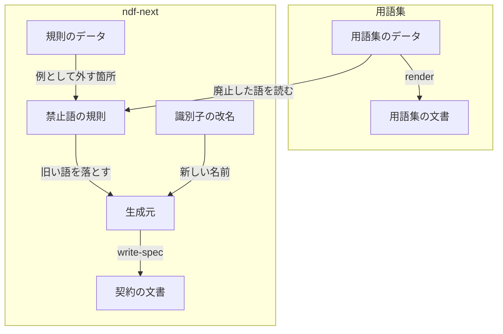
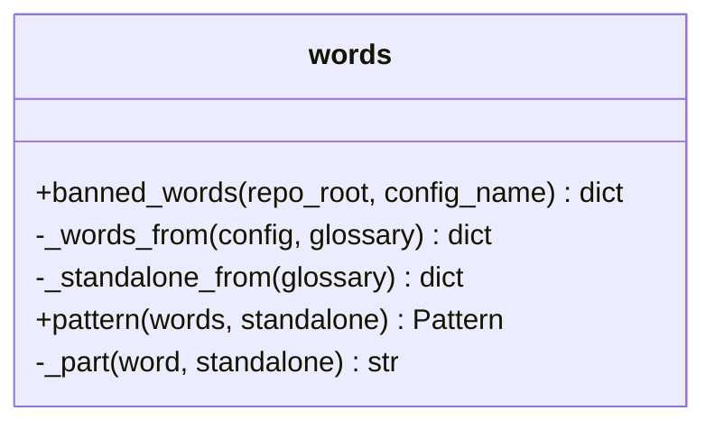
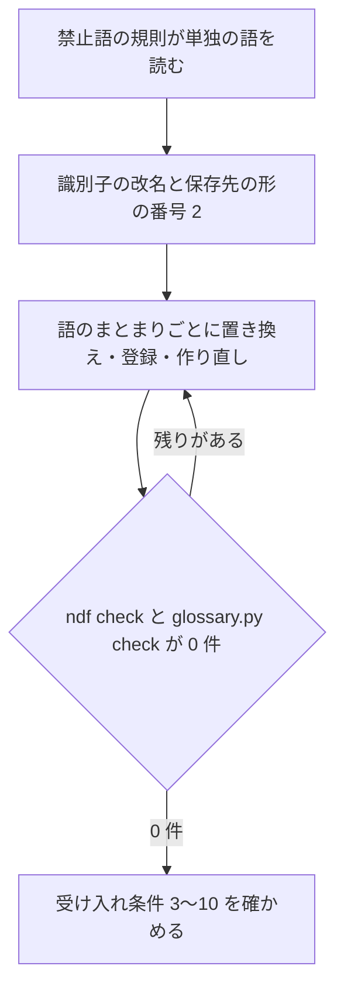

# ndf-next の用語: 直訳調の語を業界の語へ置き換え、1 語 1 意味にそろえる（#3613）

## 目的

- **今どうなっているか**: ndf-next（`plugins/ndf-next/`）の Skill・契約の文書・出力・コードに、直訳調の内部の呼び名（版・置き場・宣言・副命令・進行表など 29 語）が 1,061 ファイル中 828 ファイルに出る。印・枠・区間などは 1 語が 2〜3 の意味を持つ
- **誰に効くか**: 11.0 から ndf-next を使う利用者と、ndf-next を直す開発者
- **変えると何が成り立つか**: 利用者が読む文書と出力が、説明なしで分かる業界の語で書かれ、1 語が 1 つの意味を指す。旧い語を書いた行は検査が落とすため、旧い語が戻らない

## 適用範囲

- **働く範囲**: このリポジトリの `plugins/ndf-next/` と用語集（`docs/glossary/glossary.json`・`docs/glossary.md`）。今の `plugins/ndf/` は変えない
- **プロジェクトごとに違うもの**: 無し（語は NDF の側で決め、利用先のリポジトリの設定を変えない）
- **当たるモード**: `standard`

## あるべき姿の根拠

| 根拠 | 種類 | 何を示すか |
| --- | --- | --- |
| 「土台とか印とか版とか、直訳すぎて分からない。エンジニア業界で利用されている用語に」（2026-11-15） | 利用者の指示の原文 | 置き換えの目的と、置き換え先を業界の語にすること |
| 「直訳用語は 11.0 できちんと直しておきましょう。後が大変そうだ。」（2026-11-16） | 利用者の指示の原文 | 11.0 の公開の前に終えること |
| STD1（GitHub の Pull Request のレビュー） | 外部の一次情報 | 直しを求める判定の業界の呼び名が「変更を要求する」（API の `REQUEST_CHANGES`）であること |
| PRD1（DBOS の文書） | 外部の一次情報 | 途中から再開できるワークフローの呼び名が durable workflow であること |
| `git grep` の出現の回数（要求の「調べた結果」と、この文書の「対応表」の回数の列） | 実測 | 置き換えの量と、意味が複数ある語の所在 |

要求と受け入れ条件は #3613 の本文にある（コピーは [issue-3613-requirements.md](issue-3613-requirements.md) ）。この文書は「どう作るか」だけを扱う。

## ドメインモデル

### コンテキスト

| コンテキスト | 何の語が 1 つの意味に決まるか |
| --- | --- |
| 用語集（`project-glossary`） | 語の項目・廃止した語・単独で照合する廃止した語 |
| NDF の工程（`ndf-workflow` ほか、語の項目が属する既存のコンテキスト） | 置き換えた後の語（バージョン・設定・サブコマンドなど） |

用語集が上流、ndf-next の禁止語の規則が下流で、関係は公開された言語である。用語集の JSON の形（`terms[].deprecated`・`terms[].deprecated_standalone`）を共通の形式として、今の NDF の用語の検査（`plugins/ndf/scripts/glossary.py`）と ndf-next の禁止語の規則（`plugins/ndf-next/src/ndf/checks/words.py`）が別々に読む。

### 集約

| 集約 | 持ち主（書き換えてよいもの） | 根 | エンティティ | 値オブジェクト |
| --- | --- | --- | --- | --- |
| 用語集 | 用語集のデータ（`docs/glossary/glossary.json`）。文書（`docs/glossary.md`）は `glossary.py render` が作る | 用語集 | 語の項目 | 廃止した語・単独で照合する廃止した語・意味 |
| 禁止語の規則 | ndf-next の禁止語の規則（`words.py`）と規則のデータ（`rules.json` の `words`） | 規則 | 例として許す箇所（`words.examples` の 1 ファイル） | 禁止する語とその理由 |

禁止語の規則は用語集を書き換えない。用語集は ID（語）でだけ参照される。

### 不変条件

| # | 集約 | 条件 | 破れたときの扱い |
| --- | --- | --- | --- |
| I1 | 用語集 | 旧い語の 1 つの意味に、置き換え先の語は 1 つだけある。置き換え先の語は、同じ用語集の別の意味の語と重ならない | 用語集の構造の検査（`glossary.py check` の `schema`・`duplicate`）が落とす |
| I2 | 用語集 | 廃止した語・単独で照合する廃止した語は、どのコンテキストの生きた語とも重ならず、語の項目と意味の欄に出ない（例として挙げる行を除く） | 構造の検査の `schema`・`deprecated_meaning` が落とす |
| I3 | 禁止語の規則 | 単独で照合する廃止した語は、前後が漢字の出現に当たらない（「開発版」「出版」「問い合わせ」に当たらない） | 禁止語の規則の単体テストが落とす |
| I4 | 禁止語の規則 | ndf-next のファイルに、対応表で置き換えると決めた語が `words.examples` の箇所の外に 0 件である | `ndf check` の `banned-word` が終了コード 1 で落とす |
| I5 | 禁止語の規則 | 契約の文書（`docs/contracts/*.md`）は生成元から作り直した結果と一致する | `ndf check` の規約の規則（spec-docs）が落とす |
| I6 | 用語集 | 利用者の設定ファイル（`.ndf/`）のキーの名前は変わらない | 設定のスキーマ（`contracts/schemas/` の設定の表）のテストが、既存の `.ndf/` の読み込みで落とす |
| I7 | 用語集 | 今の `plugins/ndf/` のファイルは 1 行も変わらない | 受け入れ条件 10 の差分の確認が落とす |

### ドメインイベント

| # | イベント | 発生元 | 受け手 |
| --- | --- | --- | --- |
| E1 | 語ごとに置き換え先を決めた対応表を用語集に書いた | 用語集の変更（実装の Pull Request） | 今の NDF の用語の検査・ndf-next の禁止語の規則 |
| E2 | 生成元の語を置き換えた | ndf-next のファイルの書き換え | 契約の文書の生成（E3） |
| E3 | 契約の文書を `ndf check --write-spec` で作り直した | ndf-next の規約の生成 | ndf-next の規約の規則 |
| E4 | 直訳の英語の識別子を改名した | ndf-next のコード・契約の JSON | ndf-next のテスト・規約の規則 |
| E5 | 旧い語を廃止した語へ登録し、禁止語の検査が 0 件で通った | 用語集の変更と ndf-next のファイルの書き換え（同じ Pull Request） | CI（`ndf check`・`glossary.py check`） |

### 用語

| 用語 | 意味 | 用語集への反映 |
| --- | --- | --- |
| 廃止した語 | 用語集の語の `deprecated`。旧称として登録し、検査が新しく書いた文から落とす | 変えない |
| 単独で照合する廃止した語 | 用語集の語の `deprecated_standalone`。前後が漢字の出現には当てない | 変えない（ndf-next の禁止語の規則も読むようになるが、語の意味は変わらない） |

置き換え先の語（バージョン・設定など）は、次の「対応表」の決定どおり実装の Pull Request で用語集へ足す（E1）。設計の時点で用語集へ入れないのは、廃止した語の登録と置き換えを同じ Pull Request に入れるためである（決定 5）。

## 外部の調査

| 種類 | 調べるか | 理由 |
| --- | --- | --- |
| 標準・仕様 | 調べる | 置き換え先の語が業界で使われているかを、公式の文書の日本語版で確かめる |
| 主要な製品 | 調べる | ndf-next が使う製品（DBOS）が自分の機能をどう呼ぶかに置き換え先を揃える |
| ライブラリとサービス | 調べる | 表記の揺れを検査する既存のツールを使うか、ndf-next の禁止語の規則を延ばすかを決める |

### 標準・仕様

| # | 標準・仕様 | 何を定めているか | 設計への反映 | 出典 |
| --- | --- | --- | --- | --- |
| STD1 | GitHub の Pull Request のレビュー（日本語版の文書と REST API） | レビューの判定の 1 つを日本語版で「変更を要求する」、API の値で `REQUEST_CHANGES` と呼ぶ | 差し戻し（直しを求める判定）を「変更要求」、識別子 `revise` を `request_changes` にする | https://docs.github.com/ja/pull-requests/collaborating-with-pull-requests/reviewing-changes-in-pull-requests/about-pull-request-reviews ・ https://docs.github.com/ja/rest/pulls/reviews （2026-11-15） |

### 主要な製品

| # | 製品 | どう解いているか | 設計への反映 | 出典 |
| --- | --- | --- | --- | --- |
| PRD1 | DBOS（ndf-next が使う実行の永続化のライブラリ） | 途中から再開できる処理を durable workflows・Durable Queues と呼ぶ（文書の中の出現 11 回・4 回） | 耐久を「永続」にする（耐久ワークフロー → 永続ワークフロー）。識別子 `durable` は変えない | https://docs.dbos.dev/architecture （2026-11-15） |

### ライブラリとサービス

| # | 候補 | 版 | ライセンス | 最後のリリースの日付 | 終了のアナウンス | 要件を満たすか | 出典 |
| --- | --- | --- | --- | --- | --- | --- | --- |
| LIB1 | prh（表記の揺れの辞書による校正） | 7.0.0 | MIT | 2026-11-07 | 無し | 語の置き換えの辞書は持てる。用語集とは別の辞書（YAML）を持つことになり、同じ事実を 2 か所に持つ。Node.js の実行環境が要る | https://registry.npmjs.org/prh ・ https://raw.githubusercontent.com/prh/prh/master/README.md （2026-11-15） |
| LIB2 | textlint（16.0.0）と textlint-rule-prh | 6.1.1 | MIT | 2026-10-16（textlint は 2026-11-15） | 無し | `.md` の検査はできる。`.py`・`.json` の行を見る ndf-next の禁止語の規則の範囲を覆わない。Node.js の実行環境が要る | https://registry.npmjs.org/textlint-rule-prh ・ https://registry.npmjs.org/textlint （2026-11-15） |
| LIB3 | ndf-next の禁止語の規則（`words.py`）と用語集 | — | リポジトリの一部 | — | 無し | プラグインの下のすべての文字のファイルを見る。用語集の `deprecated` だけを読み、`deprecated_standalone` を読まない | `plugins/ndf-next/src/ndf/checks/words.py` ・ `plugins/ndf-next/src/ndf/checks/README.md` （2026-11-15） |
| LIB4 | SudachiPy（日本語の形態素解析） | 0.7.0 | PyPI の license の欄が空（未確認） | 2026-09-24 | 無し | 語の境界を形態素で決められる。辞書の取得が要り、検査の依存が増える。前後が漢字かで決める規則で受け入れ条件 9 を満たせる | https://pypi.org/pypi/sudachipy/json （2026-11-15） |

### 確かめられなかったこと

| 対象 | 試した手段 | 結果と理由 |
| --- | --- | --- |
| Microsoft の日本語のスタイルガイドの用語 | https://learn.microsoft.com/ja-jp/style-guide/welcome/ | HTTP 200 だが英語版の索引のページで、語ごとの表記を取得していない |
| 日本翻訳連盟（JTF）の日本語標準スタイルガイド | https://www.jtf.jp/tips/styleguide | HTTP 200。本文の PDF を取得していない |
| Temporal の durable execution の呼び名 | https://docs.temporal.io/workflows | HTTP 200 だが、取得した HTML の中に語が見つからなかった（描画を JavaScript に頼る可能性。未確認） |

調べた量: 候補 6 件・取得の試み 16 回。

## 対応表

**旧い語の意味ごとに、置き換え先の語を 1 つに決める。** 意味が 1 つの語は 1 行、意味が複数の語は意味ごとに 1 行を持つ。用語集へは置き換え先の語の項目に、旧い語を廃止した語として登録する（決定 2）。回数は `git grep -o <語> -- plugins/ndf-next | wc -l`（2026-11-15、`design/issue-3613`）。

### 上位 20 語と、利用者が名指しした「土台」

| # | 旧い語 | 回数 | 意味 | 置き換え先 | 登録する欄 | 英語の識別子 |
| --- | --- | ---: | --- | --- | --- | --- |
| W1 | 版 | 1,550 | ソフトウェア・文書・形式の版 | バージョン | 単独で照合 | `version`（変えない） |
| W2 | 置き場 | 1,280 | ファイル・ディレクトリを置く場所 | 保存先 | 廃止した語 | `place` → `location`、`places` → `locations` |
| W3 | 宣言 | 1,185 | 利用先が `.ndf/` に書く JSON とその中身 | 設定 | 廃止した語 | `declaration`・`declarations` → `settings`（ディレクトリ名・文書名を含む） |
| W3 | 宣言 | （同上） | 契約の表に書いて決めること（「表に宣言する」） | 定義 | 廃止した語 | — |
| W4 | 答え・答える | 872 | 人が質問へ返したもの | 回答・回答する | 廃止した語 | `answer`（変えない） |
| W5 | 鍵 | 753 | 行・記録・ロックを引く識別子 | キー | 単独で照合 | `key`・`run_key`（変えない） |
| W6 | 副命令 | 572 | `ndf <名前>` の 2 語目 | サブコマンド | 廃止した語 | `subcommand`（変えない） |
| W7 | 依頼 | 478 | 実行主体やオーガナイザーへ渡す作業の要求 | リクエスト | 廃止した語 | `request`（変えない） |
| W8 | 起こす／起こし直す | 361 | プロセス・セッションを始める／始め直す | 起動する／再起動する | 廃止した語（起こす・起こし・起こさ・起こせ） | `launch`・`spawn`（変えない） |
| W9 | 取り込み・取り込む | 238 | ブランチを合わせる | マージ | 廃止した語（取り込み・取り込む・取り込ん・取り込ま・取り込め） | — |
| W9 | 取り込み | （同上） | ある課題の受け入れ内容を別の課題の実装へ含める（取り込み先） | 統合（統合先） | （同上） | — |
| W9 | 取り込み方 | （同上） | 本番チャネルへ変更を入れる方法 | リリース方式 | （同上） | `promotion`（変えない。決定 4） |
| W9 | 取り込み | （同上） | ファイル・生成物を読んで使う | 読み込み | （同上） | — |
| W10 | 行き先 | 375 | 旧い機能が ndf-next で移る先（同等性の表） | 移行先 | 廃止した語 | — |
| W10 | 行き先 | （同上） | 止まった後に次に進む先（結果 JSON の `routes`） | ルート | （同上） | `route`（変えない） |
| W11 | 進行表 | 372 | 工程の状態と遷移をイベントで持つ表 | ステートマシン | 廃止した語 | `table_id` → `machine_id`（データベースの列を含む。決定 6） |
| W12 | 問い | 426 | 人へ求める判断・回答 | 質問 | 単独で照合（「問い合わせ」を外す） | `question`（変えない） |
| W13 | 枠 | 358 | 同時に流せる本数の 1 つ分 | スロット | 単独で照合（「枠組み」を外す） | `slot`（変えない） |
| W13 | 枠 | （同上） | 期間・対象ごとに使ってよい量（5 時間の枠・週の枠・品質の枠） | クォータ | （同上） | `budget`（変えない） |
| W14 | 印 | 445 | 状態を示すファイル・ブランチ・チェックボックス | マーカー | 単独で照合（「目印」「印刷」を外す） | — |
| W14 | 印 | （同上） | 引数や語で真偽を示すもの（導入の同意の印・互換なしの印） | フラグ | （同上） | — |
| W14 | 印 | （同上） | 兆候を外す `# noqa` のコメント（境界の印） | 抑制コメント | （同上） | `marks` → `suppressions`（`checks/marks.py` を含む） |
| W15 | 契約 | 271 | 入出力・結果の形の約束と、それを書いた表 | コントラクト | 廃止した語 | `contracts`（変えない） |
| W16 | 正本 | 267 | 同じ事実を 1 か所に持つ置き先 | SSOT | 廃止した語 | `source`（変えない） |
| W17 | 耐久 | 232 | 途中から再開できる処理（PRD1） | 永続 | 廃止した語 | `durable`（変えない） |
| W18 | 控え・控える | 230 | 戻すために取ったコピー | バックアップ | 廃止した語（控え・控える） | `backup`（変えない） |
| W18 | 控え | （同上） | 比べる・同じ値を使い回すために残したコピー（設定の控え・解決の控え） | スナップショット | （同上） | `snapshot`（変えない） |
| W19 | 照合 | 214 | 本文が MVV に従うかを言語モデルに判定させること | MVV 判定 | 廃止した語 | `vet`（変えない。決定 4） |
| W19 | 照合 | （同上） | 2 つの値・内容を突き合わせて確かめること | 検証 | （同上） | — |
| W19 | 照合 | （同上） | パターンに一致するかを見ること | マッチ | （同上） | — |
| W20 | 差し戻し・差し戻す | 145 | 承認・レビューで直しを求める判定（STD1） | 変更要求 | 廃止した語（差し戻し・差し戻す・差し戻さ・差し戻せ） | `revise` → `request_changes` |
| W21 | 土台 | 2 | 共通の部品・仕組み | 基盤 | 廃止した語 | — |

「完了条件」は対応表に置き換えの行を持たない（S3）。

### 名指しした残りの語

| # | 旧い語 | 回数 | 扱い | 置き換え先・残す理由 | 英語の識別子 |
| --- | --- | ---: | --- | --- | --- |
| W22 | 持ち主 | 172 | 置き換える | オーナー | `owner`（変えない） |
| W23 | 雛形 | 160 | 置き換える | テンプレート（`document-style` のルール 11 の表の語） | `template`（変えない） |
| W24 | 区間 | 150 | 置き換える | 中継の下で 1 回の起動から切り替えまで → セグメント。測る時間の範囲（復元の区間・引継ぎの区間）→ 期間 | — |
| W25 | 止まる理由・止まった理由 | 5 | 置き換える | 停止理由 | `cause`（変えない） |
| W26 | 提示 | 145 | 残す | 「示す」の意味の一般語で、指す対象が文脈で変わらない。公式の文書の日本語でも使われる語である | — |
| W27 | 台帳 | 115 | 置き換える | 追記で状態を持つ記録（計画の台帳・反映の記録）→ ジャーナル。環境の割り当ての一覧 → 割り当て表 | `ledger` → `journal`・`allocations` |
| W28 | 帳簿 | 58 | 置き換える | 使用量ログ | `usage_ledger` → `usage_log`、`ledger_path` → `usage_log_path` |
| W29 | 一時レーン | 41 | 残す | レーンは NDF の定義済みの語で、「一時」は修飾として説明なしで通じる | `helper`（変えない） |

**`ledger` はほかに、クロスレビューの指摘の記録（`FindingLedger`）にも使われる。** 指摘を追記する記録なので `FindingJournal` にする。`ledger` の名前は ndf-next に残さない。

### 意味ごとに分けた語

印・枠・区間・`ledger` に加えて、取り込み・行き先・控え・照合・宣言も調べた出現に意味が 2〜4 つあった（上の表の「意味」の列）。受け入れ条件 5 の「意味ごとに別の語」を、この 5 語にも当てる。

## 機能一覧

| # | 機能 | 誰が使うか |
| --- | --- | --- |
| F1 | 用語集が、置き換え先の語の項目と、旧い語の廃止した語・単独で照合する廃止した語を持つ | 今の NDF の用語の検査、ndf-next の禁止語の規則 |
| F2 | ndf-next の禁止語の規則が、単独で照合する廃止した語を、前後が漢字でない出現にだけ当てる | ndf-next の CI |
| F3 | ndf-next の文書・出力・コード・テストが置き換え先の語で書かれている | ndf-next の利用者と開発者 |
| F4 | 直訳の英語の識別子が改名され、契約の JSON・サブコマンドの引数・生成した文書が新しい名前で一致する | ndf-next の開発者 |
| F5 | 機械が読む日本語の見出しと値（例: 「区間の報告」の見出し）が、書く側と読む側で同じ新しい語になる | ndf-next の hook とスクリプト |

## 構成要素

| 要素 | 責務 |
| --- | --- |
| 用語集のデータ（`docs/glossary/glossary.json`） | 置き換え先の語の項目を足し、旧い語を含む語の項目 168 件を新しい語の名前へ改め、意味の欄に旧い語を含む 414 件を書き直す（重なりを除いて 462 件）。旧い語を廃止した語・単独で照合する廃止した語へ登録する |
| 用語集の文書（`docs/glossary.md`） | `glossary.py render` で作り直す。手で直さない |
| 禁止語の規則（`plugins/ndf-next/src/ndf/checks/words.py`） | `deprecated_standalone` を読み、前後が漢字の出現を外す正規表現を作る |
| 規則のデータ（`plugins/ndf-next/src/ndf/checks/rules.json` の `words.examples`） | 同等性の表が今の NDF の文言を引いた箇所を、ファイル・語・理由で外す |
| ndf-next の生成元（`skills/`・`agents/`・`contracts/`・`src/`・`tests/`・`bin/`・`hooks/`・`manifests/`・`pyproject.toml`） | 対応表どおりに語を置き換える。機械が読む日本語の見出しと値は、書く側と読む側を同じ Pull Request で変える |
| 識別子の改名（`src/`・`contracts/`・`tests/`） | 対応表の `→` の行の識別子・ファイル名・ディレクトリ名を改名する。チェックアウトの保存先の形の番号（`durable.STORE_FORMAT`）を 1 から 2 に上げる |
| 契約の文書（`plugins/ndf-next/docs/contracts/*.md`） | `ndf check --write-spec` で作り直す。手で直さない。`declarations.md` は `settings.md` になる |

## 構造

禁止語の規則の、変える関数だけを示す。

- `_words_from` は今と同じく `deprecated` と禁止語を返す
- 新しく足す `_standalone_from` は `deprecated_standalone` を返す
- `pattern` は単独の語にだけ「前後が漢字でない」の条件を付ける。漢字の範囲は CJK 統合漢字と「々」で、今の NDF の用語の検査（`glossary_words.is_kanji_edged`）と同じ字の範囲にする。ndf-next は今の NDF のモジュールを読まないため、範囲は `words.py` に持つ

## データ構造

**ndf-next の状態のデータベースの列 `table_id` を `machine_id` へ改名する**（`plugins/ndf-next/src/ndf/progress/store.py` の 81・89 行目の 2 つの表）。データベースはチェックアウトの保存先にあり、その先頭の `format.json` が形の番号（`ndf.core.durable.STORE_FORMAT`、今は 1）を持つ。番号を 2 に上げると、番号の古い保存先は既存の経路（`durable._retire_store`）で `<名前>.v1-<日付>` へ退避され、新しい形で作り直される。ndf-next は未公開で、移行のコードを持たない（S2）。

保存先のファイル名のうち `ledger` を含むものも改名する。

| 表 `ndf-files` の ID | 改名した後の ID | ファイル名 |
| --- | --- | --- |
| `backlog-ledger` | `backlog-journal` | `ledger.json` → `journal.json` |
| `ask-ledger` | `ask-journal` | `ask.jsonl`（変えない） |
| `usage-ledger-file` | `usage-log-file` | `usage.jsonl`（変えない） |

保存先の ID（列 `place` の値）も同じ規則で改名する（`usage-ledger` → `usage-log`）。改名した名前のファイルは、ndf-next を試した開発者の手元に残る旧い名前のファイルを読まない。

利用者の設定ファイル（`.ndf/`）のキーは変えない（決定 4）。

## 入出力の契約

| 契約 | 変わること | 互換 |
| --- | --- | --- |
| 契約の JSON（`contracts/domains/ndf-files.json` ほか） | 列のキー `place` → `location`、表 `domains/places` → `domains/locations`、`kind` の値 `declaration` → `settings` | 互換なし（S2） |
| 設定のスキーマ（`contracts/schemas/declarations/`） | ディレクトリを `contracts/schemas/settings/` へ移す。スキーマが受けるキーは変えない | 利用者の `.ndf/` はそのまま読める（I6） |
| サブコマンドの引数 | 対応表で改名する識別子を含む引数（例: 変更要求の引数の `revise`）を新しい名前にする。実装で `git grep -w` の結果から一覧を作る | 互換なし（S2） |
| 結果 JSON の `summary`・`items` の文 | 置き換え先の語で出す | 文の照合をする呼び手は無い（`.md` の文言を照合するテストを書かない方針） |
| 機械が読む日本語の見出しと値 | 旧い語を含むもの（例: 「区間の報告」）を、書く Skill の本文と読むコードで同じ語にする | 11.0 の入れ替えはスプリントの境で行い、今の NDF が書いた途中の成果物を ndf-next が読まない前提（未確認 2） |

## 処理の流れ

実装の Pull Request の順序である。1 つの語の登録と置き換えは同じ Pull Request に入れる（E5）。

1. 禁止語の規則が `deprecated_standalone` を読むようにする。用語集へはまだ登録しないので、検査の結果は変わらない
2. 識別子を改名し、チェックアウトの保存先の形の番号を 2 に上げる。テストと規約の規則で食い違いを落とす（E4）
3. 語のまとまり（例: W1〜W5）ごとに、生成元を置き換え、契約の文書を作り直し、用語集へ置き換え先の項目と廃止した語を足して `glossary.py render` する（E1・E2・E3・E5）
4. まとまりの Pull Request ごとに `ndf check --base origin/develop` と `glossary.py check --diff origin/develop --rules all` が 0 件で通る

まとまりの分け方と Pull Request の数は実装計画が決める。

## 非機能の実現方式

| 大項目 | 条件 | 実現方式 |
| --- | --- | --- |
| 移行性 | 11.0 へ移る利用者の設定ファイル（`.ndf/`）が読めなくならない | 設定のキーを改名しない（決定 4）。改名するのは ndf-next の中の識別子と、ndf-next だけが書く状態の保存先のファイルである |

## 決定の記録

### 決定 1: 旧い語が戻らないよう、置き換えの範囲を ndf-next のすべての文字のファイルにする

禁止語の規則は `src/`・`tests/`・`bin/`・`hooks/` を含むプラグインの下のすべての文字のファイルを見る。内部のコメント・docstring・テストを外すと、廃止した語を登録した時点で検査が落ちる。外部向けと内部で語を分けると、1 語 1 意味が成り立たない。

内部を対象外にして例外を広げる形は採らない。例外の一覧が置き換えの量と同じだけ増え、検査が旧い語を見なくなる。

根拠: Value 14 / Value 11（MVV 版 7）

### 決定 2: 対応表の置き先を 1 つにするため、用語集の語の項目に旧い語を廃止した語として持たせる

置き換え先の語の項目の `deprecated`（2 文字以上）と `deprecated_standalone`（1 文字の語と、「問い合わせ」のように長い語の一部に現れる語）に旧い語を書く。旧い語の意味が複数ある語は、意味ごとの置き換え先の項目のそれぞれに同じ旧い語を書き、検査の理由の文は先に見つかった語を出す。用語集が対応表の SSOT になり、今の NDF の用語の検査と ndf-next の禁止語の規則が同じデータを読む。

対応表を別の文書や別の辞書に持つ形は採らない。同じ事実を 2 か所に持ち、片方だけが直る。

根拠: Value 11 / Value 14（MVV 版 7）

### 決定 3: 1 文字の語を単独の出現だけで落とすため、ndf-next の禁止語の規則を延ばす

`words.py` に `deprecated_standalone` を読む関数を足し、前後が漢字の出現を外す。用語集はすでに `deprecated_standalone` の欄を持ち、今の NDF の用語の検査が同じ判定を持つ。延ばす量は関数 1 つと正規表現の条件 1 つである。

prh と textlint（LIB1・LIB2）は採らない。用語集と別の辞書を持つことになり、`.py`・`.json` の行を見る範囲を覆わず、Node.js の実行環境が CI に増える。形態素解析（LIB4）は採らない。前後が漢字かの規則で受け入れ条件 9 を満たし、辞書の取得が依存に増える。

- 作り方: 自前で作る
- 比べた候補: LIB1 / LIB2 / LIB3 / LIB4

根拠: Value 12 / Value 2（MVV 版 7）

### 決定 4: 11.0 へ移る利用者の設定を読めるようにするため、`.ndf/` のキー（`promotion`・`vet`）を改名しない

`promotion` は `.ndf/worktree.json`、`vet` は `.ndf/mvv.json` のキーで、利用者が書いた設定である。11.0 の入れ替えまでは今の NDF と ndf-next が同じ `.ndf/` を読むため、改名すると今の NDF か ndf-next のどちらかが読めなくなる。2 語とも英語として通じる語で、直訳の識別子ではない。日本語の側だけを置き換える（取り込み方 → リリース方式、照合 → MVV 判定）。

キーを改名して移行の手順を足す形は採らない。利用者の設定を書き換える操作（C7）が全利用者に要り、移行の失敗が 11.0 の導入を止める。

根拠: Value 4 / Value 1 / C7（MVV 版 7）

### 決定 5: CI を落とさずに進めるため、用語集の変更は実装の Pull Request に入れ、設計の Pull Request に入れない

廃止した語を登録すると、ndf-next の禁止語の規則が、置き換えの済んでいないファイルを落とす。置き換え先の語の項目だけを先に足すと、旧い語を含む語の項目と置き換え先の項目が並び、1 語 1 意味が崩れた状態が実装まで残る。語のまとまりごとに、置き換え・登録・作り直しを同じ Pull Request に入れる。

根拠: Value 14 / Value 13（MVV 版 7）

### 決定 6: 語と識別子を揃えるため、ステートマシンの ID の列を改名し、チェックアウトの保存先の形の番号を上げる

`table_id` は進行表の ID の直訳で、日本語の語をステートマシンへ置き換えると識別子と食い違う。ndf-next は未公開で、保存した状態を引き継ぐ利用者がいない。形の番号を上げると、旧い形の保存先は既存の退避の経路で退避され、移行のコードを持たずに済む。

列の名前を残して日本語の語だけを変える形は採らない。説明文と識別子の対応が崩れる（`document-style` のルール 11）。

根拠: Value 14 / Value 8（MVV 版 7）

### 決定 7: 置き換えの済んだ状態を検査で示すため、まとまりごとに `ndf check` の禁止語の規則を 0 件にしてからマージする

置き換えは語の出現の回数が多く、目で確かめられない。禁止語の規則が残りを行ごとに示すため、0 件になるまで置き換えを続ける。同等性の表で今の NDF の文言を引いた箇所だけを `words.examples` に外す（前提 5）。

根拠: Value 13 / Value 3（MVV 版 7）

## テスト設計

| 受け入れ条件・不変条件 | どの振る舞いで縛るか | どう壊したら落ちるべきか |
| --- | --- | --- |
| 受け入れ条件 1・2 / I1 | 用語集に W1〜W29 の置き換え先の項目か残す理由があり、「完了条件」に置き換えの行が無い | 置き換え先の項目を 1 つ消すと、受け入れ条件の確認（用語集の項目の照会）が欠けた語を示す |
| 受け入れ条件 3 / I4 | `ndf check --base origin/develop` の禁止語の規則が 0 件で終了コード 0 | ndf-next の Skill の本文に旧い語を 1 つ残すと終了コード 1 |
| 受け入れ条件 4 / I5 | `ndf check --write-spec` の後に `git diff` が空で、旧い語が 0 件 | 契約の JSON の説明に旧い語を書いて作り直すと、禁止語の規則が生成物の行を示す |
| 受け入れ条件 5 / I1・I2 | 印・枠・区間・`ledger`（と取り込み・行き先・控え・照合・宣言）の意味ごとに別の語の項目が 1 行ずつある | 置き換え先の 2 つの項目を同じ語にすると、構造の検査の `duplicate` が落とす |
| 受け入れ条件 6 | 改名した識別子ごとに `git grep -w <旧い名前> -- plugins/ndf-next` が 0 件 | 旧い名前の参照を 1 つ残すと 1 件以上 |
| 受け入れ条件 7 | 契約の JSON のキー・サブコマンドの引数・生成した文書が新しい名前で一致し、`uv run --frozen --project plugins/ndf-next pytest -q` が通る | 契約の JSON のキーだけを旧い名前に戻すと、規約の規則かテストが落ちる |
| 受け入れ条件 8 | 単体テスト: 用語集に「副命令」を廃止した語として持つと、Skill の本文の「副命令」の 1 行に禁止語の 1 件を返す | `deprecated` を読まないように壊すと 0 件になり落ちる |
| 受け入れ条件 9 / I3 | 単体テスト: 「版」を単独で照合する廃止した語に持つと、「版の記録」に 1 件、「開発版」「出版」に 0 件を返す | 前後の漢字の条件を外すと「開発版」に当たり落ちる。`deprecated_standalone` を読まないと「版の記録」が 0 件で落ちる |
| 受け入れ条件 10 / I7 | `git diff --stat origin/develop -- plugins/ndf` が空 | `plugins/ndf/` を 1 行変えると空でない |
| I6 | 既存の `.ndf/worktree.json`・`.ndf/mvv.json` を、移した設定のスキーマで確かめて通る | スキーマのキー `promotion` を改名すると、既存の設定が通らない |
| I2 | `glossary.py check --diff origin/develop --rules all` が 0 件 | 語の項目の意味の欄に旧い語を 1 つ残すと `deprecated_meaning` が落とす |

## 設計の結果

| 課題 | 扱い | 取り込み先 | 触るファイル |
| --- | --- | --- | --- |
| #3613 | 実装する | — | `docs/glossary/glossary.json`、`docs/glossary.md`、`plugins/ndf-next/src/ndf/checks/words.py`、`plugins/ndf-next/src/ndf/checks/rules.json`、`plugins/ndf-next/src/ndf/checks/marks.py`、`plugins/ndf-next/src/ndf/identity.py`、`plugins/ndf-next/src/ndf/core/durable.py`、`plugins/ndf-next/src/ndf/progress/store.py`、`plugins/ndf-next/tests/checks/test_words.py`、`plugins/ndf-next/tests/checks/test_marks.py`、`plugins/ndf-next/contracts/domains/ndf-files.json`、`plugins/ndf-next/docs/contracts/declarations.md`、`plugins/ndf-next/skills/`、`plugins/ndf-next/agents/`、`plugins/ndf-next/contracts/`、`plugins/ndf-next/docs/contracts/`、`plugins/ndf-next/src/`、`plugins/ndf-next/tests/`、`plugins/ndf-next/bin/`、`plugins/ndf-next/hooks/`、`plugins/ndf-next/manifests/`、`plugins/ndf-next/pyproject.toml` |

## 人へ残す判断

無し

## 未確認のまま残ること

| 項目 | 内容 |
| --- | --- |
| 1. 置き換えた語が説明なしで通じるか | 利用者が Skill の本文と出力を読んで確かめる。リリース後テストで分かる |
| 2. 今の NDF が書いた途中の成果物 | 11.0 の入れ替えの時点で、今の NDF が書いた見出し（「区間の報告」など）の成果物が残っているかは、入れ替えの時点のスプリントの状態で分かる |
| 3. 並行するレーンの変更 | ndf-next を触る別のレーンが旧い語を書いた行は、廃止した語の登録の後に CI が落とす。どのレーンが当たるかはマージの時点で分かる |
| 4. Factory のサービスが読む記録 | 表 `ndf-files` で読み手が `service` の記録（`ask.jsonl`）は、ファイル名を変えず ID だけを改名する。サービスがファイルを ID で引くかは別のリポジトリにあり、この設計の時点で確かめていない。サービスの側の結合のテストで分かる |
| 5. 単独の「版」の出現の回数 | 1,550 回のうち、前後が漢字の複合語（正式版・開発版など）を除いた置き換えの回数は、禁止語の規則を延ばした後の検査の件数で分かる |
