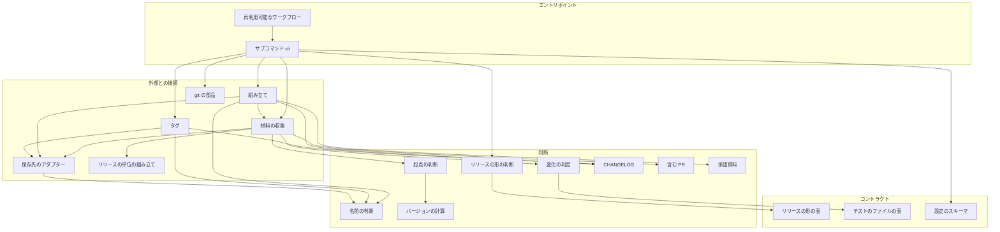
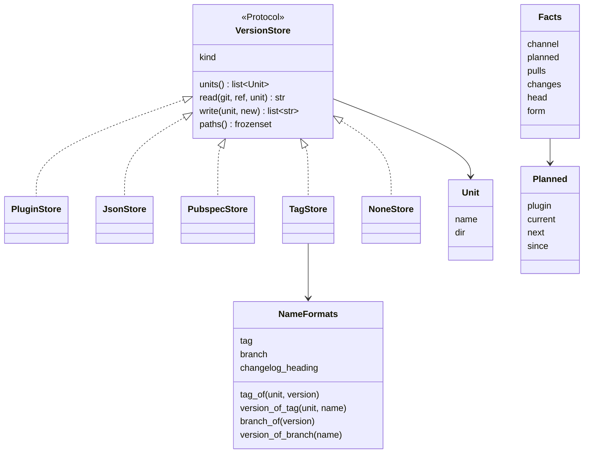
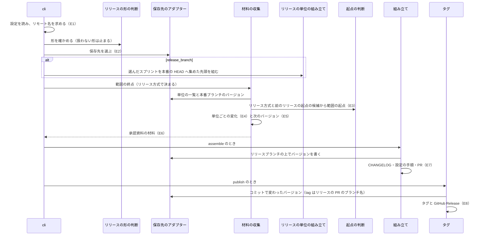

# ndf-next のリリース: 設定したリリースの形とバージョンの保存先で、承認資料・リリースブランチ・タグを組む（#3615）

## 目的

- **今どうなっているか**: ndf-next のリリースの部分は `plugins/ndf-next/src/ndf/domains/release/` にある。この部分は、バージョンとバージョンの単位を Claude Code のマーケットプレイスの登録とプラグインの定義からしか読めない。`.claude-plugin` の無いリポジトリでは承認資料・リリースブランチの組み立て・タグのどれも前提の誤りで止まる。base と production が同じ設定では、差分の範囲が空になる
- **誰に効くか**: NDF を使う Web サービス・モバイルアプリ・業務文書だけのリポジトリの開発者と、NDF のリリースを自分のリポジトリから起動したい利用者
- **変えると何が成り立つか**: 設定のリリースの形・バージョンの保存先・名前の書式で、プラグインの登録が無いリポジトリでも承認資料を組み、リリースブランチを作り、タグを打てる。今の NDF の release Skill のリリースの形 9 種の扱いが表で決まる

## 適用範囲

- **働く範囲**: ndf-next を使うすべてのリポジトリ（ai-plugins を含む）。利用者のリポジトリでは、置いた workflow から `ndf release-steps` が動く
- **プロジェクトごとに違うもの**: リリースの形・バージョンの保存先・名前の書式は `.ndf/project.json` のセクション `branch_strategy` の `release` で受ける。リリース対象外のファイルの追加と CHANGELOG のパスは、既存のキーとして `.ndf/release.json` に残す（決定 14）。リモート名は `.ndf/worktree.json` の `remote` で受ける。秘密の名前は利用者の workflow の中で決める
- **当たるモード**: リリースを通るすべてのモード（`standard`・`light`・`operation`・`documentation`）

### 代表のリポジトリでの振る舞い

| 代表のリポジトリ | 設定の要点 | 直した後に起きること | この種類で扱えなくなること |
| --- | --- | --- | --- |
| Web サービス（TypeScript・vitest か jest・develop→main・OpenAPI） | 種類 `web-develop`。`merge_base_branch`・形 `service`・保存先 `json`（`package.json` の `/version`）・タグ `v{version}` | `materials`: 範囲は本番ブランチ..ベースブランチ。`*.test.ts`・`__tests__/` だけの変更ではバージョンを上げない。`package.json` の前と次のバージョンを出す。`assemble`: develop の HEAD から `release/v1.2.3` を作り、`package.json` と CHANGELOG のセクションを書いて main 宛ての PR を作る。OpenAPI の `info.version` は `.ndf/release.json` の手順（`{version}` の置き換え）で書く。`publish`: main へのマージの後に、置いた workflow がタグ `v1.2.3` と GitHub Release を作る | 無し |
| モバイルアプリ（Flutter か Swift） | 種類 `mobile`。`release_branch`・形 `mobile`。Flutter は保存先 `pubspec`、Swift は保存先 `tag`。タグ `v{version}` | `materials`: 選んだスプリント（`--units`）を本番ブランチの HEAD へ集めた先頭を一時の作業場所に組み、範囲は前のバージョンのタグ..その先頭。`assemble`: 同じ先頭からリリースブランチを作り、Flutter は `pubspec.yaml` の `version: 1.2.3+45` を `1.2.4+46` に書く。Swift は書き換えるファイルが無く、CHANGELOG のセクションだけを書く。`publish`: タグと（設定が真なら）GitHub Release。ストアへの提出は `deliveries` の手動の行として承認資料に並ぶ | 無し |
| 業務文書だけ | 種類 `docs`。`trunk`・`production_pr`・形 `document`・保存先 `none`・タグ無し | `materials --pr <本番の PR>`: 範囲はその PR（本番ブランチとの分岐点..PR の先頭）。この種類はタグもバージョンも持たないため、受け入れ条件 12 の「前のバージョンのタグから集める」を「範囲が空にならない」と読み替える（「人へ残す判断」の 1）。バージョンの行は出さず、含む PR と変化と「提出先へ置く」届き方を出す。`assemble`: バージョンアップの PR を作らないリリース方式なので `not_applicable`。`publish`: バージョンもタグも無いので `not_applicable` | 無し |

### ai-plugins だけの事情

| 値 | 置く所 | 持つ Issue |
| --- | --- | --- |
| 形 `package-plugin`・保存先 `plugin`・タグ `{plugin}--v{version}`・GitHub Release を作る | ai-plugins の `.ndf/project.json` の `branch_strategy.release`（値は変えない） | #3615（コードの既定にしない） |
| マーケットプレイスの登録の 12 個のプラグインをバージョンの単位にする | 保存先のアダプター `plugin` が `.claude-plugin/marketplace.json` から読む | #3615 |
| リリースの workflow の秘密 `NDF_RELEASE_TOKEN` と変数 `NDF_RELEASE_RUNNER` | ai-plugins の `.github/workflows/ndf-next-release.yml` | #3615（テンプレートと再利用可能なワークフローは名前を持たない） |
| トークン消費の記録の手順 | ai-plugins の `.ndf/release.json` の `steps` | 既存（変えない） |
| `plugins/ndf/conftest.py` をリリース対象外にする | テストのファイルの表の行 `python-conftest`（Python の慣習として表に置く） | #3615 |

## あるべき姿の根拠

| 根拠 | 種類 | 何を示すか |
| --- | --- | --- |
| 「ai-plugins(ndf) を開発することと、ndf を使って様々な開発を汎用的に進行することの区別がついていない設計が入り込んでしまう」（2026-11-16） | 利用者の指示の原文 | プラグインの形をコードの既定にせず、設定で選ぶアダプターの 1 つにする |
| PRD1（release-please の release type） | 外部の一次情報 | 主要な製品が、リポジトリの種類ごとにバージョンを書くファイルを選び（`node`・`dart`・`simple`）、工程は共通にしている |
| STD1（SemVer の FAQ） | 外部の一次情報 | `v1.2.3` はタグの名前であってバージョンではない。タグの書式はバージョンと別に設定で持つ |
| STD2（Keep a Changelog 1.1.0） | 外部の一次情報 | CHANGELOG の見出しは `## [1.2.3] - 2026-06-07` の形が広く使われ、今の `## [ndf 1.2.3] - <日付>` と違う。見出しを書式で変えられる必要がある |
| STD3（GitHub Actions の再利用可能なワークフロー） | 外部の一次情報 | 呼び出し側は秘密を名前で渡せ、呼ばれる側は秘密の名前を決め打たない |
| ai-plugins の `.ndf/project.json` の `branch_strategy`（`trunk`・base と production が `main`） | 実測（2026-11-17） | 今の `assemble` は範囲を `origin/main..origin/main` にし、ai-plugins でも組み立てる変化が 0 件になる |

要求と受け入れ条件は #3615 の本文にある（コピーは [issue-3615-requirements.md](issue-3615-requirements.md)）。この文書は「どう作るか」だけを扱う。
決定の記録は [issue-3615-design-decisions.md](issue-3615-design-decisions.md) に分けた。

## ドメインモデル

### コンテキスト

| コンテキスト | 何の語が 1 つの意味に決まるか |
| --- | --- |
| リリース（`ndf-release`） | リリースの形・バージョンの保存先・バージョンの単位・名前の書式・範囲の起点・前のリリースの起点・リリース対象外のファイル |
| 開発の工程（`ndf-workflow`） | ブランチ戦略の設定・リリース方式・リリースの単位（選んだスプリントブランチ） |
| コントラクトの表（`contracts/domains`。オーナーは #1142 の子 D2） | テストのファイルの表とリリースの形の表。テストのファイルの表は cross-review・cross-refactoring・試走の候補・リリースが同じ表を読む |
| cross-refactoring（`ndf.domains.crossrefactor`） | 集めるテストのファイル |
| 10 系の NDF（`plugins/ndf`） | 10 系のリリースの部品（`release_lib`）と、ndf-next のスキーマのコピー |

開発の工程が上流、リリースが下流の関係で、**公表された言語**でつなぐ。リリースは、ブランチ戦略の設定のスキーマ（`contracts/schemas/ndf-settings/project.schema.json`）とリリースの形の表を読む。設定を書くのは解析の `ndf project branch-strategy` だけである。

リリースの形の表は、コントラクトの表のコンテキストが持ち（オーナー D2。表の `owner` は `D2（contracts/domains。行はリリースの形を足す子が足す。初版は #3615）`）、リリースへ**公表された言語**として出す。表の行の追加は、ほかの表と同じく D2 の決めた形に従う。表の語（形の名前・届き方・扱い）の意味はリリースのコンテキストが決め、読むのはリリースだけである。設定のスキーマの `release.form` の列挙と表の行の `id` の集合は、リリースの形の単体テスト（`tests/domains/release/test_release_forms.py`）が両方を読んで照らし、どちらかだけを変えるとテストが落ちる。

テストのファイルの表は、コントラクトの表のコンテキストが持つ**共有カーネル**である。リリースと cross-refactoring はどちらも表を読む側で、表の列と行の追加はオーナー D2 の決めた形（列の型を `columns` に書く）に従う。この課題は列 `role` と行 `python-conftest` を足す（決定 5）。cross-refactoring は列 `role` が `test` の行だけを読むよう、読む側を合わせる。10 系の NDF とは**順応者**の関係で、ndf-next のスキーマを変えるとコピーを合わせる（決定 11）。

要求の「プロジェクト構造」が挙げる触る場所（`domains/release/`・リリースのテスト・`contracts/`・`issues/`）の外へ及ぶのは次の 4 つである。どれもこの課題の受け入れ条件を満たすのに要る。範囲を広げることは「人へ残す判断」の 6 に載せる。

| 触る場所 | 要る理由 |
| --- | --- |
| cross-refactoring のテストの判定とそのテスト | 表に `support` の行を足すと、読む側が役割を見ないままでは `conftest.py` をテストとして集める（決定 5） |
| 10 系のスキーマのコピー 2 つ | コントラクトの一致の検査（`scripts/check-ndf-contracts.py`）がコピーの一致を求める（決定 11） |
| 10 系のバージョンの読み（`release_lib/land_read.py`） | 新しい保存先の種類で、10 系のバージョンの衝突の確かめが読み出しで落ちる（決定 11） |
| `adapters/git.py`・`checks/children.json`・`skills/release/`・`.github/workflows/`・用語集 | 受け入れ条件 9〜11・14 が名指しする |

### 集約

| 集約 | オーナー（書き換えてよいもの） | 根 | エンティティ | 値オブジェクト |
| --- | --- | --- | --- | --- |
| リリースの計画 | 材料の収集（`gather`） | 承認資料の材料（`Facts`） | バージョンの単位ごとのバージョンアップの計画（`Planned`） | 範囲の起点・範囲の終点・含む PR・変化 |
| バージョンの保存先 | 保存先のアダプター（`version_store`） | 保存先のアダプター 1 つ | バージョンの単位（`Unit`） | バージョン |
| 名前の書式 | 名前の判断（`names_decide`） | 名前の書式（`NameFormats`） | — | タグ・リリースブランチ・CHANGELOG の見出しの書式 |
| リリースの形の表 | コントラクトの表のコンテキスト（オーナー D2。`contracts/domains/release-forms.json`。コードは書き換えない） | 表 | 形の行 | 届き方・扱い・11.x へ回す理由 |

リリースの計画を作り、書き換えるのは材料の収集だけである。組み立て（`assemble`）は材料の収集が返した計画を読むだけで、計画を書き換えない。リリースの計画は、バージョンの単位を名前で参照し、保存先のアダプターをオブジェクトとして持たない。1 回の `assemble` が書き換えてよいのは、リリースブランチの作業場所の上の、保存先のアダプターの書き換えてよいパス・CHANGELOG・設定の手順（`.ndf/release.json` の `steps`）の `writes` の和である。Web サービスの OpenAPI の `info.version` は、手順の `writes` に載せて書き換える。

### 不変条件

| # | 集約 | 条件 | 破れたときの扱い |
| --- | --- | --- | --- |
| I1 | リリースの形の表 | 設定のリリースの形は表の行にあり、扱いが `11.x` の形では `materials`・`assemble`・`publish` が何もせずに止まる | 原因 `precondition`。形の名前と表のパスと 11.x へ回す理由を出す |
| I2 | バージョンの保存先 | 保存先の種類ごとにアダプターが 1 つあり、材料の収集・組み立て・タグはアダプターのインタフェースだけを呼ぶ（種類の名前で分岐しない） | 種類が表に無ければ原因 `precondition` で止まり、取れる種類を出す |
| I3 | 名前の書式 | 書式で作った名前を同じ書式で読み戻すと、元のバージョンとバージョンの単位の名前になる。書式に合わない名前は読まない | 合わない名前は前のバージョンの候補にしない |
| I4 | リリースの計画 | 範囲の起点はリリース方式で決まる。`trunk` の `release_pr` と `release_branch` ではバージョンの単位ごとの前のリリースの起点にし、本番ブランチの HEAD にしない。`production_pr` では本番の PR と本番ブランチの分岐点にする。`merge_base_branch` では本番ブランチの HEAD にする | 前のリリースの起点が決まらなければ本番ブランチの最初のコミットから集める。`production_pr` で `--pr` が無ければ原因 `precondition` |
| I5 | リリースの計画 | リリース対象外のファイルだけの変化では、`bump_undistributed` が偽ならバージョンを上げない | その単位をバージョンアップの計画に入れない |
| I6 | リリースの計画 | 同じ名前のリリースブランチが先にあれば作らない | 原因 `precondition` で止まる |
| I7 | リリースの計画 | 同じ名前のタグが別のコミットを指していれば動かさない | 原因 `refused` で止まり、タグと 2 つのコミットを出す |
| I8 | リリースの計画 | リモート名は 1 回の実行で設定から 1 度だけ求め、リリースの部品は名前を書かない | 設定が読めなければ原因 `precondition` |
| I9 | 名前の書式 | ai-plugins の設定（保存先 `plugin`・CHANGELOG の見出しとリリースブランチの書式なし）では、同じ範囲から作るタグ・リリースブランチ・CHANGELOG の見出しの名前と、承認資料の行の形が直す前と同じになる。範囲そのものは受け入れ条件 12 で変わる（決定 6） | 既存のテストが落ちる |

### ドメインイベント

| # | イベント | 発生元 | 受け手 |
| --- | --- | --- | --- |
| E1 | 設定を読んだ | `release-steps` の各サブコマンド（`cli`） | リリースの形の判断・保存先のアダプターの選択 |
| E2 | リリースの形とバージョンの保存先を選んだ | リリースの形の判断（`forms_decide`）・`version_store.load` | 材料の収集 |
| E3 | 範囲の起点を決めた | 起点の判断（`since_decide`）と材料の収集 | 変化の判定 |
| E4 | 差分の範囲のファイルを、リリース対象とリリース対象外に分けた | 変化の判定（`changes_decide`） | バージョンアップの計画 |
| E5 | 次のバージョンを決めた | バージョンの計算（`version_decide`） | 承認資料・組み立て |
| E6 | 承認資料を組んだ | 承認資料（`materials_decide`） | 会話のセッション（`present`）・リリースの PR の本文 |
| E7 | リリースブランチを作り、バージョンと CHANGELOG のセクションを書いた | 組み立て（`assemble`） | リリースの PR（承認ゲート） |
| E8 | タグを打った | タグ（`tagging`） | GitHub Release・リリース記録 |
| E9 | 利用者のリポジトリの workflow がリリースを起動した | 呼び出し側のテンプレートの workflow | 再利用可能なワークフロー → `release-steps` |

### 用語

| 用語 | 意味 | 用語集への反映 |
| --- | --- | --- |
| リリースの形 | 利用者へ届く仕組みの種類（パッケージ・サービス・モバイルアプリなど）。設定の `release.form` の値で、リリースの形の表の行を指す | 意味の変更（`ndf-release`） |
| リリースの形の表 | リリースの形ごとの届き方と、ndf-next での扱い（扱う / 11.x へ回す理由）を持つ表（`plugins/ndf-next/contracts/domains/release-forms.json`） | 追加（`ndf-release`） |
| バージョンの単位 | 1 つのバージョンを持つリリースの対象。保存先 `plugin` ではマーケットプレイスに登録したプラグイン 1 つ、ほかの保存先ではリポジトリ全体の 1 つ | 追加（`ndf-release`） |
| 保存先のアダプター | バージョンの保存先の種類ごとに、バージョンの単位の一覧・バージョンの読み書き・書き換えてよいパスを同じインタフェースで持つ部品 | 追加（`ndf-release`） |
| 範囲の起点 | 承認資料とリリースブランチに集める差分の範囲の、古い側の端のコミット。リリース方式で決まる（`merge_base_branch` は本番ブランチの HEAD、`trunk` の `release_pr` と `release_branch` は前のリリースの起点、`production_pr` は本番の PR と本番ブランチの分岐点）。新しい側の端は既存の語「範囲の終点」 | 追加（`ndf-release`） |
| 前のリリースの起点 | 前に出したバージョンの位置を表すコミット。前のバージョンのタグ、無ければ本番ブランチで今のバージョンが入ったコミット、それも無ければ本番ブランチの最初のコミット。範囲の起点に使うのは `trunk` の `release_pr` と `release_branch` だけ | 追加（`ndf-release`） |
| 再利用可能なワークフロー | GitHub Actions で `workflow_call` を持ち、ほかのリポジトリの workflow から `uses:` で呼べる workflow。ai-plugins の `.github/workflows/ndf-release-reusable.yml` | 追加（`ndf-release`） |

## 外部の調査

| 種類 | 調べるか | 理由 |
| --- | --- | --- |
| 標準・仕様 | 調べる | タグの名前とバージョンの関係（SemVer）、CHANGELOG の見出しの形（Keep a Changelog）、ほかのリポジトリから workflow を呼ぶ形（GitHub Actions）に事実上の標準がある |
| 主要な製品 | 調べる | リリースの自動化の製品が、リポジトリの種類ごとのバージョンのファイルとタグの書式をどう選ばせているかを比べる |
| ライブラリとサービス | 調べる | `pubspec.yaml` の読み書きに YAML のライブラリを使うか、バージョンの計算を既存の依存で続けるかを決める |

### 標準・仕様

| # | 標準・仕様 | 何を定めているか | 設計への反映 | 出典 |
| --- | --- | --- | --- | --- |
| STD1 | Semantic Versioning 2.0.0 の FAQ「Is "v1.2.3" a semantic version?」 | `v1.2.3` はバージョンではなく、`v` を前に付けるのはタグの名前の慣習である | タグの書式（`{version}` を含む文字列）をバージョンと別の設定に置く | `https://raw.githubusercontent.com/semver/semver/master/semver.md`（2026-11-17） |
| STD2 | Keep a Changelog 1.1.0 | 新しいバージョンを先頭に置き、見出しは `## [2.0.0] - 2026-06-07`（日付は ISO 8601） | CHANGELOG の見出しの書式を設定で変え、`{date}` は `YYYY-MM-DD` | `https://raw.githubusercontent.com/olivierlacan/keep-a-changelog/main/source/en/1.1.0/index.html.haml`・同リポジトリの `CHANGELOG.md`（2026-11-17） |
| STD3 | GitHub Actions のワークフローの再利用 | 呼ばれる側は `on: workflow_call` を持ち、秘密は呼び出し側が名前で渡すか `secrets: inherit` で渡す。`required: true` は渡したかだけを確かめる | 呼ばれる側は秘密 `release_token` を受け、呼び出し側は自分の秘密の名前を割り当てる | `https://raw.githubusercontent.com/github/docs/main/content/actions/how-tos/reuse-automations/reuse-workflows.md`（2026-11-17） |
| STD4 | GitHub Actions の `GITHUB_TOKEN` | 見出し「When `GITHUB_TOKEN` triggers workflow runs」のセクションがある（本文は文書の再利用の断片で、取得していない） | 秘密が無いときに `github.token` へ倒す操作では CI が起動しないことを、ai-plugins の workflow の注記（`.github/workflows/ndf-next-release.yml` の 23 行目）と合わせて案内する | `https://raw.githubusercontent.com/github/docs/main/content/actions/concepts/security/github_token.md`（2026-11-17） |

### 主要な製品

| # | 製品 | どう解いているか | 設計への反映 | 出典 |
| --- | --- | --- | --- | --- |
| PRD1 | release-please（設定とマニフェストのリリース） | release type ごとにバージョンを書くファイルを決める（`node`・`dart` は `pubspec.yaml`・`simple` は `version.txt`）。タグは既定で `<component>-v<version>`、`include-component-in-tag: false` で `v<version>`。CHANGELOG のパスは `changelog-path` | 保存先の種類で書くファイルを選び、工程は共通にする。タグの書式を設定で変える | `https://raw.githubusercontent.com/googleapis/release-please/main/docs/customizing.md`・`docs/manifest-releaser.md`（2026-11-17） |
| PRD2 | release-please の `pubspec.yaml` の書き換え | `^version: ` の行だけを置き換え、`+` の後のビルド番号が数なら 1 つ上げて残す | 保存先 `pubspec` は同じ規則で書く | `https://raw.githubusercontent.com/googleapis/release-please/main/src/updaters/dart/pubspec-yaml.ts`（2026-11-17） |

### ライブラリとサービス

| # | 候補 | バージョン | ライセンス | 最後のリリースの日付 | 終了のアナウンス | 要件を満たすか | 出典 |
| --- | --- | --- | --- | --- | --- | --- | --- |
| LIB1 | ruamel.yaml（ndf-next の既存の依存） | 0.19.1 | MIT | 2026-01-02 | 無し | 満たす（コメントを保つ読み書き）。ただし `version:` の 1 行の置き換えには要らない | `https://pypi.org/pypi/ruamel.yaml/json`（2026-11-17） |
| LIB2 | semver（ndf-next の既存の依存。`uv.lock` は 3.1.0） | 3.1.2 | BSD-3-Clause | 2026-11-15 | 無し | 満たす（バージョンの解釈と上げ方。今の計算をそのまま使う） | `https://pypi.org/pypi/semver/json`（2026-11-17） |
| LIB3 | pathspec（ndf-next の既存の依存） | 1.1.1 | PyPI の欄は空 | 2026-04-27 | 無し | 満たす（設定の `undistributed` の gitignore の形のマッチを続ける） | `https://pypi.org/pypi/pathspec/json`（2026-11-17） |

### 確かめられなかったこと

| 対象 | 試した手段 | 結果と理由 |
| --- | --- | --- |
| semantic-release のタグの書式（`tagFormat`） | `https://raw.githubusercontent.com/semantic-release/semantic-release/master/docs/usage/configuration.md` と `HEAD` の同じパス | HTTP 404（パスが違う）。PRD1 で同じ論点（タグの書式を設定で変える）を確かめたため、追わなかった |
| `GITHUB_TOKEN` の操作が workflow を起動しない旨の本文 | STD4 の URL | 本文は文書の再利用の断片（`data reusables`）で、取得したファイルに無い |

調べた量: 候補 9 件・取得の試み 15 回。

## 機能一覧

| # | 機能 | 誰が使うか |
| --- | --- | --- |
| F1 | 設定のリリースの形を確かめ、扱わない形なら理由と表の在りかを出して止まる | 利用者・workflow |
| F2 | 設定のバージョンの保存先（`plugin`・`json`・`pubspec`・`tag`・`none`）から前と次のバージョンを出し、承認資料を組む | 会話のセッション・workflow |
| F3 | 範囲の起点をリリース方式から決め（`trunk` の `release_pr` と `release_branch` はバージョンの単位ごとの前のリリースの起点）、差分の範囲を集める（`release_branch` は選んだスプリントを集めた先頭まで） | 会話のセッション・workflow |
| F4 | リリース対象外のファイルをテストのファイルの表と設定から決める | 会話のセッション・workflow |
| F5 | 名前の書式でリリースブランチ・CHANGELOG の見出し・タグを作り、前のものを読む | workflow |
| F6 | リリースブランチを作り、保存先のバージョンと CHANGELOG を書き、リリースの PR を作る | workflow |
| F7 | 本番ブランチへ入ったコミットで、タグと GitHub Release を作る | workflow |
| F8 | 利用者のリポジトリへテンプレートを置き、再利用可能なワークフローで `release-steps` を起動する | 利用者 |

## 構成要素

| 要素 | 責務 |
| --- | --- |
| リリースの形の表（`contracts/domains/release-forms.json`、新設） | 設定の値 6 つの行。届き方・扱い（`supported`）・11.x へ回す理由を持つ |
| リリースの形の判断（`domains/release/forms_decide.py`、新設） | 形の行を引き、扱わない形なら例外を上げる。承認資料の届き方の行を作る（純粋な処理） |
| 保存先のアダプター（`domains/release/version_store.py`、新設） | インタフェース（`units`・`read`・`write`・`paths`）と 5 つのアダプター、設定から 1 つを選ぶ `load` |
| 名前の判断（`domains/release/names_decide.py`、新設） | 名前の書式の値と、名前を作る・読み戻す（純粋な処理） |
| 起点の判断（`domains/release/since_decide.py`、新設） | タグ・バージョンの変わり目・最初のコミットの候補から前のリリースの起点を選び、範囲の起点と終点をリリース方式から決める（純粋な処理） |
| リリースの単位の組み立て（`domains/release/units.py`、新設） | `release_branch` で、本番ブランチの HEAD から選んだスプリントブランチを順にマージした先頭を組む（10 系の `_build_release_branch` を移す） |
| 材料の収集（`gather.py`） | git と GitHub から範囲・変化・含む PR・出し済みのバージョンを読む。保存先のアダプターと起点の判断を使う。リモート名を引数で受ける |
| 組み立て（`assemble.py`） | 材料を読み、リリースブランチを作り、保存先のアダプターで書き、CHANGELOG を書いて PR を作る |
| タグ（`tagging.py`） | 本番ブランチへ入ったコミットで、出したバージョンのタグと GitHub Release を作る。タグが別のコミットを指していれば止まる |
| バージョンの計算（`version_decide.py`） | バージョンの計算だけを持つ。名前を作る関数は名前の判断へ移す |
| CHANGELOG（`changelog_decide.py`） | 見出しの書式でセクションを作る・探す・読む |
| 変化の判定（`changes_decide.py`） | リリース対象外のファイルの既定をテストのファイルの表から作り、設定の形を足して分ける |
| 含む PR（`included_decide.py`） | 件名から PR の番号を読み、リリースブランチの名前を書式で見分ける。`release_branch` のリリースの単位のマージを見分ける |
| リリースの設定（`ndf_settings.py`） | `.ndf/release.json` の `undistributed` を既定へ足す形に読む |
| 承認資料（`materials_decide.py`） | バージョンの単位の行・届き方の行を出す |
| サブコマンド（`cli.py`） | 引数（`--units`・`--pr`）・リモート名の解決・停止理由の対応 |
| マージ（`land.py`）・記録（`record.py`） | リリースブランチの名前を書式で読む。`land` のバージョンの候補は JSON の位置を持たない保存先で空にする |
| git の部品（`adapters/git.py`） | 遅れて読む名前 `ORIGIN` を消す |
| テストのファイルの表（`contracts/domains/test-files.json`） | 列 `role`（`test` / `support`）と行 `python-conftest` を足す |
| cross-refactoring のテストの判定（`crossrefactor/tests_decide.py`） | 表の `role` が `test` の行だけでテストのファイルを判定する |
| 設定のスキーマ（`contracts/schemas/ndf-settings/project.schema.json` と 10 系のコピー 2 つ） | `form` の値・保存先の種類 `pubspec`・`tag`・キー `branch`・`changelog_heading`・規則 R11・R12 |
| 10 系のバージョンの読み（`plugins/ndf/scripts/release_lib/land_read.py`） | JSON の位置を持たない保存先ではバージョンの候補を空にする |
| 再利用可能なワークフロー（`.github/workflows/ndf-release-reusable.yml`、新設） | `workflow_call` で `assemble`・`merge`・`publish` を流す。秘密は `release_token` で受ける |
| 呼び出し側のテンプレート（`skills/release/assets/workflows/ndf-release.yml`、新設）と手順の文書（`skills/release/references/release-workflow.md`、新設） | 利用者が置く workflow と、置き方・権限・秘密の名前の決め方 |
| 子の表（`checks/children.json` と #1142 の本文） | 子 `B2`（#3615）を足す |

図に描かない要素:

- マージ・記録（名前の判断を呼ぶだけ）
- リリースの設定（材料の収集と組み立てが読む）
- cross-refactoring のテストの判定・10 系のバージョンの読み・子の表・テンプレートと手順の文書（コードの依存を持たない）

配置: `release-steps` は GitHub Actions の runner で動く。ai-plugins では同じコミットの `plugins/ndf-next/bin/ndf` を動かす。利用者のリポジトリでは、再利用可能なワークフローが固定した ai-plugins のタグを取り出し、その `bin/ndf` を動かす。会話のセッションは `materials`・`present`・`answer` を手元で動かす。

## 構造

`Planned` は単位の名前（`plugin` の名前のまま）と範囲の起点（`since`）を持つ。`Facts` はリリースの形（`form`）を持ち、承認資料の届き方の行に使う。

## 入出力のコントラクト

### 設定（`.ndf/project.json` の `branch_strategy.release`）

| キー | 変更 | 値 | 既定 |
| --- | --- | --- | --- |
| `form` | 値を足す | `package-plugin`・`service`・`desktop`・`mobile`・`procedure`・`document` | 必須（既定なし） |
| `version_store` | 種類を足す | `{"kind": "pubspec", "path": "<pubspec.yaml のパス>"}`・`{"kind": "tag"}` | 必須（既定なし） |
| `tag` | 変えない | `{version}` を含む文字列か `null`（タグを作らない） | 必須（既定なし） |
| `branch` | 足す | `{version}` を含む文字列（例 `release/v{version}`） | `release/v{version}` |
| `changelog_heading` | 足す | `## ` で始まり `{version}` を含む文字列。`{plugin}`・`{date}` を使える（例 `## [{version}] - {date}`） | `## [{plugin} {version}] - {date}` |

規則 R11 を足す: `version_store.kind` が `tag` なら `tag` は文字列である（R10 と合わせて `cd` が要る）。規則 R12 を足す: `merge.method` が `merge-queue` なら `version_store.kind` は `pubspec`・`tag` でない（版上げの衝突の確かめが JSON の位置を持つ保存先だけを読むため。決定 11）。

### 設定（`.ndf/release.json`）

| キー | 変更 | 意味 |
| --- | --- | --- |
| `undistributed` | 意味を変える | テストのファイルの表から作る既定へ**足す**形（バージョンの単位の根からの gitignore の形）。既定は置き換えない |

### サブコマンド `ndf release-steps`

| サブコマンド | 引数の変更 | 出力の変更 |
| --- | --- | --- |
| `materials` | `--units <ブランチ>...`（`release_branch` で必須）・`--pr <番号>`（`production_pr` で必須）を足す。`--base`・`--production` は今のまま受ける | 承認資料にバージョンの単位ごとの「前 → 次」と範囲の起点・届き方の行を出す。バージョンを持たない保存先ではバージョンの行を出さない |
| `assemble` | `--units` を足す。ほかの引数は今のまま | `outputs.branch` はブランチの書式の名前。バージョンアップの PR を作らないリリース方式では `not_applicable` |
| `publish` | 変えない | `items` の `name` はタグの書式の名前。タグが別のコミットを指していれば `stopped`（`refused`） |

停止理由の対応を足す: 扱わないリリースの形・保存先の種類が表に無い・保存先が読めない・名前が書式に合わない → `precondition`。

### 呼び出し側のテンプレート（利用者のリポジトリの `.github/workflows/ndf-release.yml`）

| 項目 | 形 |
| --- | --- |
| 起動 | `workflow_dispatch`（`step`: `assemble`・`merge`・`publish`、`level`、`pr`、`units`）と、本番ブランチへの `push`（`publish`） |
| 呼ぶもの | `uses: devbasex/ai-plugins/.github/workflows/ndf-release-reusable.yml@<NDF のタグ>`、`with.ndf_ref` に同じタグ |
| 秘密 | `secrets.release_token: ${{ secrets.<利用者が決めた名前> }}`（省けば `github.token` で動く） |
| 権限 | ジョブごとに `contents: write`・`pull-requests: write`・`statuses: write`・`checks: read` の要るものだけ |

## 処理の流れ

図に描かない要素は、構成要素図の注記に挙げたものと、材料の収集と組み立ての中で呼ばれる判断（名前・変化・バージョンの計算・CHANGELOG・含む PR・承認資料）である。

範囲の終点はリリース方式で決まる。`merge_base_branch` はベースブランチの HEAD、`trunk` の `release_pr` は本番ブランチの HEAD である。`release_branch` は選んだスプリントを集めた先頭、`production_pr` は `--pr` の PR の先頭である。範囲の起点もリリース方式で決まる（用語「範囲の起点」と I4）。

## 非機能の実現方式

| 大項目 | 実現方式 |
| --- | --- |
| 運用・保守性 | 保存先の種類を足すときは、アダプターを 1 つと `version_store.KINDS` の行とスキーマの `oneOf` の行を足す。リリースの形を足すときは、リリースの形の表の行とスキーマの列挙を足す。材料の収集・組み立て・タグは種類の名前を書かない（I2 のテストが、偽のアダプターで材料を組んで縛る） |
| セキュリティ | 再利用可能なワークフローとテンプレートは秘密の値を持たず、秘密は `release_token` の 1 つで受ける。`permissions` はワークフローの既定を `contents: read` にし、ジョブごとに要る権限だけを足す。ndf-next はタグを固定して取り出す |
| システム環境 | GitHub Actions の workflow だけを作る。ほかの CI では、手順の文書のサブコマンドの並びを利用者が自分の CI から呼ぶ |

## 決定の記録

[issue-3615-design-decisions.md](issue-3615-design-decisions.md) に置いた。

## テスト設計

| 受け入れ条件・不変条件 | どの振る舞いで縛るか | どう壊したら落ちるべきか |
| --- | --- | --- |
| 1 | 設計文書の「リリースの形の扱い」の表が 9 行（決定 1）。リリースの形の表の 6 行とスキーマの列挙が一致する | 表かスキーマの片方だけに値を足すと、`test_release_forms.py` の表とスキーマの一致のテストで落ちる |
| 2 | 設計文書の「代表のリポジトリでの振る舞い」の表（設計の検査 `design-survey.py` が見る） | — |
| 3 | nd-factory の設定のコピー（決定 7。前提 6 の値に保存先 `tag` と CD を足したもの。「人へ残す判断」の 3）を置いた一時リポジトリで、`materials` が `ok` を返し承認資料を組む | 保存先を `plugin` に決め打つと `precondition` で落ちる |
| 4 | 保存先 `json`・`pubspec`・`tag` のそれぞれで、`materials` が前と次のバージョンを出し、`assemble` が保存先を書き換える（`tag` は書き換えるファイルが無い） | アダプターの読みか書きを抜くと、前のバージョンが出ないか書き換わらずに落ちる |
| 5 | `tag: v{version}` で 1.2.3 のタグ名が `v1.2.3`、前のバージョンを `v1.2.2` から読む | 書式を読まず区切り `--v` を使うと落ちる |
| 6 | `changelog_heading: ## [{version}] - {date}` で、その形のセクションを足し、前のセクションを読める | 見出しを決め打つと落ちる |
| 7・I9 | ai-plugins の設定で、同じ範囲を与えたときのブランチ名・タグ名・CHANGELOG の見出しと承認資料の行の形が直す前と同じ。範囲は受け入れ条件 12 を優先して変わる（決定 6、「人へ残す判断」の 2）。タグの部分は `tag` が必須のため「設定が無いとき」を ai-plugins の値で読む（決定 4、「人へ残す判断」の 5） | 既定の書式を変えると落ちる |
| 8・I5 | `src/foo.test.ts`・`src/__tests__/bar.ts`・`tests/Unit/FooTest.php` だけの範囲ではバージョンを上げない。設定の `undistributed` は既定に足される | 既定を表から作らないか、設定で既定を置き換えると落ちる |
| 9 | `rg -n "NDF_RELEASE_TOKEN|NDF_RELEASE_RUNNER"` をテンプレート・再利用可能なワークフロー・手順の文書に打ち 0 件（結果を PR に添える） | — |
| 10 | 手順の文書のセクション（置き方・権限・秘密の名前）を PR のレビューで見る（`.md` の文言のテストは書かない） | — |
| 11・I8 | `rg -nw "ORIGIN" plugins/ndf-next/src` が 0 件。設定の `remote` を `upstream` にした一時リポジトリで、`materials` がそのリモートから取得する | リモート名を書くと、`upstream` だけを持つリポジトリで落ちる |
| 12・I4 | `trunk`・`release_pr` で範囲の起点が単位ごとの前のタグになり、空にならない。単位ごとにタグが違うとき、各単位の変化はその単位の起点から数える。`release_branch` で選んだスプリントの中の PR を含む PR に数える。`production_pr`（`web-trunk`・`docs`）で範囲が PR になり空にならない（「人へ残す判断」の 1） | 起点を本番ブランチの HEAD にすると空の範囲で落ちる |
| 13・I1 | `form: desktop` で `materials`・`assemble`・`publish` が `precondition` で止まり、形の名前と表のパスを出す | 扱いを見ずに進めると落ちる |
| 14 | `children.json` に子 `B2`（#3615）があり、規則 `child-deps` が通る | — |
| 15 | 既存の `land` のテストと、`plugin` の保存先の組み立て・タグのテストが通る。`bump`・`pr-check` は main に無く（`git ls-tree origin/main plugins/ndf-next/src/ndf/domains/release/` に `bump.py`・`pr_check.py` が無い）、このレーンでは確かめられない。#3572 のレーン lr-rel-rest が入れた後に確かめる（「人へ残す判断」の 7） | — |
| I2 | 偽の保存先のアダプターを `version_store.load` に返させると、材料の収集・組み立てがその読み書きだけで動く | 部品の中に種類の名前の分岐を書くと落ちる |
| I3 | 書式ごとに名前を作って読み戻すと元のバージョンと単位の名前になり、書式に合わない名前は読まない | 読み戻しの正規表現が書式の文字をそのまま使うと落ちる |
| I6 | 同じ名前のリリースブランチがリモートにあれば `assemble` が止まる | 確かめを外すと落ちる |
| I7 | 同じ名前のタグが別のコミットを指していれば `publish` が `refused` で止まり、同じコミットなら `exists` | 存在だけを見ると落ちる |

`test_ndf_settings_parse_reads_every_key`（現状固定）は、`undistributed` を足す形へ書き換える。

## 設計の結果

| 課題 | 扱い | 取り込み先 | 触るファイル |
| --- | --- | --- | --- |
| #3615 | 実装する | — | `plugins/ndf-next/src/ndf/domains/release/version_store.py`、`plugins/ndf-next/src/ndf/domains/release/names_decide.py`、`plugins/ndf-next/src/ndf/domains/release/forms_decide.py`、`plugins/ndf-next/src/ndf/domains/release/since_decide.py`、`plugins/ndf-next/src/ndf/domains/release/units.py`、`plugins/ndf-next/src/ndf/domains/release/gather.py`、`plugins/ndf-next/src/ndf/domains/release/assemble.py`、`plugins/ndf-next/src/ndf/domains/release/tagging.py`、`plugins/ndf-next/src/ndf/domains/release/cli.py`、`plugins/ndf-next/src/ndf/domains/release/version_decide.py`、`plugins/ndf-next/src/ndf/domains/release/changelog_decide.py`、`plugins/ndf-next/src/ndf/domains/release/changes_decide.py`、`plugins/ndf-next/src/ndf/domains/release/included_decide.py`、`plugins/ndf-next/src/ndf/domains/release/ndf_settings.py`、`plugins/ndf-next/src/ndf/domains/release/materials_decide.py`、`plugins/ndf-next/src/ndf/domains/release/plugins.py`、`plugins/ndf-next/src/ndf/domains/release/land.py`、`plugins/ndf-next/src/ndf/domains/release/record.py`、`plugins/ndf-next/src/ndf/domains/release/__init__.py`、`plugins/ndf-next/src/ndf/adapters/git.py`、`plugins/ndf-next/src/ndf/domains/crossrefactor/tests_decide.py`、`plugins/ndf-next/src/ndf/checks/children.json`、`plugins/ndf-next/contracts/domains/release-forms.json`、`plugins/ndf-next/contracts/domains/test-files.json`、`plugins/ndf-next/contracts/schemas/ndf-settings/project.schema.json`、`plugins/ndf-next/docs/contracts/ndf-settings.md`、`plugins/ndf/skills/development-workflow/schemas/project.schema.json`、`plugins/ndf/scripts/data/branch-strategy.schema.json`、`plugins/ndf/scripts/release_lib/land_read.py`、`.github/workflows/ndf-release-reusable.yml`、`plugins/ndf-next/skills/release/assets/workflows/ndf-release.yml`、`plugins/ndf-next/skills/release/references/release-workflow.md`、`plugins/ndf-next/skills/release/references/release-steps.md`、`plugins/ndf-next/tests/domains/release/test_release_version_store.py`、`plugins/ndf-next/tests/domains/release/test_release_names.py`、`plugins/ndf-next/tests/domains/release/test_release_forms.py`、`plugins/ndf-next/tests/domains/release/test_release_since.py`、`plugins/ndf-next/tests/domains/release/test_release_repos.py`、`plugins/ndf-next/tests/domains/release/test_release_decide.py`、`plugins/ndf-next/tests/domains/release/test_release_files.py`、`plugins/ndf-next/tests/domains/release/test_release_assemble.py`、`plugins/ndf-next/tests/domains/release/test_release_materials.py`、`plugins/ndf-next/tests/domains/crossrefactor/test_scope_tests.py`、`docs/glossary/glossary.json`、`docs/glossary.md` |

## 人へ残す判断

必ず人の承認が要る操作（C1〜C8・P1・P2）に当たる判断は無い。3 は P2（代表のリポジトリの種類を扱えなくする）に近いが、この設計は扱える範囲を狭めない（理由は 3 に書いた）。

次の 7 つは、受け入れ条件か前提をこの設計がどう読んだかで、読み方を変えると設計が変わるため、設計承認ゲートで確かめるものとしてここに並べる。どれもこの設計の読み方で決定の記録と実装の範囲を組んだ。

**1. 受け入れ条件 12 の `web-trunk`・`docs` を、要求 E3 の「タグが無ければ本番ブランチの最初のコミットから」のとおりに満たすか**

- この設計の読み方: 2 つの種類は、リリース方式 `production_pr`・保存先 `none`・タグ無しである（`contracts/data/branch-strategy-presets.json`）。そのため前のバージョンのタグが無い。範囲は本番の PR（分岐点..PR の先頭）にし、「範囲が `origin/main..origin/main` の空にならない」ことで受け入れ条件 12 を満たすとする。要求 E3 の「最初のコミットから」は `trunk` の `release_pr` と `release_branch` にだけ当てる（決定 6）
- 理由: 毎回のマージがリリースになる方式で最初のコミットから集めると、出し済みの変更をすべて承認資料に並べる
- 読み方を変えたときの影響: E3 のとおりにすると、`docs` の承認資料が毎回リポジトリの全履歴になる

**2. 受け入れ条件 7（ai-plugins の `materials` の出力が直す前と同じ）と受け入れ条件 12（範囲を前のタグから集める）のどちらを優先するか**

- この設計の読み方: 受け入れ条件 12 を優先する。直す前の ai-plugins の範囲は `origin/main..origin/main` で空であり（あるべき姿の根拠の実測）、これは既知の不具合である。受け入れ条件 7 の「同じ」は、同じ範囲を与えたときの名前（タグ・リリースブランチ・CHANGELOG の見出し）と承認資料の行の形で判定する（I9・決定 6）
- 理由: #1142 の「現行と同等」は既知の不具合を引き継がない
- 読み方を変えたときの影響: 受け入れ条件 7 を優先すると、ai-plugins では受け入れ条件 12 を満たせない

**3. nd-factory の今の運用（`release_branch`・バージョンを持たない・CD の無い手動の反映）を、そのまま NDF で扱えるようにするか**

- この設計の読み方: 扱わない。受け入れ条件 3 のテストは、前提 6 の値に保存先 `tag`・タグ `v{version}`・CD を足した設定で確かめる（決定 7）。前提 6 の値のままでは規則 R4（`release_branch` でバージョンの保存先が要る）に落ちる
- 理由: リリースブランチの名前がバージョンを持つため、バージョンの無い `release_branch` ではブランチの名前を決められない。R4 は #3681 が入れた規則で、この設計は扱える範囲を狭めない（P2 に当たらない）
- 読み方を変えたときの影響: 扱うなら、バージョンを持たないリリースブランチの名前の書式（日付など）と R4 の緩め方を設計に足す。nd-factory は今の値のままでは ndf-next のリリースを使えない

**4. #3572 の決定 22 との食い違いを、この課題とレーン lr-rel-rest のどちらで解くか**

- この設計の読み方: この課題は前提 2 に従い、保存先の設定を `.ndf/project.json` の `branch_strategy.release.version_store` から読む。インタフェースは決定 22 の表の 4 つのメソッドで main に置く。ブランチの実装との突き合わせの結果（「未確認のまま残ること」の 1 行目）は lr-rel-rest が合わせる
- 理由: 前提 2（設定は `branch_strategy.release` の 1 か所）と前提 3（決定 22 と食い違わない）は、読む設定ファイルについて両立しない。main の設定のスキーマは #3681 で既に `branch_strategy.release.version_store` を持つ
- 読み方を変えたときの影響: 決定 22 の形（`.ndf/release.json`・5 つのメソッド）に合わせると、前提 2 を外すことになる。設定のスキーマの `version_store` は `.ndf/release.json` へ移す設計になる

**5. 受け入れ条件 7 の「名前の書式の設定が無いとき、タグは今の形」をどう読むか**

- この設計の読み方: `tag` はスキーマで必須のキーで、`null` は「タグを作らない」を表すため、既定を持たせない。「設定が無いとき」が起きないので、ai-plugins の設定の値 `{plugin}--v{version}` で今の形になることで満たすとする（決定 4）。`branch`・`changelog_heading` は既定を持つ
- 理由: 既定を足すと `null`（タグを作らない）と「書いていない」の区別が要り、設定の意味が 2 通りになる
- 読み方を変えたときの影響: 既定を持たせるなら、`tag` を任意のキーにし、タグを作らないことを別のキーで表す

**6. 要求の「プロジェクト構造」が挙げる触る場所の外（cross-refactoring・10 系の NDF・`adapters/git.py`・`skills/release/`・`.github/workflows/`・用語集）へ範囲を広げてよいか**

- この設計の読み方: 広げる。どれも受け入れ条件を満たすのに要る（「ドメインモデル」のコンテキストの表の下に理由を並べた）
- 理由: テストのファイルの表は共有カーネルで、読む側をそろえないと cross-refactoring の振る舞いが変わる
- 読み方を変えたときの影響: 広げないなら、`conftest.py` の扱い（決定 5）と 10 系のコピーの一致（決定 11）を別の Issue へ分け、受け入れ条件 7・11・15 の一部が満たせない

**7. 受け入れ条件 15 の `bump`・`pr-check` の既存テストを、このレーンで確かめられないまま進めるか**

- この設計の読み方: 進める。`bump.py`・`pr_check.py` は main に無く、ブランチ `origin/sprint/lrel-lock` にだけある。lr-rel-rest が入れた後、そのレーンで受け入れ条件 15 を確かめる
- 理由: 並列の計画 p8 の順序（lrel-form2 → lr-rel-rest）では、この課題の時点でテストが存在しない
- 読み方を変えたときの影響: このレーンで確かめるなら、lr-rel-rest を先に入れ、計画の順序を入れ替える

## 未確認のまま残ること

| 項目 | 内容 |
| --- | --- |
| #3572 の実装との重なり | 2026-11-17 にマージしていないブランチ `origin/sprint/lrel-lock`（84e6c33b4）の `version_store.py` と突き合わせた。食い違いは 3 点ある。(1) 選び方が `of(root, decl, flow)` で、`.ndf/release.json` の `version_store` を読み、無ければ `plugin` に倒す。この設計は `load(root, strategy, repo_name)` で `branch_strategy.release.version_store`（必須）を読む。(2) インタフェースに 5 つ目のメソッド `changes(paths, decl)` がある。決定 22 の表とこの設計は 4 つ。(3) `json` の位置を `key` で持つ。main の設定のスキーマは `pointer` で持つ。合わせる作業は lr-rel-rest が base-sync で行う（「人へ残す判断」の 4）。合わせたときに `bump`・`pr-check` の呼び出しがどれだけ変わるかは未確認 |
| 空のコミットのリリースの PR | 保存先 `tag` で CHANGELOG のファイルが無いリポジトリでは、リリースブランチの差分が空のコミットだけになる。GitHub が差分の無いコミットの PR を作れるかは、リリース後テストで Swift のリポジトリの設定を流して分かる |
| 利用者のリポジトリでの起動 | 再利用可能なワークフローを public のリポジトリから private のリポジトリが呼べること、`bin/ndf` が runner で uv を入れて動くことは、リリース後テスト（要求の「手動確認」）で Web サービスのリポジトリ 1 つに置いて分かる |
