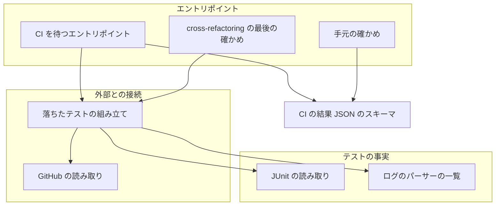
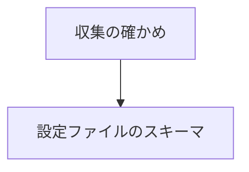
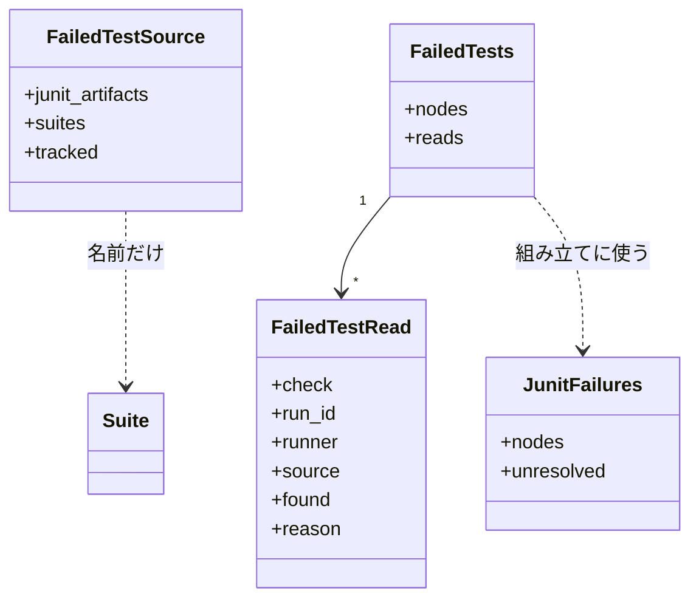
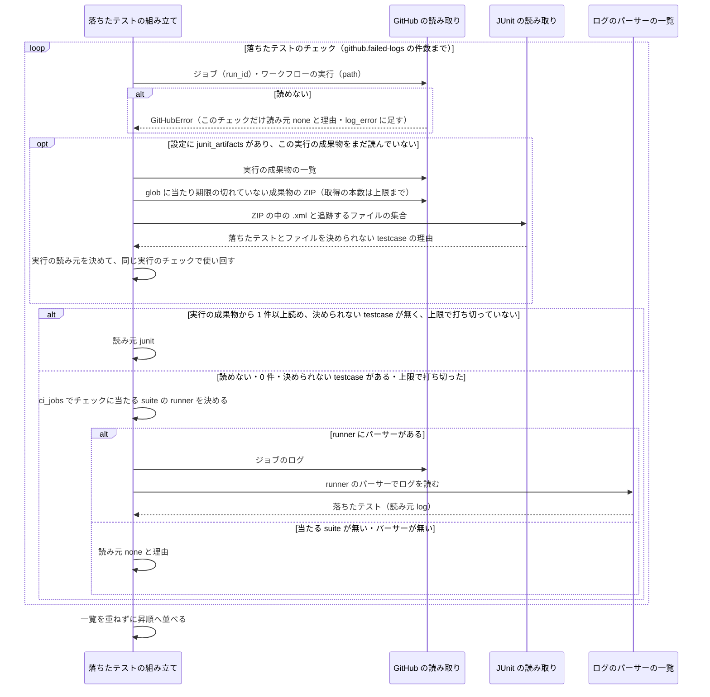
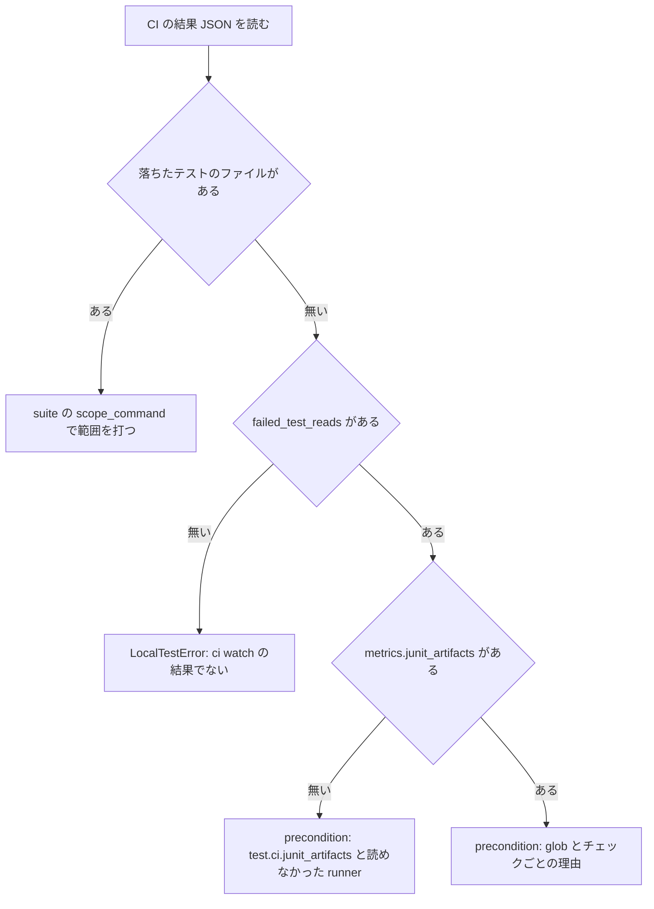

# ndf-next: どのランナーでも CI で落ちたテストを読み、収集の確かめの成功を suite ごとに宣言する（#3616）

## 目的

- **今どうなっているか**: ndf-next は CI で落ちたテストを pytest のログの行（`FAILED <パス>.py::<名前>`）からしか読まない。vitest・jest・PHPUnit・playwright のリポジトリでは落ちたテストの一覧が空になる。そのため、CI の修正の後に手元で確かめるステップが毎回 `precondition` で止まる。cross-refactoring の収集の確かめは、pytest の「収集が 0 件」を表す終了コード 5 をどのランナーでも成功と読む
- **誰に効くか**: pytest 以外のテストランナーを使うリポジトリで ndf-next の CI の修正のループを回す利用者
- **変えると何が成り立つか**: 設定ファイルで JUnit の成果物を指せば、どのランナーでも落ちたテストのファイルが分かり、CI の修正のループが人へ戻らずに回る。読めないときは、足すべき設定のキーが止まった理由に出る。収集の確かめは suite ごとに宣言した終了コードだけを成功と読む

## 適用範囲

- **働く範囲**: ndf-next（`plugins/ndf-next/`）。利用先のリポジトリでも、次の 3 つで働く。今の NDF（`plugins/ndf/`）は変えない
    - `ndf ci watch`
    - `ndf route test --failed-from`
    - cross-refactoring の収集の確かめと最後の確かめ
- **プロジェクトごとに違うもの**: 設定ファイル（`.ndf/project.json`）の次のキーで受ける。引数は増やさない
    - JUnit の成果物の名前: `test.ci.junit_artifacts`
    - チェックと suite の対応: `test.suites[].ci_jobs`
    - ログのパーサーの選択: `test.suites[].runner`
    - 収集の確かめで成功と読む終了コード: `test.suites[].collect_exit_codes`
- **当たるモード**: `standard`

代表のリポジトリで、直した後に CI の修正のループで何が起きるか（受け入れ条件 16）:

| 代表のリポジトリ | 落ちたテストの読み元 | CI の修正のループで起きること | ai-plugins だけの事情 |
| --- | --- | --- | --- |
| Web サービス（TypeScript・vitest か jest・`develop`→`main`・OpenAPI。実物は `/work/nd-factory`） | vitest・jest・playwright のログのパーサーは持たない。CI が JUnit の成果物を上げ、設定ファイルに `test.ci.junit_artifacts` を書けば成果物から読む。vitest は既定で testcase の `classname` に作業ディレクトリの根からの相対パスを書くため、そのまま読める。jest（jest-junit）と playwright は `addFileAttribute` を有効にすると `file` 属性が付き、読める | 成果物から読めれば、落ちたテストのファイルだけを suite の `scope_command` で打つ。読めなければ `precondition` で止まり、止まった理由に `test.ci.junit_artifacts` とログを読めなかった suite の `runner`（`vitest` など）が出る。テストを CI に寄せる設定（`test.ci.only`）のリポジトリ（`/work/nd-factory` が当たる）では手元で打つステップが無く、読めた一覧は CI の修正担当と同じ原因の数え上げへ渡る。`develop`→`main` と OpenAPI は読み方に影響しない | 無し |
| モバイルアプリ（Flutter か Swift） | Flutter・Swift のログのパーサーは持たない。CI が JUnit の成果物を上げ、`test.ci.junit_artifacts` を書けば成果物から読む | 成果物から読めればファイルだけを打つ。書いていなければ `precondition` で止まり、止まった理由に `test.ci.junit_artifacts` と suite の `runner` が出る。収集の確かめは `collect_command` を持つ suite だけに働き、持たなければ変わらない | 無し |
| 業務文書だけのリポジトリ | テストの suite もテストのチェックも無い | テストのチェックが無いため `test_failed` にならず、落ちたテストを読む処理は呼ばれない。今と変わらない | 無し |
| ai-plugins | suite `pytest`（`runner: pytest`、`ci_jobs: .github/workflows/pytest.yml`）のログを pytest のパーサーで読む。設定ファイルに `test.ci.junit_artifacts` は無い（CI は `pytest-junit-<分割>` を上げるが、`junit_family` が既定の `xunit2` で `file` 属性を持たない） | 今と同じ一覧を返す（受け入れ条件 7）。`test.ci.only` が真のため手元で打つステップは無い。設定ファイルに `collect_command` が無いため、収集の確かめは働かない | pytest の行の形は、`runner` が `pytest` の suite にだけ当てる。終了コード 5 は `src/` に持たず、ai-plugins が `collect_command` を足すときに同じ suite の `collect_exit_codes` へ書く |

## あるべき姿の根拠

| 根拠 | 種類 | 何を示すか |
| --- | --- | --- |
| STD1（JUnit XML の共通の形） | 外部の一次情報 | 落ちたテストは `<testcase>` の子の `<failure>` か `<error>` で表し、`<skipped>` は落ちに数えない。ランナーをまたいで読める唯一の共通の形である |
| STD2〜STD6（各ランナーの JUnit の出力） | 外部の一次情報・実測 | ファイルを書く場所はランナーごとに違う（testcase の `file`・testsuite の `file`・`classname`・testsuite の `name`）。絶対パスで書くランナーもある |
| PRD1（mikepenz/action-junit-report） | 外部の一次情報 | JUnit の属性から得たファイルの名前を、リポジトリのファイルと照らして解決する。`classname` を候補に使うかを選べる |
| 利用者の指摘（要求の「依頼（原文）」） | 利用者の指示の原文 | ai-plugins を開発する事情（pytest・終了コード 5）を、汎用に使う側の振る舞いへ持ち込まない |

要求と受け入れ条件は #3616 の本文にある（コピーは [issue-3616-requirements.md](issue-3616-requirements.md) ）。この文書は「どう作るか」だけを扱う。

## ドメインモデル

### コンテキスト

| コンテキスト | 何の語が 1 つの意味に決まるか |
| --- | --- |
| NDF の工程（`ndf-workflow`） | JUnit の成果物・ログのパーサー・落ちたテスト・落ちたテストのチェック・suite |
| cross-refactoring（`ndf-cross-refactoring`） | 収集の確かめ・許す終了コード |

コンテキストマップ:

| 上流 | 下流 | 関係 | 何を渡すか |
| --- | --- | --- | --- |
| NDF の工程 | cross-refactoring | 共有カーネル | suite の設定（`test.suites[]`）の形。両方が読み、同じ変更で形を変える |
| NDF の工程（供給者） | cross-refactoring（顧客） | 顧客と供給者 | 最後の確かめ（`final_gate`）が落ちたテストの組み立てを呼び、出力の型（落ちたテスト・読み取りの記録）を受け取る。型の形は NDF の工程が決め、cross-refactoring は形の変更を同じ変更のテストで受ける |

suite の設定の形と組み立ての出力の型のほかの語は、2 つのコンテキストで分けて持つ。

### 集約

| 集約 | 持ち主（書き換えてよいもの） | 根 | エンティティ | 値オブジェクト |
| --- | --- | --- | --- | --- |
| CI の結果（`ndf ci watch` の結果 JSON） | `ndf ci watch` のエントリポイント | 結果 JSON | — | 落ちたテスト（`<ファイル>::<名前>`）・読み取りの記録（チェックごとの読み元・件数・理由） |
| 設定ファイルの suite（`test.suites[]`） | 利用者（NDF は読むだけ） | suite | — | `runner`・`ci_jobs`・`collect_command`・`collect_exit_codes` |
| 手元の確かめの結果（`ndf route test --failed-from` の結果 JSON） | `ndf route test` | 結果 JSON | — | 打ったコマンドと合否・止まった理由 |

手元の確かめは CI の結果をファイルで受け取り、書き換えない（ほかの集約は識別子のファイルで参照する）。

### 不変条件

| # | 集約 | 条件 | 破れたときの扱い |
| --- | --- | --- | --- |
| I1 | CI の結果 | JUnit の成果物から読んだ要素のファイルは、作業ディレクトリが追跡するファイル（`git ls-files` が返す、根からの相対パス）のどれかである | ファイルを決められない testcase は一覧へ入れず、読み取りの記録に testcase の名前と足りない属性を残す |
| I8 | CI の結果 | ログから読んだ要素は、ログのパーサーが返した形のまま一覧へ入れ、追跡するファイルと照らさない（今の pytest の読み方と同じ一覧を返すため。受け入れ条件 7） | 照らす経路を作らない |
| I2 | CI の結果 | 落ちたテストの一覧は重ならず、昇順に並ぶ | 組み立てで集合にしてから並べる。破る経路を作らない |
| I3 | CI の結果 | `<skipped>` だけを持つ testcase と通った testcase は、落ちたテストに入らない | 一覧へ入れない |
| I4 | CI の結果 | ログのパーサーは、チェックに当たる suite の `runner` に登録されたものだけを当てる。当たる suite が無いか、`runner` にパーサーが無ければログを読まない | 一覧を空のままにし、読み取りの記録に理由を残す |
| I5 | CI の結果 | 成果物の取得の本数は、ログの取得と同じ上限（`limits.json` の `github.failed-logs` の件数）を超えない | 上限を超えた成果物は取得せず、その実行のチェックをログへ移し、読み取りの記録に上限で止めたことを残す |
| I6 | 手元の確かめの結果 | 落ちたテストのチェックがあるのに一覧が空なら、範囲のテストを打たずに `precondition` で止まる | テストのコマンドを 1 本も打たない |
| I9 | 手元の確かめの結果 | I6 で止まったときの止まった理由に、足すべき設定のキーか読めなかった理由が出る | 読み取りの記録から文を組む（決定 6） |
| I7 | 設定ファイルの suite | 収集の確かめは、suite の `collect_exit_codes` に入る終了コードだけを成功と読む | ほかの終了コードは `CollectError` で止める |
| I10 | 設定ファイルの suite | `collect_exit_codes` の無い suite の収集の確かめは、0 だけを成功と読む | 0 以外は `CollectError` で止める |

### ドメインイベント

| # | イベント | 発生元 | 受け手 |
| --- | --- | --- | --- |
| E1 | PR の CI でテストのチェックが落ちた | GitHub Actions | `ndf ci watch` |
| E2 | 落ちたテストのチェックのジョブを特定した | `ndf ci watch`（ジョブとワークフローの実行を読む） | 成果物の読み取り・ログの読み取り |
| E3 | JUnit の成果物から落ちたテストを読んだ | 成果物の読み取り | 落ちたテストの組み立て |
| E4 | ジョブのログから、ランナーのパーサーで落ちたテストを読んだ | ログの読み取り | 落ちたテストの組み立て |
| E5 | 落ちたテストの一覧を CI の結果 JSON へ書いた | `ndf ci watch` | `ndf route test --failed-from`・同じ原因の数え上げ（`ndf route repeat`）・CI の修正担当 |
| E6 | CI の修正の後、落ちたテストのファイルを suite の範囲のテストで打った | `ndf route test --failed-from` | プランの次のステップ |
| E7 | cross-refactoring の収集の確かめのコマンドが終わった | 収集の確かめ | 足したテストの判定 |

E3 と E4 の受け手の「落ちたテストの組み立て」は `ndf ci watch` の中の処理である。cross-refactoring の最後の確かめ（`final_gate`）も、E2〜E4 を同じ処理で通して落ちたテストを得る。

### 用語

| 用語 | 意味 | 用語集への反映 |
| --- | --- | --- |
| JUnit の成果物 | CI のジョブが上げた artifact のうち、JUnit の XML を持つもの。設定ファイルの `test.ci.junit_artifacts` が名前の glob で指す | 追加（要求のステップで反映した語。意味は変えない） |
| ログのパーサー | 1 つのテストランナーの CI のログの形から、落ちたテストの一覧を読む部品。suite の `runner` ごとに 1 つ | 追加（要求のステップで反映した語。意味は変えない） |
| 収集の確かめ | cross-refactoring が、足したテストを全体の実行が収集するかを suite の `collect_command` で確かめる工程。成功と読む終了コードは `collect_exit_codes` | 追加（要求のステップで反映した語。意味は変えない） |

## 外部の調査

| 種類 | 調べるか | 理由 |
| --- | --- | --- |
| 標準・仕様 | 調べる | 落ちたテストの共通の形として JUnit XML を読む。各ランナーがファイルをどこに書くかで、ファイルの決め方が変わる |
| 主要な製品 | 調べる | GitHub Actions で JUnit を読む製品が、ファイルの名前をどう解決しているかを比べる |
| ライブラリとサービス | 調べる | XML の読み取りを標準ライブラリで行うか、JUnit 用のライブラリを足すかを決める（要求の「前提とする取り決め」） |

### 標準・仕様

| # | 標準・仕様 | 何を定めているか | 設計への反映 | 出典 |
| --- | --- | --- | --- | --- |
| STD1 | JUnit XML の共通の形（testmoapp/junitxml） | `testsuites`→`testsuite`→`testcase` の入れ子。落ちは `<failure>`・`<error>`、飛ばしは `<skipped>` | 落ちの判定（前提 7・I3）と、testsuite が入れ子になる形を読む | https://raw.githubusercontent.com/testmoapp/junitxml/main/README.md （2026-11-15） |
| STD2 | vitest の JUnit レポーター | testsuite の `name` と testcase の `classname` の既定は作業ディレクトリの根からの相対パス。`addFileAttribute` で testcase に `file` が付く | `classname` をファイルの候補に入れる | https://raw.githubusercontent.com/vitest-dev/vitest/main/docs/guide/reporters.md （2026-11-15） |
| STD3 | jest-junit | testsuite の `name` の既定は `describe` の題、`classname` の既定は `{classname} {title}`。`addFileAttribute` の既定は `false` | 既定ではファイルを決められない。読み取りの記録に足りない属性を出す（受け入れ条件 4） | https://raw.githubusercontent.com/jest-community/jest-junit/master/README.md （2026-11-15） |
| STD4 | PHPUnit の JUnit のログ | testsuite と testcase に `file` 属性を書く。値はテストのファイルのパス（CI では作業ディレクトリの絶対パス） | 絶対パスを作業ディレクトリの根からの相対パスへ直す（受け入れ条件 3） | https://raw.githubusercontent.com/sebastianbergmann/phpunit/main/src/Logging/JUnit/JunitXmlLogger.php （2026-11-15。437〜445 行の `setAttribute('file', …)`） |
| STD5 | pytest の `--junitxml` | `junit_family` の既定は `xunit2`。`xunit1` は testcase に `file` と `line` を書き、`xunit2` は書かない。`classname` はドットで区切ったモジュール名 | `xunit2` ではファイルを決められず、ログのパーサーへ移る | https://docs.pytest.org/en/stable/reference/reference.html （2026-11-15）と実測（pytest 9.0.3 で `-o junit_family=xunit1` と `xunit2` を書かせた。下の実測の出力） |
| STD6 | playwright の JUnit レポーター | testsuite の `name` はテストのファイル（設定の置き場からの相対）。`addFileAttribute` で testcase に `fileRoot` からの相対の `file` が付く | testsuite の `name` を候補に入れ、作業ディレクトリのファイルの末尾と照らす | https://raw.githubusercontent.com/microsoft/playwright/main/docs/src/test-reporters-js.md （2026-11-15。444〜486 行） |
| STD7 | GitHub REST の Actions の API | ジョブの取得（`GET /actions/jobs/{id}` が `run_id` を返す。応答はワークフローの YAML のジョブの識別子を持たず、`name` は表示名）、ワークフローの実行の取得（`path` が `.github/workflows/build.yml@main` の形）、実行の成果物の一覧（`expired` を持つ）、成果物の取得（302 で転送、期限切れは 410） | チェックからワークフローのファイルを引き、`ci_jobs` と照らす。期限切れはログへ移る | https://docs.github.com/en/rest/actions/workflow-jobs ・ https://docs.github.com/en/rest/actions/workflow-runs ・ https://docs.github.com/en/rest/actions/artifacts （2026-11-15） |

pytest の実測（2026-11-15。`/work/ai-plugins/.venv/bin/python -m pytest -o junit_family=<形> --junitxml=<形>.xml tests`）:

```text
== xunit1
<testcase classname="tests.test_x" name="test_ng" file="tests/test_x.py" line="2" time="0.001">
<testcase classname="tests.test_x.TestC" name="test_m" file="tests/test_x.py" line="6" time="0.001">
== xunit2
<testcase classname="tests.test_x" name="test_ng" time="0.001">
<testcase classname="tests.test_x.TestC" name="test_m" time="0.001">
```

### 主要な製品

| # | 製品 | どう解いているか | 設計への反映 | 出典 |
| --- | --- | --- | --- | --- |
| PRD1 | mikepenz/action-junit-report | JUnit の `file`・`classname` から得た名前を、リポジトリのファイルを探して解決する。`classname` を使わない指定（`resolve_ignore_classname`）と、名前の書き換え（`transformers`）を持つ | 属性の候補を順に試し、作業ディレクトリのファイルと照らして解決する形に倣う。書き換えの設定は持たない | https://raw.githubusercontent.com/mikepenz/action-junit-report/main/README.md （2026-11-15） |
| PRD2 | dorny/test-reporter | ランナーごとの読み方（`reporter: jest-junit` など）を持ち、jest-junit には `suiteNameTemplate: "{filepath}"` の設定を求める | ランナーの事実は利用者の設定（CI のレポーターの設定）で揃えてもらい、NDF は足りない属性を知らせる | https://raw.githubusercontent.com/dorny/test-reporter/main/README.md （2026-11-15） |

### ライブラリとサービス

| # | 候補 | 版 | ライセンス | 最後のリリースの日付 | 終了のアナウンス | 要件を満たすか | 出典 |
| --- | --- | --- | --- | --- | --- | --- | --- |
| LIB1 | Python 標準ライブラリ `xml.etree.ElementTree` | Python 3.11 以上（作業の環境は 3.13.18・Expat 2.9.0） | PSF | Python に同梱 | 無し | 満たす。外部の実体を読まない。Expat 2.7.2 より前は「billion laughs」などの恐れがあると公式の文書が書く。ndf-next は `measure_ci.py` で同じ読み方を使っている | https://docs.python.org/3/library/xml.html （2026-11-15）・`python -c "import pyexpat; print(pyexpat.EXPAT_VERSION)"` |
| LIB2 | junitparser | 5.0.3 | Apache-2.0 | 2026-09-01 | 無し | 一部。JUnit の要素を型で読めるが、ファイルの解決（属性の候補・作業ディレクトリとの照合）は持たず、依存が 1 つ増える | https://pypi.org/pypi/junitparser/json （2026-11-15） |
| LIB3 | defusedxml | 0.7.1 | PSF | 2021-03-08 | 無し | 一部。安全な読み取りを足すが、最後のリリースから 5 年が過ぎ、依存が 1 つ増える | https://pypi.org/pypi/defusedxml/json （2026-11-15） |
| LIB4 | xunitparser | 1.3.4 | MIT | 2022-02-23 | 無し | 一部。unittest の結果へ写す形で、ファイルの属性を扱わない | https://pypi.org/pypi/xunitparser/json （2026-11-15） |

### 確かめられなかったこと

| 対象 | 試した手段 | 結果と理由 |
| --- | --- | --- |
| Flutter・Swift の CI で JUnit の XML を書く手段 | 試していない | 取得の試みを JUnit を読む側の事実に使った。NDF はランナーの事実を持たず、利用者が成果物を上げる設定に任せる（含まない「各リポジトリの CI に JUnit の成果物を上げるジョブを足すこと」）ため、設計の判断に要らない |
| jest-junit の `addFileAttribute` を有効にしたときの `file` の値が相対パスか絶対パスか | jest-junit の README を読んだ | README は属性を足すことだけを書き、値の形を書いていない。どちらの形でも同じ解決の規則で読む（下の決定 2） |

調べた量: 候補 13 件・取得の試み 16 回。

## 機能一覧

| # | 機能 | 誰が使うか |
| --- | --- | --- |
| F1 | 落ちたテストを、設定ファイルが指す JUnit の成果物から読む | `ndf ci watch` を回すプラン（CI の修正のループ）・cross-refactoring の最後の確かめ |
| F2 | 成果物で読めないとき、チェックに当たる suite の `runner` のログのパーサーでログから読む | 同上 |
| F3 | 落ちたテストを読めなかったとき、手元の確かめが足すべき設定のキーと理由を出して止まる | CI の修正のループの利用者 |
| F4 | 収集の確かめで、suite ごとに宣言した終了コードだけを成功と読む | cross-refactoring の利用者 |
| F5 | 設定ファイルのスキーマで、収集の確かめのキーの形を検査する | `ndf project check` の利用者 |

## 構成要素

| 要素 | 責務 |
| --- | --- |
| JUnit の読み取り（新設。`src/ndf/testing/junit.py`） | JUnit の XML 1 本と、作業ディレクトリが追跡するファイルの一覧から、落ちたテストの一覧と、ファイルを決められなかった testcase の理由を返す。純粋な処理（入出力を持たない） |
| ログのパーサーの一覧（新設。`src/ndf/testing/ci_logs.py`） | `runner` の名前 → ログのパーサーの対応を 1 か所に持つ。pytest のパーサーは、今の `adapters/ci.py` の pytest の行の正規表現をここへ移したもの。純粋な処理 |
| 落ちたテストの組み立て（変更。`src/ndf/adapters/ci.py`） | 落ちたテストのチェックごとに、ジョブ → ワークフローの実行 → 成果物とログを GitHub から読み、成果物を先に、読めなければログのパーサーで読む。チェックと suite の照合（`ci_jobs`）と、読み取りの記録の組み立てを持つ |
| GitHub の読み取り（変更。`src/ndf/adapters/github.py`） | ジョブ・ワークフローの実行・実行の成果物の一覧・成果物の ZIP の取得の 4 つの読み取りを足す |
| CI を待つエントリポイント（変更。`src/ndf/ci_cli.py`） | 作業場所の設定ファイルから JUnit の成果物の glob と suite を読み、作業ディレクトリの追跡するファイルと合わせて組み立てへ渡す。結果 JSON に読み取りの記録を載せる |
| 手元の確かめ（変更。`src/ndf/core/route/local_tests.py`） | 落ちたテストが空のとき、CI の結果 JSON の読み取りの記録から、足すべき設定のキーか読めなかった理由を止まった理由の文に組む |
| cross-refactoring の最後の確かめ（変更。`src/ndf/domains/crossrefactor/final_gate.py`） | 作業場所の設定ファイルを読み、落ちたテストの組み立てを CI を待つエントリポイントと同じ引数で呼ぶ |
| 収集の確かめ（変更。`src/ndf/domains/crossrefactor/collect.py`） | 終了コード 5 を成功に含む定数を外し、suite の `collect_exit_codes`（無ければ `[0]`）で判定する |
| 設定ファイルのスキーマ（変更。`contracts/schemas/declarations/project.schema.json`） | suite に `collect_command` と `collect_exit_codes` を足し、`test.ci.junit_artifacts` の説明を「書いたときだけ成果物を読む」に直す |
| CI の結果 JSON のスキーマ（変更。`contracts/schemas/io/ci.result.schema.json`） | `metrics` に `junit_artifacts` と `failed_test_reads` を足し、`test_failed` の結果では `failed_test_reads` を必須にする |
| 契約のページ（生成物。`docs/contracts/commands.md`・`docs/contracts/declarations.md`） | スキーマから `ndf check` が作り直す |
| 子の表（変更。`src/ndf/checks/children.json` と #1142 の本文） | この課題の子の行を足す（受け入れ条件 17） |

### 構成要素図

参照を読む関係だけを描く。生成物と子の表は図に含めない。

落ちたテストを読む側:



収集の確かめの側:



### 新設のモジュールの置き場

新設の 2 本は `ndf.testing` の下に置く。

- 子の表の持ち主の規則（`child-deps`）で、`ndf.testing` の持ち主は T1（#3286）に決まる
- `adapters`・`ci_cli`（AD1）と `crossrefactor`（M4）の先に要るものに、T1 がすでに入っている
- そのため、新しい子の行に `packages` を持たせずに import の向きの規則が通る
- 新設の 2 本は `ndf.adapters` を読まない（T1 の閉包に AD1 が無い）

## 構造

変更が触る型だけを描く。



| 型 | 置き場 | 責務 |
| --- | --- | --- |
| `FailedTestSource`（新設） | `adapters/ci.py` | 組み立ての入力。JUnit の成果物の glob（無ければ None）・テストの suite の並び（`runner` と `ci_jobs`）・作業ディレクトリが追跡するファイルの集合 |
| `FailedTests`（新設） | `adapters/ci.py` | 組み立ての出力。落ちたテストの一覧（I1・I2）と、チェックごとの読み取りの記録 |
| `FailedTestRead`（新設） | `adapters/ci.py` | チェック 1 件の読み取りの記録。ワークフローの実行の識別子・読み元（`junit`・`log`・`none`）・読めた件数・読めなかった理由 |
| `JunitFailures`（新設） | `testing/junit.py` | XML 1 本の読み取りの結果。落ちたテストの一覧と、ファイルを決められなかった testcase の理由の並び |

`failed_test_nodes_of(github, checks)` は `failed_tests_of(github, checks, source) -> FailedTests` に置き換える。`failed_test_nodes(log_text)` と正規表現 `_PYTEST_FAILED` は `adapters/ci.py` から消す（ログのパーサーの一覧へ移る）。

## データ構造

永続するのは設定ファイルと結果 JSON のキーだけで、時系列の記録は持たない（どちらも 1 回の実行の入力と出力で、上書きして過去を失う対象の履歴を持たない）。

設定ファイル（`.ndf/project.json`）の変わるキー:

| キー | 型 | 空を許すか | 意味 |
| --- | --- | --- | --- |
| `test.ci.junit_artifacts` | 文字列（glob） | 許す（キーを書かない・`null`） | JUnit の成果物の名前の glob（`fnmatch` の形。例: `junit-*`）。書いたときだけ成果物を読む。書かなければ成果物を読まず、ログだけを読む |
| `test.suites[].collect_command` | 文字列 | 許す | 収集の確かめのコマンド（今の読み手の形のまま。スキーマに無かったため足す） |
| `test.suites[].collect_exit_codes` | 整数の並び（1 個以上・重複なし） | 許す（キーを書かない） | 収集の確かめで成功と読む終了コード。書かなければ `[0]`。書くには `collect_command` が要る（`dependentRequired`） |

CI の結果 JSON（`ndf ci watch` が `test_failed` で止まったとき）の足すキー:

| キー | 型 | 空を許すか | 意味 |
| --- | --- | --- | --- |
| `metrics.junit_artifacts` | 文字列 | 許す（キーを置かない） | 読んだ設定の glob。設定に無ければキーを置かない（手元の確かめが止まった理由の文を選ぶ） |
| `metrics.failed_test_reads` | 読み取りの記録の並び | 許さない（`test_failed` のとき必ず置く。チェックが上限で切られたら、切られたチェックも `source: none` で並ぶ） | チェックごとの `check`（名前）・`run_id`（ジョブが属するワークフローの実行の識別子。ジョブを読めなければ `null`）・`runner`（当たる suite の `runner`。当たらなければ `null`）・`source`（`junit`・`log`・`none`）・`found`（読めた件数。読み元 `junit` なら実行の成果物から読めた件数）・`reason`（読めたときは空） |

`metrics.failed_tests`・`metrics.test_files`・`metrics.log_error` の形と意味は変えない（前提 2）。`log_error` はジョブを特定できない（E2 の失敗）チェックがあるときだけ置き、その理由を入れる（2 件以上なら `; ` でつなぐ）。そのチェックの読み取りの記録は `source: none`・`found: 0`・`reason` に同じ理由を持つ。ほかのチェックで読めた落ちたテストは一覧に残す。

機能とデータの対応:

| 機能 | 設定ファイル | CI の結果 JSON | 手元の確かめの結果 JSON |
| --- | --- | --- | --- |
| F1 成果物から読む | R | C | — |
| F2 ログから読む | R | C | — |
| F3 読めないとき止まる | — | R | C |
| F4 収集の確かめ | R | — | — |
| F5 スキーマの検査 | R | — | — |

移行は持たない（前提 1）。

## 入出力の契約

### `ndf ci watch`

| 項目 | 内容 |
| --- | --- |
| 入力 | 引数は変えない。作業場所から根へ探した設定ファイルの `test.ci.junit_artifacts` と `test.suites` を読む（設定ファイルが無い・読めないときは、glob も suite も無いとして読む） |
| 出力 | `test_failed` のとき、`metrics` に上の 2 つのキーが増える。ほかの結果は変えない |
| 失敗の形 | ジョブかワークフローの実行を読めない（`GitHubError`）とき、そのチェックだけを読み元 `none` にし、`reason` と `log_error` に理由を残す。ほかのチェックは読み続け、読めた落ちたテストを一覧に残す。成果物の一覧・成果物の取得・XML の読み取りの失敗はそのチェックをログへ移し、ログの取得の失敗はそのチェックの `reason` に残す。どれも止まった理由の種類（`test_failed`）を変えない |
| 互換性 | 互換の経路は持たない（前提 1） |

### `ndf route test --failed-from`

| 項目 | 内容 |
| --- | --- |
| 入力 | 変えない（CI の結果 JSON のファイル） |
| 出力 | 落ちたテストが空のときの `precondition` の止まった理由の文だけが変わる |
| 失敗の形 | 設定に glob が無い（`metrics.junit_artifacts` が無い）: `落ちたテストを読めない。JUnit の成果物を上げ、設定ファイルの test.ci.junit_artifacts に名前の glob を書く（ログを読めなかった suite の runner: vitest（チェック factory-check））`。glob がある: `JUnit の成果物（junit-*）とログのどちらからも落ちたテストを読めない: <チェックごとの reason>`。落ちたテストのチェックがある結果（`cause` が `test_failed`）に `metrics.failed_test_reads` が無ければ、`ndf ci watch` の結果ではないとして `LocalTestError`（入力の誤り）で止まる。CI の結果 JSON のスキーマも、`test_failed` の結果に `failed_test_reads` を必須にする |
| 互換性 | 互換の経路は持たない（前提 1） |

### 設定ファイルのスキーマ

`contracts/schemas/declarations/project.schema.json` の `Suite` に 2 つのキーを足す。検査は `ndf project check`（`contracts.schema_errors`）が今のまま行う。

```json
"collect_command": {"anyOf": [{"type": "string"}, {"type": "null"}], "default": null},
"collect_exit_codes": {"type": "array", "items": {"type": "integer"}, "minItems": 1, "uniqueItems": true}
```

`Suite` に `"dependentRequired": {"collect_exit_codes": ["collect_command"]}` を足す。JSON Schema の `integer` は真偽値を受けない（`true` は落ちる）。

## 処理の流れ

### 落ちたテストの組み立て

`ndf ci watch` と cross-refactoring の最後の確かめで同じ流れを通る。



### チェックと suite の照合

ワークフローの実行の `path` から `@` 以降を外したファイルを、テストの suite（`kind` が `test`）の `ci_jobs` の `#` より前と比べる。

| 当たる suite | 扱い |
| --- | --- |
| `runner` が 1 種類 | その `runner` のパーサーを当てる |
| 無い・`runner` が 2 種類以上 | ログを読まない |

`#` の後ろ（ジョブの識別子）は照合に使わない。ジョブの API の応答はジョブの識別子を持たない（STD7。応答の項目は `name`・`workflow_name`・`run_id` などで、`name` は表示名）。表示名と比べると、ジョブに `name:` を付けたワークフローで当たらなくなるためである。

### JUnit の読み取りのファイルの決め方

落ちた testcase ごとに、次の順で候補を試す。

1. testcase の `file`
2. 最も近い testsuite の `file`
3. testcase の `classname`
4. 最も近い testsuite の `name`

候補はバックスラッシュを `/` に、先頭の `./` を外して比べる。

| 候補と追跡するファイルの関係 | 使うファイル |
| --- | --- |
| 候補が追跡するファイルと一致する | そのファイル |
| 候補が追跡するファイルを末尾に持つ（`<何か>/<ファイル>`。絶対パスの場合） | 当たるうち最も長いファイル |
| 追跡するファイルが候補を末尾に持つ（`<何か>/<候補>`）ものが 1 つだけ | そのファイル |

どの候補でも決まらなければ、testcase の `classname` と `name`、試した属性を理由に残す。一覧の要素は `<ファイル>::<testcase の name>` である。

### 成果物の読み元を実行ごとに決める

成果物の読み元は、チェックごとではなくワークフローの実行ごとに決める。成果物は実行に付き、どの XML がどのジョブ（チェック）から上がったかは成果物の一覧から分からないためである。

- 実行の成果物から 1 件以上読め、決められない testcase が無く、ZIP の取得を上限で打ち切っていないとき、その実行を「成果物から読めた」とする。その実行の落ちたテストのチェックは、すべて読み元 `junit` になる
- 決められない testcase が 1 件でもある実行と、glob に当たる ZIP を上限で打ち切った実行は、成果物から読めた分を使わない。その実行の落ちたテストのチェックをすべてログへ移す（一部のファイルだけを打って、ほかの落ちを見落とさないため）。打ち切ったときは、上限で止めたことを `reason` に残す
- ログでも読めなければ、成果物の理由とログの理由の両方を `reason` に残す
- 読み取りの記録はチェックごとに 1 行で、`run_id` で同じ実行の行が分かる。読み元 `junit` の行の `found` は実行の成果物から読めた件数で、同じ実行の行は同じ値を持つ（行の間で足し合わせない）

### 手元の確かめ

`ndf route test --failed-from` は次の順に分かれる。



### 収集の確かめ

収集のコマンドの終了コードを、その suite の `collect_exit_codes`（無ければ `[0]`）と比べる。

| 終了コード | 扱い |
| --- | --- |
| `collect_exit_codes` に入る | 成功として出力を読む |
| 入らない | `CollectError` で止まる |

## 非機能の実現方式

| 大項目 | 要求の条件 | 実現方式 | 確かめ方 |
| --- | --- | --- | --- |
| 性能・拡張性 | 成果物の取得は、今のログの取得と同じ上限（`limits.json` の `github.failed-logs` の件数）に収める | 読むチェックの数と、ZIP を取得する本数の両方を `github.failed-logs` の件数で切る。実行ごとに成果物の一覧を 1 回だけ読み、同じ実行の分割ジョブで使い回す。ZIP の取得を上限で打ち切った実行は成果物から読めたと扱わず、その実行のチェックをログへ移す。1 本の成果物が 50 MiB を超えれば取得せず、その実行のチェックをログへ移す | 上限 + 1 本の成果物を持つ偽の GitHub で、取得の本数が上限で止まり、その実行のチェックが読み元 `log` になり、読み取りの記録に上限が残るテスト |
| 運用・保守性 | 止まった理由の文から、利用者が設定ファイルのどのキーを足せばよいかが分かる（受け入れ条件 10・11） | 止まった理由の文に、キーの名前（`test.ci.junit_artifacts`）か、書いた glob と読めなかった理由を入れる | 受け入れ条件 10・11 のテスト |

## 決定の記録

### 決定 1: ランナーをまたいで同じ形で読むため、落ちたテストは JUnit の成果物を先に、ログを後に読む

JUnit XML はどのランナーも書ける共通の形で（STD1〜STD6）、ログの形はランナーとレポーターの設定ごとに違う。成果物を先に読めば、ログのパーサーを持たないランナーでも、設定 1 行で落ちたテストが分かる。

成果物は設定に glob を書いたときだけ読む。名前の推測（今の所要時間の測定が使う名前の正規表現）を当てると、利用者の CI が上げた別の成果物を JUnit と読む恐れがある。要求も「設定ファイルに `test.ci.junit_artifacts` があれば」とする（前提 3）。

成果物だけを読み、ログを読まない形は採らない。ai-plugins のように JUnit にファイルの属性が無い CI でも、今の pytest の読み方で一覧が出ている（受け入れ条件 7）。

- 作り方: 標準に倣う
- 比べた候補: STD1 / STD2 / STD3 / STD4 / STD5 / STD6

根拠: Value 4 / Value 3（MVV 版 7）

### 決定 2: ランナーごとにファイルの書き場所が違うため、属性の候補を順に試し、作業ディレクトリが追跡するファイルと照らして決める

ファイルの書き場所はランナーごとに次のように分かれる（STD2〜STD6）。

| 書き場所 | 書くランナー |
| --- | --- |
| testcase の `file` | PHPUnit・pytest の `xunit1`・`addFileAttribute` を有効にした vitest・jest・playwright |
| testcase の `classname` | vitest の既定 |
| testsuite の `name` | playwright |

PHPUnit は CI の作業ディレクトリの絶対パスを書く。CI の作業ディレクトリの根は手元から分からないため、パスの末尾を追跡するファイルと照らす（PRD1 と同じ解き方）。末尾の照合で 2 つ以上が当たる短い候補は決めずに理由を残す。誤ったファイルを打つより、止まって設定を知らせる方が直しの費用が小さい。

ランナーごとに属性を決め打ちする形は採らない。ランナーの事実を NDF が持つことになり、レポーターの設定（`classnameTemplate` など）を変えた利用者で外れる。

- 作り方: 自前で作る・標準に倣う
- 比べた候補: PRD1 / PRD2 / LIB2 / STD1

根拠: Value 4 / Value 7（MVV 版 7）

### 決定 3: 依存を増やさずに読むため、JUnit の XML は標準ライブラリの `xml.etree.ElementTree` で読む

要るのは要素と属性の読み取りだけで、標準ライブラリで足りる。ndf-next は所要時間の測定（`measure_ci.py`）で同じ読み方を使っている。読むのは利用者の CI が上げた成果物で、取得の本数と大きさを上限で切る。Python の公式の文書は Expat 2.7.2 より前の版に実体の展開の恐れを書くが、作業の環境は Expat 2.9.0 である（LIB1）。

junitparser（LIB2）は要素を型で読めるが、難しいファイルの解決は持たず、依存が 1 つ増える。defusedxml（LIB3）は最後のリリースが 2021-03-08 で、xunitparser（LIB4）はファイルの属性を扱わない。

- 作り方: ライブラリやサービスを使う
- 比べた候補: LIB1 / LIB2 / LIB3 / LIB4

根拠: Value 12 / Value 2（MVV 版 7）

### 決定 4: 落ちたテストのチェックと suite を対応させるため、suite の `ci_jobs` とワークフローの実行のファイルを照らす

`ci_jobs` は「この suite が同じ検査を手元で走らせる CI のジョブ」として設定ファイルにすでにあり、利用者が書く。チェックの名前は GitHub の表示名で、ワークフローの YAML のジョブの識別子とも suite の名前とも一致するとは限らない。ジョブの API が返す `run_id` から実行の `path` を引けば、設定のファイルと 1 対 1 で照らせる（STD7）。

- **照らすのは `ci_jobs` のワークフローのファイル（`#` より前）だけである。** `#` の後ろのジョブの識別子は使わない。ジョブの API の応答にジョブの識別子が無い（応答の項目は `id`・`run_id`・`name`・`workflow_name` など。`name` は表示名）。表示名と比べる形では `name:` を付けたジョブで照合が外れ、今の pytest の読み方が退行する（受け入れ条件 7）
- **1 つのワークフローのファイルに `runner` の違う suite が当たるときは、ログを読まずに理由を残す。** 利用者がワークフローのファイルを分けて解く
- **API の呼び出しは、1 回の読み取りでジョブと実行の 2 回増える。** 成果物を読むにも実行の識別子が要るため、同じ呼び出しを使い回せる

チェックの名前で照らす形は採らない。分割（`pytest (0/2)`）や行列（`test (3.11)`）で名前が変わり、新しいキーを利用者に書かせることになる。

- 作り方: 標準に倣う
- 比べた候補: STD7

根拠: Value 4 / Value 11（MVV 版 7）

### 決定 5: ai-plugins の事情を汎用の振る舞いへ持ち込まないため、ログのパーサーはこの課題では pytest の 1 つだけを持つ

vitest・jest・PHPUnit・playwright・Flutter・Swift の落ちたテストは、決定 1 の JUnit の成果物で読める。ログの形はレポーターの設定で変わり、パーサーを足しても、利用者の設定によって読めない形が残る。パーサーの一覧は 1 か所の対応表にし、足すときに組み立ての処理を書き換えない（受け入れ条件 9）。pytest のパーサーを残すのは、今の pytest のリポジトリで一覧が出ている振る舞いを退行させないためである（受け入れ条件 7）。

5 つのランナーのログのパーサーをこの課題で揃える形は採らない。JUnit で同じ結果が得られるため、確かめる見本のログの分だけ費用が増える。

根拠: Value 2 / Value 11（MVV 版 7）

### 決定 6: 止まった理由の文の書き手を 1 つにするため、読み取りの記録は CI を待つ側が書き、手元の確かめはそれを読むだけにする

手元の確かめが設定ファイルを読み直すと、CI を待ったときの設定と食い違う経路ができる。CI を待つ側が読んだ glob と、チェックごとの読み元・理由を CI の結果 JSON に書き、手元の確かめはその記録から文を組む。CI の結果 JSON は、手元の確かめ・同じ原因の数え上げ・CI の修正担当がすでに受け取っているファイルである。

根拠: Value 8 / Value 11（MVV 版 7）

### 決定 7: 収集の確かめの成功の終了コードを suite ごとに宣言できるよう、キーを `collect_exit_codes` とし、`collect_command` と同じ suite の下に置く

成功の終了コードは収集のコマンドの事実で、コマンドと同じ suite に並べると読み手が 1 か所で読める。キーが無ければ `[0]` とし、`collect_command` の無い suite に書けばスキーマの検査で落とす（`dependentRequired`）。`collect_command` はスキーマに無いまま読み手だけが読んでいたため、同じ変更でスキーマへ足す。

`collect_command` を文字列からコマンドと終了コードの組の物へ変える形は採らない。今の読み手（`crossrefactor` の `cli.py`・`drive.py`）の読み方を変える範囲が広がる。

根拠: Value 4 / Value 8（MVV 版 7）

### 決定 8: 子の表の規則を新しい持ち主なしで通すため、新設のモジュールを `ndf.testing` の下に置き、子の行は `packages` を持たない

新設のモジュールの持ち主は、子の表の `packages` の最も長い一致で決まる。`ndf.testing` の下なら持ち主は T1（#3286）である。組み立てを読む `adapters`・`ci_cli`（AD1）と `crossrefactor`（M4）は、T1 を先に要るものにすでに持つ。子の行は記号 `AD4`・`packages: []`・`needs: ["AD1", "C3", "T1"]`・順番 6・レーン `lci-junit` とする。

`ndf.adapters` の下へ新しいモジュールを置く形は採らない。AD1 の閉包に新しい子を足すため、閉じた子の行（AD1）か開いた追補（AD1+）の順番と先に要るものを書き換えることになる。

根拠: Value 9 / Value 11（MVV 版 7）

## テスト設計

| 受け入れ条件・不変条件 | どの振る舞いで縛るか | どう壊したら落ちるべきか |
| --- | --- | --- |
| 1・I3 | 5 つのランナーの見本の XML（落ち・通り・飛ばしを含む）から、落ちたテストだけが `<ファイル>::<名前>` で返る。ランナーごとに 1 件。見本はファイルを決められる形で書かせる: vitest は既定、jest（jest-junit）と playwright は `addFileAttribute` を有効にした形、PHPUnit は既定、pytest は `junit_family=xunit1`。jest の既定と pytest の `xunit2` は受け入れ条件 4 の見本に使う | `<skipped>` を落ちに数える・`<error>` を落ちに数えない・通った testcase を入れると落ちる |
| 2 | 見本の XML の置き場に、実際に動かして書かせたか公式の文書の形かを書いたファイルがある | 見本の出所の記述が無い（レビューで見る。`.md` の文言のテストは書かない） |
| 3・I1 | `file` が絶対パス（PHPUnit の形）の testcase が、追跡するファイルの相対パスで返る | 絶対パスのまま返す・末尾の照合で短い方のファイルを選ぶと落ちる |
| 4・I1 | `file` も `classname` も testsuite の `name` もファイルに当たらない testcase（jest の既定・pytest の `xunit2`）は一覧へ入らず、理由に testcase の名前と試した属性が出る | 当たらない testcase を `classname` のまま一覧へ入れる・理由を空にすると落ちる |
| 5・I2 | 2 本の XML（分割ジョブ）に同じ落ちと別の落ちがあるとき、一覧が重ならず昇順になる | 並びを入力の順のまま返す・重ねると落ちる |
| 6 | 設定に glob があり、当たる成果物が無い（一覧が空・期限切れ・410）とき、ログのパーサーで読み、読み元が `log` になる | 成果物が無いときにログを読まない・`none` で止めると落ちる |
| 7・I8 | 今のテスト `tests/adapters/test_ci.py::test_failed_test_nodes_and_files_from_log` の入力のログを pytest のパーサーで読むと、今と同じ一覧が返る（テストは置き場を移しても入力と期待を変えない） | 正規表現を変えて `ERROR <パス>` を拾わないと落ちる |
| 8・I4 | `runner` が `vitest` の suite に当たるチェックのログに pytest の行が含まれても、一覧は空で、理由に `runner` が出る。当たる suite が無いときも読まない | パーサーが無いときに pytest のパーサーを当てると落ちる |
| 9 | パーサーの一覧へ試験用のパーサーを足すと、その `runner` の suite に当たるチェックのログが読まれる。組み立ての処理は書き換えない | 組み立てが `runner == "pytest"` で分岐すると落ちる |
| 10・I6・I9 | 一覧が空で `metrics.junit_artifacts` が無い CI の結果を渡すと、範囲のテストを打たずに `precondition` で止まり、理由に `test.ci.junit_artifacts` と記録の `runner` が出る | テストのコマンドを打つ・理由にキーを出さないと落ちる |
| 11・I9 | 一覧が空で glob がある CI の結果を渡すと、理由に glob とチェックごとの読めなかった理由が出る | glob か理由のどちらかを出さないと落ちる |
| 読み取りの記録の無い結果 | `test_failed` で `metrics.failed_test_reads` の無い CI の結果を渡すと、テストを打たずに `LocalTestError`（入力の誤り）で止まる。同じ結果は CI の結果 JSON のスキーマの検査でも落ちる | 記録が無いときに `precondition` の文で止める・スキーマで必須にしないと落ちる |
| 12・I7 | `collect_exit_codes: [0, 5]` の suite の収集のコマンドが 5 で終わると成功、`[0]` で 1 なら `CollectError` | 宣言を読まずに固定の集合で判定すると落ちる |
| 13・I10 | `collect_exit_codes` の無い suite で 5 が返ると `CollectError` | 既定に 5 を含めると落ちる |
| 14 | スキーマの検査で、`collect_exit_codes` の `["5"]`・`5`・`[1.5]`・`[true]`・`[]`・`collect_command` の無い suite の指定が落ち、`[0, 5]` が通る | `items` の型・`minItems`・`dependentRequired` を外すと落ちる |
| 15 | `grep -rnE "frozenset\(\{0, 5\}\)|COLLECT_OK" plugins/ndf-next/src` が 0 件（PR に結果を添える） | 定数を残すと当たる |
| 16 | 設計の「適用範囲」の表（この文書） | 設計レビューで見る |
| 17 | `ndf check` の規則 `child-deps` が、`AD4` の行を足した子の表で通る | 行の `needs` の順番が規則に合わないと落ちる |
| I5 | 上限 + 1 本の成果物を持つ実行で、取得する ZIP の本数が `github.failed-logs` の件数で止まる | 上限を数えずに全部を取得すると落ちる |
| E2 の失敗 | 2 つのチェックのうち 1 つのジョブの読み取りが `GitHubError` のとき、そのチェックは読み元 `none` で理由を持ち、`log_error` が置かれ、もう 1 つのチェックから読めた落ちたテストは一覧に残る。止まった理由の種類は `test_failed` のまま | 例外を外へ投げる・種類を変える・ほかのチェックの分を捨てると落ちる |
| 実行ごとの読み元 | 1 つの実行に落ちたテストのチェックが 2 つあり、一方の XML に決められない testcase があるとき、両方のチェックが読み元 `log` になる。決められない testcase が無ければ両方が `junit` で同じ `run_id` と `found` を持つ | チェックごとに読み元を決めて片方だけ `junit` にすると落ちる |
| cross-refactoring の最後の確かめ | 最後の確かめが組み立てに作業場所の設定（glob と suite）を渡す | 設定を渡さずに呼ぶと、JUnit の成果物から読む試験の偽の GitHub で一覧が空になる |

## 設計の結果

| 課題 | 扱い | 取り込み先 | 触るファイル |
| --- | --- | --- | --- |
| #3616 | 実装する | — | `plugins/ndf-next/src/ndf/testing/junit.py`（新設）、`plugins/ndf-next/src/ndf/testing/ci_logs.py`（新設）、`plugins/ndf-next/src/ndf/adapters/ci.py`、`plugins/ndf-next/src/ndf/adapters/github.py`、`plugins/ndf-next/src/ndf/ci_cli.py`、`plugins/ndf-next/src/ndf/core/route/local_tests.py`、`plugins/ndf-next/src/ndf/domains/crossrefactor/collect.py`、`plugins/ndf-next/src/ndf/domains/crossrefactor/final_gate.py`、`plugins/ndf-next/src/ndf/checks/children.json`、`plugins/ndf-next/contracts/schemas/declarations/project.schema.json`、`plugins/ndf-next/contracts/schemas/io/ci.result.schema.json`、`plugins/ndf-next/docs/contracts/commands.md`、`plugins/ndf-next/docs/contracts/declarations.md`、`plugins/ndf-next/tests/testing/test_junit.py`（新設）、`plugins/ndf-next/tests/testing/test_ci_logs.py`（新設）、`plugins/ndf-next/tests/adapters/test_ci.py`、`plugins/ndf-next/tests/adapters/test_ci_cli.py`、`plugins/ndf-next/tests/adapters/test_github.py`、`plugins/ndf-next/tests/route/test_commands.py`、`plugins/ndf-next/tests/domains/crossrefactor/test_added_tests_collected.py`、`plugins/ndf-next/tests/domains/crossrefactor/test_gate_and_probe.py`、`plugins/ndf-next/tests/domains/project/test_project_cli.py` |

見本の XML の置き場は `plugins/ndf-next/tests/testing/` の下に実装で決める（ファイルを足す置き場で、ほかの課題と重ならない）。#1142 の本文の子の表への行の追加は、リポジトリのファイルではなく課題の本文の書き換えで行う。

## 人へ残す判断

無し

## 未確認のまま残ること

| 項目 | 内容 |
| --- | --- |
| jest・playwright の `addFileAttribute` の値の形 | 相対パスか絶対パスかを公式の文書から確かめられなかった（外部の調査の「確かめられなかったこと」）。どちらでも決定 2 の照合で読める。実装で各ランナーを動かして見本を書かせたときに分かる |
| PHPUnit の CI での読み取り | リリース後テストで、JUnit の成果物を上げる PHPUnit のリポジトリ（`/work/carmo-system-console` の形）の CI の落ちを渡したときに、ファイルが決まるかで分かる（要求の「検証手段」） |
| ワークフローの実行の `path` の形 | 公式の文書の例は `.github/workflows/build.yml@main` で、`@` 以降を外して照らす。再利用ワークフロー（`workflow_call`）で呼ばれたジョブの実行の `path` が呼び出し元のファイルか呼ばれた側のファイルかは確かめていない。実装のテストで偽の応答を作るときではなく、リリース後テストで再利用ワークフローを持つリポジトリを読んだときに分かる |
| 開いている子 M4（#3298）との衝突 | この課題は M4 が持つ `crossrefactor` の `collect.py`・`final_gate.py` を直す。M4 のレーンが同じファイルを並行で直すと、後にマージする側で衝突を解く。子の表の書き手の規則は表（`tables`）だけを見るため、この衝突は検査に掛からない |
