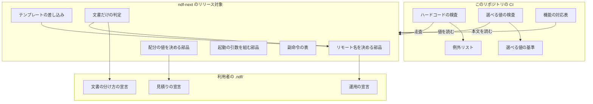
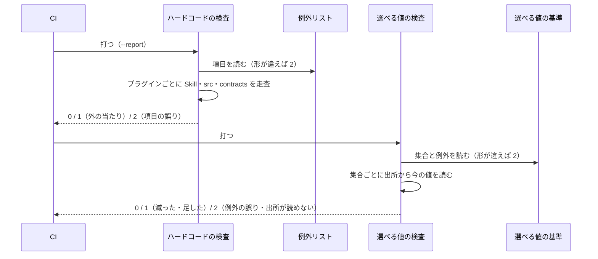
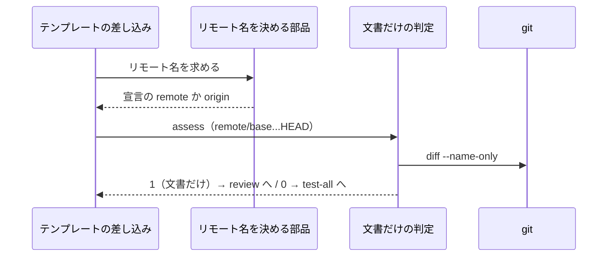
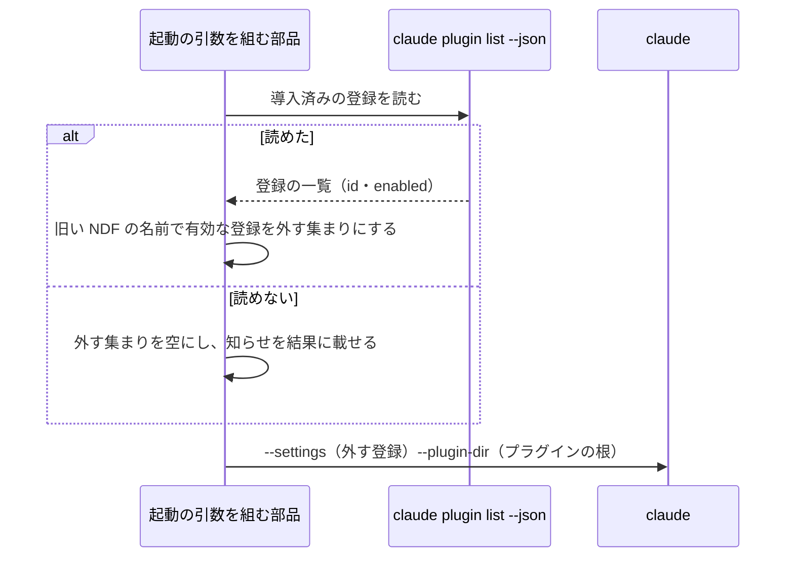

# ndf-next: ai-plugins の値を既定から外して設定で受け、ハードコードと選べる値の減少を CI で止める（#3617）

## 目的

- **今どうなっているか**: ndf-next（`plugins/ndf-next/`）の既定値・Skill の本文・同梱物に、ai-plugins だけの値が汎用の振る舞いとして入っている。リモート名 `origin` のハードコード、`.md` だけの差分を文書と決める判定、ai-plugins の実測の配分、登録名 `ndf@ai-plugins`、`devbasex` の例、機能の対応表などである。ハードコードを見つける今の検査は ndf-next の Skill を 1 本も走査していない
- **誰に効くか**: ai-plugins 以外のリポジトリで ndf-next を使う利用者と、ndf-next を開発する人
- **変えると何が成り立つか**: ai-plugins の値は ai-plugins の `.ndf/` にだけ置かれ、ほかのリポジトリは設定を書くか既定のまま使える。ハードコードが例外リストの外で増えるか、設定で選べる値が黙って減ると CI が落ちる

## 適用範囲

- **働く範囲**: ndf-next を使う利用先のリポジトリすべて。検査 2 つ（ハードコードの検査・選べる値の検査）はこのリポジトリの CI だけで働く
- **プロジェクトごとに違うもの**: 設定で受ける。リモート名は `.ndf/worktree.json` の `remote` で受ける。文書だけとみなすパスは `.ndf/project.json` の `docs`、配分の値は `.ndf/estimate.json` の `allocation_minutes` で受ける。外す旧い NDF の登録は、起動のときに導入済みの登録から読む
- **当たるモード**: `standard`

点検の一覧の直しの後に、代表のリポジトリで何が起きるか（受け入れ条件 24）。Web サービスは TypeScript・vitest か jest・develop→main・OpenAPI のリポジトリを指す。モバイルアプリは Flutter か Swift、業務文書だけは Markdown と表計算だけのリポジトリを指す。

| 点検 | Web サービス | モバイルアプリ | 業務文書だけ | ai-plugins だけの事情 |
| --- | --- | --- | --- | --- |
| 7 ハードコードの検査 | 何も起きない（このリポジトリの CI だけで働く） | 同左 | 同左 | ndf-next の Skill 49 個・`src/`・`contracts/` を走査し、例外リストの外で増えると CI が落ちる |
| 10 リモート名 | 設定が無ければ `origin` のまま。フォークの運用で `upstream` を書けば取得・照合・差分の基準が `upstream` になる | 同左 | 同左 | 設定を書かない（`origin` を使う） |
| 11 文書だけの差分 | 設定が無ければ `.md` だけの差分で全体テストとリファクタリングを飛ばす。`openapi/*.yaml` を文書にしたいときは `docs.files` に書く | 設定が無ければ `.md` だけで飛ばす | `.md` だけの差分が多く、設定が無くても飛ばす。表計算を文書にするなら `docs.files` に足す | Skill とエージェントの本文（`.md`）は振る舞いなので、`.ndf/project.json` の `docs.behavior` に書く。書いた後は Skill の変更で全体テストを飛ばさない |
| 13 配分の値 | 履歴が無い間は初期値で配分する。実測が溜まれば履歴の値を使う。初期値が合わなければ `.ndf/estimate.json` に書く | 同左（ビルドの長いテストなら初期値を上書きする） | cross-refactoring を回さないため何も起きない | 初期値の出所は ai-plugins の実測（#917）であることが、初期値のファイルに書かれる |
| 14 旧い NDF の登録 | 旧い NDF を入れていなければ何も外さない。入れていればその登録名で外す | 同左 | 同左 | `ndf@ai-plugins` も導入済みの登録から見つけて外す（今と同じ結果） |
| 15 リリースの workflow の既定 | 影響しない（ai-plugins の workflow） | 同左 | 同左 | `.ndf/worktree.json` に `develop`・`main` があるため結果は変わらない。宣言が無いときは GitHub の既定ブランチを使う |
| 16 `--admin` のマージ | 迂回の宣言と ruleset が無ければ迂回しない（Skill の本文が既定として案内しない） | 同左 | 同左 | 迂回の宣言があるため今と同じく迂回でマージする |
| 17 「（ai-plugins）」の表記 | 汎用の表の行を、自分の場合として読める | 同左 | 同左 | 表の行の中身は変わらない |
| 18 機能の対応表 | 導入先に対応表と注記が届かない | 同左 | 同左 | 対応表は `scripts/ndf-next-parity/` で開発に使い続ける |
| 19 開発の副命令 | `ndf --help` に `check`・`manifests` が出ない。hook の登録と起動は今と同じ | 同左 | 同左 | CI は今と同じく `bin/ndf check` を打つ |
| 20 `devbasex` の例 | 例が `<owner>`・`<owner>/<repo>` で、自分の値へ読み替えられる | 同左 | 同左 | — |

## あるべき姿の根拠

| 根拠 | 種類 | 何を示すか |
| --- | --- | --- |
| STD1（The Twelve-Factor App の Config） | 外部の一次情報 | デプロイごとに変わる値はコードから分けて置く |
| STD2（git clone の `clone.defaultRemoteName`） | 外部の一次情報 | git 自身がリモート名の既定を `origin` とし、設定と引数で変えられる |
| STD3（Claude Code の `claude plugin list --json`） | 外部の一次情報 | 導入済みのプラグインの登録（`name@marketplace`）と有効かを、文書化された形で読める |
| PRD1（GitHub Actions の `paths-ignore`） | 外部の一次情報 | 「変えたファイルがすべて当たれば飛ばす」を、利用者が書く glob で受ける |
| LIB1（detect-secrets の baseline） | 外部の一次情報 | 既知の検出を記録し、新しい検出だけで落とす形が広く使われている |
| `check-skill-repo-assumptions.py --report` の実測（2026-11-15） | 実測 | ndf-next の行が「公開する Skill 0 個 / ヒット 0 件」。`skills/` には Skill のディレクトリが 49 個ある（数え方は末尾の「Skill の数え方」） |
| 依頼の原文「ai-plugins(ndf) を開発することと、ndf を使って様々な開発を汎用的に進行することの区別がついていない設計が入り込んでしまう」 | 利用者の指示の原文 | ai-plugins の値を ndf-next の既定に置かない |

要求と受け入れ条件は #3617 の本文にある（コピーは [issue-3617-requirements.md](issue-3617-requirements.md) ）。この文書は「どう作るか」だけを扱う。
決定の記録は [issue-3617-design-decisions.md](issue-3617-design-decisions.md) に分けた。

## ドメインモデル

### コンテキスト

| コンテキスト | 何の語が 1 つの意味に決まるか |
| --- | --- |
| NDF 自身の開発の検査（このリポジトリの CI だけで働く） | ハードコード・例外リスト・選べる値の基準・機能の対応表 |
| NDF の開発ワークフロー（`ndf-workflow`。利用者のリポジトリで働く ndf-next の部品） | 設定で選べる値・リモート名・文書だけとみなすパス・配分の初期値・副命令 |

コンテキストの関係: NDF 自身の開発の検査は、ndf-next のリリース対象（Skill・`src/`・`contracts/`）を読むだけで、書き換えない。ndf-next の部品からも呼ばれない。ndf-next の部品は、検査・例外リスト・選べる値の基準・機能の対応表を読まない。読む向きは検査から ndf-next への 1 方向だけである。機能の対応表を `scripts/` へ移す（決定 10）のは、対応表を NDF 自身の開発の側へ戻し、この 1 方向を保つためである。

用語集の上では、2 つのコンテキストの語をどちらも `ndf-workflow` の区分に載せる。用語集に NDF 自身の開発だけの区分が無いためで、区分を足すかは用語集の側の課題とする。

### 集約

| 集約 | 持ち主（書き換えてよいもの） | 根 | エンティティ | 値オブジェクト |
| --- | --- | --- | --- | --- |
| 例外リスト（ハードコードの検査） | 開発者（PR で 1 項目 1 ファイルを足す・減らす）。検査は読むだけ | 例外リスト | 項目（ファイル・語・種類） | 件数・理由・受け持ちの Issue の番号 |
| 選べる値の基準 | 開発者（PR で `scripts/ndf-choices.json` を直す）。検査は読むだけ | 基準 | 集合（取り込み方の表の行・delivery の種類・リリースの形） | 値の出所・値・減らす例外（値・Issue の番号・理由） |
| 運用の宣言（`.ndf/worktree.json`） | 利用者 | 運用の宣言 | — | リモート名（`remote`） |
| 文書の分け方の宣言（`.ndf/project.json` の `docs`） | 利用者 | 文書の分け方 | — | 文書のパス（`files`）・振る舞いの文書のパス（`behavior`） |
| 見積りの宣言（`.ndf/estimate.json`） | 利用者 | 見積りの宣言 | — | 配分の値（`allocation_minutes`。種類ごとの分） |
| Claude Code の起動の引数 | 起動の引数を組む部品（`adapters/claude.py` の `plugin_args`） | 起動の引数 | — | 外す登録の集まり・読めなかったことの知らせ |
| 副命令の表（`cli.py`） | ndf-next の開発者（PR で行を足す・隠す） | 副命令の表 | 副命令 | 利用者向けか NDF 自身の開発のものか |
| リリース対象の同梱物（`plugins/ndf-next/`） | ndf-next の開発者。ハードコードの検査は読むだけ | リリース対象 | ファイル | — |

宣言の 3 つは利用者が書き、ndf-next は読むだけである。既定は宣言の外の 1 か所（スキーマの `default` か初期値のファイル）が持つ。

### 不変条件

| # | 集約 | 条件 | 破れたときの扱い |
| --- | --- | --- | --- |
| I1 | 例外リスト | ndf-next の Skill・`src/`・`contracts/` のハードコードは、（ファイル・語）ごとに例外リストの件数以下である | 終了コード 1。超えた組のファイル・行・語を出す |
| I2 | 例外リスト | 項目は理由と 1 以上の件数を持ち、件数は実際の当たり数と等しい。他レーンが受け持つ項目（種類 `pending`）は Issue の番号を持つ | 終了コード 2。項目のファイルと欠けた鍵か差を出す |
| I3 | 例外リスト | `plugins/ndf/skills` と `plugins/playwright-kit/skills` の走査の件数・当たり・宣言の外の件数は、走査を広げても変わらない | 単体テストが落ちる |
| I4 | 選べる値の基準 | 基準の各集合の値は、減らす例外に載った値を除いて、今のコントラクトにすべてある | 終了コード 1。集合と減った値と、足せば通る例外の行を出す |
| I5 | 選べる値の基準 | 減らす例外は Issue の番号と理由を持ち、その値は今のコントラクトに無い | 終了コード 2。例外の行と欠けた鍵か、まだある値を出す |
| I6 | 選べる値の基準 | 今のコントラクトの値は、基準の集合にすべてある | 終了コード 1。足した値と、基準へ足す行を出す |
| I7 | 運用の宣言 | ndf-next の取得・照合・差分の基準・送信が使うリモート名は、宣言の `remote` か、無ければスキーマの既定である | 単体テストが落ちる |
| I7a | 運用の宣言 | リモート名の既定の文字列（`origin`）は、`worktree.schema.json` の `remote` の `default` の 1 か所だけにある。コードとコントラクトのほかの場所にリモート名の文字列を書かない（JSON Schema の `default` の値は語 `remote-origin` の走査の外。決定 2） | ほかの場所はハードコードの検査（語 `remote-origin`）が落ちる。`default` が 2 か所以上か 0 か所なら検査が終了コード 2 で落ちる |
| I8 | 文書の分け方の宣言 | 文書だけの差分は、変えたファイルが 1 件以上あり、すべて `docs.files`（既定 `**/*.md`）に当たり、`docs.behavior`（既定は無し）に 1 件も当たらない差分である | 単体テストが落ちる |
| I8a | 文書の分け方の宣言 | 全体テストとリファクタリングを飛ばす判定（テンプレート `check` の `assess`）と工程の条件は、I8 の 1 つの判定を呼び、判定を別に持たない | 宣言 `docs` を書いた入力で、`assess` と工程の条件の結果が食い違うと単体テストが落ちる |
| I9 | 見積りの宣言 | 配分の値は、種類ごとに宣言の値、無ければ初期値のファイルの値である。初期値のファイルは、値が初期値であることと出所を持つ | 宣言の形はスキーマが確かめ、違えば宣言を読む部品が止まって直す鍵を示す（判断の部品は値を重ねるだけ） |
| I10 | 起動の引数 | 外す登録は、導入済みで有効な登録のうち旧い NDF の名前を持ち、プラグインの根の名前と違うものだけである | 単体テストが落ちる |
| I10a | 起動の引数 | 導入済みの登録の一覧が読めなければ、外す登録を空にして起動し、読めなかったことを結果に残す | 単体テストが落ちる（止まる・知らせが無いのどちらでも） |
| I11 | 副命令の表 | 利用者向けの副命令の一覧（`ndf --help`）に `check`・`manifests` が無い | 単体テストが落ちる |
| I11a | 副命令の表 | `check`・`manifests` は、名前で呼べば今と同じく動く | 単体テストと CI の `bin/ndf check` が落ちる |
| I12 | リリース対象の同梱物 | リリース対象（`plugins/ndf-next/`）に機能の対応表のファイル・その注記・そのリンクが無い | ハードコードの検査（語 `parity-table`）が落ちる |

### ドメインイベント

| # | イベント | 発生元 | 受け手 |
| --- | --- | --- | --- |
| E1 | 開発者が ndf-next のファイルを変えた PR を出した | 開発者の push | CI（ハードコードの検査・選べる値の検査） |
| E2 | CI が ndf-next の Skill・`src/`・`contracts/` のハードコードを数えた | ハードコードの検査 | 例外リストとの照合 |
| E3 | 例外リストの外のハードコードが見つかり、CI が落ちた | ハードコードの検査 | PR の作者 |
| E4 | CI が設定で選べる値を数え、基準の集合と比べた | 選べる値の検査 | 基準との照合 |
| E5 | 選べる値が減り、Issue の番号のある例外が無いため、CI が落ちた | 選べる値の検査 | PR の作者 |
| E6 | 利用者のリポジトリで ndf が `.ndf/` の設定を読んだ | ndf の副命令 | リモート名・文書の分け方・配分の値を決める部品 |
| E7 | ndf がリモート名・文書だけとみなすパス・配分の値を、設定か既定から決めた | 値を決める部品 | テンプレートの差し込み・差分の分類・配分 |
| E8 | ndf が Claude Code を起動するとき、導入されている登録を読み、外す登録を決めた | 起動の引数を組む部品 | `claude` の起動（`--settings`） |

### 用語

| 用語 | 意味 | 用語集への反映 |
| --- | --- | --- |
| ハードコード | 要求の語と用語集の語をそのまま使う（ai-plugins 固有の名前を、設定から読まずにコード・コントラクト・Skill の本文へ直接書くこと） | 無し（既にある） |
| 副命令 | `bin/ndf <名前>` の `<名前>`。要求の「サブコマンド」と同じものを指す。用語集の ndf-next の語に合わせて、この文書は「副命令」と書く | 無し（既にある） |
| リモート名 | ndf が取得・照合・差分の基準・送信に使う git のリモートの名前。`.ndf/worktree.json` の `remote` に書き、省けば `origin` | 追加 |
| 選べる値の基準 | 設定で選べる値の集合ごとに、出所と値の一覧を持つファイル（`scripts/ndf-choices.json`）。値を減らすときは Issue の番号と理由を持つ例外を足す | 追加 |
| 機能の対応表 | 旧いプラグインの機能 1 つを 1 行に持ち、行き先の子・作らない理由・試走の結果を持つ表。置き場は NDF 自身の開発の `scripts/ndf-next-parity/features.json` で、ndf-next のリリース対象に置かない | 意味の変更 |

## 外部の調査

| 種類 | 調べるか | 理由 |
| --- | --- | --- |
| 標準・仕様 | 調べる | 設定をコードから分ける原則と、git・Claude Code の既定の名前と登録の読み方に一次の定めがある |
| 主要な製品 | 調べる | 「文書だけの変更で処理を飛ばす」を主要な CI がどの形で受けるかを比べる |
| ライブラリとサービス | 調べる | ハードコードの検査と例外リストを自前で持つか、既存の検出のツールを使うかを決める |

### 標準・仕様

| # | 標準・仕様 | 何を定めているか | 設計への反映 | 出典 |
| --- | --- | --- | --- | --- |
| STD1 | The Twelve-Factor App「III. Config」 | "strict separation of config from code"。"Config varies substantially across deploys, code does not." | 利用先ごとに変わる値（リモート名・文書のパス・配分）を宣言で受け、コードに置かない | https://12factor.net/config （2026-11-15） |
| STD2 | git clone の `--origin` と `clone.defaultRemoteName` | 既定のリモート名は "Defaults to `origin`"。設定と `--origin` で変えられ、引数が設定より先に効く | 既定は `origin`、宣言で変えられる形にする | https://git-scm.com/docs/git-clone （2026-11-15） |
| STD3 | Claude Code の `claude plugin list --json` | 導入済みのプラグインを JSON で出す。各要素は `id`（"`name@marketplace` for installs"）・`version`・`scope`・`enabled`・`installPath` を持つ | 外す旧い NDF の登録を、この一覧の `id` と `enabled` から決める | https://code.claude.com/docs/en/plugins/cli-reference （2026-11-15） |

### 主要な製品

| # | 製品 | どう解いているか | 設計への反映 | 出典 |
| --- | --- | --- | --- | --- |
| PRD1 | GitHub Actions の `paths-ignore` | "When all the path names match patterns in `paths-ignore`, the workflow will not run."。パターンは `*` と `**` の glob | 文書だけの差分を「変えたファイルがすべて文書のパスに当たる」で決め、パスは利用者が glob で書く | https://docs.github.com/en/actions/writing-workflows/workflow-syntax-for-github-actions （2026-11-15） |

### ライブラリとサービス

| # | 候補 | 版 | ライセンス | 最後のリリースの日付 | 終了のアナウンス | 要件を満たすか | 出典 |
| --- | --- | --- | --- | --- | --- | --- | --- |
| LIB1 | detect-secrets | 1.5.0 | Apache-2.0 | 2024-05-06 | 無し | 一部。baseline で既知の検出を記録し新しい検出だけで落とす形は同じ。検出は秘密の値に限られ、名前の語の一覧・（ファイル・語）ごとの件数・受け持ちの Issue の番号を持てない | https://github.com/Yelp/detect-secrets ・ https://pypi.org/pypi/detect-secrets/json （2026-11-15） |
| LIB2 | betterer | 6.0.0-alpha.1（npm の latest） | MIT | 確かめられなかった | 無し | 満たさない。JavaScript の実行環境を足すことになり、latest が先行版である | https://github.com/phenomnomnominal/betterer ・ https://registry.npmjs.org/@betterer/cli/latest （2026-11-15） |
| LIB3 | semgrep | 1.185.0 | LGPL-2.1-or-later | 2026-11-10 | 無し | 満たさない。語の一致だけの検査に対して依存が大きく、例外の件数と Issue の番号の持ち方は自前で足すことになる | https://pypi.org/pypi/semgrep/json （2026-11-15） |
| LIB4 | pathspec（ndf-next が既に依存） | 1.1.1 | MPL-2.0 | 2026-04-27 | 無し | 満たす。`docs.files`・`docs.behavior` の glob の照合に使える | https://pypi.org/pypi/pathspec/json ・ `plugins/ndf-next/pyproject.toml`（2026-11-15） |

### 確かめられなかったこと

| 対象 | 試した手段 | 結果と理由 |
| --- | --- | --- |
| `enabledPlugins` の鍵の形（`name@marketplace` が鍵か） | https://code.claude.com/docs/en/settings ・ https://code.claude.com/docs/en/settings-reference | 取得できた（HTTP 200）が、項目の本体に鍵の形の記述が見つからなかった。今の `--settings '{"enabledPlugins":{"ndf@ai-plugins":false}}'` の形をそのまま使い、実機の確認はリリース後テストで行う |
| betterer の「記録と比べて悪化したら落ちる」仕組みの原文 | https://github.com/phenomnomnominal/betterer | README に仕組みの記述が無かった。ドキュメントのサイトは取得していない（上限ではなく、要件を満たさないと分かったため） |
| `claude plugin list --json` の所要時間 | 試していない | 起動ごとに 1 回打つ費用は実装で測る（「未確認のまま残ること」） |

調べた量: 候補 8 件・取得の試み 13 回。

## 機能一覧

| # | 機能 | 誰が使うか |
| --- | --- | --- |
| F1 | ndf-next のハードコードを数え、例外リストの外で増えたら落とす | ndf-next の開発者（CI） |
| F2 | 設定で選べる値を数え、基準から減るか基準に無い値が増えたら落とす | ndf-next の開発者（CI） |
| F3 | リモート名を設定で変える | 利用者 |
| F4 | 文書だけとみなすパスを設定で変える | 利用者 |
| F5 | 配分の値を設定で上書きする | 利用者（cross-refactoring） |
| F6 | 起動のときに、導入済みの旧い NDF の登録を外す | 利用者（Skill を回す起動） |
| F7 | 利用者向けの Skill の本文と副命令の一覧から、ai-plugins の事情と NDF 自身の開発のものを外す | 利用者 |

## 構成要素

| 要素 | 責務 |
| --- | --- |
| ハードコードの検査（`scripts/check-skill-repo-assumptions.py`） | 走査の対象を、Skill の一覧（`manifests/*-skills.txt` か `manifests/skills.json`）と、ndf-next の形のプラグインの `src/`・`contracts/`・`hooks/*.py` へ広げる。ndf-next の形のプラグインにだけ、追加の語（`repo-name`・`org-name`・`marketplace-entry`・`remote-origin`・`parity-table`）を当てる |
| 例外リスト（`scripts/repo-assumptions-allow/`） | ndf-next の今の当たりを、他レーンの受け持ち（種類 `pending`・Issue の番号つき）と、違反でないもの（種類 `not-a-violation`）として 1 項目 1 ファイルで持つ |
| 選べる値の検査（`scripts/check-ndf-choices.py`、新設） | 基準のファイルの集合ごとに出所から今の値を読み、I4〜I6 を照らす |
| 選べる値の基準（`scripts/ndf-choices.json`、新設） | 集合の出所・値・減らす例外を持つ |
| リモート名を決める部品（`adapters/git.py`） | 宣言の `remote` を読み、無ければスキーマの既定を返す。今の名前 `ORIGIN` は、#3615 が受け持つリリースの部品のために名前だけ残し、値はスキーマの既定から読む（決定 5）。`Git` の取得・照合・送信はリモート名を引数で受ける |
| テンプレートの差し込み（`contracts/templates/params.json`・`core/route`） | 差し込み `{{remote}}` を足し、`derived` がリモート名を決める部品から補う |
| 文書だけの判定（`progress/command.py`） | 文書だけの差分の判定を 1 つにし、全体テストとリファクタリングを飛ばす手順（テンプレート `check` の `assess`）がこれを副命令 `progress` の下で呼ぶ。振る舞いの文書の既定を空にする |
| 配分の値を決める部品（`domains/crossrefactor/allocation_decide.py`、新設） | 初期値のファイルと宣言の `allocation_minutes` を重ねた配分の値を返す |
| 起動の引数を組む部品（`adapters/claude.py`） | `claude plugin list --json` の一覧から外す登録を決める |
| 副命令の表（`cli.py`） | 利用者向けの副命令と、NDF 自身の開発の副命令（`check`・`manifests`）を分け、使い方の表示には利用者向けだけを出す |
| 機能の対応表（`scripts/ndf-next-parity/`、移す） | 対応表・その読み手・試走の判定を、リリース対象の外で持つ。読み手と試走の判定は、プラグインの根を引数で受ける（「機能の対応表の読み手」） |
| リリースの workflow（`.github/workflows/ndf-next-release.yml`） | 宣言に無いときのベースブランチと本番ブランチを、GitHub の既定ブランチで補う |
| ai-plugins の宣言（`.ndf/project.json`） | ai-plugins の振る舞いの文書のパスを `docs.behavior` に持つ |



リリースの workflow・ai-plugins の宣言・副命令の表と起動の引数の外部（`claude`）は図に入れない（読む相手が利用者の `.ndf/` でも検査でもない）。

## 処理の流れ

### ハードコードの検査と選べる値の検査（CI）



### リモート名と文書だけの判定（利用者のリポジトリ）



### Skill を回す起動（利用者の環境）



処理の流れの図に入れない要素: 配分の値を決める部品（呼び手は M4 が作る）・副命令の表・機能の対応表・リリースの workflow・ai-plugins の宣言。いずれも呼び出しの順序を変えない置き換えである。

### 機能の対応表の読み手

対応表を読むのは 3 つだけである。対応表の読み手（`table.py`）・試走の判定（`trial/probe.py`）・対応表と Skill の一覧の一致を見るテスト（`test_skill_table.py`）である。`ndf check` の規則（I2・移しの印・子の表の `child-deps`）は対応表を読まない。

```console
$ grep -rn 'parity\|features.json' plugins/ndf-next/src/ndf --include=*.py | grep -v '^plugins/ndf-next/src/ndf/parity/'
（出力なし）
$ grep -rn 'features\|parity' plugins/ndf-next/src/ndf/checks/*.py plugins/ndf-next/src/ndf/checks/rules.json
（出力なし）
$ grep -n 'parity' plugins/ndf-next/src/ndf/checks/children.json
9:    "X3": {"issue": 3406, "packages": ["ndf.parity"], "needs": ["X0"], "order": 2, "lane": "lrebuild", "closed": true},
```

`ndf check` と対応表のつながりは、子の表の `X3` の `packages` にある `ndf.parity` の 1 か所だけである。これはパッケージの持ち主を表す行で、対応表の中身は読まない。移すときにこの行から `ndf.parity` を外す（決定 10）ので、`ndf check` はリリース対象の外のパスを読まず、I12 にも当たらない。名前を入れ替えた一時コピーの中でも、`ndf check` が読むのはコピーの中の `children.json` だけである。

移した 3 つは、プラグインの根を引数で受ける。既定は、移した先から見たリポジトリの根の `plugins/ndf-next/` とする。テストは ndf-next の依存の環境で、リポジトリの根から流す（`ndf-next.yml`）。名前を入れ替えた一時コピーの中では流さない。対応表は入れ替えの前の試走で使い、入れ替えの後は使わないためである。

## 入出力の契約

| 契約 | 変更 |
| --- | --- |
| `.ndf/worktree.json`（`worktree.schema.json`） | `remote`（文字列。`default: "origin"`、`-` で始まる値を拒む）を足す。`ndf-files.json` の `worktree` の `keys` に足す。`base_branch`・`production_branch` の説明の「origin の HEAD」を「リモート名のリモートの HEAD」にする |
| `.ndf/project.json` の `docs`（`project.schema.json`） | 形は変えない。説明を「`behavior` を省くと振る舞いの文書は無し」にする |
| `.ndf/estimate.json`（`estimate.schema.json`） | `allocation_minutes`（`test`・`structure`・`verify`・`fix` の 0 より大きい数。省いた種類は初期値）を足す。`ndf-files.json` の `estimate` の `keys` に足す |
| 初期値のファイル（`skills/cross-refactoring/data/allocation-defaults.json`） | `"initial": true` と、上書きの置き場（`.ndf/estimate.json` の `allocation_minutes`）を説明する `summary` を足す |
| テンプレートの差し込み（`params.json`） | `remote` を足す。`parts/steps.json` の `push`・`base-sync` と `check.json` の `assess` が使う |
| 副命令 `progress` | 下位の命令 `docs-only`（`--base <ベースブランチ>`・`--remote <リモート名>`）を足す。範囲の差分が文書だけなら止まった理由 `not_applicable`、そうでなければ `ok`、git が読めなければ止まった理由 `precondition` を結果 JSON で返す（形は詳細設計の「処理の手順」） |
| `ndf launch-args` の結果 | 一覧が読めなかったとき、`items` に知らせ（種類 `notice`・理由）を 1 件載せる。`status` は `ok` のまま |
| `ndf --help` | `check`・`manifests` を出さない。`ndf check`・`ndf manifests` は今と同じく動く |
| 選べる値の基準（`scripts/ndf-choices.json`） | `{"version": 1, "sets": [{"id", "source", "values"}], "removed": [{"set", "value", "issue", "reason"}]}`。`source` は `{"rows": <事実の表のパス>, "key": "id"}`・`{"enum": <スキーマのパス>, "pointer": <JSON Pointer>}`・`{"files": <glob>, "prefix": <外す接頭辞>}` のどれか |

選べる値の基準の初期の中身:

| 集合 | 出所 | 値 |
| --- | --- | --- |
| `branch-flows` | `plugins/ndf-next/contracts/domains/branch-flows.json` の `id` | `promote-whole`・`promote-selected` |
| `delivery-kind` | `plugins/ndf-next/contracts/schemas/declarations/project.schema.json` の `/$defs/Delivery/properties/kind/enum` | `auto`・`manual` |
| `release-form` | `plugins/ndf-next/skills/release/references/form-*.md` のファイル名（接頭辞 `form-` を外す） | `desktop`・`document`・`mobile`・`package-plugin`・`page`・`procedure`・`service`・`slide`・`spreadsheet` |

## 非機能の実現方式

| 大項目 | 要求の条件 | 実現方式 | 確かめ方 |
| --- | --- | --- | --- |
| 運用・保守性 | 検査が落ちたとき、ファイル・行・当たった名前（ハードコードの検査）か、減った値（選べる値の検査）を出力に出し、例外リストのどの項目を足せば通るかが読める | ハードコードの検査は今の出力の形（`path:line: 'word'`）に、足せば通る項目のファイル名を添える。選べる値の検査は集合・値と、`removed` へ足す 1 行の JSON を出す | 落ちる入力の単体テストで出力の行を見る |
| 性能・拡張性 | ハードコードの検査の走査を広げた後も、CI のジョブの所要が今の同じジョブより 30 秒を超えて延びない | 走査は標準ライブラリの正規表現で、ファイルを 1 回ずつ読む。今の所要は 0.56 秒（2026-11-15 に `time` で測った） | 広げる前と後の `time python3 scripts/check-skill-repo-assumptions.py` を PR に載せる |

## 決定の記録

[issue-3617-design-decisions.md](issue-3617-design-decisions.md) にある。

## テスト設計

| 受け入れ条件・不変条件 | どの振る舞いで縛るか | どう壊したら落ちるべきか |
| --- | --- | --- |
| 1 | `--report` が ndf-next の Skill・`src/`・`contracts/` の件数を出し、Skill の数がディレクトリの数と等しい | `manifests/skills.json` を読まないように戻すと落ちる |
| 2・I1 | 例外の外の語を 1 行足した入力で終了コード 1 と、そのファイルと行を出す | 新しい走査の対象（`src/`）を外すと落ちる |
| 3・I2 | 件数を 1 超えた入力・理由の無い項目で落ちる | 件数の比較を「以上」にすると落ちる |
| 4・I3 | `plugins/ndf/skills` と `plugins/playwright-kit/skills` の件数が広げる前と同じ | 追加の語を全プラグインに当てると落ちる |
| 5・I4 | 取り込み方の表から行を 1 つ外した入力で 1 と外れた値を出す | 比べる向きを逆にすると落ちる |
| 6・I5 | 例外を足すと 0、Issue の番号の無い例外で 2 | 例外の Issue の番号を確かめないと落ちる |
| 7 | delivery の種類とリリースの形でも 5・6 と同じ結果 | 出所の種類のどれかを読まないと落ちる |
| I6 | 基準に無い値をコントラクトに足すと 1 と、足す行を出す | 足した値を黙って通すと落ちる |
| 8・I7 | 宣言に `upstream` を書いたリポジトリで、push・照合・`assess` の差分の基準・PR の取得・既定ブランチが `upstream` を使う（リリースの部品は除く。「人へ残す判断」） | 部品のどれかが宣言を読まないと落ちる |
| 8・I7a | 点検 10 の場所に `remote-origin` の当たりが無く、`default` の 1 か所は走査の外になる。`default` を 2 か所に書いた入力で終了コード 2 | 部品のどれかが `origin` を書くか、`default` の除外を全キーへ広げると落ちる |
| 9 | 宣言が無いと `origin` を使う | 既定を空にすると落ちる |
| 10・I8・I8a | `docs.files` を書いたリポジトリで、すべて当たる差分は `not_applicable`、1 つ外れると `ok`。工程の条件も同じ入力で同じ結果 | `assess` が宣言を読まないと落ちる |
| 11・I8 | 宣言が無いと `.md` だけの差分で `not_applicable`（Skill の `.md` でも `not_applicable`） | 振る舞いの文書の既定を残すと落ちる |
| 12・I9 | 宣言の値が初期値より先に効き、省いた種類は初期値。初期値のファイルが `initial` を持つ | 宣言を読まないと落ちる |
| 13・I10 | 一覧の `ndf@<別の名前>`（有効）が外れ、旧い NDF が無ければ何も外さない | 登録名のハードコードに戻すと落ちる |
| I10a | 一覧が読めない入力で、外さずに起動の引数を返し、知らせを 1 件載せる | 読めないときに止めると落ちる |
| 14 | 宣言が無い入力で、workflow が GitHub の既定ブランチを使う | `// "develop"` に戻すと落ちる（workflow の検査は実装で走らせて決める） |
| 15 | `merged` の本文が、迂回を宣言と ruleset の両方がそろうときの扱いとして書く | 文言のテストは書かない（`AGENTS.md`）。設計レビューと PR のレビューで見る |
| 16・17 | ハードコードの検査（語 `repo-name`・`org-name`）が、Skill の当たりを例外リストの `not-a-violation`（NDF の公開の置き場の URL）の分だけにする | `（ai-plugins）` か `devbasex` の例を 1 つ戻すと落ちる |
| 18・I12 | ハードコードの検査（語 `parity-table`）が Skill とエージェントで 0 件 | 注記を 1 つ戻すと落ちる |
| 19 | `plugins/ndf-next/src/ndf/parity/` が無く、移した先の対応表のテストが通る。`ndf check`（名前を入れ替えた一時コピーを含む）が対応表を読まずに今と同じ結果 | 移した先で読み手がプラグインの根を引数で受けずに置き場を決め打つと落ちる。`children.json` に `ndf.parity` を残すと `child-deps` が落ちる |
| 20・I11・I11a | `ndf --help` に `check`・`manifests` が無く、`ndf check` は今と同じ結果 | 一覧を分けずに消すと `ndf check` が落ちる |
| 21 | hook の登録の古さのテストと `hooks/entry.py` の起動のテストが通る | `hooks` を一覧から消すと落ちる |
| 22 | ハードコードの検査で、点検 10・11・13・14・15 の場所の当たりが例外リストの外でも中でも 0 | ハードコードを例外リストへ逃がすと落ちる |
| 23 | 行数・frontmatter・秘密・instructions・リンクの検査が通る | 移した対応表へのリンクが切れると落ちる |
| 24 | 適用範囲の表が 3 種と ai-plugins の欄を持つ | 設計承認ゲートで人が見る |
| 25 | 子の表の規則（child-deps）が `X4` の行を読み、IG2 に当たらない | 行を足さずに 3617 の変更を入れると、#1142 の表との突き合わせで見つかる |

## 設計の結果

| 課題 | 扱い | 取り込み先 | 触るファイル |
| --- | --- | --- | --- |
| #3617 | 実装する | — | `scripts/check-skill-repo-assumptions.py`、`scripts/tests/test_check_skill_repo_assumptions.py`、`scripts/repo-assumptions-allow/`（項目を足す）、`scripts/check-ndf-choices.py`（新設）、`scripts/ndf-choices.json`（新設）、`scripts/tests/test_check_ndf_choices.py`（新設）、`.github/workflows/ndf-next-checks.yml`、`.github/workflows/ndf-next-release.yml`、`.github/workflows/ndf-next.yml`、`conftest.py`、`scripts/ci-heavy-skip.py`、`.ndf/project.json`、`plugins/ndf-next/src/ndf/adapters/git.py`、`plugins/ndf-next/src/ndf/adapters/claude.py`、`plugins/ndf-next/src/ndf/adapters/cli.py`、`plugins/ndf-next/src/ndf/cli.py`、`plugins/ndf-next/src/ndf/core/route/__init__.py`、`plugins/ndf-next/src/ndf/core/converge/worktree.py`、`plugins/ndf-next/src/ndf/progress/command.py`、`plugins/ndf-next/src/ndf/domains/worktree/declaration.py`、`plugins/ndf-next/src/ndf/domains/worktree/repo.py`、`plugins/ndf-next/src/ndf/domains/worktree/create.py`、`plugins/ndf-next/src/ndf/domains/worktree/follow.py`、`plugins/ndf-next/src/ndf/domains/worktree/merged.py`、`plugins/ndf-next/src/ndf/domains/worktree/cleanup.py`、`plugins/ndf-next/src/ndf/domains/release/verify.py`、`plugins/ndf-next/src/ndf/domains/records/mvv.py`、`plugins/ndf-next/src/ndf/domains/crossreview/drive.py`、`plugins/ndf-next/src/ndf/domains/crossreview/repo.py`、`plugins/ndf-next/src/ndf/domains/crossreview/push.py`、`plugins/ndf-next/src/ndf/domains/crossrefactor/final_gate.py`、`plugins/ndf-next/src/ndf/domains/crossrefactor/allocation_decide.py`（新設）、`plugins/ndf-next/src/ndf/domains/project/check.py`、`plugins/ndf-next/src/ndf/domains/project/measure_repo.py`、`plugins/ndf-next/src/ndf/domains/project/measure_flow.py`、`plugins/ndf-next/src/ndf/domains/project/cli.py`、`plugins/ndf-next/src/ndf/domains/hooks/strict.py`、`plugins/ndf-next/src/ndf/domains/relay/context_records.py`、`plugins/ndf-next/src/ndf/checks/children.json`、`plugins/ndf-next/contracts/templates/params.json`、`plugins/ndf-next/contracts/templates/check.json`、`plugins/ndf-next/contracts/templates/parts/steps.json`、`plugins/ndf-next/contracts/schemas/declarations/worktree.schema.json`、`plugins/ndf-next/contracts/schemas/declarations/project.schema.json`、`plugins/ndf-next/contracts/schemas/declarations/estimate.schema.json`、`plugins/ndf-next/contracts/domains/ndf-files.json`、`plugins/ndf-next/skills/cross-refactoring/data/allocation-defaults.json`、`plugins/ndf-next/skills/cross-refactoring/docs/04-verify-and-report.md`、`plugins/ndf-next/skills/merged/SKILL.md`、`plugins/ndf-next/skills/release/SKILL.md`、`plugins/ndf-next/skills/development-workflow/SKILL.md`、`plugins/ndf-next/skills/development-workflow/references/projects-tracking.md`、`plugins/ndf-next/skills/development-workflow/references/parallel-cross-repo.md`、`plugins/ndf-next/skills/development-workflow/references/stage-completeness.md`、`plugins/ndf-next/skills/progress-tracking/references/board.md`、`plugins/ndf-next/skills/quality-gates/references/design-match.md`、`plugins/ndf-next/skills/backlog-refinement/references/overhaul.md`、`plugins/ndf-next/skills/worktree/references/declaration.md`、`plugins/ndf-next/src/ndf/parity/README.md`、`plugins/ndf-next/src/ndf/parity/__init__.py`、`plugins/ndf-next/src/ndf/parity/features.json`、`plugins/ndf-next/src/ndf/parity/fixes.json`、`plugins/ndf-next/src/ndf/parity/schema.json`、`plugins/ndf-next/src/ndf/parity/table.py`、`plugins/ndf-next/src/ndf/parity/trial/2026-11-15.json`、`plugins/ndf-next/src/ndf/parity/trial/2026-11-16.json`、`plugins/ndf-next/src/ndf/parity/trial/__init__.py`、`plugins/ndf-next/src/ndf/parity/trial/probe.py`、`plugins/ndf-next/tests/parity/test_table.py`、`plugins/ndf-next/tests/parity/test_trial_probe.py`、`plugins/ndf-next/tests/domains/manifests/test_skill_table.py`、`scripts/ndf-next-parity/`（移す先）、`plugins/ndf-next/tests/adapters/test_git.py`、`plugins/ndf-next/tests/adapters/test_claude_args.py`、`plugins/ndf-next/tests/adapters/test_launch_args_cli.py`、`plugins/ndf-next/tests/cli/test_cli.py`、`plugins/ndf-next/tests/route/test_templates.py`、`plugins/ndf-next/tests/progress/test_command.py`、`plugins/ndf-next/tests/domains/worktree/test_worktree_git.py`、`plugins/ndf-next/tests/domains/crossrefactor/test_allocation_decide.py`（新設）、`docs/glossary/glossary.json`、`docs/glossary.md`、`plugins/ndf-next/agents/corder.md`、`plugins/ndf-next/agents/director.md`、`plugins/ndf-next/agents/qa.md`、`plugins/ndf-next/skills/backlog-refinement/references/depths.md`、`plugins/ndf-next/skills/backlog-refinement/references/milestones.md`、`plugins/ndf-next/skills/backlog-refinement/references/no-work.md`、`plugins/ndf-next/skills/backlog-refinement/references/ranking.md`、`plugins/ndf-next/skills/backlog-refinement/references/research.md`、`plugins/ndf-next/skills/backlog-refinement/references/review.md`、`plugins/ndf-next/skills/backlog-refinement/SKILL.md`、`plugins/ndf-next/skills/cross-refactoring/docs/01-state-and-propose.md`、`plugins/ndf-next/skills/cross-refactoring/docs/02-plan-and-implement.md`、`plugins/ndf-next/skills/cross-refactoring/SKILL.md`、`plugins/ndf-next/skills/cross-review/docs/01-state-and-review.md`、`plugins/ndf-next/skills/cross-review/docs/02-fix-and-rotation.md`、`plugins/ndf-next/skills/cross-review/docs/03-review-output.md`、`plugins/ndf-next/skills/cross-review/docs/04-contracts.md`、`plugins/ndf-next/skills/cross-review/docs/05-pool-and-convergence.md`、`plugins/ndf-next/skills/cross-review/docs/06-evidence.md`、`plugins/ndf-next/skills/cross-review/docs/07-posts-and-records.md`、`plugins/ndf-next/skills/cross-review/docs/08-review-categories.md`、`plugins/ndf-next/skills/cross-review/references/context-budget.md`、`plugins/ndf-next/skills/cross-review/references/design-principles.md`、`plugins/ndf-next/skills/cross-review/SKILL.md`、`plugins/ndf-next/skills/decision-request/SKILL.md`、`plugins/ndf-next/skills/design/references/decisions.md`、`plugins/ndf-next/skills/design/references/detailed-design.md`、`plugins/ndf-next/skills/design/references/detail-template.md`、`plugins/ndf-next/skills/design/references/external-survey.md`、`plugins/ndf-next/skills/design/SKILL.md`、`plugins/ndf-next/skills/development-workflow/references/agent-layers.md`、`plugins/ndf-next/skills/development-workflow/references/approval-request.md`、`plugins/ndf-next/skills/development-workflow/references/asking.md`、`plugins/ndf-next/skills/development-workflow/references/conductor-entrypoints.md`、`plugins/ndf-next/skills/development-workflow/references/context-window.md`、`plugins/ndf-next/skills/development-workflow/references/glossary.md`、`plugins/ndf-next/skills/development-workflow/references/handoff.md`、`plugins/ndf-next/skills/development-workflow/references/loop.md`、`plugins/ndf-next/skills/development-workflow/references/pace.md`、`plugins/ndf-next/skills/development-workflow/references/pace-records.md`、`plugins/ndf-next/skills/development-workflow/references/parallel-checks.md`、`plugins/ndf-next/skills/development-workflow/references/parallel.md`、`plugins/ndf-next/skills/development-workflow/references/parallel-work.md`、`plugins/ndf-next/skills/development-workflow/references/production-merge.md`、`plugins/ndf-next/skills/development-workflow/references/project-analysis.md`、`plugins/ndf-next/skills/development-workflow/references/project-mvv.md`、`plugins/ndf-next/skills/development-workflow/references/relay.md`、`plugins/ndf-next/skills/development-workflow/references/scripts-lookup.md`、`plugins/ndf-next/skills/development-workflow/references/stage-notes.md`、`plugins/ndf-next/skills/development-workflow/references/waiting.md`、`plugins/ndf-next/skills/development-workflow/references/workflow-modes.md`、`plugins/ndf-next/skills/development-workflow/references/work-vessels.md`、`plugins/ndf-next/skills/document-drafting/SKILL.md`、`plugins/ndf-next/skills/document-rebuild/SKILL.md`、`plugins/ndf-next/skills/document-sources/SKILL.md`、`plugins/ndf-next/skills/estimate/references/rules.md`、`plugins/ndf-next/skills/estimate/SKILL.md`、`plugins/ndf-next/skills/external-ai/references/cli-agy.md`、`plugins/ndf-next/skills/external-ai/references/cli-claude.md`、`plugins/ndf-next/skills/external-ai/references/cli-codex.md`、`plugins/ndf-next/skills/external-ai/references/cli-kiro.md`、`plugins/ndf-next/skills/external-ai/SKILL.md`、`plugins/ndf-next/skills/fix/SKILL.md`、`plugins/ndf-next/skills/implementation-plan/SKILL.md`、`plugins/ndf-next/skills/issue-plan-strategy/references/execution-plan.md`、`plugins/ndf-next/skills/issue-plan-strategy/references/parallel-plan.md`、`plugins/ndf-next/skills/issue-plan-strategy/SKILL.md`、`plugins/ndf-next/skills/layout-review/SKILL.md`、`plugins/ndf-next/skills/official-skills-autoloader/SKILL.md`、`plugins/ndf-next/skills/out-of-scope/references/issue-target.md`、`plugins/ndf-next/skills/out-of-scope/SKILL.md`、`plugins/ndf-next/skills/plan-to-spec/references/excerpt.md`、`plugins/ndf-next/skills/plan-to-spec/SKILL.md`、`plugins/ndf-next/skills/progress-tracking/references/excerpt.md`、`plugins/ndf-next/skills/progress-tracking/SKILL.md`、`plugins/ndf-next/skills/pr-review/SKILL.md`、`plugins/ndf-next/skills/pr/SKILL.md`、`plugins/ndf-next/skills/qa-security-scan/03-report-template.md`、`plugins/ndf-next/skills/quality-gates/SKILL.md`、`plugins/ndf-next/skills/refactoring/SKILL.md`、`plugins/ndf-next/skills/release/references/form-package-plugin.md`、`plugins/ndf-next/skills/release/references/instruction-files.md`、`plugins/ndf-next/skills/release/references/release-steps.md`、`plugins/ndf-next/skills/release-verification/SKILL.md`、`plugins/ndf-next/skills/requirements-design/references/glossary-format.md`、`plugins/ndf-next/skills/requirements-design/references/spec-template.md`、`plugins/ndf-next/skills/requirements-design/SKILL.md`、`plugins/ndf-next/skills/restart/SKILL.md`、`plugins/ndf-next/skills/retrospective/SKILL.md`、`plugins/ndf-next/skills/skill-stats/SKILL.md`、`plugins/ndf-next/skills/tdd-cycle/SKILL.md`、`plugins/ndf-next/skills/worktree/references/local-environment.md`、`plugins/ndf-next/skills/worktree/references/test-execution.md`、`plugins/ndf-next/skills/worktree/SKILL.md` |

## 人へ残す判断

| 判断 | 当たるレッドライン | なぜ当たるか |
| --- | --- | --- |
| ai-plugins の `.ndf/project.json` に `docs.behavior` を足す | C7 | 利用者の設定（`.ndf/`）を書き換える。実装の中でコミットし、リリース承認ゲートで人が見る |
| 基準に無い値がコントラクトに増えたときも落とす（I6） | 無し（要求の範囲を広げる） | 要求の S4 と受け入れ条件 5〜7 は「減ったら落とす」だけを求める。I6 を入れると、取り込み方の表の行・delivery の種類・リリースの形を足す PR は、基準のファイル（`scripts/ndf-choices.json`）も同じ PR で直すことになる。入れない場合は、基準に載っていない値が後で消えても検査が気づかない。設計承認ゲートで、I6 を入れるか、I6 と行 I6 のテストを外すかを人が決める |
| リリースの部品（`domains/release/gather.py`・`assemble.py`）は、宣言の `remote` を読まず既定のリモート名を使い続ける | 無し（範囲の確認） | 要求の前提 5 に従い、#3615 が受け持つこの 2 ファイルを直さない。2 ファイルが使う `git.ORIGIN` は名前を残し、値をスキーマの既定から読む形にする（決定 5）。このため、宣言に `upstream` を書いたリポジトリでも、リリースの範囲・送信・タグの取得は #3615 が直すまで既定のリモート名を使う。受け入れ条件 8 をこの範囲で満たしたとしてよいかを、設計承認ゲートで人が確かめる |
| 要求の本文の Skill の数（51 個） | 無し（要求の記述） | 実測は 49 個（「Skill の数え方」）。受け入れ条件 1 は数を固定しないため設計と実装は変わらない。要求の本文の数を直すかを人が決める |

## 未確認のまま残ること

| 項目 | 内容 |
| --- | --- |
| `claude plugin list --json` の所要時間 | 起動ごとに 1 回打つ。所要は実装で `time` で測り、PR に載せる |
| `--settings` の `enabledPlugins` で別の登録名の旧い NDF が外れるか | 公式の文書に鍵の形の記述が見つからなかった。リリース後テストで、旧い NDF を別の登録名で入れた環境の起動の引数と、読み込まれたプラグインを見る（要求の検証手段） |
| 配分の値を決める部品の呼び手 | ndf-next の cross-refactoring の配分の表は、cross-refactoring を移す子（M4、#3298）がまだ作っていない。この課題は部品と宣言を置き、M4 が配分の表をこの部品から作る。宣言の値で配分されることの端から端の確認は M4 の後になる |
| 他レーンとの同じファイルの変更 | #3613 は ndf-next 全体の語を、#3615 はリリースの部品を変える。この課題は #3615 が受け持つ `gather.py`・`assemble.py` を触らない。#3615 がこの 2 ファイルを直すとき、`git.ORIGIN` をリモート名を決める部品の呼び出しへ替え、`git.ORIGIN` を消す。この引き継ぎは #3615 の本文に書く。#3613 と同じファイルを触る実装は、設計の結果の触るファイルで 1 本ずつ流れ、後に流れる側が取り込みの衝突を解く |

## Skill の数え方

受け入れ条件 1 の「Skill のディレクトリの数」は、`plugins/ndf-next/skills/` の直下のディレクトリの数とする。直下のディレクトリはすべて `SKILL.md` を持ち、Skill の一覧（`manifests/skills.json` の `skills`）の件数とも等しい。検査の走査の件数はこの数と比べる。

```console
$ git ls-tree -d --name-only 43fbe05fb plugins/ndf-next/skills/ | wc -l
49
$ git ls-tree -r --name-only 43fbe05fb plugins/ndf-next/skills/ | grep -c '^plugins/ndf-next/skills/[^/]*/SKILL.md$'
49
$ python3 -c "import json; print(len(json.load(open('plugins/ndf-next/manifests/skills.json'))['skills']))"
49
```

要求の本文は同じ commit（43fbe05fb）で「51 個」と書いているが、上の 3 つの数え方はどれも 49 になる。受け入れ条件 1 は数を固定せず「ディレクトリの数と一致する」と書くため、検査とテストは実行の時点のディレクトリの数と比べる。要求の本文の数は、設計承認ゲートで直すかを人が決める（「人へ残す判断」）。
