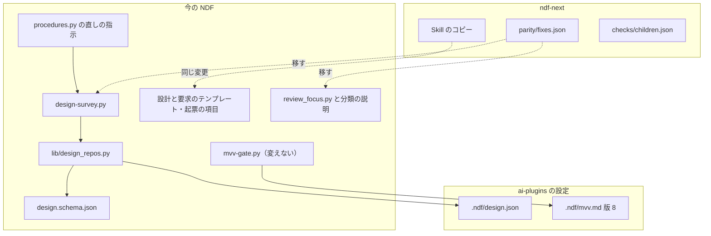
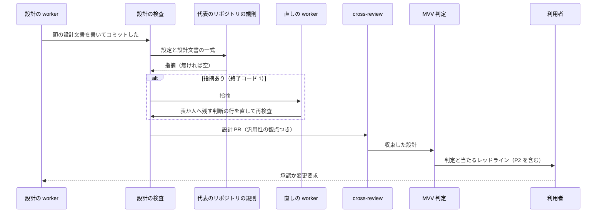

# NDF の設計の工程: 代表のリポジトリの種類を扱えなくする設計を、振る舞いの表・設計の検査・レビュー・MVV 判定で設計承認の前に見つける（#3618）

## 目的

- **今どうなっているか**: NDF を変える設計が、ある種類のリポジトリを NDF で扱えなくしても、設計の検査・cross-review・MVV 判定のどれも止めない。扱えなくなりうる種類の例は、develop を経て本番へ出す運用・プラグイン以外のリリースの形である。#3596 のやり直す前の設計（develop→main の行を外す決定 5）は、設計の検査が終了コード 0、助言の MVV 判定が「従う」で通る（「受け入れ条件 7 の確かめ」の基準値）
- **誰に効くか**: NDF を使う利用者のリポジトリ（言語・テストのツール・ブランチの運用・リリースの方法がそれぞれ違う）と、NDF を変える設計を承認する人
- **変えると何が成り立つか**: 代表のリポジトリの種類のどれかを扱えなくする設計（汎用性の後退）は、次の順で人に届く。(1) 設計を書く時点で振る舞いの表の「この種類で扱えなくなること」の列に現れ、(2) 設計の検査がその行を「人へ残す判断」へ結ぶまで通さず、(3) 設計承認ゲートで人がその行を読む
- **止めないもの**: 普及のフェーズに入るまで、NDF は後方互換を求めない。設定のキーの改名・値の作り直し・旧い形のサポートの打ち切り・既定の変更は、同じ種類のリポジトリが別の形で扱えるなら「扱えなくなること」に当たらず、人へ戻さない

## 適用範囲

- **働く範囲**: 設計の工程を通るすべてのリポジトリ。代表のリポジトリでの振る舞いの表を求める検査は、代表のリポジトリの設定（`.ndf/design.json`）を置いたリポジトリでだけ働く。そのリポジトリの中でも、設計の結果の「触るファイル」が設定の `paths` に当たる設計だけに働く。cross-review の汎用性の観点と、要求と起票のテンプレートの方針の分け方は、設定に依らずすべてのリポジトリで働く。表を求める範囲を設定と `paths` で絞ること（要求の層 C と「影響」より範囲を狭める）と、設計文書のテンプレートを変えること（全プロジェクトの設計に効く。要求の「境界」の「確認してから行う」）は、レッドラインに当たらないため決定の記録で決める（決定 13・14）
- **プロジェクトごとに違うもの**: 代表のリポジトリの種類・表を求めるパス・扱えなくなる種類があるときに名指すレッドラインの番号は、設定 `.ndf/design.json` で受ける。名指す番号の中身（何を承認に回すか）は、そのリポジトリのプロジェクト MVV の「このプロジェクトが足す操作」の表に置く。ai-plugins では MVV の文言（Value 4・P2）を ai-plugins の `.ndf/mvv.md` に入れる
- **当たるモード**: `standard`・`legacy-refactor`（頭の設計文書 `issues/issue-<番号>-design.md` を書くモード）。汎用性の観点は設計 Pull Request の cross-review を通るすべてのモード、方針の分け方は要求を書くすべてのモード

### 代表のリポジトリでの振る舞い

この設計の後に、それぞれのリポジトリで何が起きるか。材料は 2026-11-15 に各リポジトリの `.ndf/` を読んだ結果である（要求の前提 6）。モバイルアプリは実物が手元に無く（要求の前提 5）、Flutter・`flutter test`・TestFlight への手動のリリースを設定した仮のリポジトリとして書く。設定のキー `promotion` は #3613 で `release_strategy` へ改名される。値は `whole` が `merge_base_branch` に、`selected` が `release_branch` になる。

| 代表のリポジトリ | 設定の要点 | 直した後に起きること | この種類で扱えなくなること |
| --- | --- | --- | --- |
| Web サービス（`/work/nd-factory`） | TypeScript（React・Vite・vitest・Playwright）と Python（pytest）。`base_branch: qa/dev`・`production_branch: main`・`promotion: selected`（`release_strategy: release_branch`）。OpenAPI を `factory/contracts/openapi/` に持つ。`.ndf/mvv.md` は nd-factory 自身のもの | 設計: `.ndf/design.json` が無いので、適用範囲の表を求められない（今と同じ）。設計の検査: 新しい 2 規則は働かず、結果は今と同じ。cross-review: 設計 PR の `design` の観点に汎用性の 1 行が加わる。観点は、その設計の作るものを使う側のリポジトリの種類を問うため（決定 6）、OpenAPI の利用者や Factory の利用の形のどれかを代わりの形なしに扱えなくする設計に指摘が出る。項目の改名だけの設計には出ない。MVV 判定: nd-factory の MVV と共通原則を読む（どちらも変わらない。P2 は ai-plugins の MVV にだけ入る）。要求: 依頼に運用の方針があれば「運用の決まり」と「作るものの振る舞い」を分けて書く節が出る | 無し |
| Web サービス・設定なし（`/work/carmo-system-console`） | Laravel・PHPUnit。`.ndf/` に `handoff` だけがあり、ブランチの運用・リリースの設定が無い | 上の行と同じ。設定が無いため、検査は既定（新しい 2 規則が働かない）で動く | 無し |
| Web サービス・develop を経て本番へ出す運用（仮のリポジトリ） | TypeScript・vitest・OpenAPI。`base_branch: develop`・`production_branch: main`。develop を丸ごと main へ出すリリース方式（取り込み方の表の行 `promote-whole`・`promotion: whole`。#3613 の後は `release_strategy: merge_base_branch`）。#3596 で扱えなくなりかけた種類である | 設計・設計の検査・MVV 判定: 1 行目と同じで、このリポジトリ自身の設計の結果は今と同じ。cross-review: 1 行目と同じ。この設計はリリース方式の表の行を外さないので、この運用は今のまま使える。#3613 の改名の後も、同じ運用を新しい値で選べる。NDF の側で ai-plugins の設計がこの運用を代わりの形なしに外そうとすると（#3596 の決定 5）、ai-plugins の設計の検査がこの種類の行を求め、`無し` 以外を書けば人へ残す判断に P2 の行が要る。`無し` と書いた場合は MVV 判定の P2 と汎用性の観点が捕まえる（「受け入れ条件 7 の確かめ」） | 無し |
| モバイルアプリ（仮のリポジトリ） | Flutter・`flutter test`・TestFlight への手動のリリース。ブランチは `main` だけ | 1 行目と同じ。汎用性の観点は使う側のリポジトリの種類を問うため、アプリのリリースの形（手動のストア申請など）を代わりの形なしに扱えなくする設計に指摘を出す | 無し |
| 業務文書だけ（`/work/nyle-dx`） | Markdown が中心。`base_branch: main`。テストとリリースの設定が無く、提出先を `.ndf/document.json` が持つ | 設計と設計の検査: `.ndf/design.json` が無いので、新しい 2 規則は働かず、結果は今と同じ。cross-review: 文書の PR は分類が `docs_only` で `design` の観点を受けず、今と同じ。要求: 方針の分け方の節が出る（例: 提出先の運用の指示） | 無し |

**この設計の後も、5 行のどの種類も NDF で扱える。** 代表のリポジトリの設定は新しく置くファイルで、置かないリポジトリでは検査の結果が今と同じになる（不変条件 I3）。起票の項目の追加は「該当時」の項目で、既存の起票を落とさない。

### ai-plugins だけの事情

ai-plugins の運用で決める値で、NDF の既定や振る舞いへ入れず ai-plugins の `.ndf/` に置くもの。

| 値 | 置く所 | 持つ Issue |
| --- | --- | --- |
| 代表のリポジトリの 3 種（Web サービス・モバイルアプリ・業務文書だけ）、表を求めるパス（NDF の設定のスキーマとリリースの形を持つ `plugins/ndf/`・`plugins/ndf-next/`・`.claude-plugin/marketplace.json`）、扱えなくなる種類があるときに名指す番号 `P2` | ai-plugins の `.ndf/design.json`（新設） | この Issue |
| レッドライン P2（代表のリポジトリの種類のどれかを NDF で扱えなくする）と Value 4 の文言 | ai-plugins の `.ndf/mvv.md`・`.ndf/mvv.json`（版 8） | この Issue |
| 点検の一覧 10・11・13・14・15 の ai-plugins の値（リモート名・文書だけとみなすパス・配分の値など） | ai-plugins の `.ndf/` の各設定 | #3617 |
| ndf-next のブランチの運用（11.0 で GitHub flow にするか。値は `release_strategy: trunk`） | ai-plugins の `.ndf/worktree.json` の `branch_flow` | #3572 |

### CI の検査（F）と #3617 の境

| 項目 | この Issue | #3617（レーン lgeneric） |
| --- | --- | --- |
| 汎用性の後退の語の定義 | 持つ（用語集の「汎用性の後退」。設計文書の表の「この種類で扱えなくなること」の列で使う） | 参照する |
| 何を数えるか（リリース方式の表の行・`delivery` の種類・リリースの形） | 参照する（汎用性の観点の例に挙げる） | 持つ（#3617 の受け入れ条件 5〜7） |
| 代わりの形なしに選択肢を無くす変更を落とす検査・許可リスト・CI のジョブ | 持たない | 持つ |
| 設計の側の欄（代表のリポジトリでの振る舞いの表）とその検査 | 持つ | 自分の設計で表を書く（#3617 の受け入れ条件 24） |

### 代表のリポジトリでの試験（G）と #3411 の境

| 項目 | この Issue | #3411（T2・レーン lr-t2） |
| --- | --- | --- |
| 試走に加える代表のリポジトリの種類と材料 | 持つ（上の「代表のリポジトリでの振る舞い」の行と、その設定の要点） | 受け取る |
| そのリポジトリで確かめる項目 | 持つ（設定を読んだ工程が止まらないこと・設定の値がリリース方式の表に合うこと・設計の検査が今と同じ結果になること） | 受け取る |
| #3411 の本文の改訂（試走の範囲を広げる） | 実装でレーン lr-t2 へリクエストを送る | 本文を改訂するかを決める |
| 試走の実行と記録（機能の対応表の `trial`） | 持たない | 持つ |

### 今の NDF と ndf-next への入れ方

**今の NDF（`plugins/ndf/`）へ入れ、ndf-next（`plugins/ndf-next/`）の Skill のコピーにも同じ変更を入れる。** スクリプトの分は、機能の対応表の直しの棚卸し（`plugins/ndf-next/src/ndf/parity/fixes.json`）に行を足す。その行で、移す子（設計の検査は M7、cross-review の観点は M5、起票の項目は M6）へ渡す。11.0 の入れ替え（S2）は直しの棚卸しの全行が移ったことを確かめるため、11.0 の時点で ndf-next に入る（決定 9）。

## あるべき姿の根拠

| 根拠 | 種類 | 何を示すか |
| --- | --- | --- |
| PRD1（crater） | 外部の一次情報 | 変更の後退は、作り手のリポジトリではなく、使う側の多数のリポジトリで確かめて見つける |
| PRD2（Intercom の dogfooding） | 外部の一次情報 | 作り手自身の利用は、まれにしか通らない経路を見落とす |
| PRD3（Spotify の Golden Paths） | 外部の一次情報 | 道はプロジェクトの種類ごとに用意する。守る単位を値ではなくリポジトリの種類に置く前例である |
| 基準値: 今の検査と判定は #3596 のやり直す前の設計を通す | 実測 | `design-survey.py check` が終了コード 0・指摘 0 件、助言の MVV 判定が `follow`・根拠に Value 4 が無い（「受け入れ条件 7 の確かめ」） |
| 「ai-plugins(ndf) を開発することと、ndf を使って様々な開発を汎用的に進行することの区別がついていない設計が入り込んでしまう」 | 利用者の指示の原文 | 混入を工程の中で止める仕組みが要る |
| 「普及フェーズに入るまでは後方互換性気にせずきれいなツールを作りたい」 | 利用者の指示の原文 | 守る対象は旧い値ではなく、リポジトリの種類を扱えること（汎用性）である。SemVer の後方互換の規則（STD1・STD2）は普及のフェーズまで当てない |

要求と受け入れ条件は #3618 の本文にある（コピーは [issue-3618-requirements.md](issue-3618-requirements.md) ）。この文書は「どう作るか」だけを扱う。決定の記録は [issue-3618-design-decisions.md](issue-3618-design-decisions.md) にある。詳細設計は [issue-3618-design-detail.md](issue-3618-design-detail.md) にある。

## ドメインモデル

### コンテキスト

| コンテキスト | 何の語が 1 つの意味に決まるか |
| --- | --- |
| 開発のワークフロー（`ndf-workflow`） | 設計文書・設計の検査・汎用性の後退・代表のリポジトリ・人へ残す判断 |
| プロジェクト MVV（`ndf-workflow` の MVV の語） | Value・レッドライン（P の番号）・MVV 判定 |
| cross-review（`ndf-cross-review`） | 設計のレビューの観点（`design` の観点に足す汎用性の 1 行。F5・E5） |
| 課題の棚卸し（`ndf-issue-upkeep`） | 起票の項目（方針を「このリポジトリの運用の決まり」と「作るものの振る舞い」に分ける該当時の項目 `policy_split`。F4） |

上流は開発のワークフロー（`ndf-workflow`）で、ほかの 3 つは下流である。関係はどれも**公開された言語**とする。開発のワークフローが、設計文書の節の形（「適用範囲」の表・「人へ残す判断」の表）、要求の方針の分け方の節、設定のスキーマ（`.ndf/design.json`）を文書化された形式として固める。下流の 3 つは、それぞれ次の形式だけを読む。

| 下流 | 読む形式 |
| --- | --- |
| プロジェクト MVV（MVV 判定） | 設計文書の節の形を判定の材料として読む |
| cross-review | 設計文書の節の形を、汎用性の観点で問う材料として読む |
| 課題の棚卸し | 要求の方針の分け方の節の形を、起票の項目へ写す |

公開された言語が決めるのは、下流が上流の形式を読む向きだけである。この Issue は、下流の cross-review と課題の棚卸しが持つ集約（cross-review の観点・起票の項目。下の「集約」）も書き換える。その書き換えは、上流から下流を書き換えるものではなく、それぞれの下流のコンテキストの中の変更である。下流の持ち主の Skill の決まりに従い、同じ実装の Pull Request で行う。決まりは、cross-review の観点では `review_focus.py`、起票の項目では `issue-items.json` とその読み手のテストが持つ。

### 集約

| 集約 | 持ち主（書き換えてよいもの） | 根 | エンティティ | 値オブジェクト |
| --- | --- | --- | --- | --- |
| 代表のリポジトリの設定 | 利用者（ai-plugins では実装の Pull Request でコミットし、リリース承認ゲートで人が見る。C7） | 設定（`.ndf/design.json`） | — | 種類の名前・名指すレッドラインの番号 |
| 設計文書 | 設計の工程の担い手（設計の worker と直しの worker） | 頭の設計文書 | 代表のリポジトリでの振る舞いの行・人へ残す判断の行 | この種類で扱えなくなること（`無し` か中身） |
| プロジェクト MVV | 利用者（承認で改訂する。`project-mvv.py approve`） | MVV の版 | Value・レッドラインの行 | 版の sha256 |
| cross-review の観点 | cross-review のコンテキスト（`ndf-cross-review` の Skill。変更は実装の Pull Request で入れ、リリース承認ゲートで人が見る） | 分類ごとの観点の文（`review_focus.py` の `CATEGORY_TEMPLATES`） | `design` の観点の文 | 汎用性の 1 行 |
| 起票の項目 | 課題の棚卸しのコンテキスト（`ndf-issue-upkeep` の Skill。変更は実装の Pull Request で入れ、リリース承認ゲートで人が見る） | 項目の一覧（`issue-items.json`） | 項目 `policy_split` | 項目の要否（`need`） |

### 不変条件

| # | 集約 | 条件 | 破れたときの扱い |
| --- | --- | --- | --- |
| I1 | 設計文書 | 代表のリポジトリの設定があり、頭の設計文書の「設計の結果」の触るファイルのどれかが設定の `paths` に当たるか、触るファイルを読めなければ（`paths` が無ければ常に当たる。詳細設計の `applies`）、頭の設計文書の「適用範囲」に、代表のリポジトリでの振る舞いの表があり、設定の `kinds` の種類ごとに行がある | 設計の検査が終了コード 1 で、規則 `repo_scope_missing` の指摘を出す |
| I2 | 設計文書 | I1 と同じ前提（代表のリポジトリの設定があり、触るファイルのどれかが `paths` に当たるか、触るファイルを読めない）で、振る舞いの表のどれかの行の「この種類で扱えなくなること」が `無し` で始まらなければ、「人へ残す判断」の表に、設定が名指す番号を持つ行がある | 設計の検査が終了コード 1 で、規則 `repo_loss_unrouted` の指摘を出す |
| I3 | 代表のリポジトリの設定 | 設定が無いか、設計の触るファイルが `paths` に当たらなければ、設計の検査の結果（終了コード・指摘）は今と同じである | 既存の設計の検査のテストが落ちる |
| I4 | 代表のリポジトリの設定 | 設定がスキーマに合わなければ（種類が空の配列を含む）、設計の検査は推して進めずに止まる。種類を求めないリポジトリは設定を置かない | 設計の検査が終了コード 2 で止まる |
| I5 | プロジェクト MVV | 承認されていない改訂の文は `.ndf/mvv.md` に入らない | `project-mvv.py check` が承認と一致しないと返し、MVV 判定が承認ゲートを省かない（今の振る舞い） |
| I6 | 設計文書 | 承認ゲートの数は設計承認ゲートとリリース承認ゲートの 2 つのまま。この変更は承認の工程を足さない | 工程の定義の既存のテストが落ちる |
| I7 | 設計文書 | I1 と同じ前提で、頭の設計文書の「適用範囲」に「このリポジトリだけの事情」の欄がある | 設計の検査が終了コード 1 で、規則 `repo_scope_missing` の指摘を出す |

### ドメインイベント

| # | イベント | 発生元 | 受け手 | 失敗したとき |
| --- | --- | --- | --- | --- |
| E1 | 利用者が運用の方針を指示した | 利用者 | 要求の書き手・起票者 | — |
| E2 | 方針を「このリポジトリの運用の決まり」と「作るものの振る舞い」に分けて記録した（D） | 要求の書き手・起票者 | 設計の工程 | — |
| E3 | 設計の「適用範囲」に代表のリポジトリでの振る舞いを、種類ごとの「この種類で扱えなくなること」とともに書いた（C） | 設計の worker | 設計の検査 | — |
| E4 | 設計の検査が表と人へ残す判断の行を確かめた（C） | 設計の検査（`design-survey.py check`） | 直しの worker（終了コード 1）・設計 PR のステップ（0） | 設定が壊れていれば終了コード 2 で止まる（I4） |
| E5 | cross-review が汎用性の観点で問うた（E） | cross-review のレビュー担当 | 直しのラウンド | — |
| E6 | MVV 判定が、代表のリポジトリの種類を扱えなくする設計をレッドライン（P2）に当たるとした（B） | MVV 判定（`mvv-gate.py`） | 承認資料 | 判定が走らない場合（#3596 の事実 6）、`無し` 以外の行は E4 で人へ残す判断に載って届く。`無し` と書いた設計は E5 だけが捕まえる。この扱いは決定 15 で決めた |
| E7 | 利用者が人へ残す判断の行を見て、承認か変更要求を返した | 利用者 | 設計の工程（変更要求なら E3 へ） | — |
| E8 | CI が、代表のリポジトリの種類に要る選択肢を代わりの形なしに無くす変更を落とした（F） | #3617 の検査 | 実装の Pull Request | — |
| E9 | 代表のリポジトリで試走した（G） | #3411 の試走 | 行き先の子 | — |

### 用語

| 用語 | 意味 | 用語集への反映 |
| --- | --- | --- |
| 汎用性の後退 | NDF の変更の後に、代表のリポジトリの種類のどれかを NDF で扱えなくなること。その種類に要る選択肢（運用・リリースの形・テストのツール・CI など）を、代わりの形なしに無くすことで起きる。値の改名・作り直し・既定の変更・代わりの形のある値の削除は当たらない | 追加 |
| サポートする選択肢 | 設定で選べる値（supported options）。リリース方式の値・`delivery` の種類・リリースの形など。汎用性の後退は、ある種類に要るサポートする選択肢を代わりの形なしに無くすことで起きる | 追加 |
| 代表のリポジトリの種類 | NDF が扱えることを保つリポジトリの種類。代表のリポジトリの設定の `kinds` に名前で書く（ai-plugins では Web サービス・モバイルアプリ・業務文書だけ） | 追加 |
| 代表のリポジトリ | 代表のリポジトリの種類ごとに、設計の振る舞いを確かめるために選ぶ、このリポジトリの作るものを使う側のリポジトリ（実物か、設定を仮に置いたもの） | 意味の変更 |
| 代表のリポジトリの設定 | `.ndf/design.json` の `representative_repos`。代表のリポジトリの種類の一覧・表を求めるパス・扱えなくなる種類があるときに名指すレッドラインの番号を持つ。置いたリポジトリで、触るファイルがそのパスに当たる設計だけに設計の検査が振る舞いの表を求める | 意味の変更 |
| このリポジトリだけの事情 | 設計を書くリポジトリの運用で決めた値。作るものの既定や振る舞いへ入れず、そのリポジトリの `.ndf/` の設定に置く。ai-plugins では「ai-plugins だけの事情」と書く | そのまま |
| 設計の検査 | 設計文書を書いた後に工程が走らせる、言語モデルを呼ばない決まった検査（`design-survey.py check`。設計のプランのステップ `survey-check`） | 意味の変更 |
| 製品の約束 | NDF が利用者の多様なリポジトリへ約束する価値。ai-plugins の MVV の Value 1〜14 と Vision が持つ | そのまま |
| ai-plugins だけの事情 | ai-plugins の運用で決めた値（ブランチの運用・リリースの形・マーケットプレイスの名前など）。NDF の既定や振る舞いへ入れず、ai-plugins の `.ndf/` の設定に置く | そのまま |

要求の工程で用語集に足した、設定が受け付ける値の種類を指す語は廃止する（直訳の和語で、守る単位を値に置く語のため。決定 10）。指していたものは「サポートする選択肢」、守る対象は「汎用性の後退」が持つ。

## MVV と共通原則の改訂の文

**ai-plugins の MVV（`.ndf/mvv.md`）を版 7 から版 8 へ改訂する。共通原則（`plugins/ndf/scripts/data/ndf-common-principles.md`）は改訂しない**（理由は決定 2）。改訂の文は設計承認ゲートで人が承認し、実装の Pull Request で `project-mvv.py approve` を通して入れる（I5）。

| # | 箇所 | 改訂の前 | 改訂の後 |
| --- | --- | --- | --- |
| M1 | Value 4 | `4. **どのプロジェクトでもそのまま使える**` の下の 2 行（`.ndf/mvv.md` の 51〜52 行目。設定か引数を渡せば同じ工程が使えること、ai-plugins の流儀を使う側へ持ち込まないこと） | 2 行の後に 2 行を足す: 「NDF は、代表のリポジトリの種類（Web サービス・モバイルアプリ・業務文書だけ）のどれも扱えることを保つ。設定のキーと値の改名・作り直し・既定の変更は自由に行い、ある種類を代わりの形なしに扱えなくする設計だけを人の承認に回す（P2）」と「普及のフェーズに入るまで、後方互換は求めない。旧い設定の形を残す互換の仕組みを持たず、移行のコマンドできれいな最終形へ移す」 |
| M2 | 必ず人の承認が要る操作の「このプロジェクトが足す操作」の表 | P1 の 1 行だけ | P1 の後に 1 行を足す: `\| P2 \| 代表のリポジトリの種類のどれかを、NDF で扱えなくする（運用・リリースの形・テストのツール・CI などの、その種類に要る選択肢を、代わりの形なしに無くす）。既定の変更と、代わりの形のある値の削除・改名は当たらない \| その種類のリポジトリは、NDF の版を戻すか NDF を使うのをやめるほかに手段が無くなる \|` |

## 防ぐ案の採否

要求の「防ぐ案」の 7 層の採否である。理由の詳細は決定の記録にある。

| 層 | 採否 | 理由 | 決定 |
| --- | --- | --- | --- |
| A 判断の基準 | 採らない | 製品の約束を共通原則の隣へ移すと、NDF を作らない利用者のリポジトリの MVV 判定にも製品の約束が入り、その判定の基準を変える。ai-plugins の MVV は製品の約束と開発の基準を節で分けてあり、足りないのは Value 4 が「代表のリポジトリの種類をどれも扱えることを保つ」を名指していないことである。Value 4 の文言を改訂する | 決定 1 |
| B レッドライン | 採る（ai-plugins の MVV の P2） | どの種類のリポジトリを扱えることを保つかは、作るものごとに違い、共通原則の 1 行では名指せない。各リポジトリが自分の MVV のレッドラインに置き、ai-plugins は「代表のリポジトリの種類のどれかを NDF で扱えなくする」を P1（取得元・版の規則）の隣の P2 に置く。値の改名・既定の変更・代わりの形のある値の削除は当たらない | 決定 2 |
| C 設計の型 | 採る（設定を置いたリポジトリの、触るファイルが設定の `paths` に当たる設計だけ） | 振る舞いの表は、作るものを使う側のリポジトリがあるときだけ意味を持つ。設定で有効にし、既定では今と同じにする。判定の単位はリポジトリの種類にする。要求の層 C と「影響」（全プロジェクトの設計承認に効く）より範囲が狭いが、レッドラインに当たらないため決定 13 で決める | 決定 3・4 |
| D 指示の受け取り | 採る（該当時の節） | #3596 の起点（事実 1）は、運用の方針を製品の仕様として書いたことである。要求と起票のテンプレートで 2 つを分ける | 決定 5 |
| E レビュー | 採る | 汎用性の観点は、その設計の後に使う側のリポジトリの種類のどれかを扱えなくなるかを問う、どのリポジトリの設計にも当たる一般の観点である。観点の 1 行を足すだけで、ラウンドと CLI の数は変わらない | 決定 6 |
| F 機械の検査 | 採る（境界だけを持つ） | 検査の実装は #3617 が持つ。この Issue は語の定義と設計の側の欄を持つ | 決定 7 |
| G 試験 | 採る（種類と確かめる項目だけを持つ） | 試走の実行は #3411 が持つ。この Issue は試走に加える種類と項目を決め、リクエストで渡す | 決定 8 |

## 外部の調査

| 種類 | 調べるか | 理由 |
| --- | --- | --- |
| 標準・仕様 | 調べる | サポートする選択肢を無くすことの扱いに、版の付け方と非推奨の規則の事実上の標準がある |
| 主要な製品 | 調べる | 作り手の変更を使う側の多数のリポジトリで確かめる仕組みと、種類ごとの道の前例がある |
| ライブラリとサービス | 調べる | 設定の形の検査に使う既存の依存と、設計文書の表を読む既存の部品を確かめる |

### 標準・仕様

| # | 標準・仕様 | 何を定めているか | 設計への反映 | 出典 |
| --- | --- | --- | --- | --- |
| STD1 | Semantic Versioning 2.0.0 | 項目 8「Major version X (X.y.z \| X > 0) MUST be incremented if any backward incompatible changes are introduced to the public API.」。非推奨は MINOR で予告してから MAJOR で外す | 普及のフェーズまで当てない（利用者の方針）。値の改名・打ち切りを人へ戻す根拠にしない。普及のフェーズに入った後の後方互換の規則の候補として残す（未決 4） | https://semver.org/ （2026-11-15） |
| STD2 | Kubernetes Deprecation Policy | 「API elements may only be removed by incrementing the version of the API group.」。GA のフラグは予告の期間を置いてからでないと外さない | STD1 と同じく普及のフェーズまで当てない。予告の期間は設けない | https://kubernetes.io/docs/reference/using-api/deprecation-policy/ （2026-11-15。本文の前半 4 万字を読み、後半は要約で読んだ） |

### 主要な製品

| # | 製品 | どう解いているか | 設計への反映 | 出典 |
| --- | --- | --- | --- | --- |
| PRD1 | Rust の crater | コンパイラの 2 つの版で多数の公開クレートを build・test し、結果を比べて後退を報告する | 代表のリポジトリでの確かめを、設計の時点（表）と試走の時点（#3411）の 2 か所に置く | https://github.com/rust-lang/crater （2026-11-15） |
| PRD2 | Intercom「The danger of dogfooding」 | 作り手は自分がよく通る作業を磨き、まれにしか通らない重要な作業を見落とす | ai-plugins の運用だけで確かめた設計を通さない根拠にする | https://www.intercom.com/blog/the-danger-of-dogfooding/ （2026-11-15） |
| PRD3 | Spotify の Golden Paths（Backstage） | 「a set of best practices organized by type of engineering project」。プロジェクトの種類ごとに道を用意する | 代表のリポジトリを、個々のリポジトリではなく種類で設定に書き、判定の単位も種類にする | https://www.infoq.com/news/2021/03/spotify-paved-paths （2026-11-15） |

### ライブラリとサービス

| # | 候補 | 版 | ライセンス | 最後のリリースの日付 | 終了のアナウンス | 要件を満たすか | 出典 |
| --- | --- | --- | --- | --- | --- | --- | --- |
| LIB1 | 既存の Markdown の読み手（`plugins/ndf/scripts/lib/md.py`・`design_docs.py`） | リポジトリの中 | リポジトリのライセンス | — | 無し | 満たす。節と表を読む部品があり、`design-survey.py` がすでに使う | `plugins/ndf/scripts/design-survey.py` の import（2026-11-15） |
| LIB2 | 既存の設定のスキーマの検査（`lib/deps.py` が要求する JSON Schema の検査） | リポジトリの中 | リポジトリのライセンス | — | 無し | 満たす。`.ndf/` の設定はスキーマで形を確かめる既存の決まりがある（`project.schema.json` は `additionalProperties: false`） | `plugins/ndf/skills/development-workflow/schemas/project.schema.json`（2026-11-15） |

### 確かめられなかったこと

| 対象 | 試した手段 | 結果と理由 |
| --- | --- | --- |
| Kubernetes の非推奨ポリシーの後半（CLI の要素の予告の期間の数値） | https://kubernetes.io/docs/reference/using-api/deprecation-policy/ の取得 | 本文が長く、後半は要約でだけ読んだ。設計は期間の数値を使わない |

調べた量: 候補 7 件・取得の試み 5 回。

## 機能一覧

| # | 機能 | 誰が使うか |
| --- | --- | --- |
| F1 | 代表のリポジトリの設定を読み、頭の設計文書に振る舞いの表と「このリポジトリだけの事情」の欄を求める（規則 `repo_scope_missing`） | 設計のプランのステップ `survey-check`・設計の worker |
| F2 | 「この種類で扱えなくなること」が `無し` 以外の行があれば、人へ残す判断に設定の番号を持つ行を求める（規則 `repo_loss_unrouted`） | 同上 |
| F3 | 設計文書のテンプレートの「適用範囲」に、振る舞いの表と事情の欄の書き方を置く | 設計の worker |
| F4 | 要求と起票のテンプレートに、方針を「このリポジトリの運用の決まり」と「作るものの振る舞い」に分ける節を置く | 要求の書き手・起票者 |
| F5 | cross-review の `design` の観点に汎用性の 1 行を足す | cross-review のレビュー担当 |
| F6 | ai-plugins の MVV を版 8 へ改訂し、代表のリポジトリの設定を置く | 利用者（承認）・MVV 判定 |
| F7 | ndf-next の Skill のコピーと直しの棚卸しへ同じ変更を渡し、#1142 の子の表へこの Issue を足す | ndf-next の移す子（M5・M6・M7）・入れ替え（S2） |

## 構成要素

| 要素 | 責務 |
| --- | --- |
| 代表のリポジトリの規則（新設 `plugins/ndf/scripts/lib/design_repos.py`） | 設定を読んで形を確かめ、頭の設計文書の「適用範囲」と「人へ残す判断」の表を読み、規則 `repo_scope_missing`・`repo_loss_unrouted` の指摘を返す。ファイルを書かない |
| 設計の検査（`plugins/ndf/scripts/design-survey.py`） | 新しい規則を 1 つの課題の設計文書の一式ごとに呼び、指摘と件数を結果 JSON に足す。設定が壊れていれば終了コード 2 |
| 設定のスキーマ（新設 `plugins/ndf/skills/design/schemas/design.schema.json`） | `.ndf/design.json` の形（`representative_repos.kinds`・`representative_repos.redline`） |
| 直しのステップの指示（`plugins/ndf/scripts/supervise_lib/procedures.py` の `survey_steps`） | 新しい規則の指摘の直し方を、直しの worker への指示に足す |
| 設計文書のテンプレート（`plugins/ndf/skills/design/references/design-template.md` と ndf-next のコピー） | 「適用範囲」に振る舞いの表と事情の欄の形を置く |
| 要求のテンプレート（`plugins/ndf/skills/requirements-design/references/spec-template.md` と ndf-next のコピー）と起票の項目（`plugins/ndf/scripts/data/issue-items.json`） | 方針の分け方の節（該当時） |
| cross-review の観点（`plugins/ndf/skills/cross-review/scripts/review_lib/review_focus.py` の `DESIGN_REVIEW_TEMPLATE`）と分類の説明（`docs/08-review-categories.md` と ndf-next のコピー） | 汎用性の 1 行 |
| ai-plugins の設定（`.ndf/design.json`・`.ndf/mvv.md`・`.ndf/mvv.json`） | 代表のリポジトリの 3 種と番号 P2、MVV 版 8 |
| 直しの棚卸し（`plugins/ndf-next/src/ndf/parity/fixes.json`）と子の表（`plugins/ndf-next/src/ndf/checks/children.json`） | スクリプトの分を M5・M6・M7 へ渡す行、子 G1 の行と S2 の `needs` |



`mvv-gate.py` はコードを変えず、改訂した MVV を材料として読むだけである。図では読む関係を示すために置いた。

## 入出力の契約

**代表のリポジトリの設定（`.ndf/design.json`）。** 無ければ新しい 2 規則は働かない。

```json
{
  "version": 1,
  "representative_repos": {
    "kinds": ["Web サービス", "モバイルアプリ", "業務文書だけ"],
    "paths": ["plugins/ndf/**", "plugins/ndf-next/**", ".claude-plugin/marketplace.json"],
    "redline": "P2"
  }
}
```

| キー | 形 | 意味 |
| --- | --- | --- |
| `representative_repos.kinds` | 空でない文字列の配列（重複なし。空の配列はスキーマに合わず終了コード 2） | 振る舞いの表に行を求める種類の名前。表の 1 列目のセルが、この名前で始まる行を数える |
| `representative_repos.paths` | 省略可。空でない glob の配列 | 表を求める設計の範囲。頭の設計文書の「設計の結果」の表の「触るファイル」のどれかが当たる設計だけに 2 規則を当てる。省略するとリポジトリのすべての設計に当てる |
| `representative_repos.redline` | `C<数>` / `P<数>` / `R<数>` の文字列 | 扱えなくなる種類があるときに、人へ残す判断の行が名指す番号。番号の中身はそのリポジトリのプロジェクト MVV（「このプロジェクトが足す操作」の表）か共通原則に置く。設計の検査は MVV を読まず、番号の形だけを確かめる |

**頭の設計文書の「適用範囲」の形。** 小見出し `### 代表のリポジトリでの振る舞い` の表と、小見出し `### <名前>だけの事情`（「このリポジトリだけの事情」「ai-plugins だけの事情」）の本文か表を持つ。

| 列 | 書くこと |
| --- | --- |
| 代表のリポジトリ | 設定の種類の名前で始める（括弧で実物を添えてよい） |
| 設定の要点 | そのリポジトリの言語・テスト・ブランチの運用・リリースの設定 |
| 直した後に起きること | 設計・設計の検査・cross-review・MVV 判定で何が起きるか |
| この種類で扱えなくなること | `無し` か、この種類で扱えなくなる運用・リリースの形・テストのツール・CI と、代わりの形が無い理由。判定の単位はリポジトリの種類で、値を改名・作り直しても同じ種類が別の形で扱えるなら `無し` と書く |

**設計の検査の結果に足すもの。** 指摘の `rule` に `repo_scope_missing`・`repo_loss_unrouted` が加わり、`metrics` に同じ名前の件数が加わる。終了コードの意味は変えない（0 = 指摘なし / 1 = 指摘あり / 2 = 読めない）。

## 処理の流れ



設定が無いリポジトリと、触るファイルが `paths` に当たらない設計では、規則は空の指摘を返し、流れは今と同じになる。

**決まった検査が捕まえる範囲には限りがある。** 設計の検査は、表があることと、`無し` 以外の行が人へ残す判断に結ばれていることだけを確かめる。代わりの形があるかは言語モデルでなければ判定できず、設計者か直しの worker が種類を扱えなくなる変更を `無し` と書いた表は、設計の検査を通る。この場合に捕まえるのは、汎用性の観点で問う cross-review（E）と、P2 を材料に読む MVV 判定（B）である。設計の検査の役目は、扱えなくなることを書いた行を人へ残す判断へ必ず届けることと、表を書く欄を設計者の前に必ず置くことである。

設定が壊れていれば、設計の検査は終了コード 2 で止まり、プランは今の「読めない」の扱いで止まる。

## 非機能の実現方式

| 大項目 | 条件 | 実現方式 |
| --- | --- | --- |
| 性能・拡張性 | 設計の検査は言語モデルを呼ばず、1 つの設計文書で 60 秒以内 | 規則は設定 1 つと、すでに読んだ文書の 2 つの節を読むだけである。ステップ `survey-check` の上限 120 秒の中で動く |
| 運用・保守性 | cross-review のラウンドと CLI の数、MVV 判定の呼び出しの回数を増やさない | 観点は既存の `design` の文に 1 行を足すだけ。MVV 判定はコードを変えず、材料の MVV の文だけが変わる |
| 移行性 | 普及のフェーズまで後方互換を求めない。進行中の設計のプランは止めない | 旧い形を残す互換の仕組みは足さない。設定を置いたリポジトリでだけ働き、マージ済みの設計文書は検査し直さない。設定のマージの後に直しのラウンドで設計の検査を打ち直す進行中の設計は、表が無ければ終了コード 1 になり、既存の直しのラウンドで直しの worker が表を足す。終了コード 2（止まる）にはならず、プランは止まらない（決定 11） |

## テスト設計

| 受け入れ条件・不変条件 | どの振る舞いで縛るか | どう壊したら落ちるべきか |
| --- | --- | --- |
| 受け入れ条件 9（B）: 判定の扱い | MVV 判定の単体テスト（`plugins/ndf/scripts/tests/test_mvv_gate.py`）で、言語モデルの呼び出し（`ask`）を差し替え、`boundary` に P2 を名指す要素を持つ応答を返させる。助言でない判定が承認ゲートを省かず人へ戻す（`passed: false`）こと、`verdict` が `follow` でも同じであることを縛る | `boundary` が空でないときに承認ゲートを省くと落ちる |
| 受け入れ条件 9（B）: 判定の材料 | 同じテストで、版 8 の形の MVV（P2 の行を持つ）を置いたリポジトリの判定の指示（`build_prompt` の戻り値）に、P2 の行の中身が入ることを縛る | MVV の「このプロジェクトが足す操作」の表を材料から落とすと落ちる |
| 受け入れ条件 9（B）: 改名だけの設計 | 言語モデルの判定は単体テストで縛れない。「受け入れ条件 7 の確かめ」の B2 で、改名だけの設計に P2 が出ないことを確かめる | — |
| 受け入れ条件 9（B）: 扱えなくする設計で「人へ残す」を返すこと | 言語モデルの判定は単体テストで縛れない（上の 2 行が縛るのは既存の分岐と判定の材料だけ）。「受け入れ条件 7 の確かめ」の B で確かめ、受け入れ条件 13 の記録に残す。受け入れ条件 9 は「（テスト）」で確かめると書くため、この確かめ方は決定 16 で決めた | — |
| 受け入れ条件 9（B）: 人へ残す判断の行・I2 | 扱えなくなることの行を持つ合成の設計文書で、人へ残す判断に P2 の行が無ければ設計の検査が `repo_loss_unrouted` を出し、P2 の行があれば出さない。すべての行が `無し` の設計文書（改名だけの設計）は出さない | 番号の照らし合わせを外す・`無し` の判定を逆にすると落ちる |
| 受け入れ条件 10（C）・I1 | 設定に 3 種があるリポジトリで、触るファイルが `paths` に当たる設計文書のうち、表が無い・種類の行が欠けるものは終了コード 1、表に 3 種の行があるものは 0。触るファイルが `paths` に当たらない設計文書は表が無くても 0 | 種類ごとの数え方を「どれか 1 行」に緩める・`paths` の照らし合わせを外すと落ちる |
| 受け入れ条件 10（C）・I7 | 同じリポジトリで、触るファイルが `paths` に当たり、表は埋まっているが「このリポジトリだけの事情」の欄が無い設計文書は終了コード 1、欄があれば 0 | 事情の欄の確かめを外すと落ちる |
| 受け入れ条件 11（D） | テンプレートの節は文言の照合で縛らない（`AGENTS.md` の DON'T）。起票の項目は `issue-items.json` の読み手のテスト（`plugins/ndf/scripts/tests/test_issue_items.py`）で、項目 `policy_split` が該当時の項目として読めることを縛る | 項目の `need` の形を壊すと読み手のテストが落ちる |
| 受け入れ条件 12（E） | 観点の文は文言の照合で縛らない。受け入れ条件 13 の E の記録で確かめる | — |
| 受け入れ条件 13 | 「受け入れ条件 7 の確かめ」の行を打ち、記録を実装の Pull Request に残す | 期待値に合わなければ記録に残し、人へ戻す |
| 受け入れ条件 14 | `plugins/ndf-next/bin/ndf check` の規則 `child-deps` が子 G1 の行を通す | 順番を `needs` の最大以下にする・S2 の `needs` から G1 を外すと IG2 か表の検査が落ちる |
| 受け入れ条件 15・I5 | 承認した本文だけを `project-mvv.py approve` で入れ、`project-mvv.py check` が承認済みを返す | 承認と違う文を入れると `check` が一致しないと返す |
| 受け入れ条件 16・I6 | 工程の定義の既存のテスト（承認ゲートの数）が通る | 承認のステップを足すと落ちる |
| 受け入れ条件 17 | MVV 判定の既存のテストが通る（判定のコードを変えない） | — |
| 受け入れ条件 18・19 | 設計承認ゲートの前に、要求の検証手段の語の検査（`grep -c` で廃止した語を数える）が `issues/issue-3618-design*.md` で 0 であることと、改訂の文に「値を減らさない」「既定を変えない」を求める文が無いことを確かめる | — |
| I3 | 設定が無いリポジトリと、触るファイルが `paths` に当たらない設計で、既存の設計の検査のテストがすべて通り、新しい規則の件数が 0 | 設定が無いときや `paths` の外の設計に規則を働かせると落ちる |
| I4 | スキーマに合わない設定（種類が空の配列・番号の形が違う）で終了コード 2 | 壊れた設定を「設定なし」として進めると落ちる |

## 受け入れ条件 7 の確かめ

#3596 のやり直す前の設計文書を入力にして、採った B・C・E が汎用性の後退を捕まえるかを確かめる。捕まえる対象は、その設計の決定 5 の「`promote-whole`・`promote-selected` の 2 行を外す」ことである。この決定は、develop を経て本番へ出す運用（Web サービスの 1 つの種類）を代わりの形なしに扱えなくする。あわせて、値の改名だけの設計を人へ戻さないこと（B2）を確かめる。実装の後に打ち、記録を実装の Pull Request に残す（受け入れ条件 13）。

### 確かめる項目と期待値

| 案 | コマンド | 基準値（2026-11-15・実装の前） | 期待値（実装の後） |
| --- | --- | --- | --- |
| C | `python3 plugins/ndf/scripts/design-survey.py check --root . --file "$T/issue-3572-design.md" "$T/issue-3572-design-decisions.md" "$T/issue-3572-requirements.md"` | 終了コード 0、`items` 0 件 | 終了コード 1。`items` に `rule: repo_scope_missing`・`name` が `$T/issue-3572-design.md` の指摘が 1 件以上ある |
| C2 | 下の「C2 の入力」で、表を足し、develop を経て本番へ出す運用の行の「この種類で扱えなくなること」に代わりの形が無いことを書き、人へ残す判断に P2 の行を足さない設計文書を作り、C と同じコマンドを `$T/c2/` の 3 つのファイルに打つ | 終了コード 0、`items` 0 件 | 終了コード 1。`items` に `rule: repo_loss_unrouted`・`name` が `$T/c2/issue-3572-design.md` の指摘が 1 件以上あり、`repo_scope_missing` が無い |
| B | `python3 plugins/ndf/scripts/mvv-gate.py check --sprint "$T/sprint.json" --gate design --material "$T/issue-3572-design.md" "$T/issue-3572-design-decisions.md" --advise --log "$T/mvv.jsonl" --note "$T/mvv-note.md" --root .` | 終了コード 0。`verdict: follow`、`boundary` 6 件（P1 2 件・C7・C2・C1・C6）に develop・`promote-whole`・`promote-selected` を挙げる行が無い、`basis` に Value 4 が無い | 終了コード 0（助言は常に 0）。`boundary` に P2 を名指して develop を経て本番へ出す運用を扱えなくすることを挙げる要素が 1 件以上ある。`basis` に P2 か Value 4 がある。`verdict` の値は問わない（`boundary` が空でなければ、助言でない判定は `verdict` に依らず承認ゲートを省かず人へ戻す。`mvv-gate.py` の `verdict != "follow" or boundary` の分岐） |
| B2 | 下の「B2 の入力」で、`promotion` を `release_strategy` へ改名し移行のコマンドを入れるだけの設計文書を作り、B と同じコマンドを `--material "$T/b2/design.md"` に変えて打つ | 打っていない（P2 がまだ無い） | 終了コード 0。`boundary` に P2 を名指す要素が無い |
| E | 下の 2 行。観点を出し、`claude -p` に観点と設計文書を渡して 1 回だけレビューさせる | 打っていない（観点がまだ無い） | 指摘に、決定 5 が develop を経て本番へ出す運用（`promote-whole`・`promote-selected`）を代わりの形なしに扱えなくすることを挙げる行が 1 件以上ある |

C は表が無いことを、C2 は表に書いた扱えなくなることが人へ残す判断へ届かないことを捕まえる。扱えなくなることを `無し` と書いた表は C・C2 のどちらも通るため（「処理の流れ」の限り）、その場合は B と E の期待値が受け入れ条件 7 を満たす。

B・B2・E は言語モデルの判定で、結果は実行ごとに揺れうる。期待値に合わなければ 1 回だけ打ち直し、2 回とも合わなければ実装の Pull Request で人へ戻す。


### 準備

2026-11-15 に打ち、終了コード 0 を確かめた。

```bash
T=.ndf/tmp/3618-replay; mkdir -p "$T"
for f in issue-3572-design.md issue-3572-design-decisions.md issue-3572-requirements.md; do
  git show 4faa3a04:issues/$f > "$T/$f"
done
python3 plugins/ndf/scripts/sprint-state.py init "$T/sprint.json" --name replay-3618 --pace normal --root .
```

C と C2 の期待値は、やり直す前の設計文書の「設計の結果」の触るファイルが ai-plugins の設定の `paths` に当たることを前提にする。2026-11-15 に次を打ち、終了コード 0 で `touched 45 hit 41` を得た。当たった先頭のファイルは `plugins/ndf-next/contracts/templates/release.json` である。照らし合わせは Python の `fnmatch` で、実装の照らし合わせ（詳細設計の `applies`）と `**` の扱いが違えば実装の後に打ち直す。

```bash
git show 4faa3a04:issues/issue-3572-design.md | grep -E '^\| #3572 \| 実装する' | grep -oE '`[^`]+`' | tr -d '`' | python3 -c "import sys,fnmatch; f=sys.stdin.read().split(); h=[x for x in f if any(fnmatch.fnmatch(x,p) for p in ['plugins/ndf/**','plugins/ndf-next/**','.claude-plugin/marketplace.json'])]; print('touched',len(f),'hit',len(h),h[0])"
```

### C2 の入力

2026-11-15 に打ち、終了コード 0 と、表が 1 つ入ることを確かめた。

```bash
mkdir -p "$T/c2"; cp "$T/issue-3572-design-decisions.md" "$T/issue-3572-requirements.md" "$T/c2/"
python3 - "$T/issue-3572-design.md" "$T/c2/issue-3572-design.md" <<'EOF'
import sys
src, dst = sys.argv[1:]
rows = """
### 代表のリポジトリでの振る舞い

| 代表のリポジトリ | 設定の要点 | 直した後に起きること | この種類で扱えなくなること |
| --- | --- | --- | --- |
| Web サービス（develop を経て本番へ出す運用） | `base_branch: develop`・`production_branch: main` | 11.0.0 の後、取り込み方の行 `promote-whole` を受け付けない | develop を経て本番へ出す運用（`promote-whole`・`promote-selected` を外し、代わりの選択肢が無い） |
| モバイルアプリ | `main` だけ | 今と同じ | 無し |
| 業務文書だけ | `main` だけ | 今と同じ | 無し |

### ai-plugins だけの事情

ai-plugins の `.ndf/worktree.json` の `branch_flow` を `github-flow` にする。
"""
out = []
for line in open(src, encoding="utf-8").read().splitlines(keepends=True):
    out.append(line)
    if line.rstrip("\n") == "## 適用範囲":
        out.append(rows)
open(dst, "w", encoding="utf-8").write("".join(out))
EOF
```

### B2 の入力

2026-11-15 に打ち、終了コード 0 を確かめた。

```bash
mkdir -p "$T/b2"; cat > "$T/b2/design.md" <<'EOF'
# 設定のキー promotion を release_strategy へ改名する

## 適用範囲

### 代表のリポジトリでの振る舞い

| 代表のリポジトリ | 設定の要点 | 直した後に起きること | この種類で扱えなくなること |
| --- | --- | --- | --- |
| Web サービス（develop を経て本番へ出す運用） | `promotion: whole` | 移行のコマンドが `release_strategy: merge_base_branch` へ書き換え、同じ運用を続けられる | 無し |
| モバイルアプリ | `main` だけ | 今と同じ | 無し |
| 業務文書だけ | `main` だけ | 今と同じ | 無し |

## 決定

`.ndf/worktree.json` の `branch_flow.promotion` を `branch_flow.release_strategy` へ、値 `whole` を `merge_base_branch`、`selected` を `release_branch` へ改名する。旧いキーは読まず、旧いキーが残る設定は旧い名前と新しい名前を出して止める。移行のコマンドが利用者の設定を書き換える（リポジトリごとに利用者の承認を取る。C7）。
EOF
```

### E のコマンド

観点の出し方は 2026-11-15 に打って確かめた。`claude -p` の行は実装の後に打つ。

```bash
(cd plugins/ndf/skills/cross-review/scripts && python3 -c "from review_lib import review_focus as r; print(r.CATEGORY_TEMPLATES['design'])") > "$T/focus.md"
claude -p "$(cat "$T/focus.md")"$'\n\n次の設計文書をこの観点でレビューし、指摘を箇条書きで返す。\n\n'"$(cat "$T/issue-3572-design.md" "$T/issue-3572-design-decisions.md")" > "$T/review.md"
```

## 設計の結果

| 課題 | 扱い | 取り込み先 | 触るファイル |
| --- | --- | --- | --- |
| #3618 | 実装する | — | `plugins/ndf/scripts/design-survey.py`、`plugins/ndf/scripts/lib/design_repos.py`、`plugins/ndf/scripts/lib/README.md`、`plugins/ndf/skills/design/schemas/design.schema.json`、`plugins/ndf/scripts/supervise_lib/procedures.py`、`plugins/ndf/skills/design/references/design-template.md`、`plugins/ndf/skills/requirements-design/references/spec-template.md`、`plugins/ndf/scripts/data/issue-items.json`、`plugins/ndf/skills/cross-review/scripts/review_lib/review_focus.py`、`plugins/ndf/skills/cross-review/docs/08-review-categories.md`、`plugins/ndf/scripts/tests/test_design_repos.py`、`plugins/ndf/scripts/tests/test_issue_items.py`、`plugins/ndf/scripts/tests/test_mvv_gate.py`、`plugins/ndf-next/skills/design/references/design-template.md`、`plugins/ndf-next/skills/requirements-design/references/spec-template.md`、`plugins/ndf-next/skills/cross-review/docs/08-review-categories.md`、`plugins/ndf-next/src/ndf/parity/fixes.json`、`plugins/ndf-next/src/ndf/checks/children.json`、`.ndf/design.json`、`.ndf/mvv.md`、`.ndf/mvv.json`、`docs/glossary/glossary.json`、`docs/glossary.md` |

## 人へ残す判断

| 判断 | 当たるレッドライン | なぜ当たるか |
| --- | --- | --- |
| MVV の改訂の文 M1（Value 4 に、代表のリポジトリの種類をどれも扱えることを保ち、値の改名・作り直し・既定の変更は自由に行い、ある種類を扱えなくする設計だけを人の承認に回すことと、普及のフェーズまで後方互換を求めないことを足す）を入れてよいか | C7 | 利用者の設定（`.ndf/mvv.md`）の書き換えであり、MVV の改訂は利用者の承認で成立する |
| MVV の改訂の文 M2（必ず人の承認が要る操作に P2「代表のリポジトリの種類のどれかを、NDF で扱えなくする（その種類に要る選択肢を代わりの形なしに無くす）」を足す。既定の変更と代わりの形のある値の削除・改名は当たらない）を入れてよいか | C7 | 同上。P2 は以後のすべての設計承認で、ある種類を扱えなくする設計をレッドラインに当たるものとする |
| ai-plugins に代表のリポジトリの設定（`.ndf/design.json`。3 種と番号 P2）を新しく置いてよいか | C7 | 利用者の設定を新しく書く（解析で作るものではない）。置いた後、触るファイルが `plugins/ndf/`・`plugins/ndf-next/`・`.claude-plugin/marketplace.json` に当たる ai-plugins の頭の設計文書は振る舞いの表を求められる。`plugins/mcp/`・`plugins/playwright-kit/` だけを触る設計は求められない |

## 未確認のまま残ること

| 項目 | 内容 |
| --- | --- |
| B・B2・E の言語モデルの判定 | 改訂した MVV と足した観点で、#3596 のやり直す前の設計に期待値どおりの指摘が出るか、改名だけの設計に P2 が出ないかは、MVV 版 8 の承認と実装の後に「受け入れ条件 7 の確かめ」を打つまで分からない（受け入れ条件 13） |
| #3596 で MVV 判定が走らなかった原因 | #3596 の設計承認の行が MVV 判定の記録に無い（要求の事実 6）原因は、この設計で調べていない。判定が走らない設計承認が再び起きるか、どの条件で起きるかは分からない。走らなかったときの扱いは決定 15 で決めた |
| #3613 とのマージの順 | #3613 が ndf-next の語とディレクトリ（設定のスキーマの置き場）と設定のキー（`promotion` → `release_strategy`）を置き換える。この Issue の ndf-next の変更（Skill のコピー・`fixes.json`・`children.json`）と衝突する行は、後にマージする側が衝突を解くときに分かる |
| #3411 の試走の範囲 | 代表のリポジトリを試走に加えるかは、レーン lr-t2 がリクエストに答えたときに分かる |
| 普及のフェーズに入る時点 | 後方互換を求め始める時点の定義は、この Issue の範囲の外にある（要求の未決 4）。改訂の文 M1 は「普及のフェーズに入るまで」と書き、時点の定義を持たない |

## 出し直しの指摘への対応

| 項目 | 指摘 | 対応 | 直した箇所・直せない理由 |
| --- | --- | --- | --- |
| p6-lguard:1-1 | 防ぐ案 A〜G の採否と理由を決め、MVV と共通原則の改訂案を書き、人へ残す判断に載せる | 直した | 「防ぐ案の採否」（7 行）、「MVV と共通原則の改訂の文」（M1・M2、共通原則は改訂しない理由を決定 2）、「人へ残す判断」（M1・M2・設定の新設の 3 行） |
| p6-lguard:1-2 | F と #3617、G と #3411 の境を決める | 直した | 「適用範囲」の「CI の検査（F）と #3617 の境」「代表のリポジトリでの試験（G）と #3411 の境」、決定 7・8 |
| p6-lguard:1-3 | #3596 のやり直す前の設計を入力に、B・C・E が後退を捕まえる手順と期待値を書く | 直した | 「受け入れ条件 7 の確かめ」（準備のコマンド・C・C2・B・B2・E の手順・基準値・期待値） |
| p6-lguard:1-4 | 適用範囲に代表のリポジトリでの振る舞いの表と ai-plugins だけの事情の欄を書き、ai-plugins の値を `.ndf/` へ移す | 直した | 「適用範囲」の「代表のリポジトリでの振る舞い」（5 行）と「ai-plugins だけの事情」（4 行）。ai-plugins の値は `.ndf/design.json`・`.ndf/mvv.md` へ置く |
| p6-lguard:1-5 | 業界の語で書き、#3613 の対応表に合わせる | 直した | 「リリース方式」「設定」「MVV 判定」「変更要求」「リクエスト」など #3613 の対応表 W3・W7・W9・W19・W20 の語で書いた。廃止した語は p6-lguard:2-8 で外した |
| p6-lguard:1-6 | #1142 の子としての名前・順番・レーン・依存を決める | 直した | 決定 12（子 G1・順番 9・レーン lguard・`needs` S1a と X3・S2 の `needs` に G1）。表への追加は実装で行う |
| p6-lguard:1-7 | 今の NDF と ndf-next の両方か ndf-next だけかを決め、11.0 までに効かせる | 直した | 「適用範囲」の「今の NDF と ndf-next への入れ方」、決定 9 |
| p6-lguard:2-1 | 普及のフェーズまで後方互換を気にしない | 直した | 「目的」の「止めないもの」、改訂の文 M1 の 2 行目、「非機能の実現方式」の移行性、外部の調査の STD1・STD2 の反映（普及のフェーズまで当てない）、決定 4 |
| p6-lguard:2-2 | 防ぐのは汎用性の後退で、旧い値を残すかではない | 直した | 用語「汎用性の後退」、「目的」、「防ぐ案の採否」の B・E、「あるべき姿の根拠」（SemVer の行を外し、利用者の方針の行を足した）、決定 1・2 |
| p6-lguard:2-3 | M1 を汎用性の形にし、普及のフェーズまで後方互換を求めないことも書く | 直した | 「MVV と共通原則の改訂の文」の M1、「人へ残す判断」の 1 行目 |
| p6-lguard:2-4 | M2（P2）を「代表のリポジトリの種類のどれかを扱えなくする」にし、既定の変更と代わりの形のある値の削除は当たらないとする | 直した | 「MVV と共通原則の改訂の文」の M2、「人へ残す判断」の 2 行目、決定 2 |
| p6-lguard:2-5 | cross-review の観点を「汎用性」として書き直し、「後方互換」の語を使わない | 直した | 決定 6（観点の 1 行）、機能一覧 F5、構成要素、処理の流れ、「代表のリポジトリでの振る舞い」の cross-review の記述 |
| p6-lguard:2-6 | 振る舞いの表の列を、リポジトリの種類の単位「この種類で扱えなくなること」にする | 直した | 「代表のリポジトリでの振る舞い」の列、「入出力の契約」の列の定義（改名・作り直しで同じ種類が扱えるなら `無し`）、C2 の入力の表 |
| p6-lguard:2-7 | 設計の検査の判定の単位をリポジトリの種類にする | 直した | 不変条件 I2、機能一覧 F2、決定 4。列の名前の定数（`LOSS_COL`）は詳細設計の「内部のデータと定数」が持つ |
| p6-lguard:2-8 | 設定が受け付ける値の種類を指す直訳の和語を使わず業界の語にし、用語集の 4 語を見直す | 直した | 用語の表（その語を廃止し「汎用性の後退」「サポートする選択肢」「代表のリポジトリの種類」を足し、「代表のリポジトリ」「代表のリポジトリの設定」の意味を直した）、決定 10、`docs/glossary/glossary.json` |
| p6-lguard:2-9 | `promotion` を書く箇所に新しい名前 `release_strategy` を添える | 直した | 「代表のリポジトリでの振る舞い」の冒頭と 1 行目・3 行目、「ai-plugins だけの事情」の 4 行目、B2 の入力 |
| p6-lguard:2-10 | 直したら cross-review を通し、設計承認のリクエストを出し直す | 直せない | このステップは設計文書を直してコミットするまでを持ち、push・cross-review・設計承認のリクエストは設計のプランの後のステップが行う |
