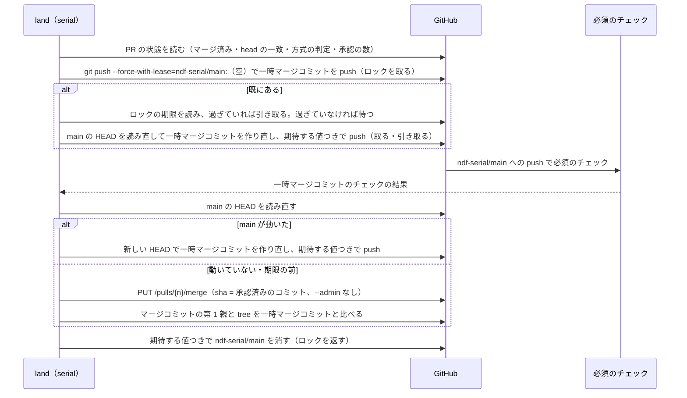
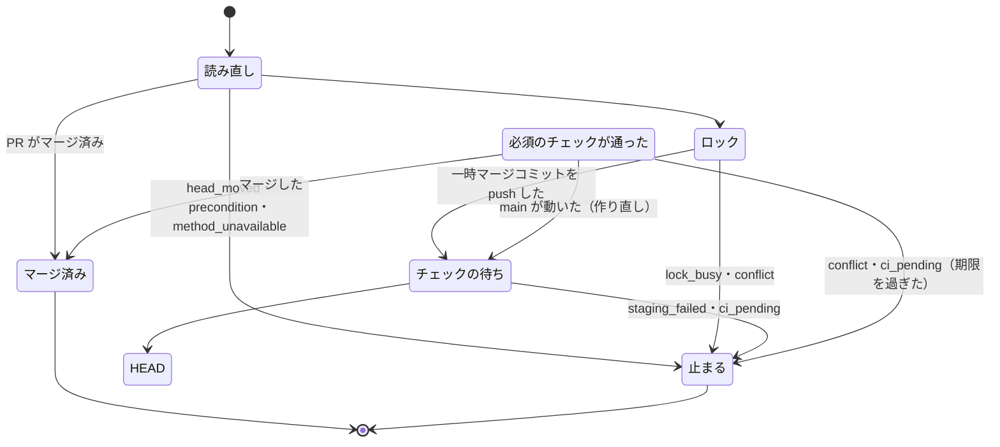

# #3641 のマージの方式 `serial` と方式の選び方: merge queue も ruleset も使えないリポジトリで GitHub flow を選べるようにする

設計文書 [issue-3641-design.md](issue-3641-design.md) から分けた文書である。決定の番号は [issue-3641-design-decisions.md](issue-3641-design-decisions.md) を、不変条件の番号（I1〜I17）は設計文書の「ドメインモデル」の表を、外部の調査の番号（`STD<数>`・`PRD<数>`・`LIB<数>`）は設計文書の「外部の調査」の表を指す。関数の粒度は [issue-3641-design-detail.md](issue-3641-design-detail.md) にある。

## 経緯

利用者の指摘（2026-11-16 08:3x JST）:

> merge queue は GitHub でも使えないプランがあるため、それが使えない場合の代替案を定義しておく必要があります。

指摘の前の設計は、ブランチ戦略 `trunk` のマージの方式に `merge-queue` か `strict` だけを受け、どちらでもない設定を断っていた。
`strict`（ruleset の「マージの前に最新の main を取り込む」）もブランチ保護の機能である。private の Free のリポジトリでは merge queue もブランチ保護も ruleset も使えない（STD9・STD10・STD11・STD12）。そのため private の Free のリポジトリは GitHub flow を選べなかった。

この文書は次の 2 つを足す。

- マージの方式の 3 つ目の値 `serial`（直列マージ）。GitHub の機能に頼らず、NDF が本番ブランチごとのロックを取って 1 本ずつマージする（bors-ng の形。PRD3）
- リポジトリの所有者・公開範囲・プランから使える方式を選ぶ表と、設定がその表に無い方式を指すときの止め方

ai-plugins は Organization の public のリポジトリで、merge queue のまま使う。ai-plugins の振る舞いと切り替えの手順（ [issue-3641-design-switch.md](issue-3641-design-switch.md) ）は変えない。

## マージの方式を選ぶ表

**使える方式は、所有者の種類・公開範囲・プランで決まる。** 出典は STD9（merge queue）・STD10（ブランチ保護）・STD11（ruleset）・STD12（プランの機能の一覧）で、取得日は 2026-11-16 である。

| 所有者 | 公開範囲 | プラン | `merge-queue` | `strict` | `serial` | 勧める方式 |
| --- | --- | --- | --- | --- | --- | --- |
| Organization | public | どれでも（Free を含む） | 使える | 使える | 使える | `merge-queue` |
| 個人アカウント | public | どれでも | 使えない | 使える | 使える | `serial` |
| Organization・個人アカウント | private | Free | 使えない | 使えない | 使える | `serial` |
| 個人アカウント | private | Pro | 使えない | 使える | 使える | `serial` |
| Organization | private | Team | 使えない | 使える | 使える | `serial` |
| Organization | private・internal | Enterprise Cloud | 使える | 使える | 使える | `merge-queue` |

- **`serial` はどの行でも使える。** 使うのは PR のマージの API・ブランチへの push・チェックの照会だけで、どれもプランを問わない
- **merge queue を使えない行では `serial` を勧める。** `strict` は main が進むたびに承認を待つ PR が main の HEAD を含まなくなり、取り込みと承認の取り直しが要る（決定 5）。`serial` は承認を取り直さない。`strict` を選ぶ利点は、GitHub が人の画面でのマージにも最新の取り込みを強制することである（「残る危険」）。どちらを選ぶかはリポジトリの持ち主が設定で決め、NDF は表にある方式ならどれも受ける
- internal の公開範囲は Enterprise Cloud にしか無い。STD9 の文は「private repositories owned by organizations using GitHub Enterprise Cloud」で internal を名指さないため、internal の merge queue は確かめていない（設計文書の「確かめられなかったこと」）。判定では internal を private と同じに扱う

## 方式の判定の手順

`check_method`（`merge_method.py`）は、設定の方式を ruleset と照らす前に、表で使える方式かを判定する（I17）。判定の値は `release_lib/method_select.py` の `usable_methods` が返す。

| 手順 | 読むもの | API | 読めないとき |
| --- | --- | --- | --- |
| 1 | 公開範囲と所有者の種類 | `GET /repos/{o}/{r}` の `visibility`・`owner.type`（読み取りの権限で読める） | 判定を「不明」にする |
| 2 | public なら、プランを読まずに表の行を決める | — | — |
| 3 | private・internal で所有者が Organization なら、プラン | `GET /orgs/{org}` の `plan.name`。Organization の owner にだけ返る（STD13） | 欄が無い（owner でない）・API の失敗なら「不明」 |
| 4 | private・internal で所有者が個人アカウントなら、プラン | `GET /user` の `login` が所有者と同じときだけ `plan.name`（STD13） | 所有者が別の人・API の失敗なら「不明」 |
| 5 | プランの名前を表の行へ当てる | `free`・`pro`・`team` だけを当てる | ほかの名前（Enterprise Cloud の名前を含む）は「不明」。確かめた値は `devbasex` の `free` と個人アカウントの `pro`（2026-11-16） |

| 判定 | 設定の方式 | 振る舞い |
| --- | --- | --- |
| 使える | 表で使える方式 | 続けて I6（ruleset との一致）を確かめる |
| 使えない | 表で使えない方式 | マージの前に止まる（原因 `method_unavailable`）。`summary` に設定の値・判定に使った所有者と公開範囲とプラン・使える方式を出し、`outputs.usable_methods` に使える方式を並べる |
| 不明 | `serial` | 止めない。`serial` はどのプランでも使える |
| 不明 | `merge-queue`・`strict` | 表では断らず、I6 の ruleset の検証に任せる。ruleset が設定と食い違えば `precondition` で止まり、`summary` に「プランを読めないため、確かに使えるのは `serial` だけ」と読めなかった理由を足す |

**プランを読めないときに断らないのは、表が案内で、ruleset が実物だからである。** ruleset の読み（`branch_rules`）は I6 がもともと行い、方式が実際に働くかを直接確かめる。プランの読みは Organization の owner でない利用者には返らない（STD13）。読めないだけで止めると、owner でない開発者は GitHub flow を使えなくなる。

## `serial` の形

### 何をするか

bors-ng（PRD3）と同じく、マージの前に「本番ブランチの HEAD と承認済みのコミットを合わせた一時マージコミット」を一時ブランチへ push し、そこで必須のチェックを走らせる。bors-ng と違う点は 2 つある。

- **1 本ずつで、まとめない。** bors-ng は複数の PR を 1 つの一時マージコミットにまとめる（batch）。この課題は最小限に留め、まとめない
- **main を fast-forward せず、PR をマージの API でマージする。** 承認済みのコミットを `sha` に渡し（STD1）、PR の head が承認済みのコミットのときだけ GitHub がマージする。PR はマージ済みの状態になり、人のマージの記録（I11）と同じ形で追える。main へ直接 push しないため、ブランチ保護のある行でも迂回の権限が要らない

本番の PR の head へは push しない。承認は承認済みのコミットに付いたままで、取り直さない。

### 処理の流れ

### `land` の状態の遷移（`serial`）

止まる遷移とマージ済みへの遷移は、どれもロックを返してから終わる（返せなかったときの扱いは「ロック」）。マージの関数が例外を投げたとき（マージの API の 409・405・422）も、ロックを取った後の処理を `try`/`finally` で囲み、`finally` で返す。

### 一時マージコミット

| 項目 | 値 |
| --- | --- |
| 親 | 第 1 親が本番ブランチの HEAD、第 2 親が承認済みのコミット |
| 作り方 | 一時の worktree で `git merge --no-ff <承認済みのコミット>` を実行する。衝突すれば作らずに `conflict` で止まり、スプリントの経路で main を取り込んだ新しい head で承認を取り直す |
| メッセージ | 1 行目は `ndf-serial: #<PR の番号>`。トレーラーにロックの持ち主の情報（下の表）を書く |
| 格納場所 | ブランチ `ndf-serial/<本番ブランチ>`（例 `ndf-serial/main`） |

## ロック

### 格納場所

**ロックは、一時マージコミットを置くブランチ `ndf-serial/<本番ブランチ>` そのものである。** ブランチがあればロックは取られている。持ち主の情報は、そのブランチの HEAD のコミットのトレーラーに書く。

| トレーラー | 値 |
| --- | --- |
| `NDF-Serial-PR` | 本番の PR の番号 |
| `NDF-Serial-Approved` | 承認済みのコミット（40 桁の SHA） |
| `NDF-Serial-Holder` | `<ホスト名>:<pid>` |
| `NDF-Serial-Deadline` | 持ち主の `land` が終わる時刻（ISO 8601、UTC）。`land` の開始の時刻に `ci_budget` の秒を足した値 |

ロックとチェックの対象を 1 つのブランチにまとめるのは、一時ブランチがどのみち要るからである。別にロックを置くと、ロックと一時ブランチの 2 つを揃えて書き換える必要があり、片方だけが残る形が増える。

比べた格納場所と採否は決定 14 にある。手元の持ち主のコンポーネント（`lib/lease.py`）とファイルロック（`lib/locks.py`）は、コンテナの中の状態のディレクトリに記録を置く。ほかの開発者のマシンや別のコンテナで動く `land` を排他できないため使わない（詳細設計の「既存の部品の再利用」）。

### 取る・作り直す・返す・引き取る

どの操作も `git push` の `--force-with-lease=<ref>:<期待する値>` で行う。GitHub の受け手が今の値と期待する値を比べ、違えば更新を断る。期待する値が空なら「ブランチが無いこと」を求める（STD14）。

| 操作 | コマンド | 断られたときの意味 |
| --- | --- | --- |
| 取る | `git push --force-with-lease=refs/heads/ndf-serial/main: origin <一時マージコミット>:refs/heads/ndf-serial/main` | ほかの持ち主がいる。ロックの期限を読む。待った後に取り直すときは、待つ間に先の持ち主のマージで main が動くため、main の HEAD で一時マージコミットを作り直してから push する（古い組み合わせで CI を走らせない） |
| 作り直す（main が動いた） | `--force-with-lease=refs/heads/ndf-serial/main:<自分の一時マージコミット>` で新しい一時マージコミットを push | 自分のロックがほかの工程に引き取られた。マージせずに `lock_busy` で止まる |
| 返す | `git push --force-with-lease=refs/heads/ndf-serial/main:<自分の一時マージコミット> origin :refs/heads/ndf-serial/main` | 既に引き取られている。何もせず、`items` に `lock_release: taken_over` を足す |
| 引き取る（期限を過ぎた） | main の HEAD で一時マージコミットを作り直し、`--force-with-lease=refs/heads/ndf-serial/main:<期限を過ぎたコミット>` で push | ほかの工程が先に引き取った。待ちへ戻る |

この 4 つの振る舞い（空の期待する値で無いときだけ作る・違う期待する値で更新も削除も断る）は、手元の bare リポジトリで確かめた（2026-11-16、git 2.53.0）。GitHub の受け手での振る舞いは「確かめられなかったこと」に書いた。

### 取りこぼし（持ち主のプロセスが落ちたとき）

| 場面 | 扱い |
| --- | --- |
| 持ち主が落ち、ロックが残る | 次の `land` がトレーラーの `NDF-Serial-Deadline` を読み、期限を過ぎていれば引き取る。期限の前なら自分の `ci_budget` の秒まで待ち、超えれば `lock_busy` で止まる |
| 期限を過ぎた持ち主が生きていた（停止していたなど） | 持ち主はマージの直前に自分の期限を確かめ、過ぎていればマージせずにロックを返して `ci_pending` で止まる。作り直しと返却は期待する値つきなので、引き取った工程のロックを壊さない |
| 期限を確かめた直後に期限を過ぎ、引き取りとマージが重なる | 引き取った工程はマージの直前に main の HEAD を読み直す。先の持ち主のマージで main が動いていれば作り直す（I15）。main に確かめていない組み合わせは入らない |
| トレーラーが読めない（人がブランチを作ったなど） | 期限が無いものとして扱わず、`lock_busy` で止まる。`summary` に「`ndf-serial/main` を人が消すか、期限のトレーラーを持つコミットにする」と出す。自動では消さない |

**持ち主は期限の前に終わる。** 期限は持ち主の `land` の待ちの上限と同じ値で、余白を足さない。持ち主は期限を過ぎたらマージしないため、期限の後に引き取っても 2 人の持ち主がマージすることはない。

ホストの時計のずれは、期限の比べにそのまま効く。ずれが大きいと、期限の前のロックを引き取ることがある。そのときも、作り直しと返却は期待する値つきで、マージの直前に main の HEAD を読み直すため、確かめていない組み合わせは main へ入らない。失うのは先の持ち主のチェックの待ちだけである。

## CI の待ちの上限

**`land` の全体の待ちを `ci_budget` の秒（プランの `ci_wait_timeout` を `--wait` で渡す。`merge-queue` と同じ値）で区切る。** ロックの待ち・一時マージコミットのチェックの待ち・作り直しの後の待ちは、どれもこの 1 つの上限の中で数える。

| 待ち | 終わる条件 | 上限を超えたとき |
| --- | --- | --- |
| ロックの待ち | ブランチが無くなる・期限を過ぎる | `lock_busy`。`summary` に持ち主の PR の番号と期限 |
| 一時マージコミットのチェック | `.ndf/project.json` の `ci.required_checks` の名前のチェックが一時マージコミットにそろって終わる。名前ごとに check run と commit status の `context` の両方を見て、付いている出どころの最新がどれも成功するまで待つ（外部の CI は commit status でだけ結果を出す。同じ名前の両方が付いていれば両方の成功を求める）。ruleset が名前に発行元のアプリを指定していれば、そのアプリのものだけを数える | `ci_pending`。ロックを返す |
| 作り直しの後のチェック | 同上 | 同上 |

- **作り直しの回数に別の上限を置かない。** 作り直すたびにチェックを待ち直すが、全体の時間は `ci_budget` が区切る。main への入りが速いリポジトリでは `ci_pending` で止まり、`land` を再実行すると最初から（ロックを取るところから）続く
- **見るチェックは `.ndf/project.json` の `ci.required_checks` である。** merge queue と `strict` は ruleset の必須のチェックを GitHub が見るが、`serial` を使う private の Free には ruleset が無い。`serial` で `ci.required_checks` が空なら、確かめるものが無いため `precondition` で止まる
- **同じ名前の別の発行元の成功では通さない。** ruleset かブランチ保護が必須のチェックの名前に発行元のアプリを指定していれば、そのアプリの check run と、そのアプリの bot が付けた commit status だけを数える（#3506 の迂回のマージと同じ規則）。指定の無い名前だけを、発行元を問わず名前で照らす
- **チェックが 1 つでも失敗すれば `staging_failed` で止まる。** 同じ一時マージコミットで再実行しない（組み合わせが落ちたなら、同じ組み合わせで落ちる。merge queue の `queue_removed` と同じ扱い）。ロックを返し、スプリントの経路へ差し戻す
- 待ちは `lib/waits.py` を使い、自前の `sleep` の繰り返しを書かない

## 一時ブランチで走らせる CI

`serial` を選ぶリポジトリは、必須のチェックを出す workflow の `on.push.branches` に `ndf-serial/**` を足す。足さないと一時マージコミットにチェックが付かず、`land` は `ci_pending` まで待つ。
ai-plugins は `merge-queue` を使うため、この課題では ai-plugins の workflow に足さない（`merge_group` だけを足す。決定 9）。

`ci_pending` の `summary` には、一時マージコミットにチェックが 1 つも付いていないとき「`ndf-serial/**` への push で必須のチェックが走るか、workflow の `on.push` を確かめる」を出す。

## 版上げの PR（`serial`）

`serial` では、CD（`trunk-steps.py cd`）は版上げの PR を作るが、自動マージをリクエストしない。ブランチ保護の無いリポジトリでは、自動マージがチェックを待つ保証が無いためである（GitHub の振る舞いは「確かめられなかったこと」）。

版上げの PR は、リリースのワークフローの `confirm`（`trunk_cd.confirm`）が `serial` の同じ手順（ロック → 一時マージコミットのチェック → マージ）で入れる。

- `confirm` は、版上げの PR が I3 の判定（`is_bump_pr`）を通り、利用者の設定と指示書を変えていないことを確かめてから入れる（I5。今の自動マージのリクエストの前の確かめと同じ）
- ruleset が承認を 1 件以上求め、版上げの PR の `reviewDecision` が `APPROVED` でなければ、`confirm` はロックを取らずに `precondition` で止まり、`summary` に求める承認の数と版上げの PR の番号を出す（I14）。一時マージコミットの CI を待ち切った後にマージの API が拒むのを避けるためである
- 版上げの PR の head は CD が作ったコミットで、承認済みのコミットの代わりに `confirm` が読んだ head を `sha` に渡す
- `confirm` が走らずに版上げの PR が残ったとき（人が画面で本番の PR をマージしたなど）は、次のリリースの `confirm` が入れるか、人が画面でマージする。開いた版上げの PR がある間、CD は新しく作らない（I9）

## 残る危険

**`serial` の排他は NDF の工程どうしにだけ効く。** private の Free にはブランチ保護が無く、GitHub はマージに何も強制しない。

| 危険 | 起きる形 | 扱い |
| --- | --- | --- |
| 人が画面でマージする | ロックの外で main が動く | マージの直前の HEAD の読み直しで、`land` は作り直す。人のマージの組み合わせは確かめられていないが、main への push の CI が結果を出す |
| 読み直しとマージの API の間に、ロックの外のマージが入る | GitHub のマージの API は main の HEAD の期待する値を受けない | マージの後に、マージコミットの第 1 親と tree を一時マージコミットと比べる。違えば `ok` のまま `items` に `untested_combination` を足し、`summary` で main の CI を見るよう知らせる（マージは済んでいるため止まらない） |
| 書き込みの権限を持つ人が `ndf-serial/main` を消す・書き換える | ロックが外れる | 作り直しと返却は期待する値つきで、書き換えられていれば `lock_busy` で止まる。マージの前の読み直しは変わらず働く |

ブランチ保護のある行（Pro・Team・Organization の public など）で `serial` を選ぶリポジトリは、ruleset に（`strict` を外した）必須のチェックを置けば、人の画面でのマージにも PR の head のチェックを強制できる。`serial` は ruleset に merge queue の規則が無く、`strict_required_status_checks_policy` が偽であることを求める（I6）。merge queue の規則があればマージの API が断られ、`strict` が真なら main を含まない PR の head のマージが断られるためである。

## 止まった理由

`land` の結果 JSON の原因に、次の 4 つを足す（今の 6 つは設計文書の「入出力の契約」）。

| 原因 | 意味 | 次にすること |
| --- | --- | --- |
| `method_unavailable` | 設定の方式が、表でこのリポジトリに使えない（I17） | `outputs.usable_methods` のどれかへ `.ndf/project.json` の `production_merge.method` を直す |
| `lock_busy` | ロックを `ci_budget` の秒の中で取れない・自分のロックが引き取られた・トレーラーの無いブランチがある | 再実行する。トレーラーの無いブランチは人が消す |
| `conflict` | 本番ブランチの HEAD と承認済みのコミットが衝突する | スプリントの経路で main を取り込み、新しい head で承認を取り直す |
| `staging_failed` | 一時マージコミットの必須のチェックが失敗した | スプリントの経路へ差し戻す。`summary` に失敗したチェックの名前と一時マージコミットの SHA |
