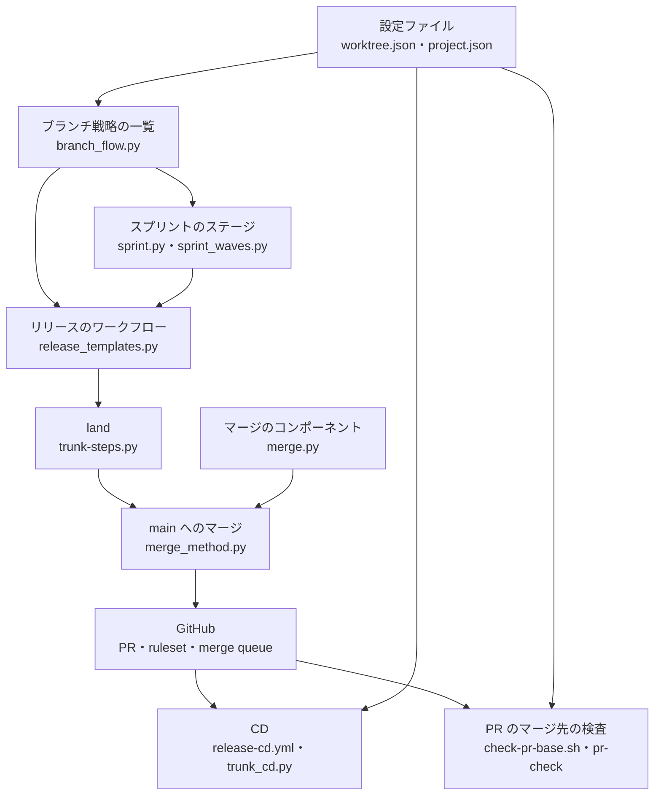
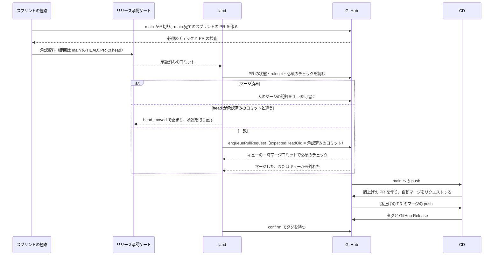
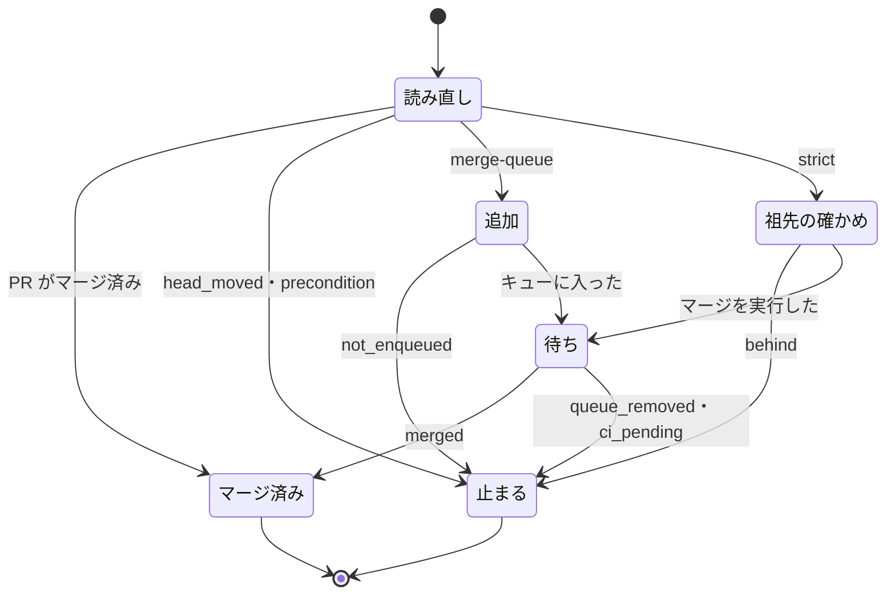

# 今の NDF のブランチ戦略: GitHub flow を選べるようにし、ai-plugins を develop と main の 2 本から移す（#3641）

## 目的

- **今どうなっているか**: 今の NDF（`plugins/ndf/`）が選べるブランチ戦略は、develop と main の 2 本を使う 2 行（`whole`・`selected`）だけである。ai-plugins は develop で開発し、リリースのたびに検査の範囲・コミット・バージョンを develop と main の間で運ぶ。2026-11-15〜16 のリリースの事故（リリース 8・14〜22）は、この運びから起きている
- **誰に効くか**: ai-plugins の開発者とリリースの承認者。GitHub flow で運用したい NDF の利用者
- **変えると何が成り立つか**: スプリントブランチを main から切り、承認済みのコミットのスプリントの PR を main へマージすることがリリースになる。バージョン・CHANGELOG・タグは CD がマージの後に作る。develop を経る経路（同期の PR・develop 宛ての部分的な検査・develop からのリリースの PR）が ai-plugins で走らなくなる

## 適用範囲

- **働く範囲**: 今の NDF を使うすべてのリポジトリ。GitHub flow は、設定ファイルで選んだリポジトリだけで働く。ai-plugins はこの課題の切り替えの手順で選ぶ
- **プロジェクトごとに違うもの**: 設定ファイルで受ける
  - ブランチ戦略: `.ndf/worktree.json` の `branch_flow.promotion`
  - マージの方式: `.ndf/project.json` の `production_merge.method`
- **当たるモード**: `standard`（ブランチ戦略・リリースのワークフロー・CD の振る舞いを変え、公開の設定に値を足す）

### 代表のリポジトリでの振る舞い（受け入れ条件 16）

| リポジトリ | 設定の値 | 振る舞い |
| --- | --- | --- |
| ai-plugins（切り替えの後） | `promotion: trunk`・`method: merge-queue` | スプリントを main から切り、スプリントの PR を main へ出す。リリース承認ゲートの後に、承認済みのコミットを merge queue へ入れる。マージの後に CD が版上げの PR を作り、そのマージでタグと GitHub Release を作る。同期の PR と開発版のステージは、ブランチ戦略 `trunk` が持たない（I8・I12） |
| nd-factory（`selected`） | `promotion: selected`（変えない） | 今のまま。スプリントの分岐元・PR のマージ先・リリースブランチの組み立て・同期の PR・開発版のデプロイ（`release-steps release --channel dev`）は変わらない |
| 設定ファイルの無いリポジトリ | どれも無い（既定の `whole`） | 今のまま。develop があれば develop を分岐元にし、開発版のデプロイを使える。マージの方式は無く、今のマージ（head の一致の確認付き）を実行する |
| private の Free の Web サービス（GitHub flow を選ぶ） | `promotion: trunk`・`method: serial` | merge queue もブランチ保護（ruleset）も使えない（STD9・STD10・STD11）。リリース承認ゲートの後に、`land` が本番ブランチごとのロックを取り、main の HEAD と承認済みのコミットを合わせた一時マージコミットで `.ndf/project.json` の `ci.required_checks` を走らせてからマージする。承認は取り直さない。版上げの PR も `confirm` が同じ手順で入れる（ [issue-3641-design-serial.md](issue-3641-design-serial.md) ）。開発版のデプロイは持たない（ai-plugins と同じ） |

**ai-plugins は Organization の public のリポジトリで、`merge-queue` のまま使う。** `serial` の追加は ai-plugins の設定の値・振る舞い・切り替えの手順を変えない。方式を選ぶ表（所有者・公開範囲・プラン → 使える方式）は [issue-3641-design-serial.md](issue-3641-design-serial.md) の「マージの方式を選ぶ表」にある。

**開発版を外す層は、ブランチ戦略に置く。** 開発版チャネルはベースブランチに載るチャネルで、ブランチ戦略 `trunk` ではベースブランチが本番ブランチと同じである（I1）。本番ブランチのほかに変更の載るブランチが無いため、ブランチ戦略 `trunk` は開発版のステージと開発版のデプロイのステップを持たない（I8・I12、決定 3）。ai-plugins の `.ndf/supervise.json` から `release.dev_workflow` を外すのは、ブランチ戦略 `trunk` が読まない値を残さないためで、開発版を外す理由ではない。

**開発版のデプロイの機能は残す。** 次のコードは変えない。ブランチ戦略 `whole`・`selected` が使う。

- 開発版チャネルと `-dev.N` の版数
- `release-steps release --channel dev`
- `verify-install --ref <ベースブランチ>`

ai-plugins で使わなくなるのは、ai-plugins がブランチ戦略 `whole` からブランチ戦略 `trunk` へ設定の値を変えるためである。ブランチ戦略 `trunk` を選んだほかのリポジトリでも開発版のデプロイ（Web の staging への反映を含む）は使えない。要求（前提 10・受け入れ条件 16）との関係は「人へ残す判断」に載せる。

## あるべき姿の根拠

| 根拠 | 種類 | 何を示すか |
| --- | --- | --- |
| STD9〜STD12（merge queue・ブランチ保護・ruleset の提供条件） | 外部の一次情報 | private の Free では merge queue もブランチ保護も ruleset も使えない。GitHub の機能に頼らない方式 `serial` が要る |
| 利用者の指摘（2026-11-16 08:3x）「merge queue は GitHub でも使えないプランがあるため、それが使えない場合の代替案を定義しておく必要があります」 | 利用者の指示の原文 | マージの方式に `serial` を足し、使える方式を選ぶ表を置く |
| STD2（GitHub flow） | 外部の一次情報 | 既定ブランチから切ったブランチを PR で既定ブランチへマージする形が、GitHub の示すブランチ戦略である |
| STD3・LIB1（merge queue） | 外部の一次情報 | 同時に承認された PR の組み合わせは、merge queue が main の HEAD と前に並ぶ PR を合わせた一時マージコミットで確かめる |
| 利用者の指示（2026-11-16）「11.0 でリリースするのでは遅いです。今かなり事故っているので、11.0 自体の開発に支障が出ています」 | 利用者の指示の原文 | ndf-next を待たずに今の NDF で GitHub flow へ移る |
| 利用者の決定（2026-11-16、`ndf-ask:redline:P1`）「B を優先」と追加の決定（開発版をやめる） | 利用者の指示の原文 | P1 の承認。ai-plugins の手順から開発版を外し、汎用の機能は残す |
| 起票の時点の事故の表（要求の「目的」） | 実測 | 事故 4 種のうち 3 種は develop と main の間の運び（検査の範囲・コミット・バージョン）から起きた |

要求と受け入れ条件は #3641 の本文にある（コピーは [issue-3641-requirements.md](issue-3641-requirements.md) ）。この文書は「どう作るか」だけを扱う。

| 分けた文書 | 格納場所 |
| --- | --- |
| 決定の記録 | [issue-3641-design-decisions.md](issue-3641-design-decisions.md) |
| 切り替えの手順（受け入れ条件 17・18） | [issue-3641-design-switch.md](issue-3641-design-switch.md) |
| マージの方式 `serial` と方式の選び方（受け入れ条件 20〜23） | [issue-3641-design-serial.md](issue-3641-design-serial.md) |
| 詳細設計（ファイルと関数の粒度） | [issue-3641-design-detail.md](issue-3641-design-detail.md) |

手本は #3572 の設計（ [issue-3572-design.md](issue-3572-design.md) ）のブランチ戦略 `trunk` である。そのうち今すぐ移るのに要るものだけを今の NDF に入れる。

## ドメインモデル

### コンテキスト

| コンテキスト | 何の語が 1 つの意味に決まるか |
| --- | --- |
| ブランチ戦略（`branch-flow`） | ブランチ戦略・分岐元・マージ先・文書の PR のマージ先・スプリントブランチを残すか |
| リリース（`release`） | 本番の PR・承認済みのコミット・マージの方式・リリースのワークフロー |
| CD（`delivery`） | 版上げの PR・バージョン・タグ・GitHub Release |

| 関係 | 種類 | やり取りするもの |
| --- | --- | --- |
| ブランチ戦略 → リリース・CD | 公表された言語 | 設定ファイルのスキーマ（`worktree.schema.json`・`project.schema.json`）に書かれた値だけ。リリースと CD はブランチ戦略の値を読み、ブランチ戦略の中身（どの値を許すか）を持たない |
| リリース ↔ CD | 共有カーネル | バージョンアップの書き換え（`release-steps.py` の `plan_bump`）・CHANGELOG の書き換え（`cmd_changelog`・`cmd_notes`）・タグと GitHub Release の作成（`publish`）・版上げの PR の見分け（I3） |

CD はリリースのコンテキストのバージョンアップ・CHANGELOG・`publish` の関数を写さずに呼ぶ（決定 10・11）。これらの関数は両方のコンテキストの言葉で同じ意味を持つため、境界を引き直さず共有カーネルとして扱う。共有カーネルの関数を変える PR は、リリースと CD の両方のテストを通す。
承認の記録（`lib/approved_commit.py`）は、書き手のリリース承認ゲートも読み手の `land` もリリースのコンテキストにあり、コンテキストをまたがない。

### 集約

| 集約 | 持ち主（書き換えてよいもの） | 根 | エンティティ | 値オブジェクト |
| --- | --- | --- | --- | --- |
| ブランチ戦略の一覧 | ブランチ戦略の表（`lib/branch_flow.py` の `PROMOTIONS`） | 行 | — | 行の値（許す分岐元・マージ先・文書のマージ先・残すか・集めるか） |
| スプリントブランチとスプリントの PR | スプリントの経路（`supervise_lib/sprint_waves.py` の検査のプラン） | スプリントの PR | コミット | head・マージ先・バージョン種別のラベル |
| リリースのワークフロー | リリースのワークフローの組み立て（`supervise_lib/release_templates.py`） | リリースのワークフローの種類 `trunk` | ステップ | ステップの並び |
| main へのマージ | main へのマージ（`release_lib/merge_method.py`） | main 宛ての PR（版上げの PR を除く） | 人のマージの記録 | 承認済みのコミット・マージの方式・承認ゲートを通ったか・マージコミット |
| main のバージョン | CD（`release_lib/trunk_cd.py`） | 版上げの PR | タグ・GitHub Release | バージョン・バージョン種別・範囲 |

**main へのマージの書き手は `merge_method.py` 1 つにする。** main 宛ての PR（版上げの PR を除く）をマージする・キューへ入れる・人のマージの記録を書く API の呼び出しは、このモジュールだけが実行する。I4・I5・I6・I11・I13・I14・I15・I17 はこのモジュールの中で守る。`serial` のロックと一時マージコミット（`serial_merge.py`）はマージの API を実行せず、このモジュールが渡したマージの関数をロックの中で呼ぶ。次の 2 つは、このモジュールを呼ぶだけで、マージの API を直接実行しない。

| 呼び手 | 渡すもの |
| --- | --- |
| `trunk-steps.py land` | 承認済みのコミットと、承認ゲートを通ったこと |
| `merge-when-green` の `merge.py` | 承認ゲートを通ったか（`--gate-approved` から） |

**版上げの PR の自動マージのリクエストは、main のバージョンの集約の書き手 `trunk_cd.py` が実行する。** 版上げの PR は main のバージョンの集約の根であり、main へのマージの集約に含めない。`trunk_cd.py` が `merge_method.py` を呼ぶと、`merge_method.py` が版上げの PR の見分け（I3）で `trunk_cd.py` を呼ぶのと合わせて依存が輪になるためである。この経路では I4 と I5 を `trunk_cd.py` が守る。I4 は、自分が作るか取り込んだ後に読み直した head を `gh pr merge --merge --match-head-commit <SHA>` へ渡して守る。I5 は、リクエストの前に I3 の判定（head のブランチが `release/v` で始まり、差分が版数と説明だけ）を通った PR にだけリクエストして守る。チェックの後の merge queue への追加とマージは GitHub が行う（STD8）。方式 `serial` では自動マージをリクエストせず、`confirm` が `serial_merge.py` のロックの中で版上げの PR をマージする（ [issue-3641-design-serial.md](issue-3641-design-serial.md) の「版上げの PR（`serial`）」）。

**版上げの PR の経路でも I14 を `trunk_cd.py` が守る。** ruleset が承認を 1 件以上求めるリポジトリでは、承認の無い版上げの PR の自動マージは発火しない。そのまま待つと、`confirm` が `ci_budget` を使い切り、`ci_pending`（チェックかキューで待っている）という実際と違う原因で止まる。これを避けるため、ruleset の読みを `merged_lib/required_checks.py` の `branch_rules` に置き、`merge_method.py` の `check_method` と `trunk_cd.py` の両方から呼ぶ。`create_bump_pr` と `update_bump_pr` は自動マージを頼んだ後に求める承認の数を読み、1 以上なら `run_cd` を `CdStop("precondition")` で止め、注釈に求める承認の数と版上げの PR の番号を書く。`run_cd` が開いた版上げの PR を見つけて何もせずに終わる分岐（I9）でも同じ確かめを行い、求める承認の数が 1 以上で PR の `reviewDecision` が `APPROVED` でなければ同じく止める。承認待ちの版上げの PR が開いたまま次の PR がマージされたとき、その push の CD が成功で終わると、そのマージの `confirm` が `ci_pending` で止まるためである。`confirm` はこの CD の実行の失敗を `cd_failed` として読み、注釈の理由を `summary` に出す。

**main のバージョンを変えてよいかの判定は `trunk_cd.py` に置く。** PR の検査（`pr-check`）と I5 の判定（版上げの PR を通すか）は、この判定の関数を呼ぶ。
承認の記録そのもの（`lib/approved_commit.py` の `record_approval`）は、今のリリース承認ゲートが書く。`land` は読むだけである。

### 不変条件

| # | 集約 | 条件 | 破れたときの扱い |
| --- | --- | --- | --- |
| I1 | ブランチ戦略の一覧 | ブランチ戦略 `trunk` を選んだ設定は、ベースブランチと本番ブランチが同じブランチである | 設定を読む側が止まり、2 つの値を理由に出す（`FlowError`） |
| I2 | スプリントブランチとスプリントの PR | ブランチ戦略 `trunk` では、スプリントブランチは `origin/<本番ブランチ>` から切り、スプリントの PR のマージ先は本番ブランチである | 分岐元かマージ先が違えば worktree の用意か PR の作成が止まる |
| I3 | main のバージョン | ブランチ戦略 `trunk` で、本番ブランチ宛ての PR はバージョンの格納場所（`plugin.json` の `version`）を変えない。例外は版上げの PR だけで、head のブランチが `release/v` で始まり、差分が版数と説明だけ（`scripts/ci-heavy-skip.py` の `version_only` と同じ判定）であることで見分ける | PR の検査（`guard`）が落ち、理由に「バージョンは CD がマージの後に上げる」を出す |
| I4 | main へのマージ | 本番ブランチへ入れる head は、承認済みのコミットだけである。merge queue への追加とマージは承認済みのコミットを GitHub へ渡して実行する | head が違えば追加もマージもせずに止まり、承認を取り直すよう理由を返す |
| I5 | main へのマージ | ブランチ戦略 `trunk` で、リリース承認ゲートを通らずに本番ブランチへ入る PR（設計 PR・確定仕様化の PR・版上げの PR）は、配るプラグインの中身と、利用者の設定（`.ndf/` の下）・指示書（どの深さでも名前が `AGENTS.md`・`CLAUDE.md` のファイル）を変えない（C7）。版上げの PR は版数と説明だけを変える（`trunk_cd.py` が自動マージのリクエストの前に確かめる） | マージが止まり、理由に「リリース対象・利用者の設定・指示書を変える PR はリリースのワークフローを通す」と変わったプラグインとファイルを出す。設定と指示書の変更は、リリース承認ゲートか人の GitHub でのマージで人が見る |
| I6 | main へのマージ | ブランチ戦略 `trunk` ではマージの方式の記述が必須で、設定の方式と本番ブランチの ruleset（merge queue の規則の有無・`strict_required_status_checks_policy`）が一致する。`serial` は merge queue の規則が無く `strict_required_status_checks_policy` が偽であること（ruleset が無いことを含む）を求める | マージの前に止まり、設定の値と ruleset の値を理由に出す |
| I7 | リリースのワークフロー | ブランチ戦略 `trunk` のリリースのワークフローは、リリース承認ゲートの後にコードを変えて本番の PR へ push するステップ（作業のステップ・修正ステップ）を持たない | テンプレートを作成する関数がそのステップを含めたらテストが落ちる |
| I8 | リリースのワークフロー | ブランチ戦略 `trunk` のリリースのワークフローは、同期の PR・次のバージョンのブランチ・開発版のデプロイ（`--channel dev` と、開発版のステージでの導入の確かめ `verify-install --ref <ベースブランチ>`）のステップを持たない。本番ブランチへの導入の確かめ（`verify-install --ref <本番ブランチ>`）は持つ。ブランチ戦略 `trunk` では 2 つの ref が同じブランチになるが（I1）、禁止するのは開発版のステージに置く確かめだけである | ブランチ戦略の値で分けた振る舞いをテストが見る |
| I9 | main のバージョン | CD はリリース対象の変化が範囲にあるときだけバージョンを上げ、開いた版上げの PR があれば新しく作らない | 変化が無い・開いた PR があるときは版上げの PR を作らずに成功で終わる |
| I10 | ブランチ戦略の一覧 | ブランチ戦略 `whole`・`selected`・宣言の無い既定の振る舞いを変えない | 今のテストが落ちる |
| I11 | main へのマージ | 人が GitHub で本番の PR をマージした後に工程を再開すると、マージ済みとして後の工程へ進み、もう一度マージしない。人のマージの記録は PR のコメントに 1 回だけ書く | マージ済みの PR へマージか merge queue への追加を実行すればテストが落ちる |
| I12 | スプリントブランチとスプリントの PR | ブランチ戦略 `trunk` のスプリントのステージは、開発版のステージを置かない | ブランチ戦略の値で分けた振る舞いをテストが見る |
| I13 | main へのマージ | ブランチ戦略 `trunk` で方式があるとき、`production_merge.admin` が真でも迂回のマージ（`--admin`）を実行しない。迂回すると ruleset の必須のチェックと承認を飛ばし、承認の外の head が main へ入りうるためである | `--admin` を付けずにマージか merge queue への追加へ進む。ruleset が拒めば止まり、理由に「方式があるため `--admin` を使わない」と ruleset が拒んだ理由を出す |
| I14 | main へのマージ | ブランチ戦略 `trunk` で本番ブランチの ruleset がレビューの承認を求めるとき、PR に求める数の承認が無ければマージも merge queue への追加もしない。追加しても GitHub が受け付けず、待ちが終わらないためである | マージの前に止まり、理由に ruleset が求める承認の数と PR の承認の数を出し、GitHub で PR を承認するよう返す。版上げの PR では `run_cd` が `precondition` で止まり、注釈に求める承認の数と版上げの PR の番号を書く。`confirm` はそれを `cd_failed` の理由として出す |
| I15 | main へのマージ | 方式 `serial` で、`land` が本番ブランチへマージするのは、第 1 親が今の本番ブランチの HEAD の一時マージコミットで必須のチェック（`ci.required_checks`）が通った後だけである。マージの直前に HEAD を読み直し、一時マージコミットの第 1 親と違えば作り直す。承認済みのコミットを `sha` に渡し、本番の PR の head へ push しない（承認を取り直さない） | HEAD が動いていればマージせずに一時マージコミットを作り直す。チェックが失敗すれば `staging_failed`、衝突すれば `conflict` で止まる。読み直しとマージの API の間に入ったロックの外のマージは、マージの後の第 1 親と tree の比べで `untested_combination` を `items` に出す（ [issue-3641-design-serial.md](issue-3641-design-serial.md) の「残る危険」） |
| I16 | main へのマージ | 方式 `serial` のロック（ブランチ `ndf-serial/<本番ブランチ>`）は、取る・作り直す・返す・引き取るのどれも期待する値つきの push（`--force-with-lease`）で書く。持ち主は自分の期限（`NDF-Serial-Deadline`）を過ぎたらマージしない。期限を過ぎたロックだけをほかの工程が引き取る | 期待する値と違えば書き換えずに `lock_busy` で止まる。期限を過ぎた持ち主はロックを返して `ci_pending` で止まる。トレーラーの無いブランチは自動で消さずに `lock_busy` |
| I17 | main へのマージ | ブランチ戦略 `trunk` で、設定の方式は、リポジトリの所有者・公開範囲・プランから使える方式（方式を選ぶ表）に含まれる。判定は I6 の ruleset の検証の前に行う | 表で使えなければマージの前に `method_unavailable` で止まり、使える方式を `outputs.usable_methods` と `summary` に出す。プランを読めない（不明）ときは断らず、`serial` はそのまま、`merge-queue`・`strict` は I6 の ruleset の検証に任せる |

### ドメインイベント

| # | イベント | 発生元 | 受け手 |
| --- | --- | --- | --- |
| E1 | 移る前の最後の develop の変更を main へ入れた | 切り替えの手順（今の `whole` のリリース） | 設定の PR |
| E2 | ai-plugins の設定を GitHub flow へ書き換えた | 設定の PR のマージ（人が GitHub でマージ） | CD・スプリントの経路・ruleset の変更 |
| E3 | 動いているレーンのブランチと PR のマージ先を main へ付け替えた | 切り替えの手順 | 各レーンのリリースのワークフロー |
| E4 | スプリントブランチを main から切った | スプリントの経路（`worktree-setup.sh`） | 実装のプラン |
| E5 | スプリントの PR を main 宛てに作った | 検査のプランの `pr` のステップ | PR の検査（`guard`）・リリース承認ゲート |
| E6 | リリース承認ゲートで本番の PR の head を承認した | リリース承認ゲート | GitHub flow のマージ（`trunk-steps.py land`） |
| E7 | 承認済みのコミットとの一致の確認付きで main へマージした（merge queue ならキューへ入れた） | `trunk-steps.py land`、または人の GitHub でのマージ | CD |
| E8 | 同時に承認されたほかの PR との組み合わせが必須のチェックを通った | GitHub の merge queue（`strict` では最新の取り込みの規則、`serial` では `land` が push した一時マージコミットのチェック） | `trunk-steps.py land` の待ち |
| E9 | CD がバージョンを上げ、CHANGELOG・タグ・GitHub Release を作った | CD（`trunk-steps.py cd`） | `trunk-steps.py land` の後の CD の確かめ・リリース後テスト |
| E10 | クリーンアップと終わりの記録を行った | リリースのワークフローの `record`・`cleanup` | 次のスプリント |

E9 は 2 回の push に分かれる。スプリントの PR のマージの push で CD が版上げの PR を作り、版上げの PR のマージの push で CD がタグと GitHub Release を作る。

### 用語

| 用語 | 意味 | 用語集への反映 |
| --- | --- | --- |
| 取り込み方 | スプリントの変更を本番チャネルへ入れる方法。`whole`・`selected` に加え、`trunk`（GitHub flow。スプリントの PR を本番ブランチへ直接マージする）を選べる | 意味の変更（今の NDF の値 `trunk` を足した） |
| スプリントの PR | スプリントブランチからマージ先へ出す、検査のプランの PR。ブランチ戦略 `trunk` ではマージ先が本番ブランチで、本番の PR を兼ねる | 意味の変更（ブランチ戦略 `trunk` のマージ先を足した） |
| 本番の PR | 本番チャネル（main）へ入れる Pull Request。ブランチ戦略 `trunk` ではスプリントの PR が兼ね、版上げの PR は含まない | 意味の変更（今の NDF のブランチ戦略 `trunk` を足した） |
| 版上げの PR | ブランチ戦略 `trunk` で、main へのマージの後に CD が main の HEAD から作る、版数と説明だけを変える main 宛ての PR（head は `release/v<バージョン>`） | 意味の変更（今の NDF のブランチ戦略 `trunk` の意味を足した） |
| GitHub flow | スプリントブランチを本番ブランチ（main）から切り、PR で main へマージし、マージをリリースとするブランチ戦略。設定の値とブランチ戦略の一覧の行の名前は `trunk` | 足す語 |
| 同期の PR | 今の NDF のブランチ戦略 `whole`・`selected` で、本番のリリースの後に main の変更をベースブランチ（develop）へ戻す PR（`release/v<版>-sync`）。GitHub flow では作らない | 足す語 |
| 切り替えの手順 | リポジトリのブランチ戦略を、develop と main の運用から GitHub flow へ切り替える一度きりの手順。利用者が新しい版へ移るときの「移行の手順」とは別 | 足す語 |

4 語の意味の変更と 3 語の追加は、この設計と同じ PR で用語集（`docs/glossary.md`・`docs/glossary/glossary.json`）へ反映する。この文書・決定の記録・切り替えの手順は、この対象を「版上げの PR」、そのコミットを「版上げのコミット」（用語集の既存の項目）とだけ呼ぶ。

merge queue・マージの方式・承認済みのコミット（用語集の「承認した head」）・ブランチ戦略は、用語集の既存の項目の意味のまま使う。マージの方式の値に `serial` が加わるが、語の意味（承認した複数の PR の組み合わせを確かめてから main へマージする方式）は変わらない。`serial` の一時マージコミットは merge queue の一時マージコミット（merge group）と同じ語で呼ぶ。

## 外部の調査

| 種類 | 調べるか | 理由 |
| --- | --- | --- |
| 標準・仕様 | 調べる | マージの一致の確認・merge queue・ruleset の迂回・workflow を起こすトークンの規則・各機能の提供条件（プランと公開範囲）は GitHub の仕様で決まる |
| 主要な製品 | 調べる | マージの後にバージョンとタグを CI が作る形には広く使われる例がある |
| ライブラリとサービス | 調べる | 組み合わせの確かめとバージョンアップを、既存のサービスとツールに任せられるかを比べる |

### 標準・仕様

| # | 標準・仕様 | 何を定めているか | 設計への反映 | 出典 |
| --- | --- | --- | --- | --- |
| STD1 | GitHub REST「Merge a pull request」 | 本文の `sha` は「SHA that pull request head must match to allow merge」。一致しなければ 409 | `strict` のマージに承認済みのコミットを渡す（I4） | https://docs.github.com/en/rest/pulls/pulls#merge-a-pull-request （2026-11-15、#3572 の調査） |
| STD2 | GitHub Docs「GitHub flow」 | 既定ブランチから切ったブランチを PR で既定ブランチへマージする | ブランチ戦略 `trunk`（決定 1） | https://docs.github.com/en/get-started/using-github/github-flow （2026-11-15、#3572 の調査） |
| STD3 | GitHub Docs「Managing a merge queue」 | 「You must use the `merge_group` event to trigger your GitHub Actions workflow when a pull request is added to a merge queue」。必須の保護の条件を満たした PR だけを、書き込みの権限を持つ者がキューへ入れられる | 必須のチェックを出す workflow へ `merge_group` を足す（決定 9）。キューへ入れる前に ruleset のレビューの承認を確かめる（I6） | https://docs.github.com/en/repositories/configuring-branches-and-merges-in-your-repository/configuring-pull-request-merges/managing-a-merge-queue （2026-11-16） |
| STD4 | GitHub Docs「Merging a pull request with a merge queue」 | 「If the pull request can't be added to the queue immediately, GitHub enables auto-merge and adds the pull request to the queue when requirements are met」。この文は Web の画面の操作の振る舞いで、`enqueuePullRequest` がすぐに入れられないときに何を返すかは書いていない | 本番の PR は `enqueuePullRequest` で入れ、追加の成否は応答ではなく追加の後の PR の状態で読む（決定 6） | https://docs.github.com/en/pull-requests/how-tos/merge-and-close-pull-requests/merging-a-pull-request-with-a-merge-queue （2026-11-16） |
| STD5 | GitHub Docs「Triggering a workflow」 | 「events triggered by the `GITHUB_TOKEN` will not create a new workflow run」。`GITHUB_TOKEN` が PR を作ると、`pull_request` の実行は承認待ちの状態で作られる。例外は `workflow_dispatch` と `repository_dispatch` | 版上げの PR は `GITHUB_TOKEN` でなくシークレット `NDF_RELEASE_TOKEN` で作る（決定 8） | https://docs.github.com/en/actions/writing-workflows/choosing-when-your-workflow-runs/triggering-a-workflow （2026-11-16） |
| STD6 | GitHub Docs「Creating rulesets for a repository」の迂回 | 迂回の形「For pull requests only」は直接の push を許さず、PR の保護の迂回だけを与える | CD は main へ直接 push せず、版上げの PR で入れる（決定 7） | https://docs.github.com/en/repositories/configuring-branches-and-merges-in-your-repository/managing-rulesets/creating-rulesets-for-a-repository （2026-11-15、#3572 の調査） |
| STD7 | GitHub GraphQL `enqueuePullRequest` | 「Add a pull request to the merge queue.」。引数 `pullRequestId`・`expectedHeadOid`（「The expected head OID of the pull request.」）・`jump`。返り値 `mergeQueueEntry`。すぐに入れられないときの振る舞いとエラーの形は書いていない | 承認済みのコミットを `expectedHeadOid` に渡す（I4・決定 6） | https://docs.github.com/en/graphql/reference/pulls （2026-11-15 取得）。#3572 の設計の確かめ 4（型の照会、2026-11-15） |
| STD8 | GitHub CLI マニュアル `gh pr merge` | 「When targeting a branch that requires a merge queue, no merge strategy is required. If required checks have not yet passed, auto-merge will be enabled. If required checks have passed, the pull request will be added to the merge queue.」。`--match-head-commit <SHA>` は「Commit SHA that the pull request head must match to allow merge」 | 版上げの PR は `gh pr merge --match-head-commit` で、チェックの前なら自動マージ、後なら merge queue への追加に任せる（決定 7） | https://cli.github.com/manual/gh_pr_merge （2026-11-15 取得） |
| STD9 | GitHub Docs「Managing a merge queue」の提供条件（「Who can use this feature?」） | 「Pull request merge queues are available in any public repository owned by an organization, or in private repositories owned by organizations using GitHub Enterprise Cloud.」 | 方式を選ぶ表の `merge-queue` の列（I17）。個人アカウントのリポジトリと Enterprise Cloud でない private では使えない | https://docs.github.com/en/repositories/configuring-branches-and-merges-in-your-repository/configuring-pull-request-merges/managing-a-merge-queue （2026-11-16 取得。ページの HTML の提供条件の欄。Markdown の本文の API は欄を含まない） |
| STD10 | GitHub Docs「About protected branches」の提供条件 | 「Protected branches are available in public repositories with GitHub Free and GitHub Free for organizations. Protected branches are also available in public and private repositories with GitHub Pro, GitHub Team, GitHub Enterprise Cloud, and GitHub Enterprise Server.」。「Require branches to be up to date before merging」は必須のチェックの strict の種類で、マージの前に最新のベースブランチを含むことを求める | 方式を選ぶ表の `strict` の列。private の Free ではブランチ保護が無く、`strict` を使えない | https://docs.github.com/en/repositories/configuring-branches-and-merges-in-your-repository/managing-protected-branches/about-protected-branches （2026-11-16 取得） |
| STD11 | GitHub Docs「About rulesets」の提供条件 | 「Rulesets are available in public repositories with GitHub Free and GitHub Free for organizations, and in public and private repositories with GitHub Pro, GitHub Team, and GitHub Enterprise Cloud.」 | 方式を選ぶ表の `strict` の列（I6 が読む ruleset の有無）。STD10 と同じ範囲 | https://docs.github.com/en/repositories/configuring-branches-and-merges-in-your-repository/managing-rulesets/about-rulesets （2026-11-16 取得） |
| STD12 | GitHub Docs「GitHub's plans」 | プランごとの機能の一覧。Free（個人・Organization）は「unlimited public repositories with a full feature set, and on unlimited private repositories with a limited feature set」。Pro と Team は「Advanced tools and insights in private repositories」の中に「Protected branches」を挙げる。merge queue は一覧に無い | プランの名前（`free`・`pro`・`team`・Enterprise Cloud）を表の行にする。merge queue の提供条件は STD9 で決める | https://docs.github.com/en/get-started/learning-about-github/githubs-plans （2026-11-16 取得） |
| STD13 | GitHub REST「Get an organization」・「Get the authenticated user」 | 「To see the full details about an organization, the authenticated user must be an organization owner.」。`plan` を「full details」に含めるかはページに書かれていない。実測（2026-11-16）: owner である `devbasex` は `plan.name` が `free`、owner でない `github` は `plan` が無い。`GET /user` は自分の `plan.name`（`pro`）を返し、`GET /users/octocat` は `plan` を返さない | 方式の判定の手順 3・4。プランを読めない利用者がいる前提で「不明」の扱いを置く（I17） | https://docs.github.com/en/rest/orgs/orgs#get-an-organization ・ https://docs.github.com/en/rest/users/users#get-the-authenticated-user （2026-11-16 取得） |
| STD14 | git のマニュアル `git push` | 「`--force-with-lease=<refname>:<expect>` will protect <refname> (alone), if it is going to be updated, by requiring its current value to be the same as the specified value <expect> … If <expect> is the empty string, then the named ref must not already exist.」 | `serial` のロックの取る・作り直す・返す・引き取る（I16） | https://git-scm.com/docs/git-push （2026-11-16 取得）。手元の bare リポジトリで 4 つの振る舞いを確かめた（git 2.53.0） |

### 主要な製品

| # | 製品 | どう解いているか | 設計への反映 | 出典 |
| --- | --- | --- | --- | --- |
| PRD1 | release-please | バージョン種別を決め、CHANGELOG とバージョンのファイルを更新する Release PR を保ち、そのマージでタグと GitHub Release を作る | バージョンアップを PR で入れる形に倣う（決定 7） | https://github.com/googleapis/release-please （2026-11-15、#3572 の調査） |
| PRD2 | semantic-release | リリースのブランチへのビルドの成功ごとに CI でバージョンを決め、タグを作る | マージの後に CI がバージョンを決める点に倣う（決定 7） | https://github.com/semantic-release/semantic-release （2026-11-15、#3572 の調査） |
| PRD3 | bors-ng | 承認された PR と main を合わせたマージコミットを `staging` ブランチへ push してテストし、通れば main をそのコミットへ fast-forward する。リポジトリは 2024-04-04 にアーカイブされ、作者は GitHub の merge queue を勧める | merge queue を使えないリポジトリの `serial` に形を倣う。まとめ（batch）と fast-forward は採らず、1 本ずつ PR のマージの API で入れる（決定 14） | https://github.com/bors-ng/bors-ng （2026-11-16 取得） |

### ライブラリとサービス

| # | 候補 | 版 | ライセンス | 最後のリリースの日付 | 終了のアナウンス | 要件を満たすか | 出典 |
| --- | --- | --- | --- | --- | --- | --- | --- |
| LIB1 | GitHub merge queue | — （GitHub の機能） | — （GitHub の利用規約） | — | 無し | 満たす。Organization の public のリポジトリで使え、ai-plugins はこれに当たる（`isPrivate: false`・所有者 `Organization`） | STD3。`gh api graphql` の `repository{isPrivate owner{__typename} mergeQueue(branch:"main"){id}}` の結果 `false`・`Organization`・`null`（2026-11-16） |
| LIB2 | release-please-action | 未確認 | Apache-2.0（#3572 の調査） | 未確認 | 無し（#3572 の調査） | 満たさない。バージョン種別を Conventional Commits から読み、このリポジトリのコミットの書式（`Add:`・`Fix:` の日本語の題）と合わない | PRD1 と同じ |
| LIB3 | semantic-release | 未確認 | MIT（#3572 の調査） | 未確認 | 無し（#3572 の調査） | 満たさない。LIB2 と同じくコミットの書式からバージョン種別を読み、Node の依存が増える | PRD2 と同じ |
| LIB4 | GitHub の自動マージ（`gh pr merge` がキューのあるブランチで自動マージを有効にする） | — （GitHub の機能） | — | — | 無し | 満たす。版上げの PR を、チェックの後に CD の実行を待たずにキューへ入れられる | STD8 |

### 確かめられなかったこと

| 対象 | 試した手段 | 結果と理由 |
| --- | --- | --- |
| merge queue が提供されるリポジトリの条件を書いたページ | STD3 のページの取得（2026-11-15・16） | Markdown の本文には記述が無かった。2026-11-16 にページの HTML の提供条件の欄で確かめた（STD9）。LIB1 の照会の結果（public・Organization）と食い違わない |
| release-please-action・semantic-release の今の版と最後のリリースの日付 | 試していない | 採らない候補で、結論に影響しない |
| merge queue のマージの push が、`release-cd.yml` の `push` を起こすか | 試していない（main に merge queue が無い） | 「未確認のまま残ること」へ書いた |
| `enqueuePullRequest` がすぐに入れられない PR に何を返すか（エラーか、自動マージに切り替わるか） | STD7 のページの取得 | ページに記述が無かった。決定 6 は応答の形に頼らず、追加の後の PR の状態で成否を読む。「未確認のまま残ること」へ書いた |
| `require_extra_approval_for_unattributed_changes` が、承認の数 0 のときに merge queue への追加を止めるか | 試していない（main に merge queue が無い） | 「未確認のまま残ること」へ書いた |
| internal の公開範囲のリポジトリで merge queue が使えるか | STD9 の取得 | STD9 は「private repositories owned by organizations using GitHub Enterprise Cloud」と書き、internal を名指さない。internal のリポジトリを持たず実測できない。方式の判定は internal を private と同じに扱う（ [issue-3641-design-serial.md](issue-3641-design-serial.md) の「マージの方式を選ぶ表」） |
| GitHub の受け手での `--force-with-lease` の振る舞い（空の期待する値で作るだけ・違う期待する値で更新も削除も断る） | STD14 の取得と、手元の bare リポジトリでの試行 | 手元の git 2.53.0 では 4 つとも確かめた。GitHub の受け手へ同時に 2 本の push を送る試行はしていない（実リポジトリにロックのブランチを作る操作になる）。「未確認のまま残ること」へ書いた |
| ブランチ保護の無いリポジトリで、自動マージがチェックを待つか | 試していない（private の Free のリポジトリで試すと実際のマージになる） | 自動マージの文書は保護の規則のチェックを待つと書き、保護の無いブランチの振る舞いを書いていない。`serial` は版上げの PR に自動マージを使わず、`confirm` が入れる（ [issue-3641-design-serial.md](issue-3641-design-serial.md) の「版上げの PR（`serial`）」） |
| `GET /orgs/{org}` の `plan` を owner でない利用者が読めるか | STD13 の取得と実測 | ページは「full details」が owner に限ると書くが、`plan` を含むかは書いていない。実測では owner でない Organization の `plan` は返らなかった。読めないときは「不明」として扱う（I17） |
| Enterprise Cloud のプランの `plan.name` の値 | 試していない（Enterprise Cloud の Organization を持たない） | 値が分からないため、`free`・`pro`・`team` 以外の名前は「不明」にする（ [issue-3641-design-serial.md](issue-3641-design-serial.md) の「方式の判定の手順」） |

調べた量: 候補 21 件・取得の試み 24 回（2026-11-16 の `serial` の追加で、候補 7 件・取得 10 回を足した）。

## 機能一覧

| # | 機能 | 誰が使うか |
| --- | --- | --- |
| F1 | 設定でブランチ戦略 `trunk` を選び、スプリントブランチを main から切り、スプリントの PR を main へ出す | 開発者 |
| F2 | `trunk` のリリースのワークフローで、スプリントの PR の承認資料を作成し、リリース承認ゲートで承認済みのコミットだけを main へ入れる | リリースの承認者 |
| F3 | マージの方式（`merge-queue`・`strict`・`serial`）を設定で選び、ruleset との一致を確認してから入れる | 開発者 |
| F4 | main への push で、CD がリリース対象の変化を読み、版上げの PR を作ってマージさせ、タグと GitHub Release を作る | CD |
| F5 | main 宛ての PR がバージョンを変えていれば、PR の検査で落とす | 開発者 |
| F6 | 承認ゲートを通らない main へのマージ（設計 PR・確定仕様化の PR）で、配るプラグインの中身を変える PR を止める | 開発者 |
| F7 | ai-plugins を develop と main の運用から GitHub flow へ切り替える | ai-plugins の開発者・承認者 |
| F8 | merge queue もブランチ保護も使えないリポジトリで、方式 `serial` で本番ブランチごとのロックを取り、一時マージコミットのチェックの後に承認済みのコミットのまま 1 本ずつマージする（ [issue-3641-design-serial.md](issue-3641-design-serial.md) ） | 開発者・リリースの承認者 |
| F9 | 所有者・公開範囲・プランから使える方式を判定し、使えない方式の設定をマージの前に止めて使える方式を示す（I17） | 開発者 |

## 構成要素

| 要素 | 責務 |
| --- | --- |
| ブランチ戦略の一覧 `lib/branch_flow.py`（変更） | ブランチ戦略 `trunk` を足す。許す値は分岐元 `production`・マージ先 `release`・文書の PR のマージ先 `base`、スプリントブランチを残さない、単位を選ばない。ベースブランチと本番ブランチが違えば止める（I1）。`INTEGRATE_POINTS` に `release` → 本番ブランチを足す |
| 設定のスキーマ `skills/worktree/schemas/worktree.schema.json`・`skills/development-workflow/schemas/project.schema.json`（変更） | `promotion` に `trunk`、`integrate` に `release`、`production_merge.method`（`merge-queue`・`strict`・`serial`）を足す |
| スプリントのステージ `supervise_lib/sprint.py`・`sprint_waves.py`（変更） | `trunk` では検査のプランからマージのステップを外し、開発版のステージを置かず、本番のステージにスプリントの PR を渡す。並列のレーンはまとめたリリースへリクエストを送らない。進め方 `fast` を断る |
| リリースのワークフローの組み立て `supervise_lib/release_templates.py`・`release_flow.py`（変更） | リリースのワークフローの種類 `trunk` を足す。並びは承認資料 → リリース承認ゲート → `land` → `confirm` → 導入の確かめ（`--ref <本番ブランチ>`）→ 記録 → クリーンアップで、作業のステップと修正ステップを持たない（I7・I8） |
| GitHub flow のエントリポイント `trunk-steps.py`（新設） | サブコマンド `land`・`confirm`・`cd`・`pr-check` を持つ。ブランチ戦略が `trunk` でなければ `not_applicable` で何もしない。`land` は承認の記録（`lib/approved_commit.py`）を読み、承認済みのコミットと承認ゲートを通ったことを `merge_method.py` へ渡して、結果を結果 JSON にするだけで、マージの API を実行しない |
| main へのマージ `release_lib/merge_method.py`（新設） | main へのマージの集約のただ 1 つの書き手。マージ済みからの再開と人のマージの記録（I11）、承認済みのコミットの検証（I4）、承認ゲートを通らない PR が配るプラグイン・利用者の設定・指示書を変えていないかの判定（I5。版上げの PR の見分けは `trunk_cd.py` の判定を呼ぶ）、設定の方式と ruleset の検証（I6）、迂回のマージを実行しないこと（I13）、承認の数の確かめ（I14）、方式が表で使えるかの判定（I17。`method_select.py` を呼ぶ）、`merge-queue` での追加（`enqueuePullRequest`）と `strict` の祖先の確かめとマージ、`serial` のマージ（ロックと一時マージコミットは `serial_merge.py` に任せ、マージの API は自分で実行する。I15）、マージかキューから外れるまでの待ち。`land` と `merge-when-green` が呼ぶ |
| 方式の判定 `release_lib/method_select.py`（新設） | 所有者・公開範囲・プランを読み、方式を選ぶ表から使える方式を返す（I17）。読めなければ「不明」を返す |
| `serial` のロックと一時マージコミット `release_lib/serial_merge.py`（新設） | ロックのブランチ `ndf-serial/<本番ブランチ>` の取る・作り直す・返す・引き取る（I16）、一時マージコミットの作成、`ci.required_checks` の待ち、マージの直前の HEAD の読み直し（I15）。マージの API は実行せず、呼び手（`merge_method.py`・`trunk_cd.py`）が渡した関数をロックの中で呼ぶ |
| CD のバージョンアップ `release_lib/trunk_cd.py`（新設） | main のバージョンの集約の書き手。範囲の読み・バージョン種別（ラベル）・版上げの PR の作成と自動マージのリクエスト（版上げの PR は main へのマージの集約の外で、I3 の判定を通った PR へ読んだ head を渡してリクエストする）・`strict` での版上げの PR への main の取り込み・`serial` での版上げの PR のマージ（`confirm` が `serial_merge.py` のロックの中で行う）・タグの作成（今の `publish` を呼ぶ）・CD の確かめ（`confirm`）。版数を変えてよい PR かの判定（I3。版上げの PR の見分け）を持ち、`pr-check` と `merge_method.py` に使わせる |
| マージのコンポーネント `merged_lib/merge.py`（変更） | ブランチ戦略 `trunk` で本番ブランチ宛てのとき、マージを `merge_method.py` へ渡し、自分ではマージの API を実行しない。`--gate-approved` の有無を承認ゲートを通ったかとして渡す |
| PR のマージ先の検査 `scripts/check-pr-base.sh`（変更） | マージ先の設定が `trunk` なら、head の名前を問わず通し、`trunk-steps.py pr-check` を実行する（I3） |
| CD の workflow `.github/workflows/release-cd.yml`（変更） | main への push で `trunk-steps.py cd` を実行する。ブランチ戦略が `trunk` でなければ今の `publish` だけが働く |
| 必須のチェックの workflow 8 本（変更） | `merge_group` の起動を足す（決定 9） |

### 構成要素の図



`trunk-steps.py` の `cd`・`confirm`・`pr-check` は、図では呼び出す先の要素（CD・PR のマージ先の検査）に含める。PR のマージ先の検査と main へのマージは、版上げの PR の見分けに CD の判定の関数を呼ぶ（図では省く）。設定のスキーマは設定ファイルのノードに含める。
必須のチェックの workflow 8 本は図の GitHub のノードに含める。

## 構造

ブランチ戦略の一覧の行は、今の `Promotion`（`lib/branch_flow.py:98`）の値を足すだけで、型の欄を変えない。

| 行 | 許す分岐元 | 許す文書の PR のマージ先 | 許すマージ先 | スプリントブランチを残す | 単位を選ぶ | 見るブランチ |
| --- | --- | --- | --- | --- | --- | --- |
| `whole`（今のまま） | `base` | `base` | `check` | 偽 | 偽 | ベース |
| `selected`（今のまま） | `production` | `sprint` | `check` | 真 | 真 | 単位・本番 |
| `trunk`（新設） | `production` | `base` | `release` | 偽 | 偽 | 本番 |

`release_from`（リリースブランチを作る元）は `trunk` では使わない。版上げの PR のブランチは CD が main の HEAD から作る。

## 設定ファイルの形

| 格納場所 | キー | ブランチ戦略 `trunk` で取れる値 | 無いとき |
| --- | --- | --- | --- |
| `.ndf/worktree.json` | `branch_flow.promotion` | `trunk` | `whole`（今の既定） |
| `.ndf/worktree.json` | `branch_flow.start`・`integrate`・`doc_prs` | `production`・`release`・`base` | ブランチ戦略の許す値の先頭（今の規則） |
| `.ndf/worktree.json` | `base_branch`・`production_branch` | 同じブランチ（I1） | 既定ブランチ |
| `.ndf/project.json` | `production_merge.method` | `merge-queue`・`strict`・`serial`（使える値は方式を選ぶ表で決まる。I17） | `trunk` では止まる（I6）。ほかのブランチ戦略では今のマージ |
| `.ndf/project.json` | `ci.required_checks`（今のキー） | `serial` で一時マージコミットに待つチェックの名前 | `serial` で空なら `precondition` で止まる（確かめるものが無い）。ほかの方式では今の使い方のまま |

切り替えの後の ai-plugins の値と、11.0 の移行で移る先（受け入れ条件 15）:

| 今の NDF の設定（切り替えの後） | #3613 の改名表で移した後 | 1 つのセクションへまとめ直した後 |
| --- | --- | --- |
| `.ndf/worktree.json` の `/branch_flow/promotion`: `trunk` | `/branch_flow/release_strategy`: `trunk`。改名表の行 `/branch_flow/promotion` の値の対応に `trunk` → `trunk` を足す | ブランチ戦略のセクションの `release_strategy`: `trunk` |
| `/branch_flow/start`: `production`・`/branch_flow/integrate`: `release` | 同じ位置と値（#3572 のブランチ戦略 `trunk` と同じ値） | ブランチ戦略のセクションの同じ名前のキー |
| `/branch_flow/doc_prs`: `base` | `sprint`（#3572 のブランチ戦略 `trunk` は `sprint` だけを許す。値の書き換えの行が要る。決定 2） | ブランチ戦略のセクションの `doc_prs`: `sprint` |
| `/base_branch`・`/production_branch`: `main` | 同じ | ブランチ戦略のセクションの同じ名前のキー |
| `.ndf/project.json` の `/production_merge/method`: `merge-queue` | 同じ（#3572 の決定 17 と同じキー） | ブランチ戦略のセクションのマージの方式 |
| （今の NDF はバージョンの格納場所をプラグインに固定する） | — | ブランチ戦略のセクションの `version_store`: `{"kind": "plugin"}`（#3572 の決定 22。移行で足す） |

1 つのセクションの格納場所とセクションの名前は、#3572 の設計の差分（`.ndf/handoff/branch-strategy-one-file.md` の受け持ち）が決める。この表の右の列はそのセクションの中のキーの名前だけを示す。

## 入出力の契約

| 契約 | 変わること | 互換 |
| --- | --- | --- |
| `.ndf/worktree.json` の `branch_flow` | `promotion` に `trunk`、`integrate` に `release` を足す | あり。今の値は変えない |
| `.ndf/project.json` の `production_merge` | `method`（`merge-queue`・`strict`・`serial`）を足す | あり。無ければ今のマージ |
| `trunk-steps.py facts --pr <番号> --approval <承認資料>` | 新設。本番の PR の承認資料を、範囲「本番ブランチの HEAD..PR の head」とバージョン種別のラベルから出した予定のバージョンで作成する（今の `approval-facts`・`notes` を呼ぶ）。`metrics.approved_sha` に PR の head を出す | 新設 |
| `trunk-steps.py land --pr <番号> (--approved <承認した head> \| --approval <承認資料>)` | 新設。`--approval` は承認資料の承認の記録から承認済みのコミットを読む。結果 JSON の `status` は `ok`（マージした・マージ済み）か `stopped`。止まった理由の原因は `head_moved`（承認済みのコミットと PR の head が違う）・`precondition`（方式の記述が無い・ruleset と食い違う・承認が要る）・`not_enqueued`（追加の後に PR がキューに無い）・`queue_removed`（キューから外れた）・`behind`（`strict` で main の HEAD を含まない）・`ci_pending`（待ちの上限）。`serial` と方式の判定で 4 つを足す: `method_unavailable`（方式が表でこのリポジトリに使えない。I17）・`lock_busy`（ロックを取れない・引き取られた）・`conflict`（main の HEAD と承認済みのコミットが衝突する）・`staging_failed`（一時マージコミットの必須のチェックが失敗した）。意味と次にすることは [issue-3641-design-serial.md](issue-3641-design-serial.md) の「止まった理由」にある。`outputs` に `merge_commit`・`method`・`by`（`ndf` か `user`）、`method_unavailable` のときは `usable_methods` | 新設 |
| `trunk-steps.py confirm --merge-commit <SHA> --out <CD の結果のファイル>` | 新設。`--out` には今の CD の結果のファイルの形（`release_lib/cd_result.py` の `save_result`）で書く。範囲にリリース対象の変化が無く版が空のときは終了コード 3。マージコミットを含む main の HEAD にタグと GitHub Release がそろうのを、`ci_budget` の秒まで待つ。`status` は `ok` か `stopped`。`ok` はタグと GitHub Release がそろった（`outputs.version` に出したバージョン）か、そのマージの push の CD の実行が成功で終わり、範囲にリリース対象の変化が無かった（`outputs.version` は空、`summary` に「リリース対象の変化が無い」）。止まった理由の原因は `cd_failed`（そのマージの push か版上げの PR のマージの push の CD の実行が失敗で終わった。`cd` が `precondition` で止まった場合を含む。`summary` に実行の URL と、実行の注釈に `cd` が書いた原因と理由を出す）・`ci_pending`（`ci_budget` の秒を超えた。`summary` に版上げの PR の番号と、そのチェックかキューのどこで待っているかを出す）。`serial` では版上げの PR を入れるときに `lock_busy`・`conflict`・`staging_failed` も出る。`outputs` に `bump_pr`（版上げの PR の番号。無ければ空） | 新設 |
| `trunk-steps.py cd --revision <SHA>` | 新設。`release-cd.yml` が実行する。足りないタグの作成（今の `publish`）→ リリース対象の変化があり開いた版上げの PR が無ければ、版上げの PR の作成と自動マージのリクエスト。`strict` では、開いた版上げの PR が main の HEAD を含まなければ取り込む（「処理の流れ」の手順 2）。`serial` では版上げの PR を作るが自動マージをリクエストせず、`confirm` が `serial` の手順で入れる。シークレット `NDF_RELEASE_TOKEN` が無ければタグの作成までを済ませ、`stopped`（原因 `precondition`）で終わる。止まったときは終了コード 1 で実行を失敗にし、原因と理由（シークレットの名前）を実行の注釈（`::error::`）に書く。`confirm` はこの注釈を読む | 新設 |
| `trunk-steps.py pr-check --base <SHA> --head <SHA> --head-ref <名前>` | 新設。`check-pr-base.sh` が実行する。バージョンの格納場所を変えた PR に終了コード 1 と理由「バージョンは CD がマージの後に上げる」 | 新設 |
| `merged-steps.py merge-when-green` | ブランチ戦略 `trunk` で本番ブランチ宛てのとき、マージを `merge_method` へ渡す。承認ゲートの承認（`--gate-approved`）が無い PR が配るプラグイン・利用者の設定・指示書を変えていれば止める（I5） | あり。`whole`・`selected` では今のまま |
| `release-cd.yml` | `publish` の代わりに `trunk-steps.py cd` を実行する。シークレット `NDF_RELEASE_TOKEN` を環境に渡す。`pull-requests: write` の権限を足す | あり。`trunk` でなければ `cd` は今の `publish` だけを行う |

バージョン種別は、範囲にマージされた PR のラベル（`release:major`・`release:minor`・`release:patch`）の最大である。ラベルの無い PR は PATCH とする（#3572 の決定 7 と同じ）。
ラベルは切り替えの手順でリポジトリに作る。

## 処理の流れ

### スプリントから main へのマージまで（`merge-queue`）



`serial` の流れと状態の遷移は [issue-3641-design-serial.md](issue-3641-design-serial.md) の「`serial` の形」にある。

`strict` では追加の代わりに、PR の head が main の HEAD を祖先に持つか（`compare` の `behind_by` が 0）を確かめる。持てば、承認済みのコミットを `sha` に渡して迂回せずにマージする。含まなければ `behind` で止まり、スプリントの経路が main を取り込んだ新しい head で承認を取り直す。

### `land` の状態の遷移



### CD（`trunk-steps.py cd`）の 1 回の実行

1. HEAD のコミットのバージョンにタグが無ければ、今の `publish` でタグと GitHub Release を作る（版上げの PR のマージの push はここで終わる）
2. 開いた版上げの PR があれば、新しく作らずに終わる（I9）。そのマージの push の実行が、残りの範囲を次のバージョンへ回す。終わる前に、`strict` で版上げの PR の head が main の HEAD を含まなければ（`compare` の `behind_by` が 1 以上）、この実行が取り込む。
   - `NDF_RELEASE_TOKEN` で `PUT /repos/{o}/{r}/pulls/{n}/update-branch` を、読んだ head を `expected_head_sha` に渡して実行する
   - 取り込みの後の head を読み直し、`gh pr merge --merge --match-head-commit <新しい head>` で自動マージを再リクエストする
   - この手順は範囲の判定（手順 3）より前に置き、文書だけの PR の push で main が進んだときも取り込む
   - `merge-queue` では取り込まない。キューが main の HEAD と合わせて確かめる
3. 範囲（最後の版上げのコミット..HEAD）でリリース対象のプラグインに変化が無ければ終わる（設計 PR・確定仕様化の PR・設定の PR の push）。始点はバージョンを書いたコミットで、そのマージコミットではない
4. バージョン種別を決め、main の HEAD から `release/v<バージョン>` を作る。今のバージョンアップ（`release-steps.py bump` の書き換え）と CHANGELOG のセクションを書いたコミットを足し、`NDF_RELEASE_TOKEN` で push して PR を作る
5. `gh pr merge --merge --match-head-commit <SHA>` で自動マージをリクエストする（STD8）。`merge-queue` ではチェックの後にキューへ入る。`strict` ではチェックの後にマージされ、それまでに main が先へ進めば、その push の実行が手順 2 で取り込む

版上げの PR へ書くのは CD の実行だけで、どの実行も `NDF_RELEASE_TOKEN` で書く。`GITHUB_TOKEN` で取り込むと、取り込んだ head の必須のチェックが自動で走らない（STD5）。

`concurrency` の `release-cd` が実行を 1 本ずつ走らせる（今の設定のまま）。

## 非機能の実現方式

| 大項目 | 実現方式 |
| --- | --- |
| 移行性 | 切り替えの手順は順序つきで、各手順に戻す方法を持つ（ [issue-3641-design-switch.md](issue-3641-design-switch.md) ）。develop は残し、正式版のマーケットプレイス（main）の利用者は各手順の間も前の正式版を取得できる |
| セキュリティ | CD がバージョンアップを main へ入れる経路は PR に限り、ruleset の迂回を広げない。シークレットは `NDF_RELEASE_TOKEN` を 1 つ足す（決定 8）。権限はこのリポジトリの `contents` と `pull_requests` の書き込みに限る |
| 運用・保守性 | `land`・`cd`・`confirm` は止まった理由（`head_moved`・`precondition`・`not_enqueued`・`queue_removed`・`behind`・`ci_pending`・`cd_failed`、`serial` と方式の判定の `method_unavailable`・`lock_busy`・`conflict`・`staging_failed`）を結果 JSON の `cause` と `summary` に出す。`cd` の結果は workflow の実行の中にあるため、実行の失敗と注釈に原因を書き、`confirm` がそれを読んでリリースのワークフローの結果 JSON に出す |

## 決定の記録

決定の記録は [issue-3641-design-decisions.md](issue-3641-design-decisions.md) にある。

## テスト設計

| 受け入れ条件・不変条件 | どの振る舞いで縛るか | どう壊したら落ちるべきか |
| --- | --- | --- |
| 受け入れ条件 1・I2 | ブランチ戦略 `trunk` の設定で worktree を用意すると、分岐元が `origin/main` になる | 分岐元を `base_branch` の解決へ戻すと落ちる |
| 受け入れ条件 2・I2 | ブランチ戦略 `trunk` の検査のプランの `pr` のステップのマージ先が main | マージ先を `check_target` の今の値に固定すると落ちる |
| 受け入れ条件 3・I9 | `cd` が、リリース対象の変化のある範囲で版上げの PR を 1 本作り、そのマージの HEAD でタグを作る。同期の PR を作らない | 変化の無い範囲で PR を作る・開いた PR があるのに 2 本目を作ると落ちる |
| 受け入れ条件 4・I3 | `pr-check` が、`plugin.json` の `version` を変えた PR に 1 と理由を返し、版上げの PR（`release/v` と版数と説明だけの差分）に 0 を返す | 名前だけで例外にすると、コードを含む `release/v` の PR で落ちる |
| 受け入れ条件 5・I4 | `land` は承認済みのコミットと PR の head が違えば `head_moved` で止まり、追加もマージも実行しない | 比べを外すと落ちる |
| 受け入れ条件 6・I11 | マージ済みの PR で `land` を実行すると `ok`、マージも追加も実行せず、人のマージの記録を 1 回だけ書く | 2 回目の実行でコメントを足すと落ちる |
| 受け入れ条件 7・I7 | `trunk` のリリースのワークフローに、作業のステップと修正ステップが無い | テンプレートに `judge_fix_steps(fix=True)` を使うと落ちる |
| 受け入れ条件 8 | `merge-queue` で `enqueuePullRequest` に承認済みのコミットを渡し、キューから外れた PR を `queue_removed` で止める（偽の GraphQL の応答）。実物は切り替えの手順の確かめで見る | 外れた PR を入れ直すと落ちる |
| 受け入れ条件 9・I6 | 方式 `merge-queue` で ruleset に merge queue が無い、`strict` で `strict_required_status_checks_policy` が偽、方式が無い、のそれぞれで `precondition` と 2 つの値を出して止まる | 既定の方式で代用すると落ちる |
| I13 | 方式があるとき、`production_merge.admin` が真でも `--admin` を実行しない | `--admin` を付けると落ちる |
| I14 | ruleset が承認を 1 件求め PR の承認が 0 件のとき、マージも merge queue への追加も実行せずに `precondition` と 2 つの数を出して止まる（偽の GitHub の応答） | 承認の無い PR を追加すると落ちる |
| 受け入れ条件 10・I8 | `trunk` のリリースのワークフローと `cd` の結果に、同期の PR と次のバージョンのブランチが出ない | `_merge_sync_pr` を呼ぶと落ちる |
| 受け入れ条件 11・I8・I12 | `trunk` のスプリントのステージに開発版のステージが無く、リリースのワークフローに `--channel dev` が無く、`verify-install` は `confirm` の後の本番ブランチへの導入の確かめ（`--ref <本番ブランチ>`）の 1 つだけである | 開発版のステージを置く・本番ブランチへの導入の確かめを外すと落ちる |
| 受け入れ条件 12・I10 | `selected` の今のテスト（分岐元・マージ先・リリースブランチの組み立て・同期の PR）が変えずに通る | ブランチ戦略の判定を `trunk` と共有して壊すと落ちる |
| 受け入れ条件 13・I10 | `release-steps release --channel dev` の今のテストが変えずに通る | 開発版の経路に `trunk` の分岐を入れると落ちる |
| 受け入れ条件 14・I10 | 宣言の無いリポジトリが `whole` で動く今のテストが変えずに通る | 既定を `trunk` にすると落ちる |
| I1 | ブランチ戦略 `trunk` でベースブランチと本番ブランチが違う設定は `FlowError` | 検査を外すと落ちる |
| 受け入れ条件 3（`strict` の取り込み） | `strict` で、開いた版上げの PR が main の HEAD を含まない push（文書だけの範囲を含む）の `cd` が、読んだ head を渡して取り込み、新しい head で自動マージを再リクエストし、版上げの PR を 2 本目に作らない（偽の GitHub の応答） | 開いた PR で早く終わり取り込まない・古い head で再リクエストすると落ちる |
| 受け入れ条件 8（追加の成否） | `enqueuePullRequest` がエラーを返さず PR がキューに無い（自動マージに切り替わった）応答で、`land` が `not_enqueued` で止まり、自動マージを外す | 応答だけで成功とみなすと落ちる |
| I4・I5（書き手が 1 つ） | `land` と `merge-when-green` の `trunk` の経路が、マージと merge queue への追加の API を `merge_method.py` を通してだけ実行する。`trunk_cd.py` は I3 の判定を通った版上げの PR にだけ、読んだ head を `--match-head-commit` へ渡して自動マージをリクエストする | `merge.py` か `trunk-steps.py` から `gh pr merge` を直接実行する・`trunk_cd.py` が版上げの PR でない PR か古い head でリクエストすると落ちる |
| 非機能（運用・保守性） | `confirm` が、`ci_budget` を超えると `ci_pending` と版上げの PR の番号を、CD の実行の失敗（`precondition` の注釈を含む）で `cd_failed` と実行の URL を返す | 待ちの上限で `ok` を返す・原因を空にすると落ちる |
| I5 | ブランチ戦略 `trunk` で承認ゲートの承認の無い PR がプラグイン・`.ndf/` の下・どの深さの `AGENTS.md`・`CLAUDE.md` のどれかを変えていれば `merge-when-green` が止まり、文書だけの PR と版上げの PR は通る。版上げの PR でも設定か指示書を変えていれば止まる | 判定を外す・設定か指示書だけを変える PR を通す・下位のディレクトリの指示書を見落とすと落ちる |
| 受け入れ条件 20・I15 | `serial` で、一時マージコミットのチェックが通り HEAD が動いていなければ承認済みのコミットを `sha` に渡してマージし、HEAD が動いていれば作り直してからマージする。本番の PR の head へ push しない（一時の bare リポジトリと偽の GitHub の応答） | HEAD の読み直しを外す・作り直しで PR の head へ push すると落ちる |
| 受け入れ条件 20（失敗） | 一時マージコミットのチェックが失敗すれば `staging_failed`、衝突すれば `conflict` で止まり、どちらもロックを返す | 同じ一時マージコミットで再実行する・ロックを残すと落ちる |
| 受け入れ条件 21・I16 | ロックの期限を過ぎたブランチを期待する値つきで引き取る。期限の前のロックは引き取らない。期限を過ぎた持ち主はマージせずにロックを返す。トレーラーの無いブランチは消さずに `lock_busy`（一時の bare リポジトリ） | 期待する値なしで push する・期限を過ぎた持ち主がマージすると落ちる |
| 受け入れ条件 22・I17 | 方式を選ぶ表の各行で使える方式を返し、使えない方式の設定は `method_unavailable` と `usable_methods` で止まる。プランを読めない（不明）とき、`serial` は止めず、`merge-queue`・`strict` は I6 の検証へ進む（偽の GitHub の応答） | 不明で断る・使えない方式を通すと落ちる |
| 受け入れ条件 15〜19・23 | 設計文書の表で見る（この文書と [issue-3641-design-switch.md](issue-3641-design-switch.md) ・ [issue-3641-design-serial.md](issue-3641-design-serial.md) ） | — （設計の記述で、コードのテストにしない） |

## 設計の結果

| 課題 | 扱い | 取り込み先 | 触るファイル |
| --- | --- | --- | --- |
| #3641 | 実装する | — | `plugins/ndf/scripts/lib/branch_flow.py`、`scripts/script-structure-allow/plugins__ndf__scripts__lib__branch_flow.py--lines.json`、`plugins/ndf/skills/worktree/schemas/worktree.schema.json`、`plugins/ndf/scripts/project_lib/model.py`、`plugins/ndf/skills/development-workflow/schemas/project.schema.json`、`plugins/ndf/scripts/lib/project_decl.py`、`plugins/ndf/scripts/lib/diff_kinds.py`、`scripts/ci-heavy-skip.py`、`plugins/ndf/scripts/supervise_lib/sprint.py`、`plugins/ndf/scripts/supervise_lib/sprint_waves.py`、`plugins/ndf/scripts/supervise_lib/release_templates.py`、`plugins/ndf/scripts/supervise_lib/release_flow.py`、`plugins/ndf/scripts/supervise_lib/sprint_routes.py`、`plugins/ndf/scripts/trunk-steps.py`（新設）、`plugins/ndf/scripts/release_lib/merge_method.py`（新設）、`plugins/ndf/scripts/release_lib/trunk_cd.py`（新設）、`plugins/ndf/scripts/release_lib/method_select.py`（新設）、`plugins/ndf/scripts/release_lib/serial_merge.py`（新設）、`plugins/ndf/scripts/merged_lib/merge.py`、`plugins/ndf/scripts/merged_lib/required_checks.py`、`scripts/script-structure-allow/plugins__ndf__scripts__merged_lib__merge.py--lines.json`（新設）、`plugins/ndf/contracts/entrypoints/plugins__ndf__scripts__trunk-steps.py.json`（新設）、`plugins/ndf/contracts/index.md`、`scripts/check-pr-base.sh`、`.github/workflows/release-cd.yml`、`.github/workflows/runtime-plugin-validate.yml`、`.github/workflows/glossary.yml`、`.github/workflows/pr-base-guard.yml`、`.github/workflows/lint.yml`、`.github/workflows/pr-body-decisions.yml`、`.github/workflows/pytest.yml`、`.github/workflows/script-structure.yml`、`.github/workflows/runtime-plugin-smoke.yml`、`plugins/ndf/scripts/tests/test_branch_flow.py`、`plugins/ndf/scripts/tests/test_sprint_branch_flow.py`、`plugins/ndf/scripts/tests/test_trunk_cd.py`（新設）、`plugins/ndf/scripts/tests/test_merge_method.py`（新設）、`plugins/ndf/scripts/tests/test_method_select.py`（新設）、`plugins/ndf/scripts/tests/test_serial_merge.py`（新設）、`scripts/tests/test_pr_base_guard.py` |

次の変更は実装の PR に入れず、切り替えの手順の設定の PR で行う（決定 10）。

- ai-plugins の設定の値（`.ndf/`）
- `AGENTS.md`・`CONTRIBUTING.md`・`docs/versioning-and-distribution.md`
- 開発版の workflow の削除

## 影響

| 対象 | 影響 |
| --- | --- |
| 公開インタフェース | 設定に値を足す（`promotion: trunk`・`integrate: release`・`production_merge.method` の `merge-queue`・`strict`・`serial`）。サブコマンド `trunk-steps.py` を新設。`land` の原因に `serial` と方式の判定の 4 つ（ [issue-3641-design-serial.md](issue-3641-design-serial.md) の「止まった理由」）。互換あり |
| `serial` を選ぶリポジトリ | 必須のチェックを出す workflow の `on.push.branches` に `ndf-serial/**` を足す（利用者のリポジトリの作業。ai-plugins は `merge-queue` のため足さない）。ブランチ `ndf-serial/<本番ブランチ>` が `land` の間だけ origin に現れる |
| 既存の振る舞い | `whole`・`selected`・宣言なしは変えない（I10）。`release-cd.yml` は `trunk` でなければ今の `publish` だけ |
| #3613（改名と移行のコマンド） | 改名表の行 `/branch_flow/promotion` の値の対応に `trunk` → `trunk` を、ブランチ戦略 `trunk` に限って `/branch_flow/doc_prs` の `base` → `sprint` を足す必要がある。実装は #3613 が持つ（要求の「含まない」）。この課題の実装のステップで #3613 の本文へ伝える |
| #3572（ndf-next の GitHub flow） | 触らない。11.0 の入れ替えで今の `trunk-steps.py` は ndf-next の `land`・`bump` に置き換わる |
| lfix-rel（`plugins/ndf/scripts/lib/parallel_*.py`・hook）との重なり（受け入れ条件 19） | 下の検索のとおり、この課題は `parallel_*.py` と hook を触らない。lfix-rel が触った `supervise_lib/release_templates.py` は重なるが、lfix-rel の PR（#3592・#3609・#3614）はマージ済みで、開いた PR は無い |

受け入れ条件 19 の検索（2026-11-16、`design/issue-3641` の 7d01f81f6）:

```text
$ git grep -l -E 'branch_flow|promotion|selects_units|production_merge|base_branch' -- 'plugins/ndf/scripts/lib/parallel_*.py' 'plugins/ndf/hooks/*' 'plugins/ndf/scripts/hook_lib/*'
plugins/ndf/scripts/lib/parallel_repo.py        # repo.base_branch から origin/<名> を作るだけ。行の値を読まない。変えない
$ gh pr view 3592 --json files --jq '.files[].path' | grep -v tests/
（15 ファイル。この課題の「触るファイル」と重なるのは plugins/ndf/scripts/supervise_lib/release_templates.py だけ）
$ gh pr list --state open --search lfix --json number,headRefName
[]
```

並列のレーンがまとめたリリースへリクエストを送るかは `supervise_lib/sprint.py` の `release_lane` が決め、`parallel_*.py` は変えない。hook（`lib/workflow-merge.sh` の `_wf_check_production_merge`）は今の振る舞いのままで、`trunk` でも同じに働く。本番ブランチ宛ての直接の `gh pr merge` を `merge-when-green` へ案内する。

## 人へ残す判断

| 判断 | 当たるレッドライン | なぜ当たるか |
| --- | --- | --- |
| シークレット `NDF_RELEASE_TOKEN`（fine-grained PAT。このリポジトリの `contents`・`pull_requests` の書き込み）を足す | C1 | トークンを作り、リポジトリのシークレットに置く |
| main の ruleset を変える（merge queue の規則を足す・承認の数 1 → 0・CODEOWNERS のレビューを外す） | C2 | 誰が何をマージできるかが変わる。値は切り替えの手順の手順 5 |
| ai-plugins の設定（`.ndf/`）と `AGENTS.md` の運用のセクションを GitHub flow へ書き換える | C7・P1 | 利用者の設定と指示書を書き換え、既定ブランチへ何がどの経路で入るかとバージョンの規則を変える。設定の PR を人が GitHub でマージする |
| ブランチ戦略 `trunk` を選んだリポジトリでは、開発版のデプロイ（Web の staging への反映を含む）が使えない形でよいか | — （レッドラインではない。要求との関係の確認） | 要求（前提 10・受け入れ条件 16）は「やめるのは ai-plugins の設定の値と手順だけで、開発版のデプロイの機能は残す」と決めている。設計は、ブランチ戦略 `whole`・`selected` の機能を変えずに残し、新しいブランチ戦略 `trunk` には開発版を持たせない（I8・I12）。ブランチ戦略 `trunk` にはベースブランチと別の変更の載るブランチが無く（I1）、マージの前に試す場（検証用マーケットプレイス）は要求が後に回した（前提 10）。GitHub flow の Web サービスが staging を要るときは、マージの前に試す場を足す別の課題になる。この読み方で要求を満たすかを設計承認ゲートで決める |

## 未確認のまま残ること

| 項目 | 内容 |
| --- | --- |
| merge queue のマージの push が CD を起こすか | merge queue が main へ入れる push で `release-cd.yml` の `push` が起きることを確かめていない（main に merge queue が無い）。切り替えの手順の手順 7 で、最初のスプリントの PR のマージの後に CD の実行があるかで分かる。起きなければ `release-cd.yml` に `workflow_run` か `merge_group` の後続のジョブを足す |
| 最後の develop→main のリリースのワークフロー | 今の `whole` のリリースのワークフローを作成した後に、main の設定が `trunk` へ変わっても、そのプランが作成した時点の値で実行されるか（`pin_flow`）。切り替えの手順は設定の PR を最後のリリースの後に置き、この依存を避ける |
| `enqueuePullRequest` がすぐに入れられない PR に何を返すか | ページ（STD7）に記述が無い。エラーを返すか、自動マージに切り替わって成功を返すかを確かめていない。`land` は応答の形に頼らず、追加の後の PR の `isInMergeQueue` と `autoMergeRequest` を読み、キューに無ければ自動マージを外して `not_enqueued` で止まる（決定 6）。どちらの返し方でも main へ承認の外の head は入らない |
| 承認の数 0 で `require_extra_approval_for_unattributed_changes` が merge queue への追加を止めるか | 確かめていない（main に merge queue が無い）。分かるのは切り替えの手順の手順 7 で、ruleset を変えた後である。止まったとき `land` は `not_enqueued` か `precondition` で止まり、main へは何も入らない。人の GitHub での迂回のマージ（管理者）は止まらない。戻し方は切り替えの手順の「ruleset の変更」にある |
| `merged_lib/merge.py` と `release-steps.py` の行数 | 前者は 500 行、後者は行数の上限の例外（1425 行）ちょうどで、足すと構造の検査が落ちる。足す処理は新設のモジュールへ置き、`release-steps.py` は触らず、`merge.py` には呼び出しの 2 行だけを足して行数の例外を置く。コードの格納場所は [issue-3641-design-detail.md](issue-3641-design-detail.md) の「ファイル配置」にある |
| 版上げの PR の CHANGELOG の範囲 | 版上げの PR が開いている間にマージされた PR は、コードがそのバージョンのタグに入るが、CHANGELOG のセクションには次のバージョンで載る（範囲の始点がバージョンを書いたコミットのため）。開いている時間は版上げの PR の CI とキューの時間で、まだ測っていない。最初の数回のリリースで、この形がリリース後テストと承認資料の読み手に通じるかを見る |
| GitHub の受け手での `--force-with-lease` | `serial` のロックは、GitHub の受け手が期待する値と今の値を比べて更新を断ることに頼る（STD14）。手元の bare リポジトリでは確かめたが、GitHub へ同時に 2 本を送る試行はしていない。`serial` を選ぶリポジトリでの最初の `land` の前に、使い捨てのブランチで期待する値の違う push が断られることを確かめる |
| ブランチ保護の無いリポジトリでの自動マージ | チェックを待つかを確かめていない。`serial` は版上げの PR にも自動マージを使わず、`confirm` が入れるため、結論に影響しない |
| internal のリポジトリの merge queue | STD9 が internal を名指さない。internal を private と同じに扱うため、Enterprise Cloud の internal では `merge-queue` を表で使えるとする。実際に使えなければ I6 の ruleset の検証が `precondition` で止める |
