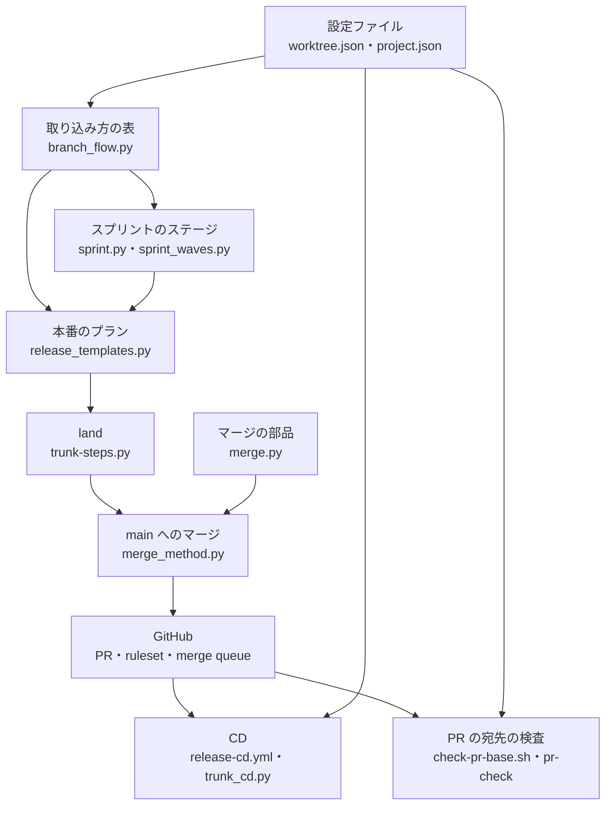
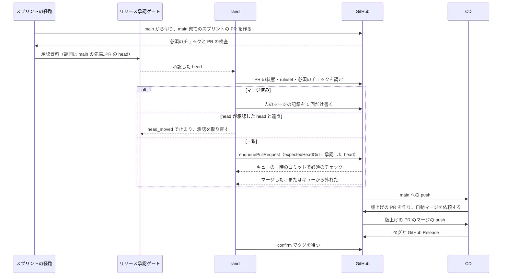
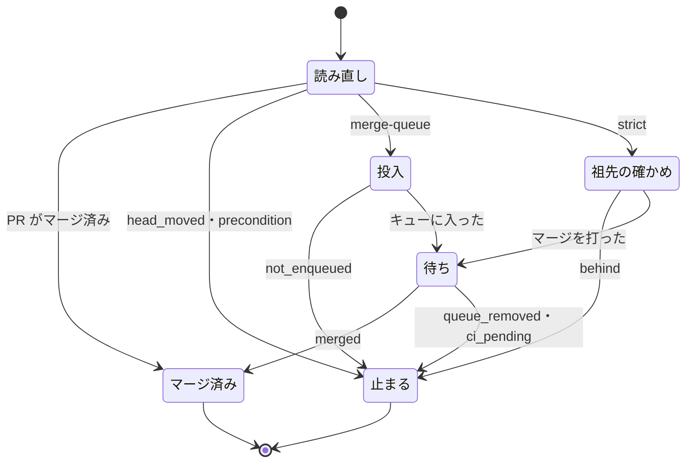

# 今の NDF のブランチ戦略: GitHub flow の行を選べるようにし、ai-plugins を develop と main の 2 本から移す（#3641）

## 目的

- **今どうなっているか**: 今の NDF（`plugins/ndf/`）が選べるブランチ戦略は、develop と main の 2 本を使う 2 行（`whole`・`selected`）だけである。ai-plugins は develop で開発し、リリースのたびに検査の範囲・コミット・バージョンを develop と main の間で運ぶ。2026-11-15〜16 のリリースの事故（リリース 8・14〜22）は、この運びから起きている
- **誰に効くか**: ai-plugins の開発者とリリースの承認者。GitHub flow で運用したい NDF の利用者
- **変えると何が成り立つか**: スプリントブランチを main から切り、承認した head のスプリントの PR を main へマージすることがリリースになる。バージョン・CHANGELOG・タグは CD がマージの後に作る。develop を経る経路（同期の PR・develop 宛ての部分的な検査・develop からのリリースの PR）が ai-plugins で走らなくなる

## 適用範囲

- **働く範囲**: 今の NDF を使うすべてのリポジトリ。GitHub flow の行は、設定ファイルで選んだリポジトリだけで働く。ai-plugins はこの課題の切り替えの手順で選ぶ
- **プロジェクトごとに違うもの**: 設定ファイルで受ける。ブランチ戦略は `.ndf/worktree.json` の `branch_flow.promotion`、マージの方式は `.ndf/project.json` の `production_merge.method` で選ぶ
- **当たるモード**: `standard`（ブランチ戦略・本番のプラン・CD の振る舞いを変え、公開の設定に値を足す）

代表のリポジトリでの振る舞い（受け入れ条件 16）:

| リポジトリ | 設定の値 | 振る舞い |
| --- | --- | --- |
| ai-plugins（切り替えの後） | `promotion: trunk`・`method: merge-queue` | スプリントを main から切り、スプリントの PR を main へ出す。リリース承認ゲートの後に、承認した head を merge queue へ入れる。マージの後に CD が版上げの PR を作り、そのマージでタグと GitHub Release を作る。同期の PR と開発版のステージは、行 `trunk` が持たない（I8・I12） |
| nd-factory（`selected`） | `promotion: selected`（変えない） | 今のまま。スプリントの起点・PR の宛先・リリースブランチの組み立て・同期の PR・開発版のデプロイ（`release-steps release --channel dev`）は変わらない |
| 設定ファイルの無いリポジトリ | どれも無い（既定の `whole`） | 今のまま。develop があれば develop を起点にし、開発版のデプロイを使える。マージの方式は無く、今のマージ（head の一致の確認付き）を打つ |

**開発版を外す層は、取り込み方の行に置く。** 開発版チャネルはベースブランチに載るチャネルで、行 `trunk` ではベースブランチが本番ブランチと同じである（I1）。本番ブランチのほかに変更の載るブランチが無いため、行 `trunk` は開発版のステージと開発版のデプロイのステップを持たない（I8・I12、決定 3）。ai-plugins の `.ndf/supervise.json` から `release.dev_workflow` を外すのは、行 `trunk` が読まない値を残さないためで、開発版を外す理由ではない。

**開発版のデプロイの機能は残す。** `whole`・`selected` の行で使う開発版チャネル・`-dev.N` の版数・`release-steps release --channel dev`・`verify-install --ref <ベースブランチ>` のコードは変えない。ai-plugins で使わなくなるのは、ai-plugins が行 `whole` から行 `trunk` へ設定の値を変えるためである。行 `trunk` を選んだほかのリポジトリでも開発版のデプロイ（Web の staging への反映を含む）は使えない。要求（前提 10・受け入れ条件 16）との関係は「人へ残す判断」に載せる。

## あるべき姿の根拠

| 根拠 | 種類 | 何を示すか |
| --- | --- | --- |
| STD2（GitHub flow） | 外部の一次情報 | 既定ブランチから切ったブランチを PR で既定ブランチへマージする形が、GitHub の示すブランチ戦略である |
| STD3・LIB1（merge queue） | 外部の一次情報 | 同時に承認された PR の組み合わせは、merge queue が main の先端と前に並ぶ PR を合わせた一時のコミットで確かめる |
| 利用者の指示（2026-11-16）「11.0 でリリースするのでは遅いです。今かなり事故っているので、11.0 自体の開発に支障が出ています」 | 利用者の指示の原文 | ndf-next を待たずに今の NDF で GitHub flow へ移る |
| 利用者の決定（2026-11-16、`ndf-ask:redline:P1`）「B を優先」と追加の決定（開発版をやめる） | 利用者の指示の原文 | P1 の承認。ai-plugins の手順から開発版を外し、汎用の機能は残す |
| 起票の時点の事故の表（要求の「目的」） | 実測 | 事故 4 種のうち 3 種は develop と main の間の運び（検査の範囲・コミット・バージョン）から起きた |

要求と受け入れ条件は #3641 の本文にある（コピーは [issue-3641-requirements.md](issue-3641-requirements.md) ）。この文書は「どう作るか」だけを扱う。
決定の記録は [issue-3641-design-decisions.md](issue-3641-design-decisions.md) 、切り替えの手順（受け入れ条件 17・18）は [issue-3641-design-switch.md](issue-3641-design-switch.md) にある。
手本は #3572 の設計（ [issue-3572-design.md](issue-3572-design.md) ）の `trunk` の行で、そのうち今すぐ移るのに要るものだけを今の NDF に入れる。

## ドメインモデル

### コンテキスト

| コンテキスト | 何の語が 1 つの意味に決まるか |
| --- | --- |
| ブランチ戦略（`branch-flow`） | 取り込み方の行・起点・宛先・文書の PR の宛先・スプリントブランチを残すか |
| リリース（`release`） | 本番の PR・承認した head・マージの方式・本番のプラン |
| CD（`delivery`） | 版上げの PR・バージョン・タグ・GitHub Release |

| 関係 | 種類 | やり取りするもの |
| --- | --- | --- |
| ブランチ戦略 → リリース・CD | 公表された言語 | 設定ファイルのスキーマ（`worktree.schema.json`・`project.schema.json`）に書かれた値だけ。リリースと CD は取り込み方の行の値を読み、行の中身（どの値を許すか）を持たない |
| リリース ↔ CD | 共有カーネル | 版上げの書き換え（`release-steps.py` の `plan_bump`）・CHANGELOG の書き換え（`cmd_changelog`・`cmd_notes`）・タグと GitHub Release の作成（`publish`）・版上げの PR の見分け（I3） |

CD はリリースのコンテキストの版上げ・CHANGELOG・`publish` の関数を写さずに呼ぶ（決定 10・11）。これらの関数は両方のコンテキストの言葉で同じ意味を持つため、境界を引き直さず共有カーネルとして扱う。共有カーネルの関数を変える PR は、リリースと CD の両方のテストを通す。
承認の記録（`lib/approved_commit.py`）は、書き手のリリース承認ゲートも読み手の `land` もリリースのコンテキストにあり、コンテキストをまたがない。

### 集約

| 集約 | 持ち主（書き換えてよいもの） | 根 | エンティティ | 値オブジェクト |
| --- | --- | --- | --- | --- |
| 取り込み方の表 | ブランチ戦略の表（`lib/branch_flow.py` の `PROMOTIONS`） | 行 | — | 行の値（許す起点・宛先・文書の宛先・残すか・集めるか） |
| スプリントブランチとスプリントの PR | スプリントの経路（`supervise_lib/sprint_waves.py` の検査のプラン） | スプリントの PR | コミット | head・宛先・上げ幅のラベル |
| 本番のプラン | 本番のプランの組み立て（`supervise_lib/release_templates.py`） | 本番のプランの種類 `trunk` | ステップ | ステップの並び |
| main へのマージ | main へのマージ（`release_lib/merge_method.py`） | main 宛ての PR | 人のマージの記録 | 承認した head・マージの方式・承認ゲートを通ったか・マージコミット |
| main のバージョン | CD（`release_lib/trunk_cd.py`） | 版上げの PR | タグ・GitHub Release | バージョン・上げ幅・範囲 |

**main へのマージの書き手は `merge_method.py` 1 つにする。** main 宛ての PR をマージする・キューへ入れる・人のマージの記録を書く API の呼び出しは、このモジュールだけが打つ。`trunk-steps.py land`（承認した head と承認ゲートを通ったことを渡す）と `merge-when-green` の `merge.py`（承認ゲートを通ったかを `--gate-approved` から渡す）は、このモジュールを呼ぶだけで、マージの API を直接打たない。I4・I5・I6・I11 はこのモジュールの中で守る。
**main のバージョンを変えてよいかの判定は `trunk_cd.py` に置く。** PR の検査（`pr-check`）と I5 の判定（版上げの PR を通すか）は、この判定の関数を呼ぶ。
承認の記録そのもの（`lib/approved_commit.py` の `record_approval`）は、今のリリース承認ゲートが書く。`land` は読むだけである。

### 不変条件

| # | 集約 | 条件 | 破れたときの扱い |
| --- | --- | --- | --- |
| I1 | 取り込み方の表 | 行 `trunk` を選んだ設定は、ベースブランチと本番ブランチが同じブランチである | 設定を読む側が止まり、2 つの値を理由に出す（`FlowError`） |
| I2 | スプリントブランチとスプリントの PR | 行 `trunk` では、スプリントブランチは `origin/<本番ブランチ>` から切り、スプリントの PR の宛先は本番ブランチである | 起点か宛先が違えば worktree の用意か PR の作成が止まる |
| I3 | main のバージョン | 行 `trunk` で、本番ブランチ宛ての PR はバージョンの置き場（`plugin.json` の `version`）を変えない。例外は版上げの PR だけで、head のブランチが `release/v` で始まり、差分が版数と説明だけ（`scripts/ci-heavy-skip.py` の `version_only` と同じ判定）であることで見分ける | PR の検査（`guard`）が落ち、理由に「バージョンは CD がマージの後に上げる」を出す |
| I4 | main へのマージ | 本番ブランチへ入れる head は、承認した head だけである。キューへの投入とマージは承認した head を GitHub へ渡して打つ | head が違えば投入もマージもせずに止まり、承認を取り直すよう理由を返す |
| I5 | main へのマージ | 行 `trunk` で、リリース承認ゲートを通らずに本番ブランチへ入る PR（設計 PR・確定仕様化の PR・版上げの PR）は、配るプラグインの中身を変えない。版上げの PR は版数と説明だけを変える | マージが止まり、理由に「リリース対象を変える PR は本番のプランを通す」と変わったプラグインを出す |
| I6 | main へのマージ | 行 `trunk` ではマージの方式の記述が必須で、設定の方式と本番ブランチの ruleset（merge queue の規則の有無・`strict_required_status_checks_policy`）が一致する。方式があるとき迂回のマージ（`--admin`）を打たない。ruleset がレビューの承認を求め、PR に承認が無ければ止まる | マージの前に止まり、設定の値と ruleset の値を理由に出す |
| I7 | 本番のプラン | 行 `trunk` の本番のプランは、リリース承認ゲートの後にコードを変えて本番の PR へ push するステップ（作業のステップ・直しのステップ）を持たない | テンプレートを組む関数がそのステップを含めたらテストが落ちる |
| I8 | 本番のプラン | 行 `trunk` の本番のプランは、同期の PR・次のバージョンのブランチ・開発版のデプロイ（`--channel dev`・`verify-install --ref <ベースブランチ>`）のステップを持たない | 行の値で分けた振る舞いをテストが見る |
| I9 | main のバージョン | CD はリリース対象の変化が範囲にあるときだけバージョンを上げ、開いた版上げの PR があれば新しく作らない | 変化が無い・開いた PR があるときは版上げの PR を作らずに成功で終わる |
| I10 | 取り込み方の表 | 行 `whole`・`selected`・宣言の無い既定の振る舞いを変えない | 今のテストが落ちる |
| I11 | main へのマージ | 人が GitHub で本番の PR をマージした後に工程を再開すると、マージ済みとして後の工程へ進み、もう一度マージしない。人のマージの記録は PR のコメントに 1 回だけ書く | マージ済みの PR へマージかキューへの投入を打てばテストが落ちる |
| I12 | スプリントブランチとスプリントの PR | 行 `trunk` のスプリントのステージは、開発版のステージを置かない | 行の値で分けた振る舞いをテストが見る |

### ドメインイベント

| # | イベント | 発生元 | 受け手 |
| --- | --- | --- | --- |
| E1 | 移る前の最後の develop の変更を main へ入れた | 切り替えの手順（今の `whole` のリリース） | 設定の PR |
| E2 | ai-plugins の設定を GitHub flow の行へ書き換えた | 設定の PR のマージ（人が GitHub でマージ） | CD・スプリントの経路・ruleset の変更 |
| E3 | 動いているレーンのブランチと PR の宛先を main へ付け替えた | 切り替えの手順 | 各レーンの本番のプラン |
| E4 | スプリントブランチを main から切った | スプリントの経路（`worktree-setup.sh`） | 実装のプラン |
| E5 | スプリントの PR を main 宛てに作った | 検査のプランの `pr` のステップ | PR の検査（`guard`）・リリース承認ゲート |
| E6 | リリース承認ゲートで本番の PR の head を承認した | リリース承認ゲート | GitHub flow のマージ（`trunk-steps.py land`） |
| E7 | 承認した head との一致の確認付きで main へマージした（merge queue ならキューへ入れた） | `trunk-steps.py land`、または人の GitHub でのマージ | CD |
| E8 | 同時に承認されたほかの PR との組み合わせが必須のチェックを通った | GitHub の merge queue（`strict` では最新の取り込みの規則） | `trunk-steps.py land` の待ち |
| E9 | CD がバージョンを上げ、CHANGELOG・タグ・GitHub Release を作った | CD（`trunk-steps.py cd`） | `trunk-steps.py land` の後の CD の確かめ・リリース後テスト |
| E10 | 後片付けと終わりの記録を行った | 本番のプランの `record`・`cleanup` | 次のスプリント |

E9 は 2 回の push に分かれる。スプリントの PR のマージの push で CD が版上げの PR を作り、版上げの PR のマージの push で CD がタグと GitHub Release を作る。

### 用語

| 用語 | 意味 | 用語集への反映 |
| --- | --- | --- |
| 取り込み方 | スプリントの変更を本番チャネルへ入れる方法。`whole`・`selected` に加え、`trunk`（GitHub flow。スプリントの PR を本番ブランチへ直接マージする）を選べる | 意味の変更（今の NDF の値 `trunk` を足した） |
| スプリントの PR | スプリントブランチから宛先へ出す、検査のプランの PR。取り込み方 `trunk` では宛先が本番ブランチで、本番の PR を兼ねる | 意味の変更（`trunk` の行の宛先を足した） |
| 本番の PR | 本番チャネル（main）へ入れる Pull Request。取り込み方 `trunk` ではスプリントの PR が兼ね、版上げの PR は含まない | 意味の変更（今の NDF の `trunk` の行を足した） |
| 版上げの PR | 取り込み方 `trunk` で、main へのマージの後に CD が main の先端から作る、版数と説明だけを変える main 宛ての PR（head は `release/v<バージョン>`） | 意味の変更（今の NDF の `trunk` の行の意味を足した） |

4 語の意味の変更は、この設計と同じ PR で用語集（`docs/glossary.md`・`docs/glossary/glossary.json`）へ反映する。この文書・決定の記録・切り替えの手順は、この対象を「版上げの PR」、そのコミットを「版上げのコミット」（用語集の今の行）とだけ呼ぶ。

GitHub flow・同期の PR・切り替えの手順・merge queue・マージの方式・承認した head・ブランチ戦略は、用語集の今の行の意味のまま使う。

## 外部の調査

| 種類 | 調べるか | 理由 |
| --- | --- | --- |
| 標準・仕様 | 調べる | マージの一致の確認・merge queue・ruleset の迂回・workflow を起こすトークンの規則は GitHub の仕様で決まる |
| 主要な製品 | 調べる | マージの後にバージョンとタグを CI が作る形には広く使われる例がある |
| ライブラリとサービス | 調べる | 組み合わせの確かめと版上げを、既存のサービスとツールに任せられるかを比べる |

### 標準・仕様

| # | 標準・仕様 | 何を定めているか | 設計への反映 | 出典 |
| --- | --- | --- | --- | --- |
| STD1 | GitHub REST「Merge a pull request」 | 本文の `sha` は「SHA that pull request head must match to allow merge」。一致しなければ 409 | `strict` のマージに承認した head を渡す（I4） | https://docs.github.com/en/rest/pulls/pulls#merge-a-pull-request （2026-11-15、#3572 の調査） |
| STD2 | GitHub Docs「GitHub flow」 | 既定ブランチから切ったブランチを PR で既定ブランチへマージする | 取り込み方の行 `trunk`（決定 1） | https://docs.github.com/en/get-started/using-github/github-flow （2026-11-15、#3572 の調査） |
| STD3 | GitHub Docs「Managing a merge queue」 | 「You must use the `merge_group` event to trigger your GitHub Actions workflow when a pull request is added to a merge queue」。必須の保護の条件を満たした PR だけを、書き込みの権限を持つ者がキューへ入れられる | 必須のチェックを出す workflow へ `merge_group` を足す（決定 9）。キューへ入れる前に ruleset のレビューの承認を確かめる（I6） | https://docs.github.com/en/repositories/configuring-branches-and-merges-in-your-repository/configuring-pull-request-merges/managing-a-merge-queue （2026-11-16） |
| STD4 | GitHub Docs「Merging a pull request with a merge queue」 | 「If the pull request can't be added to the queue immediately, GitHub enables auto-merge and adds the pull request to the queue when requirements are met」。この文は Web の画面の操作の振る舞いで、`enqueuePullRequest` がすぐに入れられないときに何を返すかは書いていない | 本番の PR は `enqueuePullRequest` で入れ、投入の成否は応答ではなく投入の後の PR の状態で読む（決定 6） | https://docs.github.com/en/pull-requests/how-tos/merge-and-close-pull-requests/merging-a-pull-request-with-a-merge-queue （2026-11-16） |
| STD5 | GitHub Docs「Triggering a workflow」 | 「events triggered by the `GITHUB_TOKEN` will not create a new workflow run」。`GITHUB_TOKEN` が PR を作ると、`pull_request` の実行は承認待ちの状態で作られる。例外は `workflow_dispatch` と `repository_dispatch` | 版上げの PR は `GITHUB_TOKEN` でなく秘密 `NDF_RELEASE_TOKEN` で作る（決定 8） | https://docs.github.com/en/actions/writing-workflows/choosing-when-your-workflow-runs/triggering-a-workflow （2026-11-16） |
| STD6 | GitHub Docs「Creating rulesets for a repository」の迂回 | 迂回の形「For pull requests only」は直接の push を許さず、PR の保護の迂回だけを与える | CD は main へ直接 push せず、版上げの PR で入れる（決定 7） | https://docs.github.com/en/repositories/configuring-branches-and-merges-in-your-repository/managing-rulesets/creating-rulesets-for-a-repository （2026-11-15、#3572 の調査） |
| STD7 | GitHub GraphQL `enqueuePullRequest` | 「Add a pull request to the merge queue.」。引数 `pullRequestId`・`expectedHeadOid`（「The expected head OID of the pull request.」）・`jump`。返り値 `mergeQueueEntry`。すぐに入れられないときの振る舞いと誤りの形は書いていない | 承認した head を `expectedHeadOid` に渡す（I4・決定 6） | https://docs.github.com/en/graphql/reference/pulls （2026-11-15 取得）。#3572 の設計の確かめ 4（型の照会、2026-11-15） |
| STD8 | GitHub CLI マニュアル `gh pr merge` | 「When targeting a branch that requires a merge queue, no merge strategy is required. If required checks have not yet passed, auto-merge will be enabled. If required checks have passed, the pull request will be added to the merge queue.」。`--match-head-commit <SHA>` は「Commit SHA that the pull request head must match to allow merge」 | 版上げの PR は `gh pr merge --match-head-commit` で、チェックの前なら自動マージ、後ならキューへの投入に任せる（決定 7） | https://cli.github.com/manual/gh_pr_merge （2026-11-15 取得） |

### 主要な製品

| # | 製品 | どう解いているか | 設計への反映 | 出典 |
| --- | --- | --- | --- | --- |
| PRD1 | release-please | 上げ幅を決め、CHANGELOG とバージョンのファイルを更新する Release PR を保ち、そのマージでタグと GitHub Release を作る | 版上げを PR で入れる形に倣う（決定 7） | https://github.com/googleapis/release-please （2026-11-15、#3572 の調査） |
| PRD2 | semantic-release | リリースのブランチへのビルドの成功ごとに CI でバージョンを決め、タグを作る | マージの後に CI がバージョンを決める点に倣う（決定 7） | https://github.com/semantic-release/semantic-release （2026-11-15、#3572 の調査） |

### ライブラリとサービス

| # | 候補 | 版 | ライセンス | 最後のリリースの日付 | 終了のアナウンス | 要件を満たすか | 出典 |
| --- | --- | --- | --- | --- | --- | --- | --- |
| LIB1 | GitHub merge queue | — （GitHub の機能） | — （GitHub の利用規約） | — | 無し | 満たす。Organization の public のリポジトリで使え、ai-plugins はこれに当たる（`isPrivate: false`・所有者 `Organization`） | STD3。`gh api graphql` の `repository{isPrivate owner{__typename} mergeQueue(branch:"main"){id}}` の結果 `false`・`Organization`・`null`（2026-11-16） |
| LIB2 | release-please-action | 未確認 | Apache-2.0（#3572 の調査） | 未確認 | 無し（#3572 の調査） | 満たさない。上げ幅を Conventional Commits から読み、このリポジトリのコミットの書式（`Add:`・`Fix:` の日本語の題）と合わない | PRD1 と同じ |
| LIB3 | semantic-release | 未確認 | MIT（#3572 の調査） | 未確認 | 無し（#3572 の調査） | 満たさない。LIB2 と同じくコミットの書式から上げ幅を読み、Node の依存が増える | PRD2 と同じ |
| LIB4 | GitHub の自動マージ（`gh pr merge` がキューのあるブランチで自動マージを有効にする） | — （GitHub の機能） | — | — | 無し | 満たす。版上げの PR を、チェックの後に CD の実行を待たずにキューへ入れられる | STD8 |

### 確かめられなかったこと

| 対象 | 試した手段 | 結果と理由 |
| --- | --- | --- |
| merge queue が提供されるリポジトリの条件を書いた頁 | STD3 の頁の取得 | 頁に条件の記述が無かった。#3572 の調査（2026-11-15）は同じ頁の文として引いている。結論は LIB1 の照会の結果（public・Organization）で決めた |
| release-please-action・semantic-release の今の版と最後のリリースの日付 | 試していない | 採らない候補で、結論に影響しない |
| merge queue のマージの push が、`release-cd.yml` の `push` を起こすか | 試していない（main に merge queue が無い） | 「未確認のまま残ること」へ書いた |
| `enqueuePullRequest` がすぐに入れられない PR に何を返すか（誤りか、自動マージに倒れるか） | STD7 の頁の取得 | 頁に記述が無かった。決定 6 は応答の形に頼らず、投入の後の PR の状態で成否を読む。「未確認のまま残ること」へ書いた |
| `require_extra_approval_for_unattributed_changes` が、承認の数 0 のときにキューへの投入を止めるか | 試していない（main に merge queue が無い） | 「未確認のまま残ること」へ書いた |

調べた量: 候補 14 件・取得の試み 14 回。

## 機能一覧

| # | 機能 | 誰が使うか |
| --- | --- | --- |
| F1 | 設定で取り込み方 `trunk` を選び、スプリントブランチを main から切り、スプリントの PR を main へ出す | 開発者 |
| F2 | `trunk` の本番のプランで、スプリントの PR の承認資料を組み、リリース承認ゲートで承認した head だけを main へ入れる | リリースの承認者 |
| F3 | マージの方式（`merge-queue`・`strict`）を設定で選び、ruleset と照らしてから入れる | 開発者 |
| F4 | main への push で、CD がリリース対象の変化を読み、版上げの PR を作ってマージさせ、タグと GitHub Release を作る | CD |
| F5 | main 宛ての PR がバージョンを変えていれば、PR の検査で落とす | 開発者 |
| F6 | 承認ゲートを通らない main へのマージ（設計 PR・確定仕様化の PR）で、配るプラグインの中身を変える PR を止める | 開発者 |
| F7 | ai-plugins を develop と main の運用から GitHub flow へ切り替える | ai-plugins の開発者・承認者 |

## 構成要素

| 要素 | 責務 |
| --- | --- |
| 取り込み方の表 `lib/branch_flow.py`（変更） | 行 `trunk` を足す。許す値は起点 `production`・宛先 `release`・文書の PR の宛先 `base`、スプリントブランチを残さない、単位を選ばない。ベースブランチと本番ブランチが違えば止める（I1）。`INTEGRATE_POINTS` に `release` → 本番ブランチを足す |
| 設定のスキーマ `skills/worktree/schemas/worktree.schema.json`・`skills/development-workflow/schemas/project.schema.json`（変更） | `promotion` に `trunk`、`integrate` に `release`、`production_merge.method`（`merge-queue`・`strict`）を足す |
| スプリントのステージ `supervise_lib/sprint.py`・`sprint_waves.py`（変更） | `trunk` では検査のプランからマージのステップを外し、開発版のステージを置かず、本番のステージにスプリントの PR を渡す。並列のレーンはまとめたリリースへ依頼を送らない。進め方 `fast` を断る |
| 本番のプランの組み立て `supervise_lib/release_templates.py`・`release_flow.py`（変更） | 本番のプランの種類 `trunk` を足す。並びは承認資料 → リリース承認ゲート → `land` → `confirm` → 導入の確かめ（`--ref <本番ブランチ>`）→ 記録 → 後片付けで、作業のステップと直しのステップを持たない（I7・I8） |
| GitHub flow のエントリポイント `trunk-steps.py`（新設） | サブコマンド `land`・`confirm`・`cd`・`pr-check` を持つ。行が `trunk` でなければ `not_applicable` で何もしない。`land` は承認の記録（`lib/approved_commit.py`）を読み、承認した head と承認ゲートを通ったことを `merge_method.py` へ渡して、結果を結果 JSON にするだけで、マージの API を打たない |
| main へのマージ `release_lib/merge_method.py`（新設） | main へのマージの集約のただ 1 つの書き手。マージ済みからの再開と人のマージの記録（I11）、承認した head の照合（I4）、承認ゲートを通らない PR が配るプラグインを変えていないかの判定（I5。版上げの PR の見分けは `trunk_cd.py` の判定を呼ぶ）、設定の方式と ruleset の照合（I6）、`merge-queue` の投入（`enqueuePullRequest`）と `strict` の祖先の確かめとマージ、マージかキューから外れるまでの待ち。`land` と `merge-when-green` が呼ぶ |
| CD の版上げ `release_lib/trunk_cd.py`（新設） | main のバージョンの集約の書き手。範囲の読み・上げ幅（ラベル）・版上げの PR の作成と自動マージの依頼・`strict` での版上げの PR への main の取り込み・タグの作成（今の `publish` を呼ぶ）・CD の確かめ（`confirm`）。版数を変えてよい PR かの判定（I3。版上げの PR の見分け）を持ち、`pr-check` と `merge_method.py` に使わせる |
| マージの部品 `merged_lib/merge.py`（変更） | 行 `trunk` で本番ブランチ宛てのとき、マージを `merge_method.py` へ渡し、自分ではマージの API を打たない。`--gate-approved` の有無を承認ゲートを通ったかとして渡す |
| PR の宛先の検査 `scripts/check-pr-base.sh`（変更） | 宛先の設定が `trunk` なら、head の名前を問わず通し、`trunk-steps.py pr-check` を打つ（I3） |
| CD の workflow `.github/workflows/release-cd.yml`（変更） | main への push で `trunk-steps.py cd` を打つ。行が `trunk` でなければ今の `publish` だけが働く |
| 必須のチェックの workflow 8 本（変更） | `merge_group` の起動を足す（決定 9） |



`trunk-steps.py` の `cd`・`confirm`・`pr-check` は、図では呼び出す先の要素（CD・PR の宛先の検査）に含める。PR の宛先の検査と main へのマージは、版上げの PR の見分けに CD の判定の関数を呼ぶ（図では省く）。設定のスキーマは設定ファイルの節点に含める。
必須のチェックの workflow 8 本は図の GitHub の節点に含める。

## 構造

取り込み方の表の行は、今の `Promotion`（`lib/branch_flow.py:98`）の値を足すだけで、型の欄を変えない。

| 行 | 許す起点 | 許す文書の PR の宛先 | 許す宛先 | スプリントブランチを残す | 単位を選ぶ | 見るブランチ |
| --- | --- | --- | --- | --- | --- | --- |
| `whole`（今のまま） | `base` | `base` | `check` | 偽 | 偽 | ベース |
| `selected`（今のまま） | `production` | `sprint` | `check` | 真 | 真 | 単位・本番 |
| `trunk`（新設） | `production` | `base` | `release` | 偽 | 偽 | 本番 |

`release_from`（リリースブランチを作る元）は `trunk` では使わない。版上げの PR のブランチは CD が main の先端から作る。

## 設定ファイルの形

| 置き場 | キー | `trunk` の行で取れる値 | 無いとき |
| --- | --- | --- | --- |
| `.ndf/worktree.json` | `branch_flow.promotion` | `trunk` | `whole`（今の既定） |
| `.ndf/worktree.json` | `branch_flow.start`・`integrate`・`doc_prs` | `production`・`release`・`base` | 行の許す値の先頭（今の規則） |
| `.ndf/worktree.json` | `base_branch`・`production_branch` | 同じブランチ（I1） | 既定ブランチ |
| `.ndf/project.json` | `production_merge.method` | `merge-queue`・`strict` | `trunk` では止まる（I6）。ほかの行では今のマージ |

切り替えの後の ai-plugins の値と、11.0 の移行で移る先（受け入れ条件 15）:

| 今の NDF の設定（切り替えの後） | #3613 の改名表で移した後 | 1 つの節へまとめ直した後 |
| --- | --- | --- |
| `.ndf/worktree.json` の `/branch_flow/promotion`: `trunk` | `/branch_flow/release_strategy`: `trunk`。改名表の行 `/branch_flow/promotion` の値の対応に `trunk` → `trunk` を足す | ブランチ戦略の節の `release_strategy`: `trunk` |
| `/branch_flow/start`: `production`・`/branch_flow/integrate`: `release` | 同じ位置と値（#3572 の `trunk` の行と同じ値） | ブランチ戦略の節の同じ名前のキー |
| `/branch_flow/doc_prs`: `base` | `sprint`（#3572 の `trunk` の行は `sprint` だけを許す。値の書き換えの行が要る。決定 2） | ブランチ戦略の節の `doc_prs`: `sprint` |
| `/base_branch`・`/production_branch`: `main` | 同じ | ブランチ戦略の節の同じ名前のキー |
| `.ndf/project.json` の `/production_merge/method`: `merge-queue` | 同じ（#3572 の決定 17 と同じキー） | ブランチ戦略の節のマージの方式 |
| （今の NDF はバージョンの置き場をプラグインに決め打つ） | — | ブランチ戦略の節の `version_store`: `{"kind": "plugin"}`（#3572 の決定 22。移行で足す） |

1 つの節の置き場と節の名前は、#3572 の設計の差分（`.ndf/handoff/branch-strategy-one-file.md` の受け持ち）が決める。この表の右の列はその節の中のキーの名前だけを示す。

## 入出力の契約

| 契約 | 変わること | 互換 |
| --- | --- | --- |
| `.ndf/worktree.json` の `branch_flow` | `promotion` に `trunk`、`integrate` に `release` を足す | あり。今の値は変えない |
| `.ndf/project.json` の `production_merge` | `method`（`merge-queue`・`strict`）を足す | あり。無ければ今のマージ |
| `trunk-steps.py land --pr <番号> --approved <承認した head>` | 新設。結果 JSON の `status` は `ok`（マージした・マージ済み）か `stopped`。止まった理由の原因は `head_moved`（承認した head と PR の head が違う）・`precondition`（方式の記述が無い・ruleset と食い違う・承認が要る）・`not_enqueued`（投入の後に PR がキューに無い）・`queue_removed`（キューから外れた）・`behind`（`strict` で main の先端を含まない）・`ci_pending`（待ちの上限）。`outputs` に `merge_commit`・`method`・`by`（`ndf` か `user`） | 新設 |
| `trunk-steps.py confirm --merge-commit <SHA>` | 新設。マージコミットを含む main の先端にタグと GitHub Release がそろうのを、`ci_budget` の秒まで待つ。`status` は `ok` か `stopped`。`ok` はタグと GitHub Release がそろった（`outputs.version` に出したバージョン）か、そのマージの push の CD の実行が成功で終わり、範囲にリリース対象の変化が無かった（`outputs.version` は空、`summary` に「リリース対象の変化が無い」）。止まった理由の原因は `cd_failed`（そのマージの push か版上げの PR のマージの push の CD の実行が失敗で終わった。`cd` が `precondition` で止まった場合を含む。`summary` に実行の URL と、実行の注釈に `cd` が書いた原因と理由を出す）・`ci_pending`（`ci_budget` の秒を超えた。`summary` に版上げの PR の番号と、そのチェックかキューのどこで待っているかを出す）。`outputs` に `bump_pr`（版上げの PR の番号。無ければ空） | 新設 |
| `trunk-steps.py cd --revision <SHA>` | 新設。`release-cd.yml` が打つ。足りないタグの作成（今の `publish`）→ リリース対象の変化があり開いた版上げの PR が無ければ、版上げの PR の作成と自動マージの依頼。`strict` では、開いた版上げの PR が main の先端を含まなければ取り込む（「処理の流れ」の手順 2）。秘密 `NDF_RELEASE_TOKEN` が無ければタグの作成までを済ませ、`stopped`（原因 `precondition`）で終わる。止まったときは終了コード 1 で実行を失敗にし、原因と理由（秘密の名前）を実行の注釈（`::error::`）に書く。`confirm` はこの注釈を読む | 新設 |
| `trunk-steps.py pr-check --base <SHA> --head <SHA> --head-ref <名前>` | 新設。`check-pr-base.sh` が打つ。バージョンの置き場を変えた PR に終了コード 1 と理由「バージョンは CD がマージの後に上げる」 | 新設 |
| `merged-steps.py merge-when-green` | 行 `trunk` で本番ブランチ宛てのとき、マージを `merge_method` へ渡す。承認ゲートの承認（`--gate-approved`）が無い PR が配るプラグインを変えていれば止める（I5） | あり。`whole`・`selected` では今のまま |
| `release-cd.yml` | `publish` の代わりに `trunk-steps.py cd` を打つ。秘密 `NDF_RELEASE_TOKEN` を環境に渡す。`pull-requests: write` の権限を足す | あり。`trunk` でなければ `cd` は今の `publish` だけを行う |

上げ幅は、範囲にマージされた PR のラベル（`release:major`・`release:minor`・`release:patch`）の最大で、ラベルの無い PR は PATCH とする（#3572 の決定 7 と同じ）。
ラベルは切り替えの手順でリポジトリに作る。

## 処理の流れ

スプリントから main へのマージまで（`merge-queue`）:



`strict` では投入の代わりに、PR の head が main の先端を祖先に持つかを確かめ（`compare` の `behind_by` が 0）、承認した head を `sha` に渡して迂回せずにマージする。含まなければ `behind` で止まり、スプリントの経路が main を取り込んだ新しい head で承認を取り直す。

`land` の状態の遷移:



CD（`trunk-steps.py cd`）の 1 回の実行:

1. 先端のコミットのバージョンにタグが無ければ、今の `publish` でタグと GitHub Release を作る（版上げの PR のマージの push はここで終わる）
2. 開いた版上げの PR があれば、新しく作らずに終わる（I9）。そのマージの push の実行が、残りの範囲を次のバージョンへ回す。終わる前に、`strict` で版上げの PR の head が main の先端を含まなければ（`compare` の `behind_by` が 1 以上）、この実行が取り込む。
   - `NDF_RELEASE_TOKEN` で `PUT /repos/{o}/{r}/pulls/{n}/update-branch` を、読んだ head を `expected_head_sha` に渡して打つ
   - 取り込みの後の head を読み直し、`gh pr merge --merge --match-head-commit <新しい head>` で自動マージを頼み直す
   - この手順は範囲の判定（手順 3）より前に置き、文書だけの PR の push で main が進んだときも取り込む
   - `merge-queue` では取り込まない。キューが main の先端と合わせて確かめる
3. 範囲（最後の版上げのコミット..先端）でリリース対象のプラグインに変化が無ければ終わる（設計 PR・確定仕様化の PR・設定の PR の push）。起点はバージョンを書いたコミットで、そのマージコミットではない
4. 上げ幅を決め、main の先端から `release/v<バージョン>` を作り、今の版上げ（`release-steps.py bump` の書き換え）と CHANGELOG の節を書いたコミットを足し、`NDF_RELEASE_TOKEN` で push して PR を作る
5. `gh pr merge --merge --match-head-commit <SHA>` で自動マージを依頼する（STD8）。`merge-queue` ではチェックの後にキューへ入る。`strict` ではチェックの後にマージされ、それまでに main が先へ進めば、その push の実行が手順 2 で取り込む

版上げの PR へ書くのは CD の実行だけで、どの実行も `NDF_RELEASE_TOKEN` で書く。`GITHUB_TOKEN` で取り込むと、取り込んだ head の必須のチェックが自動で走らない（STD5）。

`concurrency` の `release-cd` が実行を 1 本ずつ流す（今の設定のまま）。

## 非機能の実現方式

| 大項目 | 実現方式 |
| --- | --- |
| 移行性 | 切り替えの手順は順序つきで、各手順に戻す方法を持つ（ [issue-3641-design-switch.md](issue-3641-design-switch.md) ）。develop は残し、正式版のマーケットプレイス（main）の利用者は各手順の間も前の正式版を取得できる |
| セキュリティ | CD が版上げを main へ入れる経路は PR に限り、ruleset の迂回を広げない。秘密は `NDF_RELEASE_TOKEN` を 1 つ足す（決定 8）。権限はこのリポジトリの `contents` と `pull_requests` の書き込みに限る |
| 運用・保守性 | `land`・`cd`・`confirm` は止まった理由（`head_moved`・`precondition`・`not_enqueued`・`queue_removed`・`behind`・`ci_pending`・`cd_failed`）を結果 JSON の `cause` と `summary` に出す。`cd` の結果は workflow の実行の中にあるため、実行の失敗と注釈に原因を書き、`confirm` がそれを読んで本番のプランの結果 JSON に出す |

## 決定の記録

決定の記録は [issue-3641-design-decisions.md](issue-3641-design-decisions.md) にある。

## テスト設計

| 受け入れ条件・不変条件 | どの振る舞いで縛るか | どう壊したら落ちるべきか |
| --- | --- | --- |
| 受け入れ条件 1・I2 | 行 `trunk` の設定で worktree を用意すると、起点が `origin/main` になる | 起点を `base_branch` の解決へ戻すと落ちる |
| 受け入れ条件 2・I2 | 行 `trunk` の検査のプランの `pr` のステップの宛先が main | 宛先を `check_target` の今の値に固定すると落ちる |
| 受け入れ条件 3・I9 | `cd` が、リリース対象の変化のある範囲で版上げの PR を 1 本作り、そのマージの先端でタグを作る。同期の PR を作らない | 変化の無い範囲で PR を作る・開いた PR があるのに 2 本目を作ると落ちる |
| 受け入れ条件 4・I3 | `pr-check` が、`plugin.json` の `version` を変えた PR に 1 と理由を返し、版上げの PR（`release/v` と版数と説明だけの差分）に 0 を返す | 名前だけで例外にすると、コードを含む `release/v` の PR で落ちる |
| 受け入れ条件 5・I4 | `land` は承認した head と PR の head が違えば `head_moved` で止まり、投入もマージも打たない | 比べを外すと落ちる |
| 受け入れ条件 6・I11 | マージ済みの PR で `land` を打つと `ok`、マージも投入も打たず、人のマージの記録を 1 回だけ書く | 2 回目の実行でコメントを足すと落ちる |
| 受け入れ条件 7・I7 | `trunk` の本番のプランに、作業のステップと直しのステップが無い | テンプレートに `judge_fix_steps(fix=True)` を使うと落ちる |
| 受け入れ条件 8 | `merge-queue` で `enqueuePullRequest` に承認した head を渡し、キューから外れた PR を `queue_removed` で止める（偽の GraphQL の応答）。実物は切り替えの手順の確かめで見る | 外れた PR を入れ直すと落ちる |
| 受け入れ条件 9・I6 | 方式 `merge-queue` で ruleset に merge queue が無い、`strict` で `strict_required_status_checks_policy` が偽、方式が無い、のそれぞれで `precondition` と 2 つの値を出して止まる | 既定の方式へ倒すと落ちる |
| I6（迂回） | 方式があるとき、`production_merge.admin` が真でも `--admin` を打たない | `--admin` を付けると落ちる |
| 受け入れ条件 10・I8 | `trunk` の本番のプランと `cd` の結果に、同期の PR と次のバージョンのブランチが出ない | `_merge_sync_pr` を呼ぶと落ちる |
| 受け入れ条件 11・I8・I12 | `trunk` のスプリントのステージに開発版のステージが無く、本番のプランに `--channel dev`・`verify-install --ref <ベースブランチ>` が無い | 開発版のステージを置くと落ちる |
| 受け入れ条件 12・I10 | `selected` の今のテスト（起点・宛先・リリースブランチの組み立て・同期の PR）が変えずに通る | 行の判定を `trunk` と共有して壊すと落ちる |
| 受け入れ条件 13・I10 | `release-steps release --channel dev` の今のテストが変えずに通る | 開発版の経路に `trunk` の分岐を入れると落ちる |
| 受け入れ条件 14・I10 | 宣言の無いリポジトリが `whole` で動く今のテストが変えずに通る | 既定を `trunk` にすると落ちる |
| I1 | 行 `trunk` でベースブランチと本番ブランチが違う設定は `FlowError` | 検査を外すと落ちる |
| 受け入れ条件 3（`strict` の取り込み） | `strict` で、開いた版上げの PR が main の先端を含まない push（文書だけの範囲を含む）の `cd` が、読んだ head を渡して取り込み、新しい head で自動マージを頼み直し、版上げの PR を 2 本目に作らない（偽の GitHub の応答） | 開いた PR で早く終わり取り込まない・古い head で頼み直すと落ちる |
| 受け入れ条件 8（投入の成否） | `enqueuePullRequest` が誤りを返さず PR がキューに無い（自動マージに倒れた）応答で、`land` が `not_enqueued` で止まり、自動マージを外す | 応答だけで成功とみなすと落ちる |
| I4・I5（書き手が 1 つ） | `land` と `merge-when-green` の `trunk` の経路が、マージとキューへの投入の API を `merge_method.py` を通してだけ打つ | `merge.py` か `trunk-steps.py` から `gh pr merge` を直接打つと落ちる |
| 非機能（運用・保守性） | `confirm` が、`ci_budget` を超えると `ci_pending` と版上げの PR の番号を、CD の実行の失敗（`precondition` の注釈を含む）で `cd_failed` と実行の URL を返す | 待ちの上限で `ok` を返す・原因を空にすると落ちる |
| I5 | 行 `trunk` で承認ゲートの承認の無い PR がプラグインを変えていれば `merge-when-green` が止まり、文書だけの PR と版上げの PR は通る | 判定を外すと落ちる |
| 受け入れ条件 15〜19 | 設計文書の表で見る（この文書と [issue-3641-design-switch.md](issue-3641-design-switch.md) ） | — （設計の記述で、コードのテストにしない） |

## 設計の結果

| 課題 | 扱い | 取り込み先 | 触るファイル |
| --- | --- | --- | --- |
| #3641 | 実装する | — | `plugins/ndf/scripts/lib/branch_flow.py`、`plugins/ndf/skills/worktree/schemas/worktree.schema.json`、`plugins/ndf/skills/development-workflow/schemas/project.schema.json`、`plugins/ndf/scripts/supervise_lib/sprint.py`、`plugins/ndf/scripts/supervise_lib/sprint_waves.py`、`plugins/ndf/scripts/supervise_lib/release_templates.py`、`plugins/ndf/scripts/supervise_lib/release_flow.py`、`plugins/ndf/scripts/trunk-steps.py`（新設）、`plugins/ndf/scripts/release_lib/merge_method.py`（新設）、`plugins/ndf/scripts/release_lib/trunk_cd.py`（新設）、`plugins/ndf/scripts/merged_lib/merge.py`、`plugins/ndf/contracts/entrypoints/plugins__ndf__scripts__trunk-steps.py.json`（新設）、`plugins/ndf/contracts/index.md`、`scripts/check-pr-base.sh`、`.github/workflows/release-cd.yml`、`.github/workflows/runtime-plugin-validate.yml`、`.github/workflows/glossary.yml`、`.github/workflows/pr-base-guard.yml`、`.github/workflows/lint.yml`、`.github/workflows/pr-body-decisions.yml`、`.github/workflows/pytest.yml`、`.github/workflows/script-structure.yml`、`.github/workflows/runtime-plugin-smoke.yml`、`plugins/ndf/scripts/tests/test_branch_flow.py`、`plugins/ndf/scripts/tests/test_sprint_branch_flow.py`、`plugins/ndf/scripts/tests/test_trunk_cd.py`（新設）、`plugins/ndf/scripts/tests/test_merge_method.py`（新設）、`scripts/tests/test_pr_base_guard.py` |

ai-plugins の設定の値（`.ndf/`）・`AGENTS.md`・`CONTRIBUTING.md`・`docs/versioning-and-distribution.md`・開発版の workflow の削除は、実装の PR に入れず、切り替えの手順の設定の PR で行う（決定 10）。

## 影響

| 対象 | 影響 |
| --- | --- |
| 公開インタフェース | 設定に値を足す（`promotion: trunk`・`integrate: release`・`production_merge.method`）。サブコマンド `trunk-steps.py` を新設。互換あり |
| 既存の振る舞い | `whole`・`selected`・宣言なしは変えない（I10）。`release-cd.yml` は `trunk` でなければ今の `publish` だけ |
| #3613（改名と移行のコマンド） | 改名表の行 `/branch_flow/promotion` の値の対応に `trunk` → `trunk` を、`trunk` の行に限って `/branch_flow/doc_prs` の `base` → `sprint` を足す必要がある。実装は #3613 が持つ（要求の「含まない」）。この課題の実装のステップで #3613 の本文へ伝える |
| #3572（ndf-next の GitHub flow） | 触らない。11.0 の入れ替えで今の `trunk-steps.py` は ndf-next の `land`・`bump` に置き換わる |
| lfix-rel（`plugins/ndf/scripts/lib/parallel_*.py`・hook）との重なり（受け入れ条件 19） | 下の検索のとおり、この課題は `parallel_*.py` と hook を触らない。lfix-rel が触った `supervise_lib/release_templates.py` は重なるが、lfix-rel の PR（#3592・#3609・#3614）はマージ済みで、開いた PR は無い |

受け入れ条件 19 の検索（2026-11-16、`design/issue-3641` の 7d01f81f6）:

```text
$ git grep -l -E 'branch_flow|promotion|selects_units|production_merge|base_branch' -- 'plugins/ndf/scripts/lib/parallel_*.py' 'plugins/ndf/hooks/*' 'plugins/ndf/scripts/hook_lib/*'
plugins/ndf/scripts/lib/parallel_repo.py        # repo.base_branch から origin/<名> を作るだけ。行の値を読まない。変えない
$ gh pr view 3592 --json files --jq '.files[].path' | grep -v tests/
（15 ファイル。この課題の「触るファイル」と重なるのは plugins/ndf/scripts/supervise_lib/release_templates.py だけ）
$ gh pr list --state open --search lfix --json number,headRefName
[]
```

並列のレーンがまとめたリリースへ依頼を送るかは `supervise_lib/sprint.py` の `release_lane` が決め、`parallel_*.py` は変えない。hook（`lib/workflow-merge.sh` の `_wf_check_production_merge`）は本番ブランチ宛ての直接の `gh pr merge` を `merge-when-green` へ案内する今の振る舞いのままで、`trunk` でも同じに働く。

## 人へ残す判断

| 判断 | 当たるレッドライン | なぜ当たるか |
| --- | --- | --- |
| 秘密 `NDF_RELEASE_TOKEN`（fine-grained PAT。このリポジトリの `contents`・`pull_requests` の書き込み）を足す | C1 | トークンを作り、リポジトリの秘密に置く |
| main の ruleset を変える（merge queue の規則を足す・承認の数 1 → 0・CODEOWNERS のレビューを外す） | C2 | 誰が何をマージできるかが変わる。値は切り替えの手順の手順 5 |
| ai-plugins の設定（`.ndf/`）と `AGENTS.md` の運用の節を GitHub flow へ書き換える | C7・P1 | 利用者の設定と指示書を書き換え、既定ブランチへ何がどの経路で入るかとバージョンの規則を変える。設定の PR を人が GitHub でマージする |
| 行 `trunk` を選んだリポジトリでは、開発版のデプロイ（Web の staging への反映を含む）が使えない形でよいか | — （レッドラインではない。要求との関係の確認） | 要求（前提 10・受け入れ条件 16）は「やめるのは ai-plugins の設定の値と手順だけで、開発版のデプロイの機能は残す」と決めている。設計は、行 `whole`・`selected` の機能を変えずに残し、新しい行 `trunk` には開発版を持たせない（I8・I12）。行 `trunk` にはベースブランチと別の変更の載るブランチが無く（I1）、マージの前に試す場（検証用マーケットプレイス）は要求が後に回した（前提 10）。GitHub flow の Web サービスが staging を要るときは、マージの前に試す場を足す別の課題になる。この読み方で要求を満たすかを設計承認ゲートで決める |

## 未確認のまま残ること

| 項目 | 内容 |
| --- | --- |
| merge queue のマージの push が CD を起こすか | merge queue が main へ入れる push で `release-cd.yml` の `push` が起きることを確かめていない（main に merge queue が無い）。切り替えの手順の手順 7 で、最初のスプリントの PR のマージの後に CD の実行があるかで分かる。起きなければ `release-cd.yml` に `workflow_run` か `merge_group` の後段を足す |
| 最後の develop→main のリリースのプラン | 今の `whole` のリリースのプランを組んだ後に、main の設定が `trunk` へ変わっても、そのプランが組んだ時点の値で流れるか（`pin_flow`）。切り替えの手順は設定の PR を最後のリリースの後に置き、この依存を避ける |
| `enqueuePullRequest` がすぐに入れられない PR に何を返すか | 頁（STD7）に記述が無い。誤りを返すか、自動マージに倒れて成功を返すかを確かめていない。`land` は応答の形に頼らず、投入の後の PR の `isInMergeQueue` と `autoMergeRequest` を読み、キューに無ければ自動マージを外して `not_enqueued` で止まる（決定 6）。どちらの返し方でも main へ承認の外の head は入らない |
| 承認の数 0 で `require_extra_approval_for_unattributed_changes` がキューへの投入を止めるか | 確かめていない（main に merge queue が無い）。分かるのは切り替えの手順の手順 7 で、ruleset を変えた後である。止まったとき `land` は `not_enqueued` か `precondition` で止まり、main へは何も入らない。人の GitHub での迂回のマージ（管理者）は止まらない。戻し方は切り替えの手順の「ruleset の変更」にある |
| `merged_lib/merge.py` と `release-steps.py` の行数 | 前者は 500 行、後者は行数の上限の例外（1425 行）ちょうどで、足すと構造の検査が落ちる。足す処理は新設のモジュールへ置き、既存の 2 ファイルには呼び出しだけを足す。行の置き場は詳細設計で決める |
| 版上げの PR の CHANGELOG の範囲 | 版上げの PR が開いている間にマージされた PR は、コードがそのバージョンのタグに入るが、CHANGELOG の節には次のバージョンで載る（範囲の起点がバージョンを書いたコミットのため）。開いている時間は版上げの PR の CI とキューの時間で、まだ測っていない。最初の数回のリリースで、この形がリリース後テストと承認資料の読み手に通じるかを見る |
