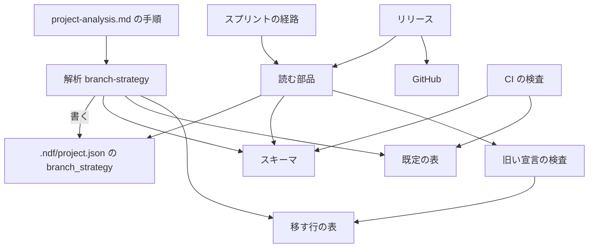
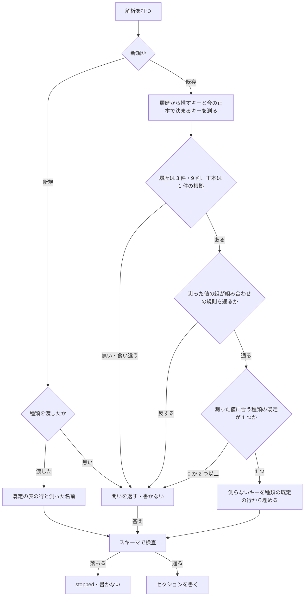
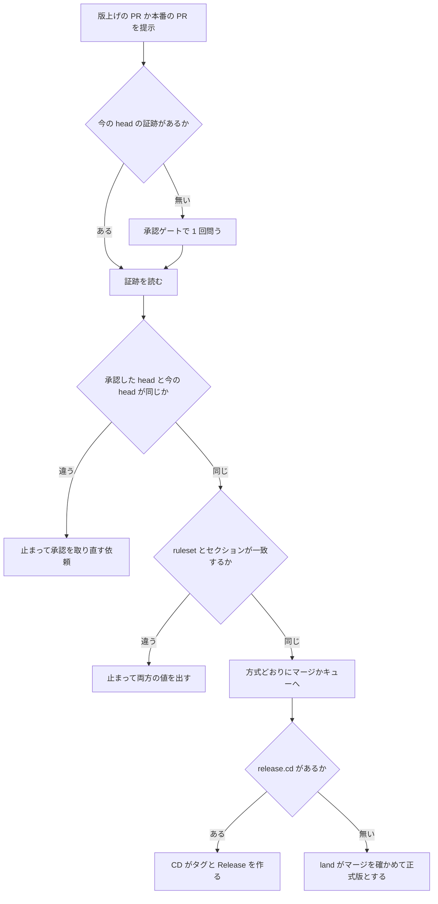

# ブランチ戦略の宣言: リポジトリごとのブランチ戦略・リリース・マージを 1 つのセクションで表し、10 系と 11.0 をそのセクションだけで動かす（#3672）

## 目的

- **今どうなっているか**: ブランチ戦略・マージ・リリースの設定が `.ndf/worktree.json`・`.ndf/project.json`・`.ndf/release.json`・`.ndf/supervise.json` の 4 か所に分かれている。10 系と 11.0 は、それを別々の設計（#3641・#3572）で読む。ai-plugins の develop→main・`--admin` が製品の既定に入り込み、p6 で承認したリリース 15 回のうち 6 回が承認の後に止まった
- **誰に効くか**: NDF を使うすべてのリポジトリの持ち主とリリースの承認者。ai-plugins の開発者
- **変えると何が成り立つか**: 1 つのセクションを読めば方法論が分かり、セクションは Skill のスクリプトが作る。10 系と 11.0 は同じセクションとスキーマで動く。承認は正式版 1 本につき 1 回で、承認した head だけがマージされる。ai-plugins は plugin 開発の慣行に沿った値を、製品の既定と同じ形で持つ

## 適用範囲

- **働く範囲**: NDF（10 系 `plugins/ndf/`・11.0 `plugins/ndf-next/`）を使うすべてのリポジトリ。ai-plugins の値は ai-plugins の `.ndf/` にだけ置く
- **プロジェクトごとに違うもの**: すべてセクションの値で受ける。引数で受けるものは無い
- **当たるモード**: `standard`。worktree の用意・PR の作成・リリース・マージの工程と、解析（`project-decl.py`・`ndf project`）

### 代表のリポジトリでの振る舞い

| 代表のリポジトリ | 設定の要点 | 直した後に起きること | この種類で扱えなくなること |
| --- | --- | --- | --- |
| Web サービス（develop→main。例: nd-factory） | 種類 `web-develop`。`merge_base_branch`・develop と main・開発版チャネル develop | スプリントの PR は develop へ、develop から切った版上げの PR を承認 1 回で main へ。開発版のデプロイも残る | 無し（今の行と開発版のデプロイをそのまま表せる。版数を持たない develop→main も、版数の置き場 `none` で develop→main の PR をリリースの PR にして表せる。R4） |
| Web サービス（trunk） | 種類 `web-trunk`。`trunk`・承認の対象 `production_pr`・`merge-queue`（使えなければ `strict`） | スプリントの PR が本番の PR を兼ね、承認ゲートの後に NDF が承認した head をキューへ入れる。版数は持たない | 無し（private の Free でも `strict` で選べる） |
| モバイルアプリ | 種類 `mobile`。`release_branch`・版数の置き場 `json` | 本番から切ったリリースブランチへ選んだスプリントを集め、版上げの PR を承認 1 回で main へ。ストアへの提出の工程は変えない | 無し（リリースブランチの行を残す） |
| 業務文書だけ | 種類 `docs`。`trunk`・版数の置き場 `none`・`strict` | 文書の PR が本番の PR を兼ね、承認ゲートの後にマージする。提出先の工程は変えない | 無し（版数もタグも求めない） |

### ai-plugins だけの事情

| 値 | 置く所 | 持つ Issue |
| --- | --- | --- |
| 種類 `plugin` の既定と同じ値（[issue-3672-design-ai-plugins.md](issue-3672-design-ai-plugins.md) ） | `.ndf/project.json` の `branch_strategy` | #3672 |
| main の ruleset（承認の数 0・merge queue・タグの保護） | GitHub のリポジトリの設定 | #3672（#3641 をこの課題の中で解決する） |
| develop の更新を止め、開発版（`-dev.N`・`release-dev.yml`）をやめる | `.ndf/` と `.github/workflows/` | 同上 |

3 行とも、受け入れ条件 24（承認 1 回で正式版を出す）の前に終える。ruleset が承認 1 を求めたままでは、`via: gate` の ai-plugins は I10 で止まるためである。
新しい NDF を出す PR・`.ndf/` を移す PR・宛先の検査の PR の順序と、その間に NDF の工程を通さない手順は [issue-3672-design-ai-plugins.md](issue-3672-design-ai-plugins.md) の「移行の順序」にある。

## あるべき姿の根拠

| 根拠 | 種類 | 何を示すか |
| --- | --- | --- |
| STD4・STD5 | 外部の一次情報 | Claude Code は `plugin.json` の版数が変わったときだけ既存の利用者へ届け、タグの形は `<plugin>--v<version>` である。版数でマージとリリースが分かれる |
| PRD1〜PRD4・STD2 | 外部の一次情報 | plugin を配る 8 リポジトリのうち 7 つが main だけで開発する。trunk-based development は長く残るブランチを勧めない |
| STD1・STD3 | 外部の一次情報 | マージとキューへの投入は承認した head を渡せ、違えば GitHub が断る。merge queue は組み合わせを一時のコミットで確かめる |
| `docs/ndf-12-survey/03-release.md` の §1.2・§2（PR #3669） | 実測 | 承認の後の止まり 6/15 回の原因は 2 つ目の承認・版数の衝突・リリースブランチの消失で、版数・承認を複数の場所に持つことから起きる |
| 旧い宣言を読むコードの数（[issue-3672-design-removal.md](issue-3672-design-removal.md) の「数えた範囲」） | 実測 | 10 系 57・11.0 21 のファイルが 4 か所を別々に読む |
| 利用者の指示（2026-11-16、#3672 の本文の「依頼（原文）」と設計承認ゲートの第 1 回の指示） | 利用者の指示の原文 | 「宣言の CRUD」「ai-plugins は plugin 開発のベストプラクティスへ移す」「従来の仕組みの削除」 |

要求と受け入れ条件は #3672 の本文にある（コピーは [issue-3672-requirements.md](issue-3672-requirements.md) ）。この文書は「どう作るか」だけを扱う。

| 分けた文書 | 中身 |
| --- | --- |
| [issue-3672-design-decisions.md](issue-3672-design-decisions.md) | 決定の記録（決定 1〜14） |
| [issue-3672-design-research.md](issue-3672-design-research.md) | 外部の調査（STD1〜STD11・PRD1〜PRD6・LIB1〜LIB6）と確かめられなかったこと |
| [issue-3672-design-ai-plugins.md](issue-3672-design-ai-plugins.md) | ai-plugins の値・今の運用から変える点・残る危険・移行の順序と PR への割り当て |
| [issue-3672-design-removal.md](issue-3672-design-removal.md) | 削除の一覧（D1〜D37）・置き換える設計と設計 PR #3649・#3650 の行き先・子の Issue 32 本の行き先 |
| [issue-3672-design-removal-paths.md](issue-3672-design-removal-paths.md) | 削除の一覧のうち複数のファイルにまたがる行（D32・D33・D34・D37）のパス |

## ドメインモデル

### コンテキスト

| コンテキスト | 何の語が 1 つの意味に決まるか |
| --- | --- |
| ブランチ戦略の宣言（セクション `branch_strategy` とスキーマ・既定の表） | 取り込み方・本番ブランチ・ベースブランチ・承認の対象・承認の受け方・マージの主体・マージの方式・版数の置き場・チャネル |
| 解析（10 系 `project-decl.py`・11.0 `ndf project`） | 代表のリポジトリの種類・値の根拠・食い違い・根拠不足 |
| スプリントの経路（worktree の用意・PR の作成） | スプリントの起点・PR の宛先・スナップショット |
| リリース（10 系 `release-steps.py`・11.0 `ndf release-steps`） | 版上げの PR・本番の PR・承認した head・承認の証跡・head の一致の確認 |
| GitHub（外部の系） | PR・レビュー・ruleset・merge queue・タグ・Release |

宣言は**公表された言語**で、解析・スプリントの経路・リリースはスキーマを通ったセクションだけを読む。解析だけがセクションを書く（**顧客 / 供給者**の供給者）。
GitHub との間は**腐敗防止層**で、ruleset と merge queue の語はリリースの GitHub のアダプタの中に閉じる。

### 集約

| 集約 | 持ち主（書き換えてよいもの） | 根 | エンティティ | 値オブジェクト |
| --- | --- | --- | --- | --- |
| ブランチ戦略の宣言 | 解析の `branch-strategy` サブコマンドだけ（10 系 `project-decl.py`・11.0 `ndf project`。作る・更新する・移す・キーを消す・セクションを消すのすべて。決定 4・10） | セクション `branch_strategy` | — | ブランチ・スプリント・リリース・チャネル・承認・マージ・試す場 |
| 作成の結果 | 解析（1 回の実行の出力。ファイルに残さない） | 実行 | 問い | 値・値の根拠・差分・差分のハッシュ |
| スプリントのスナップショット | スプリントの経路（開始時に 1 回書く） | スプリント | — | セクションの全体 |
| 本番の PR の承認とマージの記録 | リリース（証跡の書き手はケースごとに 1 つ。I12） | PR | 承認の証跡・人のマージの記録 | 承認した head・マージした head |

### 不変条件

| # | 集約 | 条件 | 破れたときの扱い |
| --- | --- | --- | --- |
| I1 | 宣言 | セクションは `.ndf/project.json` の 1 か所にだけあり、旧い 4 か所に旧いキーが無い | I4 |
| I2 | 宣言 | 作る・更新する・移す実行は、組み合わせの規則（「データ構造」の R1〜R10）を通った中身だけを書く | 書かずに落ちた規則とキーの位置を出す。ファイルは 1 バイトも変えない |
| I3 | 宣言 | セクションが無い・スキーマに落ちるリポジトリで、読む部品は既定値へ倒さない | 止まり、ファイル・キーの位置・作成のコマンドを理由に出す |
| I4 | 宣言 | 旧いキーが残るリポジトリで、旧い経路は動かない | 読む部品が止まり、旧いキーの位置と移行のコマンドを理由に出す |
| I5 | 承認とマージ | 承認した head と違う head をマージせず、キューへも入れない | マージの前に止まり、承認を取り直す依頼を出す（E10） |
| I6 | 承認とマージ | 管理者の迂回は `merge.method: direct` のときだけ使う | スキーマの R3 で書けない |
| I7 | 承認とマージ | 本番の PR（版上げの PR を含む本番ブランチ宛ての PR）は、マージの方式ごとの確かめ（「処理の流れ」の「本番の PR の確かめ」の表）を通ったときだけマージかキューへの投入をする。`merge-queue` では先端を含むことを求めず、版上げの PR は版数が衝突しないことだけを確かめて先頭へ入れる。`strict` では、確かめた先端から本番ブランチが進んでいれば入れない（ruleset が無くても、早送りだけの参照の更新で GitHub が断る） | 止まり、本番の PR を作り直して承認を取り直す |
| I8 | 宣言 | 旧いキーの名前は、移行のコマンドと旧い宣言の検査とそのテストの外に現れない | `check-legacy-branch-decl.py` が落ちる |
| I9 | 承認とマージ | 正式版 1 本につき、人へ問う承認は 1 回である（宣言のどのケースでも） | 2 回目を求める組み合わせ（`via: gate` で ruleset が承認を求める）は I10 で止まる |
| I10 | 承認とマージ | セクションの値と本番ブランチの ruleset が食い違わない。ruleset が有るとき比べるのは 3 つで、`merge.method: merge-queue` ⇔ merge queue が有る、`merge.method: strict` ⇔ 最新の取り込みを求める（merge queue は無い）、`approval.via: gate` ⇒ 承認の数 0・`approval.via: review` ⇒ 承認の数 1 以上である。`merge.admin: true` のときは、承認の数の代わりに迂回の可否を比べる。ruleset の迂回の一覧（bypass actors）に載る者だけが規則を越えられ（STD11）、NDF が打つトークンで読んだ `current_user_can_bypass` が `always` か `pull_requests_only` のときだけ通し、`never`・`exempt` なら止まる。ruleset が無いとき（GitHub Free の private など）は merge queue が無いことだけを見て、`merge-queue` なら止まる。`strict` の先端の確かめは I7、`review` の承認した head の確かめは I5 で NDF 自身が行う | マージの前に止まり、セクションの値と ruleset の値を理由に出す |
| I11 | 作成の結果 | 既存のリポジトリ（新規と既存の分け方は「処理の流れ」の「作る・更新する」）で書く値は、どれも根拠を 1 つ持つ。履歴から推すキーは 3 件以上・9 割以上の事例、今の正本で決まるキーはその正本 1 件、種類の既定から埋めるキーは選んだ種類の既定の行、人の答えはその答え（「処理の流れ」の「作る・更新する」の表） | 履歴から推すキーで事例が足りないか食い違うか、今の正本で決まるキーの正本が読めない（API の誤り・権限）か、測った値の組が組み合わせの規則に反すれば、書かずに根拠つきで問う（決定 6）。正本が無いことは値の根拠として書く |
| I12 | 承認とマージ | 証跡の種類ごとに書き手は 1 つで、証跡が今の head にあれば同じ問いを送らない | 書き手が書けなければ止まり、問いを送り直さない |
| I13 | スプリントのスナップショット | スプリントの中の部品は開始時のスナップショットを読む | スナップショットと今のセクションの違うキーを結果に出す |
| I14 | 宣言 | 製品のスキーマと既定の表は `default` と ai-plugins の名前を持たない | `check-skill-repo-assumptions.py` が落ちる（決定 13） |

### ドメインイベント

| # | イベント | 発生元 | 受け手 |
| --- | --- | --- | --- |
| E1 | 新規リポジトリで代表のリポジトリの種類を選んだ | 解析 `init` | E5 |
| E2 | 既存リポジトリの履歴と文書を測った | 解析 `measure` | E3 か E5 |
| E3 | 食い違いか根拠不足を根拠つきで人へ問うた | 解析（結果の `questions`）→ `decision-request` | 人 |
| E4 | 人の答えを宣言に書いた | 解析 `write --answers` | E5 |
| E5 | 宣言を書いた | 解析 | 工程の部品（E7） |
| E6 | 旧い宣言を新しいセクションへ移した | 解析 `branch-strategy migrate`（移行のコマンド） | E7 |
| E7 | 工程の部品が宣言を読んだ | 読む部品（`lib/branch_strategy.py`・`ndf.core.branch_strategy`） | E8〜E12 |
| E8 | PR の宛先とスプリントの起点を決め、セクションのスナップショットを取った | スプリントの経路 | スプリントのスナップショット |
| E9 | 承認を受け、承認した head を記録した | リリース承認ゲートか GitHub のレビュー | E11 |
| E10 | 承認の後に head が動いたか、版上げの PR がマージの方式ごとの確かめ（I7）に落ちたことを見つけ、承認を取り直す依頼を出した | リリースの `land` | 人 |
| E11 | 承認した head を宣言の主体と方式でマージした | リリースの `land` か人 | E12 |
| E12 | 正式版を出した | `release.cd` があれば CD（タグと GitHub Release を作り終えたとき）。`release.cd` が `null` ならリリースの `land`（E11 のマージを確かめたとき。タグと GitHub Release は作らない。R10） | リリース後テスト |
| E13 | 宣言を更新した | 解析 `measure`・`write` | E7 |
| E14 | 使わなくなったキーを消し、旧いキーの検査に載せた | NDF の版（移す行の表の `remove` の行）と解析 `branch-strategy migrate` | E7 |
| E15 | NDF を外し、セクションを消した | 解析 `remove` | 工程の部品（E7 の読む部品が I3 で止まり、作成のコマンドを理由に出す。NDF を外した後に工程を動かさない限り読まれない） |

### 用語

| 用語 | 意味 | 用語集への反映 |
| --- | --- | --- |
| 代表のリポジトリの種類の既定 | 代表のリポジトリの種類（`web-develop`・`web-trunk`・`mobile`・`docs`・`plugin`）ごとのセクションの値の行。`branch-strategy-presets.json` に持つ | 追加 |
| 承認の対象 | リリース承認ゲートで承認する PR。`release_pr`（版上げの PR）か `production_pr`（本番ブランチ宛ての各 PR） | 追加 |
| 承認の受け方 | 承認をどこで受けるか。`gate`（リリース承認ゲート）か `review`（GitHub のレビューの承認をゲートの答えとして読む） | 追加 |
| 版上げの PR | head が `release/v<版>` で、版数と CHANGELOG を書き、承認の対象 `release_pr` で承認を受ける本番ブランチ宛ての PR。`trunk` では本番ブランチから切り、版数と CHANGELOG だけを変える。ほかの行ではベースブランチか本番ブランチから切り、まだ本番へ出ていない変更も持つ。`merge_base_branch` で版数の置き場が `none` のときは版上げの PR を作らず、ベースブランチ → 本番ブランチの PR を承認の対象 `release_pr` にする（R4） | 意味の変更（`trunk` の行でもマージの前に作る形にそろえた） |
| マージの方式 | 本番ブランチへのマージで組み合わせをどう確かめるか。`merge-queue`・`strict`（head が本番ブランチの先端を含むときだけマージ）・`direct`（確かめない） | 意味の変更（`direct` を足した） |
| 本番の PR | 本番ブランチへ入れる PR。`trunk` では本番ブランチ宛てのスプリントの PR と版上げの PR、ほかの行では版上げの PR | 意味の変更（CD が作る版上げの PR を除く記述を外した） |
| 版上げのコミット | 版上げの PR の中で、バージョンの置き場のファイルと CHANGELOG を変えるコミット。マージの前に入れる | 意味の変更（マージの後に CD が作る形を外した） |
| バージョン上げ | 版上げの PR の中でバージョンを上げること。書き換えるファイルは `release.version_store` で決める | 意味の変更（マージの後に CD が上げる形を外した） |
| ブランチ戦略 | セクション `branch_strategy` の `release_strategy` で取り込み方の表の行を選ぶ決まり | 意味の変更（旧い宣言を正本として指す記述を外した） |
| 取り込み方の表 | 行の名前がセクション `branch_strategy` の `release_strategy` の値と同じ一覧 | 同上 |
| バージョンの置き場 | セクション `branch_strategy` の `release.version_store` で選ぶファイルとアダプタ | 同上 |
| ブランチ運用の宣言 | 旧い宣言の 1 つ（`.ndf/worktree.json` の `branch_flow`）。ブランチ戦略の宣言へ移す | 意味の変更（旧い宣言と明記し、無いときの既定の振る舞いを外した。I3） |

ブランチ戦略の宣言・旧い宣言・宣言の CRUD・値の根拠・代表のリポジトリの種類は、要求のステップで用語集へ足した意味のまま使う。

## 外部の調査

標準・仕様（`STD<数>`）・主要な製品（`PRD<数>`）・ライブラリとサービス（`LIB<数>`）の調べと、確かめられなかったことは [issue-3672-design-research.md](issue-3672-design-research.md) にある。

## 機能一覧

| # | 機能 | 誰が使うか |
| --- | --- | --- |
| F1 | 新規のリポジトリで、代表のリポジトリの種類を渡すとその既定のセクションを書く | リポジトリの持ち主（解析の Skill から） |
| F2 | 既存のリポジトリの事例と文書を測り、値ごとの根拠を添えてセクションを書く。食い違いと根拠不足は書かずに問う | 同上 |
| F3 | 答えを受け、組み合わせの検査を通してからセクションを書く・更新する・キーを消す・セクションを消す | 同上 |
| F4 | 旧い 4 か所の値を新しいセクションへ移す（差分を示す実行と書く実行） | 同上 |
| F5 | 10 系と 11.0 の工程の部品が、セクション（スプリントの中ではスナップショット）だけを読み、旧いキーが残るときとセクションがスキーマに通らないときに止まる | NDF の工程 |
| F6 | 承認した head だけを宣言の主体と方式でマージし、承認は正式版 1 本につき 1 回にする | オーガナイザー・利用者 |
| F7 | 削除の一覧・ai-plugins の名前・既定値の混入を CI で落とす | NDF の開発者 |

## 構成要素

| 要素 | 責務 |
| --- | --- |
| スキーマ `$defs/BranchStrategy`（11.0 `contracts/schemas/declarations/project.schema.json` が正本、10 系 `skills/development-workflow/schemas/project.schema.json` がコピー） | セクションのキー・値・組み合わせの規則 R1〜R10 |
| 既定の表 `branch-strategy-presets.json`（11.0 `contracts/domains/` が正本、10 系 `scripts/data/` がコピー） | 代表のリポジトリの種類ごとの値 |
| 移す行の表 `ndf-settings-renames.json`（11.0 `contracts/domains/` が正本、10 系 `scripts/data/` がコピー。11.0 の正本は #3613 が先にマージされていれば行を足し、されていなければこの課題が #3613 の行の形で新設する。決定 3） | 旧いキーの位置 → 新しいキーの位置・値の対応・消すキー |
| 読む部品 `lib/branch_strategy.py`（10 系）・`ndf/core/branch_strategy.py`（11.0） | セクションを読み、スキーマで検査し、旧いキーで止まる。シェルからは `branch_strategy.py get <キー>` で読む |
| 旧い宣言の検査 `lib/branch_strategy_legacy.py`（10 系）・`ndf/core/branch_strategy_legacy.py`（11.0） | 移す行の表のうちセクション `branch_strategy` へ移す行と `remove` の行を読み、旧いキーの位置を返す。#3613 の旧いキーの検査に依らない |
| 解析のサブコマンド `branch-strategy`（10 系 `project-decl.py` と `project_lib/branch_strategy_{measure,write,migrate}.py`、11.0 `ndf project` と `domains/project/strategy_{measure,write,migrate}.py`） | 作る・測る・書く・移す・キーを消す・セクションを消す（決定 4・10） |
| スプリントの経路（10 系 `supervise_lib/sprint_*`・`worktree-setup.sh`、11.0 `domains/worktree`） | 起点と宛先をセクションから決め、開始時にセクションのスナップショットを取る |
| リリース（10 系 `release-steps.py`・`release_lib/`、11.0 `domains/release`） | 版上げの PR を作り、承認の証跡を書き手どおりに書き、承認した head を方式どおりにマージする |
| CI の検査（`scripts/check-legacy-branch-decl.py`・`scripts/check-skill-repo-assumptions.py`・`scripts/check-ndf-contracts.py`・`scripts/check-pr-base.sh`） | 削除の一覧・汎用性・コピーの一致・宛先の検査 |
| `development-workflow` の `references/project-analysis.md` | 解析のサブコマンドを打つ手順と、問いを人へ回す手順 |

## データ構造

### セクションのキー

| 要求の S1 の事柄 | キー | 値 |
| --- | --- | --- |
| （作成の記録） | `kind` | `web-develop`・`web-trunk`・`mobile`・`docs`・`plugin`・`custom`（答えで既定から変えたとき） |
| 結合のしかた | `release_strategy` | `merge_base_branch`・`release_branch`・`trunk`（#3613 の改名表の名前） |
| PR の宛先 | `branches.production`・`branches.base` | ブランチの名前 |
| スプリントの起点 | `sprint.start`・`sprint.integrate`・`sprint.doc_prs`・`reviews` | `base`・`production` / `check`・`release` / `base`・`sprint` / 今の `branch_flow.reviews` の形 |
| リリースの形と版数の置き場 | `release.form`・`release.plugin`・`release.runtimes`・`release.version_store`・`release.tag`・`release.github_release`・`release.deliveries` | リリースの形の名前 / `{"kind": "plugin"}`・`{"kind": "json", "path", "pointer"}`・`{"kind": "none"}`（`files` で版数を書き換える追加のファイル）/ `"{plugin}--v{version}"` などか `null` / 真偽 / 今の `delivery` の行の形 |
| チャネル | `channels` | `[{"name": "stable", "ref"}, {"name": "dev", "ref", "workflow"}]` |
| 承認を取る場所 | `approval.target`・`approval.via` | `release_pr`・`production_pr` / `gate`・`review` |
| マージの主体と方式 | `merge.actor`・`merge.method`・`merge.commit`・`merge.admin` | `ndf`・`human` / `merge-queue`・`strict`・`direct` / `merge`・`squash`・`rebase` / 真偽 |
| マージ前に試す場 | `verify` | `null` か #3572 の形（`{"kind": "marketplace", ...}`・`{"kind": "deploy", ...}`） |
| CD の有無 | `release.cd` | `null` か `{"workflow": "<ファイル名>"}`（本番ブランチへのマージでタグと Release を作る） |

### 組み合わせの規則

| # | 規則 | 落ちる入力の例 |
| --- | --- | --- |
| R1 | `trunk` ⇔ `branches.base` と `branches.production` が同じ | `trunk` で base が develop |
| R2 | `trunk` ⇒ `merge.method` が `merge-queue` か `strict` | `trunk` で `direct` |
| R3 | `merge.admin: true` ⇒ `merge.method: direct` | `merge-queue` で迂回 |
| R4 | `approval.target: release_pr` かつ `release_strategy` が `trunk` か `release_branch` ⇒ `release.version_store.kind` が `none` でない | `trunk`・`release_pr` で版数の置き場が無い |
| R5 | `merge_base_branch`・`release_branch` ⇒ `approval.target: release_pr` | `merge_base_branch` で `production_pr` |
| R6 | `trunk` ⇒ `production_pr` なら `sprint.integrate: release`、`release_pr` なら `check` | `trunk`・`production_pr` で `check` |
| R7 | `channels` の `dev` ⇒ base と production が違う | `trunk` で開発版チャネル |
| R8 | `version_store.kind: none` ⇒ `tag: null` かつ `github_release: false` | 版数が無いのにタグの形がある |
| R9 | `sprint.start`・`sprint.doc_prs` は取り込み方の表の行が許す値 | `merge_base_branch` で `start: production` |
| R10 | `release.cd: null` ⇒ `tag: null` かつ `github_release: false`（タグと Release を作るのは CD だけ） | CD が無いのにタグの形がある |

R4 が `merge_base_branch` を外すのは、版数を持たない develop→main の Web サービス（リリースの形 `service`。起点は直前に反映したリビジョンで、版数を要らない）を今の製品が扱えるためである（P2）。
`merge_base_branch` で版数の置き場が `none` のとき、リリースの PR はベースブランチ → 本番ブランチの PR そのものである。この PR は版数と CHANGELOG を書かず、タグと Release も作らない（R8）。
`trunk` の版上げの PR は版数と CHANGELOG だけを変える PR で、`release_branch` のリリースブランチの名前は `release/v<版>` なので、どちらも版数を要る。
測った値で版数のファイルが無い develop→main のリポジトリは、種類 `web-develop` の行（版数の置き場 `json`）と合わないため `no_kind` で問う。答えで `none` を選べば種類 `custom` で書ける。

### 代表のリポジトリの種類の既定

| 種類 | 取り込み方 | production / base | 起点 / 結合 / 文書 | 形 / 版数 / タグ / Release | チャネル | 承認の対象 / 受け方 | 主体 / 方式 / コミット / 迂回 |
| --- | --- | --- | --- | --- | --- | --- | --- |
| `web-develop` | `merge_base_branch` | main / develop | base / check / base | service / json / `v{version}` / 真 | stable main・dev develop | release_pr / gate | ndf / direct / merge / 偽 |
| `web-trunk` | `trunk` | main / main | production / release / sprint | service / none / null / 偽 | stable main | production_pr / gate | ndf / merge-queue※ / squash / 偽 |
| `mobile` | `release_branch` | main / develop | production / check / sprint | mobile / json / `v{version}` / 真 | stable main・dev develop | release_pr / gate | ndf / direct / merge / 偽 |
| `docs` | `trunk` | main / main | production / release / sprint | document / none / null / 偽 | stable main | production_pr / gate | ndf / strict / merge / 偽 |
| `plugin` | `trunk` | main / main | production / check / sprint | package-plugin / plugin / `{plugin}--v{version}` / 真 | stable main | release_pr / gate | ndf / merge-queue※ / merge / 偽 |

※ merge queue を使えない（STD3 の条件に当たらない）と測ったら `strict` にし、分からなければ 2 つを候補に問う。`main`・`develop` は既定の名前で、`init` は測った既定ブランチの名前で置き換える。
`verify` はどの種類も `null` にする。表のタグ・Release の列は、CD のワークフローを持つリポジトリの値である。既存のリポジトリで種類を選ぶときは比べず、測った値で書く（「作る・更新する」の種類の決め方）。
新規のリポジトリ（ワークフローのファイルが無い）では、`init` はワークフローを作らず、どの種類も `release.cd: null`・タグ `null`・Release 偽を書く（R10）。存在しない CD を指す宣言を作らないためである。
版数を持つ種類（`web-develop`・`mobile`・`plugin`）では、版上げの PR のマージを `land` が確かめた時点で正式版とする（E12）。CD のワークフローを足した後に `measure` と `write` で更新すると、`release.cd` とタグ・Release が測った値で書かれる。`init` の結果の `warnings` にこの手順を出す。

| 種類 | スプリントの PR の宛先 | リリースの PR | 人へ問う承認 | マージの主体と方式（10 系と 11.0 で同じ） |
| --- | --- | --- | --- | --- |
| `web-develop` | develop（検査の後に NDF がマージ） | develop から切った `release/v<版>` → main | 版上げの PR で 1 回 | NDF が承認した head を `sha` 付きでマージ |
| `web-trunk` | main（本番の PR を兼ねる） | 無し | 本番の PR ごとに 1 回 | NDF が承認した head をキューへ入れる |
| `mobile` | develop（開発版）。スプリントブランチは残す | main から切った `release/v<版>` に選んだスプリントを集めて → main | 版上げの PR で 1 回 | NDF が `sha` 付きでマージ |
| `docs` | main（本番の PR を兼ねる） | 無し | 本番の PR ごとに 1 回 | NDF が先端を含むかを確かめて入れる（「本番の PR の確かめ」の `strict` の入れ方） |
| `plugin` | main（検査の後に NDF がキューへ） | main から切った `release/v<版>` → main | 版上げの PR で 1 回 | NDF が承認した head をキューの先頭へ入れる |

### 宣言の CRUD

| 操作 | 時点 | 主体 | 書く前の検査 | 人が見る場所 |
| --- | --- | --- | --- | --- |
| 作る（新規） | NDF を入れたとき（解析の手順） | 解析 `branch-strategy init --kind <種類>` | スキーマ（I2） | 書いた `.ndf/` を含む PR のリリース承認ゲート |
| 作る（既存） | 同上 | 解析 `branch-strategy measure` → 問いへの答え → `write --answers` | スキーマと、値ごとの根拠（I11） | 問い（E3）と、同上 |
| 読む | worktree の用意・PR の作成・リリース・マージ・CI の宛先の検査 | 読む部品（10 系と 11.0 で 1 つずつ） | スキーマと旧いキー（I3・I4） | — |
| 更新する | 人の依頼、または `measure` がセクションと事例のずれを出したとき | 解析 `branch-strategy measure`・`write` | 同上 | 同上 |
| 移す | NDF の版を上げ、旧いキーがあると読む部品が止まったとき | 解析 `branch-strategy migrate`（10 系 `project-decl.py`・11.0 `ndf project`） | 示した差分のハッシュと新しいスキーマ | 示した差分と、同上 |
| キーを消す | NDF の版でキーを外したとき | 移す行の表に `remove` の行を足し、解析 `branch-strategy migrate` が消す | 同上 | 同上 |
| セクションを消す | NDF を外すと決めたとき | 解析 `branch-strategy remove` | — | 同上 |

人もエージェントもセクションを手で書かない。Skill の本文と文書から手で書く手順を消す（削除の一覧の D31〜D33）。ai-plugins の `.ndf/` の書き換えは C7 で、設計承認ゲート（この設計）とリリース承認ゲートで人が見る。

## 入出力の契約

解析の `branch-strategy` の結果は 1 行の JSON で、10 系と 11.0 で同じ形にする。スキーマは `contracts/schemas/io/branch-strategy.result.schema.json` で、10 系はそのコピーを持つ。

| キー | 中身 |
| --- | --- |
| `status` | `ok`（書いた・書く差分を示した）・`ask`（問いがある。書いていない）・`stopped`（検査に落ちた。書いていない） |
| `kind` | 選んだ代表のリポジトリの種類 |
| `values` | 書くセクションの中身 |
| `evidence` | キーの位置ごとの根拠の一覧。1 件は `{"source": "pr" / "tag" / "release" / "ruleset" / "workflow" / "doc" / "repo" / "preset" / "answer", "ref": "<番号・名前・パス:行・種類の名前・答えのファイル>", "value": "<事例の値>"}`。`preset` は種類の既定の行から埋めた値、`answer` は人の答えで書いた値 |
| `questions` | `{"pointer", "why": "conflict" / "insufficient" / "no_kind" / "merge_queue_unknown", "candidates", "evidence"}` の並び |
| `diff`・`digest` | JSON Patch の差分と、そのハッシュ（`migrate`・`write --dry-run`） |
| `failed` | 落ちた規則（`R<数>`）とキーの位置 |

`questions` は `decision-request` の手順で人へ回し、答えは `write --answers <ファイル>` が受ける。

読む部品が止まるときの理由の文は、ファイル・キーの位置・打つコマンドの 3 つを持つ。10 系の例は次のとおりで、11.0 は `ndf project branch-strategy migrate` を示す。

> `.ndf/worktree.json` の `/branch_flow/promotion` は旧い宣言のキーです。`python3 "$SCRIPTS/project-decl.py" branch-strategy migrate` で移してください

## 処理の流れ

### 作る・更新する

新規と既存は、次の 4 つで分ける。4 つとも無いリポジトリだけを新規（受け入れ条件 8 の「履歴なし」）とし、1 つでもあれば既存とする。

| 見るもの | 新規とみなす値 |
| --- | --- |
| 既定ブランチのコミット | 1 本以下（リポジトリを作ったときのコミットだけ） |
| マージ済みの PR | 0 件 |
| タグと GitHub Release | 0 件 |
| ruleset とワークフローのファイル | 無い |

PR が 0 件でも、既定ブランチに直接のコミットが 2 本以上あるか、タグ・ruleset・ワークフローのどれかがあれば既存である。既存のリポジトリでは種類を渡しても既定の行で書かず、測る。
PR が 0 件の既存のリポジトリは、PR の宛先と起点から推すキー（`release_strategy`・`branches.base`・`sprint.start`）の事例が 0 件になる。そのため `insufficient` の問いを返して書かない（受け入れ条件 11）。
渡した種類は、問いの候補の先頭に置く。

既存のリポジトリでは、キーを「測るキー」と「種類の既定から埋めるキー」に分け、測るキーをさらに「履歴から推すキー」と「今の正本で決まるキー」に分ける。PR・タグ・ruleset・ワークフローの事例から数えられないキーを測ろうとすると、
どのリポジトリでも根拠不足の問いになり、問う場面が食い違いと根拠不足に絞れないためである。ruleset・版数のファイル・ワークフローのように今の値を 1 か所に持つものは、1 件で値が決まるため事例の件数を求めない。

| キーの分け方 | キー | 根拠 |
| --- | --- | --- |
| 測るキーのうち履歴から推すキー | `release_strategy`・`branches.base`・`sprint.start`・`release.tag`・`release.github_release`・`merge.commit` | 事例（PR の宛先と起点・タグ・Release・マージコミットの親の数）が 3 件以上・9 割以上で合う。ただしタグと GitHub Release がどちらも 0 件なら、0 件であることを根拠（`tag`・`release` の 0 件）に `release.tag: null`・`release.github_release: false` を書く（版数のファイルが無い ⇒ `version_store: none` と同じ扱い）。1 件か 2 件なら根拠不足として問う |
| 測るキーのうち今の正本で決まるキー | `branches.production`・`release.plugin`・`release.runtimes`・`release.version_store`・`release.cd`・`channels`・`merge.method` | 正本 1 件（既定ブランチ・版数のファイルと `plugin.json`・ワークフローのファイル・本番ブランチの ruleset）。正本が読めない（API の誤り・権限）ときだけ根拠不足として問う。正本が無いことは値の根拠にする（ワークフローが無い ⇒ `release.cd: null`・`channels` は stable だけ、版数のファイルが無い ⇒ `version_store: none`、`plugin.json` が無い ⇒ `release.plugin`・`release.runtimes` を書かない、ruleset が無い ⇒ merge queue が無いとみなす）。`merge.method` は下の表のとおり |
| 種類の既定から埋めるキー | `kind`・`release.form`・`sprint.integrate`・`sprint.doc_prs`・`reviews`・`approval.target`・`approval.via`・`merge.actor`・`merge.admin`・`verify`・`release.deliveries` | 選んだ種類の既定の行（根拠 `preset`）。`approval.via` は、ruleset が承認を求めるのに既定が `gate` なら食い違いとして問う（I10） |
| 人の答えで書くキー | 問いを返したキー | 答え（根拠 `answer`）。答えも組み合わせの規則を通す（I2） |

`merge.method` は、本番ブランチの ruleset と、履歴から推した `release_strategy` の組で決める。ruleset が無いと merge queue が無いことしか分からないため、
`strict` と `direct` は `release_strategy` で分ける。`trunk` で `direct` は R2 に反し、`strict` の先端の確かめは NDF 自身が行う（I7・I10）ためである。

| 本番ブランチの ruleset | `release_strategy` が `trunk` | それ以外 | 根拠 |
| --- | --- | --- | --- |
| merge queue を持つ | `merge-queue` | `merge-queue` | `ruleset` |
| 最新の取り込みを求める（merge queue は無い） | `strict` | `strict` | `ruleset` |
| 有るが、上の 2 つのどちらも求めない | 食い違いとして問う（R2 と I10 を同時に満たす値が無い） | `direct` | `ruleset` |
| 無い（GitHub Free の private など） | `strict`（merge queue を使えない。※の `strict`） | `direct` | `ruleset`（無いこと）と `release_strategy` の根拠 |

ruleset が無い develop→main のリポジトリ（受け入れ条件 9 の fixture に当たりうる）は `direct` になる。種類 `web-develop` の行と合うため、問いを返さずに値と根拠を出す。

測った値の組が組み合わせの規則に反するときは、スキーマの検査で `stopped` にせず、食い違いとして値の組と根拠を添えて問う（I11）。例: タグと GitHub Release の事例があるのに CD のワークフローが無いリポジトリ（手でタグを打つ・外部の CI が作る）は R10 に反する。このときは、CD のワークフローを足すか、タグと Release を作らない宣言にするかを問う。

種類（`kind`）は、測るキーの値と 5 つの種類の既定の行を比べて決める。測るキーがすべて合う行が 1 つだけのとき、その種類にする。
リリースの形（`release.form`）は比べない。既定ブランチ・版数のファイルと `plugin.json`・ワークフロー・ruleset のどれからも `service`・`document`・`mobile` を見分けられないため、選んだ種類の既定の行から埋める。
CD とその産物（`release.cd`・`release.tag`・`release.github_release`）と、ワークフローから測るチャネル（`channels`）も比べず、測った値で書く。既定の行のこれらの値は CD を持つリポジトリの値で、版数のファイルがあって CD もタグも無い既存のリポジトリ（R10 に沿う）が、どの行とも合わなくなるためである。
5 つの行は形と CD を見なくても、取り込み方（`web-develop`・`mobile` と trunk の 3 つ）・版数の置き場（`plugin`）・マージコミットの作り方（`web-trunk` の `squash` と `docs` の `merge`）で分かれる。既定の行の `merge-queue`※ は、測った `merge-queue` と `strict` のどちらとも合うとみなす。
測った値は種類の既定より優先して書く（例: 種類 `plugin` で測った `merge.method` が `strict` なら `strict` を書く）。
合う行が無いか 2 つ以上なら、候補の種類と測った値を添えて `no_kind` の問いを返す。答えで既定から値を変えたときの種類は `custom` にする。

### 承認とマージ

| ケース | 承認を与えるもの | 証跡 | 証跡の書き手 | マージする者 |
| --- | --- | --- | --- | --- |
| `via: gate`・`actor: ndf` | リリース承認ゲートの答え | PR のコメント（承認した head） | `release-steps answer` | `land` |
| 同上で、人が先に GitHub でマージした | 人のマージ | 人のマージの記録のコメント | `land`（マージ済みを見つけたとき） | 人 |
| `via: review` | GitHub のレビューの承認（`commit_id` が承認した head） | GitHub のレビュー | GitHub（NDF は書かない） | `land` |
| `actor: human` | 人のマージ | 人のマージの記録のコメント | `land`（マージ済みを見つけたとき） | 人 |

リリース承認ゲートは、問いを送る前に今の head への証跡を読み、あれば問いを送らない（I12。#3671・#3608 の形）。

### 本番の PR の確かめ

本番の PR（版上げの PR と、`trunk`・`production_pr` で本番の PR を兼ねるスプリントの PR）は、承認の後、マージかキューへの投入の前にマージの方式ごとに次を確かめる（I7）。
版上げの PR を作らない `docs` と `web-trunk` も、本番ブランチ宛ての PR はすべてこの確かめを通る。承認した head の一致の確認（I5）はどの方式でも行う。

| マージの方式 | 確かめること | 承認から投入までに本番ブランチへ別の PR が入ったとき |
| --- | --- | --- |
| `merge-queue` | 版上げの PR だけ、版数が衝突しない: 本番ブランチの先端の版数が、版上げの PR を切った時点の版数と同じで、キューに別の版上げの PR が無い。版数を持たない本番の PR は確かめずにキューへ入れる | 版数が衝突しなければそのまま入れる（版上げの PR は先頭へ）。組み合わせはキューが一時のコミットで確かめる（STD3）。衝突すれば止まり、作り直して承認を取り直す |
| `strict` | head が本番ブランチの先端を含む | 止まり、作り直して承認を取り直す。`strict` は組み合わせを確かめる場が先端を含む head だけなので、この止まりを受け入れる |
| `direct` | 確かめない（用語の「マージの方式」のとおり） | マージコミットで入れる。Git が衝突を返せば止まる |

`strict` では、先端を含むかを確かめてから入れるまでに本番ブランチが進むと、確かめが古くなる。REST のマージの `sha` は PR の head だけを照合するため、同じ先端で確かめを通った 2 つのレーンがどちらもマージできる（[GitHub REST: Merge a pull request](https://docs.github.com/en/rest/pulls/pulls#merge-a-pull-request) 、取得日 2026-11-16）。
そのため `strict` の入れ方を、本番ブランチの ruleset で分ける。どちらも、確かめた先端から本番ブランチが進んでいれば GitHub が断り、`land` は止まって承認を取り直す依頼を出す（E10）。

| 本番ブランチの ruleset | 入れ方 | 確かめた先端から進んでいたとき |
| --- | --- | --- |
| 最新の取り込みを求める（I10 で一致） | REST のマージを `sha`（承認した head）付きで呼ぶ | ruleset が最新でない head のマージを断る |
| 無い（GitHub Free の private など） | NDF が入れるコミットを作り、本番ブランチの参照を早送りだけで進める。入れるコミットは、`merge` なら親が確かめた先端と承認した head の 2 つ、`squash` なら親が確かめた先端 1 つで、どちらも承認した head の木を持つ（head が先端を含むため、木はマージの結果と同じ）。`rebase` は承認した head そのもの。参照は `PATCH /repos/{owner}/{repo}/git/refs/heads/<本番>` に `force: false` で渡す | 早送りでない更新を GitHub が断る（[GitHub REST: Update a reference](https://docs.github.com/en/rest/git/refs#update-a-reference) の `force`、取得日 2026-11-16） |

`land` は参照を進める前に、入れるコミットの SHA と確かめた先端を書いた取り込みの記録のコメントを PR に付ける。参照を進めた後、`merge` と `rebase` では PR の head が本番ブランチに入る。`squash` では入らないため、`land` は PR を閉じる。
取り込みの記録は次の 2 か所で読む。

| 読む所 | 読み方 | 理由 |
| --- | --- | --- |
| `land` の打ち直し | 本番の PR の確かめの前に読む。本番ブランチが記録のコミットを含めば、参照を進めた後に止まったものとして、確かめと参照の更新を省いて PR を閉じるところから続ける。含まなければ記録を使わず確かめから始める | 本番の先端は NDF が作った `squash` のコミットで、head はそれを含まない。確かめから始めると止まり、閉じるところへ届かない |
| 解析の事例の収集 | マージされずに閉じた PR のうち、取り込みの記録があり、本番ブランチが記録のコミットを含むものを、取り込んだ PR として数える。マージコミットの親の数は記録のコミットから読む | NDF が `squash` で入れた PR を履歴から落とすと、事例が減って根拠不足で止まるか、古いマージの方式を推す |

参照の更新を断られたときは、記録のコミットを本番ブランチが含まないため、どちらからも数えない。

`merge-queue` で承認の後に入ったスプリントの PR は、その版に含まれる。スプリントの PR は設計承認ゲート・cross-review・CI を通っており、
版上げの PR の承認の間もスプリントのマージを止めない（Value 5。承認の要らない作業は承認を待つ間も止めない）。
承認した CHANGELOG はその PR の範囲のまま変えず、承認の後に入った PR は CD が GitHub Release の本文に「承認の後に入った変更」として並べる。
このため、`merge-queue` では、リリース承認ゲートで人が見た範囲の外の変更が同じ正式版に入る。要求の「承認した先端だけがマージされる。承認の後にコミットを積まない」とこの差をどう扱うかは、決定 8 が採らなかった形を採るかの判断になるため、人へ残す（「人へ残す判断」）。
扱いの候補は、承認から投入までスプリントの PR のキューへの投入を止めて承認の範囲を版上げの PR の head に固定するか、差を受け入れるかの 2 つである。

`direct` を既定にする `web-develop` と `mobile` は、版上げの PR をマージした後に同期の PR を作る。同期の PR は本番ブランチをベースブランチへ戻すもので、今の 10 系のリリースの工程のままである。
次の版上げの PR は本番ブランチの先端を含んだベースブランチから切られる。同期の PR はベースブランチ宛てで、承認の対象ではない。

## 非機能の実現方式

| 大項目 | 実現方式 |
| --- | --- |
| 運用・保守性 | 止まり方の理由の文はファイル・キーの位置・コマンドを持つ（「入出力の契約」）。根拠は PR の番号・タグ・パスと行で 1 件ずつ開ける |
| 移行性 | 移行のコマンドは差分を示す実行と書く実行に分け、書く前に新しいスキーマで検査する（決定 10）。切り戻しは移行のコミットと実装の PR の revert |
| セキュリティ | 迂回は `direct` のときだけで、製品の既定は偽（I6）。ai-plugins の ruleset の変更は人が見る（「人へ残す判断」） |

## 決定の記録

決定の記録は [issue-3672-design-decisions.md](issue-3672-design-decisions.md) にある。

## テスト設計

5 種の宣言は 1 か所の fixture に置き、10 系と 11.0 のテストが同じ fixture を読む。

| 受け入れ条件・不変条件 | どの振る舞いで縛るか | どう壊したら落ちるべきか |
| --- | --- | --- |
| 1 | （設計承認ゲートを通ったマージ。置き換える設計と #3649・#3650 の行き先は [issue-3672-design-removal.md](issue-3672-design-removal.md) の表） | — |
| 2・I2・R1〜R10 | 規則ごとに落ちる入力をスキーマへ渡すと落ち、5 種の既定は通る。要求の例「trunk なのに版数の置き場が無い」は、版数の置き場を要る承認の対象 `release_pr` の組（R4 の落ちる入力）として落ちることを確かめる。`trunk`・`production_pr`・`none` は種類 `web-trunk` と `docs` の既定として通ることを確かめる（版数を持たない継続的なデプロイと文書を表すため。決定 8）。`merge_base_branch`・`release_pr`・`none` も通る | 規則を 1 つ消すと、その規則の落ちる入力が通る。R4 を `trunk` 全体へ広げると `web-trunk`・`docs` の既定が落ちる |
| 3 | スキーマに `promotion`・`whole`・`selected` が無く、`release_strategy` の値が改名表と同じ | 旧い名前を足すと落ちる |
| 4・5・6 | 5 種の宣言から、10 系と 11.0 の部品が PR の宛先・リリースの PR・マージの主体と方式を「代表のリポジトリの種類の既定」の 2 つ目の表のとおりに返す | 表の 1 セルを変えると、その種類のテストが落ちる |
| 7 | 文書と Skill の本文に、セクションを手で書く手順が無い | （`.md` の文言のテストを書かない規約により、削除の一覧の D31〜D33 を `check-legacy-branch-decl.py` が照らす） |
| 8 | 新規の fixture（「作る・更新する」の 4 つがどれも無い）で種類を渡すと、既定の表の行のうち `release.cd`・タグ・Release を `null`・`null`・偽にしたセクション（「代表のリポジトリの種類の既定」の表の下の注）を書き、渡さないと `no_kind` の問いを返して書かない | 種類を推して書くようにすると落ちる。新規で `release.cd` にワークフローの名前を書くと落ちる |
| 9・10 | develop→main と trunk の fixture で、問いを返さずにその値と値ごとの根拠（測るキーは PR の番号・タグ・ファイルと行、埋めたキーは種類の既定の行）を返す。trunk の fixture はタグと Release を 0 件にし、`release.tag: null`・`release.github_release: false` を 0 件の根拠で書く | 根拠を落とすか、埋めるキー（`release.form` を含む）を測って問うようにするか、タグと Release の 0 件を根拠不足にすると落ちる |
| 11・I11 | 文書と事例が食い違う fixture と、PR が 0 件の fixture（既定ブランチに直接のコミットが 2 本以上ある既存のリポジトリ）で、`conflict`・`insufficient` の問いを返して書かない。PR が 0 件の fixture は種類を渡しても問いを返す | 閾値を下げるか、食い違いを無視するか、PR が 0 件を新規とみなすと落ちる |
| 12 | 規則に落ちる答えでは 1 バイトも書かない。`remove` の行でキーを消し、旧いキーの検査がそのキーを返す。`remove` でセクションが消える | 書いてから検査するように壊すと落ちる |
| 13・14 | （設計の文書の内容。テストにしない） | — |
| 15 | ai-plugins の `.ndf/project.json` のセクションが、`init --kind plugin` に ai-plugins の測った事実を渡した結果と一致する | 片方だけを変えると落ちる |
| 16・I14 | スキーマの `default`・既定の表の ai-plugins の名前・宛先の決め打ち・条件なしの `--admin` で `check-skill-repo-assumptions.py` が落ちる | 製品に `develop` を宛先として決め打つと落ちる |
| 17・I5・I7 | #3661 の形（承認の後に head が動いた）と #3572 の形（承認の外のコミット）で、マージもキューへの投入もせずに承認を取り直す依頼で止まる。版上げの PR は、`strict` では先端を含まなければ止まり、`merge-queue` では先端を含まなくても版数が衝突しなければ先頭へ入れ、衝突すれば止まる | head の一致の確認を外すか、`merge-queue` で先端を含むことを求めると落ちる |
| 18・I12 | #3671 の形（証跡が無いまま同じ問い）で、ケースごとの書き手が証跡を書き、今の head の証跡があれば問いを送らない | 書き手を 2 つにするか、証跡を読まずに問うと落ちる |
| 19・I9・I10 | 5 種の宣言でリリースを 1 回流すと、人へ問う承認が 1 回。`via: gate` で ruleset が承認を求めると止まる | 2 つ目の承認の問いを足すと落ちる |
| 20 | 移行のコマンドが ai-plugins の旧い 4 か所を新しいセクションへ移し、旧い 4 か所を読むのは移行のコマンドと旧い宣言の検査だけ | 読む部品に旧いキーの読みを戻すと `check-legacy-branch-decl.py` が落ちる |
| 21・I8 | 削除の一覧の各行のパスに消す語が残れば落ちる | 一覧の行を 1 つ残すと落ちる |
| 22・I3・I4 | 旧いキーを置いたリポジトリで、10 系と 11.0 の worktree の用意・PR の作成・リリース・マージが止まり、旧いキーの位置と移行のコマンドを出す | 既定値へ倒して進むように壊すと落ちる |
| 23 | `glossary.py check` の廃止した語の当たりが 0 件 | 廃止した語を書くと落ちる |
| 24 | （リリース後テスト。ruleset を変えた後の最初の正式版を、ai-plugins で承認 1 回で出す。順序は [issue-3672-design-ai-plugins.md](issue-3672-design-ai-plugins.md) の「移行の順序」） | — |
| 25 | （[issue-3672-design-removal.md](issue-3672-design-removal.md) の「子の Issue の行き先」） | — |
| I1・I6・I13 | セクションが 2 か所にあると止まる / `merge-queue` で迂回が書けない / スナップショットと今のセクションの違いを出す | それぞれ外すと落ちる |

## 設計の結果

| 課題 | 扱い | 取り込み先 | 触るファイル |
| --- | --- | --- | --- |
| #3672 | 実装する | — | `plugins/ndf-next/contracts/schemas/declarations/project.schema.json`、`plugins/ndf-next/contracts/schemas/declarations/worktree.schema.json`、`plugins/ndf-next/contracts/schemas/declarations/supervise.schema.json`、`plugins/ndf-next/contracts/schemas/declarations/release.schema.json`、`plugins/ndf-next/contracts/domains/branch-strategy-presets.json`（新設）、`plugins/ndf-next/contracts/domains/ndf-settings-renames.json`（#3613 の前にマージするなら新設）、`plugins/ndf-next/contracts/domains/branch-flows.json`、`plugins/ndf-next/contracts/schemas/io/branch-strategy.result.schema.json`（新設）、`plugins/ndf-next/src/ndf/core/branch_strategy.py`（新設）、`plugins/ndf-next/src/ndf/core/branch_strategy_legacy.py`（新設）、`plugins/ndf-next/src/ndf/domains/project/strategy_measure.py`（新設）、`plugins/ndf-next/src/ndf/domains/project/strategy_write.py`（新設）、`plugins/ndf-next/src/ndf/domains/project/strategy_migrate.py`（新設）、`plugins/ndf-next/src/ndf/domains/project/cli.py`、`plugins/ndf-next/src/ndf/domains/worktree/declaration.py`、`plugins/ndf-next/src/ndf/domains/release/declaration.py`、`plugins/ndf-next/src/ndf/domains/release/land.py`、`plugins/ndf/skills/development-workflow/schemas/project.schema.json`、`plugins/ndf/skills/worktree/schemas/worktree.schema.json`、`plugins/ndf/skills/release/schemas/release.schema.json`、`plugins/ndf/scripts/data/branch-strategy-presets.json`（新設）、`plugins/ndf/scripts/data/ndf-settings-renames.json`（新設）、`plugins/ndf/scripts/lib/branch_strategy.py`（新設）、`plugins/ndf/scripts/lib/branch_strategy_legacy.py`（新設）、`plugins/ndf/scripts/lib/branch_flow.py`、`plugins/ndf/scripts/project-decl.py`、`plugins/ndf/scripts/project_lib/branch_strategy_measure.py`（新設）、`plugins/ndf/scripts/project_lib/branch_strategy_write.py`（新設）、`plugins/ndf/scripts/project_lib/branch_strategy_migrate.py`（新設）、`plugins/ndf/scripts/project_lib/measure_branch_flow.py`、`plugins/ndf/scripts/release_lib/promotion.py`、`plugins/ndf/scripts/release_lib/strategy_route.py`（新設）、`plugins/ndf/scripts/release_lib/land.py`（新設）、`plugins/ndf/scripts/release_lib/approval_trail.py`、`plugins/ndf/scripts/lib/release_case.py`、`plugins/ndf/scripts/lib/gh_graphql.py`、`plugins/ndf/scripts/lib/deps.py`、`plugins/ndf/pyproject.toml`、`plugins/ndf/uv.lock`、`plugins/ndf-next/src/ndf/adapters/github.py`、`plugins/ndf/scripts/supervise_lib/decl.py`、`plugins/ndf/scripts/supervise_lib/sprint_waves.py`、`plugins/ndf/scripts/release-steps.py`、`plugins/ndf/scripts/worktree-setup.sh`、`plugins/ndf/skills/development-workflow/references/project-analysis.md`、`plugins/ndf/skills/worktree/references/declaration.md`、`scripts/check-legacy-branch-decl.py`（新設）、`scripts/legacy-branch-decl.json`（新設）、`scripts/check-skill-repo-assumptions.py`、`scripts/check-ndf-contracts.py`、`scripts/check-pr-base.sh`、`.github/workflows/pr-base-guard.yml`、`scripts/ndf-choices.json`、`.ndf/project.json`、`.ndf/worktree.json`、`.ndf/supervise.json`、`.github/workflows/release-dev.yml`、`AGENTS.md`、`docs/versioning-and-distribution.md`、`plugins/ndf/scripts/tests/test_branch_strategy.py`（新設）、`plugins/ndf-next/tests/test_branch_strategy.py`（新設）、`scripts/tests/test_check_legacy_branch_decl.py`（新設） |

削除の一覧（D1〜D37）の残りのファイルは、計画が上の表と [issue-3672-design-removal.md](issue-3672-design-removal.md) から実装の PR へ割る。

## 人へ残す判断

| 判断 | 当たるレッドライン | なぜ当たるか |
| --- | --- | --- |
| ai-plugins の版の規則を変え、開発版チャネル（develop・`-dev.N`）をやめる | P1 | リリース対象の版の規則とチャネルが利用者全員に効く |
| ai-plugins の main の ruleset を変える（承認の数 0・merge queue・タグの保護） | C2 | 誰が何をマージできるかが変わる |
| ai-plugins の `.ndf/` と `AGENTS.md`・`CLAUDE.md` の運用のセクションを書き換える | C7 | 利用者の設定と指示書の運用のセクションの書き換え |
| ai-plugins の Codex の取得元を、版上げの PR のマージでだけ進む ref（CD が進めるブランチかタグ）へ移すか、main のままにして Codex の利用者にスプリントの PR が届くことを受け入れるか | P1 | 取得元の ref の変更は利用者全員に効く。main のままなら決定 12 の 1 番目の理由は Codex に当てはまらない（STD10）。移す場合、Codex のマーケットプレイスの登録が ref を指定できるかは未確認で、実装の前に確かめる |
| `merge-queue` の版上げの PR で、承認の後に入ったスプリントの PR が同じ正式版に入る差（「本番の PR の確かめ」）を受け入れるか。受け入れないなら、承認から投入までスプリントの PR のキューへの投入を止めて、承認の範囲を版上げの PR の head に固定する | P1（要求の対象範囲「承認とマージの 1 本化」と受け入れ条件 24） | 受け入れると、人が見た範囲の外の変更が正式版になり、要求の「承認の後にコミットを積まない」と食い違う。止めると、承認を待つ間スプリントのマージが止まり（Value 5）、決定 8 が採らなかった形になる。どちらも要求か決定を変える判断で、設計の中で決めない |
| ai-plugins の移行（ruleset の変更・develop の更新の停止・開発版をやめる）を、この課題の中で行うか、#3641 で行うか | C2・P1（要求の範囲の変更） | 要求の目的の表と子の Issue の表は #3641 を「ai-plugins の移行の実施先として残る」とし、この設計は受け入れ条件 24 の前提としてこの課題の中で行い #3641 を「この Issue で解決」にしている（「ai-plugins だけの事情」、[issue-3672-design-removal.md](issue-3672-design-removal.md) の「子の Issue の行き先」）。この設計を採るなら要求の本文を直し、採らないなら受け入れ条件 24 を #3641 へ移す |
| ai-plugins の develop ブランチを消すか | C4 | ブランチの削除は戻せない。この設計は更新を止めるところまでを行い、消すかを決めない |

## 未確認のまま残ること

| 項目 | 内容 |
| --- | --- |
| merge queue の先頭へ入れる操作（`jump`）の権限 | 版上げの PR を先頭へ入れるのに要る権限を、NDF が打つトークンで持つか。実装で ai-plugins のキューへ入れて確かめる |
| `enqueuePullRequest` に違う `expectedHeadOid` を渡したときの応答 | #3572 の確かめられなかったことと同じ。実装で確かめる |
| Codex のマーケットプレイスの登録で ref を指定できるか | 「人へ残す判断」で取得元を移すと決めたときに要る。build.md に記述が無く、確かめていない。実装の前に Codex の `marketplace add` の引数と設定のキーで確かめる |
| 参照の更新で入れた PR の状態 | `strict` で ruleset が無いとき、早送りの参照の更新で head を本番ブランチへ入れた PR を、GitHub がマージ済みとして扱うか。実装で private の Free のリポジトリで確かめ、扱わなければ `squash` と同じく `land` がコメントを付けて閉じる |
| 既存の事例の測り方の精度 | 3 件・9 割の基準で、代表のリポジトリ（nd-factory など）のセクションが人の答えと一致するか。実装の後に代表のリポジトリで測る |

## ai-plugins の値

ai-plugins のセクションの値・出典・今の運用から変える点・残る危険は [issue-3672-design-ai-plugins.md](issue-3672-design-ai-plugins.md) にある。

## 出し直しの指摘への対応

| 項目 | 指摘 | 対応 | 直した箇所・直せない理由 |
| --- | --- | --- | --- |
| p6-lunify:1-1 | 宣言の CRUD の表。作るのは Skill かスクリプト。新規は種類の既定、既存は事例と文書から根拠つき。食い違いと根拠不足は問う | 直した | 「宣言の CRUD」「入出力の契約」「処理の流れ」の「作る・更新する」、決定 4〜6、I2・I11 |
| p6-lunify:1-2 | ai-plugins を plugin 開発のベストプラクティスへ。出典つき、GitHub flow を決め打たない、変える点の表、作成のスクリプトの「plugin」の既定と一致 | 直した | 「ai-plugins の値」と「今の運用から変える点」、「外部の調査」の STD2〜STD5・STD9・STD10・PRD1〜PRD6、決定 12、受け入れ条件 15 のテスト |
| p6-lunify:1-3 | 旧い 4 か所の宣言・読むコード・文書と Skill の本文・旧い分岐を消し、検査で止める。削除の一覧を書く | 直した | [issue-3672-design-removal.md](issue-3672-design-removal.md) の「削除の一覧」（D1〜D37）、I4・I8、決定 10・13 |
| p6-lunify:1-4 | #3572 の設計と設計 PR #3649 を取り込み、置き換える対象にする | 直した | 決定 7・8・14、removal の「置き換える設計と開いている設計 PR の行き先」 |
| p6-lunify:1-5 | #3641 の設計 PR #3650 を取り込む | 直した | 決定 7（`serial` を採らない）・決定 14、removal の同じ表 |
| p6-lunify:1-6 | `branch-strategy-one-file.md` を取り込む | 直した | 決定 1・2（1 つのファイルの 1 つのセクションと、そのセクションのスキーマでの組み合わせの検査） |
| p6-lunify:1-7 | #3668 の V4・V11 と `03-release.md` を取り込む | 直した | V4 は I14・決定 13・「ai-plugins だけの事情」、V11 は決定 7・8（merge queue に任せ、承認を 1 回にする）、あるべき姿の根拠の 03-release の行 |
| p6-lunify:1-8 | 置き換える設計 8 本を明記する | 直した | removal の「置き換える設計と開いている設計 PR の行き先」 |
| p6-lunify:1-9 | 後方互換なし。10 系と 11.0 の両方の読み手を設計する | 直した | 決定 10（旧いキーを別名で読まない）、構成要素の読む部品 2 つ、テスト設計の 4〜6・22 |
| p6-lunify:1-10 | キーの名前を #3613 と食い違わせない | 直した | 決定 3、データ構造の `release_strategy` |
| p6-lunify:1-11 | 承認ゲートを増やさない。廃止した語を書かない | 直した | I9・決定 7、「宣言の CRUD」の人が見る場所（既存の 2 つの承認ゲートだけ）、`glossary.py check` |
| p6-lunify:2-1 | 設定ファイルの中のまとまりを指す「節」を「セクション」へ置き換える | 直した | 設計の 1 組（`issues/issue-3672-design*.md` と要求）の全体。`.ndf/project.json` のセクション `branch_strategy` ほか。用語集の意味の説明も同じ |
| p6-lunify:2-2 | 文書の区切りも「セクション」にそろえ、1 語 1 意味にする | 直した | 設計の 1 組の文書の区切り（「CHANGELOG のセクション」「運用のセクション」の表の見出しなど）。用語集では見出し語 6 つ（ドメインモデル・MVV・更新情報・版・手で足した・工程が足す の「セクション」）へ改名し、旧い名前を廃止した語に載せた。設計と用語集の外（Skill の本文・コード）に残る「節」は、廃止した語の検査が追加した行で直す |
| p6-lunify:2-3 | 用語集の行も同じに直し、用語チェックを通す | 直した | `docs/glossary/glossary.json`（「ブランチ戦略の宣言」ほかの意味の説明）を直し、`glossary.py render` で `docs/glossary.md` を作り直した。`glossary.py check` は設計の 1 組の 4 ファイルと用語集の全体で当たり 0 件 |
| p6-lunify:2-4 | 中身（決定・値・削除の一覧）は変えない | 直した | 語の置き換えだけで、決定・値・削除の一覧（D1〜D37）は変えていない。`design-survey.py check` は指摘 0 件 |
