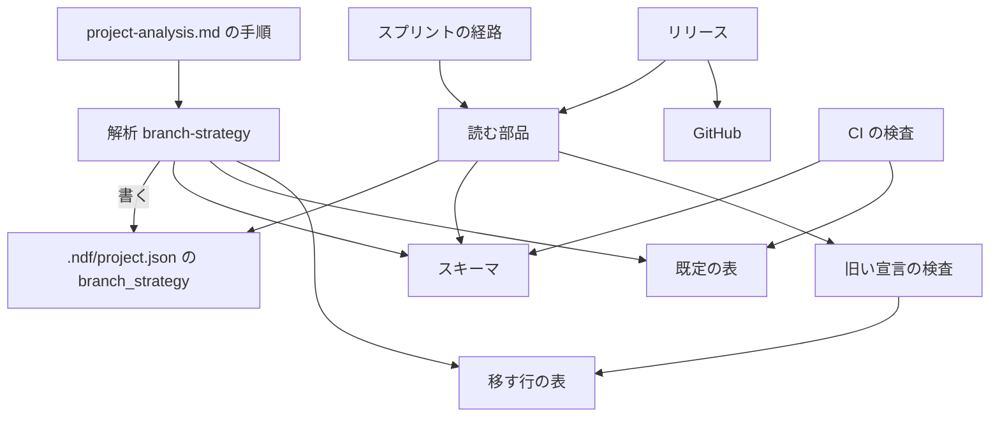
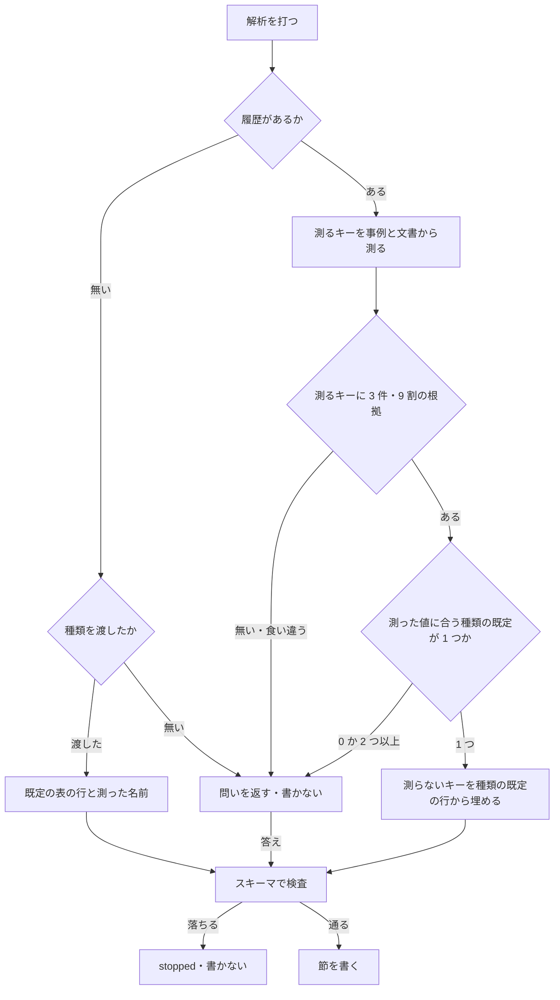
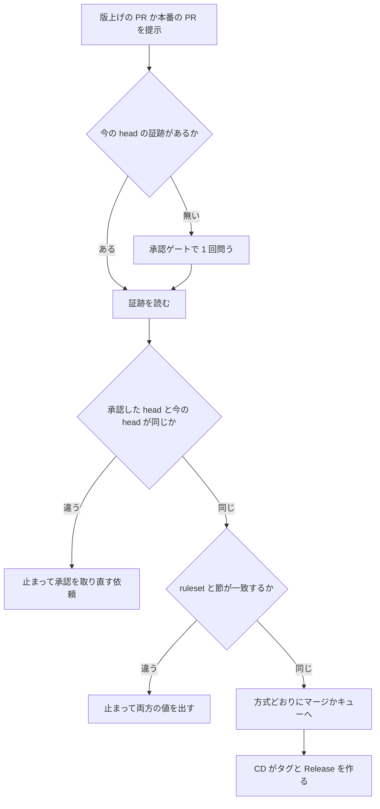

# ブランチ戦略の宣言: リポジトリごとのブランチ戦略・リリース・マージを 1 つの節で表し、10 系と 11.0 をその節だけで動かす（#3672）

## 目的

- **今どうなっているか**: ブランチ戦略・マージ・リリースの設定が `.ndf/worktree.json`・`.ndf/project.json`・`.ndf/release.json`・`.ndf/supervise.json` の 4 か所に分かれ、10 系と 11.0 が別々の設計（#3641・#3572）で読む。ai-plugins の develop→main・`--admin` が製品の既定に入り込み、p6 で承認したリリース 15 回のうち 6 回が承認の後に止まった
- **誰に効くか**: NDF を使うすべてのリポジトリの持ち主とリリースの承認者。ai-plugins の開発者
- **変えると何が成り立つか**: 1 つの節を読めば方法論が分かり、節は Skill のスクリプトが作る。10 系と 11.0 は同じ節とスキーマで動く。承認は正式版 1 本につき 1 回で、承認した head だけがマージされる。ai-plugins は plugin 開発の慣行に沿った値を、製品の既定と同じ形で持つ

## 適用範囲

- **働く範囲**: NDF（10 系 `plugins/ndf/`・11.0 `plugins/ndf-next/`）を使うすべてのリポジトリ。ai-plugins の値は ai-plugins の `.ndf/` にだけ置く
- **プロジェクトごとに違うもの**: すべて節の値で受ける。引数で受けるものは無い
- **当たるモード**: `standard`。worktree の用意・PR の作成・リリース・マージの工程と、解析（`project-decl.py`・`ndf project`）

### 代表のリポジトリでの振る舞い

| 代表のリポジトリ | 設定の要点 | 直した後に起きること | この種類で扱えなくなること |
| --- | --- | --- | --- |
| Web サービス（develop→main。例: nd-factory） | 種類 `web-develop`。`merge_base_branch`・develop と main・開発版チャネル develop | スプリントの PR は develop へ、develop から切った版上げの PR を承認 1 回で main へ。開発版のデプロイも残る | 無し（今の行と開発版のデプロイをそのまま表せる） |
| Web サービス（trunk） | 種類 `web-trunk`。`trunk`・承認の対象 `production_pr`・`merge-queue`（使えなければ `strict`） | スプリントの PR が本番の PR を兼ね、承認ゲートの後に NDF が承認した head をキューへ入れる。版数は持たない | 無し（private の Free でも `strict` で選べる） |
| モバイルアプリ | 種類 `mobile`。`release_branch`・版数の置き場 `json` | 本番から切ったリリースブランチへ選んだスプリントを集め、版上げの PR を承認 1 回で main へ。ストアへの提出の工程は変えない | 無し（リリースブランチの行を残す） |
| 業務文書だけ | 種類 `docs`。`trunk`・版数の置き場 `none`・`strict` | 文書の PR が本番の PR を兼ね、承認ゲートの後にマージする。提出先の工程は変えない | 無し（版数もタグも求めない） |

### ai-plugins だけの事情

| 値 | 置く所 | 持つ Issue |
| --- | --- | --- |
| 種類 `plugin` の既定と同じ値（「ai-plugins の値」） | `.ndf/project.json` の `branch_strategy` | #3672 |
| main の ruleset（承認の数 0・merge queue・タグの保護） | GitHub のリポジトリの設定 | #3672（#3641 をこの課題の中で解決する） |
| develop の更新を止め、開発版（`-dev.N`・`release-dev.yml`）をやめる | `.ndf/` と `.github/workflows/` | 同上 |

3 行とも、受け入れ条件 24（承認 1 回で正式版を出す）の前に終える。ruleset が承認 1 を求めたままでは、`via: gate` の ai-plugins は I10 で止まるためである。
順序は次のとおりである。

1. この課題の実装の PR（ai-plugins の `.ndf/` の移行と `release-dev.yml` の削除を含む）を、今の出し方でリリース承認ゲートを通して出す
2. 同じリリース承認ゲートの承認で、main の ruleset を変える（C2。「人へ残す判断」）
3. 変えた後の最初の正式版で、受け入れ条件 24 を確かめる（リリース後テスト）

## あるべき姿の根拠

| 根拠 | 種類 | 何を示すか |
| --- | --- | --- |
| STD4・STD5 | 外部の一次情報 | Claude Code は `plugin.json` の版数が変わったときだけ既存の利用者へ届け、タグの形は `<plugin>--v<version>` である。版数でマージとリリースが分かれる |
| PRD1〜PRD4・STD2 | 外部の一次情報 | plugin を配る 8 リポジトリのうち 7 つが main だけで開発する。trunk-based development は長く残るブランチを勧めない |
| STD1・STD3 | 外部の一次情報 | マージとキューへの投入は承認した head を渡せ、違えば GitHub が断る。merge queue は組み合わせを一時のコミットで確かめる |
| `docs/ndf-12-survey/03-release.md` の §1.2・§2（PR #3669） | 実測 | 承認の後の止まり 6/15 回の原因は 2 つ目の承認・版数の衝突・リリースブランチの消失で、版数・承認を複数の場所に持つことから起きる |
| 旧い宣言を読むコードの数（[issue-3672-design-removal.md](issue-3672-design-removal.md) の「数えた範囲」） | 実測 | 10 系 57・11.0 21 のファイルが 4 か所を別々に読む |
| 利用者の指示（2026-11-16、#3672 の本文の「依頼（原文）」と設計承認ゲートの第 1 回の指示） | 利用者の指示の原文 | 「宣言の CRUD」「ai-plugins は plugin 開発のベストプラクティスへ移す」「従来の仕組みの削除」 |

要求と受け入れ条件は #3672 の本文にある（コピーは [issue-3672-requirements.md](issue-3672-requirements.md) ）。この文書は「どう作るか」だけを扱う。

| 分けた文書 | 中身 |
| --- | --- |
| [issue-3672-design-decisions.md](issue-3672-design-decisions.md) | 決定の記録（決定 1〜14） |
| [issue-3672-design-research.md](issue-3672-design-research.md) | 外部の調査（STD1〜STD10・PRD1〜PRD6・LIB1〜LIB6）と確かめられなかったこと |
| [issue-3672-design-removal.md](issue-3672-design-removal.md) | 削除の一覧（D1〜D37）・置き換える設計と設計 PR #3649・#3650 の行き先・子の Issue 32 本の行き先 |
| [issue-3672-design-removal-paths.md](issue-3672-design-removal-paths.md) | 削除の一覧のうち複数のファイルにまたがる行（D32・D33・D34・D37）のパス |

## ドメインモデル

### コンテキスト

| コンテキスト | 何の語が 1 つの意味に決まるか |
| --- | --- |
| ブランチ戦略の宣言（節 `branch_strategy` とスキーマ・既定の表） | 取り込み方・本番ブランチ・ベースブランチ・承認の対象・承認の受け方・マージの主体・マージの方式・版数の置き場・チャネル |
| 解析（10 系 `project-decl.py`・11.0 `ndf project`） | 代表のリポジトリの種類・値の根拠・食い違い・根拠不足 |
| スプリントの経路（worktree の用意・PR の作成） | スプリントの起点・PR の宛先・スナップショット |
| リリース（10 系 `release-steps.py`・11.0 `ndf release-steps`） | 版上げの PR・本番の PR・承認した head・承認の証跡・head の一致の確認 |
| GitHub（外部の系） | PR・レビュー・ruleset・merge queue・タグ・Release |

宣言は**公表された言語**で、解析・スプリントの経路・リリースはスキーマを通った節だけを読む。解析だけが節を書く（**顧客 / 供給者**の供給者）。
GitHub との間は**腐敗防止層**で、ruleset と merge queue の語はリリースの GitHub のアダプタの中に閉じる。

### 集約

| 集約 | 持ち主（書き換えてよいもの） | 根 | エンティティ | 値オブジェクト |
| --- | --- | --- | --- | --- |
| ブランチ戦略の宣言 | 解析の `branch-strategy` サブコマンドだけ（10 系 `project-decl.py`・11.0 `ndf project`。作る・更新する・移す・キーを消す・節を消すのすべて。決定 4・10） | 節 `branch_strategy` | — | ブランチ・スプリント・リリース・チャネル・承認・マージ・試す場 |
| 作成の結果 | 解析（1 回の実行の出力。ファイルに残さない） | 実行 | 問い | 値・値の根拠・差分・差分のハッシュ |
| スプリントのスナップショット | スプリントの経路（開始時に 1 回書く） | スプリント | — | 節の全体 |
| 本番の PR の承認とマージの記録 | リリース（証跡の書き手はケースごとに 1 つ。I12） | PR | 承認の証跡・人のマージの記録 | 承認した head・マージした head |

### 不変条件

| # | 集約 | 条件 | 破れたときの扱い |
| --- | --- | --- | --- |
| I1 | 宣言 | 節は `.ndf/project.json` の 1 か所にだけあり、旧い 4 か所に旧いキーが無い | I4 |
| I2 | 宣言 | 作る・更新する・移す実行は、組み合わせの規則（「データ構造」の R1〜R9）を通った中身だけを書く | 書かずに落ちた規則とキーの位置を出す。ファイルは 1 バイトも変えない |
| I3 | 宣言 | 節が無い・スキーマに落ちるリポジトリで、読む部品は既定値へ倒さない | 止まり、ファイル・キーの位置・作成のコマンドを理由に出す |
| I4 | 宣言 | 旧いキーが残るリポジトリで、旧い経路は動かない | 読む部品が止まり、旧いキーの位置と移行のコマンドを理由に出す |
| I5 | 承認とマージ | 承認した head と違う head をマージせず、キューへも入れない | マージの前に止まり、承認を取り直す依頼を出す（E10） |
| I6 | 承認とマージ | 管理者の迂回は `merge.method: direct` のときだけ使う | スキーマの R3 で書けない |
| I7 | 承認とマージ | 版上げの PR は、マージの方式ごとの確かめ（「処理の流れ」の「版上げの PR の確かめ」の表）を通ったときだけマージかキューへの投入をする。`merge-queue` では先端を含むことを求めず、版数が衝突しないことだけを確かめて先頭へ入れる | 止まり、版上げの PR を作り直して承認を取り直す |
| I8 | 宣言 | 旧いキーの名前は、移行のコマンドと旧い宣言の検査とそのテストの外に現れない | `check-legacy-branch-decl.py` が落ちる |
| I9 | 承認とマージ | 正式版 1 本につき、人へ問う承認は 1 回である（宣言のどのケースでも） | 2 回目を求める組み合わせ（`via: gate` で ruleset が承認を求める）は I10 で止まる |
| I10 | 承認とマージ | 節の値と本番ブランチの ruleset（merge queue の有無・最新の取り込みの要否・承認の数）が食い違わない | マージの前に止まり、節の値と ruleset の値を理由に出す |
| I11 | 作成の結果 | 既存のリポジトリで書く値は、どれも根拠を 1 つ持つ。測るキーは 3 件以上・9 割以上の事例、種類の既定から埋めるキーは選んだ種類の既定の行、人の答えはその答え（「処理の流れ」の「作る・更新する」の表） | 測るキーで事例が足りないか食い違えば、書かずに根拠つきで問う（決定 6） |
| I12 | 承認とマージ | 証跡の種類ごとに書き手は 1 つで、証跡が今の head にあれば同じ問いを送らない | 書き手が書けなければ止まり、問いを送り直さない |
| I13 | スプリントのスナップショット | スプリントの中の部品は開始時のスナップショットを読む | スナップショットと今の節の違うキーを結果に出す |
| I14 | 宣言 | 製品のスキーマと既定の表は `default` と ai-plugins の名前を持たない | `check-skill-repo-assumptions.py` が落ちる（決定 13） |

### ドメインイベント

| # | イベント | 発生元 | 受け手 |
| --- | --- | --- | --- |
| E1 | 新規リポジトリで代表のリポジトリの種類を選んだ | 解析 `init` | E5 |
| E2 | 既存リポジトリの履歴と文書を測った | 解析 `measure` | E3 か E5 |
| E3 | 食い違いか根拠不足を根拠つきで人へ問うた | 解析（結果の `questions`）→ `decision-request` | 人 |
| E4 | 人の答えを宣言に書いた | 解析 `write --answers` | E5 |
| E5 | 宣言を書いた | 解析 | 工程の部品（E7） |
| E6 | 旧い宣言を新しい節へ移した | 解析 `branch-strategy migrate`（移行のコマンド） | E7 |
| E7 | 工程の部品が宣言を読んだ | 読む部品（`lib/branch_strategy.py`・`ndf.core.branch_strategy`） | E8〜E12 |
| E8 | PR の宛先とスプリントの起点を決め、節のスナップショットを取った | スプリントの経路 | スプリントのスナップショット |
| E9 | 承認を受け、承認した head を記録した | リリース承認ゲートか GitHub のレビュー | E11 |
| E10 | 承認の後に head が動いたか、版上げの PR がマージの方式ごとの確かめ（I7）に落ちたことを見つけ、承認を取り直す依頼を出した | リリースの `land` | 人 |
| E11 | 承認した head を宣言の主体と方式でマージした | リリースの `land` か人 | E12 |
| E12 | 正式版を出した（タグ・GitHub Release） | CD | リリース後テスト |
| E13 | 宣言を更新した | 解析 `measure`・`write` | E7 |
| E14 | 使わなくなったキーを消し、旧いキーの検査に載せた | NDF の版（移す行の表の `remove` の行）と解析 `branch-strategy migrate` | E7 |
| E15 | NDF を外し、節を消した | 解析 `remove` | — |

### 用語

| 用語 | 意味 | 用語集への反映 |
| --- | --- | --- |
| 代表のリポジトリの種類の既定 | 代表のリポジトリの種類（`web-develop`・`web-trunk`・`mobile`・`docs`・`plugin`）ごとの節の値の行。`branch-strategy-presets.json` に持つ | 追加 |
| 承認の対象 | リリース承認ゲートで承認する PR。`release_pr`（版上げの PR）か `production_pr`（本番ブランチ宛ての各 PR） | 追加 |
| 承認の受け方 | 承認をどこで受けるか。`gate`（リリース承認ゲート）か `review`（GitHub のレビューの承認をゲートの答えとして読む） | 追加 |
| 版上げの PR | head が `release/v<版>` で、版数と CHANGELOG を書き、承認の対象 `release_pr` で承認を受ける本番ブランチ宛ての PR。`trunk` では本番ブランチから、ほかの行ではベースブランチか本番ブランチから切る | 意味の変更（`trunk` の行でもマージの前に作る形にそろえた） |
| マージの方式 | 本番ブランチへのマージで組み合わせをどう確かめるか。`merge-queue`・`strict`（head が本番ブランチの先端を含むときだけマージ）・`direct`（確かめない） | 意味の変更（`direct` を足した） |

ブランチ戦略の宣言・旧い宣言・宣言の CRUD・値の根拠・代表のリポジトリの種類は、要求のステップで用語集へ足した意味のまま使う。

## 外部の調査

標準・仕様（`STD<数>`）・主要な製品（`PRD<数>`）・ライブラリとサービス（`LIB<数>`）の調べと、確かめられなかったことは [issue-3672-design-research.md](issue-3672-design-research.md) にある。

## 機能一覧

| # | 機能 | 誰が使うか |
| --- | --- | --- |
| F1 | 新規のリポジトリで、代表のリポジトリの種類を渡すとその既定の節を書く | リポジトリの持ち主（解析の Skill から） |
| F2 | 既存のリポジトリの事例と文書を測り、値ごとの根拠を添えて節を書く。食い違いと根拠不足は書かずに問う | 同上 |
| F3 | 答えを受け、組み合わせの検査を通してから節を書く・更新する・キーを消す・節を消す | 同上 |
| F4 | 旧い 4 か所の値を新しい節へ移す（差分を示す実行と書く実行） | 同上 |
| F5 | 10 系と 11.0 の工程の部品が、節（スプリントの中ではスナップショット）だけを読み、旧いキーが残るときと節がスキーマに通らないときに止まる | NDF の工程 |
| F6 | 承認した head だけを宣言の主体と方式でマージし、承認は正式版 1 本につき 1 回にする | オーガナイザー・利用者 |
| F7 | 削除の一覧・ai-plugins の名前・既定値の混入を CI で落とす | NDF の開発者 |

## 構成要素

| 要素 | 責務 |
| --- | --- |
| スキーマ `$defs/BranchStrategy`（11.0 `contracts/schemas/declarations/project.schema.json` が正本、10 系 `skills/development-workflow/schemas/project.schema.json` がコピー） | 節のキー・値・組み合わせの規則 R1〜R9 |
| 既定の表 `branch-strategy-presets.json`（11.0 `contracts/domains/` が正本、10 系 `scripts/data/` がコピー） | 代表のリポジトリの種類ごとの値 |
| 移す行の表 `ndf-settings-renames.json`（11.0 `contracts/domains/` が正本、10 系 `scripts/data/` がコピー。11.0 の正本は #3613 が先にマージされていれば行を足し、されていなければこの課題が #3613 の行の形で新設する。決定 3） | 旧いキーの位置 → 新しいキーの位置・値の対応・消すキー |
| 読む部品 `lib/branch_strategy.py`（10 系）・`ndf/core/branch_strategy.py`（11.0） | 節を読み、スキーマで検査し、旧いキーで止まる。シェルからは `branch_strategy.py get <キー>` で読む |
| 旧い宣言の検査 `lib/branch_strategy_legacy.py`（10 系）・`ndf/core/branch_strategy_legacy.py`（11.0） | 移す行の表のうち節 `branch_strategy` へ移す行と `remove` の行を読み、旧いキーの位置を返す。#3613 の旧いキーの検査に依らない |
| 解析のサブコマンド `branch-strategy`（10 系 `project-decl.py` と `project_lib/branch_strategy_{measure,write,migrate}.py`、11.0 `ndf project` と `domains/project/strategy_{measure,write,migrate}.py`） | 作る・測る・書く・移す・キーを消す・節を消す（決定 4・10） |
| スプリントの経路（10 系 `supervise_lib/sprint_*`・`worktree-setup.sh`、11.0 `domains/worktree`） | 起点と宛先を節から決め、開始時に節のスナップショットを取る |
| リリース（10 系 `release-steps.py`・`release_lib/`、11.0 `domains/release`） | 版上げの PR を作り、承認の証跡を書き手どおりに書き、承認した head を方式どおりにマージする |
| CI の検査（`scripts/check-legacy-branch-decl.py`・`scripts/check-skill-repo-assumptions.py`・`scripts/check-ndf-contracts.py`・`scripts/check-pr-base.sh`） | 削除の一覧・汎用性・コピーの一致・宛先の検査 |
| `development-workflow` の `references/project-analysis.md` | 解析のサブコマンドを打つ手順と、問いを人へ回す手順 |

## データ構造

### 節のキー

| S1 の事柄 | キー | 値 |
| --- | --- | --- |
| （作成の記録） | `kind` | `web-develop`・`web-trunk`・`mobile`・`docs`・`plugin`・`custom`（答えで既定から変えたとき） |
| 結合のしかた | `release_strategy` | `merge_base_branch`・`release_branch`・`trunk`（#3613 の改名表の名前） |
| PR の宛先 | `branches.production`・`branches.base` | ブランチの名前 |
| スプリントの起点 | `sprint.start`・`sprint.integrate`・`sprint.doc_prs`・`reviews` | `base`・`production` / `check`・`release` / `base`・`sprint` / 今の `branch_flow.reviews` の形 |
| リリースの形と版数の置き場 | `release.form`・`release.plugin`・`release.runtimes`・`release.version_store`・`release.tag`・`release.github_release`・`release.deliveries` | リリースの形の名前 / `{"kind": "plugin"}`・`{"kind": "json", "path", "pointer"}`・`{"kind": "none"}`（`files` で版数を書き換える追加のファイル）/ `"{plugin}--v{version}"` などか `null` / 真偽 / 今の `delivery` の行の形 |
| チャネル | `channels` | `[{"name": "stable", "ref"}, {"name": "dev", "ref", "workflow"}]` |
| 承認を取る場所 | `approval.target`・`approval.via` | `release_pr`・`production_pr` / `gate`・`review` |
| マージの主体と方式 | `merge.actor`・`merge.method`・`merge.commit`・`merge.admin` | `ndf`・`human` / `merge-queue`・`strict`・`direct` / `merge`・`squash`・`rebase` / 真偽 |
| マージ前に試す場 | `verify` | `null` か #3572 の形（`{"kind": "marketplace", ...}`・`{"kind": "deploy", ...}`） |
| CD の有無 | `release.cd` | `null` か `{"workflow": "<ファイル名>"}`（本番ブランチへのマージでタグと Release を作る） |

### 組み合わせの規則

| # | 規則 | 落ちる入力の例 |
| --- | --- | --- |
| R1 | `trunk` ⇔ `branches.base` と `branches.production` が同じ | `trunk` で base が develop |
| R2 | `trunk` ⇒ `merge.method` が `merge-queue` か `strict` | `trunk` で `direct` |
| R3 | `merge.admin: true` ⇒ `merge.method: direct` | `merge-queue` で迂回 |
| R4 | `approval.target: release_pr` ⇒ `release.version_store.kind` が `none` でない | `trunk`・`release_pr` で版数の置き場が無い |
| R5 | `merge_base_branch`・`release_branch` ⇒ `approval.target: release_pr` | `merge_base_branch` で `production_pr` |
| R6 | `trunk` ⇒ `production_pr` なら `sprint.integrate: release`、`release_pr` なら `check` | `trunk`・`production_pr` で `check` |
| R7 | `channels` の `dev` ⇒ base と production が違う | `trunk` で開発版チャネル |
| R8 | `version_store.kind: none` ⇒ `tag: null` かつ `github_release: false` | 版数が無いのにタグの形がある |
| R9 | `sprint.start`・`sprint.doc_prs` は取り込み方の表の行が許す値 | `merge_base_branch` で `start: production` |

### 代表のリポジトリの種類の既定

| 種類 | 取り込み方 | production / base | 起点 / 結合 / 文書 | 形 / 版数 / タグ / Release | チャネル | 承認の対象 / 受け方 | 主体 / 方式 / コミット / 迂回 |
| --- | --- | --- | --- | --- | --- | --- | --- |
| `web-develop` | `merge_base_branch` | main / develop | base / check / base | service / json / `v{version}` / 真 | stable main・dev develop | release_pr / gate | ndf / direct / merge / 偽 |
| `web-trunk` | `trunk` | main / main | production / release / sprint | service / none / null / 偽 | stable main | production_pr / gate | ndf / merge-queue※ / squash / 偽 |
| `mobile` | `release_branch` | main / develop | production / check / sprint | mobile / json / `v{version}` / 真 | stable main・dev develop | release_pr / gate | ndf / direct / merge / 偽 |
| `docs` | `trunk` | main / main | production / release / sprint | document / none / null / 偽 | stable main | production_pr / gate | ndf / strict / merge / 偽 |
| `plugin` | `trunk` | main / main | production / check / sprint | package-plugin / plugin / `{plugin}--v{version}` / 真 | stable main | release_pr / gate | ndf / merge-queue※ / merge / 偽 |

※ merge queue を使えない（STD3 の条件に当たらない）と測ったら `strict` にし、分からなければ 2 つを候補に問う。`main`・`develop` は既定の名前で、`init` は測った既定ブランチの名前で置き換える。
`verify` はどの種類も `null`、`release.cd` は版数を持つ種類だけ `{"workflow": "release-cd.yml"}` の形で、ファイル名は測ったワークフローの名前で置き換える。

| 種類 | スプリントの PR の宛先 | リリースの PR | 人へ問う承認 | マージの主体と方式（10 系と 11.0 で同じ） |
| --- | --- | --- | --- | --- |
| `web-develop` | develop（検査の後に NDF がマージ） | develop から切った `release/v<版>` → main | 版上げの PR で 1 回 | NDF が承認した head を `sha` 付きでマージ |
| `web-trunk` | main（本番の PR を兼ねる） | 無し | 本番の PR ごとに 1 回 | NDF が承認した head をキューへ入れる |
| `mobile` | develop（開発版）。スプリントブランチは残す | main から切った `release/v<版>` に選んだスプリントを集めて → main | 版上げの PR で 1 回 | NDF が `sha` 付きでマージ |
| `docs` | main（本番の PR を兼ねる） | 無し | 本番の PR ごとに 1 回 | NDF が先端を含むかを確かめ、`sha` 付きでマージ |
| `plugin` | main（検査の後に NDF がキューへ） | main から切った `release/v<版>` → main | 版上げの PR で 1 回 | NDF が承認した head をキューの先頭へ入れる |

## 宣言の CRUD

| 操作 | 時点 | 主体 | 書く前の検査 | 人が見る場所 |
| --- | --- | --- | --- | --- |
| 作る（新規） | NDF を入れたとき（解析の手順） | 解析 `branch-strategy init --kind <種類>` | スキーマ（I2） | 書いた `.ndf/` を含む PR のリリース承認ゲート |
| 作る（既存） | 同上 | 解析 `branch-strategy measure` → 問いへの答え → `write --answers` | スキーマと、値ごとの根拠（I11） | 問い（E3）と、同上 |
| 読む | worktree の用意・PR の作成・リリース・マージ・CI の宛先の検査 | 読む部品（10 系と 11.0 で 1 つずつ） | スキーマと旧いキー（I3・I4） | — |
| 更新する | 人の依頼、または `measure` が節と事例のずれを出したとき | 解析 `branch-strategy measure`・`write` | 同上 | 同上 |
| 移す | NDF の版を上げ、旧いキーがあると読む部品が止まったとき | 解析 `branch-strategy migrate`（10 系 `project-decl.py`・11.0 `ndf project`） | 示した差分のハッシュと新しいスキーマ | 示した差分と、同上 |
| キーを消す | NDF の版でキーを外したとき | 移す行の表に `remove` の行を足し、解析 `branch-strategy migrate` が消す | 同上 | 同上 |
| 節を消す | NDF を外すと決めたとき | 解析 `branch-strategy remove` | — | 同上 |

人もエージェントも節を手で書かない。Skill の本文と文書から手で書く手順を消す（削除の一覧の D31〜D33）。ai-plugins の `.ndf/` の書き換えは C7 で、設計承認ゲート（この設計）とリリース承認ゲートで人が見る。

## 入出力の契約

解析の `branch-strategy` の結果は 1 行の JSON で、10 系と 11.0 で同じ形にする（スキーマは `contracts/schemas/io/branch-strategy.result.schema.json`、10 系はコピー）。

| キー | 中身 |
| --- | --- |
| `status` | `ok`（書いた・書く差分を示した）・`ask`（問いがある。書いていない）・`stopped`（検査に落ちた。書いていない） |
| `kind` | 選んだ代表のリポジトリの種類 |
| `values` | 書く節の中身 |
| `evidence` | キーの位置ごとの根拠の一覧。1 件は `{"source": "pr" / "tag" / "release" / "ruleset" / "workflow" / "doc" / "repo" / "preset" / "answer", "ref": "<番号・名前・パス:行・種類の名前・答えのファイル>", "value": "<事例の値>"}`。`preset` は種類の既定の行から埋めた値、`answer` は人の答えで書いた値 |
| `questions` | `{"pointer", "why": "conflict" / "insufficient" / "no_kind" / "merge_queue_unknown", "candidates", "evidence"}` の並び |
| `diff`・`digest` | JSON Patch の差分と、そのハッシュ（`migrate`・`write --dry-run`） |
| `failed` | 落ちた規則（`R<数>`）とキーの位置 |

`questions` は `decision-request` の手順で人へ回し、答えは `write --answers <ファイル>` が受ける。

読む部品が止まるときの理由の文は、ファイル・キーの位置・打つコマンドの 3 つを持つ（例: 「`.ndf/worktree.json` の `/branch_flow/promotion` は旧い宣言のキーです。`python3 "$SCRIPTS/project-decl.py" branch-strategy migrate` で移してください」。11.0 は `ndf project branch-strategy migrate` を示す）。

## 処理の流れ

### 作る・更新する

既存のリポジトリでは、キーを「測るキー」と「種類の既定から埋めるキー」に分ける。PR・タグ・ruleset・ワークフローの事例から数えられないキーを測ろうとすると、
どのリポジトリでも根拠不足の問いになり、問う場面が食い違いと根拠不足に絞れないためである。

| キーの分け方 | キー | 根拠 |
| --- | --- | --- |
| 測るキー | `release_strategy`・`branches`・`sprint.start`・`release.form`・`release.plugin`・`release.runtimes`・`release.version_store`・`release.tag`・`release.github_release`・`release.cd`・`channels`・`merge.method`・`merge.commit` | 事例（PR の宛先と起点・タグ・Release・ruleset・ワークフロー・版数のファイル・マージコミットの親の数）が 3 件以上・9 割以上で合う |
| 種類の既定から埋めるキー | `kind`・`sprint.integrate`・`sprint.doc_prs`・`reviews`・`approval.target`・`approval.via`・`merge.actor`・`merge.admin`・`verify`・`release.deliveries` | 選んだ種類の既定の行（根拠 `preset`）。`approval.via` は、ruleset が承認を求めるのに既定が `gate` なら食い違いとして問う（I10） |
| 人の答えで書くキー | 問いを返したキー | 答え（根拠 `answer`）。答えも組み合わせの規則を通す（I2） |

種類（`kind`）は、測るキーの値と 5 つの種類の既定の行を比べ、測るキーがすべて合う行が 1 つだけのときにその種類にする（既定の行の `merge-queue`※ は、測った `merge-queue` と `strict` のどちらとも合うとみなす）。
測った値は種類の既定より優先して書く（例: 種類 `plugin` で測った `merge.method` が `strict` なら `strict` を書く）。
合う行が無いか 2 つ以上なら、候補の種類と測った値を添えて `no_kind` の問いを返す。答えで既定から値を変えたときの種類は `custom` にする。

### 承認とマージ

| ケース | 承認を与えるもの | 証跡 | 証跡の書き手 | マージする者 |
| --- | --- | --- | --- | --- |
| `via: gate`・`actor: ndf` | リリース承認ゲートの答え | PR のコメント（承認した head） | `release-steps answer` | `land` |
| 同上で、人が先に GitHub でマージした | 人のマージ | 人のマージの記録のコメント | `land`（マージ済みを見つけたとき） | 人 |
| `via: review` | GitHub のレビューの承認（`commit_id` が承認した head） | GitHub のレビュー | GitHub（NDF は書かない） | `land` |
| `actor: human` | 人のマージ | 人のマージの記録のコメント | `land`（マージ済みを見つけたとき） | 人 |

リリース承認ゲートは、問いを送る前に今の head への証跡を読み、あれば問いを送らない（I12。#3671・#3608 の形）。

### 版上げの PR の確かめ

版上げの PR は、承認の後、マージかキューへの投入の前にマージの方式ごとに次を確かめる（I7）。承認した head の一致の確認（I5）はどの方式でも行う。

| マージの方式 | 確かめること | 承認から投入までに本番ブランチへ別の PR が入ったとき |
| --- | --- | --- |
| `merge-queue` | 版数が衝突しない: 本番ブランチの先端の版数が、版上げの PR を切った時点の版数と同じで、キューに別の版上げの PR が無い | 版数が衝突しなければそのまま先頭へ入れる。組み合わせはキューが一時のコミットで確かめる（STD3）。衝突すれば止まり、作り直して承認を取り直す |
| `strict` | head が本番ブランチの先端を含む | 止まり、作り直して承認を取り直す。`strict` は組み合わせを確かめる場が先端を含む head だけなので、この止まりを受け入れる |
| `direct` | 確かめない（用語の「マージの方式」のとおり） | マージコミットで入れる。Git が衝突を返せば止まる |

`merge-queue` で承認の後に入ったスプリントの PR は、その版に含まれる。スプリントの PR は設計承認ゲート・cross-review・CI を通っており、
版上げの PR の承認の間もスプリントのマージを止めない（Value 5。承認の要らない作業は承認を待つ間も止めない）。
承認した CHANGELOG はその PR の範囲のまま変えず、承認の後に入った PR は CD が GitHub Release の本文に「承認の後に入った変更」として並べる。

`direct` を既定にする `web-develop` と `mobile` は、版上げの PR をマージした後に本番ブランチをベースブランチへ戻す同期の PR を作る（今の 10 系のリリースの工程のまま）。
次の版上げの PR は本番ブランチの先端を含んだベースブランチから切られる。同期の PR はベースブランチ宛てで、承認の対象ではない。

## ai-plugins の値

ai-plugins の節は、種類 `plugin` の既定（「代表のリポジトリの種類の既定」）に、測った名前（本番ブランチ `main`・プラグイン `ndf`・ランタイム `claude` と `codex`・ワークフロー `release-cd.yml`）を入れたものと一致させる（受け入れ条件 15）。
決めた理由と出典は決定 12 にある。

| 項目 | 値 | 出典 |
| --- | --- | --- |
| ブランチ戦略 | `trunk`。main だけで開発し、スプリントブランチは main から切って main へ戻す | STD2・STD8・PRD1・PRD2 |
| 版の付け方 | semver を `plugins/<名前>/.claude-plugin/plugin.json` の `version` の 1 か所に持つ。マーケットプレイスの項目に `version` を書かない。開発版の接尾辞は使わない | STD4・STD9 |
| リリースの単位 | 版上げの PR（main から切った `release/v<版>`）のマージ。スプリントの PR のマージは、Claude Code の既存の利用者へ届かない。Codex の利用者には main が進むたびに届く（「残る危険」） | STD4・STD10・PRD3 |
| タグと Release | `ndf--v<版>` のタグと GitHub Release を、main へのマージで CD（`release-cd.yml`）が作る。公開したタグの更新と削除を ruleset で禁じる | STD5・PRD6 |
| 利用者が取得する ref | 既定ブランチ main（今の登録のまま）。Codex の取得元を版上げの PR のマージでだけ進む ref へ移すかは人へ残す（「人へ残す判断」） | STD4・STD10 |
| 承認の場所 | 版上げの PR でのリリース承認ゲートの 1 回。main の ruleset の承認の数を 0 にする | 決定 7・PRD1 |
| マージの主体と方式 | NDF・merge queue・merge commit・迂回なし | STD3・PRD1 |
| マージ前に試す場 | 無し | 決定 12 |

### 今の運用から変える点

| 項目 | 今の値 | 新しい値 | 理由 |
| --- | --- | --- | --- |
| ブランチ戦略 | develop→main（`promotion: whole`・`base_branch: develop`） | `trunk`（main だけ） | 長く残るブランチの間で版数と検査の範囲を運ぶ事故（03-release の §2.A）を無くす |
| スプリントの起点と PR の宛先 | develop | main | 同上 |
| 開発版 | `-dev.N` の版数と develop のチャネル（`release-dev.yml`） | 無し | 版上げの PR までは既存の利用者へ届かず、別のチャネルが要らない（STD4） |
| 版上げの PR の起点 | develop から切り、main へ出した後に develop への同期の PR を作る | main から切る。同期の PR は無い | 起点と宛先が同じになる |
| 承認 | リリース承認ゲートと main の PR のレビューの承認 1（`--admin` で迂回） | リリース承認ゲートの 1 回。ruleset の承認の数 0 | 2 つ目の承認による止まりを無くす（I9） |
| マージ | merge commit・管理者の迂回 | merge queue・merge commit・迂回なし | 組み合わせを GitHub で確かめる（要求の前提 4） |
| タグの保護 | 無し | 公開したタグの更新と削除を禁じる | 依存の版の範囲がタグで解決される（STD5） |
| 宣言の置き場 | 4 か所 | `.ndf/project.json` の `branch_strategy` | I1 |
| タグの形・GitHub Release・取得の ref・merge commit | — | 変えない | 公式の形と同じ（STD5）。取得の ref を変えると利用者の操作が要る（P1） |

**残る危険。** 新しく入れる利用者と、入れ直す利用者は、main の先端（版上げの PR の前にマージしたスプリントを含む）を前の版数の表示のまま受け取る（STD4）。
Codex の利用者は、起動時のマーケットプレイスの自動更新で、main が進むたびに版数を比べずに入れ直す（STD10）。取得元が main のままなら、スプリントの PR は版上げの PR を待たずに Codex の利用者へ届く。
スプリントの PR は設計承認ゲート・cross-review・CI を通っている。Codex の利用者へ届く範囲を版上げの PR に合わせるには取得元の ref を変える必要があり、P1 に当たるため人へ残す（「人へ残す判断」）。

## 非機能の実現方式

| 大項目 | 実現方式 |
| --- | --- |
| 運用・保守性 | 止まり方の理由の文はファイル・キーの位置・コマンドを持つ（「入出力の契約」）。根拠は PR の番号・タグ・パスと行で 1 件ずつ開ける |
| 移行性 | 移行のコマンドは差分を示す実行と書く実行に分け、書く前に新しいスキーマで検査する（決定 10）。切り戻しは移行のコミットと実装の PR の revert |
| セキュリティ | 迂回は `direct` のときだけで、製品の既定は偽（I6）。ai-plugins の ruleset の変更は人が見る（「人へ残す判断」） |

## 決定の記録

決定の記録は [issue-3672-design-decisions.md](issue-3672-design-decisions.md) にある。

## テスト設計

5 種の宣言は 1 か所の fixture に置き、10 系と 11.0 のテストが同じ fixture を読む。

| 受け入れ条件・不変条件 | どの振る舞いで縛るか | どう壊したら落ちるべきか |
| --- | --- | --- |
| 1 | （設計承認ゲートを通ったマージ。置き換える設計と #3649・#3650 の行き先は [issue-3672-design-removal.md](issue-3672-design-removal.md) の表） | — |
| 2・I2・R1〜R9 | 規則ごとに落ちる入力をスキーマへ渡すと落ち、5 種の既定は通る | 規則を 1 つ消すと、その規則の落ちる入力が通る |
| 3 | スキーマに `promotion`・`whole`・`selected` が無く、`release_strategy` の値が改名表と同じ | 旧い名前を足すと落ちる |
| 4・5・6 | 5 種の宣言から、10 系と 11.0 の部品が PR の宛先・リリースの PR・マージの主体と方式を「代表のリポジトリの種類の既定」の 2 つ目の表のとおりに返す | 表の 1 セルを変えると、その種類のテストが落ちる |
| 7 | 文書と Skill の本文に、節を手で書く手順が無い | （`.md` の文言のテストを書かない規約により、削除の一覧の D31〜D33 を `check-legacy-branch-decl.py` が照らす） |
| 8 | 履歴の無い fixture で種類を渡すと既定と同じ節を書き、渡さないと `no_kind` の問いを返して書かない | 種類を推して書くようにすると落ちる |
| 9・10 | develop→main と trunk の fixture で、問いを返さずにその値と値ごとの根拠（測るキーは PR の番号・タグ・ファイルと行、埋めたキーは種類の既定の行）を返す | 根拠を落とすか、埋めるキーを測って問うようにすると落ちる |
| 11・I11 | 文書と事例が食い違う fixture と、PR が 0 件の fixture で、`conflict`・`insufficient` の問いを返して書かない | 閾値を下げるか、食い違いを無視すると落ちる |
| 12 | 規則に落ちる答えでは 1 バイトも書かない。`remove` の行でキーを消し、旧いキーの検査がそのキーを返す。`remove` で節が消える | 書いてから検査するように壊すと落ちる |
| 13・14 | （設計の文書の内容。テストにしない） | — |
| 15 | ai-plugins の `.ndf/project.json` の節が、`init --kind plugin` に ai-plugins の測った事実を渡した結果と一致する | 片方だけを変えると落ちる |
| 16・I14 | スキーマの `default`・既定の表の ai-plugins の名前・宛先の決め打ち・条件なしの `--admin` で `check-skill-repo-assumptions.py` が落ちる | 製品に `develop` を宛先として決め打つと落ちる |
| 17・I5・I7 | #3661 の形（承認の後に head が動いた）と #3572 の形（承認の外のコミット）で、マージもキューへの投入もせずに承認を取り直す依頼で止まる。版上げの PR は、`strict` では先端を含まなければ止まり、`merge-queue` では先端を含まなくても版数が衝突しなければ先頭へ入れ、衝突すれば止まる | head の一致の確認を外すか、`merge-queue` で先端を含むことを求めると落ちる |
| 18・I12 | #3671 の形（証跡が無いまま同じ問い）で、ケースごとの書き手が証跡を書き、今の head の証跡があれば問いを送らない | 書き手を 2 つにするか、証跡を読まずに問うと落ちる |
| 19・I9・I10 | 5 種の宣言でリリースを 1 回流すと、人へ問う承認が 1 回。`via: gate` で ruleset が承認を求めると止まる | 2 つ目の承認の問いを足すと落ちる |
| 20 | 移行のコマンドが ai-plugins の旧い 4 か所を新しい節へ移し、旧い 4 か所を読むのは移行のコマンドと旧い宣言の検査だけ | 読む部品に旧いキーの読みを戻すと `check-legacy-branch-decl.py` が落ちる |
| 21・I8 | 削除の一覧の各行のパスに消す語が残れば落ちる | 一覧の行を 1 つ残すと落ちる |
| 22・I3・I4 | 旧いキーを置いたリポジトリで、10 系と 11.0 の worktree の用意・PR の作成・リリース・マージが止まり、旧いキーの位置と移行のコマンドを出す | 既定値へ倒して進むように壊すと落ちる |
| 23 | `glossary.py check` の廃止した語の当たりが 0 件 | 廃止した語を書くと落ちる |
| 24 | （リリース後テスト。ruleset を変えた後の最初の正式版を、ai-plugins で承認 1 回で出す。順序は「ai-plugins だけの事情」） | — |
| 25 | （[issue-3672-design-removal.md](issue-3672-design-removal.md) の「子の Issue の行き先」） | — |
| I1・I6・I13 | 節が 2 か所にあると止まる / `merge-queue` で迂回が書けない / スナップショットと今の節の違いを出す | それぞれ外すと落ちる |

## 設計の結果

| 課題 | 扱い | 取り込み先 | 触るファイル |
| --- | --- | --- | --- |
| #3672 | 実装する | — | `plugins/ndf-next/contracts/schemas/declarations/project.schema.json`、`plugins/ndf-next/contracts/schemas/declarations/worktree.schema.json`、`plugins/ndf-next/contracts/schemas/declarations/supervise.schema.json`、`plugins/ndf-next/contracts/schemas/declarations/release.schema.json`、`plugins/ndf-next/contracts/domains/branch-strategy-presets.json`（新設）、`plugins/ndf-next/contracts/domains/ndf-settings-renames.json`（#3613 の前にマージするなら新設）、`plugins/ndf-next/contracts/domains/branch-flows.json`、`plugins/ndf-next/contracts/schemas/io/branch-strategy.result.schema.json`（新設）、`plugins/ndf-next/src/ndf/core/branch_strategy.py`（新設）、`plugins/ndf-next/src/ndf/core/branch_strategy_legacy.py`（新設）、`plugins/ndf-next/src/ndf/domains/project/strategy_measure.py`（新設）、`plugins/ndf-next/src/ndf/domains/project/strategy_write.py`（新設）、`plugins/ndf-next/src/ndf/domains/project/strategy_migrate.py`（新設）、`plugins/ndf-next/src/ndf/domains/project/cli.py`、`plugins/ndf-next/src/ndf/domains/worktree/declaration.py`、`plugins/ndf-next/src/ndf/domains/release/declaration.py`、`plugins/ndf-next/src/ndf/domains/release/land.py`、`plugins/ndf/skills/development-workflow/schemas/project.schema.json`、`plugins/ndf/skills/worktree/schemas/worktree.schema.json`、`plugins/ndf/skills/release/schemas/release.schema.json`、`plugins/ndf/scripts/data/branch-strategy-presets.json`（新設）、`plugins/ndf/scripts/data/ndf-settings-renames.json`（新設）、`plugins/ndf/scripts/lib/branch_strategy.py`（新設）、`plugins/ndf/scripts/lib/branch_strategy_legacy.py`（新設）、`plugins/ndf/scripts/lib/branch_flow.py`、`plugins/ndf/scripts/project-decl.py`、`plugins/ndf/scripts/project_lib/branch_strategy_measure.py`（新設）、`plugins/ndf/scripts/project_lib/branch_strategy_write.py`（新設）、`plugins/ndf/scripts/project_lib/branch_strategy_migrate.py`（新設）、`plugins/ndf/scripts/project_lib/measure_branch_flow.py`、`plugins/ndf/scripts/release_lib/promotion.py`、`plugins/ndf/scripts/release_lib/strategy_route.py`（新設）、`plugins/ndf/scripts/supervise_lib/decl.py`、`plugins/ndf/scripts/supervise_lib/sprint_waves.py`、`plugins/ndf/scripts/release-steps.py`、`plugins/ndf/scripts/worktree-setup.sh`、`plugins/ndf/skills/development-workflow/references/project-analysis.md`、`plugins/ndf/skills/worktree/references/declaration.md`、`scripts/check-legacy-branch-decl.py`（新設）、`scripts/legacy-branch-decl.json`（新設）、`scripts/check-skill-repo-assumptions.py`、`scripts/check-ndf-contracts.py`、`scripts/check-pr-base.sh`、`scripts/ndf-choices.json`、`.ndf/project.json`、`.ndf/worktree.json`、`.ndf/supervise.json`、`.github/workflows/release-dev.yml`、`AGENTS.md`、`docs/versioning-and-distribution.md`、`plugins/ndf/scripts/tests/test_branch_strategy.py`（新設）、`plugins/ndf-next/tests/test_branch_strategy.py`（新設）、`scripts/tests/test_check_legacy_branch_decl.py`（新設） |

削除の一覧（D1〜D37）の残りのファイルは、計画が上の表と [issue-3672-design-removal.md](issue-3672-design-removal.md) から実装の PR へ割る。

## 人へ残す判断

| 判断 | 当たるレッドライン | なぜ当たるか |
| --- | --- | --- |
| ai-plugins の版の規則を変え、開発版チャネル（develop・`-dev.N`）をやめる | P1 | リリース対象の版の規則とチャネルが利用者全員に効く |
| ai-plugins の main の ruleset を変える（承認の数 0・merge queue・タグの保護） | C2 | 誰が何をマージできるかが変わる |
| ai-plugins の `.ndf/` と `AGENTS.md`・`CLAUDE.md` の運用の節を書き換える | C7 | 利用者の設定と指示書の運用の節の書き換え |
| ai-plugins の Codex の取得元を、版上げの PR のマージでだけ進む ref（CD が進めるブランチかタグ）へ移すか、main のままにして Codex の利用者にスプリントの PR が届くことを受け入れるか | P1 | 取得元の ref の変更は利用者全員に効く。main のままなら決定 12 の 1 番目の理由は Codex に当てはまらない（STD10）。移す場合、Codex のマーケットプレイスの登録が ref を指定できるかは未確認で、実装の前に確かめる |
| ai-plugins の develop ブランチを消すか | C4 | ブランチの削除は戻せない。この設計は更新を止めるところまでを行い、消すかを決めない |

## 未確認のまま残ること

| 項目 | 内容 |
| --- | --- |
| merge queue の先頭へ入れる操作（`jump`）の権限 | 版上げの PR を先頭へ入れるのに要る権限を、NDF が打つトークンで持つか。実装で ai-plugins のキューへ入れて確かめる |
| `enqueuePullRequest` に違う `expectedHeadOid` を渡したときの応答 | #3572 の確かめられなかったことと同じ。実装で確かめる |
| Codex のマーケットプレイスの登録で ref を指定できるか | 「人へ残す判断」で取得元を移すと決めたときに要る。build.md に記述が無く、確かめていない。実装の前に Codex の `marketplace add` の引数と設定のキーで確かめる |
| 既存の事例の測り方の精度 | 3 件・9 割の基準で、代表のリポジトリ（nd-factory など）の節が人の答えと一致するか。実装の後に代表のリポジトリで測る |

## 出し直しの指摘への対応

| 項目 | 指摘 | 対応 | 直した箇所・直せない理由 |
| --- | --- | --- | --- |
| p6-lunify:1-1 | 宣言の CRUD の表。作るのは Skill かスクリプト。新規は種類の既定、既存は事例と文書から根拠つき。食い違いと根拠不足は問う | 直した | 「宣言の CRUD」「入出力の契約」「処理の流れ」の「作る・更新する」、決定 4〜6、I2・I11 |
| p6-lunify:1-2 | ai-plugins を plugin 開発のベストプラクティスへ。出典つき、GitHub flow を決め打たない、変える点の表、作成のスクリプトの「plugin」の既定と一致 | 直した | 「ai-plugins の値」と「今の運用から変える点」、「外部の調査」の STD2〜STD5・STD9・STD10・PRD1〜PRD6、決定 12、受け入れ条件 15 のテスト |
| p6-lunify:1-3 | 旧い 4 か所の宣言・読むコード・文書と Skill の本文・旧い分岐を消し、検査で止める。削除の一覧を書く | 直した | [issue-3672-design-removal.md](issue-3672-design-removal.md) の「削除の一覧」（D1〜D37）、I4・I8、決定 10・13 |
| p6-lunify:1-4 | #3572 の設計と設計 PR #3649 を取り込み、置き換える対象にする | 直した | 決定 7・8・14、removal の「置き換える設計と開いている設計 PR の行き先」 |
| p6-lunify:1-5 | #3641 の設計 PR #3650 を取り込む | 直した | 決定 7（`serial` を採らない）・決定 14、removal の同じ表 |
| p6-lunify:1-6 | `branch-strategy-one-file.md` を取り込む | 直した | 決定 1・2（1 つのファイルの 1 つの節と、その節のスキーマでの組み合わせの検査） |
| p6-lunify:1-7 | #3668 の V4・V11 と `03-release.md` を取り込む | 直した | V4 は I14・決定 13・「ai-plugins だけの事情」、V11 は決定 7・8（merge queue に任せ、承認を 1 回にする）、あるべき姿の根拠の 03-release の行 |
| p6-lunify:1-8 | 置き換える設計 8 本を明記する | 直した | removal の「置き換える設計と開いている設計 PR の行き先」 |
| p6-lunify:1-9 | 後方互換なし。10 系と 11.0 の両方の読み手を設計する | 直した | 決定 10（旧いキーを別名で読まない）、構成要素の読む部品 2 つ、テスト設計の 4〜6・22 |
| p6-lunify:1-10 | キーの名前を #3613 と食い違わせない | 直した | 決定 3、データ構造の `release_strategy` |
| p6-lunify:1-11 | 承認ゲートを増やさない。廃止した語を書かない | 直した | I9・決定 7、「宣言の CRUD」の人が見る場所（既存の 2 つの承認ゲートだけ）、`glossary.py check` |
